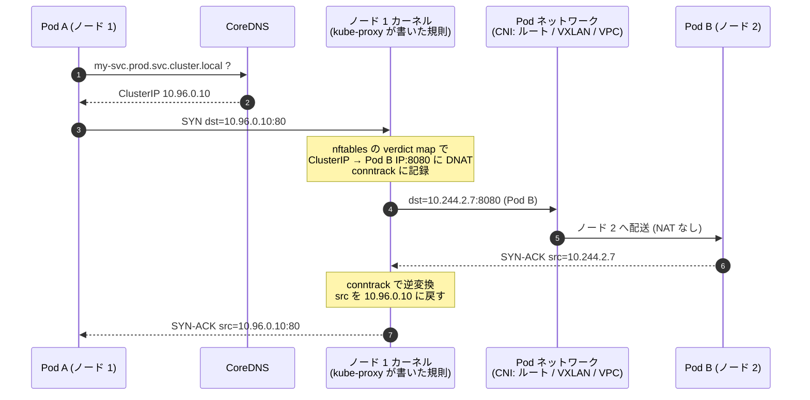
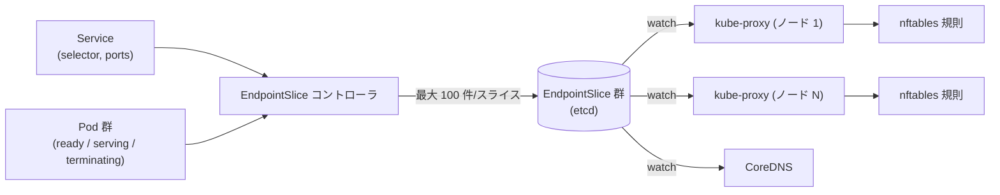
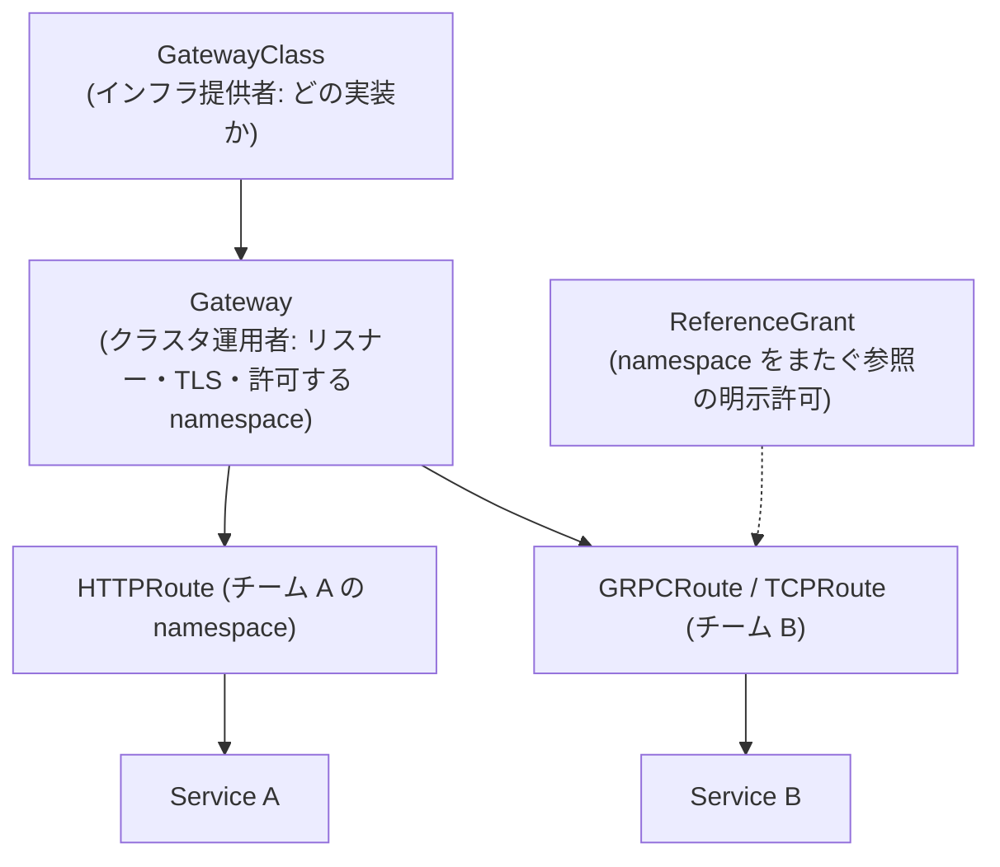

# Kubernetes ネットワーキング (Kubernetes Networking: Pod Network, Services, DNS & Policy)

## 概要 (Overview)

Kubernetes のネットワークは、1 つの機構ではなく**互いに独立した 4 つの層の積み重ね**である。(1) Pod に IP を与えて全 Pod 間の到達性を作る **Pod ネットワーク** (CNI プラグインの責務)、(2) 入れ替わり続ける Pod 群の前に安定した仮想 IP を置く **Service** (kube-proxy または eBPF 実装の責務)、(3) その仮想 IP に名前を与える**クラスタ DNS** (CoreDNS の責務)、(4) 到達性を絞る **NetworkPolicy** (再び CNI プラグインの責務)。Kubernetes 本体はこのどれも実装しておらず、定めているのは「満たすべき契約」と「状態を表す API オブジェクト」だけである。

本ドキュメントの中心テーゼは 2 つ。(1) Service は**パケットを中継するプロキシではなく、各ノードに配られる宛先書き換え規則の集合**であり、[`container-orchestration-kubernetes.md`](container-orchestration-kubernetes.md) で見た調停ループの一適用例にすぎない。EndpointSlice という観測状態を、kube-proxy が各ノードのカーネル (iptables / nftables / IPVS) へ調停し続ける。(2) Kubernetes のネットワーク設計の主要な進化 (iptables → nftables / eBPF、Endpoints → EndpointSlice、Ingress → Gateway API) は、すべて**初期設計の「平坦で単純な契約」がクラスタ規模や組織規模の拡大に耐えなくなった箇所の作り直し**として読める。分析深度は Level 3。版に依存する記述は 2026-10-07 時点 (公式文書は v1.37 を追跡) のものである。

## 方法論 (Methodology)

- ネットワークを「機能の一覧」ではなく **契約 (network model) + 4 層の実装分担**に分解し、各層の「API オブジェクト (状態) → 調停者 → カーネル上の実体」を対応づける。
- 一般機構は既存文書に委ねる。カプセル化と VPC は [`../networking/virtual-networks-overlay.md`](../networking/virtual-networks-overlay.md)、L4/L7 負荷分散と Maglev は [`../networking/load-balancing-architecture.md`](../networking/load-balancing-architecture.md)、DNS の一般論は [`../networking/dns-resolution.md`](../networking/dns-resolution.md)、netfilter とソケットは [`../networking/kernel-network-stack.md`](../networking/kernel-network-stack.md)、eBPF は [`../operating-systems/ebpf-kernel-programmability.md`](../operating-systems/ebpf-kernel-programmability.md)、L7 の制御平面は [`../networking/service-mesh.md`](../networking/service-mesh.md) を参照する。
- 一次資料は Kubernetes 公式文書・KEP・公式ブログ、CNI 仕様、Gateway API / Network Policy API の SIG 文書。Cilium・Calico・AWS の記述はベンダー/OSS の一次資料として扱い、その旨を明示する。機能の成熟度 (alpha/beta/GA) と版番号はすべて 2026-10-07 にフィーチャーゲート文書で確認した。

## 発見事項 (Findings)

1. **Kubernetes のネットワークモデルは「実装」ではなく「3 行の契約」である。** 公式文書は、(a) 各 Pod がクラスタ内で一意の IP を持つ (Pod 内のコンテナはネットワーク名前空間を共有し localhost で話す)、(b) 全 Pod が、同一ノードか否かを問わず**プロキシやアドレス変換 (NAT) なしに**直接通信できる、(c) ノード上のエージェント (kubelet 等) はそのノードの全 Pod と通信できる、を要求する。この契約は「Pod を小さな VM のように扱う」ためのものであり、ポート割当の衝突やアプリ側の NAT 対策を不要にした。代わりに「どうやって全 Pod に到達可能な IP を配るか」という難題は全部 CNI プラグインへ押し出され、オーバーレイ (VXLAN)・経路広告 (BGP)・クラウド VPC への直結 (AWS VPC CNI) という実装の多様性が生まれた。

2. **CNI は「コンテナランタイムが呼ぶ実行ファイル」という極小のインタフェースであり、その小ささが生態系を作った。** CNI 仕様 (v1.1.0) では、プラグインは環境変数 (`CNI_COMMAND`, `CNI_NETNS`, `CNI_IFNAME` 等) と標準入力の JSON 設定で呼ばれる実行ファイルで、操作は ADD / DEL / CHECK / VERSION に、v1.1.0 で STATUS / GC が加わった。呼ぶのは kubelet ではなくコンテナランタイム (containerd / CRI-O) であり、kubelet の CNI 関連フラグは dockershim とともに 1.24 で削除された。プラグインは連鎖 (chaining) でき、前段の結果を `prevResult` として受け取る。IP 管理は IPAM プラグインへ委譲できる。プロセス起動 1 回というこの粗い境界のおかげで、どんな言語・どんな下位網でも実装でき、Pod の起動経路に網の差し替え点を 1 つだけ置けた。

3. **Service はプロキシではなく「分散された宛先書き換え規則」であり、その正体は EndpointSlice の調停である。** ClusterIP はどのインタフェースにも付いていない仮想 IP である。Service コントローラがラベルセレクタに合う Pod を EndpointSlice へ書き、各ノードの kube-proxy がそれを watch して、ローカルカーネルに「宛先 ClusterIP:port を、ある Pod IP:port へ DNAT せよ」という規則を書き込む。パケットは中継点を通らず、送信元ノードのカーネル内で宛先を書き換えられて Pod へ直行する。中央のロードバランサが存在しないため単一障害点も帯域の天井もない。その代わり、規則の更新は全ノードへの**最終的な**伝搬になり、Pod の削除直後に古い規則でパケットが送られる短い窓が必ず存在する。graceful termination が必要になるのはこのためである。

4. **Endpoints → EndpointSlice の移行は、etcd の 1 オブジェクトという単位がスケールの壁になった事例である。** 初期の Endpoints は 1 Service = 1 オブジェクトで全 Pod を列挙したため、1 つの Pod の変化でも数千エンドポイント分のオブジェクト全体を全ノードの kube-proxy へ再配信していた (watch のファンアウト問題, [`container-orchestration-kubernetes.md`](container-orchestration-kubernetes.md) 発見事項 4)。EndpointSlice (1.21 GA) は既定で 1 スライス最大 100 エンドポイントへ分割し、変化を局所化した。IP ファミリごとにスライスを分けることで dual-stack にも対応した。Endpoints API は 1.33 で非推奨になった (削除版は未定)。

5. **kube-proxy の世代交代は「規則の線形探索」から「表引き」への移行である。** iptables モードでは Service 数に比例して規則が伸び、パケットの照合も規則の全量同期も O(n) になる。大規模クラスタでは同期遅延と最初のパケットのレイテンシが問題になった。nftables モード (1.33 GA) は verdict map による定数時間の表引きと差分更新でこれを解消し、公式文書は将来の既定を nftables へ切り替えると予告している (v1.37 時点の既定は依然 iptables)。IPVS モードは 1.35 で非推奨となり、v1.40 で既定無効、v1.43 で削除する計画が示されている (計画値)。並行して、Cilium などの eBPF 実装は kube-proxy そのものを置き換え、connect() 時点でソケット層で宛先を書き換えることで、パケットごとの NAT と conntrack を消した。

6. **クラスタ DNS の既定値 `ndots:5` は、利便性とクエリ増幅のトレードオフを全 Pod に配布している。** Pod の resolv.conf は既定で `search <ns>.svc.cluster.local svc.cluster.local cluster.local` と `options ndots:5` を持つ。ドット数が 5 未満の名前は、まず検索リストの各接尾辞を付けて試されるので、`api.example.com` のような外部名 1 つの解決が、A/AAAA の並行を含めて 5〜8 回程度のクエリになる (検索リストの段数からの推計であり、公式文書は件数を示していない)。`my-svc` のような短い名前で Service を引ける利便性の代償である。UDP DNS は conntrack の競合とテーブル枯渇も招くため、ノードごとのキャッシュ (NodeLocal DNSCache, 1.18 GA) が大規模クラスタの定石になっている。

7. **NetworkPolicy は「許可の和集合」しか表現できない片側の言語であり、Kubernetes 本体はそれを施行しない。** Pod は既定で隔離されておらず、ある方向 (Ingress / Egress) を `policyTypes` に含むポリシーに 1 つでも選ばれると、その方向について隔離される。複数のポリシーは衝突せず加算される (許可の和集合)。明示的な拒否規則、クラスタ全体の既定ポリシー、ログ、Service 名による指定は存在しない。施行するのは CNI プラグインであり、施行能力のないプラグインの上では、ポリシーを書いても**黙って何も起きない**。管理者が上書きできない拒否を表すためのクラスタスコープのポリシーは、SIG の外部 CRD として設計が続いており、2025-10 の v1alpha2 で AdminNetworkPolicy と BaselineAdminNetworkPolicy が `ClusterNetworkPolicy` に統合された (依然 alpha)。

8. **Ingress → Gateway API の移行は、API の不足ではなく「誰が何を書くか」の分担の作り直しである。** Ingress は 1 オブジェクトにリスナー (インフラ側の関心) とルーティング (アプリ側の関心) を同居させ、足りない表現力を実装ごとの注釈で補ったため、可搬性が崩れた。Gateway API (v1.0 は 2023-10 に GA) は GatewayClass (インフラ提供者) / Gateway (クラスタ運用者) / HTTPRoute 等 (アプリ開発者) という**役割別のリソース**へ分け、権限境界を RBAC で引けるようにした。2026-10 時点の最新は v1.6 (2026-06 リリース) で、TCPRoute / UDPRoute が Standard チャネルへ昇格した。Ingress API は「凍結」(GA のまま削除予定なし、変更もなし) である。代表的な実装の ingress-nginx は 2025-11 に引退が告知され、2026-03 で保守を終えた。

## アーキテクチャ (Architecture)

### 4 層の分担 — 誰が何を調停するか

| 層 | 契約・API オブジェクト | 調停者 | カーネル上の実体 |
|---|---|---|---|
| Pod ネットワーク | network model (全 Pod に一意 IP・NAT なし) | CNI プラグイン (ランタイムが起動) | veth ペア, ルート, VXLAN/BGP/ENI |
| Service | Service, EndpointSlice, ServiceCIDR | EndpointSlice コントローラ + kube-proxy (または eBPF 実装) | iptables / nftables 規則, IPVS テーブル, eBPF マップ |
| 名前解決 | Service 名 → ClusterIP / Pod IP | CoreDNS (API を watch) | Pod の resolv.conf, DNS 応答 |
| 到達性の制限 | NetworkPolicy | CNI プラグイン (施行能力があれば) | iptables / eBPF のフィルタ |
| クラスタ外からの入口 | Service type=LoadBalancer, Gateway API | クラウドコントローラ, Gateway 実装 | クラウド LB, Envoy 等のプロキシ |

### 1 パケットの旅 — Pod A から Service 経由で Pod B へ



ClusterIP は経路上のどの装置にも存在しない。宛先の書き換えは**送信元ノード**で 1 回だけ起き、戻りの変換は conntrack が担う。eBPF のソケット層実装 (Cilium) では、手順 3 の connect() の時点で宛先が Pod B に書き換わるため、手順 4 と手順 8 の NAT と conntrack 自体が消える。

### Service の調停連鎖



## 技術詳細 (Technical Details)

### 1. Pod ネットワークの実装方式 — オーバーレイ・経路広告・VPC 直結

CNI プラグインが network model を満たす方法は、大きく 3 つに分かれる。

| 方式 | 代表例 | 仕組み | 1500 B 網での MTU | 下位網への要求 |
|---|---|---|---|---|
| オーバーレイ | Flannel, Calico/Cilium の VXLAN モード | Pod 間パケットをノード間 UDP にカプセル化 | 1450 (VXLAN IPv4, 50 B), 1430 (IPv6) | ノード間の IP 到達性のみ |
| IP-in-IP | Calico | IP ヘッダを 1 枚追加 | 1480 (20 B) | 同上 |
| 経路広告 (ネイティブ) | Calico BGP, Cilium native routing | 各ノードの Pod CIDR を BGP で下位網へ広告 | 1500 (0 B) | 下位網が Pod CIDR を経路制御できる |
| 暗号化オーバーレイ | WireGuard (Calico/Cilium) | ノード間トンネルを暗号化 | 1440 (IPv4, 60 B) | ノード間 UDP |
| クラウド VPC 直結 | AWS VPC CNI | Pod に VPC の IP (ENI のセカンダリ IP) を直接付与 | 下位網と同じ | ENI/IP 数の上限 |

MTU の数値は Calico の公式文書の値である (OSS 一次資料)。Geneve は可変長オプションを持つため、オーバーヘッドはオプション次第で変わる (RFC 8926)。オーバーレイは下位網に何も要求しない代わりにヘッダの税と、クラウド VPC の上に重ねたときの「オーバーレイの二重化」を払う ([`../networking/virtual-networks-overlay.md`](../networking/virtual-networks-overlay.md))。経路広告は税がない代わりに、下位網のルーティング制御という組織的な前提を要求する。どれを選ぶかは性能より、「網の運用権限を誰が持っているか」で決まることが多い。

ノード内では、各 Pod のネットワーク名前空間とホストを veth ペアで結び、ホスト側の経路 (またはブリッジ) で宛先 Pod へ振り分けるのが一般形である。ADD の失敗は Pod を `ContainerCreating` に留め、DEL の取りこぼしは IP の漏れ (IPAM の枯渇) を生む。CNI v1.1.0 の GC 操作は、ランタイムが「生きている接続の一覧」を渡してプラグインに残骸を回収させる仕組みであり、DEL の取りこぼしという現実の故障モードへの仕様側の回答である。

### 2. Service の種類と ClusterIP の割当

| type | 到達元 | 実体 |
|---|---|---|
| ClusterIP (既定) | クラスタ内 | 仮想 IP + 各ノードの DNAT 規則 |
| NodePort | ノード IP:ポート (既定 30000–32767) | ClusterIP + 全ノードでポートを開く |
| LoadBalancer | クラスタ外 | NodePort + クラウドコントローラが外部 LB を調停 |
| ExternalName | クラスタ内 | DNS の CNAME のみ (プロキシなし) |
| headless (`clusterIP: None`) | クラスタ内 | 仮想 IP なし。DNS が Pod IP 群を直接返す |

ClusterIP は Service CIDR から割り当てられる。この範囲は長らく API サーバの起動フラグで固定されていたが、MultiCIDRServiceAllocator (1.33 GA) により ServiceCIDR / IPAddress という API オブジェクトになり、運用中に範囲を追加できるようになった。IP の割当状態を「アロケータのビットマップ」から「1 IP = 1 オブジェクト」へ移したことで、割当の一意性を etcd の楽観並行制御で保証する、という Kubernetes の一般形に揃えたわけである。Service CIDR は静的割当用と動的割当用の帯に分かれている (1.26 GA)。手で ClusterIP を指定した Service が、動的割当と衝突しにくくするためである。

### 3. kube-proxy の 3 モードと eBPF による置換

| | iptables (v1.37 既定) | nftables (1.33 GA) | IPVS (1.35 非推奨) | eBPF 置換 (Cilium 等) |
|---|---|---|---|---|
| 照合 | チェーンの線形走査 O(n) | verdict map による表引き | カーネル LB のハッシュ表 | eBPF マップの表引き |
| 規則の更新 | 全量再書き込みが基本 | 差分更新 | 差分更新 | マップエントリの更新 |
| 宛先変換の位置 | パケットごと (netfilter) | パケットごと (netfilter) | パケットごと (IPVS) | connect() 時にソケット層で 1 回 |
| conntrack | 使う | 使う | 使う | ソケット層 LB では不要 |
| 負荷分散 | 確率的な規則 (ランダム) | 表引きでランダム | rr / lc 等の複数方式 | ランダム / Maglev 一貫性ハッシュ |

- **iptables の問題の所在**: Service とエンドポイントごとに規則が並ぶため、規則数はおおむね「Service 数 × エンドポイント数」に比例する。同期周期 (`minSyncPeriod` / `syncPeriod`) を調整しても、パケット照合と全量書き換えのコストは消えない。nftables の公式ブログはこの規模依存を主な移行理由に挙げている (Kubernetes Blog, 2025-02-28)。
- **IPVS が退場する理由**: IPVS は表引きで高速だったが、Service の意味論の一部 (フィルタリングなど) を iptables で補う必要があり、2 つのサブシステムを同時に保守し続けることになった。nftables が同じ性能特性を 1 つのサブシステムで提供したことで、存在意義が薄れた (KEP-5495)。
- **eBPF 置換**: Cilium の kube-proxy 置換は、cgroup にかけた eBPF フックで connect() / sendmsg() / recvmsg() の宛先を書き換える (socket-LB)。ノード外から来る NodePort/LoadBalancer トラフィックには、tc/XDP 段の eBPF と Maglev 一貫性ハッシュ (既定の表サイズ M=16381) を使い、DSR (Direct Server Return) で送信元 IP を保てる (Cilium 公式文書)。Maglev の原典は Eisenbud et al. (NSDI '16) で、表の構成は [`../networking/load-balancing-architecture.md`](../networking/load-balancing-architecture.md) が扱う。

### 4. トラフィックポリシー — 局所性と送信元 IP

- **`externalTrafficPolicy: Local`**: 外部 LB から来たトラフィックを、受けたノード上の Pod にだけ渡す。SNAT と 2 段目のホップがなくなるので**クライアントの送信元 IP が保たれる**。その代わり、ローカル Pod のないノードはヘルスチェックに落ちる必要があり、Pod の偏りがそのまま負荷の偏りになる。`Cluster` (既定) はこの逆で、均等だが送信元 IP を失う。
- **`internalTrafficPolicy: Local`** (1.26 GA): クラスタ内トラフィックを同一ノードの Pod に限る。ノードごとのエージェント (DaemonSet) に向けた通信が主な用途である。
- **`trafficDistribution`**: 「近いエンドポイントを優先せよ」というヒント。フィールドと `PreferClose` は 1.33 で GA、`PreferSameZone` / `PreferSameNode` は 1.35 で GA になった。AZ をまたぐ転送は、クラウドではレイテンシだけでなく**課金対象**でもあるため、局所性は性能と費用の両方に効く。ただし近さを優先すると負荷分散の均等性は崩れるので、ゾーンごとの容量が揃っていることが前提になる。
- **終了中エンドポイント**: EndpointSlice は `ready` (serving かつ非 terminating)・`serving`・`terminating` の 3 条件を持つ。ほかに行き先がないとき、kube-proxy は終了中だがまだ serving のエンドポイントへ送る (ProxyTerminatingEndpoints, 1.28 GA)。これにより `externalTrafficPolicy: Local` のローリング更新で接続が落ちる問題が緩和された。
- **セッションアフィニティ**: `ClientIP` を指定すると送信元 IP ごとに同じエンドポイントへ固定する (既定タイムアウト 10800 秒)。NAT の背後にいる多数のクライアントが 1 つの IP に見えると、偏りの原因になる。

### 5. クラスタ DNS

- **レコード形式**: Service は `my-svc.my-ns.svc.cluster.local` の A/AAAA が ClusterIP を返す。headless Service では、ready な Pod の IP 群を直接返す。名前付きポートには SRV レコード `_port._proto.my-svc.my-ns.svc.cluster.local` がある。StatefulSet と headless Service を組み合わせると、`pod-0.my-svc...` のように Pod ごとの安定した名前が得られる。
- **`dnsPolicy`**: `ClusterFirst` (既定・クラスタ DNS を使う)、`Default` (ノードの resolv.conf を継承)、`ClusterFirstWithHostNet` (hostNetwork Pod 用)、`None` (`dnsConfig` で全指定)。
- **ndots の対策**: 外部名を FQDN (末尾ドット付き `api.example.com.`) で書く、Pod ごとに `dnsConfig.options` で `ndots` を下げる、NodeLocal DNSCache を入れる、が定石である。NodeLocal DNSCache はリンクローカルアドレス (169.254.0.0/16 の中、一般に 169.254.20.10) で待ち受ける DaemonSet で、iptables の DNAT と conntrack を迂回し、上流の CoreDNS へは TCP で問い合わせる。
- **DNS は Service の調停の下流にある**: CoreDNS も EndpointSlice を watch しているので、Pod の入れ替わりは DNS 応答にも遅れて反映される。クライアント側のキャッシュ (言語ランタイムが TTL を無視して永続キャッシュする例) は、この遅れをさらに引き延ばす。

### 6. NetworkPolicy の意味論と限界

```yaml
# Language: Kubernetes manifest (YAML)
# Purpose: namespace 内の全 Pod を ingress について既定拒否にし、
#          role=frontend からの 8080/TCP だけを許可する最小例
# Source: kubernetes.io/docs/concepts/services-networking/network-policies/ の
#         "Default deny" 例と基本例を組み合わせた説明用の構成
apiVersion: networking.k8s.io/v1
kind: NetworkPolicy
metadata: { name: default-deny-ingress, namespace: prod }
spec:
  podSelector: {}          # namespace 内の全 Pod を選ぶ → ingress について隔離
  policyTypes: [Ingress]   # 許可規則なし = 既定拒否
---
apiVersion: networking.k8s.io/v1
kind: NetworkPolicy
metadata: { name: allow-frontend, namespace: prod }
spec:
  podSelector: { matchLabels: { app: api } }
  policyTypes: [Ingress]
  ingress:
    - from: [{ podSelector: { matchLabels: { role: frontend } } }]
      ports: [{ protocol: TCP, port: 8080 }]
```

- **和集合の意味論**: 上の 2 つは衝突しない。`app=api` の Pod への ingress は「2 つのポリシーの許可の和」になり、frontend からの 8080 だけが通る。順序も優先度もないので、どのポリシーを追加しても**到達性は広がる方向にしか変わらない**。宣言を足しても危険にならない単調な言語だが、裏返せば「管理者がこれだけは禁止」と強制する手段がない。ClusterNetworkPolicy (alpha) の Admin 層と Baseline 層は、この欠落を埋めるために優先度付きの拒否を導入する。
- **Egress と DNS の罠**: Egress を既定拒否にすると、まず DNS (kube-system の CoreDNS への UDP/TCP 53) が止まり、全通信が名前解決の段階で失敗する。Egress ポリシーには DNS 許可を必ず添える必要がある。
- **L3/L4 の限界**: NetworkPolicy は IP・ポート・ラベルの言語であり、HTTP のパスや mTLS の主体は扱えない。L7 の認可は [`../networking/service-mesh.md`](../networking/service-mesh.md) の層、あるいは Cilium の独自 CRD の領分になる。

### 7. クラスタ外からの入口 — LoadBalancer, Ingress, Gateway API

- **type=LoadBalancer**: クラウドコントローラが Service を watch し、外部 LB を調停する。インスタンスターゲット (LB → 全ノードの NodePort → kube-proxy → Pod) は 2 段の負荷分散になる。IP ターゲット (LB → Pod IP 直接) は、Pod IP が VPC 内でルーティング可能なとき (AWS VPC CNI) にだけ使え、余分なホップと SNAT が消える (AWS Load Balancer Controller 文書)。
- **Gateway API の構造**:



Gateway がどの namespace のルートを受け入れるかを宣言し、ルート側が親の Gateway を指名する。参照は**双方の同意**で成立する。namespace をまたぐ Service 参照には、参照される側が ReferenceGrant で明示的に許可する必要がある。Ingress では 1 オブジェクトの注釈に混在していた権限が、ここで RBAC で区切れるリソース境界になった。v1.5 (2026-02) でリリーストレイン方式に移行し、v1.6 で実験的リソースは別の API グループ (`gateway.networking.x-k8s.io`) に分けられた。

### 8. EKS の接合部

- **Pod 密度の式**: VPC CNI のセカンダリ IP 方式では、既定の最大 Pod 数は `ENI 数 × (ENI あたり IP 数 − 1) + 2` である (+2 はホストネットワークで動く aws-node と kube-proxy の分)。マネージドノードグループはさらに 110 (30 vCPU 未満) / 250 で上限を設ける (ベンダー仕様)。網の上限が [`container-orchestration-kubernetes.md`](container-orchestration-kubernetes.md) のスケジューラの資源量にまで貫通する例である。
- **プレフィックス委任**: Nitro インスタンスで ENI のスロットに個別 IP ではなく /28 プレフィックスを割り当て、密度の制約と EC2 API 呼び出しを減らす (VPC CNI 1.9.0 以降, ベンダー仕様)。代わりにサブネットの断片化が起きやすくなる。
- **Pod 用セキュリティグループ**: トランク ENI 上のブランチ ENI を Pod に割り当て、VPC のセキュリティグループを Pod 単位で適用する。NetworkPolicy (クラスタ内のラベル言語) と VPC セキュリティグループ (クラウドの ID 言語) という 2 つの施行点が並ぶことになる。ブランチ ENI の作成は API のレート制限を受けるので、Pod の起動は遅くなる (ベンダー仕様)。
- **kube-proxy モード**: EKS では iptables が既定で、IPVS と、1.33 以降のクラスタでは nftables を設定で選べる (ベンダー文書)。Fargate では kube-proxy は配備されない。

## セキュリティ考察 (Security Considerations)

- **既定は全通信許可である。** network model の (b) は「全 Pod が全 Pod に届く」ことを要求しており、NetworkPolicy を 1 つも書かなければクラスタは平坦な網になる。1 つの Pod の侵害が、そのままクラスタ内の全サービスへの横移動経路になる。namespace ごとの既定拒否 (ingress / egress) と、DNS など必要な通信の明示的な許可が出発点になる。ポリシーを施行しない CNI の上では、この対策は書いても効かないので、施行能力は CNI 選定の必須要件である。
- **NetworkPolicy は ID ではなく IP で施行される。** ラベルセレクタは最終的に Pod IP の集合へ解決され、規則は IP で照合される。Pod が入れ替わってから規則が更新されるまでの窓では、再利用された IP が古い許可を引き継ぎうる。暗号学的な主体による認可 (mTLS + SPIFFE ID) を重ねる理由がここにある ([`../networking/service-mesh.md`](../networking/service-mesh.md))。
- **ノード上の特権経路**: `hostNetwork: true` の Pod はノードのネットワーク名前空間で動き、NetworkPolicy の対象外になりやすい。NodePort はすべてのノード IP でポートを開く。network model の (c) によりノード上のエージェントは全 Pod に届くので、ノードの侵害は Pod 網全体の侵害を意味する。クラウドでは、Pod からインスタンスメタデータ (IMDS) への到達がノードの IAM 資格情報の窃取経路になる。ホップ制限による遮断は [`cloud-iam-authorization.md`](cloud-iam-authorization.md) が扱う。
- **ExternalName と externalIPs の悪用**: ExternalName は任意のホスト名への CNAME を作れる。Service の `externalIPs` は任意の IP へのトラフィックを横取りできるため、過去に中間者攻撃の脆弱性 (CVE-2020-8554) として報告され、admission 制御で制限するのが推奨になった。どちらも、Service を作成できる権限を持つ主体の信頼性に依存する機能である。
- **DNS の可視性**: クラスタ DNS は、Service 名と namespace の一覧を、問い合わせた Pod に区別なく返す。名前は秘密ではない。認可を名前の秘匿に頼ってはいけない。
- **入口の供給網**: Gateway / Ingress の実装は TLS を終端し全外部トラフィックを見るので、最も重要なデータ経路の一つである。保守を終えた実装 (例: 2026-03 以降の ingress-nginx) を使い続けると、以後の脆弱性修正を受けられない。実装の保守状況は [`../security/software-supply-chain-security.md`](../security/software-supply-chain-security.md) の観点で継続的に審査する必要がある。

## 結論 (Conclusions)

- Kubernetes のネットワークは、「全 Pod が NAT なしで届く」という 3 行の契約と、それを満たす 4 層の分担でできている。本体は実装を持たず、CNI・kube-proxy・CoreDNS・Gateway 実装という差し替え可能な部品に任せる。その結果、同じ API の上でオーバーレイ・BGP・VPC 直結・eBPF という全く違う実装が並立する。
- Service の正体は、EndpointSlice という観測状態を各ノードのカーネル規則へ調停する分散ループである。中央のロードバランサがないので単一障害点はないが、規則の伝搬は最終的にしか揃わないので、終了処理とヘルスチェックの設計が必須になる。
- 主要な進化はすべて、初期の単純さが規模に負けた箇所の作り直しである。etcd の 1 オブジェクトという単位 (Endpoints → EndpointSlice)、規則の線形探索 (iptables → nftables / eBPF)、1 オブジェクトへの権限の同居 (Ingress → Gateway API)、許可しか書けない言語 (NetworkPolicy → ClusterNetworkPolicy) がそれにあたる。
- 安全面では、既定が全許可であること、施行が CNI 依存であること、照合が IP 単位であることの 3 点が要になる。L3/L4 のポリシーは境界の第一層にすぎず、主体に基づく認可は上位層で重ねる必要がある。

### 次の接続先 (Related Topics)

- [`container-orchestration-kubernetes.md`](container-orchestration-kubernetes.md) — 本書の前提となる調停ループ・etcd・EKS の全体像。
- [`kubernetes-storage.md`](kubernetes-storage.md) — もう一つのプラグイン境界 (CSI) と、トポロジーがスケジューリングに貫通するもう一つの例。
- [`../networking/virtual-networks-overlay.md`](../networking/virtual-networks-overlay.md) — カプセル化の税と VPC のデータ平面。
- [`../networking/load-balancing-architecture.md`](../networking/load-balancing-architecture.md) — Maglev と L4/L7 負荷分散の積層。
- [`../networking/service-mesh.md`](../networking/service-mesh.md) — Service の上に載る L7 の制御平面と mTLS。
- [`../operating-systems/ebpf-kernel-programmability.md`](../operating-systems/ebpf-kernel-programmability.md) — kube-proxy 置換を可能にしたカーネル内プログラマビリティ。

## 参考文献 (References)

**一次資料 (Primary — 仕様・公式文書・論文)**

- [Kubernetes Documentation: Services, Load Balancing, and Networking](https://kubernetes.io/docs/concepts/services-networking/) — Accessed: 2026-10-07。network model の 3 要件。
- [Kubernetes Documentation: Service](https://kubernetes.io/docs/concepts/services-networking/service/) — Accessed: 2026-10-07。Service の種類、trafficDistribution、トラフィックポリシー。
- [Kubernetes Documentation: Virtual IPs and Service Proxies](https://kubernetes.io/docs/reference/networking/virtual-ips/) — Accessed: 2026-10-07。kube-proxy の各モード、既定値、IPVS の非推奨計画、ClusterIP の割当帯、セッションアフィニティ。
- [Kubernetes Documentation: EndpointSlices](https://kubernetes.io/docs/concepts/services-networking/endpoint-slices/) — Accessed: 2026-10-07。スライスあたり 100 件の既定、条件フィールド。
- [Kubernetes Documentation: DNS for Services and Pods](https://kubernetes.io/docs/concepts/services-networking/dns-pod-service/) — Accessed: 2026-10-07。レコード形式、dnsPolicy、resolv.conf の既定。
- [Kubernetes Documentation: Using NodeLocal DNSCache in Kubernetes Clusters](https://kubernetes.io/docs/tasks/administer-cluster/nodelocaldns/) — Accessed: 2026-10-07。
- [Kubernetes Documentation: Network Policies](https://kubernetes.io/docs/concepts/services-networking/network-policies/) — Accessed: 2026-10-07。隔離と加算の意味論、できないことの一覧。
- [Kubernetes Documentation: Network Plugins](https://kubernetes.io/docs/concepts/extend-kubernetes/compute-storage-net/network-plugins/) — Accessed: 2026-10-07。CNI の要求版、ランタイムによる呼び出し。
- [Kubernetes Documentation: IPv4/IPv6 dual-stack](https://kubernetes.io/docs/concepts/services-networking/dual-stack/) — Accessed: 2026-10-07。
- [Kubernetes Documentation: Ingress](https://kubernetes.io/docs/concepts/services-networking/ingress/) — Accessed: 2026-10-07。Ingress API の凍結。
- [Kubernetes Feature Gates (NFTablesProxyMode, MultiCIDRServiceAllocator, ServiceTrafficDistribution, PreferSameTrafficDistribution)](https://kubernetes.io/docs/reference/command-line-tools-reference/feature-gates/) — Accessed: 2026-10-07。各機能の alpha/beta/GA の版。
- [KEP-5495: Deprecate IPVS mode in kube-proxy](https://kubernetes.dev/resources/keps/5495) — Accessed: 2026-10-07。
- [CNI Specification v1.1.0](https://www.cni.dev/docs/spec/) — Accessed: 2026-10-07。操作・環境変数・chaining・IPAM・GC/STATUS。
- [Gateway API](https://gateway-api.sigs.k8s.io/) — Accessed: 2026-10-07。役割別リソースモデル、ReferenceGrant。
- [Network Policy API: ClusterNetworkPolicy replaces AdminNetworkPolicy and BaselineAdminNetworkPolicy (v1alpha2)](https://network-policy-api.sigs.k8s.io/blog/2025/10/09/api-update-for-v1alpha2-clusternetworkpolicy-replaces-adminnetworkpolicy-and-baselineadminnetworkpolicy/) — Accessed: 2026-10-07。
- [CVE-2020-8554: Man in the middle using LoadBalancer or ExternalIPs (kubernetes/kubernetes#97076)](https://github.com/kubernetes/kubernetes/issues/97076) — Accessed: 2026-10-07。設計上の欠陥でパッチはなく、admission webhook と RBAC による制限が推奨策。
- Eisenbud, D. E., Yi, C., Contavalli, C., Smith, C., Kononov, R., Mann-Hielscher, E., Cilingiroglu, A., Cheyney, B., Shang, W., & Hosein, J. D. (2016). Maglev: A Fast and Reliable Software Network Load Balancer. *NSDI '16*, 523–535. — eBPF 実装が採用する一貫性ハッシュの原典。
- Gross, J., Ganga, I., & Sridhar, T. (Eds.). (2020). Geneve: Generic Network Virtualization Encapsulation. *RFC 8926*. DOI: 10.17487/RFC8926
- Mahalingam, M., et al. (2014). Virtual eXtensible Local Area Network (VXLAN). *RFC 7348*. DOI: 10.17487/RFC7348

**公式ブログ (Primary — 時点情報)**

- [NFTables mode for kube-proxy](https://kubernetes.io/blog/2025/02/28/nftables-kube-proxy/) — Accessed: 2026-10-07。iptables の規模依存と nftables の設計。
- [Kubernetes v1.33: Continuing the transition from Endpoints to EndpointSlices](https://kubernetes.io/blog/2025/04/24/endpoints-deprecation/) — Accessed: 2026-10-07。Endpoints API の非推奨化。
- [Gateway API v1.0: GA Release](https://kubernetes.io/blog/2023/10/31/gateway-api-ga/) — Accessed: 2026-10-07。
- [Gateway API v1.5](https://kubernetes.io/blog/2026/04/21/gateway-api-v1-5/) — Accessed: 2026-10-07。
- [Gateway API v1.6 release](https://kubernetes.io/blog/2026/08/03/gateway-api-v1-6-release/) — Accessed: 2026-10-07。
- [Ingress NGINX Retirement: What You Need to Know](https://kubernetes.io/blog/2025/11/11/ingress-nginx-retirement/) — Accessed: 2026-10-07。

**ベンダー / OSS 提示 (Vendor-presented)**

- [Cilium Documentation: Kubernetes Without kube-proxy](https://docs.cilium.io/en/stable/network/kubernetes/kubeproxy-free/) — Accessed: 2026-10-07。socket-LB、Maglev の表サイズ、DSR。
- [Calico Documentation: Configure MTU](https://docs.tigera.io/calico/latest/networking/configuring/mtu) — Accessed: 2026-10-07。カプセル化方式ごとのオーバーヘッド。
- [Amazon EKS: Choosing an Amazon EC2 instance type (max pods)](https://docs.aws.amazon.com/eks/latest/userguide/choosing-instance-type.html) — Accessed: 2026-10-07。
- [Amazon EKS: Assign more IP addresses to nodes with prefixes](https://docs.aws.amazon.com/eks/latest/userguide/cni-increase-ip-addresses.html) — Accessed: 2026-10-07。
- [Amazon EKS: Security groups for Pods](https://docs.aws.amazon.com/eks/latest/userguide/security-groups-for-pods.html) — Accessed: 2026-10-07。
- [Amazon EKS Best Practices: nftables mode](https://docs.aws.amazon.com/eks/latest/best-practices/nftables.html) — Accessed: 2026-10-07。
- [AWS Load Balancer Controller: How it works](https://kubernetes-sigs.github.io/aws-load-balancer-controller/latest/how-it-works/) — Accessed: 2026-10-07。インスタンス / IP ターゲット。
