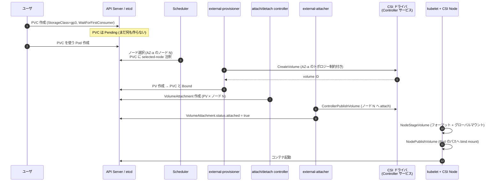
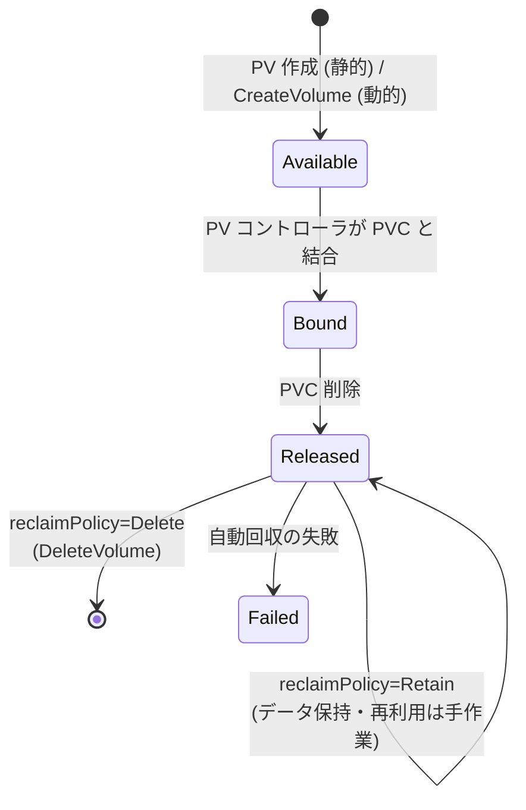

# Kubernetes ストレージ (Kubernetes Storage: PV/PVC, StorageClass & CSI)

## 概要 (Overview)

コンテナは本来使い捨てであり、Pod が消えればそのファイルシステムも消える。Kubernetes のストレージ機構は、この使い捨ての計算単位に**Pod より長く生きる状態**を接ぎ木するための仕組みである。中核は 3 つの分離にある。(1) **要求と供給の分離**: アプリは PersistentVolumeClaim (PVC) で「10 GiB・単一ノード書き込み」と要求だけを書き、実体の PersistentVolume (PV) は管理者か動的プロビジョナが用意する。(2) **方針と実体の分離**: StorageClass が「どの種類のディスクを、どこに、どの削除方針で」という方針を名前で束ねる。(3) **オーケストレータとストレージ製品の分離**: Container Storage Interface (CSI) が、Kubernetes とストレージベンダーの境界を gRPC の仕様として固定した。

本ドキュメントの中心テーゼは 2 つ。(1) ボリュームのライフサイクル (作成 → attach → mount → unmount → detach → 削除) は、[`container-orchestration-kubernetes.md`](container-orchestration-kubernetes.md) の調停ループが**複数のコントローラとノードエージェントに分割された連鎖**として実装されている。その各段は API オブジェクト (PVC・PV・VolumeAttachment) の状態遷移として観測できる。(2) ストレージは計算と違って**場所を持つ**。ディスクは特定の可用域 (AZ) やノードに縛られるので、ストレージの制約がスケジューラにまで貫通する。`WaitForFirstConsumer`・ノードあたりの attach 上限・ノード障害時の二重 attach 防止は、すべて「状態には場所がある」ことの帰結である。分析深度は Level 3。版に依存する記述は 2026-10-07 時点 (Kubernetes v1.37 が最新) のものである。

## 方法論 (Methodology)

- ストレージを「ボリューム種類の一覧」ではなく **API オブジェクトの状態遷移 + その遷移を担う調停者**として分解する。各段で「誰が・どのオブジェクトを見て・どの CSI RPC を呼ぶか」を対応づける。
- 下位層の一般機構は既存文書に委ねる。ブロックデバイスとレプリケーションは [`cloud-block-storage.md`](cloud-block-storage.md)、ファイルシステムとクラッシュ一貫性は [`../operating-systems/filesystems.md`](../operating-systems/filesystems.md)、ブロック I/O は [`../operating-systems/block-io-stack.md`](../operating-systems/block-io-stack.md)、ノード障害の検出不能性は [`../distributed-systems/failure-models.md`](../distributed-systems/failure-models.md) を参照する。
- 一次資料は Kubernetes 公式文書・公式ブログ・KEP、CSI 仕様、kubernetes-csi の文書。AWS EBS / EFS CSI ドライバの記述はベンダー/OSS の一次資料として扱い明示する。機能の成熟度と版番号は 2026-10-07 に公式文書・リリースブログで確認した。

## 発見事項 (Findings)

1. **PV/PVC の分離は「要求」と「供給」を別の主体に書かせるための API 設計である。** PVC は namespace に属しアプリ開発者が書く。PV はクラスタスコープで管理者かプロビジョナが書く。両者を結ぶのは kube-controller-manager 内の PV コントローラで、条件の合う PV と PVC を `claimRef` で 1 対 1 に、双方向に結びつける。合う PV がなければ PVC は Pending のまま待つ。これは [`container-orchestration-kubernetes.md`](container-orchestration-kubernetes.md) の spec/status 分離の応用であり、「誰が何を書いてよいか」という権限の規約が、そのままストレージの調達フローになっている。

2. **StorageClass による動的プロビジョニングは、ディスクの調達をチケットから調停ループへ移した。** PVC が StorageClass を名指すと、外部プロビジョナ (external-provisioner サイドカー) がそれを watch し、CSI の `CreateVolume` を呼んで PV を作る。StorageClass は、ドライバ名・パラメータ (ディスク種類・IOPS・暗号化鍵)・削除方針 (`reclaimPolicy`)・拡張可否・バインドのタイミングを名前で束ねたものである。動的に作られた PV は StorageClass の `reclaimPolicy` を継承し、その既定は `Delete` である。つまり **PVC を消すと既定でディスクも消える**。手作業で作った PV の既定は `Retain` で、この非対称は運用事故の典型的な原因になる。

3. **`WaitForFirstConsumer` は、ストレージがスケジューラに拒否権を持つことの表明である。** 既定の `Immediate` では、PVC の作成と同時にディスクが作られる。そのため、ディスクが AZ-a に作られ、後から Pod が AZ-b に配置されて永遠に起動できない、という事態が起きうる。`WaitForFirstConsumer` は、Pod のスケジューリングが決まるまでバインドと作成を遅らせ、Pod の配置制約 (ノード・AZ) を満たす場所にディスクを作る。これにより、「計算の配置」と「状態の配置」という 2 つの決定が 1 つの意思決定点にまとまった。ストレージ容量の追跡 (CSIStorageCapacity, 1.24 GA) も、この遅延バインドを前提にしてスケジューラに残容量を見せる機構である。

4. **CSI の 3 サービス × 段階的 RPC は、ボリュームの一生を「どこで実行されるか」で切り分けている。** CSI 仕様 (最新 v1.13.0) は、Identity (プラグイン情報)・Controller (クラスタのどこからでも実行できる操作: 作成・削除・attach・スナップショット・拡張)・Node (そのノード上でしか実行できない操作: マウント) の 3 つの gRPC サービスを定める。立ち上げは `CreateVolume` → `ControllerPublishVolume` (attach) → `NodeStageVolume` (ノードごとに 1 回のグローバルマウント) → `NodePublishVolume` (Pod ごとの bind mount) の順で、解体はその逆順になる。stage と publish を分けたのは、同じノード上の複数 Pod が 1 つのボリュームを共有するとき、デバイスのフォーマットとマウントを 1 回で済ませるためである。

5. **Kubernetes 側の CSI 実装は、ドライバを「調停ループの集合」に包むサイドカー群である。** ストレージベンダーが書くのは CSI の gRPC サーバだけで、Kubernetes API の watch と状態の書き戻しは external-provisioner / external-attacher / external-resizer / external-snapshotter / node-driver-registrar といった共通のサイドカーが担う。attach は、kube-controller-manager の attach/detach コントローラが VolumeAttachment オブジェクトを作り、external-attacher がそれを見て `ControllerPublishVolume` を呼ぶ、という 2 段の調停になる。ノード上の mount は kubelet のボリュームマネージャが Node サービスを呼んで行う。ベンダーは Kubernetes の API 機械を一切知らなくてよい。この分業が、in-tree プラグイン (Kubernetes 本体に同梱されていたドライバ) を本体から追い出す CSI 移行を可能にした。

6. **アクセスモードは「何 Pod から」ではなく「何ノードから」を表しており、RWOP はその穴埋めである。** `ReadWriteOnce` (RWO) は単一**ノード**からの読み書きを意味し、同じノード上の複数 Pod からは同時に書ける。これは、ブロックデバイスの attach がノード単位であることの名残である。単一 Pod だけに書き込みを限る `ReadWriteOncePod` (RWOP) は 1.29 で GA になった。RWX (複数ノードから読み書き) はファイルプロトコル (NFS / EFS 等) か、クラスタファイルシステムでしか実現できない。ブロックデバイスを複数ノードに attach すると、上のファイルシステムが壊れるからである。

7. **ノード障害時の振る舞いは、「死んだのか見えないだけか」が区別できないことへの保守的な回答である。** RWO のブロックボリュームは、旧ノードから detach されるまで新ノードへ attach できない (Multi-Attach エラー)。旧ノードが応答しない場合、attach/detach コントローラは unmount 完了を待ち、既定 6 分 (`maxWaitForUnmountDuration`) で強制 detach に進む。この強制 detach は、旧ノードが実は生きていて書き込みを続けていたらデータを壊しうる。そのため、より安全な経路として**ノード停止を人間 (か外部の自動化) が保証する** non-graceful node shutdown (1.28 GA) が用意された。`node.kubernetes.io/out-of-service` taint を付けると、Pod の強制削除とボリュームの detach が即座に進む。fencing の責任を、検出できない Kubernetes から、検出できる主体へ明示的に移した設計である ([`../distributed-systems/failure-models.md`](../distributed-systems/failure-models.md))。

8. **ボリュームは「作って終わり」ではなく、可変な資源へ進化した。** 容量拡張は 1.24 で GA、拡張失敗からの回復 (要求サイズを戻せる) は 1.34 で GA になった。IOPS やスループットを後から変更する VolumeAttributesClass は 1.34 で GA で、CSI の `ControllerModifyVolume` に対応する。スナップショット (1.20 GA)、任意のデータソースからの事前充填 (volume populators, 1.33 GA)、複数ボリュームの同時点スナップショット (volume group snapshot, 1.36 GA) も揃った。データ保護の操作が、外部のバックアップ製品の専有物から、宣言的な API オブジェクトへ取り込まれつつある。

## アーキテクチャ (Architecture)

### ボリュームの一生 — PVC から Pod のマウントまで



どの段も、前の段が書いた API オブジェクトの状態を見て動く。部品同士は直接呼び合わない。途中で失敗した段は、その段の調停者が再試行するだけで、全体のやり直しは起きない。

### 調停者とオブジェクトの対応

| 段 | 見るオブジェクト | 調停者 (動作場所) | CSI RPC | 結果として書くもの |
|---|---|---|---|---|
| バインド | PVC, PV | PV コントローラ (kube-controller-manager) | — | `claimRef`, PVC の Bound |
| 作成 | PVC, StorageClass | external-provisioner (ドライバの Pod) | `CreateVolume` | PV |
| attach | Pod の割当, PV | attach/detach コントローラ → external-attacher | `ControllerPublishVolume` | VolumeAttachment |
| マウント | Pod, VolumeAttachment | kubelet のボリュームマネージャ (各ノード) | `NodeStageVolume`, `NodePublishVolume` | ノード上のマウント |
| 拡張 | PVC の要求サイズ | external-resizer → kubelet | `ControllerExpandVolume`, `NodeExpandVolume` | PV / PVC の容量 |
| 属性変更 | PVC の VolumeAttributesClass | external-resizer | `ControllerModifyVolume` | PVC の status |
| スナップショット | VolumeSnapshot | snapshot-controller → external-snapshotter | `CreateSnapshot` | VolumeSnapshotContent |
| 削除 | PV (Released) | external-provisioner | `DeleteVolume` | PV の削除 |

### PV の状態遷移



`Retain` で Released になった PV は、`claimRef` が残っているので別の PVC には自動で結合されない。前の利用者のデータが別のテナントへ渡らないための安全側の設計であり、再利用するには管理者が明示的に解放する必要がある。

## 技術詳細 (Technical Details)

### 1. ボリュームの分類 — 寿命と供給元

| 分類 | 例 | 寿命 | 供給元 |
|---|---|---|---|
| 一時 (ノードローカル) | `emptyDir` (`medium: Memory` で tmpfs) | Pod と同じ | kubelet |
| 投影 (API 由来) | `configMap`, `secret`, `downwardAPI`, `projected` (ServiceAccount トークン含む) | Pod と同じ。内容は API に追随して更新 | kubelet |
| 汎用一時ボリューム | `ephemeral.volumeClaimTemplate` (1.23 GA) | Pod と同じ。実体は PVC | StorageClass 経由の CSI |
| CSI インライン | `csi:` (1.25 GA) | Pod と同じ | CSI ドライバ (シークレットストア等) |
| イメージボリューム | `image:` (OCI イメージを読み取り専用でマウント, 1.36 GA) | Pod と同じ | コンテナランタイム |
| 永続 | `persistentVolumeClaim` | Pod から独立 | PV (静的 / 動的) |
| ホスト | `hostPath`, local PV | ノードと同じ | ノード |

- **`emptyDir` の `medium: Memory`** は tmpfs で、使用量はコンテナのメモリ上限に計上される。書きすぎると OOM kill の原因になる。
- **汎用一時ボリューム**は、Pod ごとに `<pod>-<volume>` という名前の PVC を作り、Pod を ownerReference に持たせて Pod と一緒に消す。永続ボリュームの機構 (容量・IOPS・スナップショット) を、スクラッチ領域にも使えるようにしたものである。
- **in-tree プラグインの退場**: AWS EBS・GCE PD などクラウドのボリュームプラグインは本体に同梱されていたが、CSI 移行 (EBS と GCE PD は 1.25 で GA) を経て本体から削除された。たとえば gcePersistentDisk は 1.28、cephfs と rbd は 1.31 で削除されている。旧来の `awsElasticBlockStore` などの記述は、移行機能により CSI ドライバへ振り替えられる。
- **イメージボリューム**: OCI レジストリのイメージや成果物 (ML モデルの重みなど) を、読み取り専用のボリュームとして直接マウントする。データをコンテナイメージに焼き込む方法と、起動時にダウンロードする方法の中間にあたる。対応したランタイムが必要になる (containerd 2.1 以降または CRI-O)。

### 2. バインドとプロビジョニングの詳細

- **バインドの条件**: 容量 (PV ≥ 要求)、アクセスモード、`volumeMode` (Filesystem / Block)、StorageClass 名、ラベルセレクタ、ノードアフィニティ。最小で条件を満たす PV が選ばれる。
- **既定の StorageClass**: 注釈 `storageclass.kubernetes.io/is-default-class: "true"` で指定する。`storageClassName` を書かない PVC には既定が割り当てられ、既定が後から設定された場合も遡って適用される。既定が複数あると最も新しいものが使われる。`storageClassName: ""` を明示すると、動的プロビジョニングを禁止して静的 PV だけに結合する、という別の意味になる。
- **`allowedTopologies`**: StorageClass で作成できる場所 (AZ 等) を制限する。`WaitForFirstConsumer` と組み合わせると、Pod の配置候補との積集合からディスクの場所が決まる。
- **保護ファイナライザ**: 使用中の PVC には `kubernetes.io/pvc-protection` が、結合中の PV には `kubernetes.io/pv-protection` が付き、Pod が使っている間は削除が保留される。かつては PV を PVC より先に消すと、`reclaimPolicy: Delete` なのに下位のディスクが消えずに漏れる問題があった。これは削除順序に依存しない回収 (HonorPVReclaimPolicy, 1.33 GA) で修正され、CSI のボリュームには `external-provisioner.volume.kubernetes.io/finalizer` が付くようになった。

### 3. CSI の境界とノードの制約

```text
# Language: 説明用の模式図 (疑似構成)
# Purpose: CSI ドライバの典型的な配備形態と、各サイドカーが呼ぶ RPC の対応
# Source: kubernetes-csi.github.io/docs/sidecar-containers.html の構成を要約
#
#  Controller 側 (Deployment / StatefulSet, 1〜数レプリカ・リーダー選出)
#  ┌──────────────────────────────────────────────────────────┐
#  │ external-provisioner  → CreateVolume / DeleteVolume       │
#  │ external-attacher     → ControllerPublish / Unpublish     │
#  │ external-resizer      → ControllerExpand / ControllerModify│
#  │ external-snapshotter  → CreateSnapshot / DeleteSnapshot   │
#  │ CSI driver (Controller + Identity サービス)  ← unix socket │
#  └──────────────────────────────────────────────────────────┘
#  Node 側 (DaemonSet, 全ノード)
#  ┌──────────────────────────────────────────────────────────┐
#  │ node-driver-registrar → kubelet にドライバを登録 (CSINode)  │
#  │ CSI driver (Node + Identity サービス)  ← kubelet が直接呼ぶ │
#  │ livenessprobe         → Probe                             │
#  └──────────────────────────────────────────────────────────┘
```

- **CSIDriver オブジェクト**: ドライバの性質を Kubernetes に宣言する。attach が必要か (`attachRequired`)、Pod 情報を mount 時に渡すか、どのライフサイクルモード (永続 / インライン一時) を許すか、fsGroup の扱い (`fsGroupPolicy`)、SELinux のマウントオプション対応 (`seLinuxMount`)、容量を報告するか (`storageCapacity`)。
- **CSINode とノードあたりの上限**: ドライバは `NodeGetInfo` の `max_volumes_per_node` で 1 ノードに付けられるボリューム数を報告し、それが `CSINode.spec.drivers[].allocatable.count` になる。スケジューラはこの値を資源として扱う。上限に達したノードには、そのドライバのボリュームを使う Pod が配置されない。この値は固定ではない。1.36 では kubelet が定期的に、または attach の ResourceExhausted 失敗の直後に、上限を再取得できるようになった (MutableCSINodeAllocatableCount, Stable)。
- **ハードウェア由来の上限**: AWS の多くの Nitro インスタンスでは、EBS ボリューム・ENI・NVMe インスタンスストアが合計 28 の attach スロットを共有する。一部の新しい世代は EBS 専用の上限を持つ (ベンダー仕様。インスタンスタイプごとに異なるので個別に確認が要る)。[`kubernetes-networking.md`](kubernetes-networking.md) の VPC CNI が ENI を増やすほど、付けられるボリュームが減る、という**網とストレージの資源競合**がここで起きる。

### 4. 拡張・属性変更・スナップショット

- **拡張**: StorageClass が `allowVolumeExpansion: true` なら、PVC の `resources.requests.storage` を増やすだけで、external-resizer が `ControllerExpandVolume` (下位ディスクの拡張) を、kubelet が `NodeExpandVolume` (ファイルシステムの拡張) を呼ぶ。オンラインで拡張できるかはドライバ次第である。縮小は一般にはできない。ただし拡張が失敗しているあいだは、要求サイズを元の値以上の範囲で下げて再試行できる (1.34 GA)。
- **VolumeAttributesClass**: IOPS・スループットのような「容量以外の可変属性」をクラスタスコープのクラスとして定義し、PVC がそれを名指しする。クラスを付け替えると `ControllerModifyVolume` が呼ばれる。StorageClass (作成時に固定) と VolumeAttributesClass (運用中に変更可能) を分けたのは、作成後に変えられない属性と変えられる属性の境界を API の型で表すためである。
- **スナップショット**: VolumeSnapshotClass / VolumeSnapshot / VolumeSnapshotContent の 3 つ組で、PV / PVC / StorageClass と同じ「要求・実体・方針」の分離を繰り返している。復元は、新しい PVC の `dataSource` にスナップショットを指定して行う。`dataSourceRef` (volume populators, 1.33 GA) は、これを任意のカスタムリソース (バックアップ製品のオブジェクト等) に一般化した。
- **クラッシュ一貫性の境界**: 単一ボリュームのスナップショットは、そのボリュームについてのクラッシュ一貫性 (電源断と同等の状態) しか保証しない。データとログを別ボリュームに置くデータベースでは、volume group snapshot (1.36 GA) で複数ボリュームを同じ時点で取る必要がある。アプリケーション一貫性 (書き込みバッファのフラッシュ) は、どちらの場合も API の外の責務である ([`../operating-systems/filesystems.md`](../operating-systems/filesystems.md) の `fsync` の契約)。増分バックアップのための変更ブロック追跡 (CSI SnapshotMetadata) は、2026-09 時点で beta である。

### 5. StatefulSet と状態の同一性

StatefulSet は `volumeClaimTemplates` から Pod の序数ごとに PVC を作る (`<テンプレート名>-<StatefulSet 名>-<序数>`)。Pod `db-0` が別のノードで作り直されても同じ PVC `data-db-0` に再結合されるので、「名前 (DNS) と状態 (ボリューム) の同一性」が Pod の入れ替わりを越えて保たれる。PVC は既定でスケールダウンや StatefulSet の削除後も残る (データ保護を優先した既定)。`persistentVolumeClaimRetentionPolicy` (1.32 GA) の `whenDeleted` / `whenScaled` に `Delete` を指定すると自動削除になる。公式文書の例は RWOP を推奨しており、同一ノード上での二重起動による同時書き込みを防いでいる。

### 6. 所有権と SELinux — マウント時のコスト

- **fsGroup**: Pod の `securityContext.fsGroup` を指定すると、kubelet はボリューム内の全ファイルの所有グループと権限を再帰的に変更する。数百万ファイルのボリュームでは、これが Pod の起動を分単位で遅らせる。`fsGroupChangePolicy: OnRootMismatch` にすると、ルートディレクトリの所有権が既に合っていれば走査を省ける。**未指定時の既定は `Always`** である。`CSIDriver.fsGroupPolicy` で、ドライバ側に処理を任せることもできる。
- **SELinux**: 再帰的なラベル付け直しを避けるため、ボリュームを `-o context=<ラベル>` でマウントする方式が段階的に広げられた。RWOP 限定の版は 1.36 で GA、全アクセスモードへの拡張 (SELinuxMount) は 1.37 で Stable・既定有効になった。ドライバが `CSIDriver.spec.seLinuxMount: true` で対応を表明した場合に限られる。これは**破壊的な変更**で、同じノード上で異なる SELinux ラベルの Pod が 1 つのボリュームを共有すると、Pod が起動できなくなる。従来の挙動に戻すには Pod 側で `seLinuxChangePolicy: Recursive` を指定する。

### 7. ローカルストレージ

local PV (1.14 GA) はノードに直結したディスク (NVMe 等) を PV として公開する。PV に `nodeAffinity` を持たせ、`WaitForFirstConsumer` と組み合わせて「そのディスクがあるノード」にだけ Pod を配置させる。低レイテンシと高 IOPS を得られる代わりに、ノードの故障はそのままデータの喪失になり、Pod はそのノード以外へ移れない。レプリケーションをアプリケーション層 (分散データベース自身の複製, [`../distributed-systems/replication-partitioning.md`](../distributed-systems/replication-partitioning.md)) で持つワークロード向けの選択である。ネットワークブロックストレージ ([`cloud-block-storage.md`](cloud-block-storage.md)) が下位で複製を引き受けるのと、責務の置き場所が逆になる。

### 8. EKS の接合部

- **EBS CSI ドライバ**: ボリュームは 1 つの AZ に縛られるので、`WaitForFirstConsumer` が実質必須になる。StorageClass の `type` の既定は gp3 で、`iops`・`throughput` (gp3 のみ)・`encrypted`・`kmsKeyId` を指定できる。ノードあたりの上限はインスタンスタイプから推定され、`--volume-attach-limit` で上書きできる (ベンダー/OSS 仕様)。AZ の障害時、そこのボリュームを使う Pod は他の AZ へ移れない。単一 AZ のブロックボリュームの上に置いた StatefulSet の可用性は、AZ の可用性を超えない。
- **Multi-Attach**: io2 ボリュームは同じ AZ の複数ノードへ attach できるが、Block モードに限られる。I/O の排他制御 (fencing) はアプリケーションの責任である (ベンダー仕様)。RWX をブロックで実現しても、複数の書き手の調停は消えずにアプリへ移るだけである。
- **EFS CSI ドライバ**: NFS ベースで RWX と AZ をまたぐアクセスを提供し、アクセスポイントによる動的プロビジョニングと、通信の暗号化 (既定有効) を持つ。PV の容量は形式上の値で、強制されない (ベンダー/OSS 仕様)。

## セキュリティ考察 (Security Considerations)

- **`hostPath` はノードへの脱出口である。** ホストの任意のパスをマウントできるので、`/`、`/var/run/containerd/containerd.sock`、`/etc/kubernetes` などへの書き込みはノードの掌握に直結する。Pod Security Standards の Baseline 以上では禁止されており、admission で強制するのが定石である。`mountPropagation: Bidirectional` (rshared) は特権コンテナにしか許されない。コンテナ内のマウントがホストへ伝搬するからである。
- **subPath とシンボリックリンクの歴史**: CVE-2017-1002101 では、subPath でマウントしたボリューム内にシンボリックリンクを作ると、コンテナがホストのファイルシステムへ到達できた (1.7.14 / 1.8.9 / 1.9.4 で修正)。マウントの経路解決はカーネルとユーザ空間の境界をまたぐ TOCTOU の温床で、subPath の実装はその後も同系統の修正を受けている。
- **Secret ボリュームは tmpfs 上の平文である。** Secret はノード上ではメモリにマウントされ、ディスクには書かれない。しかし、そのノードの root かコンテナにアクセスできれば読める。etcd 上の暗号化 ([`container-orchestration-kubernetes.md`](container-orchestration-kubernetes.md)) はノード上の露出を守らない。CSI インラインの Secret Store ドライバは保存場所を外部の鍵管理へ移すが、マウント後の露出は同じである。
- **データの残留とテナント間の受け渡し**: `reclaimPolicy: Retain` の PV や、削除が漏れたディスクは、前の利用者のデータを保持し続ける。Released の PV が自動で再結合されないのはこのためである。ディスク自体の暗号化 (KMS 鍵, [`cloud-kms-confidential-computing.md`](cloud-kms-confidential-computing.md)) を StorageClass で既定にしておくと、鍵の破棄が残留データの無効化手段になる。
- **CSI ドライバは最高権限の部品である。** Node 側の DaemonSet は特権で動き、ホストのマウント名前空間とデバイスに触れる。Controller 側はクラウドのディスクを作成・削除・attach する IAM 権限を持つ。ドライバの侵害は、全ノードの掌握と全ボリュームの窃取 (別ノードへの attach) を意味する。ドライバとサイドカーは [`../security/software-supply-chain-security.md`](../security/software-supply-chain-security.md) の審査対象であり、Controller 側の権限は Pod 単位のロールで最小化する ([`cloud-iam-authorization.md`](cloud-iam-authorization.md))。
- **CSI インラインボリュームの属性は利用者が書ける。** インライン一時ボリュームの `volumeAttributes` は Pod の作成者が指定できるので、ドライバによっては任意のパラメータでボリュームを作らせる経路になる。`CSIDriver.spec.volumeLifecycleModes` から `Ephemeral` を外すか、admission で制限する。
- **スナップショットは権限の迂回路になりうる。** VolumeSnapshotContent はクラスタスコープで、事前作成 (pre-provisioned) の形ではストレージ側のスナップショット ID を直接指定できる。これを作成できる主体は、どの namespace に属するディスクの複製でも、自分の namespace の VolumeSnapshot に結びつけて復元できる。VolumeSnapshotContent の作成権限は、全ボリュームの読み取り権限と同じ重さで扱う必要がある。

## 結論 (Conclusions)

- Kubernetes のストレージは、「要求 (PVC) と供給 (PV)」「方針 (StorageClass) と実体」「オーケストレータと製品 (CSI)」の 3 つの分離でできている。どの分離も「誰が何を書くか」を API の型で定め、間を調停ループで埋めるという、Kubernetes 全体と同じ設計原理の適用である。
- ボリュームの一生は、PV コントローラ・プロビジョナ・attach/detach コントローラ・kubelet という調停者の連鎖に分割され、各段の結果は API オブジェクトとして観測できる。どこかで止まった PVC や Pod は、どのオブジェクトの状態が進んでいないかを見れば原因の段を特定できる。
- 計算との本質的な違いは、状態が**場所を持つ**ことである。AZ に縛られるディスク、ノードあたりの attach 上限、ローカルディスクの nodeAffinity は、すべてスケジューラの制約へ貫通する。`WaitForFirstConsumer` は配置の決定を 1 箇所にまとめるための仕組みである。
- 障害時の設計は一貫して保守的である。二重 attach を防ぐために待ち、強制 detach には時間制限を置き、確実な fencing は外部の主体に委ねる。ステートフルワークロードを Kubernetes に載せることは可能だが、その可用性は下位ストレージの故障ドメイン (単一 AZ のブロックか、複製されたファイルか、ノードローカルか) を超えない。

### 次の接続先 (Related Topics)

- [`container-orchestration-kubernetes.md`](container-orchestration-kubernetes.md) — 調停ループ・etcd・スケジューラの全体像。
- [`kubernetes-networking.md`](kubernetes-networking.md) — もう一つのプラグイン境界 (CNI) と、ENI を通じたストレージとの資源競合。
- [`cloud-block-storage.md`](cloud-block-storage.md) — EBS 型ブロックストレージの複製・スナップショット・故障ドメイン。
- [`../operating-systems/filesystems.md`](../operating-systems/filesystems.md) — クラッシュ一貫性と `fsync` の契約。
- [`../distributed-systems/failure-models.md`](../distributed-systems/failure-models.md) — 故障検出の非決定性と fencing。

## 参考文献 (References)

**一次資料 (Primary — 仕様・公式文書)**

- [Kubernetes Documentation: Persistent Volumes](https://kubernetes.io/docs/concepts/storage/persistent-volumes/) — Accessed: 2026-10-07。バインド、reclaimPolicy、アクセスモード、保護ファイナライザ。
- [Kubernetes Documentation: Storage Classes](https://kubernetes.io/docs/concepts/storage/storage-classes/) — Accessed: 2026-10-07。volumeBindingMode、allowedTopologies、既定の StorageClass。
- [Kubernetes Documentation: Volumes](https://kubernetes.io/docs/concepts/storage/volumes/) — Accessed: 2026-10-07。ボリューム種類、emptyDir、mountPropagation、in-tree プラグインの状況。
- [Kubernetes Documentation: Ephemeral Volumes](https://kubernetes.io/docs/concepts/storage/ephemeral-volumes/) — Accessed: 2026-10-07。汎用一時ボリューム、CSI インライン。
- [Kubernetes Documentation: Node-specific Volume Limits](https://kubernetes.io/docs/concepts/storage/storage-limits/) — Accessed: 2026-10-07。CSINode の allocatable。
- [Kubernetes Documentation: Storage Capacity](https://kubernetes.io/docs/concepts/storage/storage-capacity/) — Accessed: 2026-10-07。
- [Kubernetes Documentation: Node Shutdowns](https://kubernetes.io/docs/concepts/cluster-administration/node-shutdown/) — Accessed: 2026-10-07。non-graceful node shutdown、強制 detach。
- [Kubernetes Documentation: Configure a Security Context for a Pod or Container](https://kubernetes.io/docs/tasks/configure-pod-container/security-context/) — Accessed: 2026-10-07。fsGroupChangePolicy、SELinux。
- [Kubernetes Documentation: StatefulSets](https://kubernetes.io/docs/concepts/workloads/controllers/statefulset/) — Accessed: 2026-10-07。volumeClaimTemplates、PVC 保持ポリシー。
- [Container Storage Interface Specification](https://github.com/container-storage-interface/spec/blob/master/spec.md) — Accessed: 2026-10-07。3 サービスと RPC、呼び出し順序。
- [CSI Specification Releases](https://github.com/container-storage-interface/spec/releases) — Accessed: 2026-10-07。v1.13.0。
- [Kubernetes CSI Developer Documentation: Sidecar Containers](https://kubernetes-csi.github.io/docs/sidecar-containers.html) — Accessed: 2026-10-07。
- [KEP-4639: OCI VolumeSource](https://www.kubernetes.dev/resources/keps/4639/) — Accessed: 2026-10-07。
- [NVD: CVE-2017-1002101](https://nvd.nist.gov/vuln/detail/CVE-2017-1002101) — Accessed: 2026-10-07。

**公式ブログ (Primary — 時点情報)**

- [Kubernetes 1.25: Storage in-tree to CSI migration status update](https://kubernetes.io/blog/2022/09/26/storage-in-tree-to-csi-migration-status-update-1.25/) — Accessed: 2026-10-07。
- [Kubernetes 1.28: Non-Graceful Node Shutdown Moves to GA](https://kubernetes.io/blog/2023/08/16/kubernetes-1-28-non-graceful-node-shutdown-GA/) — Accessed: 2026-10-07。
- [Kubernetes v1.33: Prevent PersistentVolume Leaks When Deleting out of Order graduates to GA](https://kubernetes.io/blog/2025/05/05/kubernetes-v1-33-prevent-persistentvolume-leaks-when-deleting-out-of-order-graduate-to-ga/) — Accessed: 2026-10-07。
- [Kubernetes v1.33: Volume Populators Graduate to GA](https://kubernetes.io/blog/2025/05/08/kubernetes-v1-33-volume-populators-ga/) — Accessed: 2026-10-07。
- [Kubernetes v1.34: VolumeAttributesClass for Volume Modification GA](https://kubernetes.io/blog/2025/09/08/kubernetes-v1-34-volume-attributes-class/) — Accessed: 2026-10-07。
- [Kubernetes v1.34: Recovery From Volume Expansion Failure (GA)](https://kubernetes.io/blog/2025/09/19/kubernetes-v1-34-recover-expansion-failure/) — Accessed: 2026-10-07。
- [Kubernetes v1.36: Volume Group Snapshot GA](https://kubernetes.io/blog/2026/05/08/kubernetes-v1-36-volume-group-snapshot-ga/) — Accessed: 2026-10-07。
- [Breaking changes in SELinux volume labeling](https://kubernetes.io/blog/2026/04/22/breaking-changes-in-selinux-volume-labeling/) — Accessed: 2026-10-07。
- [Kubernetes v1.37 Release](https://kubernetes.io/blog/2026/08/26/kubernetes-v1-37-release/) — Accessed: 2026-10-07。SELinuxMount の Stable 化。
- [CSI Changed Block Tracking moves to Beta](https://kubernetes.io/blog/2026/09/14/csi-changed-block-tracking-beta/) — Accessed: 2026-10-07。
- [Fixing the Subpath Volume Vulnerability in Kubernetes](https://kubernetes.io/blog/2018/04/04/fixing-subpath-volume-vulnerability/) — Accessed: 2026-10-07。

**ベンダー / OSS 提示 (Vendor-presented)**

- [Amazon EBS CSI Driver: StorageClass parameters](https://github.com/kubernetes-sigs/aws-ebs-csi-driver/blob/master/docs/parameters.md) — Accessed: 2026-10-07。
- [Amazon EBS CSI Driver: Multi-Attach](https://github.com/kubernetes-sigs/aws-ebs-csi-driver/blob/master/docs/multi-attach.md) — Accessed: 2026-10-07。
- [Amazon EC2: Instance volume limits](https://docs.aws.amazon.com/AWSEC2/latest/UserGuide/volume_limits.html) — Accessed: 2026-10-07。共有 attach スロットと EBS 専用上限。
- [Amazon EFS CSI Driver](https://github.com/kubernetes-sigs/aws-efs-csi-driver) — Accessed: 2026-10-07。
