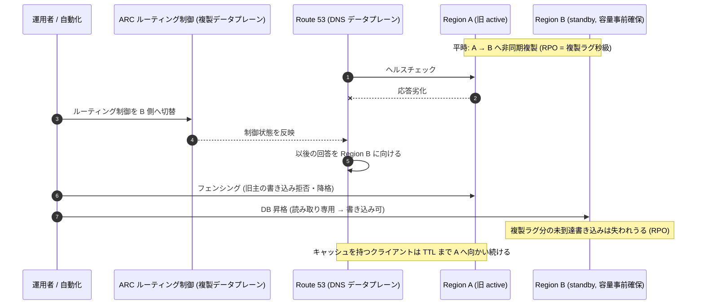

# マルチリージョンとグローバルサービス (Multi-Region Architecture & Global Services)

## 概要 (Overview)

**リージョン (region)** は、クラウドの故障隔離の最外殻である。AZ が電源・冷却・ネットワークの故障ドメインを分けるのに対し ([`../../engineering/datacenters/datacenter-fundamentals.md`](../../engineering/datacenters/datacenter-fundamentals.md))、リージョンはソフトウェアのデプロイ・コントロールプレーン・運用ミスまで含めた**相関故障の隔離単位**として設計される。リージョン間で制御系を共有しないこと自体が製品仕様である。マルチリージョンアーキテクチャとは、この**注意深く作られた独立性を、必要最小限だけ壊して結合を張る**工学である：複製とは「隔離が切り離したものを再び結ぶ」行為であり、結んだ分だけ相関故障が戻ってくる。

本ドキュメントの中心テーゼは 3 つ。(1) 同期複製の範囲は工学ではなく**物理**が決める。リージョン間の光速 RTT (数十〜百数十 ms) は削れないため、「AZ 間は同期、リージョン間は非同期」という業界共通の構造は光速の帰結である。(2) マルチリージョン設計の通貨は **RTO (復旧時間目標) と RPO (復旧時点目標)** であり、バックアップ復元からアクティブ/アクティブまでの選択肢は「いくら失ってよいか・何分止まってよいか」を金と複雑さに換算する作業である。(3) アクティブ/アクティブの本体は**競合解決の選択**であり、回避 (単一ライター)・LWW・CRDT・合意 (Spanner 型) のどれを選んでも痛みは消えず、痛む場所が変わるだけである。AWS を走る事例に、対極解としての Google Spanner、実障害 (2021-12 us-east-1) の公式記録を突き合わせる。分析深度は Level 3。

## 方法論 (Methodology)

- 一貫性・複製・分断の語彙は [`../distributed-systems/consistency-models.md`](../distributed-systems/consistency-models.md) に、単一リージョン内の信頼性原則は [`cloud-control-planes.md`](cloud-control-planes.md) に依拠し、本書は「リージョンという粒度で何が変わるか」に集中する。
- 各アーキテクチャ選択を「RPO・RTO・書き込みレイテンシ・競合の意味論・運用複雑性」の 5 軸で評価し、単一の推奨ではなく交換条件の表として示す。
- クラウド内部のリージョン設計はベンダー文書 (whitepaper・障害報告) に依存するため、**ベンダー一次資料**と明示する。対極解 (Spanner) と理論 (CRDT) は査読付き論文で押さえ、実障害の記述は公式ポストモーテムを一次資料として扱う。

## 発見事項 (Findings)

1. **リージョンの独立性はデフォルトではなく設計成果物であり、「グローバルサービス」はその例外として最も危険な場所である。** AWS はリージョン間でデータプレーン・コントロールプレーンを原則共有しない (ベンダー一次資料: Fault Isolation Boundaries whitepaper)。しかし IAM・Route 53・CloudFront のような**グローバルサービス**は構造上の例外で、その実体は「**データプレーンは全域に複製、コントロールプレーンは単一リージョン (多くは us-east-1) に集約**」である。2021 年 12 月の us-east-1 障害では、この隠れ結合が顕在化した。影響は us-east-1 に限られるはずが、グローバルサービスの管理操作 (Route 53 のレコード変更等) が全世界で滞った。一方で**データプレーンは動き続けた**：既存の DNS 解決・既存クレデンシャルの認可は無傷であり、[`cloud-control-planes.md`](cloud-control-planes.md) の静的安定性が世界規模で実証された形になった (公式サマリ, ベンダー一次資料)。教訓は「自分のマルチリージョン構成の**依存グラフに、単一リージョンのコントロールプレーンが混ざっていないか**」を棚卸しすることに尽きる。

2. **同期複製の境界は光速が引く。** 同期複製 (RPO=0) は全書き込みが複製先の ack を待つため、書き込みレイテンシの床が RTT になる。AZ 間 (同一都市圏、RTT 1〜2ms 桁) なら床は誤差であり、Aurora の 4/6 クォーラム ([`cloud-databases-aurora-dynamodb.md`](cloud-databases-aurora-dynamodb.md)) のような AZ 跨ぎ同期が成立する。大陸間 (RTT 数十〜150ms 超) では床がユーザ体感を直撃するため、リージョン間複製は**非同期が既定**になり、RPO は複製ラグ (秒のオーダ) を受け入れる。この構造はベンダーを問わず共通で、「AZ = 同期の単位、リージョン = 非同期の単位」はクラウド設計の最も安定した公理の一つである。逆に Spanner はこの公理をあえて破り、大陸規模の同期 (外部一貫性) を **TrueTime とコミット待ち**で買った。これは書き込みレイテンシと専用インフラ (原子時計・GPS) という代金を明示的に払う対極解である (OSDI '12)。

3. **RTO/RPO は「止まってよい時間」と「失ってよい量」の事業契約であり、DR 戦略はその値段表である。** バックアップ復元 (RTO 時間級・安い) → パイロットライト (縮退した複製を常時稼働) → ウォームスタンバイ (縮小版フルスタック) → アクティブ/アクティブ (RTO 分〜秒級・最も高い) のスペクトルは、技術の優劣ではなく**保険料の選択**である。見落とされがちな 2 点：(a) RPO は複製方式で決まるが、**論理破壊 (誤削除・ランサムウェア) には複製は無力**である。破壊されたデータも忠実に複製される。時点復元とイミュータブルなバックアップは、複製とは別の軸として必ず残る。(b) RTO の支配項は技術的切替時間ではなく**判断時間**である。つまり、部分劣化 (gray failure) で状況が見通せない中で「これはフェイルオーバーに値する障害か」を誰かが決めるまでの時間である。

4. **フェイルオーバー機構自体が静的安定でなければならない。「引き金」はデータプレーンに置く。** 障害時に動かす仕組み (DNS 切替・ルーティング変更) が、障害の影響を受けるコントロールプレーンに依存していたら、最も必要なときに引けない引き金になる。Route 53 の回答変更がグローバルなコントロールプレーン経由である事実への応答として、Route 53 ARC (Application Recovery Controller) はルーティング制御の状態を**複数リージョンに複製された専用データプレーン**として実装し、コントロールプレーンが劣化していても切替操作だけは通るよう設計されている (ベンダー提示)。同じ論理で、フェイルオーバー先の**容量も事前確保**が要る。リージョン障害時には全員が同時に避難するため、「行った先でオートスケールすればよい」は成立しない前提で設計する ([`cloud-control-planes.md`](cloud-control-planes.md) の静的安定性のリージョン版)。

5. **アクティブ/アクティブの設計とは競合解決の選択である。** 複数リージョンで同時に書くなら、分断・遅延下の並行書き込みの意味論を決めなければならない。選択肢は 4 つに尽きる：(a) **回避**。データを利用者の「ホームリージョン」に張り付け、書き込みは常に単一リージョン (グローバルには active-active、各データにはシングルライター)。最も堅実で、多くの「active-active」の実体はこれである。(b) **LWW (last-writer-wins)**。DynamoDB Global Tables の方式。全リージョンで書けるが、並行更新はタイムスタンプで勝者が決まり、**敗者の書き込みは気づかないうちに消える**。時計への依存と更新消失を許容できる用途に限る (ベンダー仕様)。(c) **CRDT**。可換なデータ型 (カウンタ・集合・レジスタ) に表現を制限し、マージを数学的に保証する (SSS 2011)。表現力の制限が代金。(d) **合意**。書き込みごとにリージョン跨ぎクォーラム (Spanner 型)。レイテンシが代金。[`cloud-databases-aurora-dynamodb.md`](cloud-databases-aurora-dynamodb.md) の「難しさは消えず移動する」がここでも成り立つ。

6. **グローバルに機能する層は、最終的に名前解決と経路制御だけである。** 利用者をリージョンへ振り分ける仕事は DNS (Route 53: レイテンシ/地理/ヘルスチェックベースの回答) か、anycast + エッジ ([`../networking/cdn-edge-delivery.md`](../networking/cdn-edge-delivery.md), [`../networking/ip-routing-bgp.md`](../networking/ip-routing-bgp.md) の BGP 収束) が担う。DNS 切替の速度は**世界中のリゾルバにキャッシュされた TTL** に縛られ、これがフェイルオーバー時間の消せない床になる (TTL を短くする ↔ 平時のクエリ負荷と可用性依存が増える)。anycast は BGP の経路収束で吸収するため TTL 問題を回避するが、制御の粒度が粗い。Route 53 のデータプレーンが 100% 可用性 SLA を掲げる (ベンダー提示) のは、この層が「最後に必ず動いていなければならない層」であることの裏返しであり、その設計 (一定作業のヘルスチェック集約) は [`cloud-control-planes.md`](cloud-control-planes.md) で扱った。

7. **複製トポロジーを決めるのは技術だけではない。データ主権は「複製の向き」への法的制約である。** 所在規制 (EU 域内保持等) は「どこに複製**してよいか**」を法が指定する構図であり、性能・可用性の最適解と直交する制約としてトポロジーに入る。この要件下では「全リージョンへ複製」ではなく、**所在境界の内側で冗長化し、境界を越えるのはメタデータや匿名化された派生物だけ**という非対称な設計になる。マルチリージョン設計の入力は RTT と RTO/RPO だけでなく、規制地図を含む。ここはアーキテクチャ図に国境線が描き込まれる領域である。

## アーキテクチャ (Architecture)

### 基本形 — 非対称アクティブ/スタンバイと引き金の分離

```
                    利用者
                      │
              Route 53 (DNS データプレーン: 100% SLA 設計)
              ヘルスチェック + ARC ルーティング制御 (複製されたデータプレーン)
               ┌──────┴───────────────┐
               ▼ (平時)                ▼ (切替後)
 ┌─ Region A (active) ─────┐   ┌─ Region B (standby) ────┐
 │  LB / compute / cache    │   │  縮小版スタック           │
 │  DB (AZ間は同期 4/6 等)  │   │  (容量は事前確保 = 保険料) │
 │      │                   │   │      ▲                  │
 └──────┼───────────────────┘   └──────┼──────────────────┘
        │   非同期複製 (RPO = 複製ラグ秒級)│
        └────────────≈100ms RTT─────────┘
   リージョン間で共有するもの: 複製ストリームと DNS だけ。
   コントロールプレーン・デプロイ・資格情報の共有は独立性の消費である。
```

### フェイルオーバーのシーケンス — データプレーン上の引き金

上の基本形でリージョン A が劣化したときの切替手順を時系列で示す。引き金（ARC のルーティング制御）と DNS 回答はデータプレーン側で完結し、障害リージョンのコントロールプレーンを経由しない。DNS 切替だけでは旧主の書き込みを止められないので、データ層のフェンシングを別段で行う（技術詳細の split-brain 防止）。



### 競合解決の選択肢 — 5 軸の交換条件

| 方式 | RPO | 書き込みレイテンシ | 並行更新の意味論 | 代金 |
|---|---|---|---|---|
| 単一ライター (ホームリージョン) | 秒級 (非同期) | ローカル | 競合が存在しない | 他リージョンからの書き込みは迂回/転送 |
| LWW (DynamoDB Global Tables) | 秒級 | ローカル | 敗者は静かに消える | 更新消失・時計依存 |
| CRDT | 秒級 | ローカル | 数学的にマージ | データ型の表現力制限 |
| 合意 (Spanner 型) | 0 | リージョン間 RTT | 外部一貫性 (競合は直列化) | レイテンシ・専用インフラ |

## 技術詳細 (Technical Details)

### 1. リージョン間複製の実装形 — 論理か物理か

- **DynamoDB Global Tables**: 各リージョンに完全なテーブル複製を置き、更新をストリーム経由で相互伝播するマルチライター構成。競合は項目単位の LWW。強一貫読み取りは**リージョン内に限られ**、リージョンを跨いだ read-after-write は保証されない。そのため、アプリはリージョン単位のセッション親和性 (同一ユーザは同一リージョンへ) で意味論の穴を塞ぐのが定石である (ベンダー仕様)。
- **Aurora Global Database**: ストレージ層の物理複製。書き込みリージョンの 6 レプリカ構成 ([`cloud-databases-aurora-dynamodb.md`](cloud-databases-aurora-dynamodb.md)) から、専用の複製基盤が redo ログをセカンダリリージョンへ流す。コンピュートを経由しないため複製がクエリ負荷と競合しない。セカンダリは読み取り専用で、昇格 (switchover/failover) が RTO の中心になる。RPO は秒のオーダ (ベンダー提示の目標値)。「ログこそデータベース」がリージョン間でも複製の単位になっている点が設計の一貫性を示す。
- 両者の対比は「論理複製 (項目ストリーム) はマルチライターと選択的複製に開き、物理複製 (ログ) は単一ライターの高速・低負荷複製に閉じる」という一般則の実例である。

### 2. Spanner — 公理を破る側の会計

Spanner (OSDI '12) は大陸規模で外部一貫性 (external consistency: コミット順序が実時間順序と矛盾しない) を提供する。機構の核は **TrueTime** である。GPS と原子時計で時刻の不確かさを区間 [earliest, latest] として API 化し、トランザクションは**区間の不確かさが解消するまでコミットを待つ** (commit wait)。これにより、タイムスタンプ順序がグローバルな直列化順序として信頼できる。読み取りは過去タイムスタンプのスナップショットならどのレプリカでもロックなしで返せる。会計は明快で、(a) 書き込みは Paxos クォーラム + commit wait のレイテンシを払う、(b) インフラは時刻源という物理装置を要求する、(c) 得るものは「アプリが複製を意識しない」プログラミングモデル。LWW の「気づかれない更新消失」を許せないドメイン (課金・在庫) では、この代金が正当化されうる。これは Zanzibar の new enemy problem ([`cloud-iam-authorization.md`](cloud-iam-authorization.md)) が外部一貫性を要求したのと同じ構図である。

### 3. フェイルオーバー工学 — 判断・引き金・復帰

- **判断**: リージョン障害は全断ではなく灰色 (gray failure, [`cloud-control-planes.md`](cloud-control-planes.md)) で始まることが多い。「エラー率 x% が y 分継続」のような**事前に合意された発動基準**と、ヘルスチェックの階層 (浅い ping ではなく業務トランザクションの合成監視) が、判断時間 = RTO の支配項を削る。
- **引き金**: 切替操作の経路依存を最小化する (発見事項 4)。DNS フェイルオーバーは TTL の床を持つため、TTL 短縮・クライアント側リトライ (複数リージョンのエンドポイントを知るクライアント)・anycast の併用で床を下げる。
- **split-brain 防止**: 旧アクティブが「自分はまだ主だ」と書き続ける事態は、DNS 切替では防げない (切替を知らないクライアントとキャッシュが残る)。データ層のフェンシング (旧主の書き込み拒否、複製方向の反転を伴う明示的な降格) が必須であり、これは [`cloud-block-storage.md`](cloud-block-storage.md) の「構成の権威」問題のリージョン版である。
- **復帰 (failback)**: 障害より難しい場合が多い。分岐した書き込みの突合、複製の再同期、そして「戻す判断」が要る。演習で最も頻繁に失敗するのはこの経路であり、**フェイルオーバーは定期演習されていなければ存在しないのと同じ**という運用原則に行き着く (ゲームデー)。

### 4. 2021-12 us-east-1 障害の読み方

公式サマリ (ベンダー一次資料) によれば、内部ネットワークの輻輳が AWS 内部サービス間の通信を劣化させ、us-east-1 のコントロールプレーン群と、そこに集約されていた**グローバルサービスのコントロールプレーン** (Route 53 のレコード変更、一部コンソール等) に影響した。本書の枠組みでの含意は 3 点：(a) 「リージョン障害に備えて別リージョンへ」という標準対策は、**切替手段がそのリージョンのコントロールプレーンに依存していると機能しない**。DNS 変更で逃げる計画が、DNS 変更 API の劣化で塞がれる。(b) データプレーンの静的安定性は実際に機能し、既存構成のワークロードは動き続けた。(c) 対策は「依存の棚卸し」に帰着する：フェイルオーバー経路上の全操作について「この API のコントロールプレーンはどこにあるか」を問い、ARC のようなデータプレーン化された引き金か、事前プロビジョニング (切替不要の常時 active-active) へ寄せる。

### 5. リージョン内 AZ 設計との連続性

マルチリージョンは「AZ 設計の拡大版」ではない。AZ 間は同期複製・単一コントロールプレーン・透過的フェイルオーバーが成立する (RTT が許すから) のに対し、リージョン間は非同期・独立制御・明示的フェイルオーバーになる (RTT が許さないから)。従って設計判断も別物になる：AZ 冗長は「既定で常にやる」(追加の意味論的コストがほぼない)、リージョン冗長は「事業要件が正当化する場合にやる」(意味論・運用・費用のコストが桁で大きい)。「とりあえずマルチリージョン」は、RPO/RTO 要件の翻訳を省略したまま複雑さだけを買う典型的な過剰設計である。独立性を消費する結合は、必要が証明された分だけ張るのが本書のテーゼの実践形である。

## セキュリティ考察 (Security Considerations)

- **リージョンは侵害の爆発半径でもある。** 資格情報・CI/CD・管理端末がリージョン横断で共有されていれば、攻撃者にとってリージョン境界は存在しない。DR 環境を「本番と同じ権限で同じパイプラインから」デプロイする構成は、可用性のための独立性をセキュリティ面で自ら打ち消す。バックアップの隔離 (別アカウント・イミュータブル設定・削除保護) は、ランサムウェアが複製とバックアップごと暗号化・削除する攻撃 (含む: 窃取した管理権限での削除) への最後の防衛線であり、「複製は災害対策、隔離バックアップは攻撃対策」という役割分担で読むべきである。
- **IAM のグローバル性は認可の伝播遅延をリージョン設計に持ち込む。** IAM はグローバルサービスであり、変更は結果整合に全リージョンへ伝播する ([`cloud-iam-authorization.md`](cloud-iam-authorization.md))。フェイルオーバー手順の中に「新しいロール・ポリシーの作成」を含めてはならない理由がここにもある。認可変更のコントロールプレーンは障害時に使えない前提 (発見事項 1) に加え、伝播の遅延が切替時間に上乗せされる。必要な権限は平時に全リージョンで有効化しておく (静的安定性の認可版)。
- **KMS のマルチリージョンキーは「信頼の複製」である。** 暗号化データのリージョン間複製は、鍵が複製先でも使えて初めて意味を持つ。マルチリージョンキー (同一鍵素材の複製、ベンダー仕様) は復号の可搬性を与えるが、同時に鍵の危殆化半径もリージョンを跨ぐ。鍵を分ける (リージョン独立鍵 + 再暗号化) か複製するかは、可用性と爆発半径の交換として意識的に選ぶ。
- **主権要件は暗号でも担保する。** 所在規制への技術的裏付けは「データがそこにある」ことに加え、「域外の主体が復号できない」ことである。鍵の所在と管理主体の分離 (外部鍵ストア・顧客管理鍵) が、複製トポロジーの法的制約 (発見事項 7) の暗号側の対になる。

## 結論 (Conclusions)

- リージョンの独立性は資産であり、複製・共有・グローバルサービスへの依存はその資産を消費する行為である。マルチリージョン設計の第一歩は結合を張ることではなく、**既に張られている隠れた結合 (単一リージョンのコントロールプレーン依存) の棚卸し**である。
- 同期の境界は光速が引く。AZ 間同期・リージョン間非同期という構造は技術トレンドで変わらない。変えたければ Spanner のように物理 (時刻源) とレイテンシで代金を払うしかなく、その代金が正当化されるのは更新消失を許せないドメインに限られる。
- DR 戦略は RTO/RPO という事業契約の値段表であり、支配項は技術ではなく判断と演習である。引き金のデータプレーン化・容量の事前確保・定期的なゲームデーがなければ、フェイルオーバー計画は書類上の存在にとどまる。
- アクティブ/アクティブを名乗る構成の大半は「データ単位のシングルライター」であり、それは欠点ではなく正解であることが多い。真のマルチライターは競合解決の意味論 (LWW の更新消失・CRDT の型制限・合意のレイテンシ) を事業が引き受けた場合にだけ選ぶ。ここでも「難しさは消えず、置き場所を選ぶだけ」というこの領域の通奏低音が繰り返される。

### 次の接続先 (Related Topics)

- [`../distributed-systems/consistency-models.md`](../distributed-systems/consistency-models.md) — 結果整合・外部一貫性・CAP/PACELC という本書の意味論の基礎。
- [`cloud-control-planes.md`](cloud-control-planes.md) — 静的安定性・gray failure・一定作業。リージョン内の一般原則が本書で外殻へ拡大される。
- [`cloud-databases-aurora-dynamodb.md`](cloud-databases-aurora-dynamodb.md) — Global Tables / Global Database の単一リージョン側の機構。
- [`../networking/dns-resolution.md`](../networking/dns-resolution.md) / [`../networking/ip-routing-bgp.md`](../networking/ip-routing-bgp.md) — TTL とキャッシュ、anycast と BGP 収束というフェイルオーバーの床。
- [`cloud-iam-authorization.md`](cloud-iam-authorization.md) — グローバルサービスとしての IAM と結果整合な認可伝播。
- [`../../foundations/mathematics/probability-statistics/reliability-theory.md`](../../foundations/mathematics/probability-statistics/reliability-theory.md) — 並列冗長の信頼度合成と共通原因故障。リージョンを独立な故障ドメインとして数える前提と、共有コントロールプレーンがその独立性を崩す構図の数理。

## 参考文献 (References)

**一次資料 (Primary — 査読付き論文)**

- Corbett, J. C., Dean, J., Epstein, M., et al. (2012). Spanner: Google's Globally-Distributed Database. *OSDI '12*, 261–264. — TrueTime・commit wait・外部一貫性の一次記述。
- Shapiro, M., Preguiça, N., Baquero, C., & Zawirski, M. (2011). Conflict-free Replicated Data Types. *SSS 2011*, 386–400. DOI: 10.1007/978-3-642-24550-3_29 — CRDT の定式化 (強結果整合性)。
- Huang, P., Guo, C., Zhou, L., et al. (2017). Gray Failure: The Achilles' Heel of Cloud-Scale Systems. *HotOS '17*. DOI: 10.1145/3102980.3103005 — フェイルオーバー判断を難しくする部分劣化の定式化。

**ベンダー一次資料 (Vendor — 仕様・障害記録)**

- AWS Whitepaper. *AWS Fault Isolation Boundaries*. [docs.aws.amazon.com/whitepapers/latest/aws-fault-isolation-boundaries/](https://docs.aws.amazon.com/whitepapers/latest/aws-fault-isolation-boundaries/abstract-and-introduction.html) — Accessed: 2026-07-30。リージョン/AZ/コントロールプレーンの隔離設計と「グローバルサービス」の定義。
- AWS (2021). *Summary of the AWS Service Event in the Northern Virginia (US-EAST-1) Region*. [aws.amazon.com/message/12721/](https://aws.amazon.com/message/12721/) — Accessed: 2026-07-30。2021-12 障害の公式記録。
- AWS 文書: *Amazon DynamoDB global tables*; *Amazon Aurora Global Database*; *Route 53 Application Recovery Controller*; *AWS KMS multi-Region keys*. [docs.aws.amazon.com](https://docs.aws.amazon.com/) — Accessed: 2026-07-30。複製方式・RPO 目標値・ルーティング制御の規範記述。

**二次資料 (Secondary)**

- Amazon Builders' Library: Static stability using Availability Zones ほか (詳細は [`cloud-control-planes.md`](cloud-control-planes.md) の参考文献を参照)。
