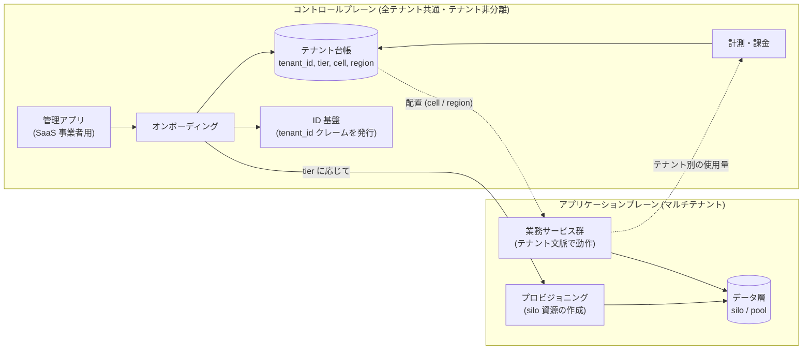
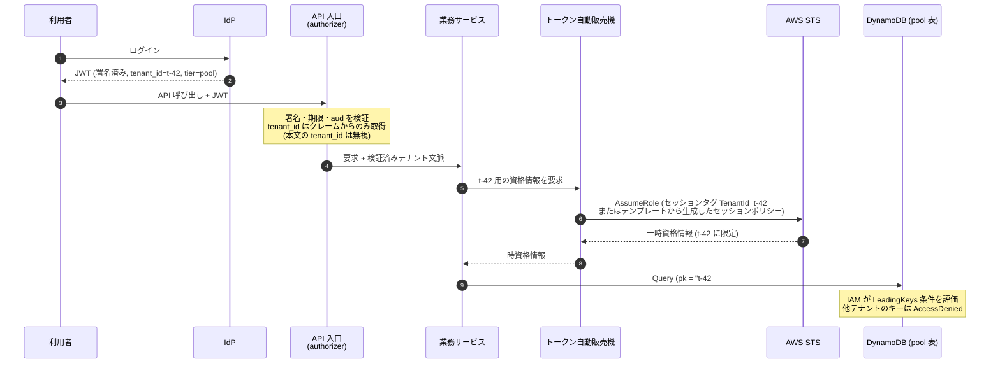

# マルチテナント SaaS 設計 (Multi-Tenant SaaS Architecture: Isolation Models, Tenant Context, Noisy Neighbors & Cross-Tenant Security)

## 概要 (Overview)

SaaS (Software as a Service) の事業性は、多数の顧客 (テナント, tenant) が同じソフトウェアと同じ基盤を共有することから生まれる。共有すれば資源を統計的に多重化でき、1 テナントあたりの原価と運用対象の数が下がる。しかし共有した分だけ、あるテナントのバグ・負荷・侵害が別のテナントへ漏れる経路も増える。マルチテナント設計とは、この**テナント分離 (tenant isolation)** と**多重化 (multiplexing) によるコスト効率**の交換条件を、どこで・どの程度選ぶかという問題である。

本ドキュメントの中心テーゼは 2 つ。(1) 分離か共有かはシステム全体で 1 回決めるものではなく、**層ごと (計算・データ・ネットワーク・ID) に、さらにテナントの等級ごとに個別に決める**ものである。AWS の用語でいう silo / pool / bridge は、この層別の選択を名前にしたものにすぎない。(2) どの選択をしても、**テナントは全層を貫いて伝播する第一級のコンテキスト**でなければならない。テナント ID が認証済みトークンから一度だけ導出され、データアクセスの資格情報そのものに焼き込まれるとき、分離は「全開発者が全クエリに `WHERE tenant_id = ?` を書き忘れない」という希望から、基盤が強制する性質へ変わる。分析深度は Level 3。版や状態に依存する記述は 2026-10-07 時点のものである。

## 方法論 (Methodology)

- マルチテナントを「どの部品を共有するか」の一覧ではなく、**層 × 分離度 × テナント等級**の 3 軸で分解する。各層について、分離を施行する主体 (DB エンジン・IAM・カーネル・ハイパーバイザ) と、その主体が破られたときの影響範囲を対応づける。
- 一般機構は既存文書に委ねる。セル・シャッフルシャーディング・アドミッション制御は [`cloud-control-planes.md`](cloud-control-planes.md)、STS・ポリシー評価・confused deputy は [`cloud-iam-authorization.md`](cloud-iam-authorization.md)、エンベロープ暗号化は [`cloud-kms-confidential-computing.md`](cloud-kms-confidential-computing.md)、DynamoDB のパーティションは [`cloud-databases-aurora-dynamodb.md`](cloud-databases-aurora-dynamodb.md)、コンテナの隔離等級は [`../virtualization/hardware-virtualization-containers.md`](../virtualization/hardware-virtualization-containers.md) と [`../security/sandbox-architectures.md`](../security/sandbox-architectures.md) を参照し、再導出しない。
- **出典階層上の注意**: silo / pool / bridge や control plane / application plane という語彙は、AWS の SaaS Lens と 2 つの whitepaper (*SaaS Architecture Fundamentals* 2022-08-03、*SaaS Tenant Isolation Strategies* 2020-08-01) に由来する。いずれも**ベンダー提示**であり、2 つの whitepaper は 2026-10 時点で AWS 自身が「historical reference only」と表示している。そこで語彙の定義はこれらから借りつつ、機構の主張は PostgreSQL・DynamoDB・IAM・Kubernetes の公式文書、査読付き論文 (SIGMOD '08 / '09, CCS '09)、事業者の公式セキュリティ公表 (MSRC, CSRB) と照合した。
- 越境事故 (cross-tenant incident) は、発見者 (Wiz) の技術記事と事業者 (Microsoft) の公表を突き合わせ、両者で一致する事実だけを使った。発見者側の影響推計は、その旨を明示する。

## 発見事項 (Findings)

1. **silo / pool / bridge は「システムの型」ではなく「資源ごとの選択の集計」である。** SaaS Lens は、テナントに専有資源を与える構成を silo、資源を共有する構成を pool と定義し、両者が混在する現実を bridge と呼ぶ。たとえば、規制の厳しいデータを持つマイクロサービスは silo、アクセスパターンとコストが効くサービスは pool、という使い分けである。重要なのは、silo であっても ID・オンボーディング・運用は全テナントで共有される点である。これが「顧客ごとに別製品を運用するマネージドサービス」と SaaS を分ける境界線だと SaaS Lens は述べている。つまり SaaS で完全に分離できるのはデータ平面だけで、コントロールプレーンは常に pool である。

2. **分離の強さは「誰が施行するか」で決まり、施行者の等級は層ごとに異なる。** 共有テーブルの `tenant_id` 列はアプリケーションが施行する。PostgreSQL の行レベルセキュリティ (Row-Level Security, RLS) は DB エンジンが施行する。DynamoDB の `dynamodb:LeadingKeys` は IAM が施行する。アカウント分離やセル分離はクラウドの制御系が、専有ノードや microVM はハイパーバイザが施行する。施行者がアプリケーションから遠く低い層にあるほど、アプリのバグで分離が破れる確率は下がる。その代わり資源の共有度、つまり多重化の利得も下がる。データ分割の 3 方式 (DB 単位・スキーマ単位・共有テーブル) の比較は、結局「施行者をどの層に置くか」の比較である。

3. **テナントコンテキストは「認証済みの主張」からだけ導出しなければならない。** テナント ID をリクエスト本文・クエリ文字列・独自ヘッダから読む設計は、利用者が値を書き換えるだけで他テナントのデータを指せる。OWASP API Security Top 10 (2023) が首位に置く BOLA (Broken Object Level Authorization) の、テナント版である。正しい形は、IdP が署名した JWT のクレーム (RFC 7519) からテナント ID を一度だけ取り出し、以後は下流へ伝播させることである。さらに進めると、その ID を**データアクセス用の資格情報に焼き込む**ことになる。AWS の whitepaper がトークン自動販売機 (token vending machine) と呼ぶのは、テンプレート化した IAM ポリシーにテナント ID を埋め、STS で一時資格情報を発行する機構である。こうするとコードに分離条件を書き忘れても、資格情報が他テナントのキーへの到達を拒む。

4. **RLS は強力だが、「迂回する主体」と「コンテキストの寿命」という 2 つの罠を持つ。** PostgreSQL の公式文書によれば、RLS を有効にしてポリシーが 1 つもない表は既定拒否になる。一方で、スーパーユーザと `BYPASSRLS` 属性のロールは常に RLS を迂回し、表の所有者も `FORCE ROW LEVEL SECURITY` を指定しない限り迂回する。参照整合性の検査 (一意制約・外部キー) も常に RLS を迂回するため、文書自身が「隠れチャネル (covert channel)」の可能性を警告している。運用面の罠はもう 1 つある。テナント ID をセッション変数 (`SET app.tenant_id`) で渡すと、コネクションプールで接続が再利用されたとき、前のリクエストのテナント文脈が次のリクエストへ持ち越される。`SET LOCAL` (トランザクション終了で元に戻る) で設定することが必須になる。

5. **ノイジーネイバー (noisy neighbor) への防御は、テナントを単位にした多段のアドミッション制御である。** pool の資源では、1 テナントの負荷急増がそのまま他テナントの遅延になる。防御は層ごとに重ねる。入口ではテナントごとのレート制限とクォータ、キューではテナントごとの公平キューイング (fair queuing)、配置ではシャッフルシャーディングとセルへのテナント固定が効く。ここで注意すべきは、API Gateway の usage plan が自らの制限を「ハードリミットではなくベストエフォート」と明記している点である。入口の制限は過負荷の緩和策であって、分離の保証ではない。最終的な隔離はセル境界や専有資源という構造で買う。Kubernetes の API Priority and Fairness (v1.29 GA) が、ユーザまたは namespace をフローの単位とし、シャッフルシャーディングでキューへ割り当てているのは、同じ解の制御平面版である。

6. **Kubernetes の namespace は「誤りの防止」には足りるが、「相互不信テナントの境界」にはならない。** Kubernetes 公式文書は、マルチテナントを「チーム間の共有 (multi-team)」と「SaaS 事業者が顧客ごとにワークロードを動かす共有 (multi-customer)」に分ける。そのうえで、hard / soft という二分法は定義が一つに定まらず、分離度は連続的なスペクトラムとして理解すべきだと注意している。namespace・RBAC・ResourceQuota・NetworkPolicy は制御平面の論理分離である。カーネルを共有している以上、データ平面の分離にはノード分離かサンドボックス化したランタイム (gVisor, Kata) が要る ([`container-orchestration-kubernetes.md`](container-orchestration-kubernetes.md) の「namespace はテナント境界ではない」)。namespace と専有クラスタの中間にある仮想制御平面 (vCluster 等) は、API の分離とデータ平面の共有を切り離す選択肢である。

7. **越境事故の多くは、データ平面ではなく「テナント横断の管理機構」の欠陥から起きている。** Azure Cosmos DB の ChaosDB (Wiz 報告, 2021-08) は、Jupyter Notebook 機能の設定不備から他顧客のプライマリキーを取得できた事例である。Microsoft は 2021-08-12 に報告を受け、機能を無効化した。Azure Database for PostgreSQL Flexible Server の ExtraReplica (2022-01 報告) は、複製用ユーザの証明書認証で正規表現の末尾が `(.*)` になっていたことが越境認証を許した事例である。Storm-0558 (2023) では、消費者向けアカウントの署名鍵で偽造したトークンが、企業向けの Exchange Online で受理された。トークン検証の欠陥である (CSRB 報告, 2024)。3 例とも、破れたのは個々のテナントのデータではない。全テナントに共通する鍵・複製経路・管理機能という「共有された特権」が破れている。

8. **テナント単位の運用能力 (計測・削除・移動・復元) こそが、pool を選ぶ代価である。** silo ではテナントの原価・バックアップ・削除・移転は資源単位の操作で済む。pool では、これらすべてが「共有資源の中からテナントの持ち分を切り出す」操作になる。原価は共有資源の消費をテナントへ按分しなければ分からない。GDPR 第 17 条の消去権 (right to erasure) に応えるには、共有テーブルとバックアップの中のテナント行を見つけ出す必要がある。セル間の移転は clone → flip → redirect → forget の手順を要する (AWS セル whitepaper)。pool の安さは、こうしたテナント単位の運用機構を作り込む前提で成り立っている。

## アーキテクチャ (Architecture)

### 2 つの平面 — コントロールプレーンとアプリケーションプレーン

AWS の *SaaS Architecture Fundamentals* は、SaaS 環境をテナントの登録・認証・管理・運用・分析を担う**コントロールプレーン (control plane)** と、テナントが実際に使う機能を担う**アプリケーションプレーン (application plane)** に分ける。同文書は「コントロールプレーンのサービス自体はマルチテナントではなく、全テナントに対してグローバルである」と注記している。オンボーディング時の資源プロビジョニングは、作る資源がアプリケーションプレーンに属するため、アプリケーションプレーン側に置かれている (ベンダー提示)。



テナント台帳は「テナント ID → 等級・セル・リージョン・鍵」の写像であり、[`cloud-control-planes.md`](cloud-control-planes.md) のセルルータが引く静的表の実体である。台帳が止まっても既存テナントの要求処理が続くよう、データプレーン側は配置情報を手元に保持しておく必要がある (静的安定性)。

### 層ごとの分離選択 — silo / pool / bridge の実体

| 層 | silo (専有) | pool (共有) | 施行者 | 典型的な等級分け |
|---|---|---|---|---|
| アカウント / セル | テナントごとの AWS アカウント・専用セル | 多数テナントを 1 セルへ | クラウド制御系・セルルータ | premium は専用セル |
| 計算 | 専有ノード, 専用クラスタ, microVM | 共有の Pod / 関数 / ノード | ハイパーバイザ / カーネル | 規制テナントは専有ノード |
| データ | DB / インスタンス単位 | スキーマ単位, 共有表 + `tenant_id` | DB エンジン (RLS) / IAM / アプリ | 大口は DB 単位 |
| ネットワーク | 専用 VPC / サブネット | 共有 VPC + NetworkPolicy / SG | VPC / CNI | 閉域接続は専用 |
| ID / 鍵 | テナント専用の IdP 設定・KMS 鍵 (BYOK) | 共有ユーザプール, 共有鍵 | IdP / KMS | 暗号鍵は早めに分ける |

1 つのシステムの中で、行ごとに違う列が選ばれるのが普通である。それが bridge の実態であり、テナント等級 (tier) はこの表のどの列を割り当てるかの「束」になる。等級を設計するときは、上位等級へ昇格したテナントを pool から silo へ**オンラインで移せる**ことが前提になる。

### テナントコンテキストの伝播 — 認証から資格情報まで



この流れの要は、手順 4 で「どのテナントか」が決まった後、手順 10 の判定を**アプリではなく IAM が行う**ことである。業務コードがテナント条件を書き忘れても、手元の資格情報には他テナントのキーへ届く権限がない。

## 技術詳細 (Technical Details)

### 1. データ分割の 3 方式と規模の算術

| 方式 | 分離の施行者 | テナント数の上限要因 | スキーマ変更 | ノイジーネイバー | テナント単位の削除・復元 |
|---|---|---|---|---|---|
| DB / インスタンス単位 | DB の認証・インスタンス境界 | インスタンス数・接続数・管理コスト | テナント数ぶんの移行を逐次実行 | 物理的に分離 | 資源ごとに削除・PITR できる |
| スキーマ単位 | DB の権限 (スキーマ / ロール) | カタログ肥大 (表数 × テナント数) | テナント数ぶんの DDL | 同一インスタンス内で競合 | `DROP SCHEMA`、復元は抽出が要る |
| 共有表 + `tenant_id` | アプリ, または RLS / IAM | 事実上なし (行が増えるだけ) | 1 回 | 行・索引・バッファを共有 | 行の削除、バックアップからの抽出が要る |

学術的な整理としては、Aulbach ら (SIGMOD '08) が共有表方式のスキーマ写像 (汎用表・ピボット表・Chunk Folding) を比較している。テナント固有の列拡張を、共有表のままどう実現するかという問題である。Salesforce はこの問題を**メタデータ駆動**で解いた代表例である (Weissman & Bobrowski, SIGMOD '09。Salesforce 公式の Architect 文書でも同じ構造を説明している)。テナントがオブジェクトや項目を定義しても、実際の DB 表は作られない。定義はメタデータ表 (MT_Objects, MT_Fields) に記録され、レコード値は共有のデータ表 MT_Data の汎用列 (Value0 … ValueN, 可変長文字列型) に格納される。索引が要る項目は、ピボット表 MT_Indexes へ同期的に複製される。全データ・メタデータ・索引は OrgID (テナント ID) でネイティブにパーティション分割されている。さらに Apex コードの CPU 時間・メモリ・クエリ数には上限 (governor limits) がある。共有表方式の「スキーマを持たない共有」と「実行時資源の上限」を最も徹底した形である (ベンダー提示)。

### 2. PostgreSQL RLS — 実装例と罠の一覧

```sql
-- Language: PostgreSQL (SQL)
-- Purpose: 共有表をトランザクション単位のテナント文脈で RLS 保護する最小例
-- Source: postgresql.org/docs/current/ddl-rowsecurity.html (CREATE POLICY, FORCE)
--         と sql-set.html (SET LOCAL) の記述を組み合わせた説明用の構成
ALTER TABLE orders ENABLE ROW LEVEL SECURITY;
ALTER TABLE orders FORCE ROW LEVEL SECURITY;      -- 所有者ロールにも適用する
CREATE POLICY tenant_isolation ON orders
  USING      (tenant_id = current_setting('app.tenant_id')::uuid)   -- 読み・更新・削除の対象
  WITH CHECK (tenant_id = current_setting('app.tenant_id')::uuid);  -- 挿入・更新後の行

-- アプリは要求ごとに、トランザクション内で文脈を設定する
BEGIN;
SET LOCAL app.tenant_id = '9b1d...';   -- COMMIT / ROLLBACK で自動的に元に戻る
SELECT * FROM orders WHERE status = 'open';
COMMIT;
```

- **迂回する主体**: スーパーユーザと `BYPASSRLS` ロールは常に迂回する。アプリの接続ロールは表の所有者にせず、`FORCE` も併用する。マイグレーション用の所有者ロールと実行時ロールは分ける。
- **ビュー**: ビューは既定でビュー所有者の権限で表を読むため、所有者が RLS を迂回できると、ビュー経由で全テナントの行が見える。PostgreSQL 15 以降は `security_invoker` で呼び出し側の権限に切り替えられる。
- **文脈の寿命**: セッション単位の `SET` は、プールで接続を再利用したときに次の要求へ持ち越される。PgBouncer のトランザクションモードなどでは、`SET LOCAL` (または `set_config(..., true)`) が唯一安全な形になる。未設定のときに `current_setting` がエラーになるか空になるかは書き方次第なので、未設定時に**どの行も見えない**ことを試験で確かめておく。
- **隠れチャネル**: 一意制約と外部キーの検査は RLS を迂回する。そのため「他テナントにこの値が存在するか」が挿入の成否から推測できる。一意制約は `(tenant_id, …)` の複合にする。
- **性能**: ポリシーの述語は全クエリに付加されるため、`tenant_id` を先頭に持つ索引 (または `tenant_id` によるパーティション) が要る。leakproof でない関数は述語の後に評価されるので、計画が劣化することがある。

### 3. DynamoDB — テナント接頭辞と LeadingKeys

共有表ではパーティションキーを `tenantId#entityId` の形にし、テナントの全項目をそのテナント接頭辞の下に置く。DynamoDB の公式文書は、`dynamodb:LeadingKeys` (パーティションキー値) を条件にして、項目単位でアクセスを制限する方法を示している。この条件キーには `ForAllValues` 修飾子が必須である。

```jsonc
// Language: AWS IAM policy (JSON)
// Purpose: セッションタグ TenantId を持つ一時資格情報が、自テナント接頭辞の項目だけを扱えるようにする
// Source: DynamoDB Developer Guide "Using IAM policy conditions for fine-grained access control"
//         Example 2 を、IAM のセッションタグ (aws:PrincipalTag) と組み合わせた説明用の構成
{
  "Version": "2012-10-17",
  "Statement": [{
    "Effect": "Allow",
    "Action": ["dynamodb:GetItem", "dynamodb:BatchGetItem", "dynamodb:Query",
               "dynamodb:PutItem", "dynamodb:UpdateItem", "dynamodb:DeleteItem",
               "dynamodb:BatchWriteItem"],
    "Resource": "arn:aws:dynamodb:us-west-2:123456789012:table/AppData",
    "Condition": {
      "ForAllValues:StringLike": {
        "dynamodb:LeadingKeys": ["${aws:PrincipalTag/TenantId}#*"]
      }
    }
  }]
}
```

- **Scan を許可しない**: 公式文書は、`Scan` はリーディングキーに関係なく全項目を返すため許可リストから外すよう明記している。テナント横断の分析は、別経路 (エクスポート → テナントごとに分けた分析基盤) に分ける。
- **ポリシー変数の版**: ポリシー変数を使うには `"Version": "2012-10-17"` が必須である。
- **タグの発行権限**: セッションタグを渡すには、ロールの信頼ポリシーで `sts:TagSession` を許可する必要がある。`aws:RequestTag` で渡せる値を絞らないと、TVM 以外の主体が任意の TenantId を名乗れてしまう。タグは 1 セッション 50 個まで、値は 256 文字までで、セッションポリシーの平文は合計 2048 文字までである (IAM 公式文書)。
- **静的ポリシーか動的生成か**: テナントごとに IAM ロールやポリシーを作ると、テナント数に比例して IAM のクォータと管理対象が増える。*SaaS Tenant Isolation Strategies* は、実行時にテンプレートへテナント文脈を埋めて資格情報を発行する方式を、この規模問題への解として示している。ただし同文書は、テンプレートが分離要件を正しく施行することを保証する責任は自分で負うことになる、とも述べている (ベンダー提示)。ABAC (セッションタグ + `aws:PrincipalTag`) は、ポリシーを 1 つに保ったまま同じ効果を得る形である。
- **ホットパーティション**: 大口テナントの接頭辞に書き込みが集中すると、パーティション単位のスループットに当たる ([`cloud-databases-aurora-dynamodb.md`](cloud-databases-aurora-dynamodb.md))。大口テナントにはキーへの書き込み分散 (サフィックス付与) を行うか、silo の表へ昇格させる。

### 4. ノイジーネイバー対策 — 入口・キュー・配置

```text
// Pseudocode: テナント等級別のアドミッション制御 (入口の 1 段目)
// Complexity: 要求あたり O(1) (テナント ID をキーにしたハッシュ表引き + トークン補充の算術)
// Assumptions: tenant_id は検証済み JWT から取得済み。バケット状態はノードローカル
//              (全体の厳密な上限ではなく、ノード数倍まで許す近似)。
function admit(req):
    t      = req.verified_tenant_id
    limits = tier_limits[tenant_registry[t].tier]   // 例: pool=100 rps, premium=1000 rps
    b      = buckets.get_or_create(t, limits.burst)
    b.refill(now(), limits.rate)
    if b.tokens >= req.cost:            // cost は要求の重さ (書き込み・検索で変える)
        b.tokens -= req.cost
        return ADMIT
    return REJECT_429(retry_after = b.time_to(req.cost))
```

- **入口**: 上の擬似コードのような等級別の制限は、外部 API の段で行う。API Gateway の usage plan も、API キー単位のスロットリングとクォータを提供する。ただし AWS 自身が、これらはベストエフォートでありコスト管理やアクセス遮断に頼るなと注記している。また API キーを認証・認可に使ってはならないとも明記している。
- **キュー**: 非同期処理では、テナント混在の単一 FIFO に大口テナントのバッチが積まれると、他テナントの処理が後ろに並ぶ。テナントごとのサブキューを公平に巡回する (fair queuing) か、等級ごとにキューを分ける。Kubernetes の APF は、FlowSchema とフロー識別子 (ユーザまたは namespace) でフローを分け、シャッフルシャーディングでキューへ割り当てる。低強度のフローを高強度のフローから守るための設計である。
- **配置**: シャッフルシャーディング (テナントにワーカーの組を固定割当) とセル (テナントを完結したスタックへ固定) の算術は [`cloud-control-planes.md`](cloud-control-planes.md) が扱う。SaaS に固有なのは、「最大テナントが 1 セルに収まるか」という下限制約と、テナントの成長に伴う**セル間移転**である。AWS のセル whitepaper は、状態を移す手順を clone (非正本の複製) → flip (新しい側を正本化) → redirect (旧位置から新位置へ転送) → forget (旧データの消去) と整理している。移転中はルータの写像が新旧 2 版になるので、旧セルに転送の印を残す必要がある。容量制御との接続は [`autoscaling-capacity-control.md`](autoscaling-capacity-control.md) を参照する。

### 5. Kubernetes 上のマルチテナント

| モデル | 制御平面の分離 | データ平面の分離 | 主な道具 | 向く場面 |
|---|---|---|---|---|
| namespace / テナント | RBAC・ResourceQuota・LimitRange・APF | NetworkPolicy のみ (カーネル共有) | 標準 API, Capsule 等 | multi-team, 信頼できるテナント |
| namespace + 専有ノード / サンドボックス | 同上 | taint / toleration による専有ノード, RuntimeClass (gVisor, Kata) | ノードプール, microVM | multi-customer の pool |
| 仮想制御平面 (vCluster 等) | テナントごとの API サーバ・データストア | 共有ノード (syncer がホストの namespace へ同期) または専有ノード | vCluster | テナントに CRD や cluster-admin 相当を渡す場合 |
| クラスタ / テナント | 完全分離 | 完全分離 | クラスタのフリート管理 | silo 等級, 規制要件 |

- **namespace の限界**: namespace は名前の範囲であり、Node・CRD・ClusterRole・Webhook などクラスタスコープの資源は分けられない。Kubernetes 公式文書は、テナント単位ではなくワークロード単位で namespace を切ることを勧め、名前をフリート全体で一意にしておけば、後で専有クラスタと共有クラスタの間を移しやすいと述べている。網の分離は [`kubernetes-networking.md`](kubernetes-networking.md) が扱う「既定は全許可」から始まり、ストレージの分離 (StorageClass ごとの暗号鍵、PV の再利用) は [`kubernetes-storage.md`](kubernetes-storage.md) が扱う。
- **階層 namespace**: 方針とクォータを namespace の木で継承させる Hierarchical Namespace Controller (HNC) は、wg-multitenancy の下で開発されたが、リポジトリは 2025-04-17 にアーカイブされた。新規採用は勧められない。
- **vCluster**: テナントごとの API サーバ・コントローラマネージャ・データストア (既定は組み込み SQLite、etcd や PostgreSQL にも変更可能) を、ホストクラスタの 1 Pod として動かす。共有ノード構成では、syncer が Pod・Service・Secret などをホストの専用 namespace へ写す。API の分離は強まるが、共有ノードではカーネルの共有は解消されない (OSS / ベンダー一次資料)。

### 6. 計測と原価配賦 — テナント単位の単位経済

pool では、クラウドの請求書はテナントを知らない。テナントあたりの原価を出すには、次の 3 つを組み合わせる必要がある。

1. **専有資源の直接計上**: silo 資源にテナント ID のタグを付けて集計する。
2. **共有資源の按分**: 要求数・CPU 時間・保存量・読み書き容量など、テナント別に計測した消費量で按分する。
3. **共通費**: コントロールプレーンなど、按分しきれない費用は別枠で扱う。

計測はアプリケーションプレーンが出すテナント別メトリクスに依存するため、テナント文脈をログとメトリクスの必須次元にしておくことが前提になる。按分の精度は、価格設計 (等級・従量課金) の正しさに直結する。原価構造の一般論は [`cloud-cost-structure-finops.md`](cloud-cost-structure-finops.md) に委ねる。注意すべきは、メトリクスに高カーディナリティのテナント次元を付けること自体が観測基盤の費用を押し上げる点である ([`cloud-observability.md`](cloud-observability.md))。全テナントの全次元ではなく、上位テナントは個別に、残りはまとめて、という階層化が現実解になる。

### 7. 運用 — デプロイ・バックアップ・削除・所在地

- **テナント集団 (cohort) へのデプロイ**: pool では 1 回のデプロイが全テナントに当たる。セルや等級をデプロイの波として使い、内部テナント → 無料等級 → 一般 → premium の順に広げる ([`deployment-safety-progressive-delivery.md`](deployment-safety-progressive-delivery.md))。silo の数が増えると、全 silo を同じ版に揃えておくこと自体が運用負荷になる。版のばらつき (version drift) を許すと、SaaS の「単一の運用経験」という前提が崩れる。
- **テナント単位の復元**: 共有 DB の PITR (point-in-time recovery) はインスタンス全体を巻き戻す。1 テナントの誤削除を戻すには、別インスタンスへ復元してからそのテナントの行だけを抽出し、書き戻す手順を事前に用意しておく必要がある。
- **削除 (GDPR 第 17 条)**: 消去権は、データ主体の要求に応じて「不当な遅滞なく」消去する義務を定める。共有表とバックアップの両方に及ぶ実装上の手段として、テナント単位の鍵で暗号化し、鍵の破棄によって復号不能にする方式 (crypto-shredding) がある。これは工学上の手段であり、それだけで法的な消去要件を満たすかどうかの判断は法務の領分である。
- **データ所在地 (data residency)**: テナント台帳に所在リージョンを持たせ、セル配置・バックアップ先・ログ転送先までその制約に従わせる。グローバルに共有したくなるのは、コントロールプレーン・検索索引・分析基盤・サポート用ツールといった「横断的な部品」であり、ここが所在地制約の漏れ口になりやすい ([`multi-region-global-architecture.md`](multi-region-global-architecture.md))。

## セキュリティ考察 (Security Considerations)

- **越境の第一経路は共有された特権である。** ChaosDB では、Notebook 機能の設定不備から、他顧客の Cosmos DB アカウントの長命なプライマリキー (完全な読み書き権限) を取得できた。Microsoft の公表によれば、報告は 2021-08-12、機能は直ちに無効化された。研究者の活動期間 (2021-08-07〜13) に機能を使っていた顧客などへ、鍵の再生成を要請している。同社は、研究者以外の第三者による顧客データへのアクセスはなかったとしている。ExtraReplica では、PostgreSQL エンジン内の権限昇格と、複製ユーザの証明書 CN を照合する正規表現の末尾 `(.*)` の 2 つが連鎖した。公開アクセス構成の Flexible Server がリージョン内で越境認証を許す状態だった (Wiz によれば 2022-01-11 報告、2022-02-25 に全インスタンスへ修正適用。Single Server は影響外)。どちらも、テナントのデータ平面ではなく「全テナントの鍵や複製を扱う管理経路」が破れた事例である。
- **鍵の適用範囲 (scope) はテナント境界と一致させる。** Storm-0558 について CSRB は、2016 年の MSA (消費者向け) 署名鍵が盗まれたことと、その鍵で署名したトークンが企業向け Exchange Online で受理されたトークン検証の欠陥の組み合わせが、ほぼ任意の Exchange Online アカウントへのアクセスを許したと結論した。テナントの種類をまたいで鍵を受理する検証系は、全テナント共通の単一障害点になる。トークン検証では、発行者 (iss)・対象 (aud)・テナントクレームを、鍵の所属と突き合わせる必要がある。
- **confused deputy**: テナントの代わりに共有資源へアクセスするサービス (エクスポート、Webhook、外部ストレージ連携) は、「テナント A の要求で、テナント B の資源を指す」入力を受けたとき、自分の権限で実行してしまう危険がある。外部 ID・`aws:SourceArn` 条件などによる防御は [`cloud-iam-authorization.md`](cloud-iam-authorization.md) が扱う。SaaS の設計原則としては、代理サービスもトークン自動販売機を通して**そのテナントに限定した資格情報**で動かすことになる。
- **テナント単位の鍵と BYOK**: テナントごとの KMS 鍵は、暗号学的な分離と crypto-shredding を同時に与える。BYOK (顧客管理鍵) では顧客が鍵を無効化すれば事業者も読めなくなるので、規制テナントへの説明力が高い。代わりに、鍵の無効化が自社サービスの障害として現れる。KMS の顧客管理鍵は既定で 1 アカウント・1 リージョンあたり 100,000 個 (引き上げ可能) なので、全テナントに専用鍵を割り当てられるかは規模次第である。暗号化コンテキストにテナント ID を入れれば、鍵の取り違えを復号の失敗として検出できる ([`cloud-kms-confidential-computing.md`](cloud-kms-confidential-computing.md))。
- **共有ハードウェアのサイドチャネル**: Ristenpart ら (CCS '09) は、公開クラウドで攻撃者が標的と同じ物理ホストへの同居を狙い、キャッシュ経由で情報を漏洩させうることを実証した。共有カーネル上のコンテナは、さらに広い攻撃面を持つ。pool の計算層に相互不信テナントを載せるなら、境界にはハードウェア仮想化を置く ([`../virtualization/hardware-virtualization-containers.md`](../virtualization/hardware-virtualization-containers.md), [`../security/sandbox-architectures.md`](../security/sandbox-architectures.md))。暗号処理のような機微な処理は、等級によって専有ホストへ移す。
- **分離の試験**: 分離は機能試験では検出できない種類の欠陥である。2 つの試験テナントを常設し、「テナント A の資格情報で B の ID を指す」要求を、全 API について自動で投げ続ける負の試験を CI と本番の合成監視に組み込む。Wiz の PEACH フレームワークは、権限 (Privilege)・暗号 (Encryption)・認証 (Authentication)・接続 (Connectivity)・衛生 (Hygiene) の 5 軸で、テナント境界の強度を審査する観点を示している (ベンダー提示)。
- **ログ自体が越境経路になる**: テナント別の観測データを顧客に見せる機能 (監査ログのエクスポート、ダッシュボード) は、それ自体がテナント分離の対象である。サポート担当者による横断検索は、最小権限と監査のもとに置く。

## 結論 (Conclusions)

マルチテナント SaaS の設計は、分離と多重化のどちらかを選ぶ問題ではない。層ごと・テナント等級ごとに、その交換条件を個別に決める問題である。silo / pool / bridge はその選択の名前にすぎず、実際のシステムでは計算・データ・ネットワーク・ID・鍵の各層で違う列が選ばれる。どの列を選んだかより重要なのは、分離を**誰が施行しているか**である。アプリケーションのコードが施行する分離は、開発者が 1 箇所書き忘れるだけで破れる。DB エンジンの RLS や IAM の条件キー、ハイパーバイザが施行する分離は、アプリのバグに対して頑健である。ただし共有度、すなわち多重化の利得はその分だけ下がる。

テナント文脈を第一級に扱うとは、テナント ID を認証済みトークンからだけ導出し、以後のあらゆる層 (ログ・メトリクス・キュー・資格情報・鍵) にその ID を必須の次元として通すことである。特に、トークン自動販売機や ABAC によってテナント ID を**資格情報そのものに焼き込む**設計は、分離の施行を規約から基盤へ移す要の一手である。

越境事故の実例からは、破れるのは個々のテナントのデータではなく、全テナントに共通する特権 (管理機能・複製経路・署名鍵) だという教訓が読み取れる。したがって分離の審査は、データ平面のクエリよりも、コントロールプレーンと運用・管理の経路に重点を置くべきである。最後に、pool の安さは「テナント単位の計測・復元・削除・移転」という運用機構を作り込んではじめて現実のものになる。これらを後回しにした pool は、安いのではなく、費用を将来へ繰り延べているにすぎない。

### 次の接続先 (Related Topics)

- [`cloud-control-planes.md`](cloud-control-planes.md) — セル・シャッフルシャーディング・アドミッション制御の算術。本書のノイジーネイバー対策の基礎。
- [`cloud-iam-authorization.md`](cloud-iam-authorization.md) — STS・ポリシー評価・confused deputy。テナント限定資格情報の評価論理。
- [`cloud-kms-confidential-computing.md`](cloud-kms-confidential-computing.md) — テナント単位の鍵、暗号化コンテキスト、enclave による処理の分離。
- [`container-orchestration-kubernetes.md`](container-orchestration-kubernetes.md) / [`kubernetes-networking.md`](kubernetes-networking.md) / [`kubernetes-storage.md`](kubernetes-storage.md) — Kubernetes 上で分離を構成する部品。
- [`cloud-cost-structure-finops.md`](cloud-cost-structure-finops.md) — テナント別の原価配賦を載せる原価構造の一般論。
- [`deployment-safety-progressive-delivery.md`](deployment-safety-progressive-delivery.md) — テナント集団とセルを波にした段階的デプロイ。
- [`../databases/transactions-isolation.md`](../databases/transactions-isolation.md) — RLS の文脈がトランザクション境界に従う理由と、共有 DB の分離水準。

## 参考文献 (References)

**一次資料 (Primary — 公式文書・標準)**

- [PostgreSQL Documentation: Row Security Policies](https://www.postgresql.org/docs/current/ddl-rowsecurity.html) — Accessed: 2026-10-07。既定拒否、BYPASSRLS・所有者の迂回、FORCE、permissive / restrictive、参照整合性検査による隠れチャネル (文書版 18.6)。
- [PostgreSQL Documentation: SET](https://www.postgresql.org/docs/current/sql-set.html) — Accessed: 2026-10-07。`SET LOCAL` のトランザクション内の有効範囲。
- [PostgreSQL Documentation: CREATE VIEW](https://www.postgresql.org/docs/current/sql-createview.html) — Accessed: 2026-10-07。`security_invoker` オプション。
- [Amazon DynamoDB Developer Guide: Using IAM policy conditions for fine-grained access control](https://docs.aws.amazon.com/amazondynamodb/latest/developerguide/specifying-conditions.html) — Accessed: 2026-10-07。`dynamodb:LeadingKeys` と `ForAllValues` の必須、Scan の除外、ポリシー変数の版。
- [AWS IAM User Guide: Pass session tags in AWS STS](https://docs.aws.amazon.com/IAM/latest/UserGuide/id_session-tags.html) — Accessed: 2026-10-07。`sts:TagSession`、タグ数・長さ・セッションポリシー長の上限、ABAC。
- [AWS KMS Developer Guide: Resource quotas](https://docs.aws.amazon.com/kms/latest/developerguide/resource-limits.html) — Accessed: 2026-10-07。顧客管理鍵 100,000 個 / リージョン (調整可能)。
- [Amazon API Gateway Developer Guide: Usage plans and API keys for REST APIs](https://docs.aws.amazon.com/apigateway/latest/developerguide/api-gateway-api-usage-plans.html) — Accessed: 2026-10-07。スロットリングとクォータがベストエフォートであること、API キーを認可に使わないこと。
- [Kubernetes Documentation: Multi-tenancy](https://kubernetes.io/docs/concepts/security/multi-tenancy/) — Accessed: 2026-10-07。multi-team / multi-customer、hard / soft のスペクトラム、namespace 単位・仮想制御平面・専有クラスタ。
- [Kubernetes Documentation: API Priority and Fairness](https://kubernetes.io/docs/concepts/cluster-administration/flow-control/) — Accessed: 2026-10-07。v1.29 で stable、フロー識別子とシャッフルシャーディングによるキュー割当。
- [kubernetes-sigs/hierarchical-namespaces (GitHub)](https://github.com/kubernetes-sigs/hierarchical-namespaces) — Accessed: 2026-10-07。2025-04-17 にアーカイブ。
- Jones, M., Bradley, J., & Sakimura, N. (2015). JSON Web Token (JWT). *RFC 7519*. DOI: 10.17487/RFC7519
- [Regulation (EU) 2016/679 (General Data Protection Regulation), Article 17](https://eur-lex.europa.eu/eli/reg/2016/679/oj) — Accessed: 2026-10-07。消去権。
- [OWASP API Security Top 10 2023: API1 Broken Object Level Authorization](https://api-security.owasp.org/editions/2023/en/0xa1-broken-object-level-authorization) — Accessed: 2026-10-07。

**一次資料 (Primary — 査読付き論文)**

- Aulbach, S., Grust, T., Jacobs, D., Kemper, A., & Rittinger, J. (2008). Multi-Tenant Databases for Software as a Service: Schema-Mapping Techniques. *SIGMOD '08*. DOI: 10.1145/1376616.1376736
- Weissman, C. D., & Bobrowski, S. (2009). The Design of the Force.com Multitenant Internet Application Development Platform. *SIGMOD '09*, 889–896. DOI: 10.1145/1559845.1559942 — メタデータ駆動の共有表方式の一次記述。
- Ristenpart, T., Tromer, E., Shacham, H., & Savage, S. (2009). Hey, You, Get Off of My Cloud: Exploring Information Leakage in Third-Party Compute Clouds. *CCS '09*, 199–212. DOI: 10.1145/1653662.1653687
- Hardy, N. (1988). The Confused Deputy (or why capabilities might have been invented). *ACM SIGOPS Operating Systems Review*, 22(4), 36–38. DOI: 10.1145/54289.871709

**事故の公表 (Primary — 事業者・政府の公式報告)**

- [MSRC: Update on the vulnerability in the Azure Cosmos DB Jupyter Notebook Feature (2021-08-27)](https://www.microsoft.com/en-us/msrc/blog/2021/08/update-on-vulnerability-in-the-azure-cosmos-db-jupyter-notebook-feature) — Accessed: 2026-10-07。報告日、研究者の活動期間、第三者アクセスなしの結論。
- [Cyber Safety Review Board: Review of the Summer 2023 Microsoft Exchange Online Intrusion](https://www.cisa.gov/sites/default/files/2024-04/CSRB_Review_of_the_Summer_2023_MEO_Intrusion_Final_508c.pdf) — Accessed: 2026-10-07。

**ベンダー提示 (Vendor-presented)**

- [AWS Well-Architected SaaS Lens: Silo, Pool, and Bridge Models](https://docs.aws.amazon.com/wellarchitected/latest/saas-lens/silo-pool-and-bridge-models.html) — Accessed: 2026-10-07。
- [AWS Whitepaper: SaaS Architecture Fundamentals (2022-08-03)](https://docs.aws.amazon.com/whitepapers/latest/saas-architecture-fundamentals/saas-architecture-fundamentals.html) — Accessed: 2026-10-07。control plane / application plane の定義。2026-10 時点で historical reference と表示。
- [AWS Whitepaper: SaaS Tenant Isolation Strategies (2020-08-01) — Scaling and managing pool isolation policies](https://docs.aws.amazon.com/whitepapers/latest/saas-tenant-isolation-strategies/scaling-and-managing-pool-isolation-policies.html) — Accessed: 2026-10-07。トークン自動販売機と動的ポリシー生成。historical reference と表示。
- [AWS Whitepaper: Reducing the Scope of Impact with Cell-Based Architecture — Cell migration](https://docs.aws.amazon.com/wellarchitected/latest/reducing-scope-of-impact-with-cell-based-architecture/cell-migration.html) — Accessed: 2026-10-07。clone / flip / redirect / forget。
- [Salesforce Architects: Platform Multitenant Architecture](https://architect.salesforce.com/fundamentals/platform-multitenant-architecture) — Accessed: 2026-10-07。UDD、MT_Data の汎用列、OrgID パーティション、governor limits。
- [vCluster Documentation: Architecture](https://www.vcluster.com/docs/vcluster/introduction/architecture) — Accessed: 2026-10-07。仮想制御平面の構成と syncer。
- [Wiz: ChaosDB — How we hacked thousands of Azure customers' databases](https://www.wiz.io/blog/chaosdb-how-we-hacked-thousands-of-azure-customers-databases) — Accessed: 2026-10-07。発見者の技術記述 (影響範囲の推計は発見者側の主張)。
- [Wiz: ExtraReplica — cross-account database vulnerability in Azure PostgreSQL](https://www.wiz.io/blog/wiz-research-discovers-extrareplica-cross-account-database-vulnerability-in-azure-postgresql) — Accessed: 2026-10-07。報告・修正日、2 つの脆弱性の連鎖、影響構成。
- [Wiz: Introducing PEACH, a tenant isolation framework for cloud applications](https://www.wiz.io/blog/introducing-peach-a-tenant-isolation-framework-for-cloud-applications) — Accessed: 2026-10-07。
