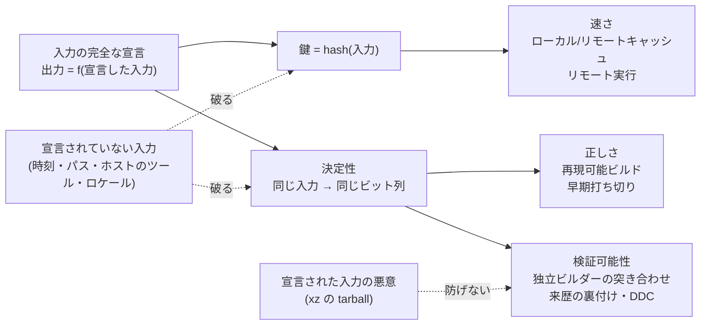
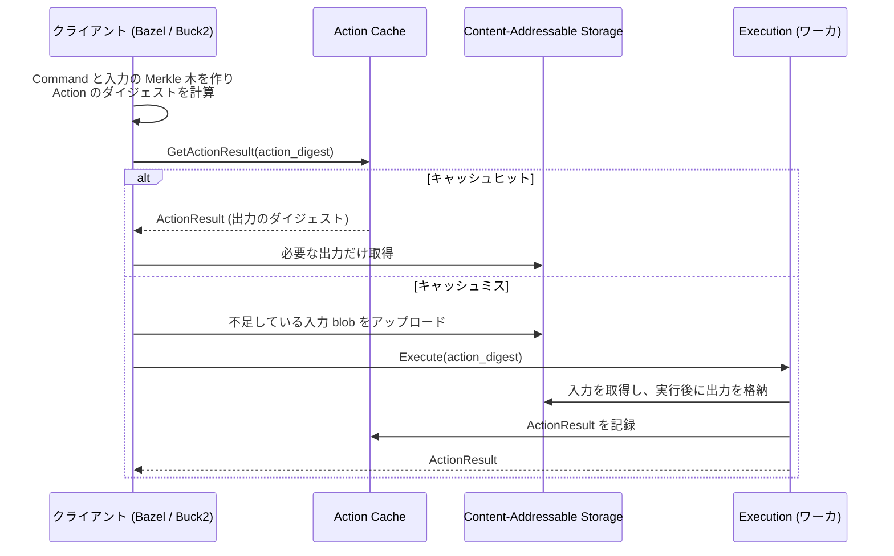

# ビルドシステムと再現可能ビルド (Build Systems & Reproducible Builds)

## 概要 (Overview)

ビルドシステム (build system) は、ソースと設定からなる入力の集合から、成果物の集合を計算する仕組みである。コンパイラとリンカが1つの翻訳単位や1つの実行ファイルを作る道具だとすれば、ビルドシステムはその呼び出しを依存グラフ (dependency graph) の上で並べ、前回の結果をどこまで使い回せるかを判断する。

本書の中心テーゼは次のとおりである。**ビルドの速さ (キャッシュ)、正しさ (再現性)、検証可能性 (サプライチェーン) は、いずれも「ビルドの入力をすべて宣言し、各ステップの出力を宣言した入力だけの関数にする」という一つの性質から得られる。** 入力が完全に宣言されていれば、入力のハッシュを鍵にした結果の使い回しは正しく、別の機械で同じ鍵を計算すれば同じ結果を共有でき、第三者が同じ入力から同じビット列を作れれば成果物の出所を確かめられる。逆に、宣言されていない入力が1つでも残ると、キャッシュは誤った結果を返し、再現は失敗し、検証は意味を失う。

ただし、この性質は必要条件であって十分条件ではない。宣言された入力そのものが悪意を含めば、ビルドはそれを忠実に再現する。xz/liblzma 事件 (2024) は、宣言の境界をどこに引くかという問題でもあった。サプライチェーン全体の防御 (署名、SBOM、依存かく乱など) は [`../security/software-supply-chain-security.md`](../security/software-supply-chain-security.md) が扱い、本書はビルドの側、つまり依存グラフの計算、キャッシュの鍵、パッケージの依存解決、非決定性の除去を扱う。分析深度は Level 3。

## 方法論 (Methodology)

- ビルドシステムの分類には Mokhov・Mitchell・Peyton Jones の "Build Systems à la Carte" (ICFP 2018、増補版は JFP 2020) の枠組みを使う。ビルドシステムを「スケジューラ (scheduler)」と「再構築の判定 (rebuilder)」の組として捉え、Make・Bazel・Nix などを同じ表の上に置く[^bsalc][^bsalc-jfp]。
- キャッシュとリモート実行は、Bazel の公式文書と Remote Execution API の proto 定義 (bazelbuild/remote-apis) から、アクションの鍵が何から計算されるかを読む[^bazel-cache][^reapi]。
- 依存解決は計算量 (NP 完全性) の結果を査読論文と Cox の証明で確かめ[^abate][^cox-sat]、各エコシステムの公式文書で、それぞれがどの制約を緩めてこの困難を避けているかを対比する。
- 再現可能ビルドの定義と SOURCE_DATE_EPOCH は reproducible-builds.org の仕様を一次資料とし[^rb-def][^sde]、非決定性の原因は Lamb & Zacchiroli (IEEE Software 2022) で裏付ける[^lamb]。
- ディストリビューションの達成率は 2026-10-24 に各プロジェクトの公開ダッシュボードから取得した値である。測定方法がプロジェクトごとに違うため、数字を横に並べて優劣をつけることはしない。
- サプライチェーン上の意味は SLSA v1.2 の仕様、Thompson (1984)、Wheeler の多様二重コンパイル (DDC) から読む[^slsa-future][^thompson][^wheeler2009]。

## 発見事項 (Findings)

1. **ビルドシステムの設計は「どの順で実行するか」と「再実行が要るかをどう判定するか」の2軸でほぼ決まる。** Mokhov らはスケジューラを topological・restarting・suspending の3種、再構築の判定を dirty bit・verifying traces・constructive traces・deep constructive traces の4種に分け、12通りの組み合わせのうち8つに既存のビルドシステムが入ることを示した[^bsalc]。Make は topological と dirty bit、Bazel は restarting と constructive traces、Nix は suspending と deep constructive traces の組である。

2. **Make の時刻比較は内容ではなくファイルシステムのメタデータを判定に流用しているため、正しさも共有も保証できない。** Make にとって「成果物が依存より古い」ことが dirty bit の代わりになる。この dirty bit は Make の管理下にないので、`touch` で内容を変えずに時刻だけ変えれば Make はだまされ、時刻を巻き戻すバックアップソフトでも判定を誤る[^bsalc]。さらに、出力が変わらなかったときに下流の再構築を止める早期打ち切り (early cutoff) は、時刻ベースでは原理的に実現できない[^bsalc]。

3. **内容ハッシュとアクションの鍵に切り替えると、「変わったか」の判定が「この関数をこの引数で計算したことがあるか」の検索に変わる。** Bazel のアクションは入力、出力名、コマンドライン、環境変数を持ち、アクションキャッシュはアクションのハッシュから結果のメタデータへの写像である[^bazel-cache]。鍵が入力だけで決まるので、結果を機械をまたいで共有できる。ただしこれが正しいのは入力がすべて鍵に入っているときだけで、Bazel 自身が「ワークスペース外のツールは追跡しない」ため、別のコンパイラを使う2人が誤ってキャッシュを共有しうると警告している[^bazel-cache]。宣言漏れは速さの問題ではなく、正しさの問題になる。

4. **Remote Execution API は、この性質を通信プロトコルとして固定した。** Action は実行に要る情報をすべて持ち、Action のダイジェストがアクションキャッシュの鍵になる。入力はディレクトリの Merkle 木としてダイジェストで参照され、環境変数は名前順に並べることが必須とされる。同じ意味の Action が同じダイジェストになるようにするためである[^reapi]。Bazel だけでなく Buck2 もこの API を話すサービスでリモート実行できる[^buck2-re]。

5. **パッケージの依存解決は一般には NP 完全であり、各エコシステムの違いは「どの仮定を捨ててその困難を避けたか」の違いである。** 「同じパッケージの2つのバージョンは同時に入れられない」「バージョンごとに依存が違ってよい」という仮定のもとで、3-SAT は依存解決に帰着できる[^cox-sat][^abate]。Go の MVS は制約を「最小バージョンの指定」に限ってグラフ探索だけで解き[^cox-mvs]、Cargo と npm は互換でないバージョンの共存を許し[^cargo-resolver][^npm-folders]、pip は1環境1バージョンを守ったままバックトラックする[^pip-resolver]。どの方式でも、lockfile は「解決の結果」を宣言された入力に変える。

6. **再現可能ビルドとはビルド環境の「関係する属性」を明示し、その集合をできるだけ小さくする作業である。** 定義は「同じソース、ビルド環境、ビルド手順から、誰でもビット単位で同一の成果物を作れる」ことで、環境の属性 (依存とそのバージョン、ビルドフラグ、ロケールなどの環境変数) は小さいほど望ましいとされる[^rb-def]。非決定性の最大の源は時刻であり[^lamb]、SOURCE_DATE_EPOCH はそれを入力として宣言し直すための規約である[^sde]。Go 1.21 のツールチェーンは関係する入力をソースコードだけにまで減らした例である[^go-rebuild]。

7. **2026-10 時点で、主要ディストリビューションの達成率は 8〜9 割台にあるが、測っているものが違う。** Debian の CI は環境を意図的に変えた2回のビルドを比べ、unstable/amd64 で 94.7%、forky/amd64 で 95.8% が再現した[^debian-ci]。Arch Linux は公式パッケージを再ビルドして比べ、extra で 12,191 件が一致、1,686 件が不一致、1,131 件が未判定だった[^arch]。NixOS は最小 ISO の実行時依存 781 パスのうち 776 が再現と判定された[^nixos-rt]。前者は「環境を変えても同じか」、後二者は「配布物を作り直せるか」を測っている。

8. **ビット単位の一致は検証を「ビルダーを信頼する」から「ビルダー同士を突き合わせる」へ変える。ただし入力の悪意は消せない。** SLSA v1.2 は再現可能ビルドを「他のビルド基盤が来歴を裏付ける」手段と位置づけ、密閉ビルドと並べて将来の Build L4 の候補に挙げている[^slsa-future]。DDC も親コンパイラの決定性を前提とする[^wheeler2009]。一方 xz では、悪意あるコードが git にはなくリリース tarball にだけあった[^xz]。tarball を入力として宣言する限り、再現可能ビルドはバックドアを忠実に再現する。

## アーキテクチャ (Architecture)

### 一つの性質から三つの利得へ

凡例: 実線の矢印は「左の性質から右の利得が得られる」、点線の矢印は「左の要因が右の性質を破る、または右の機構では防げない」を表す。

キャッシュの鍵と決定性は別の性質である。鍵が正しくても出力が非決定的なら、キャッシュはどれか1回の結果を返し続けるだけで、正しいとも誤りとも言えない状態になる。逆に出力が決定的でも鍵に入力の一部が欠けていれば、異なる計算に同じ鍵がつく。三つの利得をそろえるには、両方が要る。

### ビルドシステムの分類 (Build Systems à la Carte)

| 再構築の判定 \ スケジューラ | Topological (静的な順序) | Restarting (中断して並べ直す) | Suspending (要求時に待つ) |
|---|---|---|---|
| Dirty bit | Make | Excel | — |
| Verifying traces (入力ハッシュの記録) | Ninja | — | Shake |
| Constructive traces (結果も保存) | CloudBuild | Bazel | — |
| Deep constructive traces (末端入力だけで照合) | Buck | — | Nix |

出典: Mokhov et al. (2018) の Table 2[^bsalc]。「—」は同論文の時点で既存システムが該当しない組み合わせ。分類は 2018 年時点のモデル化であり、Buck2 のようにその後に登場した実装はこの表に含まれない。

- **スケジューラ**は依存の性質で決まる。依存が事前に分かる (静的、論文の用語では Applicative) なら、トポロジカル順序を先に計算すればよい。ビルド中に生成されたファイルの中身を見て初めて依存が分かる (動的、Monad) なら、途中で止めて並べ直す (restarting) か、依存を要求した時点でそのタスクを待たせる (suspending) 必要がある[^bsalc]。
- **再構築の判定**は「前回のビルドについて何を覚えているか」で決まる。verifying traces は依存のハッシュだけを覚え、constructive traces は結果の値も覚える。結果を覚えていれば、他人が過去に計算した結果をそのまま持ってこられる。これがクラウドビルドの成立条件である[^bsalc]。
- **deep constructive traces** は中間の依存を飛ばして末端の入力だけで照合するため速いが、中間のタスクが決定的でないと正しさを失い、早期打ち切りもできない[^bsalc]。Nix がこの位置にあることは、Nix が決定性を強く必要とする理由を説明している。

### リモートキャッシュとリモート実行の流れ

凡例: 実線は要求、破線は応答。`alt` はキャッシュの当たり外れによる分岐。

## 技術詳細 (Technical Details)

### 1. 正しさと最小性の定義

Mokhov らはビルドシステムの存在理由を**最小性 (minimality)** として定義した。最小なビルドシステムとは1回のビルドで各タスクを高々1回だけ実行し、しかも前回から変わった入力に推移的に依存するタスクだけを実行するものである[^bsalc]。これとは別に**正しさ (correctness)** を定義し、ビルド後のストアで入力の値が変わっておらず、入力以外のキーの値がタスクの記述どおりに入力から計算した値と一致することを求めた[^bsalc]。

二つの定義は独立している。外部の依存 (システムのコンパイラ、環境変数) がタスク記述に現れていなければ、Make は最小でありながら正しくないビルドを作れる。Bazel は依存の発見のたびにタスクを再起動しうるので最小ではないが、早期打ち切りは備える[^bsalc]。実務で「`make clean` してから作り直す」習慣があるのは、正しさの保証がないことを人が補っている状態である。

### 2. 時刻ベースの判定とその失敗モード

Make の判定は「ターゲットの更新時刻が、依存のどれかより古ければ作り直す」である。失敗モードはこの規則から機械的に導ける。

- 時刻は内容を代表しない。`touch` で時刻だけ新しくすると不要な再構築が起き、時刻を過去に戻すバックアップの復元では必要な再構築が起きない[^bsalc]。
- 早期打ち切りができない。`main.c` にコメントを足しただけなら `main.o` は変わらないが、Make は `main.o` を新しく書いた時点で下流をすべて dirty にする。出力ファイルを書き換えなければ時刻は古いままなので、今度は毎回作り直しが起きる[^bsalc]。verifying traces を使う Ninja や Shake は、出力のハッシュが変わらなければ下流を止められる。
- 宣言されない依存は見逃される。ヘッダファイルやコンパイラ自体を依存に書き忘れると、変更しても再構築されない。時刻ベースでも内容ベースでも共通の失敗だが、時刻ベースではキャッシュを共有しないので、被害はその手元の作業ツリーにとどまる。共有キャッシュではこの宣言漏れが他人にも広がる (後述)。

### 3. アクション鍵と密閉性 (hermeticity)

Bazel は密閉ビルドを「ホストの変化から隔離することで、常に同じ出力を返すビルド」と説明し、非密閉の典型として、ビルド ID やタイムスタンプで非決定的にファイルを作るツール、ホストごとに違う `/usr/bin` のバイナリや絶対パス、ソースツリーへの書き込みを挙げる[^bazel-hermetic]。

アクション鍵の設計上の問題は、入力の宣言の過不足が逆向きの失敗を生むことである。

| 宣言の状態 | 起きること | 性質 |
|---|---|---|
| 入力の宣言漏れ | 違う計算に同じ鍵がつき、誤った結果がヒットする | 正しさの破れ (最も危険) |
| 余計な入力の宣言 (`$PATH` など) | 同じ計算に違う鍵がつき、ヒットしない | 速さの損失 |
| 出力が非決定的 | 同じ鍵に対して実行ごとに違う結果がある | 下流の鍵が揺れ、キャッシュが効きにくい |

Bazel の文書はワークスペース外のツールを追跡しないこと、`--action_env` で明示した環境変数だけがアクション定義に入ること、ビルド中に入力ファイルを変更すると不正な結果がリモートキャッシュに上がりうることを記している[^bazel-cache]。それぞれ表の1行目、2行目、そして鍵の計算と実行の間の時間差 (TOCTOU) に当たる。

ツールチェーン自体をビルドの入力として宣言し、サンドボックスで宣言外のファイルを見えなくするのは、宣言漏れを設計で防ぐためである。Bazel はリモート実行のルールを使って密閉性の問題を発見・修正することを勧めている[^bazel-hermetic]。リモートのワーカには手元のファイルがそもそも無いので、宣言漏れはエラーとして表に出る。

### 4. Remote Execution API の要点

Remote Execution API (REAPI) v2 は、Execution・ActionCache・ContentAddressableStorage・Capabilities の各サービスからなる gRPC の API である[^reapi]。設計の要点を挙げる。

- **Action** は `command_digest`、`input_root_digest`、`timeout`、`do_not_cache`、`salt`、`platform` を持つ。proto のコメントは Action を「実行を再現するのに要る情報をすべて捉えたもの」と述べる[^reapi]。`timeout` が鍵に含まれるので、タイムアウトだけが違う Action は別の鍵になる。`salt` は意図的に別のキャッシュ空間を作るための値である。
- **Digest** はハッシュ値とバイト数の組で、サイズはダイジェストから切り離せない一部とされる[^reapi]。
- **Directory** は子をダイジェストで参照するので、入力全体が Merkle 木になる。正準形 (canonical form) として名前の一意性とバイト順の整列を要求する。Command の環境変数も名前順の整列が必須である[^reapi]。整列を要求する理由は、意味が同じ Action を同じダイジェストにするためである。ファイルシステムの列挙順という非決定性を、プロトコルの段階で取り除いている。
- 実行の意味論として、サーバは同じ Action を複数回、並列に実行してもよい[^reapi]。proto は「理想的にはすべての Action が再現可能であり、キャッシュから結果を返すことが常に望ましく正しい」と述べる[^reapi]。この「理想的には」が、REAPI が再現性を前提にしつつ強制はしていないことを示している。

Buck2 は「リモート実行が先にあり、ローカル実行はその特殊例」と設計を説明し、Bazel の REAPI を話すサービス (EngFlow、BuildBarn、BuildBuddy で確認済み) を使える[^buck2-why][^buck2-re]。Buck2 は依存の発見を一つのグラフ (DICE) にまとめ、ファイルを生成してから中身を見て後続の依存を決める動的依存も扱う[^buck2-why]。Mokhov らの表の topological の列には収まらない設計である。

### 5. パッケージの依存解決

ビルドグラフの上流には、どのバージョンのライブラリを使うかを決める依存解決 (dependency resolution) がある。ここで決まったバージョンの集合が、ビルドの入力になる。

**計算量**: Cox は、(1) パッケージは他のパッケージやその特定のバージョンに依存できる、(2) 入れるには依存もすべて入れる、(3) バージョンごとに依存が違ってよい、(4) 同じパッケージの2つのバージョンは同時に入れられない、の4仮定のもとで、3-SAT を依存解決に帰着させて NP 完全性を示した[^cox-sat]。Abate・Di Cosmo・Gousios・Zacchiroli も、依存解決は自明でない部品モデルすべてで NP 完全であるとし、SAT 系ソルバの採用が広がっていると報告している[^abate]。

各エコシステムは4仮定のどれかを緩めるか、困難を受け入れて探索するかを選んでいる。

| 方式 | 選ぶバージョン | 緩めた仮定 / 方針 | 代償 |
|---|---|---|---|
| Go modules (MVS) | 要求された最小バージョンの最大値 | 制約を「X 以上」だけに限り、上限や除外を解決に使わない | 新しい修正を自動では取り込まない |
| Cargo | 互換範囲内の最大バージョン | semver 非互換なバージョン (0.6 と 0.7 など) の共存を許す | 同名の型が別物になる、バックトラック |
| npm | 範囲内で選び、入れ子に配置 | バージョンの違うものを入れ子の `node_modules` に共存させる | 依存木の重複 |
| pip | 候補を順に試す | 1環境1バージョンを守り、バックトラックで探索 | 探索が長引きうる |

- **Go の MVS**: 各モジュールは依存の最小バージョンだけを書き、解決結果は全要求の「最小バージョンの最大値」になる。実装は再帰的なグラフ探索で済み、新しいバージョンが公開されてもビルドは変わらない[^cox-mvs]。Cox は、MVS が一般の SAT を解かず、扱いやすい部分クラスにとどまることを明示している[^cox-mvs]。解決結果がレジストリの最新バージョンに左右されないので、解決の段階では lockfile がなくても同じ結果になる。
- **Cargo**: 既定で互換範囲内の最も新しいバージョンを選び、互換なバージョンが見つからなければ非互換な複数のバージョンを同時に解決する[^cargo-resolver]。その結果、同じ crate の2つのバージョンが混在すると、コンパイラは同名の型を別物として扱う[^cargo-resolver]。共存を許さない例外が `links` で、同じネイティブライブラリにリンクする crate は1つしか置けない[^cargo-resolver]。リンカのシンボル空間は1つだからである ([`linkers-loaders-elf.md`](linkers-loaders-elf.md))。解決結果は `Cargo.lock` に固定され、以後の解決では lockfile のバージョンが最優先される[^cargo-resolver]。resolver v3 (Rust 1.84 以降、edition 2024 の既定) は、自分の Rust のバージョンで動くバージョンを優先する[^cargo-resolver]。
- **npm**: 同じバージョンなら上位に寄せて重複を除き、バージョンが違えば入れ子の `node_modules` に共存させる[^npm-folders]。`package-lock.json` は生成された依存木を正確に記録し、途中の依存が更新されても同一の木を再生成できるようにする。各パッケージには SRI 形式のハッシュ (`integrity`) が付く[^npm-lock]。
- **pip**: 20.3 からバックトラックできる解決器になったが、どれだけ選択をやり直すか事前には分からず、時間がかかりうると公式文書が述べている[^pip-resolver]。Python でもロックファイルの標準形式 `pylock.toml` が PEP 751 として 2025-03-31 に受理された[^pep751]。

**lockfile の意味**: 範囲指定による解決はレジストリの状態という時刻に依存する入力を暗黙に含む。lockfile は解決の結果をファイルとして固定し、暗黙の入力を宣言された入力に変える。ハッシュ付きの lockfile なら内容も固定されるので、本書のテーゼでいう「入力の完全な宣言」の、依存解決の段階での実装になる。

### 6. 再現可能ビルドの定義と非決定性の原因

reproducible-builds.org の定義は「同じソースコード、ビルド環境、ビルド手順が与えられたとき、どの当事者も、指定された成果物のビット単位で同一の複製を作り直せる」ことである。ビルド環境の関係する属性は、通常、依存とそのバージョン、ビルドフラグ、ビルドシステムが使う範囲の環境変数 (ロケールなど) を含み、この集合は小さいほど望ましいとされる[^rb-def]。

非決定性の主な原因と対策を挙げる。

| 原因 | 成果物に入る経路 | 対策 |
|---|---|---|
| ビルド時刻 | `__DATE__` マクロ、man ページやアーカイブの日付 | SOURCE_DATE_EPOCH を使い、他の時刻はその値で頭打ちにする[^sde][^lamb] |
| ビルドパス | デバッグ情報のソースパス、`assert` の `__FILE__` | `-ffile-prefix-map=OLD=NEW` (`-fdebug-prefix-map` と `-fmacro-prefix-map` の両方)[^rb-path] |
| ファイルシステムの列挙順 | アーカイブやリンクの入力順 | `tar --sort=name` などで整列、disorderfs で順序を乱して検査[^rb-archives][^lamb] |
| ハッシュ表の反復順、並列の完了順 | 生成物の並び順 | 出力前に整列、乱数の種を固定[^lamb] |
| 未初期化メモリ | 構造体のパディング、FAT の未使用領域 | 明示的にゼロで埋める (GNU mtools の修正例)[^lamb] |
| 所有者、パーミッション | tar のヘッダ、PAX 拡張ヘッダの atime/ctime | `--owner=0 --group=0 --numeric-owner`、PAX ヘッダの時刻を削除[^rb-archives] |
| 署名 | 埋め込み署名 | 署名を分離する (鍵をビルダーに配れないため)[^lamb] |

Lamb & Zacchiroli は、時刻が「群を抜いて最大の」原因だとしている[^lamb]。**SOURCE_DATE_EPOCH** (仕様 rev 1.1、2017-11-27) は、1970-01-01 00:00:00 UTC からの秒数 (うるう秒を除く) を整数で表す環境変数である。ビルドは埋め込む時刻に現在時刻の代わりにこの値を使わなければならず、子プロセスからこの変数を消してはならない。値にはソースの最終更新時刻 (Debian なら `debian/changelog` の最新エントリ、開発者なら最新コミットの日時) が推奨される[^sde]。「現在時刻」という宣言されていない入力を、ソースから導ける宣言された入力に置き換える規約と読める。

**Go 1.21 の例**: Go 1.21.0 はソースコードだけを入力にした完全に再現可能なツールチェーンの最初のバージョンとされる。その過程で、cgo を無効にしてホストの C ツールチェーンへの依存を除き、`-trimpath` でビルドパスを消し、時刻を `go/VERSION` ファイルに移し、アーカイブ作成のコードを本体のツリーに取り込んだ。リリースは Linux/x86-64 と Windows/x86-64 の両方でビルドしてビット単位で一致させ、`gorebuild` で誰でも検証できる[^go-rebuild]。関係する属性を一つずつ消していく作業の、具体的な記録である。

**検証の方法**: Debian の CI は各パッケージを2回、できるだけ違うように構成した2つの環境でビルドする。2回目は時計を 18 か月先に進め、ホスト名、言語、カーネルなどを変え、30 を超える変化を加える[^lamb]。一方 `.buildinfo` はソースのバージョン、全ビルド依存のバージョン、生成した `.deb` のチェックサムを記録し、同じ環境を再構成して作り直したときの照合に使われる[^lamb]。前者は「環境が変わっても同じか」を試す検査、後者は「配布物を記録どおりに作り直せるか」を確かめる検査である。不一致の原因は diffoscope で、アーカイブを再帰的に展開して差分を示して調べる[^lamb]。

### 7. ディストリビューションの現状 (2026-10 時点)

以下はいずれも 2026-10-24 に各ダッシュボードから取得した値である。測定方法が違うので、横に比べないこと。

| プロジェクト | 測定方法 | 結果 |
|---|---|---|
| Debian (tests.reproducible-builds.org) | 環境を変えた2回のビルドの比較 (ソースパッケージ単位) | unstable/amd64: 41,531 中 39,322 (94.7%) 再現、1,151 不一致、670 ビルド失敗。forky/amd64: 39,661 中 37,991 (95.8%)。arm64 は 94.6% (unstable)、95.0% (forky)[^debian-ci] |
| Debian (reproduce.debian.net) | 公式アーカイブのバイナリを、ビルド時の `.buildinfo` を使って作り直して比較 | amd64、main 区分で一致 113,749、不一致 2,302、未判定 66,680。判定済みのうち 98.0% が一致だが、未判定が約 36% 残る[^rdn] |
| Arch Linux (reproducible.archlinux.org) | 公式パッケージを再ビルドして比較 | core: 一致 270、不一致 21、未判定 8。extra: 一致 12,191、不一致 1,686、未判定 1,131 (全体比で約 81%)[^arch] |
| NixOS (reproducibility.nixos.social) | ISO を構成するストアパスごとの判定 | 最小 ISO の実行時依存: 781 パス中 776 再現、1 不一致、4 保留 (2026-09-24 登録)。ビルド時依存: 3,359 中 3,244 再現、113 不一致 (2026-01-20 登録、約 96.6%)[^nixos-rt][^nixos-bt] |

- Debian の CI の値は、Lamb & Zacchiroli が 2021 年に報告した「開発版の 3 万超のパッケージの 95% 超」と整合している[^lamb]。2021 年の報告と 2026-10 の値はどちらも 95% 前後にある。同論文は、残りの数 % に原理的な障害はなく、進まない理由は人手の限界と、一度直したパッケージの退行にあると述べている[^lamb]。
- reproduce.debian.net は、実際に配布されているバイナリを作り直す点で、CI より検証の意味が強い。ただし 2026-10 時点で未判定が多く、全体の達成率としては読めない。
- NixOS のダッシュボードは各パスの判定方法をページ上で説明していない。表示されている列は証明 (attestation) の数と、異なるハッシュの数である[^nixos-rt]。ダッシュボードを動かす Lila のソースコードでは、判定は次の規則による。証明がなければ保留、出力のハッシュが 2 種類以上あれば (同じ利用者の証明どうしでも) 不一致、ハッシュが一致していても証明した利用者が 2 人未満なら保留、2 人以上の利用者のハッシュが一致すれば再現である。どの利用者の証明も同じ重みで数え、公式のキャッシュや Hydra のハッシュを特別扱いする処理はない[^lila]。ただし読んだのは main ブランチであり、運用中のサーバが同じ版かどうかは確かめていない。

### 8. Nix と Guix: 性質を構造にする

Nix は各部品の格納先の名前に、その部品のビルドに寄与したすべての入力の暗号学的ハッシュを含める。このため、少しでも違う部品は別の場所に置かれ、互いを上書きしない[^dolstra]。ストアパスは 20 バイトのダイジェストと人が読める名前からなる (例: `/nix/store/q06x3jll2yfzckz2bzqak089p43ixkkq-firefox-33.1`)[^nix-storepath]。Guix は Nix の低層を使い、パッケージ記述を Scheme で書く[^guix]。

この設計では、入力の宣言が任意の規律ではなく格納の仕組みそのものになる。宣言しなかった入力のハッシュはパスに入らず、宣言した入力が変わればパスが変わる。ただし、パスのハッシュは**入力**から計算されるので、出力が同一であることまでは保証しない。Mokhov らの表で Nix が deep constructive traces の欄にあるのは、中間結果を見ずに末端の入力だけで照合するためで、この方式はタスクが決定的でないと正しさを失う[^bsalc]。Nix にとって再現可能ビルドは性能の最適化ではなくモデルの前提を満たすための作業である。

**ブートストラップ**: どれだけ入力を宣言しても、最初のコンパイラのバイナリは宣言の外に残る。Guix は 2023 年に「完全ソース・ブートストラップ (full-source bootstrap)」を本線に入れ、2 万 2 千を超えるノードのパッケージグラフを 357 バイトのプログラム (hex0) から組み上げた[^guix-fsb]。LWN はこの 357 バイトという値を確認したうえで、ビルドを走らせる Linux カーネルはこの種に含まれないと注記している[^lwn-bootstrap]。

### 9. ビット単位の一致がサプライチェーンに持つ意味

**来歴の裏付け**: SLSA の Build Track は、来歴 (provenance) があるだけの L1 から、偽造に高度な脆弱性の悪用を要する L3 までの段階を定める[^slsa-basics]。v1.2 (2025-11 公表) の「今後の方向」は、Build L4 の候補として、余計な依存を使わないことを保証する密閉ビルドと、他のビルド基盤が来歴を裏付けられるようにする再現可能ビルドを挙げている[^slsa-future][^slsa-v12]。来歴は「ビルダーがこう主張した」という記録であり、再現可能ビルドはその主張を第三者が計算で確かめる手段になる。

**多数決による信頼の分散**: Lamb & Zacchiroli は、半ば信頼された独立ビルダーがそれぞれチェックサムを公表し、食い違えば多数 (50% 以上) の値を信じる方式を描く。この場合、利用者に悪意あるバイナリを使わせるには、ビルダー共同体の半数以上を乗っ取る必要がある[^lamb]。

**Trusting Trust と DDC**: Thompson は、コンパイラのバイナリに細工があれば、ソースを読んでも検出できないことを示した[^thompson]。Wheeler の DDC は信頼するコンパイラで親コンパイラのソースをコンパイルし、その結果でもう一度コンパイラのソースをコンパイルして、得られたバイナリが検査対象とビット単位で一致するかを見る。前提は、親コンパイラが決定的であること (同じ入力とフラグから同じ出力を出すこと) である[^wheeler2009][^wheeler-site]。再現可能ビルドは DDC が成立するための条件そのものである。GNU Mes を Guix・Nix・Debian の GCC 3 系統で再コンパイルして一致を得た例があるが、Wheeler は使った系統が互いに似ており、得られる確信は限られると注記している[^wheeler-site]。多様性の質が検証の強さを決める。

**xz が示した境界**: xz の悪意あるコードの一部は配布 tarball にだけあり、上流の git にはなかった。tarball の `build-to-host.m4` が configure の終わりに難読化したスクリプトを差し込み、条件 (x86-64 Linux、gcc と GNU リンカ、Debian か RPM のパッケージビルド) を満たすと liblzma の Makefile を書き換えた[^xz]。tarball を入力として宣言したビルドは、何度やり直してもバックドア入りの同じバイナリを作る。再現可能ビルドはこの攻撃を検出しない。検出できたのは、宣言の境界を tarball から git のタグまで広げ、両者を比べる場合だけである。「入力をすべて宣言する」の「すべて」が、どこから始まるかが問われた事件といえる。

## セキュリティ考察 (Security Considerations)

- **キャッシュ汚染 (cache poisoning)**: 共有キャッシュに書き込める者は、そのキャッシュを使う全員の成果物を差し替えられる。Bazel の文書はリモートキャッシュへの書き込み権を持つ者に注意し、キャッシュはバイナリを持つので安全に保つ必要があると述べ、汚染後にキャッシュを作り直す運用にも触れている[^bazel-cache]。実務上は、CI だけが書き込み、開発者の手元は読み取りだけにする構成が基本になる。REAPI の Action キャッシュは鍵から結果への対応表なので、鍵の計算に入らない入力 (宣言漏れ) は、悪意がなくても汚染と同じ結果を生む。
- **鍵の衝突**: 宣言漏れは攻撃者にも使える。ワークスペース外のツールが鍵に入らない構成では[^bazel-cache]、ビルドホストのツールを差し替えれば、正規の鍵のまま異なる出力をキャッシュに載せられる。ツールチェーンを入力として宣言することは、速さや正しさだけでなく、この攻撃面を閉じるためにも要る。
- **ビルド時の実行点**: ビルドスクリプト、configure、パッケージのインストールフックは、成果物が使われる前に走るコードである。xz は configure の段階で Makefile を書き換えた[^xz]。実行点の列挙と最小化は [`../security/software-supply-chain-security.md`](../security/software-supply-chain-security.md) が、ロード時の実行点 (IFUNC) は [`linkers-loaders-elf.md`](linkers-loaders-elf.md) が扱う。ビルド側でできる防御はサンドボックスでネットワークと宣言外のファイルを見えなくし、ビルド時の実行が成果物以外に影響する経路を狭めることである。
- **再現性と署名の衝突**: 埋め込み署名を持つ成果物は、署名鍵をビルダーに配らない限り再現できない。分離署名にすると、署名を配る別の経路が要る[^lamb]。Go は macOS・Windows の署名やインストーラの差を無視して比べる検証器を用意した[^go-rebuild]。検証から除外する部分を明示し、それ以外をビット単位で比べるという折衷である。
- **ビルダーの独立性**: 多数決や DDC の強さは、ビルダーやコンパイラの系統がどれだけ独立かで決まる。同じクラウド、同じベースイメージ、同じツールチェーンのビルダーを何台並べても、共通の入力が侵害されれば全員が同じ誤りに一致する。Mes の例で Wheeler が確信の限界を注記したのは、この点である[^wheeler-site]。
- **依存解決の入力**: lockfile がない状態の解決は、レジストリのその時点の状態を暗黙の入力にする。依存かく乱のように解決器のバージョン選択の規則を突く攻撃は ([`../security/software-supply-chain-security.md`](../security/software-supply-chain-security.md))、この暗黙の入力を攻撃者が操作する形をとる。ハッシュ付き lockfile と、新しいバージョンの公開でビルドが変わらない MVS 型の規則は、どちらもこの入力を固定する。

## 結論 (Conclusions)

- ビルドシステムはスケジューラと再構築の判定の組として整理できる。Make の時刻比較はファイルシステムのメタデータを dirty bit に流用したもので、正しさ、早期打ち切り、機械をまたぐ共有のどれも保証しない。
- 内容ハッシュとアクションの鍵に移ると、ビルドは「同じ入力での計算結果の検索」になる。この検索が正しいのは、入力がすべて鍵に入っているときだけである。REAPI はこれを通信プロトコルとして固定し、Bazel と Buck2 が同じサービスを共有できるようにした。
- 依存解決は一般に NP 完全であり、MVS、複数バージョンの共存、バックトラックは、それぞれ違う仮定を捨てて実用に収めた答えである。lockfile は解決の結果を宣言された入力に変える。
- 再現可能ビルドはビルド環境の関係する属性を明示して減らしていく作業である。時刻、パス、列挙順、ロケールのような暗黙の入力を、SOURCE_DATE_EPOCH や整列で宣言された入力に置き換える。2026-10 時点で主要ディストリビューションは 8〜9 割台に達しているが、残りは退行との綱引きが続いている。
- ビット単位の一致はビルダーを信頼する検証を、ビルダー同士を突き合わせる検証に変え、SLSA の来歴の裏付けや DDC の前提になる。ただし宣言された入力の悪意は消せない。xz は宣言の境界をどこから始めるかが検証の範囲を決めることを示した。
- 以上から、速さ、正しさ、検証可能性は「入力の完全な宣言と、入力の関数としての出力」という一つの性質から得られる、というテーゼは妥当である。同時に、その性質が保証するのは「宣言した入力に忠実であること」までであり、入力が正しいことは別の層 (ソースのレビュー、ソースと配布物の照合) が担う。

### 次の接続先 (Related Topics)

- [`../security/software-supply-chain-security.md`](../security/software-supply-chain-security.md): 署名 (Sigstore)、SBOM、依存かく乱、SLSA の運用。本書はそのビルド側の機構を扱った。
- [`linkers-loaders-elf.md`](linkers-loaders-elf.md): ビルドの最終段のリンク、IFUNC による xz のロード時実行、Cargo の `links` 制約の背景にあるシンボル空間。
- [`language-implementations-cpython-go-rust.md`](language-implementations-cpython-go-rust.md): Go の単一バイナリ配布と Rust の単相化。依存解決の方式 (MVS と Cargo) が各言語の設計とどう噛み合うか。
- [`compiler-middle-end-ir-optimization.md`](compiler-middle-end-ir-optimization.md): LTO・ThinLTO。分散 ThinLTO は動的依存を持つビルドの典型例である。
- [`../cloud/infrastructure-as-code.md`](../cloud/infrastructure-as-code.md): 宣言的な状態管理と plan/apply。「宣言と現実の差」を扱う点でビルドの密閉性と同じ問題を、インフラの側から扱う。
- [`../cloud/deployment-safety-progressive-delivery.md`](../cloud/deployment-safety-progressive-delivery.md): ビルドした成果物を本番へ流す段階。パイプラインが最高権限の攻撃面になる点で、来歴と再現性の検証が効く場所でもある。
- [`../security/sandbox-architectures.md`](../security/sandbox-architectures.md): ビルドのサンドボックス化と、ビルド基盤の隔離。

## 参考文献 (References)

**一次資料 (Primary: 査読論文、仕様、公式文書、公式ダッシュボード)**

[^bsalc]: Mokhov, A., Mitchell, N., & Peyton Jones, S. (2018). Build Systems à la Carte. *Proceedings of the ACM on Programming Languages*, 2(ICFP), Article 79, 1–29. DOI: 10.1145/3236774. Table 1・Table 2、Definition 2.1 (最小性)・3.1 (正しさ)、§4.2 (再構築の判定) を参照。

[^bsalc-jfp]: Mokhov, A., Mitchell, N., & Peyton Jones, S. (2020). Build systems à la carte: Theory and practice. *Journal of Functional Programming*, 30, e11. DOI: 10.1017/S0956796820000088. ICFP 2018 版の増補改訂。

[^reapi]: [Remote Execution API v2, `build/bazel/remote/execution/v2/remote_execution.proto` (bazelbuild/remote-apis)](https://github.com/bazelbuild/remote-apis/blob/main/build/bazel/remote/execution/v2/remote_execution.proto) — Accessed: 2026-10-24. Action・Command・Digest・Directory の定義とサービスのコメント。

[^bazel-cache]: [Bazel, Remote Caching](https://bazel.build/remote/caching) — Accessed: 2026-10-24. アクション、アクションキャッシュ、CAS の定義と、ワークスペース外ツール・環境変数・書き込み権の注意。

[^bazel-hermetic]: [Bazel, Hermeticity](https://bazel.build/basics/hermeticity) — Accessed: 2026-10-24.

[^buck2-why]: [Buck2, Why Buck2](https://buck2.build/docs/about/why/) — Accessed: 2026-10-24.

[^buck2-re]: [Buck2, Remote Execution](https://buck2.build/docs/users/remote_execution/) — Accessed: 2026-10-24.

[^abate]: Abate, P., Di Cosmo, R., Gousios, G., & Zacchiroli, S. (2020). Dependency Solving Is Still Hard, but We Are Getting Better at It. *Proc. IEEE SANER 2020*, 547–551. DOI: 10.1109/SANER48275.2020.9054837.

[^cargo-resolver]: [The Cargo Book, Dependency Resolution](https://doc.rust-lang.org/cargo/reference/resolver.html) — Accessed: 2026-10-24.

[^npm-folders]: [npm Docs, folders](https://docs.npmjs.com/cli/v11/configuring-npm/folders) — Accessed: 2026-10-24.

[^npm-lock]: [npm Docs, package-lock.json](https://docs.npmjs.com/cli/v11/configuring-npm/package-lock-json) — Accessed: 2026-10-24.

[^pip-resolver]: [pip documentation, Dependency Resolution](https://pip.pypa.io/en/stable/topics/dependency-resolution/) — Accessed: 2026-10-24.

[^pep751]: [PEP 751 – A file format to record Python dependencies for installation reproducibility](https://peps.python.org/pep-0751/) — Accessed: 2026-10-24. Status: Final、Resolution: 2025-03-31。

[^rb-def]: [Reproducible Builds, Definitions](https://reproducible-builds.org/docs/definition/) — Accessed: 2026-10-24.

[^sde]: [Reproducible Builds, SOURCE_DATE_EPOCH specification (rev 1.1, 2017-11-27)](https://reproducible-builds.org/specs/source-date-epoch/) — Accessed: 2026-10-24.

[^rb-path]: [Reproducible Builds, Build path](https://reproducible-builds.org/docs/build-path/) — Accessed: 2026-10-24.

[^rb-archives]: [Reproducible Builds, Archive metadata](https://reproducible-builds.org/docs/archives/) — Accessed: 2026-10-24.

[^lamb]: Lamb, C., & Zacchiroli, S. (2022). Reproducible Builds: Increasing the Integrity of Software Supply Chains. *IEEE Software*, 39(2), 62–70. DOI: 10.1109/MS.2021.3073045. (プレプリント arXiv:2104.06020)

[^go-rebuild]: [Cox, R. (2023-08-28). Perfectly Reproducible, Verified Go Toolchains. The Go Blog](https://go.dev/blog/rebuild) — Accessed: 2026-10-24.

[^debian-ci]: [Reproducible Builds, Debian overview (tests.reproducible-builds.org)](https://tests.reproducible-builds.org/debian/reproducible.html) — Accessed: 2026-10-24. ページの最終更新 2026-10-24 04:02 UTC。

[^rdn]: [reproduce.debian.net](https://reproduce.debian.net/) と [amd64 の API (`/amd64/api/v0/dashboard`)](https://reproduce.debian.net/amd64/api/v0/dashboard) — Accessed: 2026-10-24. 値は API の生値 (good / bad / unknown)。

[^arch]: [Arch Linux Reproducible Status (`/api/v0/dashboard`)](https://reproducible.archlinux.org/api/v0/dashboard) — Accessed: 2026-10-24. 値は API の生値 (good / bad / unknown)。

[^lila]: [nix-community/lila — `web/common.py` の `get_output_path_status()`](https://github.com/nix-community/lila/blob/main/web/common.py) — Accessed: 2026-11-28。設計は Malka, J. & Engelen, A. (2026). Lila: Decentralized Build Reproducibility Monitoring for the Functional Package Management Model. arXiv:2601.20662 (判定規則そのものは論文に書かれていない)。

[^nixos-rt]: [NixOS reproducibility, Minimal ISO runtime dependencies, evaluation #28](https://reproducibility.nixos.social/evaluations/1/4975466d3247) — Accessed: 2026-10-24. 一覧は [reproducible.nixos.org](https://reproducible.nixos.org/) から。

[^nixos-bt]: [NixOS reproducibility, Minimal ISO build-time dependencies](https://reproducibility.nixos.social/jobsets/4) — Accessed: 2026-10-24.

[^nix-storepath]: [Nix Reference Manual, Store Path](https://nix.dev/manual/nix/latest/store/store-path) — Accessed: 2026-10-24.

[^dolstra]: Dolstra, E. (2006). *The Purely Functional Software Deployment Model*. PhD thesis, Utrecht University. [dspace.library.uu.nl/handle/1874/7540](https://dspace.library.uu.nl/handle/1874/7540) — Accessed: 2026-10-24.

[^guix]: Courtès, L. (2013). Functional Package Management with Guix. *European Lisp Symposium 2013*, Madrid. arXiv:1305.4584.

[^guix-fsb]: [GNU Guix Blog (2023). The Full-Source Bootstrap: Building from source all the way down](https://guix.gnu.org/blog/2023/the-full-source-bootstrap-building-from-source-all-the-way-down/) — Accessed: 2026-10-24.

[^slsa-basics]: [SLSA v1.2, Build Track: Basics](https://slsa.dev/spec/v1.2/build-track-basics) — Accessed: 2026-10-24.

[^slsa-future]: [SLSA v1.2, Future directions](https://slsa.dev/spec/v1.2/future-directions) — Accessed: 2026-10-24.

[^slsa-v12]: [SLSA Blog (2025-11). Announcing SLSA v1.2](https://slsa.dev/blog/2025/11/announce-slsa-v1.2) — Accessed: 2026-10-24.

[^thompson]: Thompson, K. (1984). Reflections on Trusting Trust. *Communications of the ACM*, 27(8), 761–763. DOI: 10.1145/358198.358210.

[^wheeler2009]: Wheeler, D. A. (2009). *Fully Countering Trusting Trust through Diverse Double-Compiling*. PhD dissertation, George Mason University. (初出の会議論文は Wheeler, D. A. (2005). Countering Trusting Trust through Diverse Double-Compiling. *Proc. ACSAC 2005*, 33–48. DOI: 10.1109/CSAC.2005.17)

[^xz]: [Freund, A. (2024-03-29). backdoor in upstream xz/liblzma leading to ssh server compromise. oss-security](https://www.openwall.com/lists/oss-security/2024/03/29/4) — Accessed: 2026-10-24.

**二次資料 (Secondary: 専門家による解説、報道)**

[^cox-mvs]: [Cox, R. (2018-02-21). Minimal Version Selection (Go & Versioning, Part 4). research!rsc](https://research.swtch.com/vgo-mvs) — Accessed: 2026-10-24. Go modules の設計者自身による設計文書。

[^cox-sat]: [Cox, R. (2016-12-13). Version SAT. research!rsc](https://research.swtch.com/version-sat) — Accessed: 2026-10-24. 3-SAT からの帰着による NP 完全性の証明。査読論文での裏付けは [^abate]。

[^wheeler-site]: [Wheeler, D. A. Countering Trusting Trust through Diverse Double-Compiling (DDC) — 解説と関連成果のページ](https://dwheeler.com/trusting-trust/) — Accessed: 2026-10-24. DDC の前提条件と GNU Mes の検証例。

[^lwn-bootstrap]: [LWN.net (2024-07-31). Pulling Linux up by its bootstraps](https://lwn.net/Articles/983340/) — Accessed: 2026-10-24.
