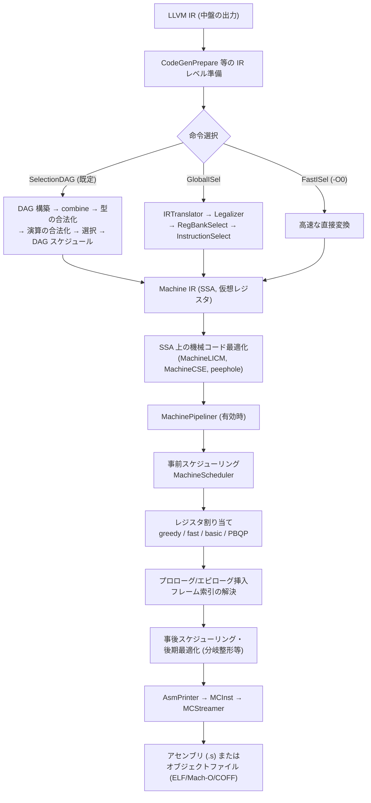
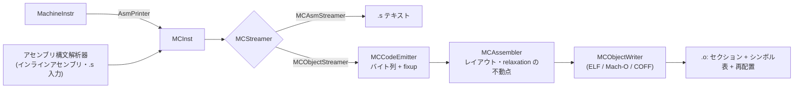

# コンパイラバックエンド (Compiler Back-End) — 命令選択・レジスタ割り当て・スケジューリング

## 概要 (Overview)

中盤 ([`compiler-middle-end-ir-optimization.md`](compiler-middle-end-ir-optimization.md)) が出力する IR は、無限の仮想レジスタ・順序の緩いデータ依存・抽象的な `call` 命令からなる「理想機械」のプログラムである。バックエンドの仕事は、この理想機械を**有限で具体的な実機**に写すことである。命令選択 (instruction selection) は抽象演算を実在の命令に、レジスタ割り当て (register allocation) は無限のレジスタを十数〜数十本の物理レジスタに、命令スケジューリング (instruction scheduling) は半順序のデータ依存をパイプラインに合う全順序に、呼び出し規約の低水準化 (calling-convention lowering) は抽象的な `call` を ABI の定めるレジスタとスタックの配置に写す。最後に MC 層がそれを ELF などのオブジェクトファイルのバイト列と再配置に符号化する。

本ドキュメントの中心テーゼは、**バックエンドとは「NP 困難な写像問題の連鎖を、相互作用を承知のうえでヒューリスティクスで分割統治する工学」である**ということである。最適な命令被覆、最適なレジスタ彩色、最適なスケジュールは、いずれも一般には NP 困難である[^chaitin81][^cooper22]。しかもこれらは独立ではない。スケジューリングで並列性を上げればレジスタ圧力が増え、レジスタ割り当てでスピルすればスケジュールが崩れる。この**相順序問題 (phase-ordering problem)** を、LLVM は「SSA 上の命令選択 → レジスタ圧力を意識した事前スケジューリング → 分割を多用する貪欲割り当て → 事後スケジューリング」という段階の並びと、各段の局所ヒューリスティクスで近似している。

LLVM を主参照とし、(1) 命令選択の理論 (木被覆・BURS) と SelectionDAG / GlobalISel、(2) レジスタ割り当ての三系統 (グラフ彩色・線形走査・LLVM greedy)、(3) リストスケジューリング・マシンモデル・ソフトウェアパイプライニング、(4) 呼び出し規約の低水準化、(5) MC 層からオブジェクトファイルへ、を扱う。分析深度は Level 3。

## 方法論 (Methodology)

- 各工程を「抽象 → 具体の写像」として定義し、何が有限化されるか (命令の種類・レジスタ本数・発行幅・ABI) を明示する。
- アルゴリズムは原典 (Aho et al. 1989, Pelegrí-Llopart & Graham 1988, Chaitin 1981/1982, Briggs et al. 1994, Poletto & Sarkar 1999, Gibbons & Muchnick 1986, Lam 1988, Rau 1994) と教科書 (Cooper & Torczon[^cooper22]) で裏づける。
- LLVM 実装は llvmorg-19.1.0 タグのソースで確認し、引用にはファイルパスと行番号を付す[^llvm-src]。工程の全体像は LLVM の Code Generator 文書[^llvm-codegen]に依拠する。
- 性能値は原典・公式ブログの報告値 (reported) と明記する。
- ハードウェア側の前提 (パイプライン・ハザード・OoO) は [`../../hardware/cpu/pipeline-superscalar-ooo.md`](../../hardware/cpu/pipeline-superscalar-ooo.md)、ABI は [`../../hardware/hw-sw-interface/abi-syscalls.md`](../../hardware/hw-sw-interface/abi-syscalls.md)、ISA の具体例は [`../../hardware/cpu/isa-riscv-intro.md`](../../hardware/cpu/isa-riscv-intro.md) に委ね、本書はそれらを**消費する側**として書く。

## 発見事項 (Findings)

1. **命令選択は「木 (DAG) をタイルで覆う」問題であり、木なら最適解が線形時間で求まるが、DAG では困難になる。** 式木に対しては、動的計画法 (Aho, Ganapathi & Tjiang[^aho89]) や、その表を生成時に前計算する BURS (Pelegrí-Llopart & Graham[^burs88]) により、コスト最小の被覆が求まる。共有部分式を持つ DAG では最適性が崩れるため、実用のセレクタはパターン照合と貪欲な選択で妥協する。LLVM の SelectionDAG は TableGen で記述したパターンから照合器を生成する。
2. **SelectionDAG の限界は「基本ブロック単位」と「専用 IR のコスト」であり、GlobalISel はその両方に対する回答である。** SelectionDAG は基本ブロックごとに DAG を作るため、ブロックを跨ぐ最適化の機会を失い、専用 IR の構築にコンパイル時間を払う。GlobalISel は関数全体を対象に、Machine IR 上で直接、IRTranslator → Legalizer → RegBankSelect → InstructionSelect の 4 段で選択する[^llvm-gisel]。AArch64 では LLVM 6.0 から `-O0` の既定になった[^llvm6-rn]。
3. **レジスタ割り当ての古典はグラフ彩色であり、その本質は「スピルの決定」にある。** Chaitin は干渉グラフの k 彩色として定式化し、任意のグラフがプログラムから生じうるため問題が NP 完全であることを示した[^chaitin81]。Briggs らは彩色できないと判断する時点を遅らせる楽観的彩色 (optimistic coloring) で不要なスピルを減らした[^briggs94]。線形走査 (Poletto & Sarkar[^poletto99]) は生存区間を一度走査するだけで済み、JIT のようにコンパイル時間が重要な場面で使われてきた[^wimmer05]。
4. **LLVM の greedy 割り当ては「大きい生存区間から割り当て、だめなら追い出し、分割し、最後にスピル」という段階的な戦略をとる。** 線形走査は分割と相性が悪く、書き換え器がコンパイル時間の約半分を占めていたため、LLVM 3.0 で greedy に置き換えられた。報告では、生成コードは線形走査より 1〜2% 小さく、最大 10% 速かった[^llvm-greedy]。
5. **スケジューリングの価値はマイクロアーキテクチャに依存し、OoO コアでも消えない。** in-order コアではスケジュールが性能を直接決める。OoO コアはハードウェアが窓内で並べ替えるが、窓の大きさ・発行幅・レジスタ圧力の制約は残る。LLVM は TableGen の `SchedMachineModel` で発行幅・バッファ容量・レイテンシ・実行資源をコアごとに記述し、MachineScheduler と llvm-mca が同じモデルを使う[^llvm-mca]。
6. **呼び出し規約の低水準化は「ABI という契約」をコードにする工程であり、LLVM はそれを宣言的な表で記述する。** x86-64 System V の「整数引数は RDI, RSI, RDX, RCX, R8, R9、浮動小数点は XMM0〜7、残りはスタック」は、`X86CallingConv.td` の数行の規則としてそのまま書かれている (技術詳細 4)。
7. **MC 層はアセンブラをコンパイラに統合し、「命令の符号化」と「再配置の生成」を一つの API で扱う。** `MCInst` を `MCStreamer` に流すと、テキストのアセンブリにもオブジェクトファイルにもなる。符号化時に解決できないアドレスは**フィックスアップ (fixup)** として残り、ファイル内で解決できなければ再配置としてリンカに渡る[^llvm-mc]。これは [`linkers-loaders-elf.md`](linkers-loaders-elf.md) が扱う再配置の**生産者側**である。

## アーキテクチャ (Architecture)

### LLVM コード生成パイプライン



凡例: 菱形は実装の選択肢、角丸でない箱は処理段階を表す。段階の区分は LLVM Code Generator 文書の 7 段 (命令選択、スケジューリングと形成、SSA ベースの機械コード最適化、レジスタ割り当て、プロローグ/エピローグ挿入、後期最適化、コード出力)[^llvm-codegen] に対応する。

### 有限化の対応表

| 工程 | 抽象 (入力) | 具体 (出力) | 有限な資源 | 一般の最適化問題 |
|---|---|---|---|---|
| 命令選択 | IR 演算 (型付き、合法性不問) | ターゲット命令 (合法な型・演算のみ) | 命令の種類とアドレッシングモード | DAG 被覆 (一般に NP 困難) |
| スケジューリング | 依存 DAG (半順序) | 命令列 (全順序) | 発行幅・実行ユニット・レイテンシ | 資源制約付きスケジューリング (NP 困難) |
| レジスタ割り当て | 無限の仮想レジスタ | 物理レジスタ + スタックスロット | レジスタ本数 k | k 彩色 (NP 完全)[^chaitin81] |
| 呼び出し規約 | `call f(a, b, ...)` | 引数レジスタ・スタック・callee-saved の退避 | ABI が定める固定集合 | (規約に従う決定的変換) |
| MC 出力 | 記号的な命令とラベル | バイト列 + 再配置 | 命令長・分岐の到達範囲 | 分岐緩和 (relaxation) の不動点 |

## 技術詳細 (Technical Details)

### 1. 命令選択 — 木被覆から SelectionDAG / GlobalISel へ

**木被覆 (tree tiling)**: 各ターゲット命令を IR の小さな木パターン (タイル) とコストの組として表し、式木全体をタイルで重なりなく覆う。最も単純な **maximal munch** は根から最大のタイルを貪欲に選ぶ。最適被覆は、各節点で「この節点を根とする部分木を、ある非終端記号 (例: レジスタに値を持つ) として覆う最小コスト」を葉から根へ動的計画法で計算すれば求まり、木のサイズに対して線形時間である[^aho89][^cooper22]。BURS (Bottom-Up Rewrite System) は、この動的計画法の状態遷移をコード生成器の生成時に有限オートマトンとして前計算し、選択時の計算を表引きに置き換える[^burs88]。

**SelectionDAG**: LLVM の既定のセレクタは、基本ブロックごとに次の段階を踏む[^llvm-codegen]。

1. **構築 (build)**: IR から、値と順序依存 (chain) を辺に持つ DAG を作る。
2. **combine**: 合法化の前後で DAG 上の簡約を行う (中盤が見落とした、あるいは低水準化で新たに生じた機会を拾う)。
3. **型の合法化 (legalize types)**: ターゲットにない型 (例: 32 ビット機の `i64`) を、分割・昇格・ベクトルの拡幅/分割で合法な型にする。
4. **演算の合法化 (legalize ops)**: ターゲットにない演算を、展開・ライブラリ呼び出し・カスタム低水準化で置き換える。
5. **選択 (select)**: TableGen が `.td` のパターン定義から生成した照合器で、DAG 節点をターゲット命令節点に置換する。
6. **スケジュールと形成**: DAG を線形化して `MachineInstr` 列にする。

**GlobalISel**: SelectionDAG の欠点として、文書は (1) 専用 IR の構築によるコンパイル時間、(2) 基本ブロック単位であるために大域的な最適化の機会を失うこと、(3) 高速パス (FastISel) と最適化パスでコードを共有できないこと、を挙げる[^llvm-gisel]。GlobalISel は Machine IR 上の汎用命令 (`G_ADD`, `G_LOAD` など) から出発し、Legalizer で合法化し、RegBankSelect で各仮想レジスタを**レジスタバンク** (汎用 / 浮動小数点・ベクトル) に振り分け、InstructionSelect でターゲット命令に置換する。レジスタバンクを命令選択の前に決めるのは、「整数演算か浮動小数点演算か」という選択が、どちらのレジスタファイルに値を置くかと不可分だからである。

| | SelectionDAG | GlobalISel | FastISel |
|---|---|---|---|
| 範囲 | 基本ブロック | 関数全体 | 基本ブロック |
| 中間表現 | 専用の SDNode DAG | Generic Machine IR | なし (IR から直接) |
| 主な用途 | 最適化ビルドの既定 | AArch64 の `-O0` 既定 (LLVM 6.0〜)[^llvm6-rn]、他ターゲットで拡大中 | `-O0` の高速選択 (未対応の構文は SelectionDAG に退避) |
| パターン記述 | TableGen | TableGen (SelectionDAG のパターンを多く再利用) | 一部 TableGen 生成 |

### 2. レジスタ割り当て — 彩色・線形走査・greedy

**グラフ彩色 (Chaitin 1981/1982)**[^chaitin81][^chaitin82]: 同時に生存する仮想レジスタの対を辺で結んだ**干渉グラフ**を作り、k 本の物理レジスタで k 彩色する。

1. **build**: 生存解析から干渉グラフを作る。
2. **coalesce**: `mov` で結ばれ干渉しない 2 ノードを併合し、コピー命令を消す。
3. **simplify**: 次数 < k のノードは、残りがどう塗られても必ず色が残るので、スタックに積んでグラフから外す。
4. **spill**: 次数 < k のノードがなくなったら、スピルコスト (使用頻度 ÷ 次数など) の小さいノードをスピル候補として外す。
5. **select**: スタックから戻しながら色を割り当てる。

Chaitin は、スピル候補を選んだ時点でそのノードを即座にスピルし、コードを書き換えて最初からやり直した。Briggs らの**楽観的彩色**は、スピル候補もスタックに積んで select まで進め、近傍がたまたま同色で済み色が残れば、スピルせずに済ませる[^briggs94]。同論文は、併合後のノードが彩色可能性を損なわない場合だけ併合する**保守的併合 (conservative coalescing)** と、値をメモリから再ロードする代わりに再計算する**再実体化 (rematerialization)** も扱っている。

**線形走査 (Poletto & Sarkar 1999)**[^poletto99]: 命令を線形に番号付けし、各仮想レジスタの生存区間を [最初の定義, 最後の使用] の一区間で近似する。区間を開始点順に走査し、現在生存中の区間集合 (active) を終了点順に保つ。新しい区間を割り当てるときに空きレジスタがなければ、active の中で**最も遠くで終わる区間**をスピルする。干渉グラフを作らないためコンパイル時間はほぼ線形で、生成コードの品質はグラフ彩色に迫る。区間の穴 (lifetime hole) や区間分割を扱う拡張が、HotSpot クライアントコンパイラ向けに[^wimmer05]、さらに SSA 形式上で[^wimmer10] 提案されている。

**LLVM の割り当て器**: LLVM は fast (デバッグビルドの既定)、basic、greedy (最適化ビルドの既定)、PBQP の 4 種を持つ[^llvm-codegen]。greedy の設計は次のとおりである[^llvm-greedy]。

- **優先度キュー**: 生存区間を**大きいものから**割り当てる。小さい区間はスピル重みが高くなりがちで先に割り当てると大きな区間の行き場を奪うため、この順序をとる。
- **追い出し (eviction)**: 空きがなければ、干渉する割り当て済みの区間のうちスピル重みの低いものを追い出し、キューに戻す。
- **分割 (splitting)**: 大きな区間は「多くの時間は暇だが、熱いループの中でだけ激しく使われる」ことがある。そこで区間をループや領域の境界で分割し、熱い部分にだけレジスタを与える。
- **スピル**: 分割しても割り当てられない区間だけをスタックに置く。分割で問題をあらかじめ整理しておくので、最終的な書き換え器は旧来の 2600 行から 85 行になったと報告されている[^llvm-greedy]。

この段階的戦略は、各生存区間が持つ**段階 (stage)** として実装されている。

```cpp
// Language: C++ / Purpose: greedy 割り当て器の段階的な試行順序 (割り当て → 追い出し → 待機 → 分割 → スピル)
// Source: llvm/lib/CodeGen/RegAllocGreedy.cpp lines 2417-2418, 2444-2447, 2461-2475, 2501 (llvmorg-19.1.0), 抜粋
  if (MCRegister PhysReg =
          tryAssign(VirtReg, Order, NewVRegs, FixedRegisters)) {
  // ...
  if (Stage != RS_Split)
    if (Register PhysReg =
            tryEvict(VirtReg, Order, NewVRegs, CostPerUseLimit,
                     FixedRegisters)) {
  // ...
  // The first time we see a live range, don't try to split or spill.
  // Wait until the second time, when all smaller ranges have been allocated.
  // This gives a better picture of the interference to split around.
  if (Stage < RS_Split) {
    ExtraInfo->setStage(VirtReg, RS_Split);
    LLVM_DEBUG(dbgs() << "wait for second round\n");
    NewVRegs.push_back(VirtReg.reg());
    return 0;
  }

  if (Stage < RS_Spill) {
    // Try splitting VirtReg or interferences.
    unsigned NewVRegSizeBefore = NewVRegs.size();
    Register PhysReg = trySplit(VirtReg, Order, NewVRegs, FixedRegisters);
    if (PhysReg || (NewVRegs.size() - NewVRegSizeBefore))
  // ...
    spiller().spill(LRE);
```

「初回は分割もスピルもせず、小さい区間がすべて割り当てられた二巡目まで待つ」(lines 2461-2463) という判断は、干渉の全体像が見えてから分割位置を決めるための工夫である。分割が進展しないまま繰り返されないよう、`RS_Split2` 段階では進展を必須にしている (同ファイル lines 1635-1645 のコメント)。

### 3. 命令スケジューリング — リスト・マシンモデル・ソフトウェアパイプライニング

**リストスケジューリング**: 基本ブロック (または拡張された領域) の依存 DAG に対し、各サイクルで依存が満たされた命令 (ready list) から優先度の最も高いものを、資源が許す限り発行する。優先度には臨界経路長 (その命令から DAG の終端までの最長レイテンシ) を使うのが基本である[^gibbons86][^cooper22]。資源制約付きの最適スケジューリングは NP 困難であり、リストスケジューリングはその標準的な近似である[^cooper22]。

**レジスタ圧力との緊張**: レジスタ割り当ての前にスケジュールすれば並列性を引き出せるが、同時に生存する値が増えてスピルを誘発する。割り当ての後にスケジュールすれば圧力は確定しているが、物理レジスタの再利用が偽の依存 (WAR/WAW) を作り並べ替えの自由が減る。LLVM の MachineScheduler の汎用戦略は、この緊張を**判定の優先順位**として符号化している。

```cpp
// Language: C++ / Purpose: 事前スケジューラ (GenericScheduler) の候補比較の優先順位
// Source: llvm/lib/CodeGen/MachineScheduler.cpp lines 3545-3557 (llvmorg-19.1.0)
  // Avoid exceeding the target's limit.
  if (DAG->isTrackingPressure() && tryPressure(TryCand.RPDelta.Excess,
                                               Cand.RPDelta.Excess,
                                               TryCand, Cand, RegExcess, TRI,
                                               DAG->MF))
    return TryCand.Reason != NoCand;

  // Avoid increasing the max critical pressure in the scheduled region.
  if (DAG->isTrackingPressure() && tryPressure(TryCand.RPDelta.CriticalMax,
                                               Cand.RPDelta.CriticalMax,
                                               TryCand, Cand, RegCritical, TRI,
                                               DAG->MF))
    return TryCand.Reason != NoCand;
```

同関数 (`GenericScheduler::tryCandidate`, line 3531 以降) では、レジスタ圧力の超過回避 (`RegExcess`)・臨界圧力 (`RegCritical`) の判定が、ストール回避・クラスタリング・資源の均衡 (`ResourceReduce`)・レイテンシ (`tryLatency`) より**先に**来る。「スピルを生むくらいならレイテンシを諦める」という方針がコードの順序として読み取れる。

**マシンモデル**: 各コアのパイプライン特性は TableGen で宣言する。

```text
// Language: TableGen / Purpose: プロセッサごとのスケジューリングモデルの基底クラス
// Source: llvm/include/llvm/Target/TargetSchedule.td lines 76-83 (llvmorg-19.1.0)
class SchedMachineModel {
  int IssueWidth = -1; // Max micro-ops that may be scheduled per cycle.
  int MicroOpBufferSize = -1; // Max micro-ops that can be buffered.
  int LoopMicroOpBufferSize = -1; // Max micro-ops that can be buffered for
                                  // optimized loop dispatch/execution.
  int LoadLatency = -1; // Cycles for loads to access the cache.
  int HighLatency = -1; // Approximation of cycles for "high latency" ops.
  int MispredictPenalty = -1; // Extra cycles for a mispredicted branch.
```

`IssueWidth` はスーパースカラの発行幅、`MicroOpBufferSize` は OoO の窓 (予約ステーション / ROB) の大きさに当たる。[`../../hardware/cpu/pipeline-superscalar-ooo.md`](../../hardware/cpu/pipeline-superscalar-ooo.md) で扱ったハードウェアの量が、そのままコンパイラの入力パラメータになっている。命令ごとのレイテンシと使用する実行資源 (ポート) は `SchedWriteRes`/`ProcResource` で記述され、llvm-mca はこのモデルで命令列をシミュレートして IPC・資源圧力・タイムラインを報告する[^llvm-mca]。llvm-mca の文書が「報告が実機と合わなければ、ツールではなくそのバックエンドのスケジューリングモデルのバグとして報告せよ」としているのは、モデルが唯一の真実の源 (single source of truth) だからである[^llvm-mca]。

**ソフトウェアパイプライニング**: ループの異なる反復の命令を重ねて実行し、定常状態 (kernel) では毎 II (initiation interval) サイクルごとに新しい反復を開始する。II の下限は資源制約による ResMII と、反復間依存の閉路による RecMII の大きい方である。Lam は VLIW 向けにこの手法の有効性を示し[^lam88]、Rau の**反復モジュロスケジューリング**は II を下限から一つずつ増やしながらスケジュールを探索する標準的なアルゴリズムになった[^rau94]。LLVM の `MachinePipeliner` は Llosa らの Swing Modulo Scheduling[^llosa96] を実装しており、レジスタ割り当て前の SSA 形式の Machine IR 上で動き、プロローグ・カーネル・エピローグを生成する。与えられた MII でスケジュールできなければ MII を 1 増やして再試行する (`llvm/lib/CodeGen/MachinePipeliner.cpp` lines 9-17 のファイル冒頭コメント)。ターゲット固有のフックの実装を要するため、全ターゲットで有効なわけではない。

### 4. 呼び出し規約の低水準化とフレーム

呼び出し規約の低水準化は、`TargetLowering` の `LowerFormalArguments` (関数入口の仮引数)・`LowerCall` (呼び出し地点)・`LowerReturn` (戻り値) で行われる。各引数をどのレジスタまたはスタック位置に置くかは、TableGen の `CallingConv` 記述から生成された割り当て関数が決める。

```text
// Language: TableGen / Purpose: x86-64 System V の C 呼び出し規約 (引数割り当て規則)
// Source: llvm/lib/Target/X86/X86CallingConv.td lines 533-538, 563-564, 573, 591-594, 611-613 (llvmorg-19.1.0), 抜粋
def CC_X86_64_C : CallingConv<[
  // Handles byval parameters.
  CCIfByVal<CCPassByVal<8, 8>>,

  // Promote i1/i8/i16/v1i1 arguments to i32.
  CCIfType<[i1, i8, i16, v1i1], CCPromoteToType<i32>>,
  // ...
  // The first 6 integer arguments are passed in integer registers.
  CCIfType<[i32], CCAssignToReg<[EDI, ESI, EDX, ECX, R8D, R9D]>>,
  // ...
  CCIfType<[i64], CCAssignToReg<[RDI, RSI, RDX, RCX, R8 , R9 ]>>,
  // ...
  // The first 8 FP/Vector arguments are passed in XMM registers.
  CCIfType<[f16, f32, f64, f128, v16i8, v8i16, v4i32, v2i64, v8f16, v4f32, v2f64],
            CCIfSubtarget<"hasSSE1()",
            CCAssignToReg<[XMM0, XMM1, XMM2, XMM3, XMM4, XMM5, XMM6, XMM7]>>>,
  // ...
  // Integer/FP values get stored in stack slots that are 8 bytes in size and
  // 8-byte aligned if there are no more registers to hold them.
  CCIfType<[i32, i64, f16, f32, f64], CCAssignToStack<8, 8>>,
```

規則は上から順に評価され、最初に適用できたもので決まる。[`../../hardware/hw-sw-interface/abi-syscalls.md`](../../hardware/hw-sw-interface/abi-syscalls.md) の対比表にある「x86-64 は RDI〜R9 の 6 本、RISC-V は a0〜a7 の 8 本」という ABI の文面が、バックエンドではこのような宣言的な表として実装されている。ただし構造体の分類 (System V の INTEGER/SSE/MEMORY 分類など) の一部はフロントエンド (Clang の ABI 層) が IR の引数型に落としてから渡すため、ABI の実装はフロントエンドとバックエンドに分担されている。

- **callee-saved レジスタ**: レジスタ割り当て器は、関数内で使った callee-saved レジスタを記録する。**プロローグ/エピローグ挿入 (PEI)** がその退避・復元とスタックフレームの確保を挿入し、抽象的なフレーム索引 (frame index) を SP/FP 相対のオフセットに置き換える[^llvm-codegen]。greedy 割り当て器が「初めて使う callee-saved レジスタ」に追加コスト (`CSRCost`) を課すのは、その一本が PEI での退避・復元の一組を発生させるからである。
- **末尾呼び出し (tail call)**: 呼び出し元のフレームを再利用して `jmp` に変える。引数がスタックに溢れる場合や規約が異なる場合は適用できず、保証が必要な言語 (例: `musttail`、Swift の `swifttailcc`) は専用の規約を使う。
- **RISC-V の例**: [`../../hardware/cpu/isa-riscv-intro.md`](../../hardware/cpu/isa-riscv-intro.md) で見たように、RISC-V は `ra` (戻り番地) をレジスタに置くため、葉関数 (他を呼ばない関数) ではスタックフレーム自体を省略できる。PEI はこうしたターゲット固有の最適化を `TargetFrameLowering` のフックとして持つ。

### 5. MC 層 — 命令からオブジェクトファイルへ

LLVM の MC 層は、コード生成器の `MachineInstr` とは別の、より単純な命令表現 `MCInst` を中心に組まれている[^llvm-mc]。



- **同一 API の二つの出力**: `MCStreamer` はアセンブラ指示子と命令を受け取る抽象 API であり、テキスト出力とオブジェクト出力が同じインタフェースを実装するので、両者の意味が食い違わない[^llvm-mc]。アセンブリの構文解析器も `MCInst` を生成するため、`.s` ファイルやインラインアセンブリも同じ経路を通る (統合アセンブラ)。MC 層の導入時、外部アセンブラの起動はコンパイル時間の約 20% を占めていたと報告されている[^llvm-mc]。
- **フィックスアップと再配置**: 命令の符号化器は、データのバイト列とともに「後で埋める穴」であるフィックスアップを生成する[^llvm-mc]。同一セクション内のラベル差のように MCAssembler がレイアウト確定後に解決できるものはその場で埋め、外部シンボルや別セクションへの参照は `MCObjectWriter` が ELF の再配置エントリ (例: `R_X86_64_PC32`, `R_X86_64_PLT32`) に変換する。[`linkers-loaders-elf.md`](linkers-loaders-elf.md) の技術詳細 2 で追った「穴」は、ここで掘られる。
- **緩和 (relaxation)**: 分岐命令の長さが分岐先までの距離に依存する ISA (x86 の短/長ジャンプなど) では、命令長がレイアウトに依存し、レイアウトが命令長に依存する。MCAssembler は短い形式から始め、届かない命令だけを長い形式に置き換えるという反復を不動点まで繰り返す[^llvm-mc]。RISC-V はこの判断の一部をリンカに委ね、`call` を `AUIPC+JALR` の 2 命令で出力して `R_RISCV_CALL_PLT` と `R_RISCV_RELAX` を付け、距離が ±1 MiB 以内ならリンカが `JAL` 1 命令に縮める (linker relaxation)[^riscv-psabi]。アセンブラが確定させる x86 と、リンカまで遅延させる RISC-V の違いは、「どの段階で全体が見えるか」の設計選択である。

### 6. 診断の道具

| 知りたいこと | 道具 |
|---|---|
| 各パス後の Machine IR | `llc -print-after-all`、`-stop-after=<pass>` と `-run-pass` (MIR の切り出しと再実行) |
| 命令選択の過程 | `llc -view-isel-dags` 等の DAG 可視化、`-debug-only=isel` (デバッグビルド) |
| レジスタ割り当てとスピル | `-Rpass-missed=regalloc` (スピル・リロードの報告)、`-debug-only=regalloc` |
| スケジュールの静的評価 | `llvm-mca -mcpu=<cpu>` (IPC・資源圧力・タイムライン)[^llvm-mca] |
| オブジェクトの中身 | `llvm-objdump -dr` (逆アセンブル + 再配置)、`llvm-readelf -r` |

## セキュリティ考察 (Security Considerations)

- **投機実行対策はバックエンドの仕事である。** Spectre 型の攻撃 ([`../../hardware/cpu/pipeline-superscalar-ooo.md`](../../hardware/cpu/pipeline-superscalar-ooo.md) のセキュリティ考察) への対策の多くは、命令選択以降でしか表現できない。retpoline は間接分岐を投機の捕獲ループ付きの `call`/`ret` 列に置き換え、Speculative Load Hardening (`-mspeculative-load-hardening`) は誤予測された制御フローを述語状態として追跡し、その経路上のロードのアドレスや値をマスクする[^llvm-slh]。SLH の公式文書は、Haswell での測定でおよそ 10〜50%、大規模アプリケーションで約 30% のオーバーヘッドを報告している[^llvm-slh]。これらは「レジスタと命令が確定した後」でなければ正しく挿入できない。
- **制御フロー保護の命令の挿入**: スタックカナリア (stack protector) の配置、Intel CET の `endbr64` による間接分岐先のマーキング、AArch64 の PAC/BTI による戻り番地の署名と分岐先の制限は、いずれもプロローグ/エピローグ挿入や命令選択の段階でバックエンドが挿入する。呼び出し規約の低水準化が「どのレジスタに何が残るか」を決めるため、`-fzero-call-used-regs` のように戻る前にレジスタを消去して情報の漏洩や ROP ガジェットの材料を減らす緩和策もバックエンドに置かれる。
- **定数時間性の喪失は命令選択でも起こる。** 中盤が保った分岐なしのコード (`select`) も、命令選択がコストモデルに従い条件分岐に戻すことがありうる。逆に `cmov` を選んでも、その命令がデータ依存のレイテンシを持たないことは ISA が保証する範囲に依存する。暗号実装では、生成コードを逆アセンブルして検査するか、言語機能・組み込み関数で意図を固定する必要がある。
- **スピルによる秘密の残留**: レジスタ割り当て器は秘密を扱う値もスタックにスピルしうるので、関数の終了後もスタック上に鍵の断片が残る。ソースで `memset` しても、スピル先のスロットは消せない。スピルされた値はソースから見えないため、秘密の消去はソース層だけでは完結しない。
- **バックエンドの誤コンパイル**: レジスタ割り当てや緩和のバグは、境界検査を含む正しいソースから誤った機械語を生む。統合アセンブラ・逆アセンブラ・オブジェクトファイル読み取りを同じ MC 層で共有することは整合性の利点だが、同じ誤りが往復で隠れる危険もある。外部ツールとの差分検査 (例: GNU binutils の `objdump` との比較) が有効な理由である。

## 結論 (Conclusions)

- バックエンドは「無限で抽象的な理想機械」を「有限で具体的な実機」に写す工程の連鎖であり、命令・レジスタ・発行枠・ABI という四つの資源をそれぞれ有限化する。各写像は一般に NP 困難であり、実用のバックエンドはヒューリスティクスと段階の順序で近似している。
- 命令選択は、木なら動的計画法や BURS で最適化できるが、DAG・基本ブロック境界・コンパイル時間の制約で妥協を強いられる。SelectionDAG から GlobalISel への移行は、範囲 (ブロック → 関数) と表現 (専用 DAG → Machine IR) の両方を改める再設計である。
- レジスタ割り当ての歴史は、Chaitin の彩色、Briggs の楽観的彩色、Poletto & Sarkar の線形走査、LLVM の greedy (追い出しと分割を主役にした段階的戦略) へと続く。本質は一貫して「何をいつスピルするか」の決定であり、greedy はスピルの前に分割で問題を整理することで、コード品質と書き換えの単純さを両立した。
- スケジューリングは、ハードウェアのパイプライン特性 (発行幅・窓の大きさ・レイテンシ) を TableGen のマシンモデルとして入力に取り、レジスタ圧力との緊張を優先順位として符号化する。ソフトウェアパイプライニングは、ループ反復の重ね合わせを静的に行う、OoO 実行の静的な対応物である。
- 呼び出し規約の低水準化と MC 層は、ABI とオブジェクトファイル形式という外部契約をコードに落とす工程である。フィックスアップは再配置の起源であり、緩和をアセンブラで閉じるか (x86) リンカまで遅らせるか (RISC-V) の違いは、「どの段階で全体が見えるか」という本シリーズに通底する問いの一例である。

### 次の接続先 (Related Topics)

- [`compiler-middle-end-ir-optimization.md`](compiler-middle-end-ir-optimization.md) — バックエンドへの入力 IR を作る中盤。SSA・最適化パイプライン・UB。
- [`../../hardware/cpu/pipeline-superscalar-ooo.md`](../../hardware/cpu/pipeline-superscalar-ooo.md) — スケジューリングとマシンモデルが前提とするハードウェア。
- [`../../hardware/hw-sw-interface/abi-syscalls.md`](../../hardware/hw-sw-interface/abi-syscalls.md) — 呼び出し規約の低水準化が実装する契約の中身。
- [`../../hardware/cpu/isa-riscv-intro.md`](../../hardware/cpu/isa-riscv-intro.md) — 命令選択の対象 ISA の具体例と、RISC-V のレジスタ・命令形式。
- [`linkers-loaders-elf.md`](linkers-loaders-elf.md) — MC 層が出力した再配置を消費する側。

## 参考文献 (References)

**一次資料 (Primary — 論文・教科書)**

[^aho89]: Aho, A. V., Ganapathi, M., & Tjiang, S. W. K. (1989). Code Generation Using Tree Matching and Dynamic Programming. *ACM Transactions on Programming Languages and Systems*, 11(4), 491–516. DOI: 10.1145/69558.75700 — 木照合と動的計画法による命令選択 (twig)。

[^burs88]: Pelegrí-Llopart, E., & Graham, S. L. (1988). Optimal Code Generation for Expression Trees: An Application of BURS Theory. *Proc. POPL '88*, 294–308. DOI: 10.1145/73560.73586 — BURS による最適な式木のコード生成。

[^chaitin81]: Chaitin, G. J., Auslander, M. A., Chandra, A. K., Cocke, J., Hopkins, M. E., & Markstein, P. W. (1981). Register Allocation via Coloring. *Computer Languages*, 6(1), 47–57. DOI: 10.1016/0096-0551(81)90048-5 — 干渉グラフ彩色による割り当てと NP 完全性。

[^chaitin82]: Chaitin, G. J. (1982). Register Allocation & Spilling via Graph Coloring. *Proc. SIGPLAN '82 Symposium on Compiler Construction*, 98–101. DOI: 10.1145/800230.806984 — スピルを組み込んだ彩色割り当て。

[^briggs94]: Briggs, P., Cooper, K. D., & Torczon, L. (1994). Improvements to Graph Coloring Register Allocation. *ACM Transactions on Programming Languages and Systems*, 16(3), 428–455. DOI: 10.1145/177492.177575 — 楽観的彩色・保守的併合・再実体化。

[^poletto99]: Poletto, M., & Sarkar, V. (1999). Linear Scan Register Allocation. *ACM Transactions on Programming Languages and Systems*, 21(5), 895–913. DOI: 10.1145/330249.330250 — 線形走査割り当ての原典。

[^wimmer05]: Wimmer, C., & Mössenböck, H. (2005). Optimized Interval Splitting in a Linear Scan Register Allocator. *Proc. VEE '05*, 132–141. DOI: 10.1145/1064979.1064998 — 区間分割付き線形走査 (HotSpot クライアントコンパイラ)。

[^wimmer10]: Wimmer, C., & Franz, M. (2010). Linear Scan Register Allocation on SSA Form. *Proc. CGO '10*, 170–179. DOI: 10.1145/1772954.1772979 — SSA 形式上の線形走査。

[^gibbons86]: Gibbons, P. B., & Muchnick, S. S. (1986). Efficient Instruction Scheduling for a Pipelined Architecture. *Proc. SIGPLAN '86 Symposium on Compiler Construction*, 11–16. DOI: 10.1145/12276.13312 — パイプライン向けリストスケジューリング。

[^lam88]: Lam, M. (1988). Software Pipelining: An Effective Scheduling Technique for VLIW Machines. *Proc. PLDI '88*, 318–328. DOI: 10.1145/53990.54022 — ソフトウェアパイプライニングの実用化。

[^rau94]: Rau, B. R. (1994). Iterative Modulo Scheduling: An Algorithm for Software Pipelining Loops. *Proc. MICRO-27*, 63–74. DOI: 10.1145/192724.192731 — 反復モジュロスケジューリング。

[^llosa96]: Llosa, J., González, A., Ayguadé, E., & Valero, M. (1996). Swing Modulo Scheduling: A Lifetime-Sensitive Approach. *Proc. PACT '96*, 80–86. DOI: 10.1109/PACT.1996.554030 — LLVM MachinePipeliner が実装する SMS。

[^cooper22]: Cooper, K. D., & Torczon, L. (2022). *Engineering a Compiler* (3rd ed.). Morgan Kaufmann. ISBN 978-0128154120 — 命令選択・スケジューリング・レジスタ割り当ての教科書。

**一次資料 (Primary — 公式文書・仕様・ソース)**

[^llvm-codegen]: [The LLVM Target-Independent Code Generator](https://llvm.org/docs/CodeGenerator.html) — Accessed: 2026-10-04. — コード生成の 7 段、SelectionDAG の段階、MC 層、割り当て器の種類と既定。

[^llvm-gisel]: [Global Instruction Selection](https://llvm.org/docs/GlobalISel/index.html) — Accessed: 2026-10-04. — GlobalISel の動機と 4 段のパイプライン。

[^llvm6-rn]: [LLVM 6.0.0 Release Notes](https://releases.llvm.org/6.0.1/docs/ReleaseNotes.html) — Accessed: 2026-10-04. — AArch64 の `-O0` における GlobalISel の既定化。

[^llvm-mca]: [llvm-mca — LLVM Machine Code Analyzer](https://llvm.org/docs/CommandGuide/llvm-mca.html) — Accessed: 2026-10-04. — スケジューリングモデルに基づく静的性能解析。

[^llvm-slh]: [Speculative Load Hardening](https://llvm.org/docs/SpeculativeLoadHardening.html) — Accessed: 2026-10-04. — SLH の機構と測定されたオーバーヘッド。

[^riscv-psabi]: [RISC-V ELF psABI Specification](https://github.com/riscv-non-isa/riscv-elf-psabi-doc/blob/master/riscv-elf.adoc) — Accessed: 2026-10-04. — `R_RISCV_CALL_PLT`・`R_RISCV_RELAX` と linker relaxation。

[^llvm-src]: LLVM Project, tag llvmorg-19.1.0 — `llvm/lib/CodeGen/RegAllocGreedy.cpp`, `llvm/lib/CodeGen/MachineScheduler.cpp`, `llvm/lib/CodeGen/MachinePipeliner.cpp`, `llvm/include/llvm/Target/TargetSchedule.td`, `llvm/lib/Target/X86/X86CallingConv.td`. [github.com/llvm/llvm-project/tree/llvmorg-19.1.0](https://github.com/llvm/llvm-project/tree/llvmorg-19.1.0) — Accessed: 2026-10-04. — 本文中のコード引用の出典 (行番号は同タグのもの)。

**二次資料 (Secondary — 公式ブログ)**

[^llvm-greedy]: Olesen, J. S. (2011). [Greedy Register Allocation in LLVM 3.0](https://blog.llvm.org/2011/09/greedy-register-allocation-in-llvm-30.html). LLVM Project Blog — Accessed: 2026-10-04. — greedy 割り当て器の設計と、線形走査との比較結果 (報告値)。

[^llvm-mc]: Lattner, C. (2010). [Intro to the LLVM MC Project](https://blog.llvm.org/2010/04/intro-to-llvm-mc-project.html). LLVM Project Blog — Accessed: 2026-10-04. — MCInst・MCStreamer・フィックスアップ・relaxation・統合アセンブラの動機。
