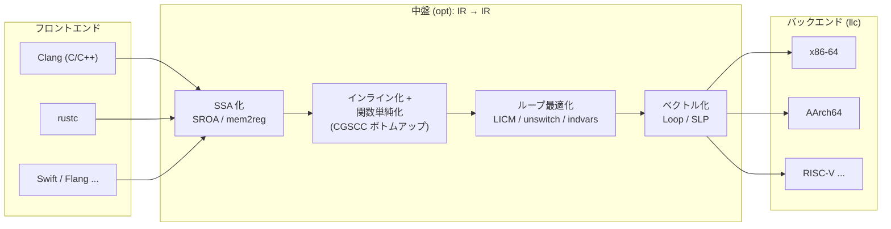
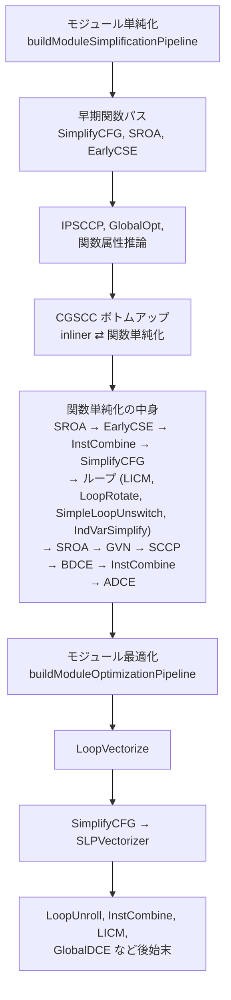

# コンパイラ中盤 (Compiler Middle-End) — IR・SSA・最適化パイプライン

## 概要 (Overview)

コンパイラは慣習的に**フロントエンド (front-end)**・**中盤 (middle-end)**・**バックエンド (back-end)** の三層に分けられる。フロントエンドはソース言語の構文と意味をソース非依存の**中間表現 (IR: Intermediate Representation)** に落とし、バックエンドは IR を特定の命令セット (ISA) の機械語に落とす。両者に挟まれた中盤の仕事は「IR を IR に書き換えて速くする」ことであり、言語にもターゲットにも依存しない最適化の大半がここに集まる。M 個の言語と N 個のターゲットを M+N 個の部品で賄える (M×N 問題の解消) のは、中盤が共通 IR の上で閉じているからである[^lattner04]。

本ドキュメントの中心テーゼは、**中盤最適化とは「プログラムについての事実を証明し、その事実が許す書き換えだけを行う」作業である**ということである。定数伝播は「この変数は常に 3 である」を、ループ不変式移動 (LICM) は「この式はループ内で値が変わらず、かつ移動しても観測可能な挙動が変わらない」を、ベクトル化は「この 2 つのポインタは重ならない」を証明してから書き換える。IR の設計 (SSA 形式)、解析 (支配木・別名解析)、そして未定義動作 (UB) の意味論は、すべて「事実を安く・多く証明する」ための道具として読める。

LLVM を主参照とし、(1) IR の設計と MLIR の位置づけ、(2) SSA 構築の二大アルゴリズム、(3) 主要最適化 (インライン化・SCCP・GVN・LICM・ループ変換・自動ベクトル化)、(4) 別名解析、(5) 新パスマネージャと `-O2`/`-O3` パイプライン、(6) UB と poison/undef、(7) PGO/LTO/ThinLTO を扱う。命令選択以降は [`compiler-backend-code-generation.md`](compiler-backend-code-generation.md) に委ねる。分析深度は Level 3。

## 方法論 (Methodology)

- 各最適化を「何を証明すれば、どの書き換えが許されるか」という**前提 → 変換**の対で記述し、失敗モードは「証明できなかった前提」として説明する。
- アルゴリズムは原典論文 (Cytron et al. 1991, Braun et al. 2013, Wegman & Zadeck 1991 ほか) と教科書 (Cooper & Torczon[^cooper22]) で裏づけ、LLVM 上の実装は**ソースを llvmorg-19.1.0 タグで固定**して引用する (ファイルパスと行番号はこのタグのもの)。
- パイプライン構成は版によって変わるため、主張は「LLVM 19 時点の `PassBuilderPipelines.cpp` に何が書かれているか」に限定する。
- 性能数値は原典の報告値 (reported) であることを明記し、一般化しない。
- セキュリティは防御的観点に限定し、「正しいコンパイラが UB を根拠に安全検査を消す」型の問題を中心に扱う。

## 発見事項 (Findings)

1. **SSA 形式は「定義と使用の対応」を IR の構造そのものに埋め込む。** 各変数が静的に一度だけ代入される SSA (Static Single Assignment) では、use-def 連鎖が名前で一意に決まり、データフロー解析の多くが反復解法なしの疎な (sparse) 伝播になる[^cytron91]。合流点で値を選ぶ φ 関数をどこに置くかが構築の核心であり、Cytron らは**支配辺境 (dominance frontier)** でこれを解いた。Braun らは支配木を使わずに AST やバイトコードから直接 minimal かつ pruned な SSA を作る単純な方法を示し、実行時間も Cytron 法と同等と報告した[^braun13]。
2. **最適化は単独では弱く、組み合わせで効く。** インライン化は呼び出し境界を消して定数伝播と死コード除去の材料を作り、SROA は構造体をスカラに分解して SSA 化の対象を増やし、LICM はベクトル化の前にループ本体を軽くする。LLVM の `-O2` パイプラインが InstCombine や SimplifyCFG を何度も挟むのは、各パスが他のパスの前提を作るからである (技術詳細 4)。
3. **インライン化は中盤で最も影響の大きい決定であり、その本体はコストモデルである。** LLVM は呼び出し先の命令コストを見積もり閾値と比較する。既定閾値は 225、`-O3` では 250、`-Os` で 50、`-Oz` で 5 である[^llvm-inline]。閾値の数十の差がコードサイズと性能を大きく動かすため、PGO による「熱い呼び出し地点」の情報が最も効く場所でもある。
4. **別名解析 (alias analysis) はほぼすべてのメモリ最適化の律速前提である。** LICM・GVN の冗長ロード除去・ベクトル化のいずれも「この store はあの load と重ならない」を証明できなければ実行できない。LLVM は複数の解析 (BasicAA, TBAA, ScopedNoAlias, GlobalsAA, SCEV-AA) の結果を `AAResults` で合成する[^llvm-aa]。C の `restrict` や型規則 (strict aliasing) は、プログラマがこの証明を肩代わりする手段である。
5. **未定義動作は最適化の燃料であり、poison はその燃料を安全に運ぶ容器である。** 「符号付き整数は溢れない」(`add nsw`) という UB 由来の事実は、ループ誘導変数の幅拡張や比較の簡約を可能にする。LLVM は UB を即時 UB (immediate) と遅延 UB (deferred: undef/poison) に分け、命令の投機的実行を許しつつ誤用時のみ破綻させる[^llvm-ub]。undef の多義性が健全性バグを生んだため、Lee らは poison と `freeze` 命令への整理を提案し[^lee17]、undef は現在非推奨とされている[^llvm-ub]。
6. **LTO/ThinLTO と PGO は「中盤の視野」を広げる二方向の拡張である。** LTO は翻訳単位の境界 (空間) を、PGO は静的に見えない実行頻度 (時間) を中盤に持ち込む。ThinLTO は要約 (summary) だけを全体で突き合わせ、本体の最適化を並列化することで、full LTO の逐次・大メモリという欠点を除いた[^johnson17][^llvm-thinlto]。

## アーキテクチャ (Architecture)

### 三層構成と IR の位置



凡例: 矢印はいずれも LLVM IR (ビットコードまたはメモリ上の表現) の受け渡しを表す。

### LLVM IR の設計判断

Lattner と Adve は LLVM IR を「低水準だが型付きの、SSA ベースの仮想命令セット」として設計し、コンパイル時・リンク時・実行時・アイドル時の**生涯にわたる最適化 (lifelong optimization)** をこの単一の表現で行うことを目標とした[^lattner04]。LangRef も LLVM を「型安全性・低水準演算・柔軟性を備えた SSA ベースの表現」と定義している[^llvm-langref]。

| 設計判断 | 内容 | 中盤への効果 |
|---|---|---|
| 無限の仮想レジスタ + SSA | 値は一度だけ定義され、`phi` で合流 | use-def が自明、疎な解析が可能 |
| メモリは明示的 load/store | レジスタ化されていない変数は `alloca` 上に置く | フロントエンドは SSA を意識せず生成でき、後段の mem2reg/SROA が SSA 化する |
| 型付きポインタ演算 (`getelementptr`) | アドレス計算をメモリアクセスと分離 | 別名解析とループ解析 (SCEV) がアドレスを代数的に扱える |
| 命令フラグとメタデータ | `nsw`/`nuw`/`exact`/`inbounds`、`!tbaa`、`noalias` | フロントエンドの意味論的知識 (UB・型規則) を中盤に渡す |
| 三層の入れ子 | Module ⊃ Function ⊃ BasicBlock ⊃ Instruction | パスの粒度 (module/CGSCC/function/loop) と一致 |

### MLIR — 単一 IR から IR の基盤へ

LLVM IR は C 程度の抽象度に固定されているため、テンソル演算・ループネスト・データフローといった高水準の構造は、IR に落とした時点で失われる。**MLIR (Multi-Level IR)** はこの問題に対し、「1 つの IR」ではなく**方言 (dialect)** を定義する枠組みを提供する。高水準の方言 (例: `linalg`, `affine`) から低水準の方言へ段階的に下げる**漸進的低水準化 (progressive lowering)** を行い、最後に LLVM 方言を経て LLVM IR に渡す[^mlir21]。MLIR は LLVM IR の中盤を置き換えるものではなく、その**上流**に「抽象度ごとの中盤」を積み上げる設計である。XLA・TVM・Triton などの ML コンパイラがこの上流をどう構成するかは [`../ai/ml-compilers.md`](../ai/ml-compilers.md) で扱う。

## 技術詳細 (Technical Details)

### 1. SSA 構築 — 支配辺境法と on-the-fly 法

**Cytron 法 (1991)**[^cytron91]:

1. 制御フローグラフ (CFG) の**支配木 (dominator tree)** を求める。ブロック X が Y を支配するとは、入口から Y へのすべての経路が X を通ることをいう。
2. 各ブロック X の**支配辺境 DF(X)** を求める。X が直前のブロックを支配するが、自身は厳密には支配しないブロックの集合であり、「X の定義が他の定義と出会う最初の合流点」に当たる。
3. 変数 v を定義するブロック集合の**反復支配辺境 (iterated DF)** に φ を置く。
4. 支配木を深さ優先で辿り、各使用を到達する唯一の定義の名前に付け替える (renaming)。

支配辺境の総サイズは最悪で CFG サイズの二乗になりうるが、原典は実際のプログラムではほぼ線形であったと報告している[^cytron91]。φ を置いても使われない変数を除くため、生存解析と組み合わせた **pruned SSA** が実用形である。LLVM の mem2reg (`PromoteMemoryToRegister`) は、まさにこの「生存ブロック × 反復支配辺境」で φ 配置を計算する。

```cpp
// Language: C++ / Purpose: alloca を SSA 値へ昇格する際の φ 配置 (pruned SSA)
// Source: llvm/lib/Transforms/Utils/PromoteMemoryToRegister.cpp lines 821-833 (llvmorg-19.1.0)
    // Determine which blocks the value is live in.  These are blocks which lead
    // to uses.
    SmallPtrSet<BasicBlock *, 32> LiveInBlocks;
    ComputeLiveInBlocks(AI, Info, DefBlocks, LiveInBlocks);

    // At this point, we're committed to promoting the alloca using IDF's, and
    // the standard SSA construction algorithm.  Determine which blocks need phi
    // nodes and see if we can optimize out some work by avoiding insertion of
    // dead phi nodes.
    IDF.setLiveInBlocks(LiveInBlocks);
    IDF.setDefiningBlocks(DefBlocks);
    SmallVector<BasicBlock *, 32> PHIBlocks;
    IDF.calculate(PHIBlocks);
```

**Braun 法 (2013)**[^braun13] は支配木を前提にしない。各ブロックで変数を読むとき、局所定義がなければ前任ブロックへ再帰的に問い合わせ、複数の前任から異なる値が来れば φ を作る。まだ全前任が確定していない (未封印: unsealed) ブロックでは「不完全な φ」を置いておき、封印時に埋める。冗長な φ (すべての引数が同じ値か自分自身) は作った端から除去する。こうしてフロントエンドが AST を辿りながら直接 SSA を出力でき、構築中に定数畳み込みなどの最適化も適用できる。Cranelift のフロントエンドの SSA 構築器はこの論文に基づくと明記している[^cranelift-ssa]。

```text
// 擬似コード (Braun et al. 2013 の骨子)。計算量: 各 (変数, ブロック) 対あたり
// 償却定数回の問い合わせ。前提: CFG が逐次構築され、ブロックの封印時点が分かること。
readVariable(v, B):
    if B に v の局所定義がある: return それ
    if B が未封印:            φ = 空の φ(B); incomplete[B][v] = φ
    elif B の前任が 1 つ:      φ = readVariable(v, pred(B))
    else:                      φ = 空の φ(B); writeVariable(v, B, φ)
                               各前任 P について φ に readVariable(v, P) を追加
                               φ = tryRemoveTrivialPhi(φ)
    writeVariable(v, B, φ); return φ
```

### 2. 主要なスカラ最適化

| 最適化 | 証明する事実 | 書き換え | 原典 / LLVM パス |
|---|---|---|---|
| **SCCP** (Sparse Conditional Constant Propagation) | 値の格子 (未定義 ⊤ / 定数 / 非定数 ⊥) 上の不動点と、到達可能な辺 | 定数への置換、到達不能分岐の削除 | Wegman & Zadeck[^wegman91] / `SCCPPass`, 手続き間版 `IPSCCPPass` |
| **GVN** (Global Value Numbering) | 2 つの式が常に同じ値を計算する (値番号が等しい) | 冗長計算・冗長ロードの除去 | Click[^click95] ほか / `GVNPass` (`NewGVNPass` も選択可) |
| **LICM** (Loop-Invariant Code Motion) | 式の値がループ内で不変、かつ移動が安全 (例外・別名) | プリヘッダへの巻き上げ、ループ外への沈め、スカラ置換による promotion | `LICMPass` (MemorySSA 上で動作) |
| **SROA** (Scalar Replacement of Aggregates) | 集成体 (構造体・配列) のアドレスが逃げない | 要素ごとのスカラ SSA 値に分解 | `SROAPass` |
| **InstCombine** | 局所的な代数恒等式 | 命令列の正規化・簡約 | `InstCombinePass` |

SCCP の要点は「条件付き」にある。通常の定数伝播は全辺を実行可能と仮定するが、SCCP は条件分岐の条件が定数と判明した時点で片側の辺を「実行不能」とし、その先の定義を合流に参加させない。これにより、定数伝播と到達不能コード除去を個別に反復するより多くの定数を見つける[^wegman91]。

### 3. インライン化とループ変換

**インライン化**: LLVM は呼び出しグラフの強連結成分 (CGSCC) を**ボトムアップ**に辿り、各 SCC 内で inliner と関数単純化パイプラインを交互に適用する (`buildInlinerPipeline` が `buildFunctionSimplificationPipeline` を CGSCC ウォーク内に入れ子にする)。呼び出し先を先に単純化してからコストを測るので、「インライン化すると定数畳み込みで小さくなる関数」を正しく小さく見積もれる。閾値は最適化レベルで切り替わる。

```cpp
// Language: C++ / Purpose: 最適化レベルごとのインライン化閾値の定義
// Source: llvm/include/llvm/Analysis/InlineCost.h lines 37-44 (llvmorg-19.1.0)
/// Use when optsize (-Os) is specified.
const int OptSizeThreshold = 50;

/// Use when minsize (-Oz) is specified.
const int OptMinSizeThreshold = 5;

/// Use when -O3 is specified.
const int OptAggressiveThreshold = 250;
```

既定値 225 は `llvm/lib/Analysis/InlineCost.cpp` の `inline-threshold` オプション (line 75, `cl::init(225)`) で与えられ、`computeThresholdFromOptLevels` (lines 3217-3226) が `-O3` なら 250、`-Os`/`-Oz` なら上記の値を選ぶ[^llvm-inline]。加えて「内部リンケージの関数の最後の呼び出し」には大きなボーナス (`LastCallToStaticBonus = 15000`, line 50) が付く。インライン化すれば元の関数本体を削除できるため、コードサイズが増えないからである。

**ループ変換**: LLVM は SCEV (Scalar Evolution) でループ誘導変数を `{開始, +, 刻み}` の閉形式で表し、これが反復回数の計算・ベクトル化の依存判定・誘導変数の簡約 (`IndVarSimplifyPass`) の基盤になる。主要変換は、ループ回転 (`LoopRotate`: while 形を do-while 形にしてプリヘッダを作る)、unswitching (ループ不変な条件分岐をループ外に出してループを複製する。`-O3` では非自明な unswitch も行う)、展開 (unroll)、展開ジャム (unroll-and-jam)、ループ削除・イディオム認識 (`memset`/`memcpy` への置換) である。

### 4. 新パスマネージャと `-O2`/`-O3` パイプライン

LLVM 13 で、中盤 (最適化パイプライン) の既定は**新パスマネージャ (new PM)** に切り替わった。旧パスマネージャ (legacy PM) は最適化パイプラインでは非推奨となり、バックエンドのコード生成では引き続き legacy PM が使われている[^llvm13-rn][^llvm-npm]。新 PM の主な変更点は、解析結果をパスから切り離して `AnalysisManager` にキャッシュし、各パスが `PreservedAnalyses` で「どの解析を壊さなかったか」を申告する**明示的な無効化**のモデルである。Module → CGSCC → Function → Loop の入れ子は、`createModuleToFunctionPassAdaptor` などのアダプタで明示的に組む[^llvm-npm]。

`-O1` 以上のパイプラインの骨格は「モジュール単純化」と「モジュール最適化」の二段である。

```cpp
// Language: C++ / Purpose: -O1/-O2/-O3 共通の最上位パイプライン構成
// Source: llvm/lib/Passes/PassBuilderPipelines.cpp lines 1589-1593 (llvmorg-19.1.0)
  // Add the core simplification pipeline.
  MPM.addPass(buildModuleSimplificationPipeline(Level, LTOPhase));

  // Now add the optimization pipeline.
  MPM.addPass(buildModuleOptimizationPipeline(Level, LTOPhase));
```



ベクトル化は単純化の**後**に置かれている。ループ本体が十分に正規化され、インライン化で呼び出しが消えていないと、依存解析とコストモデルが働かないからである。

```cpp
// Language: C++ / Purpose: ベクトル化パスの登録 (ループ → SLP の順)
// Source: llvm/lib/Passes/PassBuilderPipelines.cpp lines 1231-1234, 1319-1325 (llvmorg-19.1.0)
void PassBuilder::addVectorPasses(OptimizationLevel Level,
                                  FunctionPassManager &FPM, bool IsFullLTO) {
  FPM.addPass(LoopVectorizePass(
      LoopVectorizeOptions(!PTO.LoopInterleaving, !PTO.LoopVectorization)));
  // ...
  // Optimize parallel scalar instruction chains into SIMD instructions.
  if (PTO.SLPVectorization) {
    FPM.addPass(SLPVectorizerPass());
    if (Level.getSpeedupLevel() > 1 && ExtraVectorizerPasses) {
      FPM.addPass(EarlyCSEPass());
    }
  }
```

**`-O2` と `-O3` の差** (LLVM 19 の同ファイルで `OptimizationLevel::O3` を条件とする箇所): 非自明なループ unswitching (lines 652, 662, 1286)、`ArgumentPromotionPass` (line 956)、`CallSiteSplittingPass` (line 1091)、プロファイルがある場合の `ControlHeightReductionPass` (line 1462)、そしてインライン閾値 250 である。ベクトル化は両レベルで有効である[^llvm-vec]。つまり今日の LLVM では「`-O3` でないとベクトル化されない」は誤りであり、差は主にコードサイズを犠牲にする変換の積極性にある。

### 5. 自動ベクトル化 — Loop Vectorizer と SLP Vectorizer

| | Loop Vectorizer | SLP Vectorizer |
|---|---|---|
| 対象 | ループの**連続する反復**をレーンに割り当てる | 直線コード中の**同型な独立スカラ演算**を束ねる |
| 起源 | 古典的なループベクトル化 | Larsen & Amarasinghe の superword level parallelism[^larsen00] |
| 主な判定 | 反復間依存、別名 (実行時ポインタ検査で補う)、リダクション、誘導変数 | 隣接メモリアクセスの束、木の根からのコスト比較 |
| 出力 | ベクトル化本体 + スカラ (またはより狭いベクトル) の epilogue | ベクトル命令列 + 必要な挿入・抽出 |

Loop Vectorizer は、別名が静的に否定できないとき、**実行時に配列が重ならないかを検査するコード**を挿入し、重なる場合はスカラ版のループを実行する[^llvm-vec]。これは「証明できない前提を実行時検査に変える」という中盤の常套手段 (ループバージョニング) である。ベクトル化係数とインターリーブ係数はコストモデル (TargetTransformInfo 経由のターゲット別コスト) で選ばれ、`-Rpass=loop-vectorize`、`-Rpass-missed=loop-vectorize`、`-Rpass-analysis=loop-vectorize` で成否と阻害要因を確認できる[^llvm-vec]。ハードウェア側から見たレーン構成・マスク・ベクトル化の失敗条件は [`../../hardware/cpu/simd-vector.md`](../../hardware/cpu/simd-vector.md) の「自動ベクトル化とその限界」が対応する。本書はその**供給側**である。

### 6. 別名解析

| 結果 | 意味[^llvm-aa] |
|---|---|
| `NoAlias` | 2 つのポインタに基づくアクセスの間に依存は生じない |
| `MayAlias` | 重なる可能性がある (保守的な既定) |
| `PartialAlias` | 開始位置は異なるが領域が重なる |
| `MustAlias` | 常に同じ位置から始まる |

- **BasicAA**: 異なる大域変数・スタック割り当て・ヒープ割り当ては重ならない、構造体の異なるフィールドは重ならない、といった局所規則による。
- **TBAA**: `!tbaa` メタデータで渡された言語の型規則 (C/C++ の strict aliasing) を使い、型の異なるアクセスを `NoAlias` とする。
- **`noalias` 属性 / scoped noalias**: C の `restrict` や Rust の `&mut` から生成され、「この引数を基にしたポインタ以外ではアクセスされない」ことを表す[^llvm-langref]。
- **MemorySSA**: メモリ状態を SSA 化した補助表現で、LICM・EarlyCSE・GVN 系が「この load の直前の書き込みはどれか」を高速に問い合わせるのに使う。

別名解析の結果は**メモリ最適化全体の上限**を決める。`restrict` を付けただけでベクトル化が通る、`-fno-strict-aliasing` で性能が落ちる、という現象はこの依存関係から機械的に説明できる。

### 7. 未定義動作と poison / undef

LLVM の UB マニュアルは、除算のゼロ除算や null 参照のように「多くの CPU でトラップする操作」だけを即時 UB とし、それ以外を**遅延 UB** として値に持たせる[^llvm-ub]。

- **undef**: 使用のたびに異なる値を観測してよい非決定的な値。この「使用ごとに別の値」という性質が、`x = undef; y = x xor x` を 0 と簡約できない、といった直観に反する帰結を生み、複数の最適化パスの間で健全性の矛盾を起こした[^lee17]。現在は非推奨である[^llvm-ub]。
- **poison**: undef より強い遅延 UB。NaN のように式 DAG 全体に伝播する。`add nsw` は符号付きオーバーフロー時に poison を返す。poison で**分岐することは即時 UB** である[^llvm-ub]。
- **freeze**: poison/undef を「任意だが一つに固定された値」に変える。通常の値には何もしない[^llvm-ub]。ループ unswitching のように「元は実行されなかったかもしれない分岐条件を、ループ外で無条件に評価する」変換は、その条件が poison だと新たな UB を作ってしまう。そこで条件を `freeze` してから使うのが Lee らの提案した修正である[^lee17]。

この区別の要点は**投機の健全性**にある。poison は「計算すること自体は安全で、結果を副作用のある場所 (分岐・メモリアドレス・除数) に使ったときだけ破綻する」値であり、これによって中盤は LICM で命令をループ外へ巻き上げたり、SimplifyCFG で両側の計算を `select` に変えたりできる。CPU の投機実行 ([`../../hardware/cpu/pipeline-superscalar-ooo.md`](../../hardware/cpu/pipeline-superscalar-ooo.md)) が「結果を確定するまでは誤っていてもよい」のと同型の構造が、IR の意味論として定式化されている。

### 8. PGO・LTO・ThinLTO

- **計装型 PGO (instrumentation PGO)**: カウンタを埋め込んだバイナリで代表入力を実行し、プロファイルを `llvm-profdata` で統合して再コンパイルに与える。分岐確率・ブロック頻度・呼び出し頻度がインライン化・ブロック配置・ループ展開・ベクトル化の判断に入る。
- **サンプリング型 PGO (AutoFDO)**: 本番環境のハードウェア性能カウンタのサンプル (`perf` の LBR など) からプロファイルを作る。計装ビルドが不要で、Google はデータセンター規模でこの方式を運用し、計装型 PGO の利得の大部分を得たと報告している[^chen16]。
- **ポストリンク最適化 (BOLT)**: リンク後のバイナリに対し、サンプルに基づいて関数・基本ブロックの配置を並べ替え、命令キャッシュと iTLB の効率を改善する[^panchenko19]。中盤の外側だが、同じ「実行頻度をレイアウトに反映する」発想の延長にある。
- **LTO と ThinLTO**: full LTO は全モジュールを 1 つに併合するため時間・メモリの両面でスケールせず、差分ビルドも遅い。ThinLTO は (1) コンパイル時にモジュール要約を付けたビットコードを出し、(2) リンク時に要約だけを統合して関数のインポート先を決め、(3) 各モジュールを完全並列のバックエンドで最適化する。キャッシュによる差分ビルドにも対応する[^llvm-thinlto][^johnson17]。リンカ側から見た LTO は [`linkers-loaders-elf.md`](linkers-loaders-elf.md) の技術詳細 6 が扱う。

### 9. 診断の道具

| 知りたいこと | 道具 |
|---|---|
| パスごとの IR の変化 | `opt -passes='default<O2>' -print-after-all`、`-print-changed` |
| 最適化の成否と理由 | `-Rpass=<pass>`, `-Rpass-missed=<pass>`, `-Rpass-analysis=<pass>`、`-fsave-optimization-record` |
| 実行中のパス一覧と所要時間 | `-ftime-report`, `opt -debug-pass-manager` |
| 変換の健全性検証 | Alive2 (LLVM の UB 意味論を扱う有界翻訳検証器)[^alive2] |

## セキュリティ考察 (Security Considerations)

- **UB を根拠にした安全検査の削除**: 正しく実装された中盤は、UB を含むプログラムについて何を出力してもよい。たとえば「ポインタを参照解決した後に null 検査をする」コードでは、参照解決の時点で非 null が証明されたとみなされ、後続の null 検査は死コードとして消される。符号付き整数の溢れ検査 (`if (x + 1 < x)`) も `nsw` の前提のもとで偽に畳み込まれる。これらはコンパイラのバグではなく、UB 意味論の正しい帰結である。防御策は、UB に依存しない書き方 (`__builtin_add_overflow` 等)、`-fwrapv`/`-fno-delete-null-pointer-checks` のような意味論の変更、そして UBSan による検出である。
- **最適化による秘密情報の残留**: 「使われない書き込み」は死ストア除去 (DSE) の正当な対象であり、鍵を消すための `memset` が消える。`explicit_bzero`/`memset_s` や volatile アクセスのように、中盤が観測可能な副作用として扱う手段を使う必要がある。
- **定数時間性の破壊**: 中盤は実行時間を「観測可能な挙動」とみなさない。暗号実装の分岐なし (branchless) コードも、SimplifyCFG や InstCombine が分岐に戻したり、値域から早期脱出を導いたりしうる。定数時間性は IR の意味論の外にあるため、コンパイラの最適化では保証されず、生成コードの検査や専用の言語機能・組み込み関数に頼ることになる。
- **最適化器自体の誤り**: 中盤の変換は多数のパスの合成であり、単一パスの健全性バグが誤ったコード (miscompilation) を生む。Lee らは undef の意味論に起因する既存の誤最適化を複数報告した[^lee17]。翻訳検証 (Alive2)[^alive2] や差分ファジングは、攻撃面そのものではなく「信頼の基盤」であるコンパイラを検証する手段である。
- **プロファイル入力の信頼**: PGO のプロファイルは最適化判断を変える入力であり、悪意ある、あるいは代表性のないプロファイルは性能劣化 (コードサイズの膨張・冷たいパスの肥大化) を招く。再現可能ビルドの観点では、プロファイルもソースと同様に管理・検証すべき成果物になる。

## 結論 (Conclusions)

- 中盤最適化は「事実の証明 → 許された書き換え」の繰り返しであり、IR 設計・解析・UB 意味論はすべて事実を安く多く証明するための道具である。最適化が効かないときに問うべきは「どの前提が証明できなかったか」であり、`-Rpass-missed` はその問いに直接答える道具である。
- SSA は use-def 関係を IR の構造に埋め込み、疎な解析を可能にした。Cytron 法 (支配辺境) と Braun 法 (on-the-fly) は、「SSA を既存 IR から作る」か「IR を最初から SSA で作る」かという設計選択に対応する。
- LLVM のパイプラインは「単純化 → インライン化 (ボトムアップ) → ループ正規化 → ベクトル化 → 後始末」という順序依存の構成をとる。`-O2` と `-O3` の差はベクトル化の有無ではなく、コードサイズを犠牲にする変換の積極性にある。
- UB は最適化の燃料であり、poison/freeze による意味論の整理は「投機的計算の健全性」を IR に持ち込んだ。同じ燃料が安全検査の削除や秘密情報の残留を生む点が、中盤のセキュリティ問題の核心である。
- PGO と LTO/ThinLTO は、それぞれ時間軸 (実行頻度) と空間軸 (翻訳単位) で中盤の視野を広げる。ThinLTO の要約ベースの設計は、全体最適化と並列・差分ビルドの両立という実務上の要求への回答である。

### 次の接続先 (Related Topics)

- [`compiler-backend-code-generation.md`](compiler-backend-code-generation.md) — 中盤が出力した IR を機械語にする工程。命令選択・レジスタ割り当て・スケジューリング。
- [`../../hardware/cpu/simd-vector.md`](../../hardware/cpu/simd-vector.md) — 自動ベクトル化の需要側。レーン・マスク・ベクトル化の失敗条件。
- [`linkers-loaders-elf.md`](linkers-loaders-elf.md) — LTO がリンカ内部でコンパイラを再起動する仕組みとリンカの進化。
- [`managed-runtimes-gc-jit.md`](managed-runtimes-gc-jit.md) — 同じ最適化を実行時の観測 (型フィードバック) を前提に行う JIT 側の中盤。

## 参考文献 (References)

**一次資料 (Primary — 論文・教科書)**

[^cytron91]: Cytron, R., Ferrante, J., Rosen, B. K., Wegman, M. N., & Zadeck, F. K. (1991). Efficiently Computing Static Single Assignment Form and the Control Dependence Graph. *ACM Transactions on Programming Languages and Systems*, 13(4), 451–490. DOI: 10.1145/115372.115320 — 支配辺境による SSA 構築の原典。

[^braun13]: Braun, M., Buchwald, S., Hack, S., Leißa, R., Mallon, C., & Zwinkau, A. (2013). Simple and Efficient Construction of Static Single Assignment Form. *Compiler Construction (CC 2013)*, LNCS 7791, 102–122. DOI: 10.1007/978-3-642-37051-9_6 — 支配木を用いない on-the-fly SSA 構築。

[^lattner04]: Lattner, C., & Adve, V. (2004). LLVM: A Compilation Framework for Lifelong Program Analysis & Transformation. *Proc. CGO 2004*, 75–86. DOI: 10.1109/CGO.2004.1281665 — LLVM IR の設計目標と生涯最適化。

[^mlir21]: Lattner, C., Amini, M., Bondhugula, U., Cohen, A., Davis, A., Pienaar, J., Riddle, R., Shpeisman, T., Vasilache, N., & Zinenko, O. (2021). MLIR: Scaling Compiler Infrastructure for Domain Specific Computation. *Proc. CGO 2021*, 2–14. DOI: 10.1109/CGO51591.2021.9370308 — 方言と漸進的低水準化。

[^wegman91]: Wegman, M. N., & Zadeck, F. K. (1991). Constant Propagation with Conditional Branches. *ACM Transactions on Programming Languages and Systems*, 13(2), 181–210. DOI: 10.1145/103135.103136 — SCCP の原典。

[^click95]: Click, C. (1995). Global Code Motion / Global Value Numbering. *Proc. PLDI '95*, 246–257. DOI: 10.1145/207110.207154 — SSA 上の大域値番号付けとコード移動。

[^larsen00]: Larsen, S., & Amarasinghe, S. (2000). Exploiting Superword Level Parallelism with Multimedia Instruction Sets. *Proc. PLDI 2000*, 145–156. DOI: 10.1145/349299.349320 — SLP ベクトル化の原典。

[^lee17]: Lee, J., Kim, Y., Song, Y., Hur, C.-K., Das, S., Majnemer, D., Regehr, J., & Lopes, N. P. (2017). Taming Undefined Behavior in LLVM. *Proc. PLDI 2017*, 633–647. DOI: 10.1145/3062341.3062343 — undef の問題点と poison/freeze による整理。

[^johnson17]: Johnson, T., Amini, M., & Li, X. D. (2017). ThinLTO: Scalable and Incremental LTO. *Proc. CGO 2017*, 111–121. DOI: 10.1109/CGO.2017.7863733 — ThinLTO の設計と評価。

[^chen16]: Chen, D., Li, D. X., & Moseley, T. (2016). AutoFDO: Automatic Feedback-Directed Optimization for Warehouse-Scale Applications. *Proc. CGO 2016*, 12–23. DOI: 10.1145/2854038.2854044 — サンプリング型 PGO の大規模運用。

[^panchenko19]: Panchenko, M., Auler, R., Nell, B., & Ottoni, G. (2019). BOLT: A Practical Binary Optimizer for Data Centers and Beyond. *Proc. CGO 2019*, 2–14. DOI: 10.1109/CGO.2019.8661201 — ポストリンクのレイアウト最適化。

[^alive2]: Lopes, N. P., Lee, J., Hur, C.-K., Liu, Z., & Regehr, J. (2021). Alive2: Bounded Translation Validation for LLVM. *Proc. PLDI '21*, 65–79. DOI: 10.1145/3453483.3454030 — LLVM の最適化に対する翻訳検証。

[^cooper22]: Cooper, K. D., & Torczon, L. (2022). *Engineering a Compiler* (3rd ed.). Morgan Kaufmann. ISBN 978-0128154120 — SSA・データフロー解析・スカラ最適化の教科書。

**一次資料 (Primary — LLVM 公式文書・ソース)**

[^llvm-langref]: [LLVM Language Reference Manual](https://llvm.org/docs/LangRef.html) — Accessed: 2026-10-04. — IR の定義、`noalias` 属性。

[^llvm-ub]: [LLVM IR Undefined Behavior (UB) Manual](https://llvm.org/docs/UndefinedBehavior.html) — Accessed: 2026-10-04. — 即時 UB / 遅延 UB、undef の非推奨、poison、freeze。

[^llvm-aa]: [LLVM Alias Analysis Infrastructure](https://llvm.org/docs/AliasAnalysis.html) — Accessed: 2026-10-04. — 別名クエリの結果分類と各実装。

[^llvm-vec]: [Auto-Vectorization in LLVM](https://llvm.org/docs/Vectorizers.html) — Accessed: 2026-10-04. — Loop/SLP ベクトル化、実行時ポインタ検査、`-Rpass` 診断。

[^llvm-npm]: [Using the New Pass Manager](https://llvm.org/docs/NewPassManager.html) — Accessed: 2026-10-04. — 新 PM の構成、`PreservedAnalyses`、アダプタ、legacy PM の現状。

[^llvm13-rn]: [LLVM 13.0.0 Release Notes](https://releases.llvm.org/13.0.1/docs/ReleaseNotes.html) — Accessed: 2026-10-04. — 最適化パイプラインの新 PM 既定化と legacy PM の非推奨化。

[^llvm-thinlto]: [ThinLTO — Clang documentation](https://clang.llvm.org/docs/ThinLTO.html) — Accessed: 2026-10-04. — ThinLTO の三段構成とキャッシュ。

[^llvm-inline]: LLVM Project, `llvm/include/llvm/Analysis/InlineCost.h` (lines 37-50) および `llvm/lib/Analysis/InlineCost.cpp` (lines 75, 3217-3226), tag llvmorg-19.1.0. [github.com/llvm/llvm-project/tree/llvmorg-19.1.0](https://github.com/llvm/llvm-project/tree/llvmorg-19.1.0) — Accessed: 2026-10-04. — インライン化閾値の定義。本文中の `PassBuilderPipelines.cpp`・`PromoteMemoryToRegister.cpp` の引用も同タグ。

[^cranelift-ssa]: Bytecode Alliance, `cranelift/frontend/src/ssa.rs` (lines 3-4, main branch). [github.com/bytecodealliance/wasmtime](https://github.com/bytecodealliance/wasmtime/blob/main/cranelift/frontend/src/ssa.rs) — Accessed: 2026-10-04. — Braun et al. (2013) に基づく SSA 構築器であることの明記。
