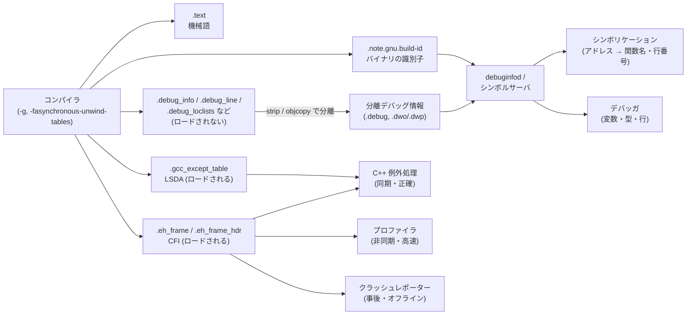
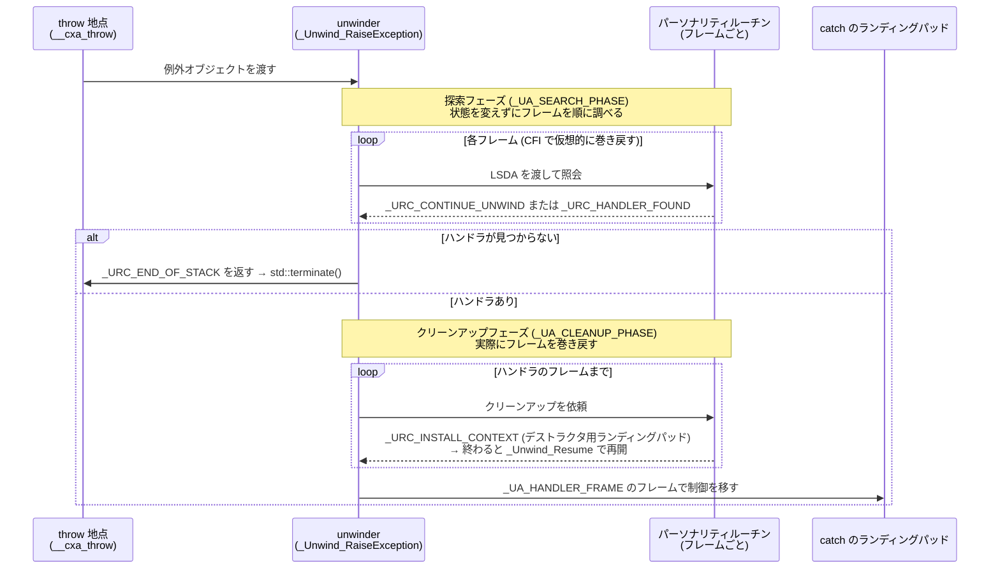
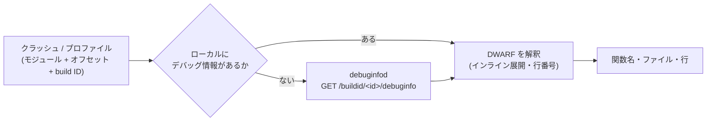

# デバッグ情報とスタックアンワインド (Debug Info & Stack Unwinding) — DWARF・CFI・シンボリケーション

## 概要 (Overview)

最適化されたバイナリはソースコードの構造をほとんど残さない。変数はレジスタに置かれて名前を失い、関数はインライン化で消え、フレームポインタ (frame pointer) が省かれればスタック上の境界も見えなくなる。それでもデバッガは変数の値を表示し、C++ の `throw` は正しい `catch` に着地し、プロファイラは火焔グラフを描き、クラッシュレポートは関数名と行番号を返す。これらはすべてコンパイラが機械語の横に残した**メタデータ**を読んで、失われた文脈を逆算している。

本書の中心テーゼは次のとおりである。**デバッグ情報とアンワインド情報は「プログラムカウンタ (PC) とレジスタの値から、ソースの文脈と呼び出し元の状態を復元する」ための副読本であり、その利用者は正しさ・速さ・可用性の要求がそれぞれ違う。** 例外処理は一度も間違えられないが、`throw` の地点でしか動かない。プロファイラはサンプリングの割り込みのたびにスタックをたどるので、何より速さが要る。クラッシュレポーターは壊れたプロセスから、後で解析できるだけの情報を取り出せればよい。フレームポインタ、DWARF の CFI (Call Frame Information)、Linux カーネルの ORC、SFrame という複数の方式が並立しているのは、この三者の要求を一つの形式では満たせないからである。

扱う範囲は DWARF のデバッグ情報 (DIE・行番号表・ロケーションリスト・split DWARF・圧縮)、CFI (`.eh_frame` / `.debug_frame`)、アンワインド方式の比較と 2023〜2024 年の主要ディストリビューションでのフレームポインタ復活、C++ のゼロコスト例外処理 (Itanium ABI の二段階アンワインド)、シンボリケーション (build ID・debuginfod・PDB・dSYM)、プロファイラとクラッシュレポートでの使われ方、そしてアンワインダが攻撃面になる構造である。分析深度は Level 3。

## 方法論 (Methodology)

- 形式の定義は一次資料で確かめる。DWARF は DWARF 5 標準[^dwarf5]、例外処理は Itanium C++ ABI の例外処理章[^itanium-eh]、`.eh_frame` の拡張は LSB Core 仕様[^lsb-eh]、ORC はカーネル文書[^orc]、SFrame は binutils の仕様書[^sframe]を典拠とする。
- 方式の比較は「利用者が何を要求するか」(同期か非同期か、精度、1 回あたりのコスト、事前に要るデータ量) の軸で行い、どの方式が優れているかではなくどの要求を捨てたかを対比する。
- 性能の数字は出典ごとに測定条件が違う。Fedora の変更提案の測定値[^fedora-fp]、Canonical の公称値[^ubuntu-fp]、カーネル文書の値[^orc]はそれぞれの条件とともに示し、横に並べて比較しない。
- 時間とともに変わる状況 (SFrame のカーネル統合、ディストリビューションの方針) は 2026-11-28 時点の確認として書き、未確定のものは未確定と明記する。
- セキュリティは防御の観点から扱い、攻撃手法は公開された論文と緩和策の文書に基づいて構造だけを述べる。

## 発見事項 (Findings)

1. **デバッグ情報とアンワインド情報は別物であり、ロードされるかどうかで分かれる。** `.debug_*` セクションはロードされず、`strip` で消せる。一方 `.eh_frame` は `SHF_ALLOC` 付きでメモリに載り、例外処理のために実行時に読まれる[^maskray-unwind]。リリースバイナリから DWARF を剥がしても C++ の例外が動くのはこのためである。

2. **CFI は「各命令アドレスで呼び出し元のレジスタをどう復元するか」の表を、圧縮した命令列として持つ。** 表の各行は CFA (Canonical Frame Address、呼び出し直前のスタックポインタ) の計算規則と、各レジスタの保存場所の規則からなる[^dwarf5]。命令列を解釈する必要があるため、1 フレームあたりのコストはフレームポインタをたどるより桁違いに大きい。

3. **アンワインド方式の違いはコストをどこで払うかの違いである。** フレームポインタは全関数のプロローグで実行時に払い、CFI は解析のたびに解釈器で払い、ORC と SFrame は事前計算した単純な表で払う。カーネル文書によれば、フレームポインタはカーネルの `.text` を約 3.2% 増やし、一部のワークロードを 5〜10% 遅くする。ORC は実行時コストを持たない代わりに 2〜4MB の表を使う[^orc]。

4. **主要ディストリビューションは 2023〜2024 年にフレームポインタを既定に戻した。** Fedora 38 が最初に `-fno-omit-frame-pointer -mno-omit-leaf-frame-pointer` を既定フラグに入れ[^fedora-fp]、FESCo は 2023-10-26 の再評価でも維持を決めた[^fesco-3084]。Ubuntu 24.04 LTS は 64 ビットプラットフォームで既定にし[^ubuntu-fp]、Arch Linux も RFC 26 で続いた[^arch-rfc26]。Fedora の測定ではカーネルのビルドで約 2.4%、CPython のベンチマークで 1〜10% 遅くなった[^fedora-fp]。DWARF でのアンワインドを本番で常時使うのは現実的でないため、可観測性のためにこの代価を払うと判断された[^gregg-fp]。

5. **SFrame は「ユーザー空間の ORC」を目指す形式で、2026-11 時点ではツールチェーン側が先行している。** SFrame は CFA・FP・RA の 3 つだけを記録し、関数記述子の二分探索と行の検索だけでアンワインドできる[^sframe]。カーネルではユーザー空間のスタックを後でたどる deferred unwind の基盤が Linux 6.17 に入った[^phoronix-deferred]が、SFrame を読む部分は 2026-05 に v15 のパッチが投稿された段階で、本稿の執筆時点ではメインラインへの統合を確認できなかった[^sframe-v15]。

6. **C++ のゼロコスト例外処理は正常系の代価をゼロにする代わりに、例外の送出を高価な表引きにした。** Itanium ABI の例外処理はハンドラを探すだけの探索フェーズと、実際にフレームを巻き戻すクリーンアップフェーズの二段階で動く[^itanium-eh]。各フレームでの判断は言語ごとのパーソナリティルーチン (personality routine) が LSDA (Language-Specific Data Area) を読んで行う。`try` ブロックに入るときに命令は一つも実行されない。

7. **シンボリケーションは「バイナリの識別子 → 対応するデバッグ情報」の検索問題に帰着する。** ELF の build ID、Windows の PDB の照合情報、Mach-O の UUID はいずれも、配布したバイナリとデバッグ情報を一対一に結ぶための鍵である。debuginfod はこの鍵を URL にした HTTP サービスで、主要ディストリビューションが公式サーバを運用している[^debuginfod]。

8. **アンワインダは攻撃面である。** CFI のバイトコードは壊れたスタックや細工されたデータを前提にせずに書かれた解釈器で実行される。Oakley と Bratus は DWARF の CFI 命令列でエクスプロイトを組めることを示し[^oakley]、Duta らは例外処理のアンワインドを「混乱した代理 (confused deputy)」として使い、シャドウスタックなどの戻りアドレス保護を迂回する CHOP を示した[^chop]。

## アーキテクチャ (Architecture)

### メタデータの生成から利用まで

コンパイラは機械語と同時に、2 種類のメタデータを出力する。人間のための「名前・型・変数の場所」(DWARF のデバッグ情報) と、機械のための「呼び出し元へ戻る方法」(CFI) である。



凡例: 箱はセクションまたは利用者、矢印はデータの流れ。「ロードされる」は `SHF_ALLOC` 付きで実行時のメモリに載るという意味である。

### 三種類の利用者と要求の違い

| 利用者 | いつ動くか | 正確さの要求 | 1 回あたりのコストの許容 | 典型的な情報源 |
|---|---|---|---|---|
| 例外処理 | `throw` の時点 (同期) | 完全 (間違えれば未定義動作) | 大きくてよい (例外は稀) | `.eh_frame` + LSDA |
| サンプリングプロファイラ | 割り込みの時点 (非同期、プロローグ中も含む) | 統計的でよい | 非常に小さく | フレームポインタ、LBR、ORC、SFrame、`.eh_frame` から作った表 |
| クラッシュレポーター | 異常終了の時点、解析は後で | できるだけ高く | 中程度 (一度きり) | スタックのコピー + オフラインの CFI と DWARF |
| デバッガ | 人間が止めた時点 | 高い | 大きくてよい | DWARF 全体 |

非同期の利用者は関数のプロローグやエピローグの途中で割り込むことがある。そのため `-fasynchronous-unwind-tables` で全命令の境界を記述した CFI が要る[^maskray-unwind]。例外処理だけなら呼び出し地点だけを正しく記述すれば足りる。

## 技術詳細 (Technical Details)

### 1. DWARF のデバッグ情報

**DIE (Debugging Information Entry)**: `.debug_info` は DIE の木である。各 DIE はタグ (`DW_TAG_compile_unit`、`DW_TAG_subprogram`、`DW_TAG_variable`、`DW_TAG_inlined_subroutine` など) と属性 (`DW_AT_name`、`DW_AT_type`、`DW_AT_location`、`DW_AT_low_pc` など) を持ち、属性の符号化は `.debug_abbrev` に一度だけ書いて共有する[^dwarf5]。インライン化された関数は `DW_TAG_inlined_subroutine` として呼び出し元の DIE の下に入るので、シンボリケーションは 1 つのアドレスから「インライン展開された関数の連鎖」を復元できる。

**行番号表 (line number table)**: `.debug_line` はアドレスとソースの位置 (ファイル・行・列) の対応表を、状態機械 (state machine) への命令列として符号化する。状態機械は `address`・`file`・`line`・`column`・`is_stmt` などのレジスタを持ち、特殊命令 (special opcode) 1 バイトでアドレスと行を同時に進められる[^dwarf5]。表をそのまま並べるより桁違いに小さくなるのは、この差分符号化のためである。DWARF 5 では行番号表のヘッダが作り直され、ファイル名の表に MD5 を持たせてソースの照合ができるようになった[^dwarf5]。

**ロケーション式とロケーションリスト**: 最適化されたコードでは、変数の置き場所が命令の位置によって変わる。DWARF はスタックマシン型のロケーション式 (`DW_OP_reg*`、`DW_OP_fbreg`、`DW_OP_piece` など) で場所を表し、アドレス範囲ごとに別の式を割り当てるのがロケーションリストである。DWARF 5 は `.debug_loc` と `.debug_ranges` を、再配置を減らしたより小さい `.debug_loclists` と `.debug_rnglists` に置き換えた[^dwarf5]。「optimized out」と表示される変数は、その PC で有効な式がないか、値がどこにも残っていない場合である。DWARF 5 の `DW_OP_entry_value` と呼び出し地点の情報 (`DW_TAG_call_site`) は、関数に入った時点の引数の値を呼び出し元から逆算することで、この欠落の一部を埋める[^dwarf5]。

**split DWARF と圧縮**: 大きなプログラムでは、デバッグ情報がリンク時間と容量の大半を占める。DWARF 5 で標準化された split DWARF では、オブジェクトファイルには小さな skeleton unit だけを残し、本体は `.dwo` ファイルに出す。リンカは `.dwo` に触れずに済み、`dwp` ツールが後で `.dwp` パッケージにまとめる[^dwarf5]。名前検索用の `.debug_names` も DWARF 5 で入り、`.debug_pubnames` と `.debug_pubtypes` を置き換えた[^dwarf5]。圧縮は ELF の `SHF_COMPRESSED` で行い、圧縮方式は zlib に加えて 2022 年に gABI へ `ELFCOMPRESS_ZSTD` (値 2) が追加された[^gabi-zstd]。binutils も `--compress-debug-sections=zstd` に対応した[^binutils-zstd]。一方 `.eh_frame` は実行時に直接読まれるため圧縮できない[^maskray-unwind]。

DWARF 6 は 2026-11 時点でまだ策定中で、委員会は作業草案のスナップショットを公開しているが、大きく変わりうると明記している[^dwarf-site]。

### 2. CFI: `.eh_frame` と `.debug_frame`

CFI は概念上、次のような巨大な表である[^dwarf5]。

| PC | CFA | rbp | rbx | 戻りアドレス |
|---|---|---|---|---|
| `foo+0` | `rsp+8` | (変化なし) | (変化なし) | `[CFA-8]` |
| `foo+1` (`push rbp` の後) | `rsp+16` | `[CFA-16]` | (変化なし) | `[CFA-8]` |
| `foo+4` (`mov rbp, rsp` の後) | `rbp+16` | `[CFA-16]` | (変化なし) | `[CFA-8]` |

表を行ごとに持つと巨大になるので、DWARF は共通部分を **CIE (Common Information Entry)** に、関数ごとの差分を **FDE (Frame Description Entry)** に分け、行の変化を `DW_CFA_advance_loc`・`DW_CFA_def_cfa_offset`・`DW_CFA_offset`・`DW_CFA_remember_state` などの命令列で表す。CIE はコードとデータの整列係数、戻りアドレスを表すレジスタ番号、初期命令を持つ[^dwarf5]。

`.eh_frame` は `.debug_frame` を実行時向けに変えた GNU の形式で、DWARF 標準ではなく LSB Core 仕様と各 psABI が定義する[^lsb-eh][^psabi]。主な違いは次のとおりである[^maskray-unwind]。

- `.eh_frame` は `SHF_ALLOC` 付きでロードされ、`.debug_frame` はロードされない。
- `.eh_frame` の CIE は拡張文字列 (augmentation string) を持つ。`z` は拡張データの長さ、`P` はパーソナリティルーチンへのポインタ、`L` は LSDA へのポインタの符号化、`R` は FDE のアドレスの符号化、`S` はシグナルフレームを表す。
- FDE から CIE への参照が相対値であり、アドレスを PC 相対の 4 バイトで持てるので、64 ビットでも小さく、PIE や共有ライブラリで再配置が要らない。

実行時に FDE を探すために、リンカは `--eh-frame-hdr` で `.eh_frame_hdr` を作る。これは関数の開始アドレスで整列した二分探索表で、プログラムヘッダの `PT_GNU_EH_FRAME` から見つけられる[^maskray-unwind]。アンワインダは PC を含むモジュールを `dl_iterate_phdr` で探してきたが、この関数はグローバルなロックを取るため、多数のスレッドが同時に例外を投げると詰まった。glibc 2.35 はロックを取らない `_dl_find_object` を加え、LLVM の libunwind はこれに切り替えて、20 スレッドでのアンワインドのベンチマークが 1103ms から 78ms になったと報告している[^dl-find-object]。

CFI による 1 フレームの巻き戻しは次の擬似コードで表せる。

```text
// 擬似コード: CFI による 1 フレーム分のアンワインド
// 前提: regs は現在のフレームのレジスタ集合、PC は regs.ip
// 計算量: FDE の探索 O(log F) (F = FDE 数) + CIE と FDE の命令数 O(I) の解釈
function step(regs):
    fde = binary_search(eh_frame_hdr, regs.ip)      // 見つからなければ終端
    row = interpret(fde.cie.initial_instructions)    // 初期行
    row = interpret_until(fde.instructions, regs.ip) // PC に達するまで命令を実行
    cfa = eval(row.cfa_rule, regs)                   // 例: regs.rsp + 16
    caller = copy(regs)
    for r in row.saved_registers:
        caller[r] = load(cfa + row.offset[r])        // 例: rbp は [CFA-16]
    caller.ip = load(cfa + row.ra_offset)            // 戻りアドレス
    caller.sp = cfa
    return caller
```

`interpret` は DWARF 式も評価しうる汎用の解釈器であり、これが 1 フレームあたりのコストを大きくし、同時に攻撃面にもしている (セキュリティ考察を参照)。

Windows x64 は同じ問題を、PE の `.pdata` に置く `RUNTIME_FUNCTION` の整列済み表と、`.xdata` の `UNWIND_INFO` (プロローグの操作を逆順に記録した unwind code の配列) で解く。JIT で生成したコードは `RtlAddFunctionTable` などで表を登録しないと、例外処理もデバッグも信頼できなくなる[^ms-x64-eh]。macOS は 32 ビットの記述子で大半の関数を表す compact unwind を使い、表せない関数だけ DWARF の CFI に逃がす[^maskray-unwind]。

### 3. アンワインド方式の比較

| 方式 | 情報の置き場所 | 実行時のコスト | 1 フレームのコスト | 非同期の正確さ | 主な利用者 |
|---|---|---|---|---|---|
| フレームポインタ | レジスタ (`rbp`) とスタック上のリンク | 全関数のプロローグ・エピローグと 1 レジスタ | ロード 2 回 | プロローグ中・リーフ関数で崩れうる | perf `--call-graph fp` (既定)、eBPF の `bpf_get_stackid` |
| DWARF CFI | `.eh_frame` | なし | 命令列の解釈 | 高い (非同期テーブルがあれば) | 例外処理、gdb、perf `--call-graph dwarf` |
| ORC | カーネルの `.orc_unwind` / `.orc_unwind_ip` | なし (2〜4MB のメモリ) | 表引き | objtool が検証 | Linux カーネル (x86) |
| SFrame | `.sframe` (`PT_GNU_SFRAME`) | なし | 二分探索と表引き | CFA・FP・RA に限る | perf の後払いアンワインド (統合作業中) |
| LBR / シャドウスタック | ハードウェア | ハードウェアの記録 | なし | 深さに上限 (LBR は 16〜32 段程度) | perf `--call-graph lbr` |

**フレームポインタ**: `push rbp; mov rbp, rsp` で各フレームが呼び出し元のフレームへのリンクを持つので、たどるのはリンクリストの走査に等しい。GCC は 2004 年に 32 ビット x86 で `-fomit-frame-pointer` を既定にした。汎用レジスタが少ない i386 では 1 本増える効果が大きかったが、同じ既定が x86-64 にも持ち込まれ、利得は小さくなった[^gregg-fp]。

**perf の DWARF モード**: カーネルは割り込みの文脈で CFI を解釈しない。perf の `--call-graph dwarf` はユーザースタックの先頭を既定で 8192 バイトずつサンプルにコピーし、ユーザー空間で後から CFI を適用する[^perf-record]。コピーの量がそのままオーバーヘッドとデータ量になり、深いスタックでは途中で切れる。

**ORC**: カーネルは DWARF の解釈器を持ち込まない代わりに、objtool がビルド時に各オブジェクトファイルの命令列を解析して ORC の表を作る。カーネル文書によれば、ORC は試験の一つで DWARF ベースのアンワインダより約 20 倍速く、その後の調整で 40 倍に近づいた可能性がある。ORC の表は `.eh_frame` より約 50% 多くメモリを使う[^orc]。ORC はユーザー空間を扱わない。

**SFrame**: ORC の考え方をユーザー空間の ELF に持ち込んだ形式で、GNU as が生成する。仕様の最新版 (SFrame version 3、2026-07-26 付の草案) は AArch64・AMD64・s390x を対象とし、SP や FP を基点にできない場合のための柔軟な FDE 型を加えた[^sframe]。カーネル側の方式は、割り込みの時点ではスタックをたどらず、ユーザー空間へ戻る直前に task_work で後からたどる (deferred unwind) というものである。SFrame のデータはユーザーのメモリにあってページアウトされうるので、ページフォルトを処理できる文脈まで待つ必要がある[^sframe-lwn]。基盤は Linux 6.17 に入り[^phoronix-deferred]、SFrame を読む部分は 2026-05 時点で v15 のパッチがレビュー中だった[^sframe-v15]。Fedora では Florian Weimer が Fedora 43 を目標に SFrame をバイナリへ入れる変更を提案したが、本稿の時点で採否は確認できなかった。この提案はフレームポインタを全面的に外すものではない[^fedora-sframe]。

**ディストリビューションの判断**: Fedora の変更提案は、SFrame が普及するまでの現実的な解としてフレームポインタを選んだ。提案者は Daan De Meyer、Davide Cavalca、Andrii Nakryiko で、カーネルのパッケージは対象外とし、パッケージごとに `%undefine _include_frame_pointers` で外せるようにした[^fedora-fp]。Ubuntu は 24.04 LTS で 64 ビットプラットフォームを対象にし、CPU オーバーヘッドは通常 1% 未満と説明したが、影響の大きい Python などは除外した[^ubuntu-fp]。Gregg は Netflix での経験として通常 1% 未満、極端な例で 10% のコストを挙げ、ユーザー空間の SFrame が主要ディストリビューションに入るのは 2029 年頃と予想している[^gregg-fp]。

### 4. C++ のゼロコスト例外処理

`throw` は `__cxa_allocate_exception` で例外オブジェクトを確保し、`__cxa_throw` が `_Unwind_RaiseException` を呼ぶ。言語に依存しない unwinder (libgcc_s や LLVM libunwind) と、言語ごとのパーソナリティルーチン (C++ では `__gxx_personality_v0`) の二層構造である[^itanium-eh]。



- 二段階にするのは、探索フェーズで状態を変えずにハンドラの有無を確かめられるからである。ハンドラがなければスタックを壊さないまま `terminate()` を呼べる。デバッガはスタックが残った状態で止められる。また、再開型の例外処理を持つ言語と共存できる[^itanium-eh]。
- **LSDA**: FDE の拡張データが指す `.gcc_except_table` の中身で、呼び出し地点の範囲、ランディングパッド (landing pad)、アクション (どの型を `catch` するか) の表からなる[^maskray-unwind]。パーソナリティルーチンは `_Unwind_GetLanguageSpecificData` でこれを受け取り、例外の型と照合する[^itanium-eh]。
- **強制アンワインド**: `_UA_FORCE_UNWIND` は、どの言語も捕捉してはいけない巻き戻し (スレッドの取り消しなど) を表し、デストラクタだけが走る[^itanium-eh]。
- ゼロコストとは、`try` に入っても命令が増えないという意味である。例外の送出は FDE の探索、CFI の解釈、LSDA の照合をフレームごとに 2 回 (探索とクリーンアップ) 行うので非常に高価である。この非対称が「例外は例外的な状況にだけ使う」という C++ の慣習を支えている。
- ABI の上では、x86-64 の psABI が Itanium の unwind ライブラリのインタフェースを取り込んでいる[^psabi]。呼び出し規約が [`../../hardware/hw-sw-interface/abi-syscalls.md`](../../hardware/hw-sw-interface/abi-syscalls.md) の「見えない契約」なら、CFI はその契約がフレームごとにどう実装されたかの記録である。Windows x64 は同じ役割を `UNWIND_INFO` の言語別ハンドラが担う[^ms-x64-eh]。

### 5. シンボリケーション

本番のバイナリは `strip` されているので、アドレスを関数名と行番号に変えるには、ビルド時に分けたデバッグ情報をどこかから引く必要がある。



- **build ID**: リンカが `.note.gnu.build-id` に書く識別子で、デバッグ情報を分けても両方に残る。debuginfod はこれを鍵に、デバッグ情報、実行ファイル、ソースファイルを HTTP で配る。elfutils 0.178 (2019-11) で入り、gdb 10.1、perf (Linux 5.10)、valgrind 3.17.0 などが対応している。Fedora、Debian、Ubuntu、Arch Linux、openSUSE などが公式サーバを運用している[^debuginfod]。
- **Windows の PDB**: デバッガはシンボルパスに `srv*` で Microsoft の公開シンボルサーバや社内のシンボルストアを指定し、バイナリに対応する PDB を取得してキャッシュする[^ms-symbol-path]。
- **macOS / iOS の dSYM**: DWARF を `.dSYM` バンドルに分け、バイナリの UUID で照合して、クラッシュレポートのアドレスを関数名に戻す[^apple-dsym]。
- **プロファイラでの後払い**: OpenTelemetry の eBPF プロファイラ (Elastic が 2024 年に寄贈) は、DWARF のデバッグ情報を使わずに `.eh_frame` からネイティブコードをたどり、HotSpot・Python・Node.js などのインタプリタやランタイムも扱う。動作には Linux 5.10 以降が必要である[^otel-ebpf]。トレースをバックエンドに送るので、本番のホストにシンボルを置かずに済む。これは [`../observability/observability-performance-engineering.md`](../observability/observability-performance-engineering.md) の continuous profiling を成り立たせる前提でもある。

### 6. クラッシュレポート: ミニダンプと Crashpad

クラッシュしたプロセスの中で凝ったことをするのは危険である。ヒープもスタックも壊れているかもしれない。Crashpad (Breakpad の後継) は、クライアントライブラリをアプリに組み込み、別プロセスのハンドラが異常終了したプロセスを止めてスナップショットを取る。スナップショットにはモジュールの一覧、スレッドごとのレジスタとスタック、レジスタとスタックから参照されたメモリが入り、Windows のミニダンプ形式で書き出される[^crashpad]。

Crashpad はクライアント側でスタックをたどったりシンボルを解決したりしない。アンワインド情報もシンボルも大きく、処理にも資源が要るので、生のダンプをサーバへ送り、サーバ側で CFI と DWARF を使ってスタックを再構築する[^crashpad]。送信は Breakpad と互換の HTTP の multipart 形式で、ユーザーの同意は組み込み側が管理する[^crashpad]。クラッシュレポートとプロファイラは、どちらも「その場では最小限を記録し、重い解釈は後でする」という同じ設計に落ち着いている。

### 7. 失敗モードと境界条件

- **フレームポインタを持たないコードが 1 つ混ざると、そこで連鎖が切れる。** 手書きのアセンブリ、`-fomit-frame-pointer` でビルドされたライブラリ、JIT のコードがその典型である。フレームポインタを既定にしても、全パッケージがそろわなければ効果は部分的である。
- **リーフ関数とプロローグ**: `-mno-omit-leaf-frame-pointer` がないと、リーフ関数の中で割り込んだときに呼び出し元が 1 段飛ぶ。Fedora が 2 つのフラグを組で入れたのはこのためである[^fedora-fp]。
- **JIT と動的コード**: `.eh_frame` を持たないコードは CFI でたどれない。JIT は GDB の JIT インタフェースや perf のマップファイル、Windows では `RtlAddFunctionTable` で別途登録する必要がある[^ms-x64-eh]。
- **シグナルフレーム**: シグナルハンドラの呼び出し元は通常の関数ではないので、CIE の `S` 拡張などで特別扱いする[^maskray-unwind]。
- **perf の DWARF モードの切り詰め**: コピーした 8KB を超えるスタックの奥はたどれない[^perf-record]。
- **シャドウスタックとの整合**: CET のシャドウスタックが有効なプロセスでは、例外でフレームを飛ばすときにシャドウスタックも同じ数だけ進める必要がある。libgcc は `incssp` 命令でこれを行い、引数が 1 バイトに制限されるため 255 ずつ繰り返す[^gcc-shstk-unwind]。

## セキュリティ考察 (Security Considerations)

- **アンワインダは信頼できない入力を解釈する。** 例外処理のアンワインダはスタック上の戻りアドレスと保存されたレジスタを「正しい」と仮定して CFI と LSDA を適用する。スタックが壊されていれば、その仮定はそのまま攻撃者の入力になる。Duta ら (NDSS 2023) は、スタックを壊したうえで例外を送出させると、アンワインダが攻撃者の選んだ `catch` ハンドラへ制御を移すことを示し、これを CHOP (Catch Handler Oriented Programming) と名付けた[^chop]。戻りアドレスを直接書き換えて `ret` で飛ぶわけではないので、`ret` だけを守る後方エッジの保護 (backward-edge protection) をすり抜ける。著者らは Linux・Windows・macOS・Android・iOS で成立すると報告し、既存の緩和策の不変条件をアンワインドの経路まで広げることを提案している[^chop]。
- **CFI のバイトコード自体が実行環境になる。** Oakley と Bratus (WOOT 2011) は、例外処理に対応した GCC のバイナリには DWARF のバイトコードが必ず含まれ、その解釈器を使えばネイティブコードを持ち込まずにトロイの木馬やエクスプロイトを組めることを示した[^oakley]。この手法は従来のメモリ破壊と組み合わせて使うもので、アンワインダが読むデータの経路を攻撃者が書き換えられれば、正規の解釈器に偽の CFI を実行させられることを意味する。
- **SEH の上書き (歴史的事例)**: 32 ビット Windows の構造化例外処理 (SEH) は、例外ハンドラのリンクリストをスタック上に置いた。スタックのオーバーフローでハンドラのポインタを書き換え、わざと例外を起こすのが SEH overwrite であり、Microsoft はリンカの `/SAFESEH` (登録されたハンドラだけを許す) と、実行時にチェーンの整合性を確かめる SEHOP (Windows Vista SP1 と Windows Server 2008 で導入) で対処した[^msrc-sehop]。x64 の Windows が表に基づく例外処理 (`.pdata`/`.xdata`) に移ったことで、ハンドラのポインタがスタックに置かれなくなり、この経路は構造的に消えた[^ms-x64-eh]。Linux の `.eh_frame` も表に基づく方式であり、同じ利点を持つ。
- **CET シャドウスタックとアンワインド**: Linux はユーザー空間のシャドウスタックを `arch_prctl(ARCH_SHSTK_ENABLE)` で有効にし、通常は glibc の動的ローダが設定する。シグナルフレームには元のシャドウスタックポインタがトークンとして保存され、`sigreturn` で検証される[^shstk]。Linux 6.6 でユーザー空間のシャドウスタックが入り[^phoronix-shstk]、例外処理のアンワインダはフレームを飛ばすたびにシャドウスタックも合わせて進めなければならない[^gcc-shstk-unwind]。逆に、この `incssp` によるずらしは「正当なアンワインド」を装えばシャドウスタックを進められる経路でもあり、CHOP が示したようにアンワインダそのものを守る不変条件が別に要る[^chop]。シャドウスタックや PAC の全体像は [`../security/memory-safety-exploit-mitigations.md`](../security/memory-safety-exploit-mitigations.md) を参照。
- **デバッグ情報の漏洩**: 出荷するバイナリに DWARF を残すと、関数名、型、構造体のレイアウト、ソースのパス (ビルドしたマシンのユーザー名やディレクトリ構成を含む) が渡る。リバースエンジニアリングの手間が大きく下がり、`DW_AT_comp_dir` の絶対パスは再現可能ビルドも壊す。`strip` や `objcopy --only-keep-debug` で分け、`-fdebug-prefix-map` でパスを書き換えるのが定石である。これは [`build-systems-reproducible-builds.md`](build-systems-reproducible-builds.md) の非決定性の除去と同じ作業になる。なお `.eh_frame` とシンボルテーブル (`.dynsym`) は strip しても残るので、関数の境界はある程度復元できる。
- **シンボルの配布と信頼**: debuginfod は誰でもサーバを立てられるため、配られたデバッグ情報を信じてよいかが問題になる。elfutils 0.192 以降は IMA 署名を検証する `ima:enforcing` モードを持ち、Fedora の公式サーバは Fedora 39 以降で署名を配る。upstream はディストリビューション自身のサーバを使うよう勧めている[^debuginfod]。細工された DWARF は gdb や解析ツールの解釈器にとって攻撃の入力になりうるので、出所の確認はデバッグ時の安全にも関わる。
- **クラッシュダンプは機密情報を含む。** ミニダンプにはスタックとそこから参照されたメモリが入るので、パスワードや鍵が含まれうる。Crashpad は送信にユーザーの同意を求め、HTTPS を強く推奨している[^crashpad]。社内のバイナリでも、ダンプの保管と閲覧の権限は本番データと同じ水準で扱うべきである。
- **プロファイラの権限**: perf や eBPF のプロファイラは他プロセスのスタックとメモリを読む。`perf_event_paranoid` や BPF の権限設定は観測の利便とプロセス間の分離の取引であり、詳細は [`../operating-systems/ebpf-kernel-programmability.md`](../operating-systems/ebpf-kernel-programmability.md) が扱う。

## 結論 (Conclusions)

- デバッグ情報とアンワインド情報は、最適化で失われた「どこにいて、どこから来たか」を PC とレジスタから復元するための副読本である。名前と型と変数の場所は DWARF のデバッグ情報が、呼び出し元への戻り方は CFI が担い、前者はロードされず、後者はロードされる。
- アンワインド方式が並立するのは、例外処理 (同期・正確)、プロファイラ (非同期・高速)、クラッシュレポーター (事後・オフライン) の要求が両立しないからである。フレームポインタは実行時に、CFI は解析時に、ORC と SFrame は事前計算した表で代価を払う。
- 2023〜2024 年のフレームポインタ復活は、本番で常時プロファイルを取るという要求が、数 % の実行時コストより重くなったことの表れである。SFrame はその代価を外す候補だが、2026-11 時点ではツールチェーンが先行し、カーネルとディストリビューションでの採用は途中にある。
- C++ のゼロコスト例外処理は正常系の代価をゼロにする代わりに、送出時に CFI と LSDA の解釈を二段階で行う。この設計は、表に基づく例外処理が SEH のスタック上のポインタという攻撃面を消した一方で、アンワインダ自体を新しい攻撃面にした。
- シンボリケーションは build ID・PDB・UUID を鍵とした検索問題であり、debuginfod はそれをディストリビューション規模の HTTP サービスにした。「その場では最小限を記録し、重い解釈は後でする」という設計は、プロファイラにもクラッシュレポートにも共通している。

### 次の接続先 (Related Topics)

- [`linkers-loaders-elf.md`](linkers-loaders-elf.md) — `.eh_frame_hdr` を作るリンカ、`PT_GNU_EH_FRAME` を含むプログラムヘッダ、`strip` で消せるセクションと消せないセクションの区別。
- [`compiler-backend-code-generation.md`](compiler-backend-code-generation.md) — CFI 命令を出すプロローグ・エピローグの挿入とフレームの低水準化、CET の `endbr64` や PAC の挿入。
- [`build-systems-reproducible-builds.md`](build-systems-reproducible-builds.md) — デバッグ情報に入るパスと時刻という非決定性、`-fdebug-prefix-map`。
- [`../../hardware/hw-sw-interface/abi-syscalls.md`](../../hardware/hw-sw-interface/abi-syscalls.md) — CFI が記録する呼び出し規約とスタックフレームの配置。
- [`../../hardware/cpu/performance-monitoring-units.md`](../../hardware/cpu/performance-monitoring-units.md) — サンプリングの割り込みを生む PMU と、フレームポインタなしでスタックを再構築する LBR。
- [`../observability/observability-performance-engineering.md`](../observability/observability-performance-engineering.md) — 火焔グラフと continuous profiling。アンワインドはその入力である。
- [`../operating-systems/ebpf-kernel-programmability.md`](../operating-systems/ebpf-kernel-programmability.md) — eBPF プロファイラがスタックを取得する仕組みと権限モデル。
- [`../security/memory-safety-exploit-mitigations.md`](../security/memory-safety-exploit-mitigations.md) — シャドウスタック・PAC・CFI。CHOP が迂回した後方エッジの保護。

## 参考文献 (References)

**一次資料 (Primary: 仕様・標準・公式文書・論文・ソース)**

[^dwarf5]: DWARF Debugging Information Format Committee. (2017). *DWARF Debugging Information Format Version 5*. [dwarfstd.org/doc/DWARF5.pdf](https://dwarfstd.org/doc/DWARF5.pdf) — Accessed: 2026-11-28. 主な変更点の一覧は [dwarfstd.org/dwarf5std.html](https://dwarfstd.org/dwarf5std.html) を参照。

[^dwarf-site]: [DWARF Debugging Standard (dwarfstd.org)](https://dwarfstd.org/) — Accessed: 2026-11-28. DWARF 6 は "currently under development" で、作業草案のスナップショットを公開している。

[^itanium-eh]: [Itanium C++ ABI: Exception Handling](https://itanium-cxx-abi.github.io/cxx-abi/abi-eh.html) — Accessed: 2026-11-28.

[^psabi]: [System V Application Binary Interface, AMD64 Architecture Processor Supplement](https://gitlab.com/x86-psABIs/x86-64-ABI) — Accessed: 2026-11-28. unwind ライブラリのインタフェースと DWARF のレジスタ番号の対応を規定する。

[^lsb-eh]: [Linux Standard Base Core Specification 5.0, Exception Frames](https://refspecs.linuxfoundation.org/LSB_5.0.0/LSB-Core-generic/LSB-Core-generic/ehframechpt.html) — Accessed: 2026-11-28. 執筆時点ではボット対策によりページを取得できず、内容は [^maskray-unwind] で確かめた。

[^gabi-zstd]: [generic-abi mailing list (2022). Add new ch_type value: ELFCOMPRESS_ZSTD](https://groups.google.com/g/generic-abi/c/satyPkuMisk) — Accessed: 2026-11-28.

[^binutils-zstd]: [Sourceware Bugzilla 29397. binutils: support zstd for SHF_COMPRESSED debug sections](https://sourceware.org/bugzilla/show_bug.cgi?id=29397) — Accessed: 2026-11-28.

[^orc]: [The Linux Kernel documentation, ORC unwinder](https://docs.kernel.org/arch/x86/orc-unwinder.html) — Accessed: 2026-11-28.

[^sframe]: [The SFrame format (SFrame Version 3, draft dated 2026-07-26). GNU Binutils documentation](https://sourceware.org/binutils/docs/sframe-spec.html) — Accessed: 2026-11-28. version 2 は [binutils 2.41 版](https://sourceware.org/binutils/docs-2.41/sframe-spec.html) を参照。

[^sframe-v15]: [Rostedt, S. et al. (2026-05). [PATCH v15 00/20] unwind_deferred: Implement sframe handling. linux-trace-kernel](https://ratatoskr.run/linux-trace-kernel/2026/05/17006645/t) — Accessed: 2026-11-28.

[^shstk]: [The Linux Kernel documentation, Control-flow Enforcement Technology (CET) Shadow Stack](https://docs.kernel.org/arch/x86/shstk.html) — Accessed: 2026-11-28.

[^gcc-shstk-unwind]: [GCC source, `libgcc/config/i386/shadow-stack-unwind.h`](https://gnu.googlesource.com/gcc/+/trunk/libgcc/config/i386/shadow-stack-unwind.h) — Accessed: 2026-11-28. 導入時のパッチは [gcc-patches (2017-10)](https://gcc.gnu.org/legacy-ml/gcc-patches/2017-10/msg02279.html)。

[^dl-find-object]: [LLVM libunwind commit 87933852. [libunwind] Use `_dl_find_object` if available (2022-08)](https://llvm.googlesource.com/llvm-project/libunwind/+/87933852e0ea190eba7d953bb2b8ddfdb3ee1cf4) — Accessed: 2026-11-28. 20 スレッドでのベンチマークはコミットメッセージによる。

[^fedora-fp]: [Fedora Project Wiki, Changes/fno-omit-frame-pointer](https://fedoraproject.org/wiki/Changes/fno-omit-frame-pointer) — Accessed: 2026-11-28. 性能値は Fedora 37 のパッケージをフレームポインタあり・なしで比べた提案者の測定。

[^fesco-3084]: [FESCo issue #3084, Re-evaluate -fno-omit-frame-pointer compile flag for F40](https://pagure.io/fesco/issue/3084) — Accessed: 2026-11-28. 2023-10-26 の会議で +7, 0, -1。

[^fedora-sframe]: [Fedora Project Wiki, Changes/SFrameInBinaries](https://www.fedoraproject.org/wiki/Changes/SFrameInBinaries) — Accessed: 2026-11-28. 状態は proposed (ページの最終更新 2025-06-30)。

[^arch-rfc26]: [Arch Linux RFC 26 (merge request). Add -fno-omit-frame-pointer and -mno-omit-leaf-frame-pointer to default compilation flags](https://gitlab.archlinux.org/archlinux/rfcs/-/merge_requests/26) — Accessed: 2026-11-28.

[^ubuntu-fp]: [Canonical (2024). Ubuntu performance engineering with frame pointers by default](https://ubuntu.com/blog/ubuntu-performance-engineering-with-frame-pointers-by-default) — Accessed: 2026-11-28. オーバーヘッドの数字は Canonical の公称値。

[^perf-record]: [perf-record(1), Linux manual page](https://man7.org/linux/man-pages/man1/perf-record.1.html) — Accessed: 2026-11-28.

[^debuginfod]: [elfutils debuginfod](https://sourceware.org/elfutils/Debuginfod.html) — Accessed: 2026-11-28.

[^otel-ebpf]: [open-telemetry/opentelemetry-ebpf-profiler (GitHub)](https://github.com/open-telemetry/opentelemetry-ebpf-profiler) — Accessed: 2026-11-28. 寄贈の経緯は [OpenTelemetry Blog (2024). Elastic Contributes its Continuous Profiling Agent to OpenTelemetry](https://opentelemetry.io/blog/2024/elastic-contributes-continuous-profiling-agent/)。

[^crashpad]: [Crashpad, Overview Design](https://chromium.googlesource.com/crashpad/crashpad/+/HEAD/doc/overview_design.md) — Accessed: 2026-11-28.

[^ms-x64-eh]: [Microsoft Learn, x64 exception handling](https://learn.microsoft.com/en-us/cpp/build/exception-handling-x64) — Accessed: 2026-11-28.

[^ms-symbol-path]: [Microsoft Learn, Configure Symbol Path: Windows Debuggers](https://learn.microsoft.com/en-us/windows-hardware/drivers/debugger/symbol-path) — Accessed: 2026-11-28.

[^apple-dsym]: [Apple Developer Documentation, Building your app to include debugging information](https://developer.apple.com/documentation/xcode/building-your-app-to-include-debugging-information) — Accessed: 2026-11-28.

[^msrc-sehop]: [Microsoft Security Response Center (2009-02). Preventing the Exploitation of Structured Exception Handler (SEH) Overwrites with SEHOP](https://msrc.microsoft.com/blog/2009/02/preventing-the-exploitation-of-structured-exception-handler-seh-overwrites-with-sehop) — Accessed: 2026-11-28.

[^chop]: Duta, V., Freyer, F., Pagani, F., Muench, M., & Giuffrida, C. (2023). Let Me Unwind That For You: Exceptions to Backward-Edge Protection. *Network and Distributed System Security Symposium (NDSS 2023)*. [ndss-symposium.org](https://www.ndss-symposium.org/ndss-paper/let-me-unwind-that-for-you-exceptions-to-backward-edge-protection/) — Accessed: 2026-11-28.

[^oakley]: Oakley, J., & Bratus, S. (2011). Exploiting the Hard-Working DWARF: Trojan and Exploit Techniques with No Native Executable Code. *5th USENIX Workshop on Offensive Technologies (WOOT '11)*, 91–102. [usenix.org](https://www.usenix.org/conference/woot11/exploiting-hard-working-dwarf-trojan-and-exploit-techniques-no-native-executable) — Accessed: 2026-11-28.

**二次資料 (Secondary: 専門家による解説、報道)**

[^gregg-fp]: [Gregg, B. (2024-03-17). The Return of the Frame Pointers](https://www.brendangregg.com/blog/2024-03-17/the-return-of-the-frame-pointers.html) — Accessed: 2026-11-28.

[^maskray-unwind]: [Song, F. (MaskRay). Stack unwinding](https://maskray.me/blog/2020-11-08-stack-unwinding) — Accessed: 2026-11-28. LLVM の lld と libunwind の開発者による解説。

[^sframe-lwn]: [Corbet, J. (2025-07-11). SFrame-based stack unwinding for the kernel. LWN.net](https://lwn.net/Articles/1029189/) — Accessed: 2026-11-28.

[^phoronix-deferred]: [Phoronix (2025). Deferred Unwinder Code Upstreamed For Linux 6.17 On Road To SFrame Support](https://www.phoronix.com/news/Linux-6.17-Deferred-Unwinder) — Accessed: 2026-11-28.

[^phoronix-shstk]: [Phoronix. Glibc Updated For Recent Linux CET Shadow Stack Support](https://www.phoronix.com/news/Glibc-Intel-CET-Shadow-Stack) — Accessed: 2026-11-28. Linux 6.6 でユーザー空間のシャドウスタックが入ったことの報道。
