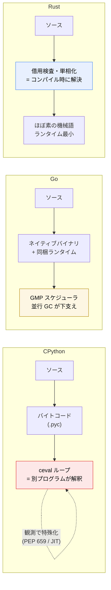

# 言語処理系の設計対比 — CPython・Go・Rust (Language Implementations: CPython, Go, Rust)

## 概要 (Overview)

「プログラミング言語が動く」とは何が起きることか。ソースコードは CPU にとってただのテキストであり、言語の意味論——型・メモリ管理・並行性——を**誰かがどこかで機械の言葉に翻訳し、保証し続け**なければならない。本ドキュメントは、その「誰か」と「どこか」が言語ごとにどう違うかを、設計思想が対極にある 3 つの処理系——CPython (バイトコードインタプリタ)、Go (AOT コンパイル + 重量ランタイム)、Rust (AOT コンパイル + 最小ランタイム)——の内部構造で比較する。

中心テーゼは、**言語処理系とは「意味論の保証をいつ払うかの会計方式」である**、ということ。同じ保証 (メモリ安全・型整合・並行安全) でも、支払時期は選べる: 実行のたびに毎回払う (CPython の動的束縛と参照カウント)、実行中にランタイムが肩代わりする (Go のスケジューラと GC)、コンパイル時に全額前払いする (Rust の所有権と単相化)。この選択が、起動時間・ピーク性能・レイテンシの決定性・コンパイル時間・書き手の負担——すべてのトレードオフを決める。

もう一つの軸は**「ランタイムの重さ」はバイナリの形に現れる**こと。CPython ではプログラム本体がデータ (バイトコード) であり実行主体はインタプリタという別のプログラムである。Go のバイナリは自前のスケジューラ・GC・スタック管理を丸ごと抱えた「小さな OS」であり、Rust のバイナリはほぼ素の機械語で、ランタイムと呼べるものをほとんど持たない。[`../toolchain/linkers-loaders-elf.md`](../toolchain/linkers-loaders-elf.md) が扱った「成果物がプロセスになる」経路の先に、この三者の違いが立ち上がる。

本書は (1) 実行モデルのスペクトラム、(2) CPython の内部 (ceval ループ・GIL・特殊化・free-threading)、(3) Go ランタイム (GMP スケジューラ・伸長スタック・並行 GC)、(4) Rust (所有権・単相化・unsafe 境界)、(5) 並行安全性の保証位置の比較、(6) 非同期処理の設計対比 (コルーチン・イベントループ・状態機械)、(7) エラー処理と大域脱出の機構、(8) 起動とデプロイの形、を一次資料 (PEP, Go 設計文書, 査読論文) を基に整理する。JIT・GC の一般論は [`managed-runtimes-gc-jit.md`](managed-runtimes-gc-jit.md) に委ね、本書は**言語ごとの設計選択の対比**に集中する。分析深度は Level 3。

## 方法論 (Methodology)

- 三言語を同じ 8 軸——実行形態・型の解決時期・メモリ管理・並行モデル・非同期モデル・エラー処理・他言語境界 (FFI)・起動とデプロイ——で貫いて比較し、個別の「豆知識」ではなく設計空間の中の**位置取り**として読めるようにする。
- 一次資料を優先する: CPython は PEP (659, 703, 744) と公式ドキュメント、Go は設計文書 (スケジューラ・メモリモデル・GC ガイド)、Rust は査読論文 (RustBelt) と言語リファレンス。性能の主張は「何を測ったか」と出典時点を併記する (処理系の性能は変化が速い)。
- 三言語の選定理由: 実行モデル (インタプリタ / AOT+重ランタイム / AOT+最小ランタイム)、メモリ管理 (参照カウント / 追跡 GC / 所有権)、並行性 (GIL / goroutine / 型システム) のすべてで互いに異なる選択をしており、3 点で設計空間を最大に張れるため。JIT を主戦場とする V8/JVM は前掲書で扱済み。
- 高速化の系譜 (hidden class, IC, deopt) は前掲書の内容を前提とし、本書では CPython の特殊化がその再適用であることの指摘に留める。

## 発見事項 (Findings)

1. **処理系の設計は「意味論のコストをいつ払うか」で統一的に読める。** `a + b` の意味の解決を、CPython は実行のたびに払い (型を見て `__add__` を辞書引き)、Go はコンパイル時に型を固定した上で実行時の下支え (GC・スケジューラ) をランタイムに払わせ、Rust はコンパイル時に全額払う (単相化で加算命令 1 個に確定)。三者は同じ問題の支払時期をずらしただけであり、「スクリプト言語 vs コンパイル言語」という素朴な二分法より、この**会計軸**の方が設計を正確に説明する。
2. **CPython の遅さの本体は解釈のオーバーヘッドではなく「すべてがヒープ上の PyObject である」ことにある。** 整数 1 個もヒープ上の参照カウント付きオブジェクト (boxing) であり、属性アクセスは辞書引き、すべての演算がポインタの間接参照を挟む。CPython 3.11 の特殊化適応インタプリタ (PEP 659) は「この加算は毎回 int だった」という実行時観測で汎用命令を特殊化命令に書き換える——V8 のインラインキャッシュ (1984 年の発明) の CPython への再適用であり、3.11 は平均 1.25 倍高速化した。3.13 以降の copy-and-patch JIT (PEP 744) はその延長線にある。
3. **GIL の本当の役割は「参照カウントと C 拡張を守ること」であり、除去の難しさもそこにある。** GIL (global interpreter lock) はバイトコード実行を直列化する粗いロックで、参照カウントの非原子的な増減と、GIL の存在を前提に書かれた膨大な C 拡張を同時に守ってきた。free-threading (PEP 703, 3.13 で実験導入・3.14 で正式サポート) の本体は GIL を消すことではなく、**参照カウントをマルチスレッドでスケールさせる技術群** (biased reference counting・不滅オブジェクト・遅延カウント・mimalloc ベースのヒープ) と、C 拡張エコシステムの移行である。単スレッド性能の代償は 3.13 実験版で大きく (特殊化の無効化を含め数十 %)、3.14 で 1 桁 % 台へ縮小と報告されている (2025 年時点・公式値)。
4. **Go は「AOT コンパイルされたバイナリの中に小さな OS を同梱する」設計である。** goroutine は OS スレッドではなくランタイムが M:N 多重化する軽量継続で、GMP スケジューラ (G: goroutine, M: OS スレッド, P: 実行権) がワークスティーリングで分配し、ブロッキング syscall やネットワーク I/O は netpoller が OS のイベント機構に変換する。スタックは約 2KB から始まりコピー方式で成長する——「スレッドを気軽に 10 万個作れる」という言語体験は、OS の仕事 ([`../operating-systems/process-thread-scheduling.md`](../operating-systems/process-thread-scheduling.md)) をユーザ空間で再実装したランタイムが買っている。
5. **Rust の所有権は「GC の仕事をコンパイル時に前倒しした」ものであり、代償は柔軟性とコンパイル時間で払う。** 各値に唯一の所有者を定め、借用の生存期間をコンパイラが検査することで、解放忘れ・二重解放・use-after-free を**実行前に**排除する——実行時コストはゼロ、決定的解放 (RAII)。ジェネリクスは単相化 (monomorphization) で型ごとに機械語を複製し動的ディスパッチを消す。代償は、借用検査が却下する正しいプログラムの存在 (書き手の学習コスト)、単相化によるコード膨張とコンパイル時間、そして保証の外側 (`unsafe`) の管理責任である。核心部の型システムの健全性は RustBelt (2018) が機械証明した。
6. **並行安全性の保証位置が三者の設計思想を最も鮮明に分ける。** CPython は GIL という単一の粗いロックで「そもそも並列にしない」(free-threading はこの前提を今まさに外しつつある)。Go はデータ競合を型システムでは防がず、規約 (「共有してから通信するな、通信して共有せよ」) と検出器 (race detector) に委ねる——そして Go のデータ競合は多ワード値 (インタフェース・スライス) の破断書込を通じて**メモリ安全性そのものを破りうる**。Rust は Send/Sync という型情報で「どの値がスレッド境界を越えられるか」をコンパイル時に検査し、データ競合を安全なコードでは型エラーにする。ロックで消す・検出して直す・型で書けなくする——三つの哲学の縮図である。
7. **非同期処理の三答は「関数の色」問題の位置取りである。** 「待てる関数と待てない関数の分裂」(Nystrom の colored functions) に対し、Python は色を受け入れてコルーチンを言語機構に・イベントループをライブラリにし (asyncio)、Go は色を消すためにランタイムを常時払わせ (goroutine + netpoller = blocking の見た目で non-blocking の実装)、Rust はコンパイル時に `async fn` を状態機械へ畳んで色のコストをゼロにした——代わりに最も濃い色 (`Pin`・API 二重化) を書き手が払う。ここでも支払時期テーゼがそのまま再演される。
8. **エラー処理は「異常経路にいつ課金するか」の選択である。** CPython は例外を制御フローの日常部品として使い (3.11 でゼロコスト例外化——正常経路の課金を廃止し、飛んだときだけ例外表を引く)、Go はエラーを多値返却のただの値にして大域脱出 (panic) を事故に隔離し、Rust は `Result` + `?` で異常を型に運び網羅性を検査させる。大域脱出の実装機構 (unwind 表・CFI) は三者とも下の層で共有しており、その本体は [`../toolchain/`](../toolchain/) の主題である。

## アーキテクチャ (Architecture)

### 実行モデルのスペクトラム — 意味論をいつ払うか



赤 (実行時に毎回払う) → 黄 (ランタイムが肩代わり) → 青 (コンパイル時に前払い)。

### 8 軸の対比表

| 軸 | CPython | Go | Rust |
|---|---|---|---|
| 実行形態 | バイトコードインタプリタ (+ 3.13 で実験的 JIT) | AOT ネイティブ + 重量ランタイム | AOT ネイティブ (LLVM 経由)・最小ランタイム |
| 型の解決 | 実行時 (動的束縛・辞書引き)、観測で特殊化 | コンパイル時 (interface は実行時 itab) | コンパイル時 (単相化)、`dyn` のみ vtable |
| メモリ管理 | 参照カウント + 循環回収 GC | 並行マーク&スイープ GC (非移動・非世代) | 所有権 + RAII (実行時機構なし) |
| 並行モデル | スレッド + GIL (→ free-threading 移行中) | goroutine (M:N) + チャネル、競合は検出器 | OS スレッド / async、Send/Sync で型検査 |
| 非同期モデル | コルーチン (言語) + イベントループ (ライブラリ) | async の消去 (goroutine + netpoller) | Future→状態機械 (コンパイル時)、実行器はライブラリ |
| エラー処理 | 例外 (制御フローの日常部品) | error 値 + panic/defer/recover | Result + `?`、panic は unwind/abort を選択 |
| FFI 境界 | C API が全面公開 (拡張が内部表現に依存) | cgo (スタック切替とスケジューラ協調が必要) | `extern "C"` でほぼゼロコスト (unsafe) |
| 起動とデプロイ | インタプリタ初期化 + import の連鎖。環境ごと配る | 静的単一バイナリ。起動はランタイム初期化のみ | ほぼ素の機械語。起動は C 同等、musl で完全静的化 |

### Go GMP スケジューラ — バイナリに同梱された「小さな OS」

```
 G (goroutine, 数万〜)      P (実行権, GOMAXPROCS 個)     M (OS スレッド)
 ┌──────────────┐          ┌─────────────────┐
 │ G1 G2 G3 ...  │ ←実行キュー│ P0: [G4 G5]      │ ←1:1 で装着→  M0
 │ (待機・ブロック中)│          │ P1: [G6]         │              M1
 └──────────────┘          └─────────────────┘
   ・P のローカルキューが空 → 他の P から半分盗む (work stealing)
   ・G が syscall でブロック → M ごと切り離し、P は別の M に移って続行
   ・ネットワーク I/O → netpoller (epoll/kqueue) に預けて G だけ眠らせる
   ・sysmon が長時間走る G をシグナルで抜き取る (Go 1.14+ の非同期プリエンプション)
```

OS から見えるのは少数の M だけであり、数万の G の切替はユーザ空間のレジスタ退避 (数十 ns 級) で済む——スレッド切替のコンテキストスイッチ ([`../operating-systems/process-thread-scheduling.md`](../operating-systems/process-thread-scheduling.md)) をランタイムが自前化した構図である。

## 技術詳細 (Technical Details)

### 1. CPython — 「すべてがオブジェクト」の値段と、観測による割引

- **実行の実体**: ソースは AST 経由でスタックマシンのバイトコードに落ち、`ceval.c` の巨大ループが 1 命令ずつディスパッチする。`len(x)` 一つでも、名前 `len` の辞書引き (LEGB スコープ探索) → 呼び出しフレーム構築 → 型ごとの関数ポインタ経由、と間接参照が連鎖する。
- **boxing の税**: Python の整数はヒープ上の `PyObject` (型ポインタ + 参照カウント + 値) であり、`a + b` は 2 回のポインタ追跡と参照カウント操作を伴う。機械語の `add` 1 命令との差が「10〜100 倍遅い」の実体で、NumPy が速い理由はこの税を配列単位で 1 回にまとめる (中身は C の連続バッファ) ことにある。
- **特殊化適応インタプリタ (PEP 659, 3.11)**: 各命令サイトが実行時の型を観測し、汎用 `BINARY_OP` を `BINARY_OP_ADD_INT` のような特殊化版に**その場で書き換える** (quickening)。型が揺れれば汎用版へ戻す——[`managed-runtimes-gc-jit.md`](managed-runtimes-gc-jit.md) のインラインキャッシュと同じ「観測して賭け、外れたら降格」であり、JIT なしで平均 1.25 倍 (pyperformance, 公式値) を得た。3.13 の実験的 JIT (PEP 744) は特殊化済み命令列を copy-and-patch 法 (Xu & Kjolstad 2021——コンパイル済みテンプレートを複製して定数を埋める) で機械語化する。
- **free-threading (PEP 703)**: GIL 除去の技術本体は (a) biased reference counting——所有スレッドは非原子命令で速く数え、他スレッドは原子命令で別カウンタに数える、(b) 不滅オブジェクト (PEP 683)—— `None`・小整数等はカウント操作自体を省く、(c) コンテナ操作の per-object lock、(d) mimalloc 導入によるスレッド安全なヒープ。3.14 で正式サポートとなったが、既定ビルドは従来通りで、C 拡張エコシステムの対応が移行の律速である (2025 年時点)。

### 2. Go — ランタイムに払わせて言語を単純に保つ

- **伸びるスタック**: goroutine のスタックは約 2KB で始まり、関数入口の検査 (morestack) で不足を検出すると**倍のスタックを確保して全フレームをコピーし、ポインタを書き換える**。ランタイムがスタック上のポインタを正確に追跡できる (precise GC) からこそ可能な芸当であり、C のように「スタックのアドレスを勝手に取られる」言語では成立しない——cgo 境界でスタック切替が必要になる理由でもある。
- **GC は停止時間に全振り**: Go の GC は並行マーク&スイープで、世代なし・コンパクションなし・STW は 1 サイクルにつき 2 回のサブミリ秒級のみ。ヒープが前回の生存量の (1 + GOGC/100) 倍に達したら次サイクルを起動し (pacer)、Go 1.19 の `GOMEMLIMIT` がコンテナ上限との定番事故 ([`managed-runtimes-gc-jit.md`](managed-runtimes-gc-jit.md) 参照) に公式の答えを与えた。移動しない GC なので断片化は許容し、割り当ては tcmalloc 系のサイズクラス方式で吸収する。Go 1.25 (2025) は局所性を改善する新 GC「Green Tea」を実験導入——非移動 GC の弱点 (キャッシュ効率) への応答である。
- **コンパイル時とランタイムの分担線**: escape analysis が「関数外に漏れない値」をスタックに置いて GC 負荷を消し (`go build -gcflags=-m` で観測可能)、interface 経由の呼び出しだけが実行時ディスパッチ (itab = 型とインタフェースの組ごとのメソッド表) を払う。ジェネリクス (1.18) は完全な単相化ではなく **GC shape ごとのステンシル**——ポインタ形状が同じ型は機械語を共有し、辞書で型情報を渡す——を採り、コンパイル速度 (Go の看板) とコード膨張回避を性能より優先した。この一貫した「コンパイルの速さと言語の単純さを性能より上に置く」価値観が Go の設計を貫いている。

### 3. Rust — 前払いの経済学

- **所有権 = コンパイル時メモリ管理**: 値には唯一の所有者があり、スコープ離脱で決定的に解放される (RAII)。共有は借用 (`&T` 複数可 / `&mut T` 排他) として型に現れ、借用チェッカが「参照が指す先より長生きしない」ことを検査する——GC が実行時に解いていた「この値はまだ使われるか」を、コンパイル時の生存期間解析に置き換えた構図である。2018 年の NLL (non-lexical lifetimes) で検査の粒度が字句スコープから制御フローに細分化され、却下される正しいプログラムが大幅に減った。
- **抽象の消去**: ジェネリクスは単相化で型ごとに機械語を生成し、イテレータチェーンや `Option` は最適化 (LLVM) 後にループと分岐に溶ける——「使わない抽象にコストを払わない」(zero-cost abstraction) の実体。動的ディスパッチが必要な場面だけ `dyn Trait` (vtable) を**書き手が明示的に**選ぶ。代償は単相化によるコンパイル時間とバイナリサイズで、「Rust はコンパイルが遅い」の相当部分がここと LLVM 最適化に帰着する。
- **unsafe という契約境界**: 生ポインタ操作・FFI 等は `unsafe` ブロックに隔離され、「コンパイラが検査できない箇所は人間が健全性を保証する」という契約になる。標準ライブラリ自体が unsafe の上に安全な抽象を建てており (例: `Vec` の内部)、**安全性の主張は「unsafe が無い」ことではなく「unsafe が正しく包まれている」こと**である。RustBelt (Jung et al. 2018) は核心的な型システムと代表的 unsafe ライブラリの健全性を Coq で機械証明し、この契約構造に形式的基盤を与えた——[`../formal-methods/`](../formal-methods/) が扱う検証手法の言語設計への適用例でもある。
- **ランタイムの不在**: Rust バイナリの「ランタイム」は panic 機構とアロケータ程度で、GC もスケジューラもない。だからこそ C と同じ土俵 (カーネルモジュール・組込み・他言語への埋め込み) に立て、`extern "C"` の FFI がほぼゼロコストになる——Go の cgo がスケジューラ協調のコストを払うのと対照的である。

### 4. 非同期処理 — 「関数の色」問題への三つの答え

- **問題の設定**: 大量の同時接続を OS スレッドで持つと、スタックのメモリとコンテキストスイッチのコストが壁になる ([`../operating-systems/process-thread-scheduling.md`](../operating-systems/process-thread-scheduling.md))。答えは「待ちの多重化」だが、それは「待てる関数と待てない関数」の分裂——Nystrom の言う **colored functions**——を持ち込む。この分裂をどこで引き受けるかが三者を分ける。
- **Python — コルーチンは言語、スケジューラはライブラリ**: ジェネレータ (`yield`) → コルーチン化 (PEP 342 の `send`) → 委譲 (PEP 380 の `yield from`) → `async`/`await` (PEP 492) という進化で、「途中で止まって再開できる関数」を言語機構として獲得した。一方イベントループ (asyncio) はただのライブラリであり、uvloop や trio に差し替えられる。asyncio は単スレッド協調型で、`await` だけが切替点——だからデータ競合は粗く消えるが、CPU-bound な処理やうっかり呼んだ同期 I/O が**全コルーチンを止める** (イベントループ阻害) のが定番事故である。色は濃く、同期/非同期でエコシステムが二重化した (requests と aiohttp)。
- **Go — 色の消去**: async という概念自体を言語から消した。すべて goroutine 上で同期的に書き、ブロックする操作はランタイムが netpoller に変換して G だけを眠らせる——**blocking の見た目で non-blocking の実装**である。関数に色がないためエコシステムは分裂しない。代償は GMP 節の通り: 全関数がスタック管理の規約を払い、cgo 境界が重く、ランタイムの複雑さを常時払う。
- **Rust — コンパイル時の状態機械化**: `async fn` はコンパイラが **enum の状態機械**へ変換する。Future は poll されるまで何もしない遅延値で、実行器 (Tokio、組込み向け embassy 等) は言語の外にある——ヒープ割当なしでも動かせるため `no_std` の組込みでも使える。代償は最も濃い色である: 状態機械が自己参照構造体になるための `Pin`、同期/非同期 API の二重化、async trait の長い整備——「async Rust は難しい」の本体がここにある。
- **stackful vs stackless**: goroutine は本物のスタックを持ち、任意の呼び出し深さで切り替えられる (stackful)。Rust/Python のコルーチンは切替点が構文 (`await`) でコンパイル時に確定し、生存する局所変数だけが 1 個のオブジェクトへ平坦化される (stackless)——メモリ効率と FFI 透過性で勝り、切替の自由度で劣る。支払時期テーゼの再演である: Python は実行時にインタプリタが再開を解釈し、Go はランタイムに常時肩代わりさせ、Rust はコンパイル時に変換を終える。

### 5. エラー処理と大域脱出 — 異常経路への課金方式

- **CPython**: 例外が唯一の異常系であり、`StopIteration` が for ループの終端を伝えるように**制御フローの日常部品**でもある。3.11 の「ゼロコスト例外」で try ブロック進入時のセットアップ命令が消え、例外表 (`co_exceptiontable`) を**飛んだときだけ**引く方式になった——例外を多用する言語が正常経路への課金を廃止した、という支払場所の移動である。
- **Go**: エラーは多値返却のただの値 (`if err != nil`) で、直和型の支援がない分を規約と静的解析で埋める。大域脱出は panic/defer/recover というランタイム機構に隔離され、defer は Go 1.14 の open-coded 化でホットパスでは数命令に落ちた。「エラーは値、panic は事故」という線引きを言語の形にしたものである。
- **Rust**: `Result` + `?` 演算子が異常を型で運び (直和型・網羅性検査つき)、回復不能な事故だけが panic に行く。panic の実体はビルド時に選ぶ: unwind (C++ 例外と同じ Itanium EH ABI のテーブル駆動——正常経路ゼロコスト・脱出経路は重い) か、即 abort か。unwind 表と CFI の機構自体は [`../toolchain/`](../toolchain/) の候補「デバッグ情報とアンワインド」の本体であり、本書では課金構造の指摘に留める。
- まとめれば「異常経路にいつ課金するか」: 例外を日常に使い表引きで払う (CPython)、異常を値にして正常系の分岐で常時払う (Go)、型と網羅性検査でコンパイル時に払い大域脱出は原則使わない (Rust)。

### 6. 起動とデプロイ — バイナリの形の帰結

- **CPython — 起動とは import の連鎖である**: プロセス起動はインタプリタ初期化に続く import の連鎖であり、import 1 件ごとに sys.path 上の探索 (stat/open の嵐)・必要ならバイトコードへのコンパイル (`__pycache__`)・**モジュールレベルコードの実行**を伴う。依存の深いアプリでは起動が秒単位になり、CLI ツールや serverless のコールドスタートでは boxing の税より先にこれが効く。緩和の系譜——標準ライブラリ中核の deep-freeze (3.11 の起動高速化)、lazy import の標準化議論 (PEP 690 の却下から明示的構文の提案へ、2025 年時点で継続中)——は、「実行時払い」の言語が起動コストだけは前払いに寄せようとする動きとして読める。デプロイの単位は「ソース + インタプリタ + 依存の環境全体」であり、venv・コンテナ・PyInstaller はいずれもこの環境を丸ごと運ぶ工夫である。
- **Go — 静的単一バイナリという配布形態の発明**: ランタイムも依存も静的リンクした単一バイナリが既定で、`CGO_ENABLED=0` なら libc にすら依存しない——`FROM scratch` のコンテナや scp 一発のデプロイが成立し、コンテナ時代のインフラ系ツール (Docker, Kubernetes 自身) が Go で書かれた理由の一つになった。起動はランタイム初期化 (GC・スケジューラの準備) のみで ms 級。`GOOS`/`GOARCH` によるクロスコンパイルが一級機能である点も含め、**デプロイの単純さを言語の売りに据えた**設計である。代償はバイナリサイズ (ランタイム同梱で MB 級)。
- **Rust — C と同じ土俵、C と同じ答え**: Rust クレートは静的リンク、libc は既定で動的 (glibc)、musl ターゲットで完全静的化できる。ランタイム初期化がほぼ無いため `main` までの起動コストは C 同等であり、CLI ツール (ripgrep, fd 等) の体感速度の一因になっている。一方バイナリは単相化と std の静的リンクで予想より太りやすく、strip・LTO・`panic = "abort"` がサイズ削減の定番である。静的/動的リンクの規則と起動時に ld.so が行う仕事の本体は [`../toolchain/linkers-loaders-elf.md`](../toolchain/linkers-loaders-elf.md) を参照。
- まとめれば起動時間も支払時期の写像である: インタプリタ初期化 + import の I/O (CPython) / ランタイム初期化 (Go) / ほぼゼロ (Rust)。「どこで動かすか」(serverless・CLI・常駐サービス) が、どの支払方式を許容できるかを決める。

### 7. 観測の入口 (Observability)

| 疑問 | CPython | Go | Rust |
|---|---|---|---|
| どこで時間を食っているか | cProfile, py-spy (サンプリング) | pprof (CPU/heap), execution tracer | perf, flamegraph (素の機械語なので OS 標準の道具がそのまま効く) |
| 特殊化/最適化の成否 | `dis.dis()` で特殊化命令を確認 | `-gcflags=-m` (escape/inline 判定) | `cargo asm`, `--emit=llvm-ir` |
| GC / メモリの挙動 | `gc.set_debug()`, tracemalloc | `GODEBUG=gctrace=1`, GOMEMLIMIT | (GC なし) valgrind/heaptrack 等の汎用道具 |
| スケジューラ / 並行性 | `threading` + GIL 競合は py-spy --gil | `GODEBUG=schedtrace=1000`, race detector | ThreadSanitizer (unsafe 含む検証), loom (並行モデル検査) |
| 非同期タスクの状態 | asyncio debug mode, aiomonitor | execution tracer (goroutine 単位の追跡) | tokio-console |

## セキュリティ考察 (Security Considerations)

- **メモリ安全性の「置き場所」が三者三様である。** CPython のメモリ安全性はインタプリタと C 拡張という **C のコード**に依存する——Python コードは use-after-free を書けないが、その保証を実装する層 (および NumPy 等の拡張) は普通に書ける。Go はランタイム (GC) が保証するが、後述の通りデータ競合が抜け穴になる。Rust はコンパイラが保証し、抜け穴は `unsafe` に明示的に局在する。業界データ (Microsoft・Chromium の自社報告で深刻な脆弱性の約 7 割がメモリ安全性起因、Android はメモリ安全言語への移行後にメモリ安全性脆弱性の比率が 76%→24% (2019→2024, Google 報告) へ低下) は、この「置き場所」の選択が脆弱性統計に直結することを示す——ベンダ報告値である点は割り引いても、傾向は複数社で一致している。
- **Go のデータ競合はメモリ安全性を破りうる。** インタフェース値 (型ポインタ + データポインタの 2 ワード) やスライスヘッダ (ポインタ + 長さ + 容量の 3 ワード) への非同期書込は破断書込 (torn write) を起こし、「型 A のメソッド表で型 B のデータを解釈する」型混乱に到達しうる——Java が data race 下でも VM の整合性を保つ (保証が VM にある) のと対照的に、Go のメモリモデルは競合プログラムの挙動を保証しない。race detector は強力だが**実行されたインターリーブしか検出できない**動的検査であり、Rust の Send/Sync が同じ問題を静的に型エラーへ変換するのとの対比が、本書の「支払時期」テーゼのセキュリティ版である。
- **free-threading は C 拡張の暗黙の前提を外す。** GIL 前提で書かれた C 拡張 (「バイトコード境界までは割り込まれない」) は、free-threaded ビルドでは保護なしの共有状態になりうる。エコシステム移行期 (2025 年時点) は「Python 層は安全だが拡張層に競合が眠る」段階であり、GIL という粗いロックが偶然守っていたものの棚卸しが進行中である。
- **供給網の観点**: 三言語とも中央パッケージレジストリ (PyPI, Go module proxy, crates.io) を持ち、typosquatting やビルドスクリプト実行 (`setup.py`, `build.rs`) が攻撃面になる。Go の module proxy + checksum DB (sumdb) による全モジュールの透明性ログは、この層への構造的な対策として先行している——[`../toolchain/`](../toolchain/) の再現可能ビルドの主題と接続する。

## 結論 (Conclusions)

- 言語処理系は「意味論の保証をいつ払うか」の会計方式である。CPython は実行時に毎回払い (だから起動が速く・書き換えが自由で・定常が遅い)、Go はランタイムに肩代わりさせ (だから並行が安く・GC の分だけ挙動が確率的で)、Rust はコンパイル時に前払いする (だから実行が速く決定的で・コンパイルと学習が高い)。どれが「速い」かではなく、**どの支払時期がその用途の制約に合うか**が正しい問いである。
- 三者の進化は互いの領分への浸食として読める: CPython は観測による特殊化と JIT で「実行時払いの割引」を進め (V8 が 20 年前に通った道)、free-threading で並列の壁を外しにかかる。Go は GOMEMLIMIT や新 GC でランタイムの確率的挙動を制御可能にする。Rust は NLL で前払いの心理的コストを下げ続ける。**設計空間の 3 点は固定ではなく、各点が中心に向かって滲んでいる**。
- 並行安全性の 3 戦略——粗いロックで消す (GIL)・検出器で直す (race detector)・型で書けなくする (Send/Sync)——は、保証の強さと書き手の自由のトレードオフの縮図であり、Go の競合がメモリ安全性を破る事実は「保証をどの層に置いたか」が攻撃面の形を決めることを示す。
- 非同期とエラー処理も同じ会計軸に載る。async は「関数の色」への三答——色を受け入れ実行時に解釈する (asyncio)・ランタイムで色を消す (goroutine)・コンパイル時に状態機械へ畳む (Future)——であり、エラー処理は異常経路への課金方式——表引き (例外)・値の分岐 (error)・型と網羅性検査 (Result)——である。個別機能に見えるものが一つの軸に還元されることが、三者比較の効用である。
- バイナリの形はランタイムの重さの写像である: インタプリタにとってプログラムはデータであり、Go のバイナリは小さな OS を同梱し、Rust のバイナリはほぼ素の機械語である。この違いは FFI コスト・デプロイ形態・観測手法 (専用ツール vs OS 標準の道具) まで一貫して波及する。

### 次の接続先 (Related Topics)

- [`stdlib-internals-cpython-go-rust.md`](stdlib-internals-cpython-go-rust.md) — 本書の各論 (その 1)。dict / map / HashMap と文字列表現で、支払時期テーゼをデータ構造の内部まで検証する。
- [`async-executors-asyncio-tokio.md`](async-executors-asyncio-tokio.md) — 本書の各論 (その 2)。async の三答の実行器側 (イベントループ・poll/Waker・ワークスティーリング) の内部。
- [`managed-runtimes-gc-jit.md`](managed-runtimes-gc-jit.md) — JIT・GC の一般論。CPython の特殊化が再演している歴史の本体。
- [`../toolchain/linkers-loaders-elf.md`](../toolchain/linkers-loaders-elf.md) — 三者のバイナリが等しく通る「プロセスになる」経路。
- [`../concurrency/memory-models-and-synchronization.md`](../concurrency/memory-models-and-synchronization.md) — Go/Rust のメモリモデルが立脚する一般論。torn write の物理。
- [`../operating-systems/process-thread-scheduling.md`](../operating-systems/process-thread-scheduling.md) — GMP が再実装している OS 側のスケジューリング。
- [`../../hardware/hw-sw-interface/abi-syscalls.md`](../../hardware/hw-sw-interface/abi-syscalls.md) — FFI 境界の下にある ABI という契約。
- [`../formal-methods/`](../formal-methods/) — RustBelt 型の機械証明が属する検証手法の全体像。

## 参考文献 (References)

**一次資料 (Primary — 論文・仕様・設計文書)**

- Jung, R., Jourdan, J.-H., Krebbers, R., & Dreyer, D. (2018). RustBelt: Securing the Foundations of the Rust Programming Language. *POPL '18*. DOI: 10.1145/3158154 — Rust 型システムと unsafe ライブラリの健全性の機械証明。
- Xu, H., & Kjolstad, F. (2021). Copy-and-Patch Compilation. *OOPSLA '21*. DOI: 10.1145/3485513 — CPython 3.13 JIT の基盤技法。
- Choi, J., Shull, T., & Torrellas, J. (2018). Biased Reference Counting: Minimizing Atomic Operations in Garbage Collection. *PACT '18*. DOI: 10.1145/3243176.3243195 — PEP 703 の参照カウント方式の原典。
- [PEP 492 — Coroutines with async and await syntax](https://peps.python.org/pep-0492/)、[PEP 659 — Specializing Adaptive Interpreter](https://peps.python.org/pep-0659/)、[PEP 703 — Making the GIL Optional](https://peps.python.org/pep-0703/)、[PEP 744 — JIT Compilation](https://peps.python.org/pep-0744/) — Accessed: 2026-08-14。
- [Itanium C++ ABI: Exception Handling](https://itanium-cxx-abi.github.io/cxx-abi/abi-eh.html) — テーブル駆動 unwind の仕様。Rust の panic=unwind が共有する基盤。Accessed: 2026-08-14。
- [The Go Memory Model](https://go.dev/ref/mem)、[A Guide to the Go Garbage Collector](https://go.dev/doc/gc-guide) — Accessed: 2026-08-14。
- Vyukov, D. (2012). [Scalable Go Scheduler Design Doc](https://docs.google.com/document/d/1TTj4T2JO42uD5ID9e89oa0sLKhJYD0Y_kqxDv3I3XMw) — GMP スケジューラの設計原典。Accessed: 2026-08-14。
- Matsakis, N. D., & Klock, F. S. (2014). The Rust Language. *ACM SIGAda Ada Letters*, 34(3). DOI: 10.1145/2692956.2663188 — 所有権モデルの言語設計論文。

**二次資料 (Secondary — 実装解説・報告)**

- Hudson, R. (2018). [Getting to Go: The Journey of Go's Garbage Collector](https://go.dev/blog/ismmkeynote) — Go GC の設計判断の一次解説。Accessed: 2026-08-14。
- Python Docs — [Free-threaded CPython (HOWTO)](https://docs.python.org/3/howto/free-threading-python.html)、[What's New in Python 3.13 / 3.14](https://docs.python.org/3/whatsnew/) — free-threading・JIT の公式ステータス。Accessed: 2026-08-14。
- Go Blog — [The Green Tea Garbage Collector](https://go.dev/blog/greenteagc) — Accessed: 2026-08-14。
- Google Security Blog (2024). [Safer with Google: Advancing Memory Safety](https://security.googleblog.com/2024/09/eliminating-memory-safety-vulnerabilities-Android.html) — Android のメモリ安全性脆弱性比率の推移 (ベンダ報告値)。Accessed: 2026-08-14。
- Nystrom, B. (2015). [What Color is Your Function?](https://journal.stuffwithstuff.com/2015/02/01/what-color-is-your-function/) — 「関数の色」問題の初出エッセイ。Accessed: 2026-08-14。
- Turon, A. (2016). [Zero-cost futures in Rust](https://aturon.github.io/blog/2016/08/11/futures/) — Future 設計 (poll 駆動・状態機械) の設計意図の一次解説。Accessed: 2026-08-14。
- *The Rustonomicon* — [unsafe の契約の公式解説](https://doc.rust-lang.org/nomicon/) — Accessed: 2026-08-14。
