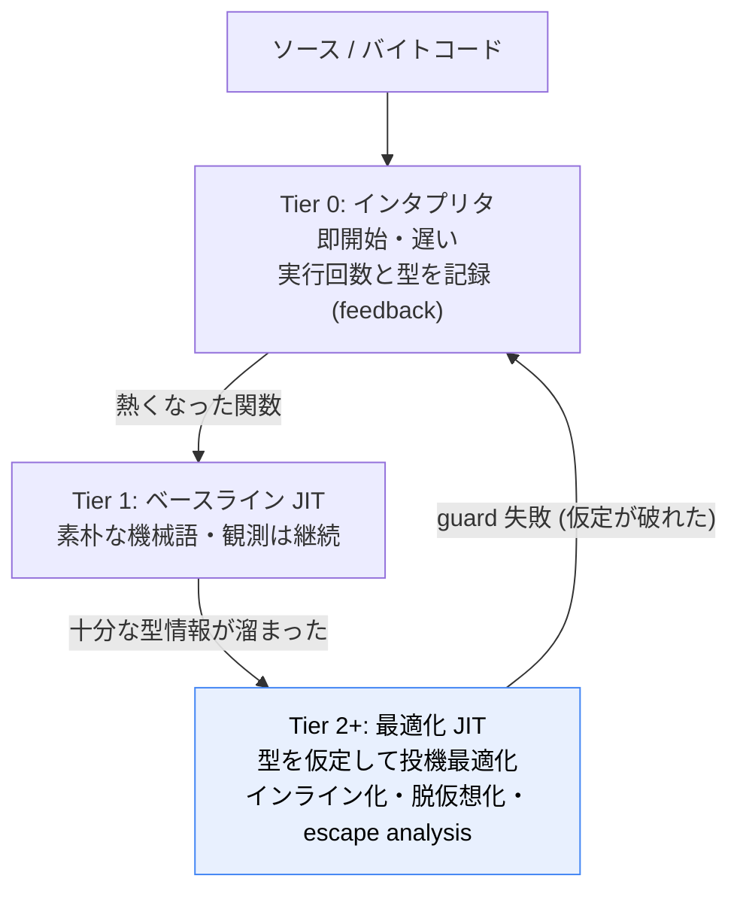

# マネージドランタイム — JIT と GC (Managed Runtimes: JIT Compilation & Garbage Collection)

## 概要 (Overview)

JavaScript・Java・Python・Go など、今日書かれるコードの大半は、コンパイル済みバイナリではなく**ランタイム (runtime) の上**で走る。ランタイムは実行と同時に翻訳し (JIT: just-in-time compilation)、メモリを自動で回収する (GC: garbage collection)。本ドキュメントはこの二つの機構の内部を扱う。

中心テーゼは、**マネージドランタイムとは「観測して賭けるシステム」である**、ということ。JIT は「この関数の引数は毎回この型だった」「この分岐はいつも同じ側だった」という**実行時の観測**に基づいて投機的に最適化し、外れたら脱最適化 (deoptimization) で賭け金を払い戻す。これは CPU の分岐予測・投機実行 ([`../../hardware/cpu/branch-prediction-speculation.md`](../../hardware/cpu/branch-prediction-speculation.md)) と同型の構造がソフトウェア層で再発明されたものである。GC もまた賭けの上に立つ: 「ほとんどのオブジェクトは若くして死ぬ」という**世代仮説**が、全ヒープ走査を新領域の走査に置き換え、桁違いの効率を生んだ。

動的言語がなぜ静的言語に迫る速度で走れるのか。答えは「**実行中のプログラムは、書かれたプログラムより遥かに静的である**」ということである。ソース上は何でも起こりうる場所も、実行時にはほぼ毎回同じことが起きる。JIT はこの実行時の単調さを収穫する装置であり、逆にこの前提を壊すコード (多態の乱発・型の揺れ) が「性能の崖」を作る。

本書は (1) 階層型コンパイルの構造、(2) hidden class・インラインキャッシュ・deopt という投機の道具立て、(3) GC の基礎 (到達可能性・世代・コピー)、(4) 並行 GC とバリア、(5) 参照カウントとの対比、(6) JIT/GC 固有のセキュリティ、を V8 と JVM を主参照に整理する。分析深度は Level 3。

## 方法論 (Methodology)

- JIT と GC を別々の技術ではなく「観測と投機」「近似と賭け」という同じ設計原理の 2 適用として扱い、CPU マイクロアーキテクチャ ([`../../hardware/cpu/`](../../hardware/cpu/)) との構造的相似を明示する。
- 歴史的原典 (Smalltalk/Self 系の論文) から現行実装 (V8, HotSpot, ZGC) への系譜で説明し、「新機能」がほぼ常に 1980 年代の発明の再適用であることを示す。
- 性能の主張は「何を測るか」(スループット vs 停止時間 vs メモリ量) を常に併記する。GC の比較は単一軸では意味を成さないため。
- コンパイラ中盤の一般論 (IR・最適化パス) は将来の別ドキュメントに委ね、本書は**実行時であることに固有の機構**に集中する。

## 発見事項 (Findings)

1. **階層 (tiering) は「観測のコスト」と「翻訳のコスト」の会計である。** 全コードの最適化コンパイルは起動を大きく遅らせ、全コードのインタプリタ実行は定常性能を大きく下げる。だからランタイムは安い層 (インタプリタ) で開始して**実行回数と型を観測**し、熱いコードだけを高い層 (最適化 JIT) に送る。V8 (Ignition→Sparkplug→Maglev→TurboFan) も JVM (インタプリタ→C1→C2) も同じ形に収斂した。**プログラムの実行時間の大半はごく一部のコードが占める**という経験則 (hot spot) が、この設計の前提である。
2. **動的言語の高速化は 1984 年の 2 つの発明の上に立つ。** Smalltalk のための **動的翻訳とインラインキャッシュ (IC)** (Deutsch & Schiffman) と、Self で完成した **hidden class (maps)** と多態 IC である。その考え方は「オブジェクトの形 (プロパティ構成) を暗黙の型として扱い、呼び出し地点ごとに直近の形をキャッシュする」というものである。JavaScript が V8 で桁違いに速くなった (2008) 中核はこの再適用であり、プロパティアクセスは「形の一致確認 + 固定オフセット読み」という**静的言語並みの機械語**に落ちる。
3. **投機は保険 (deopt) があるから踏める。** 最適化コードは「この形しか来ない」「この加算は整数」といった仮定を焼き込み、仮定の検査 (guard) が外れたら**実行中のフレームをインタプリタ状態に翻訳し直して**降格する (deoptimization / OSR)。この保険の存在が、健全性を保ったまま楽観的な最適化を可能にする。投機の哲学は CPU と同じだが、CPU の誤予測回復が数十サイクルで済むのに対し deopt は桁違いに高く、**繰り返す deopt (性能の崖) はプロファイルで探すべき事故**である。
4. **GC の本質は「ゴミの発見」ではなく「生存者の発見」である。** ルート (スタック・グローバル) から辿れるものが生存、残りが自動的にゴミとなる。そのため、コストは**生存者の量**に比例し、ゴミの量には比例しない。ここから世代仮説の威力が出る: 「ほとんどのオブジェクトは若くして死ぬ」なら、若い領域 (nursery) は生存者がごく少なく、**生存者だけコピーして残り全部を一括破棄**する minor GC は、死んだ大多数に一切触れない。
5. **並行 GC の中心問題は「動いている対象を止めずに数える」ことであり、答えはバリアである。** アプリケーション (mutator) がポインタを書き換える横で印付けすると、マーク済みオブジェクトから未マークへの参照が「隠れて」取りこぼされる (tri-color invariant の破れ)。write barrier / read barrier がこの書き換えを GC に通知する。これは [`../concurrency/memory-models-synchronization.md`](../concurrency/memory-models-synchronization.md) と同じ「並行下の一貫性」問題であり、現代の低停止 GC (ZGC, Shenandoah: 停止ミリ秒未満) はバリアのコストを常時払う代わりに停止時間を短くしている。**スループット・停止時間・メモリ量の三竦み**が GC 選択の本当の軸である。
6. **参照カウント (RC) と追跡 (tracing) は対立ではなく双対である。** RC は死をその場で検出 (決定的解放・停止なし) するが、循環を見逃し・カウンタ更新が常時コスト・マルチスレッドでは原子操作を強いる。追跡は生存を一括検出 (高スループット) するが停止・遅延を伴う。Bacon らはこの二つが同じ設計空間の両端であり、実用 GC はすべて両者の混成であることを示した (2004)。Swift/Obj-C の ARC ([`../ios/platform-architecture.md`](../ios/platform-architecture.md)) と JVM/V8 の追跡 GC は、レイテンシ決定性とスループットのどちらを優先するかの選択であり、Rust の所有権はこの問題を**コンパイル時に解いて実行時コストを消す**第三の道である。

## アーキテクチャ (Architecture)

### 階層型実行 — 観測が上の層を建てる



### 世代別ヒープ — 若い死は安い

```
 ヒープ
 ┌───────────────────────────┬──────────────────────────────────────┐
 │ nursery (新領域, 小)         │ old 世代 (大)                          │
 │ 割り当てはポインタを進めるだけ │ minor GC を数回生き延びた昇格者        │
 │ minor GC: 生存者のみコピー    │ major GC: まれ・並行マーク等で高コスト  │
 │ → 死者 (大多数) はタダで消える │ old→nursery への参照は write barrier   │
 │                             │ が記録 (remembered set)               │
 └───────────────────────────┴──────────────────────────────────────┘
```

- コピー GC の副産物: 生存者を詰めて写すので**断片化が消え、割り当てが bump pointer (数命令)** になる。「malloc より速い new」はこの構造から来る。

## 技術詳細 (Technical Details)

### 1. hidden class とインラインキャッシュ — 形の経済

- `{x: 1, y: 2}` を作るたび、V8 は「x を持つ形 → x,y を持つ形」という **hidden class (map/shape) の遷移**を辿り、同じ順序で作られたオブジェクトは同じ形を共有する。プロパティアクセス地点 (IC) は「前回来た形 → オフセット」を機械語中にキャッシュし、単型 (monomorphic) なら比較 1 回 + ロード 1 回で済む。
- 形が数種類なら多型 IC (polymorphic)、多すぎると megamorphic に落ちてハッシュ表引きに退化する。**実務上の含意**: コンストラクタでプロパティを毎回同じ順で初期化する・後からプロパティを生やさない・同じ配列に型を混ぜない、が「JIT に優しいコード」の実体であり、すべて**形の単調さを保つ**ことに帰着する。
- インライン化は最適化の王 (呼び出し境界が消えると他の全最適化が適用できるようになる) であり、IC の観測 (呼び先が単型) が投機的インライン化の根拠になる。この**観測 → 投機 → さらに深い最適化**という増幅構造がこの層の設計原理である。

### 2. deoptimization — 保険の値段と崖の正体

- guard 失敗時、ランタイムは最適化フレーム (レジスタ・スタックの値) を**インタプリタのフレーム表現に写像し直して**実行を継続する。このため最適化コンパイラは「どの時点でどの値がどこにあるか」の巨大なメタデータ (deopt 情報) を保持しており、JIT のメモリ消費の相当部分を占める。
- 崖のパターン: (a) 型の揺れで最適化 → deopt → 再最適化を往復する (deopt storm)、(b) `arguments` の特殊操作・`eval`・`with` 等、投機を諦めさせる構文、(c) megamorphic 化。V8 の `--trace-deopt`、JVM の JITWatch がこれを可視化する。
- **AOT との対比**: 事前コンパイル (Android の ART は AOT+JIT+プロファイルのハイブリッド、[`../android/art-runtime-internals.md`](../android/art-runtime-internals.md)) は起動と決定性で勝り、実行時観測に基づくピーク性能で劣りうる。iOS が第三者 JIT を禁じる ([`../ios/security-architecture.md`](../ios/security-architecture.md)) ため Web エンジン以外は AOT 一択という**政策がランタイム設計を決める**例もある。

### 3. GC の実装スペクトラム

| GC | 戦略 | 停止時間 | 代償 |
|---|---|---|---|
| Serial / Parallel (旧 JVM 既定) | STW でマーク&コピー/コンパクト | 数十 ms〜秒 (ヒープ比例) | スループット最良・停止最悪 |
| G1 (JDK 9+ 既定) | リージョン分割・停止目標に合わせ部分回収 | 目標指定 (数十〜百 ms) | remembered set のメモリ・管理コスト |
| ZGC / Shenandoah | 並行マーク＋**並行コンパクション** (read/load barrier で移動中も参照可能) | **1ms 未満級** (ヒープ非依存) | バリアの常時コスト (スループット数 %〜) |
| Go GC | 並行マーク&スイープ (非移動・非世代) | 短い STW ×2 | コンパクションなし = 断片化を許容、割り当ては tcmalloc 系 |
| V8 Orinoco | 世代別＋並行/並列/インクリメンタルの複合 | minor は準並行・数 ms 級 | JS の単スレッド意味論に合わせた工夫 |

- 選択の軸は用途が決める: バッチ処理はスループット GC、レイテンシ SLO のあるサービスは並行 GC、組込みは決定的な RC/手動。**「最速の GC」は存在せず、あるのは三竦みの中の位置取り**である。
- GC とヒープサイズの隠れた取引: 追跡 GC の効率は**空きの余裕**に比例する (余裕が 2 倍なら GC 頻度は約半分)。「Java はメモリ食い」の実体の一部は、スループットのためにヒープを余らせる運用であり、メモリを時間で買っている。

### 4. ランタイムと下の層の交差

- **escape analysis**: 「このオブジェクトは関数外に漏れない」と証明できればヒープでなくスタック/レジスタに置き、GC 負荷そのものを消す。最良の GC 対策は割り当てないことであり、最適化 JIT の重要な仕事である。
- GC は キャッシュ・仮想記憶と相互作用する: コピー GC の再配置は空間局所性を改善する一方、全ヒープ走査は LLC を洗い流し ([`../../hardware/cpu/cache-memory-hierarchy.md`](../../hardware/cpu/cache-memory-hierarchy.md))、巨大ヒープでは TLB とページフォルト ([`../operating-systems/virtual-memory-paging.md`](../operating-systems/virtual-memory-paging.md)) が GC 時間を支配しうる (THP が GC 性能を左右する理由)。コンテナのメモリ上限と GC の相性 (上限を知らずにヒープを広げて OOM kill) は運用の定番事故である。
- **safepoint**: スタックを正確に走査するため、全スレッドを「GC が状態を解釈できる地点」で止める。JIT コードにはポーリング命令が織り込まれ、「たまに全員が同じ瞬間に立ち止まる」。長いループに safepoint がないと停止要求が待たされる (time-to-safepoint 問題) など、**GC の停止時間は GC アルゴリズム以外の場所でも作られる**。

### 5. 観測の入口 (Observability)

| 疑問 | 道具 |
|---|---|
| どの関数がどの tier にいるか・deopt はあるか | V8: `--trace-opt --trace-deopt`、JVM: `-XX:+PrintCompilation`・JITWatch |
| GC の頻度・停止時間・原因 | JVM: GC ログ (`-Xlog:gc*`)・JFR、V8/Node: `--trace-gc`、Go: `GODEBUG=gctrace=1` |
| 割り当ての発生源 | ヒーププロファイラ (async-profiler の alloc、pprof、Chrome DevTools) |
| 停止時間の SLO 影響 | レイテンシ p99 と GC ログの突合。safepoint 統計 (`-Xlog:safepoint`) |
| IC の状態 (単型/多型) | V8: `%GetOptimizationStatus` (--allow-natives-syntax)、Deopt Explorer |

## セキュリティ考察 (Security Considerations)

- **JIT は「攻撃者の入力から機械語を作る」装置である。** ブラウザの JS エンジンは信頼できないコードを高速化するため、型混乱 (type confusion)・IC/形システムのバグ・境界検査の最適化ミスがそのまま**任意コード実行**に到達しうる。ブラウザの脆弱性報奨の主戦場が JIT である理由であり、V8 はヒープ内ポインタを圧縮・隔離する sandbox を導入して「エンジン内のバグ 1 個 = 即プロセス掌握」の距離を伸ばしている。
- **W^X と JIT の緊張**: JIT は「書ける + 実行できる」メモリを本質的に要求し、W^X (書込と実行の排他) と衝突する。二重マッピング (書込ビューと実行ビューを分離)・Apple の `MAP_JIT`＋スレッド単位の切替のような妥協が実装され、iOS は第三者アプリの JIT 自体を禁じた。**政策・緩和策・性能の三者交渉**が、この一点に凝縮されている。JIT が生成したコード領域を攻撃の踏み台に使う JIT spraying への対策 (定数の分割等) も生成器の責務である。
- **Spectre はランタイムを直撃した**: 投機実行のサイドチャネル ([`../../hardware/cpu/branch-prediction-speculation.md`](../../hardware/cpu/branch-prediction-speculation.md)) は「同一プロセス内で信頼境界を跨ぐ」JS エンジンの前提を破壊し、V8 の対策は最終的にサイト分離 (信頼境界ごとにプロセスを分ける) という**アーキテクチャ側の撤退**に落ち着いた。高精度タイマの制限・`SharedArrayBuffer` の一時無効化はこの余波である。
- **GC の正しさはメモリ安全性そのものである**: バリアの取りこぼしや deopt 情報の不整合は「生きているオブジェクトの解放」= use-after-free をランタイム自身が作ることを意味する。マネージド言語が消したはずの脆弱性クラスは、ランタイムの実装バグとして一段下に移動しただけであり、ランタイムの複雑化 (並行 GC・多層 JIT) はこの一点で攻撃面の複雑化でもある。

## 結論 (Conclusions)

- マネージドランタイムは「観測して賭ける」システムである。tiering は翻訳コストの、IC と hidden class は動的型の、deopt は投機の、それぞれ会計機構であり、全体は CPU の投機実行と同じ設計原理のソフトウェア再演として読める。
- GC の効率は「生存者にしか触れない」ことから出る。世代仮説・コピー・bump pointer 割り当ての組は「若い死は安い」を実装したものであり、並行化の代償 (バリア) と三竦み (スループット・停止・メモリ) がエンジニアリングの本体である。
- RC・追跡・所有権 (Rust) は「いつメモリ管理のコストを払うか」の三択 (実行時に分散して・実行時に一括で・コンパイル時に) であり、ARC の決定性から ZGC のサブミリ秒停止まで、すべてこの軸上の位置取りとして統一的に比較できる。
- 性能の崖 (megamorphic, deopt storm) は魔法の失敗ではなく観測可能な事象であり、道具 (trace-deopt, GC ログ) で診断できる。そして JIT/GC の複雑さはそのまま攻撃面である。W^X・sandbox・サイト分離という緩和策の系譜は、「速さのための投機」と「安全のための境界」の緊張が今も現在進行形であることを示している。

### 次の接続先 (Related Topics)

- [`../../hardware/cpu/branch-prediction-speculation.md`](../../hardware/cpu/branch-prediction-speculation.md) — 同じ「観測と投機」のハードウェア版。Spectre の源。
- [`linkers-loaders-elf.md`](linkers-loaders-elf.md) — AOT 側の対応物。成果物がプロセスになる経路。
- [`../android/art-runtime-internals.md`](../android/art-runtime-internals.md) — AOT+JIT+プロファイルのハイブリッドの実例。
- [`../concurrency/memory-models-synchronization.md`](../concurrency/memory-models-synchronization.md) — 並行 GC のバリアが解いている一貫性問題の一般論。
- [`../operating-systems/virtual-memory-paging.md`](../operating-systems/virtual-memory-paging.md) — ヒープの下の層。GC と THP・OOM・コンテナ上限の交差点。

## 参考文献 (References)

**一次資料 (Primary — 論文)**

- Deutsch, L. P., & Schiffman, A. M. (1984). Efficient Implementation of the Smalltalk-80 System. *POPL '84*. DOI: 10.1145/800017.800542 — 動的翻訳とインラインキャッシュの原典。
- Chambers, C., Ungar, D., & Lee, E. (1989). An Efficient Implementation of SELF. *OOPSLA '89*. DOI: 10.1145/74877.74884 — maps (hidden class) の原典。
- Hölzle, U., Chambers, C., & Ungar, D. (1991). Optimizing Dynamically-Typed Object-Oriented Languages With Polymorphic Inline Caches. *ECOOP '91*. — 多型 IC と適応的再コンパイル。
- Ungar, D. (1984). Generation Scavenging: A Non-disruptive High Performance Storage Reclamation Algorithm. *ACM SIGSOFT/SIGPLAN Software Engineering Symposium*. DOI: 10.1145/800020.808261 — 世代別 GC の原典。
- Bacon, D. F., Cheng, P., & Rajan, V. T. (2004). A Unified Theory of Garbage Collection. *OOPSLA '04*. DOI: 10.1145/1028976.1028982 — RC と追跡の双対性。
- Aycock, J. (2003). A Brief History of Just-In-Time. *ACM Computing Surveys*, 35(2). DOI: 10.1145/857076.857077 — JIT の系譜の総説。

**二次資料 (Secondary — 教科書・実装ドキュメント)**

- Jones, R., Hosking, A., & Moss, J. E. B. (2023). *The Garbage Collection Handbook* (2nd ed.). CRC Press. — GC の網羅的教科書。
- V8 Blog — [Ignition](https://v8.dev/blog/ignition-interpreter)、[Sparkplug](https://v8.dev/blog/sparkplug)、[Maglev](https://v8.dev/blog/maglev)、[Trash talk: the Orinoco garbage collector](https://v8.dev/blog/trash-talk)、[The V8 Sandbox](https://v8.dev/blog/sandbox) — Accessed: 2026-07-05。
- OpenJDK — [ZGC Wiki](https://wiki.openjdk.org/display/zgc/Main)、HotSpot Runtime Overview — Accessed: 2026-07-05。
