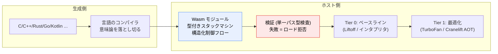

# WebAssembly — 検証可能な移植バイナリとサンドボックス (WebAssembly: Verifiable Portable Binaries & the Sandbox)

## 概要 (Overview)

WebAssembly (Wasm) は言語ではない。C/C++・Rust・Go・Kotlin がコンパイルされる先の、**移植可能で検証可能なバイナリ形式**であり、CPython/Go/Rust 三部作 ([`language-implementations-cpython-go-rust.md`](language-implementations-cpython-go-rust.md)) が示した実行モデルのスペクトラム (実行時に払う・ランタイムに払わせる・コンパイル時に前払いする) に対する**第四の答え**である: 意味論の検証を**ロード時の型検査**として払い、機械語への最終変換を**実行するホスト**に委ねる。AOT の決定性と JIT の適応性の間に、「配布されるのは検証可能な中間形式」という新しい支払時期を挿入した設計と言える。

中心テーゼは、**サンドボックスの要請が命令セットを設計した**、ということ。Wasm の一見奇妙な特徴、すなわち任意ジャンプのない構造化制御フロー、単一の線形メモリ (linear memory)、関数表を介した間接呼び出し、外界へはインポートされた関数のみという性質は、すべて「信頼できないバイナリを、単一パスの型検査だけで安全と判定し、ホストのメモリから隔離して走らせる」という目標からの逆算である。歴代のバイトコード (JVM 等) が言語のために設計されサンドボックスを後付けしたのに対し、Wasm はサンドボックスのために設計され言語を後から受け入れた。

もう一つの軸は**正直な限界**である。Wasm が守るのは**ホスト**であって、モジュール**内部**ではない。線形メモリの中には ASLR も保護ページもなく、C の脆弱性はサンドボックスの中で生き続ける (Lehmann et al., 2020)。「Wasm だから安全」という言説の正確な射程を、本書は攻撃面の両側から確定する。

本書は (1) バイナリ形式と検証 (なぜ単一パスで型検査できるのか)、(2) 実行エンジンの内部 (階層コンパイル・guard page による境界検査)、(3) 言語ランタイムの持ち込み問題と WasmGC、(4) WASI とコンポーネントモデル (ケイパビリティ型のシステム境界)、(5) eBPF との検証付き実行の対比、を仕様と査読論文を基に整理する。分析深度は Level 3。

## 方法論 (Methodology)

- Wasm を「Web 技術」ではなく**実行モデルとサンドボックス設計**として扱い、三部作の軸 (支払時期・保証の置き場所) に接続する。ブラウザ API・JS 連携の詳細は扱わない。
- 一次資料を優先する: 設計論文 (Haas et al., PLDI '17)、W3C 仕様 (3.0, 2025)、WASI/コンポーネントモデルの公式文書。性能とセキュリティの主張は**査読付きの第三者測定** (Jangda et al., ATC '19; Lehmann et al., USENIX Security '20) を軸に、ベンダの主張 (near-native 等) と区別して記述する。これは本リポジトリの Source Hierarchy 基準の適用例でもある。
- エンジン内部は V8 (Liftoff/TurboFan) と Wasmtime (Cranelift) を主参照にし、JIT/GC の一般論は [`managed-runtimes-gc-jit.md`](managed-runtimes-gc-jit.md) に委ねる。
- カーネル内の検証付き実行である eBPF ([`../operating-systems/`](../operating-systems/)) を対照として常設し、「検証で何を証明するか」の設計差を明示する。

## 発見事項 (Findings)

1. **Wasm は第四の実行モデルである: 「検証をロード時に、最終コンパイルをホストに」。** ソース言語のコンパイラは意味論を Wasm の型付きスタックマシンに落とし切り、配布されるバイナリは受け手が**単一パスの型検査**で安全性を機械的に確認できる。ホストのエンジンはそれを自分の ISA へコンパイルする。Wasm は「一度書けばどこでも走る」を、JVM のように言語ランタイムごと運ぶのではなく、**検証可能性という契約**として実現した。移植性の単位が「言語」から「バイナリ形式」へ移った点が歴史的な分岐である。
2. **構造化制御フローは検証コストの前払いである。** Wasm に任意アドレスへのジャンプはなく、分岐は入れ子のブロックからの脱出 (`br`) だけ。このため制御フローグラフの再構築なしに、コードを頭から一度走査するだけで全実行経路の型整合 (スタックの深さと型) が検証できる。これは**検証器を単純にするために、コンパイラ (生成側) に構造化の手間を押し付けた**設計であり、検証器のバグ = サンドボックス崩壊という急所を小さく保つ。急所を小さくするこの発想は eBPF 検証器と共通だが、eBPF が**停止性まで静的に要求する** (有界ループの証明) のに対し、Wasm は停止性を検証しない。無限ループは合法であり、実行時の燃料 (fuel) やエポック割り込み (Wasmtime) で**時間側から**切る。カーネル内で走る eBPF と、ホストが監督できる Wasm の、信頼モデルの差が検証範囲の差になっている。
3. **線形メモリの境界検査は、仮想記憶で「タダ」にする。** モジュールのメモリは単一の連続領域で、全アクセスは「基底 + 32bit オフセット」に還元される。64bit ホストのエンジンは仮想アドレスを 4GB + ガード分だけ**予約** (物理は使わない) し、範囲外アクセスをページフォルトとして捕まえる。つまり、明示的な境界検査命令を消し、検査をハードウェアの MMU ([`../operating-systems/virtual-memory-paging.md`](../operating-systems/virtual-memory-paging.md)) に肩代わりさせる。memory64 (Wasm 3.0) ではこの技法が使えず明示検査に戻る。**「32bit であること」自体が性能機能**だった、という逆説がここにある。
4. **Wasm が守るのはホストであり、モジュール内部の安全性は言語の責任のままである。** Lehmann らの分析 (USENIX Security '20) が示した通り、線形メモリの内部にはスタックカナリアも ASLR も unmapped guard page もなく、C で書かれたモジュールのバッファオーバーフローは**ネイティブより素朴に**成立しうる (スタック上のバッファから、関数ポインタ相当である間接呼び出し表の添字を書き換える等)。サンドボックスは信頼境界を「プロセス vs ホスト」に引き直しただけで、モジュール内のデータ完全性は守らない。**Rust のようなメモリ安全言語から Wasm へ**、が防御の両輪になるのはこのためである。
5. **「ランタイムごと持ち込む」問題が WasmGC を生んだ。** 三部作で見た通り Go や Python の意味論はランタイム (GC・スケジューラ) が実装しており、Wasm に来るときは**それを丸ごと同梱**するしかなかった (バイナリ肥大・エンジン GC との二重管理・循環参照のリーク)。WasmGC (3.0 で標準化、2023 年からエンジン実装) は構造体・配列の割り当てと回収を**ホストエンジンの GC に委譲**する拡張で、Kotlin/Wasm や Dart (Flutter Web) が最初の本格利用者になった。「ランタイムの仕事をどの層が引き受けるか」という三部作の軸が、Wasm の中でもう一度演じられている。
6. **エンジンはここでも階層コンパイルに収斂した。** V8 は Liftoff (単一パスの高速ベースライン) で即座に走らせ、熱いモジュールを TurboFan で再コンパイルする。Wasmtime は AOT (事前コンパイルして起動をほぼゼロに) を選べる。[`managed-runtimes-gc-jit.md`](managed-runtimes-gc-jit.md) の tiering の構図が Wasm でも再演され、さらに **per-request isolation の経済** (プロセス起動なしに数 µs〜ms でインスタンスを作って捨てられる) がエッジ実行 (Fastly Compute 等) やプラグイン機構 (Envoy proxy-wasm, Shopify Functions) という新しい用途を作った。サンドボックスの起動コストが桁で下がると、隔離の単位を「リクエストごと」まで細かくできる。
7. **性能の正直な数字は「ネイティブの 1.5〜2 倍遅い」である。** 査読付きの測定 (Jangda et al., ATC '19: SPEC 系ベンチで平均 1.45〜1.55 倍、最悪 2.5 倍前後) が、"near-native" というベンダ表現の実際の値域を与える。差の主因は境界検査しきれない場面・レジスタ圧・最適化情報の欠落であり、逆に言えば**プロセス隔離やコンテナに比べた起動と密度の利得**がこの実行時オーバーヘッドを払っても釣り合う場面こそが、Wasm の適所である。

## アーキテクチャ (Architecture)

### 配布と実行の分業 — 第四の支払時期



### サンドボックスの断面 — 外向きに閉じ、内向きに素朴

```
 ホストプロセス
 ┌────────────────────────────────────────────────────┐
 │  Wasm インスタンス                                     │
 │  ┌──────────────────────────────┐                    │
 │  │ 線形メモリ (連続・基底+オフセット)  │ ← 範囲外 = trap     │
 │  │   [データ|ヒープ|シャドウスタック]  │   (guard page)      │
 │  │   ※内部に ASLR・カナリアは無い     │                    │
 │  └──────────────────────────────┘                    │
 │  関数表 (間接呼び出しは添字+型検査)  実行スタックはホスト側 │
 │  ↑ 外界へのアクセスはインポートのみ (ambient authority 無し) │
 └──┼─────────────────────────────────────────────────┘
    └─ WASI 等: ケイパビリティとして明示的に渡す (preopen した
       ディレクトリ・ソケットだけが見える)
```

## 技術詳細 (Technical Details)

### 1. 形式と検証 — 単一パスで安全と言い切れる理由

- モジュールはセクション列 (型・関数・メモリ・表・エクスポート等) で、コードは**型付きスタックマシン**のバイトコード。各命令のスタック効果は型から一意に決まり、ブロック構造 (`block`/`loop`/`if` と `br`) が制御の合流点の型を宣言するため、検証は「スタックの型を追いながら一度読む」だけで完結する。バックトラックも CFG 構築も不要で、検証時間はコードサイズに線形。
- 関数ポインタは存在せず、間接呼び出しは**関数表の添字 + 実行時の型一致検査** (`call_indirect`)。制御フロー完全性 (CFI) に相当する制約が形式レベルで組み込まれている。ただし「同じ型の別関数」への差し替えは防げない (後述のセキュリティ考察)。
- 実行スタック (リターンアドレス・局所変数の一部) は**ホスト側**にあり、線形メモリから物理的に分離される。C のアドレス取得可能なローカル変数はコンパイラが線形メモリ内の「シャドウスタック」に置く。これが、リターンアドレスの上書きが形式上不可能になる一方、シャドウスタック上のデータは無防備、という非対称の源泉である。

### 2. エンジン内部 — 起動・ピーク・密度の三竦み

- **V8**: Liftoff が関数単位の単一パスコンパイルで「ダウンロードしながらコンパイル」に近い起動を実現し、実行頻度の高い関数を TurboFan が置き換える。JS と違い型は静的に確定しているため、[`managed-runtimes-gc-jit.md`](managed-runtimes-gc-jit.md) の投機・deopt 装置は原則不要である。これは**JIT の複雑さの大半は動的型の観測装置だった**ことの傍証である。
- **Wasmtime (Cranelift)**: サーバ・組込み向けに AOT コンパイル (事前変換したネイティブコードを mmap して即実行) を選べる。インスタンス生成はメモリの COW とプールで µs 級まで削られ、**リクエストごとに新品のサンドボックス**という運用が成立する。fuel (命令数課金) と epoch interruption (タイマでの強制脱出) が停止性の実行時対策。
- 境界検査の実装スペクトラム: 64bit ホスト + wasm32 = 仮想予約 + guard page (検査ゼロ)、wasm64 / 32bit ホスト = 明示的比較命令。共有メモリ (threads 拡張) はアトミック命令と組み合わせ、[`../concurrency/memory-models-synchronization.md`](../concurrency/memory-models-synchronization.md) のメモリモデルの議論がそのまま適用される。

### 3. 言語ランタイムの持ち込みと WasmGC

- MVP 時代の対応表: C/C++/Rust (ランタイム最小・最適)、Go (GC・スケジューラ同梱でバイナリ MB 級、TinyGo が縮小版を提供)、Python (CPython 丸ごと、Pyodide が科学計算スタックごと移植)。**三部作の「ランタイムの重さ」がそのまま Wasm バイナリの重さに写像される**。
- WasmGC は `struct`/`array` 型と割り当て命令を追加し、参照はエンジン管理のヒープに住む (線形メモリの外)。ホスト GC との統合で循環参照 (JS ↔ Wasm) も回収可能になり、Kotlin/Wasm・Dart が採用。一方 Go のような「ポインタ演算を含む既存ランタイム前提」の言語は単純には乗れない。**GC を委譲できるのは、GC を抽象として使っていた言語だけ**という選別が起きている。
- コンポーネントモデル (WASI 0.2, 2024): モジュール間を共有メモリではなく**型付きインタフェース (WIT) + 値のコピー**で合成する shared-nothing 設計。リンクではなく合成 (composition) を単位にする点で、[`linkers-loaders-elf.md`](linkers-loaders-elf.md) の動的リンクと好対照である。シンボル解決の代わりに、インタフェース型の一致が結合の契約になる。

### 4. 観測の入口 (Observability)

| 疑問 | 道具 |
|---|---|
| 何がバイナリを太らせているか | `twiggy` (サイズプロファイラ), `wasm-objdump` (WABT) |
| どの tier で走っているか | V8: `--trace-wasm-compilation`、Wasmtime: AOT ならば固定 |
| 実行時間・trap の発生源 | ブラウザ DevTools (Wasm ステッピング・DWARF 対応)、Wasmtime の profiling (perf 連携) |
| 燃料・エポックの消費 | Wasmtime fuel API / epoch カウンタ |
| インスタンス密度・起動 | エンジンの pooling allocator 統計 (Wasmtime) |

## セキュリティ考察 (Security Considerations)

- **境界の外側は強い: ホスト保護は構成的である。** 型検査・線形メモリ・インポート限定の外界アクセスにより、モジュールは**与えられていない権限を行使する形式的手段を持たない** (ambient authority の不在)。WASI はこれをシステム界面まで延長し、preopen されたディレクトリ以外は「存在すら見えない」。これは [`../security/`](../security/) で言うケイパビリティモデルの実装例である。攻撃面はしたがって (a) エンジン自体のバグ (検証器・JIT: 攻撃者の入力から機械語を作る装置である点は [`managed-runtimes-gc-jit.md`](managed-runtimes-gc-jit.md) の JS エンジンと同じ)、(b) ホストがインポートとして渡した関数の脆弱性、に集約される。
- **境界の内側は素朴: 「Wasm だから安全」はモジュール内部には及ばない。** Lehmann らは、線形メモリ内に緩和機構 (ASLR・カナリア・W^X 相当) がほぼ無く、C 由来モジュールでは古典的なメモリ破壊 (ヒープメタデータの上書き、シャドウスタック上のデータ書き換え、`call_indirect` の添字差し替えによる**同型関数への制御流ハイジャック**) が現代のネイティブ環境より容易に成立しうることを示した。防御は言語側 (メモリ安全言語でコンパイルする) とエンジン側 (緩和の追加) の両輪であり、サンドボックスはその代替ではない。
- **サイドチャネルはサンドボックスを尊重しない。** Wasm のプロセス内隔離は Spectre 型の投機的読み出し ([`../../hardware/cpu/branch-prediction-speculation.md`](../../hardware/cpu/branch-prediction-speculation.md)) に対して形式的な防壁を持たない。ブラウザが共有メモリ (SharedArrayBuffer) の解禁に cross-origin isolation (COOP/COEP) を要求するのは、高精度タイマの成立条件を信頼境界の再編で縛るためであり、マルチテナントのエッジ実行系も「同一プロセスに誰を同居させるか」という配置問題として同じ課題を負う。**プロセス隔離の放棄は、マイクロアーキテクチャの共有という請求書と引き換え**である。
- **サプライチェーン**: プラグイン機構としての Wasm は「信頼できないコードを走らせる」を日常化する。検証が保証するのは型安全と隔離だけで、**何をするか** (渡したケイパビリティの悪用・暗号採掘・データ持ち出し) は保証しない。そのため、権限を最小に渡す設計 (ケイパビリティの粒度) と、fuel/epoch による資源課金が運用側の防衛線になる。

## 結論 (Conclusions)

- Wasm は三部作のスペクトラムに対する第四の答えである: 検証可能性をバイナリ形式の契約にし、検証をロード時に、最終コンパイルをホストに、停止性の統治を実行時に置いた。移植性の担い手が「言語ランタイム」から「検証可能な形式」へ移ったことが、JVM 世代との本質的な差である。
- サンドボックスの要請が ISA (構造化制御フロー・線形メモリ・インポート限定) を設計したという逆算の構図は、検証器という急所を小さく保つ工学である。eBPF との対比 (停止性まで証明 vs 時間で切る) は、検証で何を証明すべきかが信頼モデルの関数であることを示す。
- 保証の射程は非対称である: ホストへの隔離は構成的に強く、モジュール内部は言語任せで素朴。「Wasm で安全になる」のは境界の外側だけであり、内側はメモリ安全言語の仕事として残る。三部作の「保証の置き場所」の議論が、ここでは一つのバイナリの内と外の問題として現れている。
- tiering の再演・WasmGC への委譲・per-request isolation の経済は、いずれも三部作で見た力学 (階層化・ランタイムの層選択・起動コストが用途を決める) の Wasm 上での再現であり、シリーズの締めくくりとして: **実行モデルの設計とは、同じ少数の力学を、その時代の信頼境界とハードウェアの上で並べ直すことである**。

### 次の接続先 (Related Topics)

- [`language-implementations-cpython-go-rust.md`](language-implementations-cpython-go-rust.md) — 本書が「第四の答え」として接続する実行モデルのスペクトラム。
- [`managed-runtimes-gc-jit.md`](managed-runtimes-gc-jit.md) — tiering・JIT のセキュリティ・「攻撃者の入力から機械語を作る」問題の一般論。
- [`../operating-systems/`](../operating-systems/) — カーネル内の検証付き実行。停止性を静的に要求する対照設計。
- [`linkers-loaders-elf.md`](linkers-loaders-elf.md) — リンクによる結合と、コンポーネントモデルの合成の対比。
- [`../operating-systems/virtual-memory-paging.md`](../operating-systems/virtual-memory-paging.md) — guard page による境界検査の下部機構。
- [`../../hardware/cpu/branch-prediction-speculation.md`](../../hardware/cpu/branch-prediction-speculation.md) — プロセス内隔離を貫くサイドチャネルの源。

## 参考文献 (References)

**一次資料 (Primary — 論文・仕様)**

- Haas, A., Rossberg, A., Schuff, D. L., Titzer, B. L., Holman, M., Gohman, D., Wagner, L., Zakai, A., & Bastien, J. F. (2017). Bringing the Web up to Speed with WebAssembly. *PLDI '17*. DOI: 10.1145/3062341.3062363 — 設計原典。形式意味論と検証の健全性。
- Jangda, A., Powers, B., Berger, E. D., & Guha, A. (2019). Not So Fast: Analyzing the Performance of WebAssembly vs. Native Code. *USENIX ATC '19*. — 対ネイティブ性能の第三者測定 (平均 1.45〜1.55 倍)。
- Lehmann, D., Kinder, J., & Pradel, M. (2020). Everything Old is New Again: Binary Security of WebAssembly. *USENIX Security '20*. — 線形メモリ内部の攻撃可能性の体系的分析。
- [WebAssembly Specification (W3C)](https://webassembly.github.io/spec/) および [Wasm 3.0 発表 (2025)](https://webassembly.org/news/2025-09-17-wasm-3.0/) — GC・memory64・例外処理等の標準化。Accessed: 2026-08-15。
- [WASI 0.2 / Component Model](https://github.com/WebAssembly/component-model) — WIT・canonical ABI・shared-nothing 合成。Accessed: 2026-08-15。

**二次資料 (Secondary — 実装解説)**

- V8 Blog — [Liftoff: a new baseline compiler for WebAssembly](https://v8.dev/blog/liftoff)、[WebAssembly Garbage Collection (WasmGC) の移植解説](https://v8.dev/blog/wasm-gc-porting) — Accessed: 2026-08-15。
- [Wasmtime ドキュメント](https://docs.wasmtime.dev/) — fuel・epoch interruption・pooling allocator。Accessed: 2026-08-15。
- Clark, L. (2019). [Standardizing WASI: A system interface to run WebAssembly outside the web](https://hacks.mozilla.org/2019/03/standardizing-wasi-a-webassembly-system-interface/) — ケイパビリティ設計の一次解説。Accessed: 2026-08-15。
