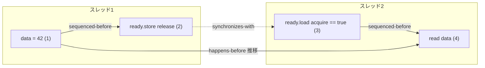

# 並行プログラミングのメモリモデルと同期 (Language Memory Models and Synchronization)

## 概要 (Overview)

並行プログラムを書くプログラマは、ハードウェアごとに異なるメモリ順序 (memory ordering) を直接相手にしたくない。x86 の TSO と ARM/POWER の弱順序 (weak ordering) を毎回意識してコードを書き分けるのは非現実的であり、しかもコンパイラ自身もまた最適化のために命令を並べ替える。`../../hardware/cpu-architecture/memory-ordering-atomics.md` で見たとおり、**並べ替えは2段で起きる**——コンパイラの最適化と、CPU のアウトオブオーダ実行・ストアバッファ (store buffer)。この2段の並べ替えを単一の抽象で覆い隠し、「どこまで並べ替えてよいか」をプログラマとシステム（コンパイラ＋ハードウェア）の間の**契約 (contract)** として固定したものが、**言語レベルのメモリモデル (language memory model)** である。

本ドキュメントは、ハードウェアのメモリ順序の**上**に立つ層を扱う。すなわち、なぜ言語レベルの契約が要るか、データ競合 (data race) はなぜ未定義動作 (undefined behavior) なのか、先行発生 (happens-before) を中心とする正しさの推論枠組み、C/C++11 と Java Memory Model (JMM) の具体的保証、アトミック変数と CAS、mutex/futex/spinlock/rwlock などの同期プリミティブ、lock-free / wait-free 構造への入口、そして async runtime までを、機構レベル (mechanism level) で整理する。`memory-ordering-atomics.md` がハードウェアモデルと `memory_order` の意味論を扱ったのに対し、本書はそこから**上方向に** (build upward) 同期の構築物を積む。

## 方法論 (Methodology)

- まず**ハードウェアの reordering** と**コンパイラの reordering** を1つの契約に統合する、という言語メモリモデルの動機を起点に置く。両者は別の主体だが、プログラマから見れば「観測順が崩れる」という同じ現象である。
- 正しさは直感ではなく**先行発生関係 (happens-before)** の成立で判定する。`memory-ordering-atomics.md` の方針（モデルに基づく推論）を言語層に持ち上げ、sequenced-before と synchronizes-with の合成として定式化する。
- 保証の強さを軸に、C/C++11 の `memory_order` と JMM の `volatile`/`final` を**同じ枠組み**（acquire/release セマンティクス）に写像し、言語差を相対化する。
- 同期プリミティブは「待ち方 (spin か block か)」と「公平性・スケーラビリティ」の2軸で比較する。`../../hardware/cpu-architecture/cache-coherence.md` の「同一ラインに触るコア数を減らす」という結論を、ロック設計の評価基準として一貫して使う。
- OS スケジューラ側の対比は `../operating-systems/process-thread-scheduling.md`に委ね、本書はユーザ空間のランタイム視点に絞る。

## 発見事項 (Findings)

1. **言語メモリモデルはハードとコンパイラの並べ替えを束ねる単一契約。** プログラマは TSO/weak の差や `dmb`/`lock` の有無を意識せず、`memory_order` や `volatile` という移植可能な語彙で意図を書く。コンパイラがそれを各 ISA のバリアへ翻訳する。契約がなければ「最適化が消してよい読み込み」と「他スレッドが書く読み込み」をコンパイラは区別できない。

2. **データ競合は未定義動作であり、性能問題ではなくセキュリティ問題。** 非アトミックな共有変数への並行アクセス（少なくとも一方が書き込み）は、C/C++ では UB。コンパイラは「競合は起きない」と仮定して最適化するため、引き裂き (tearing)・境界チェック消去・値の再読み込みが起き、メモリ安全性を破壊しうる。

3. **正しさは happens-before の一本道に還元できる。** sequenced-before（単一スレッド内）と synchronizes-with（スレッド間の release→acquire）を推移的に合成した半順序が happens-before。これが成立する書き込み→読み込みのみ「見えることが保証される」。それ以外は何も保証されない。

4. **言語が違っても核は acquire/release。** C++ の `release`/`acquire`、Java の `volatile` 書き/読み、すべて「release より前の書き込みが、対応する acquire 以降に可視」という同じ骨格。JMM の `final` は構築完了の安全公開という別軸の保証を足す。

5. **同期プリミティブは lock-free 部品の組み合わせ。** mutex は futex の二段構え（ユーザ空間 CAS ＋カーネル待機）で、spinlock は CAS ループ、CAS 自体はハードウェアの LL/SC または `CMPXCHG`。同期はすべてアトミックとコヒーレンスの上に積まれており、競合点 (contention) はそのまま `cache-coherence.md` のホットライン問題に帰着する。

## アーキテクチャ (Architecture)

### 2段の並べ替えを覆う契約

```
   プログラマが書いた順                言語メモリモデル (契約)
   ┌──────────────┐                  「data-race-free なら
   │ data = 42;    │                   SC のように見せる」
   │ ready = true; │  ───契約に従い───▶  (DRF-SC 保証)
   └──────────────┘        │
                           ▼ コンパイラが各層へ翻訳
        ┌───────────────────────────────┐
        │ ① コンパイラ reordering         │  命令入替・レジスタ保持・除去
        │    (契約の範囲内で自由)          │
        ├───────────────────────────────┤
        │ ② ハードウェア reordering        │  OoO 実行・store buffer
        │    (memory-ordering-atomics.md) │  → 必要なら dmb / lock を挿入
        └───────────────────────────────┘
```

言語モデルの中心命題は **DRF-SC (Data-Race-Free implies Sequential Consistency)**：「データ競合のないプログラムは、逐次一貫 (sequentially consistent) であるかのように振る舞う」。逆に競合があれば、両層の並べ替えがそのまま観測に漏れ、保証は一切ない。

### 先行発生関係 (happens-before) の構成

happens-before は2つの基本関係の推移閉包である。



- **sequenced-before**: 単一スレッド内のプログラム順に基づく順序（(1)→(2)、(3)→(4)）。
- **synchronizes-with**: スレッドをまたぐ同期エッジ。release ストア (2) を観測した acquire ロード (3) との間に張られる。
- **happens-before**: 上記2つの合成。(1) hb (2) sw (3) hb (4) より (1) happens-before (4)。ゆえに (4) は `data == 42` を必ず観測する。

エッジが繋がらない書き込み→読み込みは「見えるかもしれないし見えないかもしれない」——これがモデルの全てであり、`assert` の正当性はこのグラフが閉じるかで判定する。

### 同期エッジを張る道具

| 道具 | エッジの種類 | 典型 |
|---|---|---|
| `release` ストア / `acquire` ロード | synchronizes-with | フラグ同期、生産者-消費者 |
| mutex unlock → 次の lock | synchronizes-with | クリティカルセクション |
| スレッド `start` / `join` | happens-before | ライフサイクル境界 |
| Java `volatile` 書き / 読み | synchronizes-with | DCL の安全公開 |

## 技術詳細 (Technical Details)

### 1. データ競合の定義と未定義動作

C/C++ の定義: 2つのアクセスが (a) 同一メモリ位置に触れ、(b) 少なくとも一方が書き込みで、(c) 一方が他方に happens-before しない（=順序付けられていない）場合、それは**データ競合**であり、プログラム全体の動作は**未定義**になる。

```cpp
// 例示コード (illustrative)。リポジトリ内の実コードではない。
int flag = 0, data = 0;           // 非アトミックな共有変数

// スレッドA
data = 42;                         // 書き込み
flag = 1;                          // 書き込み (アトミックでない)

// スレッドB
while (flag == 0) { }              // 読み込み (アトミックでない) → データ競合
use(data);                         // flag==1 でも data==42 は保証されない
```

ここでコンパイラは「`flag` は他から変わらない」と仮定して `while (flag==0){}` を `if (flag==0) for(;;){}` に変えてよい（無限ループ最適化）。`data` の読みもループ外へ巻き上げられる。**「テストで動いた」は無意味**——UB は最適化レベル・コンパイラ・ISA で顕在化する。正しくは `flag` をアトミックにし、release/acquire でエッジを張る。

### 2. C/C++11 memory_order の意味論

`memory-ordering-atomics.md` の表を、happens-before の語彙で再掲・補強する。

| memory_order | happens-before への寄与 | 主な用途 |
|---|---|---|
| `relaxed` | エッジを張らない。アトミック性のみ | 統計カウンタ |
| `acquire` | 以降の操作を前に動かさない。release と対で sw を張る | ロック取得、フラグ読み |
| `release` | 以前の操作を後ろに動かさない。acquire と対で sw を張る | ロック解放、フラグ書き |
| `acq_rel` | RMW で両方向 | CAS ループ |
| `seq_cst` | 全 seq_cst 操作に単一の全順序。最強・最コスト | 迷ったら（既定） |

`consume` は実務上ほぼ全コンパイラが `acquire` に格上げするため非推奨。指針は `memory-ordering-atomics.md` と同じ——**まず `seq_cst`、計測後に必要箇所だけ緩める**。

```cpp
// 例示コード (illustrative)。release/acquire で synchronizes-with を張る。
std::atomic<bool> ready{false};
int data = 0;

data = 42;                                      // (1)
ready.store(true, std::memory_order_release);   // (2) (1)を後ろへ動かさない
// --- 別スレッド ---
while (!ready.load(std::memory_order_acquire))  // (3) これ以降を前へ動かさない
    ;
assert(data == 42);                             // (2) sw (3) により必ず成立
```

### 3. Java Memory Model (JMM) と volatile/final

JMM は JSR-133 で再定義され、C++11 と同じく happens-before を基盤に置くが、用語と保証が異なる。

- **`volatile`**: 書き込みは release、読み込みは acquire のセマンティクスを持つ。`volatile` 書き→後続の `volatile` 読みで synchronizes-with が張られ、書き手のそれ以前の**全**書き込み（非 volatile 含む）が読み手に可視。C++ の `volatile`（最適化抑止のみで順序保証なし）とは**まったく別物**である点が移植時の罠。
- **`final`**: コンストラクタが正常終了すれば、`final` フィールドの初期化が、その後オブジェクト参照を取得した任意スレッドから可視であることを保証する（safe publication）。同期なしで不変オブジェクトを安全に共有できる根拠。
- **`synchronized`**: モニタの unlock → 次の lock に happens-before を張る。C++ の mutex と同型。

```java
// 例示コード (illustrative)。volatile による安全公開。
class Holder {
    private volatile Config cfg;          // volatile が release/acquire を提供
    void publish() { cfg = new Config(42); }   // 構築 → volatile 書き (release)
    int read() {                               // volatile 読み (acquire)
        Config c = cfg;                        // c が非 null なら…
        return (c != null) ? c.value : -1;     // …42 が必ず見える
    }
}
```

### 4. アトミック変数と CAS、ハードウェアとの接続

ロックフリーの基本部品は **CAS (Compare-And-Swap)**：期待値と一致すれば新値に差し替え、結果（成否と現値）を返す不可分操作。

```
// CAS の概念 (illustrative)。アトミックに行われる。
bool CAS(addr, expected, desired):
    if *addr == expected: *addr = desired; return true
    else:                 expected = *addr; return false   // 現値を返す
```

ハードウェアへの落ち方は ISA で異なる（`memory-ordering-atomics.md`・`cache-coherence.md` 参照）：

- **x86**: `lock cmpxchg`。対象キャッシュラインを排他所有 (M 状態) してから RMW を局所化する (cache locking)。
- **ARM/POWER**: **LL/SC** (`ldxr`/`stxr`) ループ。LL でラインを reservation 登録し、SC は「その間ラインへの他コア書き込み（=コヒーレンス無効化）が無かった場合のみ」成功。

CAS は **ABA 問題**を持つ：値が A→B→A と戻ると CAS は「変化なし」と誤認する。LL/SC は「途中で誰かが触ったか」をコヒーレンス状態で検出するため A→B→A でも SC が失敗しうる（機構的に ABA に強いが、フォルスフェイルもある）。これは `cache-coherence.md` の §6 と表裏一体である。

### 5. 同期プリミティブ

#### mutex と futex の二段構え

素朴な mutex は「ロックできるまでカーネルに眠る」が、競合がなければシステムコールは純粋な無駄である。Linux の **futex (fast userspace mutex)** はこれを二段で解く。

```
// 例示 (illustrative)。futex ベース mutex の二段構え。
lock():
    if CAS(state, 0, 1) == success: return       // ① 競合なし → ユーザ空間で完結
    while CAS(state, 0, 2) != success:           // ② 競合あり → contended を記録し
        futex_wait(&state, 2)                     //    カーネルで眠る (no busy spin)
unlock():
    if atomic_xchg(state, 0) == 2:               // 待ち手がいたなら
        futex_wake(&state, 1)                     //    1つ起こす
```

**競合がなければシステムコールゼロ**、競合時のみカーネルへ落ちる。「速い経路はユーザ空間、遅い経路だけカーネル」という設計が futex の核心。

#### spinlock vs blocking

| | spinlock | blocking (mutex) |
|---|---|---|
| 待ち方 | CPU を回し続ける (busy-wait) | スレッドを眠らせる (futex_wait) |
| 適する状況 | 保持時間が極短・コア数 ≥ 待ち手 | 保持時間が長い・オーバーサブスク |
| コスト源 | コヒーレンストラフィック | コンテキストスイッチ |
| 危険 | 保持者がプリエンプトされると全員空回り | 短い区間では切替が割に合わない |

spinlock の改良は `cache-coherence.md` の結論に直結する：素朴な `test_and_set` は全待ち手が同一ラインを叩き合い ping-pong を起こす。**MCS ロック**は各スレッドが自分専用ノードでスピンし、隣接ノードだけと通信することでホットラインを解消する（=同一ラインに触るコア数を減らす）。

#### rwlock・condition variable・セマフォ

- **rwlock (reader-writer lock)**: 複数 reader 同時可、writer 排他。読み多寡では並列度が上がるが、reader カウンタ自体が共有ラインになり writer 飢餓 (starvation) を招きうる。
- **condition variable**: 述語が成立するまで待つ。必ず**ループで再チェック**する（spurious wakeup と、起床と再取得の間の状態変化＝TOCTOU を防ぐ）。`while (!pred) cv.wait(lock);` が定型。
- **セマフォ (semaphore)**: カウント付きの許可。`P`(wait)/`V`(post) でリソース数を律する。mutex と異なり所有者の概念がなく、別スレッドが post できる（生産者-消費者の通知に向く）。

### 6. lock-free / wait-free 構造への入口

- **進行保証の階層**: **lock-free**（システム全体として常にいずれかが前進）⊃ **wait-free**（全スレッドが有界ステップで完了）。spinlock は保持者プリエンプトで全停止しうるため lock-free **ではない**。
- **ABA とメモリ再利用**: lock-free 構造の難所は「ノードをいつ free してよいか」。読み手が参照中のノードを別スレッドが解放・再利用すると ABA とダングリングが同時に起きる。
- **hazard pointer**: 各スレッドが「今アクセス中のポインタ」を公開し、回収側はどのスレッドにも hazard 登録されていないノードだけを free する。
- **RCU (Read-Copy-Update)**: 読み手はほぼゼロコスト（バリアすら不要な実装あり）、書き手はコピーを作って差し替え、全読み手が「猶予期間 (grace period)」を抜けてから旧版を回収する。読み多寡に極めて強く、Linux カーネルで多用。
- **false sharing への注意**: lock-free でも、隣接インデックスのアトミックが同一64Bラインに乗ると `cache-coherence.md` の cache line ping-pong が発生する。ホットなアトミックは `alignas(64)` でライン分離する。

```
// lock-free スタック push (illustrative)。CAS リトライループ。
push(node):
    do:
        old = head.load(acquire)
        node.next = old
    while not head.CAS(old, node, release)   // 競合で失敗したらリトライ
```

### 7. 非同期ランタイム (async runtime)

スレッドあたり数十万の接続を捌くには、OS スレッドより軽い並行単位が要る。async runtime はこれをユーザ空間で提供する。

- **event loop**: 単一（または少数）スレッドが、ノンブロッキング I/O の準備完了を `epoll`/`kqueue`/IOCP で多重監視し、準備できたものだけコールバックを回す。I/O 待ちでスレッドを塞がない。
- **coroutine / async-await**: 関数の途中で**中断・再開**できる。`await` 点が中断点となり、I/O 待ちの間ランタイムが他タスクを走らせる。スタックレス（状態機械へ変換）かスタックフルかで実装が分かれる。
- **work-stealing scheduler**: 各ワーカが自分のローカルキューを LIFO で処理し、空いたワーカは他ワーカのキュー末尾からタスクを**盗む (steal)**。ローカル局所性を保ちつつ負荷分散する。Tokio・Go ランタイム・.NET ThreadPool が採用。

```
   Worker0 deque        Worker1 deque (空)
   [t3][t2][t1] ◀pop自分          │
       │                          │ steal (末尾から)
       └──────────  t1  ◀─────────┘
   自分は LIFO 末端、泥棒は反対端 → 競合点を分離
```

OS カーネルのスレッドスケジューリング（プリエンプティブ・タイムスライス・優先度）との対比は `../operating-systems/process-thread-scheduling.md`を参照。要点だけ先取りすると、**async runtime は協調的 (cooperative)** ——タスクが `await` で自発的に譲らない限り切り替わらない——のに対し、**OS スケジューラはプリエンプティブ**で、CPU バウンドな処理が event loop を専有するとランタイム全体が固まる（`await` の無い重い計算は別スレッドへ逃がす）。

## セキュリティ考察 (Security Considerations)

並行性バグは可用性・完全性・機密性のすべてを脅かす。`memory-ordering-atomics.md` のデータ競合＝UB 論をアプリ層へ拡張する。

- **TOCTOU (Time-of-Check to Time-of-Use)**: チェックと使用の間に別スレッド／プロセスが状態を変える競合。典型は `access()` で権限確認後に `open()` する（その隙にシンボリックリンクが差し替わる）。対策は窓 (window) を閉じる——チェックと使用をアトミック化する、ロックで囲む、`openat`+`O_NOFOLLOW` のように一発の操作にまとめる。condition variable を `if` でなく `while` で待つのも同じ原理（述語の再確認）。

- **double-fetch**: カーネル／信頼境界が、ユーザ空間の同じ値を**二度読む**間に、攻撃者が値を書き換える。一度目の検査（サイズ上限チェック等）を通った後、二度目の使用（コピー長）で別の値が使われ、バッファオーバーフローに化ける。対策は「一度だけコピーしてから検査・使用する (snapshot)」。本質は TOCTOU の特殊形で、共有可変メモリの再読み込みが攻撃面になる。

- **並行性バグによるメモリ破壊**: データ競合は引き裂き (torn read/write) を生む。ポインタや認可フラグが中途半端な状態で観測されれば、use-after-free・型混同・認可バイパスに直結する。lock-free 構造の ABA とメモリ再利用の誤りは use-after-free を直接生む（§6）。これらは UB の結果であり、コンパイラ最適化が境界チェックを消すことで悪化する。

- **デッドロック / ライブロックの可用性影響**: ロック獲得順序の不整合はデッドロック（相互待ち、進行ゼロ）、リトライの噛み合いはライブロック（動くが進まない）を生む。いずれも DoS になりうる。攻撃者が制御できる入力でロック順を誘導できれば、意図的にハングを起こせる。対策は**ロック順序の全域整列 (lock ordering)**、`try_lock`＋タイムアウト、ロック区間の最小化。

- **検出手段**: 競合は確率的でテストをすり抜ける。**ThreadSanitizer (TSan)** による動的検出、Java の `volatile`/`final` 契約や C++ の `memory_order` に基づく静的推論、形式検証 (model checking) の併用が現実解。「動いた」は証明ではない。

教訓: 共有可変状態は、アトミック化・ロック・不変化 (immutability) のいずれかで必ず律する。律していない共有は UB であり、UB はセキュリティ境界を素通りする。

## 結論 (Conclusions)

- 言語メモリモデルは、ハードウェアの reordering とコンパイラの reordering を**単一の契約**に束ね、プログラマに移植可能な語彙（`memory_order`・`volatile`・`final`）を与える。契約の中心命題は DRF-SC——競合がなければ逐次一貫に見える、逆に競合があれば何も保証しない。
- 正しさは直感でなく **happens-before** の成立で判定する。sequenced-before と synchronizes-with を合成し、書き込み→読み込みのエッジが閉じることを確認する。C++ と Java は語彙こそ違え、核は acquire/release で共通する。
- 同期プリミティブはすべてアトミックとコヒーレンスの上の構築物である。mutex は futex の二段構え、spinlock は CAS ループ、lock-free は CAS リトライ。競合点はそのまま `cache-coherence.md` のホットライン問題に帰着し、最適化は「同一ラインに触るコア数を減らす」ことに集約される。
- async runtime は協調的スケジューリングでユーザ空間の軽量並行を提供するが、OS のプリエンプティブスケジューラとは前提が異なる（`../operating-systems/process-thread-scheduling.md`）。
- データ競合は性能問題ではなく未定義動作＝セキュリティ問題である。TOCTOU・double-fetch・lock-free の use-after-free・デッドロックは、いずれも共有可変状態を律していないことの帰結。アトミック化・ロック・不変化のいずれかで必ず律する。

### 次の接続先 (Related Topics)

- `../../hardware/cpu-architecture/memory-ordering-atomics.md` — 本書が立脚するハードウェアのメモリ順序と `memory_order` の意味論。本書はその上方向の続き。
- `../../hardware/cpu-architecture/cache-coherence.md` — CAS/LL/SC・false sharing・ホットラインの機構レベル。同期の競合コストの根。
- `../operating-systems/process-thread-scheduling.md` — OS のプリエンプティブなスレッドスケジューリング。async runtime の協調的スケジューリングとの対比。

## 参考文献 (References)

- Lamport, L. (1979). How to Make a Multiprocessor Computer That Correctly Executes Multiprocess Programs. *IEEE Transactions on Computers*, C-28(9), 690-691. DOI: 10.1109/TC.1979.1675439
- Boehm, H.-J., & Adve, S. V. (2008). Foundations of the C++ Concurrency Memory Model. *PLDI '08*, 68-78. DOI: 10.1145/1375581.1375591
- Manson, J., Pugh, W., & Adve, S. V. (2005). The Java Memory Model. *POPL '05*, 378-391. DOI: 10.1145/1040305.1040336
- ISO/IEC 14882:2011 (C++11), §1.10 Multi-threaded executions and data races.
- JSR-133: Java Memory Model and Thread Specification (2004).
- Mellor-Crummey, J. M., & Scott, M. L. (1991). Algorithms for Scalable Synchronization on Shared-Memory Multiprocessors. *ACM TOCS*, 9(1), 21-65. DOI: 10.1145/103727.103729
- Michael, M. M. (2004). Hazard Pointers: Safe Memory Reclamation for Lock-Free Objects. *IEEE TPDS*, 15(6), 491-504. DOI: 10.1109/TPDS.2004.8
- McKenney, P. E., & Slingwine, J. D. (1998). Read-Copy Update: Using Execution History to Solve Concurrency Problems. *PDCS '98*.
- Franke, H., Russell, R., & Kirkwood, M. (2002). Fuss, Futexes and Furwocks: Fast Userlevel Locking in Linux. *Ottawa Linux Symposium*, 479-495.
- [The Rustonomicon — Atomics](https://doc.rust-lang.org/nomicon/atomics.html) — Accessed: 2026-06-29
