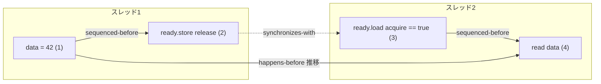

# 並行プログラミングのメモリモデルと同期 (Language Memory Models and Synchronization)

## 概要 (Overview)

並行プログラムを書くプログラマは、ハードウェアごとに異なるメモリ順序 (memory ordering) を直接相手にしたくない。x86 の TSO と ARM/POWER の弱順序 (weak ordering) を毎回意識してコードを書き分けるのは非現実的であり、しかもコンパイラ自身もまた最適化のために命令を並べ替える。`../../hardware/cpu-architecture/memory-ordering-atomics.md` で見たとおり、**並べ替えは2段で起きる**——コンパイラの最適化と、CPU のアウトオブオーダ実行・ストアバッファ (store buffer)。この2段の並べ替えを単一の抽象で覆い隠し、「どこまで並べ替えてよいか」をプログラマとシステム（コンパイラ＋ハードウェア）の間の**契約 (contract)** として固定したものが、**言語レベルのメモリモデル (language memory model)** である。

本ドキュメントは、ハードウェアのメモリ順序の**上**に立つ層を扱う。すなわち、なぜ言語レベルの契約が要るか、データ競合 (data race) はなぜ未定義動作 (undefined behavior) なのか、先行発生 (happens-before) を中心とする正しさの推論枠組み、C/C++11 と Java Memory Model (JMM) の具体的保証、アトミック変数と CAS、mutex/futex/spinlock/rwlock などの同期プリミティブ、lock-free / wait-free 構造への入口、そして async runtime までを、機構レベル (mechanism level) で整理する。`memory-ordering-atomics.md` がハードウェアモデルと `memory_order` の意味論を扱ったのに対し、本書はそこから**上方向に** (build upward) 同期の構築物を積む。

## 方法論 (Methodology)

- まず**ハードウェアの reordering** と**コンパイラの reordering** を1つの契約に統合する、という言語メモリモデルの動機を起点に置く。両者は別の主体だが、プログラマから見れば「観測順が崩れる」という同じ現象である。
- 正しさは直感ではなく**先行発生関係 (happens-before)** の成立で判定する。`memory-ordering-atomics.md` の方針（モデルに基づく推論）を言語層に持ち上げ、sequenced-before と synchronizes-with の合成として定式化する。
- 保証の強さを軸に、C/C++11 の `memory_order` と JMM の `volatile`/`final` を**同じ枠組み**（acquire/release セマンティクス）に写像し、言語差を相対化する。
- 同期プリミティブは「待ち方 (spin か block か)」と「公平性・スケーラビリティ」の2軸で比較する。`../../hardware/cpu-architecture/cache-coherence.md` の「同一ラインに触るコア数を減らす」という結論を、ロック設計の評価基準として一貫して使う。
- OS スケジューラ側の対比は `../operating-systems/process-thread-scheduling.md`に委ね、本書はユーザ空間のランタイム視点に絞る。

## 発見事項 (Findings)

1. **言語メモリモデルはハードとコンパイラの並べ替えを束ねる単一契約。** プログラマは TSO/weak の差や `dmb`/`lock` の有無を意識せず、`memory_order` や `volatile` という移植可能な語彙で意図を書く。コンパイラがそれを各 ISA のバリアへ翻訳する。契約がなければ「最適化が消してよい読み込み」と「他スレッドが書く読み込み」をコンパイラは区別できない。

2. **データ競合は未定義動作であり、性能問題ではなくセキュリティ問題。** 非アトミックな共有変数への並行アクセス（少なくとも一方が書き込み）は、C/C++ では UB。コンパイラは「競合は起きない」と仮定して最適化するため、引き裂き (tearing)・境界チェック消去・値の再読み込みが起き、メモリ安全性を破壊しうる。

3. **正しさは happens-before の一本道に還元できる。** sequenced-before（単一スレッド内）と synchronizes-with（スレッド間の release→acquire）を推移的に合成した半順序が happens-before。これが成立する書き込み→読み込みのみ「見えることが保証される」。それ以外は何も保証されない。

4. **言語が違っても核は acquire/release。** C++ の `release`/`acquire`、Java の `volatile` 書き/読み、すべて「release より前の書き込みが、対応する acquire 以降に可視」という同じ骨格。JMM の `final` は構築完了の安全公開という別軸の保証を足す。

5. **同期プリミティブは lock-free 部品の組み合わせ。** mutex は futex の二段構え（ユーザ空間 CAS ＋カーネル待機）で、spinlock は CAS ループ、CAS 自体はハードウェアの LL/SC または `CMPXCHG`。同期はすべてアトミックとコヒーレンスの上に積まれており、競合点 (contention) はそのまま `cache-coherence.md` のホットライン問題に帰着する。

## アーキテクチャ (Architecture)

### 2段の並べ替えを覆う契約

```
   プログラマが書いた順                言語メモリモデル (契約)
   ┌──────────────┐                  「data-race-free なら
   │ data = 42;    │                   SC のように見せる」
   │ ready = true; │  ───契約に従い───▶  (DRF-SC 保証)
   └──────────────┘        │
                           ▼ コンパイラが各層へ翻訳
        ┌───────────────────────────────┐
        │ ① コンパイラ reordering         │  命令入替・レジスタ保持・除去
        │    (契約の範囲内で自由)          │
        ├───────────────────────────────┤
        │ ② ハードウェア reordering        │  OoO 実行・store buffer
        │    (memory-ordering-atomics.md) │  → 必要なら dmb / lock を挿入
        └───────────────────────────────┘
```

言語モデルの中心命題は **DRF-SC (Data-Race-Free implies Sequential Consistency)**：「データ競合のないプログラムは、逐次一貫 (sequentially consistent) であるかのように振る舞う」。逆に競合があれば、両層の並べ替えがそのまま観測に漏れ、保証は一切ない。

### 先行発生関係 (happens-before) の構成

happens-before は2つの基本関係の推移閉包である。



- **sequenced-before**: 単一スレッド内のプログラム順に基づく順序（(1)→(2)、(3)→(4)）。
- **synchronizes-with**: スレッドをまたぐ同期エッジ。release ストア (2) を観測した acquire ロード (3) との間に張られる。
- **happens-before**: 上記2つの合成。(1) hb (2) sw (3) hb (4) より (1) happens-before (4)。ゆえに (4) は `data == 42` を必ず観測する。

エッジが繋がらない書き込み→読み込みは「見えるかもしれないし見えないかもしれない」——これがモデルの全てであり、`assert` の正当性はこのグラフが閉じるかで判定する。

### 同期エッジを張る道具

| 道具 | エッジの種類 | 典型 |
|---|---|---|
| `release` ストア / `acquire` ロード | synchronizes-with | フラグ同期、生産者-消費者 |
| mutex unlock → 次の lock | synchronizes-with | クリティカルセクション |
| スレッド `start` / `join` | happens-before | ライフサイクル境界 |
| Java `volatile` 書き / 読み | synchronizes-with | DCL の安全公開 |

### 進行保証の階層 (Progress Guarantees)

「正しさ」とは別に、並行アルゴリズムには**進行保証 (progress guarantee)** という独立した軸がある。これは「あるスレッドが他スレッドの**遅延・停止・プリエンプト**にどこまで耐えて前進できるか」を問う。Herlihy & Shavit の定式化に従い、強い順に階層を成す。

```
   強い ◀────────────────────────────────────────────▶ 弱い
   ┌────────────┐  ┌────────────┐  ┌──────────────┐  ┌──────────┐
   │ wait-free  │ ⊃│ lock-free  │ ⊃│obstruction-  │ ⊃│ blocking │
   │ 全スレッド  │  │ 全体として  │  │   free       │  │ 誰かが止  │
   │ 有界ステップ │  │ 誰かが前進  │  │ 単独実行なら  │  │ まると全  │
   │ で完了      │  │ (飢餓あり)  │  │ 完了         │  │ 停止しうる│
   └────────────┘  └────────────┘  └──────────────┘  └──────────┘
```

- **wait-free**: *任意の*スレッドが、他スレッドの挙動に関わらず**有界回数 (bounded steps)** の操作で必ず完了する。飢餓 (starvation) すら起きない最強保証。実装は高コストで、ヘルプ機構 (helping) を伴うことが多い。
- **lock-free**: システム**全体として**は常にいずれかのスレッドが有限ステップで前進する。ただし特定のスレッドは CAS リトライに負け続けて飢餓しうる。Treiber stack や Michael-Scott queue がこの階層。
- **obstruction-free**: あるスレッドが**単独で**走れる（他が一時停止する）なら有限ステップで完了する。複数同時実行ではライブロック (livelock) しうるため、補助としてバックオフを併用する。
- **blocking**: ロックを使う構造。保持者がプリエンプト/停止すると待ち手は前進不能。mutex も spinlock も**この階層**である（spinlock は保持者プリエンプトで全員空回り＝lock-free *ではない*）。

実用上の含意: lock-free 以上は「あるスレッドの停止が他を巻き込まない」ため、リアルタイム性・耐障害性が要る箇所で価値を持つ。一方、wait-free の有界性は割り込みハンドラやシグナルセーフな経路で意味を持つが、コードは著しく複雑化する。多くの実務コードは blocking で十分で、lock-free 化は競合計測の後にのみ正当化される。

## 技術詳細 (Technical Details)

### 1. データ競合の定義と未定義動作

C/C++ の定義: 2つのアクセスが (a) 同一メモリ位置に触れ、(b) 少なくとも一方が書き込みで、(c) 一方が他方に happens-before しない（=順序付けられていない）場合、それは**データ競合**であり、プログラム全体の動作は**未定義**になる。

```cpp
// 例示コード (illustrative)。リポジトリ内の実コードではない。
int flag = 0, data = 0;           // 非アトミックな共有変数

// スレッドA
data = 42;                         // 書き込み
flag = 1;                          // 書き込み (アトミックでない)

// スレッドB
while (flag == 0) { }              // 読み込み (アトミックでない) → データ競合
use(data);                         // flag==1 でも data==42 は保証されない
```

ここでコンパイラは「`flag` は他から変わらない」と仮定して `while (flag==0){}` を `if (flag==0) for(;;){}` に変えてよい（無限ループ最適化）。`data` の読みもループ外へ巻き上げられる。**「テストで動いた」は無意味**——UB は最適化レベル・コンパイラ・ISA で顕在化する。正しくは `flag` をアトミックにし、release/acquire でエッジを張る。

### 2. C/C++11 memory_order の意味論

`memory-ordering-atomics.md` の表を、happens-before の語彙で再掲・補強する。

| memory_order | happens-before への寄与 | 主な用途 |
|---|---|---|
| `relaxed` | エッジを張らない。アトミック性のみ | 統計カウンタ |
| `acquire` | 以降の操作を前に動かさない。release と対で sw を張る | ロック取得、フラグ読み |
| `release` | 以前の操作を後ろに動かさない。acquire と対で sw を張る | ロック解放、フラグ書き |
| `acq_rel` | RMW で両方向 | CAS ループ |
| `seq_cst` | 全 seq_cst 操作に単一の全順序。最強・最コスト | 迷ったら（既定） |

`consume` は実務上ほぼ全コンパイラが `acquire` に格上げするため非推奨。指針は `memory-ordering-atomics.md` と同じ——**まず `seq_cst`、計測後に必要箇所だけ緩める**。

```cpp
// 例示コード (illustrative)。release/acquire で synchronizes-with を張る。
std::atomic<bool> ready{false};
int data = 0;

data = 42;                                      // (1)
ready.store(true, std::memory_order_release);   // (2) (1)を後ろへ動かさない
// --- 別スレッド ---
while (!ready.load(std::memory_order_acquire))  // (3) これ以降を前へ動かさない
    ;
assert(data == 42);                             // (2) sw (3) により必ず成立
```

#### スタンドアロンのフェンス (std::atomic_thread_fence)

`memory_order` はアトミック**操作**に順序を付けるが、`std::atomic_thread_fence` は操作に紐付かない**独立したバリア (standalone fence)** を置く。`relaxed` アトミックと組み合わせ、順序付けを操作から分離できる。これは `memory-ordering-atomics.md` の「取得バリア／解放バリア」をソフト層へ写したものである。

```cpp
// 例示 (illustrative)。fence + relaxed で release/acquire と等価なエッジを張る。
data = 42;                                          // (1) 通常書き込み
std::atomic_thread_fence(std::memory_order_release); // release フェンス
ready.store(true, std::memory_order_relaxed);        // (2) relaxed で十分
// --- 別スレッド ---
while (!ready.load(std::memory_order_relaxed)) ;     // (3) relaxed
std::atomic_thread_fence(std::memory_order_acquire); // acquire フェンス
assert(data == 42);                                  // 必ず成立
```

- **release フェンス**は「フェンスより前の全メモリ操作」を、フェンス後の任意の**ストア**より前に固定する（後方移動の禁止）。
- **acquire フェンス**は「フェンスより後の全メモリ操作」を、フェンス前の任意の**ロード**より後に固定する（前方移動の禁止）。
- ハードへの落ち方: release/acquire フェンスは ARM/POWER で `dmb ish` 等の**バリア命令**に翻訳される。x86 (TSO) では Store→Store / Load→Load が既に保たれるため acquire/release フェンスは**ノーオペ（コンパイラバリアのみ）** で済み、唯一 `seq_cst` フェンスだけが `mfence`（または `lock` 接頭辞付きダミー RMW）を要する。この非対称が `memory-ordering-atomics.md` の TSO/weak 差の直接の帰結である。

操作付き順序指定とフェンスは概ね等価だが、ループ内の複数 relaxed 操作を1つのフェンスで囲える点でフェンスが有利な場合がある（バリア命令の発行回数を減らせる）。

#### seq_cst のコストと store-load バリア

`seq_cst` が他の順序より高いのは、acquire/release が**片方向**しか縛らないのに対し、`seq_cst` ストアは後続ロードに対する**store-load バリア**を要求するからである。`memory-ordering-atomics.md` で見たとおり、TSO ですら唯一許す並べ替えが Store→Load であり、これを潰すには store buffer をドレインする `mfence` 級の全バリアが要る。これは最もコストの高いバリアである。

```
   store buffer が Store→Load 並べ替えを生む機構:
   ┌──────────┐
   │ x.store  │──▶ [store buffer] ──(遅延)──▶ キャッシュ/他コア
   │ y.load   │──────────────────────────────▶ 先にロードが完了しうる
   └──────────┘   ↑ seq_cst はここに mfence を挿し、buffer を空にしてからロード
```

この差が顕在化する古典が **Dekker / Peterson 型**の相互排除パターンである。各スレッドが「自分のフラグを立ててから相手のフラグを読む」が、`relaxed`（あるいは acquire/release だけ）では Store→Load 並べ替えにより**両者が相手のフラグを false と観測**し、同時にクリティカルセクションへ入りうる。

```cpp
// 例示 (illustrative)。Dekker の核。relaxed/acq-rel では壊れる。
// スレッド0                         スレッド1
flag0.store(true,  RELAXED);        flag1.store(true,  RELAXED);
if (flag1.load(RELAXED) == false)   if (flag0.load(RELAXED) == false)
    enter_critical();                   enter_critical();   // 両方入りうる！
```

ここで store と後続 load の両方を `seq_cst` にするか、両者の間に `seq_cst` フェンス（store-load バリア）を挟むと、全 `seq_cst` 操作に対する**単一全順序**が保証され、少なくとも一方は相手の `true` を観測する。「acquire/release では足りず seq_cst が要る数少ない正当な場面」がこの対称的な store-load 依存パターンであり、`seq_cst` のコストはこの全順序の代償である。

#### memory_order_consume と依存順序 (dependency ordering)

`consume` は acquire より弱い特殊な順序で、**データ依存 (data dependency)** を通じてのみ順序を伝播させることを狙った。ポインタを `consume` ロードすると、そのポインタを**通じて**辿った読み込みだけが順序付けられ、依存のない読み込みは縛らない。狙いは ARM/POWER でバリア命令を**省ける**こと——これらの ISA はアドレス依存 (address dependency) をハード自身が保つため、追加バリア無しで依存先の可視性が得られる。

```
   release側            consume側
   p->x = 42;           r = head.load(consume);   // r に依存ロード
   head.store(p,rel);   use(r->x);  // r 経由 → 順序保証(バリア不要)
                        use(global); // r 非依存 → 順序保証なし
```

しかし `consume` は**ほぼ全コンパイラが実装を放棄し、`acquire` に格上げ**している。理由は、ソースコードの「依存関係」をコンパイラの最適化（共通部分式除去、値の具体化による依存の消去、`if (r==known) use(known->x)` への変換など）を跨いで正確に追跡するのが極めて困難だからである。C++17 では「`consume` の使用を当面推奨しない」と注記され、N4321 等で依存順序の再定義が議論され続けている。実務的指針は単純で、**`consume` は使わず `acquire` を使う**——RCU の高速読み手のように依存順序が真に効く特殊系を除き、得られる利得は実装上の格上げで消える。

### 3. Java Memory Model (JMM) と volatile/final

JMM は JSR-133 で再定義され、C++11 と同じく happens-before を基盤に置くが、用語と保証が異なる。

- **`volatile`**: 書き込みは release、読み込みは acquire のセマンティクスを持つ。`volatile` 書き→後続の `volatile` 読みで synchronizes-with が張られ、書き手のそれ以前の**全**書き込み（非 volatile 含む）が読み手に可視。C++ の `volatile`（最適化抑止のみで順序保証なし）とは**まったく別物**である点が移植時の罠。
- **`final`**: コンストラクタが正常終了すれば、`final` フィールドの初期化が、その後オブジェクト参照を取得した任意スレッドから可視であることを保証する（safe publication）。同期なしで不変オブジェクトを安全に共有できる根拠。
- **`synchronized`**: モニタの unlock → 次の lock に happens-before を張る。C++ の mutex と同型。

```java
// 例示コード (illustrative)。volatile による安全公開。
class Holder {
    private volatile Config cfg;          // volatile が release/acquire を提供
    void publish() { cfg = new Config(42); }   // 構築 → volatile 書き (release)
    int read() {                               // volatile 読み (acquire)
        Config c = cfg;                        // c が非 null なら…
        return (c != null) ? c.value : -1;     // …42 が必ず見える
    }
}
```

#### double-checked locking の壊れ方と volatile による修正

DCL は「初回だけロックして生成し、以降はロック無しで読む」遅延初期化の定番だが、JSR-133 以前の Java では壊れていた。本質は `memory-ordering-atomics.md` の §3 と同じく、**オブジェクト構築とポインタ公開の並べ替え**である。

```java
// 例示 (illustrative)。volatile を欠いた壊れる DCL。
class Broken {
    private Singleton inst;                      // volatile が無い → 壊れる
    Singleton get() {
        if (inst == null) {                      // ① ロック無しチェック
            synchronized (this) {
                if (inst == null)                // ② ロック内で再チェック
                    inst = new Singleton();      // ③ 構築と公開が並べ替えられうる
            }
        }
        return inst;                             // ④ 非 null だが未初期化を観測しうる
    }
}
```

`inst = new Singleton()` は概念上「メモリ確保 → コンストラクタ実行 → `inst` へ代入」だが、JIT/CPU は**確保 → `inst` 代入 → コンストラクタ実行**へ並べ替えてよい。別スレッドが①の `inst == null` を「非 null」と観測した瞬間、コンストラクタはまだ走っておらず、**半構築のオブジェクト**を掴む。修正は `inst` を `volatile` にすること——③の代入が release となり、構築完了が代入より後ろへ漏れず、④の読み（acquire）が完全構築を保証する。あるいは `static` ホルダクラス（クラス初期化ロックに委ねる）や `final` フィールドで安全公開する。

#### piggybacking（半同期イディオム）

JMM では、`volatile` 書き→読みが張る synchronizes-with エッジは、その書き手の**それ以前の非 volatile 書き込みすべて**を読み手に可視化する。これを利用し、1つの `volatile` フラグに「便乗 (piggyback)」させて多数の通常フィールドを安全公開するのが piggybacking である。`AtomicInteger` のような並行ユーティリティの内部や、`ConcurrentHashMap` のサイズフィールド更新でこの効果が活用される。注意点は、可視化されるのは**release より前に完了した書き込みのみ**であり、フラグ書き込み後の更新には保証が及ばないこと。便乗の方向（どの書きがどの読みに見えるか）を happens-before で必ず確認する。

### 4. アトミック変数と CAS、ハードウェアとの接続

ロックフリーの基本部品は **CAS (Compare-And-Swap)**：期待値と一致すれば新値に差し替え、結果（成否と現値）を返す不可分操作。

```
// CAS の概念 (illustrative)。アトミックに行われる。
bool CAS(addr, expected, desired):
    if *addr == expected: *addr = desired; return true
    else:                 expected = *addr; return false   // 現値を返す
```

ハードウェアへの落ち方は ISA で異なる（`memory-ordering-atomics.md`・`cache-coherence.md` 参照）：

- **x86**: `lock cmpxchg`。対象キャッシュラインを排他所有 (M 状態) してから RMW を局所化する (cache locking)。
- **ARM/POWER**: **LL/SC** (`ldxr`/`stxr`) ループ。LL でラインを reservation 登録し、SC は「その間ラインへの他コア書き込み（=コヒーレンス無効化）が無かった場合のみ」成功。

CAS は **ABA 問題**を持つ：値が A→B→A と戻ると CAS は「変化なし」と誤認する。LL/SC は「途中で誰かが触ったか」をコヒーレンス状態で検出するため A→B→A でも SC が失敗しうる（機構的に ABA に強いが、フォルスフェイルもある）。これは `cache-coherence.md` の §6 と表裏一体である。

### 5. 同期プリミティブ

#### mutex と futex の二段構え

素朴な mutex は「ロックできるまでカーネルに眠る」が、競合がなければシステムコールは純粋な無駄である。Linux の **futex (fast userspace mutex)** はこれを二段で解く。

```
// 例示 (illustrative)。futex ベース mutex の二段構え。
lock():
    if CAS(state, 0, 1) == success: return       // ① 競合なし → ユーザ空間で完結
    while CAS(state, 0, 2) != success:           // ② 競合あり → contended を記録し
        futex_wait(&state, 2)                     //    カーネルで眠る (no busy spin)
unlock():
    if atomic_xchg(state, 0) == 2:               // 待ち手がいたなら
        futex_wake(&state, 1)                     //    1つ起こす
```

**競合がなければシステムコールゼロ**、競合時のみカーネルへ落ちる。「速い経路はユーザ空間、遅い経路だけカーネル」という設計が futex の核心。

#### spinlock vs blocking

| | spinlock | blocking (mutex) |
|---|---|---|
| 待ち方 | CPU を回し続ける (busy-wait) | スレッドを眠らせる (futex_wait) |
| 適する状況 | 保持時間が極短・コア数 ≥ 待ち手 | 保持時間が長い・オーバーサブスク |
| コスト源 | コヒーレンストラフィック | コンテキストスイッチ |
| 危険 | 保持者がプリエンプトされると全員空回り | 短い区間では切替が割に合わない |

spinlock の改良は `cache-coherence.md` の結論に直結する：素朴な `test_and_set` は全待ち手が同一ラインを叩き合い ping-pong を起こす。**MCS ロック**は各スレッドが自分専用ノードでスピンし、隣接ノードだけと通信することでホットラインを解消する（=同一ラインに触るコア数を減らす）。

#### rwlock・condition variable・セマフォ

- **rwlock (reader-writer lock)**: 複数 reader 同時可、writer 排他。読み多寡では並列度が上がるが、reader カウンタ自体が共有ラインになり writer 飢餓 (starvation) を招きうる。
- **condition variable**: 述語が成立するまで待つ。必ず**ループで再チェック**する（spurious wakeup と、起床と再取得の間の状態変化＝TOCTOU を防ぐ）。`while (!pred) cv.wait(lock);` が定型。
- **セマフォ (semaphore)**: カウント付きの許可。`P`(wait)/`V`(post) でリソース数を律する。mutex と異なり所有者の概念がなく、別スレッドが post できる（生産者-消費者の通知に向く）。

### 6. lock-free / wait-free 構造への入口

- **進行保証の階層**: **lock-free**（システム全体として常にいずれかが前進）⊃ **wait-free**（全スレッドが有界ステップで完了）。spinlock は保持者プリエンプトで全停止しうるため lock-free **ではない**。
- **ABA とメモリ再利用**: lock-free 構造の難所は「ノードをいつ free してよいか」。読み手が参照中のノードを別スレッドが解放・再利用すると ABA とダングリングが同時に起きる。
- **hazard pointer**: 各スレッドが「今アクセス中のポインタ」を公開し、回収側はどのスレッドにも hazard 登録されていないノードだけを free する。
- **RCU (Read-Copy-Update)**: 読み手はほぼゼロコスト（バリアすら不要な実装あり）、書き手はコピーを作って差し替え、全読み手が「猶予期間 (grace period)」を抜けてから旧版を回収する。読み多寡に極めて強く、Linux カーネルで多用。
- **false sharing への注意**: lock-free でも、隣接インデックスのアトミックが同一64Bラインに乗ると `cache-coherence.md` の cache line ping-pong が発生する。ホットなアトミックは `alignas(64)` でライン分離する。

```
// lock-free スタック push (illustrative)。CAS リトライループ。
push(node):
    do:
        old = head.load(acquire)
        node.next = old
    while not head.CAS(old, node, release)   // 競合で失敗したらリトライ
```

#### Treiber stack と ABA の発生箇所

上の push が **Treiber stack**（CAS ベース lock-free スタックの古典）である。問題は `pop` 側に出る。

```
// Treiber pop (illustrative)。ABA はここに潜む。
pop():
    do:
        old = head.load(acquire)
        if old == null: return EMPTY
        next = old.next            // ★ ここで old を別スレッドが pop→free→再 push しうる
    while not head.CAS(old, next, acq_rel)   // old==head でも head の意味が変わっている
    return old
```

`old` を読んでから CAS するまでの間に、別スレッドが `old` を pop し、解放・再利用して**同じアドレスを A として再 push**すると、CAS は `head == old` を見て成功するが、`next` は既に陳腐化しており、リストが破壊される（ABA 問題そのもの）。これが lock-free 構造の本質的難所であり、`memory-ordering-atomics.md` §3 の ABA を構造の具体に落としたものである。対策はタグ付きポインタ（version counter を CAS に同梱し、A→B→A でもタグが変わる）、ハザードポインタ、エポックベース回収、RCU のいずれか。

#### Michael-Scott queue

並行キューの標準実装が **Michael-Scott queue**（lock-free な FIFO、`java.util.concurrent.ConcurrentLinkedQueue` の基礎）。`head`/`tail` の2ポインタを持ち、ダミーノード (sentinel) を先頭に置くことで空・非空の場合分けを統一する。enqueue は「`tail.next` を CAS で繋ぐ」と「`tail` を CAS で前進」の2段で、後者は他スレッドが**ヘルプ (helping)** して前進させられる（tail が途中の不整合状態を観測したら誰でも修正できる）。ABA は dequeue で `head` を CAS する箇所に現れ、Treiber と同じくノード再利用管理を要する。

#### RCU (Read-Copy-Update) の機構深掘り

RCU は「読み多寡 (read-mostly)」で圧倒的な性能を出す。核心は**読み手をほぼ無コスト**にし、回収コストを書き手側へ寄せることである。

```
   読み手 (read-side critical section)        書き手 (update)
   rcu_read_lock();    // ほぼ無コスト         new = copy(old);
   p = rcu_dereference(ptr);  // 依存ロード      modify(new);
   use(p->field);                              rcu_assign_pointer(ptr, new); // 公開
   rcu_read_unlock();  // ほぼ無コスト          synchronize_rcu();  // grace period 待ち
                                               free(old);          // 全読み手通過後に回収
   ───────────────────────────────────────────────────────────────
   grace period: 「この時点で走っていた全読み手が
                  critical section を抜けるまで」の猶予期間
   quiescent state: 各CPUがRCU保護下の参照を持たない瞬間
                    (例: ユーザ空間復帰・コンテキストスイッチ・idle)
```

- **read-side critical section**: `rcu_read_lock()`/`unlock()` は非プリエンプティブ RCU ではプリエンプト無効化程度、実装によっては**何もしない（コンパイラバリアのみ）**。アトミックも CAS もライン書き込みも無く、`cache-coherence.md` のコヒーレンストラフィックが**発生しない**——これが「読みが無コスト」の正体であり、共有カウンタやロックが必ず起こすホットライン往復を完全に回避する。
- **grace period と quiescent state**: 書き手は旧版を即座に解放できない（読み手が `ptr` を掴んでいるかもしれない）。各 CPU が「RCU 保護下の参照を持たない瞬間」=**quiescent state** を一度ずつ通過すれば、公開以前に始まった全読み手は終了したと判定でき、これを待つのが **grace period**。読み手はバリアすら不要になる。
- **rcu_assign_pointer / rcu_dereference**: 前者は release 相当、後者は consume 相当（依存先の可視性を保証）。RCU は `consume` の依存順序が真に価値を持つ数少ない実例である。

#### ハザードポインタ (hazard pointer) の回収機構

ハザードポインタは「いつ free してよいか」を明示的に解く。各スレッドは**現在アクセス中のポインタ**をグローバルに公開する固定数のスロットを持つ。

```
   各スレッド: hazard[tid] = p;  // 公開してから p を使う(間に再確認)
   回収側 retire(node):
     retired_list.push(node)            // 即 free せず退避
     if retired_list.size > threshold:  // バッチで償却
        H = 全スレッドの hazard スロットを走査して集合化
        for n in retired_list:
           if n not in H: free(n)       // どのスレッドも参照していないものだけ解放
           else:          残す
```

ポイントは、公開→再確認の順序が `seq_cst`（または store-load フェンス）を要すること——公開ストアと「ポインタがまだ有効か」の再ロードが Store→Load 並べ替えされると、回収側が「未公開」と誤判定して使用中ノードを free しうる。回収は閾値超過時に**バッチ**で行い、ハザード集合走査の O(スレッド数 × retire 数) コストを償却する。RCU が「時間（grace period）」で安全性を判定するのに対し、ハザードポインタは「明示公開された参照集合」で判定する点が対照的である。

#### false sharing 緩和の実装

§6 で触れたとおり、ホットなアトミックが同一64Bラインに同居すると `cache-coherence.md` の cache line ping-pong を起こす。緩和の実装は2系統。

```cpp
// 例示 (illustrative)。alignas/パディングでライン分離。
struct alignas(64) PaddedCounter {
    std::atomic<long> value;
    char pad[64 - sizeof(std::atomic<long>)];   // 後続フィールドを別ラインへ追い出す
};
PaddedCounter counters[NUM_THREADS];            // 各要素が独立ラインを占有
```

- **alignas / パディング**: ホットなフィールドを `alignas(64)`（C++17 では `std::hardware_destructive_interference_size`）でライン境界に揃え、末尾パディングで隣接データの相乗りを防ぐ。
- **per-CPU / per-thread データ**: そもそも共有しない。各スレッドが自分のカウンタを更新し、読み出し時のみ合算する（sloppy counter / シャーディング）。これは `cache-coherence.md` の「同一ラインに触るコア数を減らす」結論の最も素直な適用であり、書き込みのコヒーレンストラフィックを原理的にゼロにする。

#### トランザクショナルメモリ (Transactional Memory)

ロックの代わりに、一連のメモリ操作を**アトミックなトランザクション**として実行し、競合が無ければコミット、あれば**アボート (abort) して巻き戻す**抽象。楽観的並行制御 (optimistic concurrency) の一形態。

- **HTM (Hardware TM)**: x86 の **TSX** (RTM: `xbegin`/`xend`/`xabort`) が代表。トランザクション中の読み書きを CPU が追跡し、コヒーレンスの**無効化を競合検出に流用**する——他コアが read-set/write-set のラインに触れば即アボート。追跡はキャッシュ単位なので、**write-set/read-set がキャッシュ容量や連想度を超えるとアボート**する。アボート要因は他に、割り込み・システムコール・`cpuid` 等の不可逆命令・ページフォルト。HTM は best-effort であり、**成功を保証しないため必ずソフトのフォールバック経路（ロック）を併設**する（lock elision）。TSX は過去にサイドチャネル (TAA) 脆弱性が報告され、多くの環境で無効化された経緯もある。
- **STM (Software TM)**: 純ソフトでログ・バージョン管理を行う。HTM の容量制限が無く可搬だが、読み書きごとのメタデータ操作でオーバヘッドが大きい。
- **限界**: いずれもアボートの再試行コストと、I/O・システムコールなど**巻き戻せない副作用**をトランザクション内に置けない制約がある。HTM は容量・割り込みで確率的にアボートし、STM は定数倍が重い。万能のロック代替にはならず、競合が低く区間が短い場合に効く。

### 7. 非同期ランタイム (async runtime)

スレッドあたり数十万の接続を捌くには、OS スレッドより軽い並行単位が要る。async runtime はこれをユーザ空間で提供する。

- **event loop**: 単一（または少数）スレッドが、ノンブロッキング I/O の準備完了を `epoll`/`kqueue`/IOCP で多重監視し、準備できたものだけコールバックを回す。I/O 待ちでスレッドを塞がない。
- **coroutine / async-await**: 関数の途中で**中断・再開**できる。`await` 点が中断点となり、I/O 待ちの間ランタイムが他タスクを走らせる。スタックレス（状態機械へ変換）かスタックフルかで実装が分かれる。
- **work-stealing scheduler**: 各ワーカが自分のローカルキューを LIFO で処理し、空いたワーカは他ワーカのキュー末尾からタスクを**盗む (steal)**。ローカル局所性を保ちつつ負荷分散する。Tokio・Go ランタイム・.NET ThreadPool が採用。

```
   Worker0 deque        Worker1 deque (空)
   [t3][t2][t1] ◀pop自分          │
       │                          │ steal (末尾から)
       └──────────  t1  ◀─────────┘
   自分は LIFO 末端、泥棒は反対端 → 競合点を分離
```

#### executor / reactor と waker による poll 駆動

多くのランタイム（Rust の Tokio が典型）は **executor**（タスクを実行・スケジュールする層）と **reactor**（I/O 準備完了を監視する層）に分離される。Future はスタックレスな**状態機械**にコンパイルされ、executor がそれを `poll()` する。`poll` は「完了したら値、まだなら `Pending`」を返す協調的契約である。

```
   executor                    reactor (epoll/io_uring)
   ┌──────────┐                ┌────────────────────┐
   │ poll(F)  │──Pending──────▶│ F の waker を I/O に  │
   │          │                │ 登録 (fd→waker)     │
   │ (他タスク)│                │                    │
   │   ...    │◀──wake()───────│ I/O 準備完了→waker   │
   │ poll(F)再 │  (再キューへ)   │ 呼び出し            │
   └──────────┘                └────────────────────┘
```

- **waker / Future polling**: `Pending` を返すとき、Future は自分を後で起こすための **waker**（再スケジュールのコールバック）を reactor に預ける。busy-poll しない——準備完了通知が来て初めて waker が呼ばれ、タスクが実行キューへ戻る。これにより「待っている間 CPU を使わない」が成立する。
- **io_uring / epoll への接続**: reactor は `epoll`（レベル/エッジトリガの**準備完了通知**モデル）か、より新しい **io_uring**（投入キュー (SQ) と完了キュー (CQ) を共有メモリリングで結ぶ**完了通知 (completion-based)** モデル）の上に立つ。io_uring は I/O 完了そのものを非同期化し、システムコール回数を削減する点で `epoll`+ノンブロッキング read の二段を一段に畳む。reactor は CQ を取り出して対応する waker を呼ぶ。両者ともランタイム内部のキューはマルチプロデューサ・マルチコンシューマで、本書 §6 の lock-free 構造とライン分離（false sharing 回避）がそのまま効く。

#### 協調スケジューリングの限界と CPU バウンド

`../operating-systems/process-thread-scheduling.md` の OS カーネルスケジューリング（プリエンプティブ・タイムスライス・優先度）との対比が要点である。**async runtime は協調的 (cooperative)** ——タスクが `await`/`poll` の `Pending` で自発的に譲らない限り切り替わらない——のに対し、**OS スケジューラはプリエンプティブ**で、タイマ割り込みで強制的に切り替える。

この差が **CPU バウンド (CPU-bound)** な処理で牙を剥く。`await` 点を一切持たない重い計算（暗号演算、大きなソート、画像処理）がワーカスレッド上で走ると、その間 `poll` が返らず、同一ワーカに割り当てられた他タスクは**永久に進めない**——event loop が固まる。対策は、(a) 重い計算を `spawn_blocking`／専用スレッドプールへ逃がす、(b) 計算を分割して定期的に `yield` で譲る、(c) ワーカ数を CPU コア数に合わせて CPU バウンドと I/O バウンドのプールを分ける。これは「協調スケジューリングは**信頼できるタスク**を前提とする」という構造的限界の現れであり、悪意ある／バグのあるタスク1つが全体を DoS しうる点でセキュリティ上の含意も持つ（後述）。

## セキュリティ考察 (Security Considerations)

並行性バグは可用性・完全性・機密性のすべてを脅かす。`memory-ordering-atomics.md` のデータ競合＝UB 論をアプリ層へ拡張する。

- **TOCTOU (Time-of-Check to Time-of-Use)**: チェックと使用の間に別スレッド／プロセスが状態を変える競合。典型は `access()` で権限確認後に `open()` する（その隙にシンボリックリンクが差し替わる）。対策は窓 (window) を閉じる——チェックと使用をアトミック化する、ロックで囲む、`openat`+`O_NOFOLLOW` のように一発の操作にまとめる。condition variable を `if` でなく `while` で待つのも同じ原理（述語の再確認）。

- **double-fetch**: カーネル／信頼境界が、ユーザ空間の同じ値を**二度読む**間に、攻撃者が値を書き換える。一度目の検査（サイズ上限チェック等）を通った後、二度目の使用（コピー長）で別の値が使われ、バッファオーバーフローに化ける。対策は「一度だけコピーしてから検査・使用する (snapshot)」。本質は TOCTOU の特殊形で、共有可変メモリの再読み込みが攻撃面になる。

- **並行性バグによるメモリ破壊**: データ競合は引き裂き (torn read/write) を生む。ポインタや認可フラグが中途半端な状態で観測されれば、use-after-free・型混同・認可バイパスに直結する。lock-free 構造の ABA とメモリ再利用の誤りは use-after-free を直接生む（§6）。これらは UB の結果であり、コンパイラ最適化が境界チェックを消すことで悪化する。

- **デッドロック / ライブロックの可用性影響**: ロック獲得順序の不整合はデッドロック（相互待ち、進行ゼロ）、リトライの噛み合いはライブロック（動くが進まない）を生む。いずれも DoS になりうる。攻撃者が制御できる入力でロック順を誘導できれば、意図的にハングを起こせる。対策は**ロック順序の全域整列 (lock ordering)**、`try_lock`＋タイムアウト、ロック区間の最小化。

- **検出手段**: 競合は確率的でテストをすり抜ける。**ThreadSanitizer (TSan)** による動的検出、Java の `volatile`/`final` 契約や C++ の `memory_order` に基づく静的推論、形式検証 (model checking) の併用が現実解。「動いた」は証明ではない。

### reordering が招く脆弱性 (Reordering-induced Vulnerabilities)

並べ替えは性能の最適化だが、契約を満たさないコードでは**攻撃可能な観測窓**を開ける。

- **初期化前公開 (publish-before-init)**: §3 の DCL の壊れ方は、単なるバグでなく脆弱性である。構築とポインタ公開が並べ替わると、別スレッドが**半構築のオブジェクト**——未初期化の仮想テーブルポインタ、ゼロ埋めされていない認可フラグ、ダングリングなコールバック——を有効ポインタ越しに観測する。攻撃者が公開タイミングを誘導できれば、未初期化フィールドを通じた型混同や制御フロー奪取に繋がりうる。修正は公開を release（C++）/`volatile` 書き（Java）にして、構築完了を公開より前に固定すること。
- **メモリモデル誤用による use-after-free**: lock-free 構造で回収を誤る（ハザードポインタの公開と再確認の間に store-load 並べ替えを許す、grace period を待たずに free する、ABA をタグで防がない）と、読み手が参照中のノードが解放・再利用され、**UAF と型混同が同時に**起きる。これは §6 の ABA・回収機構の失敗の直接の帰結であり、`memory_order` の選択ミス1つが exploitable な UAF を生む。
- **コンパイラ最適化による検査の消去**: データ競合は UB なので、コンパイラは「競合しない」前提で**境界チェックやヌルチェックを消去**しうる。並行に書き換わる値で検査した後に使うコードは、検査が最適化で蒸発し、攻撃者が制御する値が無検査で使われる。double-fetch（前述）はこの一般形である。
- **協調スケジューリングの DoS**: §7 のとおり、async ランタイムは協調的なため、`await` を持たない CPU バウンドタスク1つがワーカを専有し、同居タスク群を飢餓させる。攻撃者が「重い入力」でこの状態を誘発できれば可用性を破壊できる。信頼境界を跨ぐ入力を処理するタスクは、計算量上限・タイムアウト・専用プール隔離で律する。

教訓: 共有可変状態は、アトミック化・ロック・不変化 (immutability) のいずれかで必ず律する。律していない共有は UB であり、UB はセキュリティ境界を素通りする。`memory_order` の選択は性能チューニングではなく**正しさとセキュリティの契約**であり、緩めるたびに happens-before が閉じることを再確認する。

## 結論 (Conclusions)

- 言語メモリモデルは、ハードウェアの reordering とコンパイラの reordering を**単一の契約**に束ね、プログラマに移植可能な語彙（`memory_order`・`volatile`・`final`）を与える。契約の中心命題は DRF-SC——競合がなければ逐次一貫に見える、逆に競合があれば何も保証しない。
- 正しさは直感でなく **happens-before** の成立で判定する。sequenced-before と synchronizes-with を合成し、書き込み→読み込みのエッジが閉じることを確認する。C++ と Java は語彙こそ違え、核は acquire/release で共通する。
- 同期プリミティブはすべてアトミックとコヒーレンスの上の構築物である。mutex は futex の二段構え、spinlock は CAS ループ、lock-free は CAS リトライ。競合点はそのまま `cache-coherence.md` のホットライン問題に帰着し、最適化は「同一ラインに触るコア数を減らす」ことに集約される。
- async runtime は協調的スケジューリングでユーザ空間の軽量並行を提供するが、OS のプリエンプティブスケジューラとは前提が異なる（`../operating-systems/process-thread-scheduling.md`）。
- データ競合は性能問題ではなく未定義動作＝セキュリティ問題である。TOCTOU・double-fetch・lock-free の use-after-free・デッドロックは、いずれも共有可変状態を律していないことの帰結。アトミック化・ロック・不変化のいずれかで必ず律する。

### 次の接続先 (Related Topics)

- `../../hardware/cpu-architecture/memory-ordering-atomics.md` — 本書が立脚するハードウェアのメモリ順序と `memory_order` の意味論。本書はその上方向の続き。
- `../../hardware/cpu-architecture/cache-coherence.md` — CAS/LL/SC・false sharing・ホットラインの機構レベル。同期の競合コストの根。
- `../operating-systems/process-thread-scheduling.md` — OS のプリエンプティブなスレッドスケジューリング。async runtime の協調的スケジューリングとの対比。

## 参考文献 (References)

- Lamport, L. (1979). How to Make a Multiprocessor Computer That Correctly Executes Multiprocess Programs. *IEEE Transactions on Computers*, C-28(9), 690-691. DOI: 10.1109/TC.1979.1675439
- Boehm, H.-J., & Adve, S. V. (2008). Foundations of the C++ Concurrency Memory Model. *PLDI '08*, 68-78. DOI: 10.1145/1375581.1375591
- Manson, J., Pugh, W., & Adve, S. V. (2005). The Java Memory Model. *POPL '05*, 378-391. DOI: 10.1145/1040305.1040336
- ISO/IEC 14882:2011 (C++11), §1.10 Multi-threaded executions and data races.
- JSR-133: Java Memory Model and Thread Specification (2004).
- Mellor-Crummey, J. M., & Scott, M. L. (1991). Algorithms for Scalable Synchronization on Shared-Memory Multiprocessors. *ACM TOCS*, 9(1), 21-65. DOI: 10.1145/103727.103729
- Michael, M. M. (2004). Hazard Pointers: Safe Memory Reclamation for Lock-Free Objects. *IEEE TPDS*, 15(6), 491-504. DOI: 10.1109/TPDS.2004.8
- McKenney, P. E., & Slingwine, J. D. (1998). Read-Copy Update: Using Execution History to Solve Concurrency Problems. *PDCS '98*.
- Franke, H., Russell, R., & Kirkwood, M. (2002). Fuss, Futexes and Furwocks: Fast Userlevel Locking in Linux. *Ottawa Linux Symposium*, 479-495.
- Herlihy, M., & Shavit, N. (2011). On the Nature of Progress. *OPODIS '11*, 313-328. DOI: 10.1007/978-3-642-25873-2_22
- Herlihy, M., & Shavit, N. (2012). *The Art of Multiprocessor Programming* (Revised). Morgan Kaufmann. (進行保証の階層・lock-free/wait-free)
- Treiber, R. K. (1986). Systems Programming: Coping with Parallelism. *IBM Research Report* RJ 5118.
- Michael, M. M., & Scott, M. L. (1996). Simple, Fast, and Practical Non-Blocking and Blocking Concurrent Queue Algorithms. *PODC '96*, 267-275. DOI: 10.1145/248052.248106
- McKenney, P. E., et al. (2013). User-Level Implementations of Read-Copy Update. *IEEE TPDS*, 23(2), 375-382. DOI: 10.1109/TPDS.2011.159
- ISO/IEC 14882:2017 (C++17), §32 Atomic operations — `memory_order_consume` の使用に関する注記。
- N4321: Towards Implementation and Use of `memory_order_consume` (2014). WG21.
- [The Rustonomicon — Atomics](https://doc.rust-lang.org/nomicon/atomics.html) — Accessed: 2026-06-29
- [Tokio Documentation — Runtime / Async in depth](https://tokio.rs/tokio/tutorial) — Accessed: 2026-06-29
