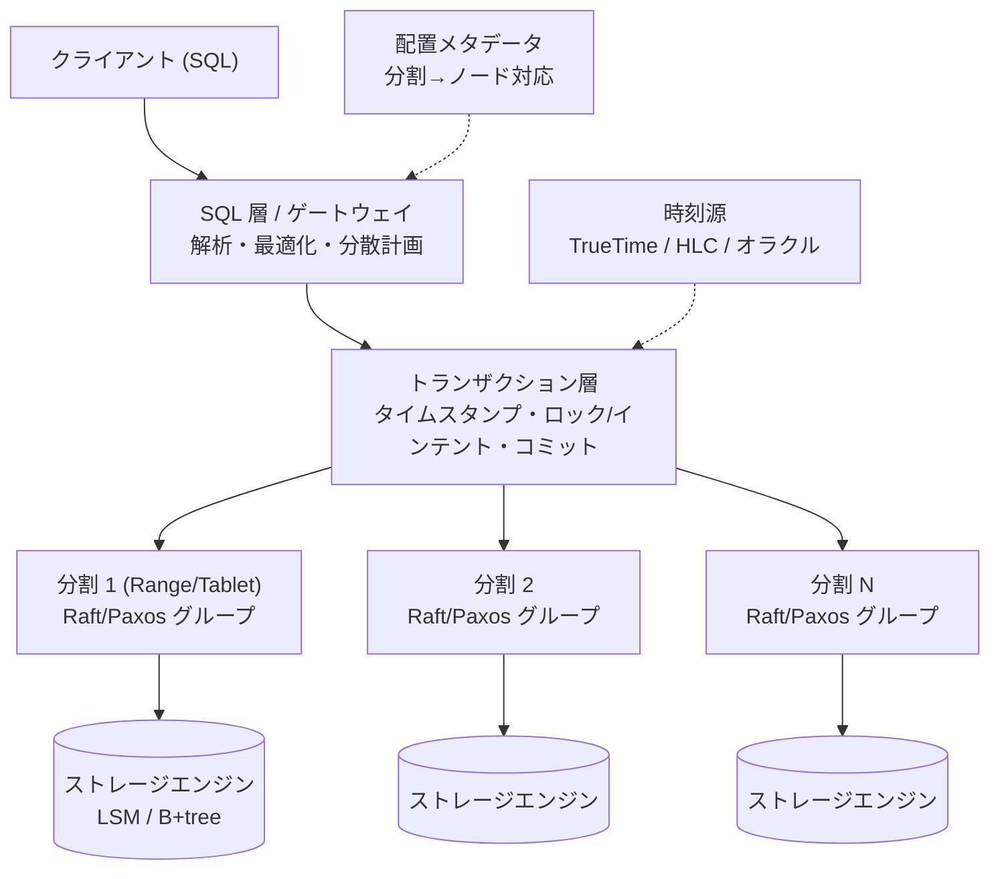
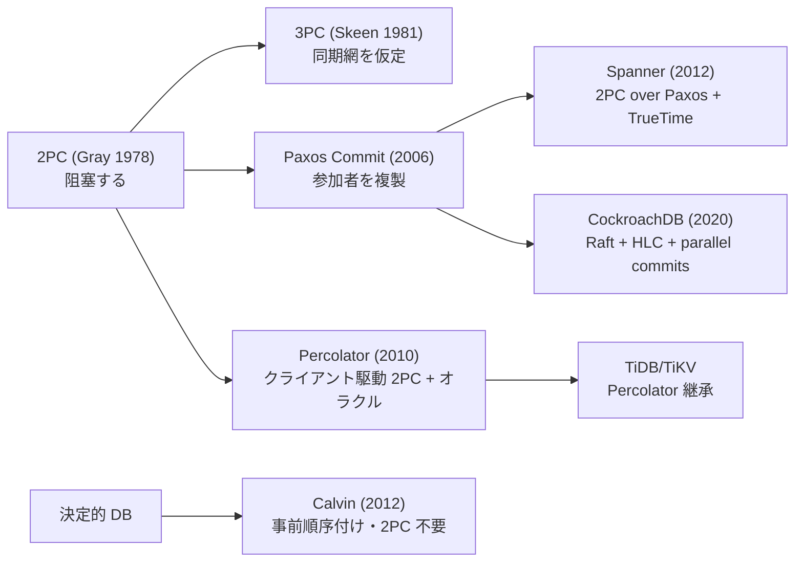
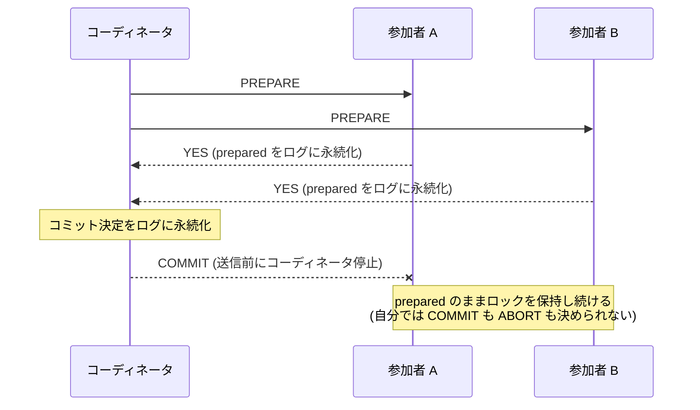

# 分散データベース (Distributed Databases)

## 概要 (Overview)

単一ノードのデータベースは、容量・書き込み帯域・可用性のいずれかで限界に当たる。分散データベース (distributed database) は、データを**分割 (partitioning / sharding)** して複数ノードに載せ、各分割を**複製 (replication)** して障害に耐える。そのうえで、単一ノードと同じ「トランザクション」と「SQL」の抽象を提供しようとする。難しいのは最後の部分である。複数の分割にまたがる書き込みを原子的に確定し (分散コミット)、並行実行を直列化可能に見せ (分散並行制御)、結合や集約をネットワーク越しに実行する (分散クエリ) 必要がある。

この層の材料は、Daedalus 内の他文書にすでにある。複製の正しさは合意 ([`../distributed-systems/consensus.md`](../distributed-systems/consensus.md))、読み手に見える保証は一貫性モデル ([`../distributed-systems/consistency-models.md`](../distributed-systems/consistency-models.md))、単一ノードの分離は [`transactions-isolation.md`](transactions-isolation.md)、時刻の不確かさは [`../../hardware/timekeeping/clocks-time-synchronization.md`](../../hardware/timekeeping/clocks-time-synchronization.md) が扱う。本ドキュメントはそれらを組み合わせて「分散 SQL データベース」を構成する設計空間を整理する。

中心テーゼは 3 つある。(1) 分散トランザクションの難しさは「**合意 (どの値か) とコミット (全員が同じ結論か) は別問題**」であることに起因し、2 相コミット (2PC) の阻塞 (blocking) は参加者を合意グループにすることで解消される。(2) 「どの順序で直列化するか」を決める手段は、中央のタイムスタンプ発行 (Percolator)、物理時計の区間 (Spanner TrueTime)、ハイブリッド論理時計と不確かさ区間 (CockroachDB)、事前の決定的順序付け (Calvin) の 4 系統に分かれ、それぞれ時計インフラとレイテンシと表現力を交換している。(3) 分割は性能の道具であると同時に、ホットスポット、全分割問い合わせ (scatter-gather)、グローバル二次索引の整合という新しい失敗モードの源である。分析深度は Level 3。

## 方法論 (Methodology)

- 分散データベースを「**分割 (どこに置くか)・複製 (何個置くか)・コミット (どう確定するか)・順序付け (どう直列化するか)・クエリ (どう計算するか)**」の 5 軸に分解し、各軸の代表方式を一次論文で押さえる。
- 実システムの参照点として、Spanner (Google)、Percolator (Google、TiDB/TiKV が継承)、Calvin (Yale)、CockroachDB、Citus (PostgreSQL 拡張)、Vitess (MySQL シャーディング)、DynamoDB を用いる。論文の記述は設計時点の値であり、ベンダー文書の現行仕様とは区別して示す。
- レイテンシは「**合意の往復回数 (consensus round trips)**」と「**時計待ち (clock wait)**」で会計する。WAN では 1 往復が数十〜百数十 ms に達するため、往復回数が設計の通貨になる ([`../cloud/multi-region-global-architecture.md`](../cloud/multi-region-global-architecture.md))。
- 失敗モードは、ノード停止・ネットワーク分断・時計ずれ・ホットスポットの 4 種に分類し、各方式がどれに弱いかを明示する。

## 発見事項 (Findings)

1. **2PC は原子性を与えるが、コーディネータ障害で参加者を阻塞させる。** prepared 状態の参加者は、コミットか中断かを自分では決められず、コーディネータの復帰を待つしかない[^gray1978][^skeen1981]。現代の分散 SQL は、各参加者 (およびコーディネータ状態) を Paxos/Raft で複製して「落ちない参加者」にすることで、この阻塞を実用上消している。Gray & Lamport の Paxos Commit はこの構成の一般形である[^gray2006]。
2. **直列化順序の決め方が、時計インフラとレイテンシの交換条件を決める。** Percolator は単一のタイムスタンプオラクル (1 台で毎秒約 200 万タイムスタンプ) に順序を集中させる[^percolator]。Spanner は GPS と原子時計で不確かさ ε を約 1〜7 ms (多くの時間 4 ms 程度) に抑え、コミット時に ε だけ待って外部一貫性 (external consistency) を得る[^spanner]。CockroachDB は専用時計なしで HLC と最大時計ずれ (既定 500 ms) の不確かさ区間を使い、待つ代わりに読み直し (restart / refresh) で対処する[^crdb-paper][^crdb-faq]。
3. **決定的データベースは 2PC そのものを不要にする。** Calvin はトランザクションの入力を先に順序付けて複製し、全レプリカが同じ順序で決定的に実行する。非決定的な中断 (ノード障害) を理由にした中断がなくなるため、コミットの合意プロトコルが要らない。代償は、読み書き集合を事前に知る必要がある (知らない場合は OLLP で偵察実行する) ことである[^calvin]。100 ノードで毎秒約 50 万件の TPC-C トランザクションを示した。
4. **コミットの往復回数は削れる。** CockroachDB の parallel commits は、トランザクション記録を STAGING 状態で書き込みと並行に複製し、「STAGING かつ全書き込みが複製済み」を暗黙のコミット条件とする。これでコミットを合意 2 往復から 1 往復にした (v19.2 で既定)[^crdb-pc]。
5. **分割キーの選択はホットスポットを決める。** 範囲分割で単調増加キー (タイムスタンプ、連番) を主キーにすると、挿入がすべて末尾の 1 分割に集中する。Spanner の公式指針は、UUIDv4、ビット反転した連番、キー列の順序入れ替え、ハッシュ接頭辞を推奨している[^spanner-schema]。ハッシュ分割は偏りを消すが、範囲走査の局所性を失う。
6. **グローバル二次索引は「別の分割キーを持つ別テーブル」であり、整合のコストは分散トランザクションと同じである。** Spanner や CockroachDB は索引更新を基表と同じトランザクションに入れる (同期・強整合)。DynamoDB の GSI は非同期伝播 (結果整合) を選ぶ[^dynamodb-atc22]。Vitess の consistent lookup vindex は 2PC を使わず、コミット順序とロックで整合を保つ[^vitess-vindex]。局所索引 (分割ごとの索引) は書き込みが安いが、分割キーを含まない検索は全分割問い合わせになる。
7. **時計は正しさの依存先になり、攻撃面にもなる。** Spanner と CockroachDB の保証は「時計ずれが宣言した上界内にある」ことを前提とする。CockroachDB は、過半のノードに対して最大ずれの 80% を超えたノードを自ら停止させる[^crdb-faq]。時計の異常や改ざんは、可用性障害か一貫性違反のどちらかとして現れる。

## アーキテクチャ (Architecture)

### 分散 SQL データベースの層構造

Spanner、CockroachDB、TiDB はこの形に収束している。各分割が独立した合意グループで ([`../distributed-systems/consensus.md`](../distributed-systems/consensus.md) の「合意はシャード内複製の部品になる」)、その上にトランザクション層が分割横断の原子性と順序を足す。ストレージエンジン ([`storage-engines.md`](storage-engines.md)) は各レプリカのローカル実装に退く。

### 分割方式

| 方式 | 配置関数 | 範囲走査 | 偏りへの強さ | 再分割 | 代表 |
|---|---|---|---|---|---|
| **範囲分割 (range)** | キーの区間 → 分割 | 局所的で速い | 単調キーで末尾に集中 | 分割 (split)・併合が自然 | Spanner、CockroachDB、TiKV、HBase/Bigtable |
| **ハッシュ分割 (hash)** | `hash(key) mod N` | 全分割問い合わせ | 一様に近い | N の変更で大移動 | Citus (既定)、多くの KV |
| **コンシステントハッシュ** | ハッシュリング上の位置[^karger1997] | 全分割問い合わせ | 仮想ノードで平準化 | 隣接区間だけ移動 | Dynamo[^dynamo]、Cassandra |
| **ディレクトリ/ルックアップ** | 明示的な対応表 | 対応表次第 | 任意に再配置可能 | 表の更新で移動 | Vitess の vindex[^vitess-vindex] |
| **共置 (co-location)** | 関連表を同じキーで分割 | — | 分割キー次第 | 一括で移動 | Citus の分散表・参照表[^citus]、Spanner の interleave |

範囲分割は「近いキーは近くに置く」ことで範囲走査と分割単位の自動 split を得るが、単調キーに弱い。ハッシュ分割は逆である。両者の中間として、Spanner の指針のようにハッシュ接頭辞を主キーの先頭に付け、論理的な分割数を固定する方法がある[^spanner-schema]。

### 分散トランザクションの系譜

## 技術詳細 (Technical Details)

### 1. 2PC と阻塞問題

2PC はコーディネータが全参加者に `PREPARE` を送り、全員が「コミット可能」と投票したら `COMMIT`、1 人でも拒否すれば `ABORT` を送る[^gray1978]。参加者は投票前にコミットに必要な情報 (redo/undo) を永続化しておく。

- **阻塞の本質**: YES を投票した参加者は、コーディネータが COMMIT を決めたかもしれないので勝手に中断できない。他の参加者が ABORT したかもしれないので勝手にコミットもできない。コーディネータの決定を知る唯一の存在が落ちると、参加者はロックを持ったまま待ち続け、そのデータに触る他のトランザクションも止まる。
- **3PC の限界**: Skeen の 3 相コミットは事前コミット相を挟んで非阻塞にするが、メッセージ遅延の上界を仮定する[^skeen1981]。非同期網での分断下では安全性を保証できず、実務では普及しなかった。合意の不可能性 (FLP) と同じ壁である ([`../distributed-systems/consensus.md`](../distributed-systems/consensus.md))。
- **Paxos Commit**: Gray & Lamport は、各参加者の投票を独立した Paxos インスタンスで複製すれば、F 個の故障に耐えて非阻塞のコミットができることを示し、2PC はその F=0 の特殊例であると位置づけた[^gray2006]。Spanner と CockroachDB の構成は実質これである。参加者 (分割) もトランザクション記録も合意グループに載っているため、単一ノードの停止は阻塞にならない。ただし過半数を失った合意グループは依然として止まる。

### 2. Percolator — 中央オラクルとクライアント駆動のコミット

Percolator は Bigtable (単一行の原子性しか持たない) の上に、複数行・複数表のスナップショット分離 (SI) トランザクションを載せた[^percolator]。

- **タイムスタンプオラクル**: 厳密に単調増加するタイムスタンプを発行する専用サーバ。バッチ化により 1 台で毎秒約 200 万個を発行する。開始時と コミット時に 1 回ずつ取得する。
- **プライマリロック**: 書き込む行の 1 つをプライマリとし、他の行 (セカンダリ) のロック列にプライマリの位置を書く。コミット点は「プライマリのロックを消し、書き込み記録 (write レコード) をコミットタイムスタンプで置く」1 行の原子操作である。セカンダリの後処理はその後に行う。
- **怠惰なロック解除**: クライアントが途中で落ちると、ロックが残る。後続のトランザクションがそのロックに出会うと、プライマリを見に行く。プライマリがコミット済みなら前進 (roll forward)、未コミットで古ければ巻き戻す。中央のロックマネージャもデッドロック検出もない代わりに、障害時のコミットが数十秒遅れうる。Percolator はレイテンシより処理量を重視するバッチ指向の設計だと明言している。
- **分離レベル**: SI なので write skew を許す ([`transactions-isolation.md`](transactions-isolation.md))。TiDB/TiKV はこのモデルを継承し、オラクルを PD (Placement Driver) が担う。

オラクルは単一点だが、合意で複製すれば可用性の問題は解ける。残る問題は**地理的な距離**である。全トランザクションがオラクルへ往復するため、大陸をまたぐ配置ではその往復がレイテンシの床になる。

### 3. Spanner — TrueTime と commit wait

Spanner は各分割 (tablet 群) を Paxos グループで複製し、分割横断のトランザクションは Paxos グループのリーダ同士で 2PC を行う[^spanner]。順序付けの核が **TrueTime** である。

- `TT.now()` は時刻を区間 `[earliest, latest]` で返し、真の時刻がその中にあることを保証する。不確かさ ε は時刻マスタ (GPS・原子時計) へのポーリング間でのこぎり波状に増減し、論文の本番環境では約 1〜7 ms、多くの時間 4 ms 程度だった[^spanner]。
- **commit wait**: コーディネータはコミットタイムスタンプ s を選んだ後、`TT.after(s)` が真になるまで (約 2ε) 結果を公開しない。これにより、あるトランザクションのコミットが別のトランザクションの開始より実時間で先なら、タイムスタンプも必ず小さくなる。これが**外部一貫性**、すなわち線形化可能性のトランザクション版である ([`../distributed-systems/consistency-models.md`](../distributed-systems/consistency-models.md))。
- **読み取り専用トランザクション**: タイムスタンプを選べば、十分に追いついた任意のレプリカでロックなしに一貫したスナップショットを読める。これが「時計に投資して通信を買い戻す」の回収部分である ([`../../hardware/timekeeping/clocks-time-synchronization.md`](../../hardware/timekeeping/clocks-time-synchronization.md) §8)。
- 書き込みは悲観的ロック (wound-wait) と 2PC を使い、レイテンシは「Paxos 往復 + 2PC 往復 + commit wait」になる。SQL 層の発展 (分散クエリ、Spanner SQL) は Bacon et al. (2017) が述べている[^spanner-sql]。

### 4. CockroachDB — HLC・不確かさ区間・parallel commits

CockroachDB は専用の時計ハードウェアを前提とせず、NTP 程度の同期で直列化可能 (SERIALIZABLE) を既定として提供する[^crdb-paper]。

- **HLC と不確かさ区間**: タイムスタンプはハイブリッド論理時計 (HLC)[^hlc] で振る。読み取りが自分のタイムスタンプより後だが `max_offset` (既定 500 ms) 以内の値に出会うと、それが実時間で前か後か判別できない。その場合はタイムスタンプを進めて読み直す。Spanner が**全コミットで待つ**ε を、CockroachDB は**曖昧な値に出会った読みだけが払う**形に変えた。そのぶん、保証は直列化可能性と単一キーの線形化可能性までで、キーをまたぐ外部一貫性 (strict serializability) は保証しない[^crdb-paper][^crdb-faq]。
- **書き込みインテントとトランザクション記録**: 書き込みは仮の値と排他ロックを兼ねる「インテント (write intent)」として置かれ、トランザクション記録 (PENDING / STAGING / COMMITTED / ABORTED) を指す[^crdb-txn]。
- **read refresh**: タイムスタンプを進めざるを得なくなった SERIALIZABLE トランザクションは、それまでに読んだ範囲に新しい書き込みがないかを検証する。なければ再開せずにタイムスタンプを進められる[^crdb-txn]。
- **parallel commits**: 素朴には「全インテントの複製完了 (1 往復) → 記録を COMMITTED に (もう 1 往復)」で 2 往復かかる。parallel commits は記録を STAGING として in-flight 書き込みの一覧とともに並行して書き、全書き込みが複製されたことを確認した時点でクライアントに返す。記録が STAGING のままコーディネータが落ちても、他者が一覧の各書き込みの成否を確認する**状態回復 (status recovery)** で、COMMITTED か ABORTED かを決められる。欠けた書き込みがあれば、それが今後成功しないようにしてから中断を確定する[^crdb-pc]。
- **時計ずれの安全装置**: 過半の他ノードに対して最大ずれの 80% を超えたノードは自ら停止する[^crdb-faq]。上界の前提が破れる前にノードを外すことで、一貫性違反を可用性の低下に変換している。

### 5. Calvin — 決定的順序付け

Calvin は「合意をトランザクションの**結果**ではなく**入力**に対して行う」設計である[^calvin]。

- **シーケンサ層**: 受け付けたトランザクション要求を 10 ms のエポックごとにまとめ、Paxos (実装は ZooKeeper) または非同期複製でレプリカ間に複製する。この時点で大域的な順序が確定する。
- **決定的スケジューラ**: 各ノードは確定した順序どおりにロックを取得し、決定的に実行する。全レプリカが同じ入力列を同じ順序で実行するため、同じ結果になる。ノード障害で中断する必要がなく (別レプリカが同じ結果を持つ)、残る中断はアプリケーション論理による決定的なものだけになる。そのため、分割横断でも 2PC の投票が要らない。
- **代償**: ロックを事前に取るため、読み書き集合を実行前に知る必要がある。二次索引を引いてから書く行が決まるようなトランザクションには、OLLP (偵察実行で集合を予測し、外れたら再実行) を使う。対話型トランザクションとは相性が悪い。100 ノードで毎秒約 50 万件の TPC-C を示した[^calvin]。

### 6. 方式の比較

| 方式 | 順序付け | コミットの往復 | 時計の要求 | 分離レベル | 主な弱点 |
|---|---|---|---|---|---|
| 2PC (素朴) | ロック | 2 往復 + ログ | なし | 2PL なら直列化可能 | コーディネータ障害で阻塞 |
| Percolator | 中央オラクル | オラクル 2 回 + 2PC | なし (オラクルが論理時計) | SI | オラクルへの WAN 往復、障害時の遅延 |
| Spanner | TrueTime | Paxos + 2PC + commit wait | GPS/原子時計、ε 数 ms | 外部一貫性 | 専用時計インフラ、書き込みレイテンシ |
| CockroachDB | HLC + 不確かさ区間 | 合意 1 往復 (parallel commits) | NTP 程度、ずれ ≤ max_offset | SERIALIZABLE (既定) | 読み直し・リトライ、時計ずれで停止 |
| Calvin | 事前の入力順序 | 入力の合意のみ | なし | 直列化可能 | 読み書き集合の事前知識、対話型不可 |
| DynamoDB | タイムスタンプ順序 | ワンショット 2PC | 内部時計 | 直列化可能 (トランザクション API 内) | 対話型不可・項目数の上限[^dynamodb-atc23] |

### 7. 分散クエリ実行

[`query-execution-optimization.md`](query-execution-optimization.md) の演算子と最適化は、分散環境で「どのデータをどこへ動かすか」という軸を加える。

- **プッシュダウン**: 選択・射影・部分集約を各分割で実行し、ゲートウェイへ送る量を減らす。`SUM`/`COUNT` は各分割の部分和を足し合わせればよい。`AVG` は (和, 個数) に分解する。`COUNT(DISTINCT)` は分解できないため、再分配するか近似 (HyperLogLog) を使う。
- **結合の配置戦略**:

| 戦略 | 仕組み | 適する場面 |
|---|---|---|
| **共置結合 (co-located)** | 両表が結合キーで同じように分割済み。各分割内で局所結合 | 分割キー = 結合キー (例: テナント ID)。Citus の設計の中心[^citus] |
| **broadcast 結合** | 小さい側を全ノードへ複製 | 次元表が小さい。Citus の参照表 (reference table) はこれを常設したもの |
| **再分配結合 (shuffle / repartition)** | 両側を結合キーでハッシュ再分配 | 両側が大きく共置されていない。ネットワーク転送が支配的 |
| **lookup 結合** | 片側の各行で他方の分割へ点検索 | 外側が小さく内側に索引がある (分散版 index nested loop) |

- **全分割問い合わせとテールレイテンシ**: 分割キーを含まないクエリは全分割へ散布され、最も遅い分割を待つ。各分割の応答時間の 99 パーセンタイルが 1% の確率で遅いとき、100 分割へ散布すると、少なくとも 1 つが遅い確率は 1 − 0.99¹⁰⁰ ≈ 63% になる。テールは分割数とともに支配的になる[^tail]。ヘッジ要求 (hedged request) や、分割キーを含むクエリ設計で緩和する。
- **推定はさらに難しくなる**: 分散最適化器はネットワーク転送量をコストに含めるが、その入力はやはりカーディナリティ推定であり、単一ノードと同じ失敗モードを持つ。Spark AQE のようにシャッフル境界で再最適化する方式は、この問題への応答である。

### 8. グローバル二次索引 (Global Secondary Index)

| 方式 | 更新の整合 | 書き込みコスト | 分割キー以外での検索 | 代表 |
|---|---|---|---|---|
| **局所索引 (local / co-partitioned)** | 基表と同じ分割内で原子的 | 安い (分割内) | 全分割問い合わせ | Citus の分割ごとの索引、Cassandra の二次索引 |
| **グローバル索引 (同期)** | 基表と同一トランザクション | 分散トランザクション 1 回 | 索引の分割 1 つに点検索 | Spanner、CockroachDB |
| **グローバル索引 (非同期)** | 結果整合 (伝播遅延あり) | 基表の書き込みは単一分割 | 速いが古い値を返しうる | DynamoDB GSI[^dynamodb-atc22] |
| **ルックアップ表** | ロック順序による整合 (2PC なし) | 複数セッションのコミット | 対応表経由で対象分割へ | Vitess の consistent lookup vindex[^vitess-vindex] |

グローバル索引は、索引キーで分割された**もう 1 つのテーブル**である。したがって、同期更新なら索引付き書き込みはすべて分割横断トランザクションになり、非同期更新なら索引からの読み取りは結果整合になる。DynamoDB GSI の伝播は基表の変更ログ配送であり、詰まれば基表への逆圧として現れる ([`../cloud/cloud-databases-aurora-dynamodb.md`](../cloud/cloud-databases-aurora-dynamodb.md) §4)。また、単調増加する列に張ったグローバル索引は、基表がハッシュ分割でも索引側にホットスポットを作る。Spanner の指針はこれを明示的に戒めている[^spanner-schema]。

### 9. 失敗モード

| 失敗 | 現れ方 | 影響を受ける方式 | 緩和 |
|---|---|---|---|
| **コーディネータ停止** | prepared 参加者がロックを保持したまま停止 | 素朴な 2PC | コーディネータ状態の合意複製 (Paxos Commit)、状態回復 |
| **合意グループの過半喪失** | その分割が読み書き不能 | 全方式 | 配置の多様化 (AZ/リージョン分散)、レプリカ数 5 |
| **ネットワーク分断** | 少数派側は書けない (CP)。結果整合系は両側で書いて後で競合 | CP 系は可用性、AP 系は整合性 | 分断時の振る舞いを PACELC で明示 |
| **時計ずれ** | 上界超過で一貫性違反、または自己停止 | Spanner、CockroachDB | 時計監視、最大ずれの保守的設定 |
| **ホットスポット** | 単一分割の CPU/IO 飽和、レイテンシ悪化 | 範囲分割 + 単調キー、偏ったテナント | キー設計、負荷ベース split、テナント分離 |
| **再分割中の異常** | 移動中の分割で二重書き込み・読み落とし | 全方式 | 移動をトランザクションとして扱う、リース移譲 |
| **リトライ嵐** | 競合で中断 → 再試行が競合をさらに悪化 | 楽観的方式 (SSI、CockroachDB) | 指数バックオフ、ホットキーの設計変更 |

Jepsen の故障注入解析は、分散データベースの宣伝された保証と、分断・時計ずれ下の実際の挙動の差を繰り返し示してきた[^jepsen]。保証は「どの故障モデルの下で」と組で読む必要がある。

## セキュリティ考察 (Security Considerations)

- **時計は信頼の根である**: Spanner/CockroachDB 型の正しさは、時計ずれの上界に依存する。NTP の偽装や GNSS スプーフィングで時計を進めれば、不確かさ区間の前提が崩れて一貫性違反が起き、自己停止を誘発すればサービス拒否になる ([`../../hardware/timekeeping/clocks-time-synchronization.md`](../../hardware/timekeeping/clocks-time-synchronization.md) のセキュリティ考察)。時刻源の認証 (NTS)、複数ソースの照合、ずれの監視を、データベースの安全性要件として扱う。
- **ホットスポットの意図的誘発**: 分割キーを外部入力から推測できる場合、攻撃者は特定の分割に負荷を集中させ、その分割に同居する他テナントを巻き込める (ノイジーネイバー)。ハッシュ分割の鍵付きハッシュ、テナント単位のレート制限、負荷ベースの分割が対策になる。
- **全分割問い合わせの増幅**: 分割キーを含まない検索条件を外部から指定できると、1 リクエストが全分割への散布に増幅される。API 層で分割キーを必須にするか、散布クエリにコストの上限を設ける。
- **結果整合の索引は認可バイパスを生む**: 非同期 GSI や古いレプリカを認可判定 (権限・失効) に使うと、取り消したはずの権限が伝播遅延のあいだ有効に見える ([`../distributed-systems/consistency-models.md`](../distributed-systems/consistency-models.md) の stale read)。認可と残高は強整合の経路から読む。
- **分割境界とテナント分離**: テナント ID で分割する設計 (Citus の典型) は性能上合理的だが、分割キーの欠落したクエリやルーティングの誤りが、他テナントのデータ混入に直結する。行レベルセキュリティ (RLS) を分割ルーティングと独立に重ねて多層防御にする。
- **トランザクションの中断はアプリの責務**: 楽観的な分散トランザクションはリトライを正常系に含む。冪等キーなしのリトライは二重実行 (二重送金) を生む ([`transactions-isolation.md`](transactions-isolation.md) の TOCTOU)。

## 結論 (Conclusions)

分散データベースは、分割・複製・コミット・順序付け・クエリという 5 つの軸の組み合わせとして理解できる。複製の正しさは合意が解決済みであり、現代の分散 SQL の本体は「合意グループの上でどう分割横断の原子性と順序を作るか」にある。2PC の阻塞は参加者を合意グループにすることで消え、残る設計判断は**直列化順序をどこで決めるか**に集約される。中央オラクル (Percolator) は単純だが距離に弱い。物理時計の区間 (Spanner) は時計インフラに投資して commit wait を数 ms に抑える。HLC と不確かさ区間 (CockroachDB) は普通の時計で済むが、読み直しとリトライを払う。事前順序付け (Calvin) は 2PC 自体を消すが、事前に読み書き集合を知る必要がある。どれも「時計・レイテンシ・表現力」のどれかを差し出している。

分割は性能を生むと同時に、ホットスポット、全分割問い合わせのテールレイテンシ、グローバル索引の整合という固有の失敗モードを生む。グローバル索引は「もう 1 つの分割されたテーブル」であり、同期なら分散トランザクションを払い、非同期なら結果整合を受け入れる。この選択から逃れる方法はない。そして時計とキー設計は、性能パラメータであると同時に正しさとセキュリティの依存先である。

### 次の接続先 (Related Topics)

- [`../distributed-systems/consensus.md`](../distributed-systems/consensus.md) — 各分割を複製する Paxos/Raft。本書の「落ちない参加者」の部品。
- [`../distributed-systems/consistency-models.md`](../distributed-systems/consistency-models.md) — 線形化可能性・外部一貫性・HLC・PACELC。本書の保証を記述する語彙。
- [`transactions-isolation.md`](transactions-isolation.md) — 単一ノードの分離レベル。SI/SSI は分散でもそのまま現れる (Percolator は SI)。
- [`query-execution-optimization.md`](query-execution-optimization.md) — 分散クエリの基礎となる演算子・最適化・適応実行。
- [`../cloud/cloud-databases-aurora-dynamodb.md`](../cloud/cloud-databases-aurora-dynamodb.md) — マネージドな分割・複製の実例。DynamoDB の GSI とワンショットトランザクション。
- [`../cloud/multi-region-global-architecture.md`](../cloud/multi-region-global-architecture.md) — リージョン間 RTT が合意の往復コストを決める物理的背景。
- [`../../hardware/timekeeping/clocks-time-synchronization.md`](../../hardware/timekeeping/clocks-time-synchronization.md) — TrueTime を支える GNSS・原子時計・PTP と、不確かさを区間として運ぶ設計。

## 参考文献 (References)

**一次資料 (Primary — 論文)**

[^gray1978]: Gray, J. N. (1978). Notes on Data Base Operating Systems. In *Operating Systems: An Advanced Course*, LNCS 60, 393–481. Springer. DOI: 10.1007/3-540-08755-9_9 — 2PC の古典的記述。

[^skeen1981]: Skeen, D. (1981). Nonblocking Commit Protocols. *Proc. SIGMOD '81*. DOI: 10.1145/582318.582339 — 3PC と非阻塞性の条件。

[^gray2006]: Gray, J., & Lamport, L. (2006). Consensus on Transaction Commit. *ACM TODS*, 31(1), 133–160. DOI: 10.1145/1132863.1132867 — Paxos Commit。2PC をその特殊例として位置づける。

[^percolator]: Peng, D., & Dabek, F. (2010). Large-scale Incremental Processing Using Distributed Transactions and Notifications. *Proc. OSDI '10*, 251–264. USENIX. — [usenix.org](https://www.usenix.org/conference/osdi10/large-scale-incremental-processing-using-distributed-transactions-and) — Accessed: 2026-10-04。タイムスタンプオラクル (毎秒約 200 万)、プライマリロック、怠惰なロック解除。

[^spanner]: Corbett, J. C., Dean, J., et al. (2013). Spanner: Google's Globally Distributed Database. *ACM TOCS*, 31(3), Article 8. DOI: 10.1145/2491245 (初出: OSDI '12) — TrueTime (ε 約 1〜7 ms、多くの時間 4 ms)、commit wait、外部一貫性。

[^spanner-sql]: Bacon, D. F., Bales, N., Bruno, N., et al. (2017). Spanner: Becoming a SQL System. *Proc. SIGMOD '17*, 331–343. DOI: 10.1145/3035918.3056103 — 分散クエリ処理と SQL 層。

[^calvin]: Thomson, A., Diamond, T., Weng, S.-C., Ren, K., Shao, P., & Abadi, D. J. (2012). Calvin: Fast Distributed Transactions for Partitioned Database Systems. *Proc. SIGMOD '12*, 1–12. DOI: 10.1145/2213836.2213838 — 決定的実行、10 ms エポック、OLLP、100 ノードで約 50 万 TPC-C tx/s。

[^crdb-paper]: Taft, R., Sharif, I., Matei, A., VanBenschoten, N., Lewis, J., et al. (2020). CockroachDB: The Resilient Geo-Distributed SQL Database. *Proc. SIGMOD '20*, 1493–1509. DOI: 10.1145/3318464.3386134 — HLC と不確かさ区間、SERIALIZABLE の実装。

[^hlc]: Kulkarni, S. S., Demirbas, M., Madappa, D., Avva, B., & Leone, M. (2014). Logical Physical Clocks. *Proc. OPODIS 2014*, LNCS 8878, 17–32. DOI: 10.1007/978-3-319-14472-6_2 — HLC の原典。

[^karger1997]: Karger, D., Lehman, E., Leighton, T., Panigrahy, R., Levine, M., & Lewin, D. (1997). Consistent Hashing and Random Trees. *Proc. STOC '97*, 654–663. DOI: 10.1145/258533.258660 — コンシステントハッシュの原典。

[^dynamo]: DeCandia, G., Hastorun, D., Jampani, M., et al. (2007). Dynamo: Amazon's Highly Available Key-value Store. *Proc. SOSP '07*, 205–220. DOI: 10.1145/1294261.1294281 — 仮想ノードとリーダーレス複製。

[^citus]: Cubukcu, U., Erdogan, O., Pathak, S., Sannakkayala, S., & Slot, M. (2021). Citus: Distributed PostgreSQL for Data-Intensive Applications. *Proc. SIGMOD '21*, 2490–2502. DOI: 10.1145/3448016.3457551 — 分散表・参照表・共置結合。

[^dynamodb-atc22]: Elhemali, M., Gallagher, N., Gordon, N., et al. (2022). Amazon DynamoDB: A Scalable, Predictably Performant, and Fully Managed NoSQL Database Service. *Proc. USENIX ATC '22*. — 分割・複製・GSI の設計。

[^dynamodb-atc23]: Idziorek, J., Keyes, A., Lazier, C., et al. (2023). Distributed Transactions at Scale in Amazon DynamoDB. *Proc. USENIX ATC '23*. — ワンショット 2PC とタイムスタンプ順序付け。

[^tail]: Dean, J., & Barroso, L. A. (2013). The Tail at Scale. *Communications of the ACM*, 56(2), 74–80. DOI: 10.1145/2408776.2408794 — 散布要求のテールレイテンシとヘッジ要求。

**一次資料 (Vendor — 公式ドキュメント・技術ブログ)**

[^crdb-pc]: VanBenschoten, N. (2019-11-07). *Parallel Commits: An atomic commit protocol for globally distributed transactions*. Cockroach Labs. — [cockroachlabs.com](https://www.cockroachlabs.com/blog/parallel-commits/) — Accessed: 2026-10-04。STAGING 状態、合意 2 往復 → 1 往復、v19.2 で既定。

[^crdb-txn]: Cockroach Labs, *Transaction Layer* (CockroachDB architecture docs)。 — [docs.cockroachlabs.com](https://docs.cockroachlabs.com/docs/stable/architecture/transaction-layer) — Accessed: 2026-10-04。インテント、トランザクション記録の状態、read refresh、pipelining。

[^crdb-faq]: Cockroach Labs, *Operational FAQs* (時計同期)。 — [docs.cockroachlabs.com](https://docs.cockroachlabs.com/docs/stable/operational-faqs) — Accessed: 2026-10-04。既定の最大ずれ 500 ms、80% 超過での自己停止。

[^spanner-schema]: Google Cloud, *Spanner schema design best practices*. — [docs.cloud.google.com](https://docs.cloud.google.com/spanner/docs/schema-design) — Accessed: 2026-10-04。単調キーのホットスポットと対策 (UUIDv4、ビット反転連番、ハッシュ接頭辞)、索引のホットスポット。

[^vitess-vindex]: Vitess Documentation, *Vindexes*. — [vitess.io](https://vitess.io/docs/reference/features/vindexes/) — Accessed: 2026-10-04。primary / lookup vindex、2PC なしの consistent lookup、散布クエリ。

**二次資料 (Secondary — 独立検証)**

[^jepsen]: Jepsen — 分散システムの故障注入による安全性解析。 — [jepsen.io/analyses](https://jepsen.io/analyses) — Accessed: 2026-10-04。
