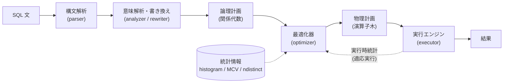
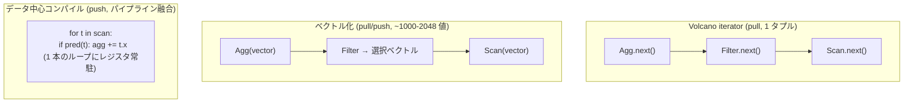

# クエリ実行と最適化 (Query Execution & Optimization)

## 概要 (Overview)

SQL は「何が欲しいか」だけを書く宣言的言語 (declarative language) であり、「どう計算するか」はデータベースが決める。この「どう」を決めて実行する層が**クエリ処理系 (query processor)** で、構文解析 (parsing)、論理計画 (logical plan) への変換、**コストベース最適化 (cost-based optimization)** による物理計画 (physical plan) の選択、実行エンジン (execution engine) による評価の 4 段からなる。[`storage-engines.md`](storage-engines.md) がページとインデックスを、[`transactions-isolation.md`](transactions-isolation.md) が並行実行の正しさを扱ったのに対し、本ドキュメントはその上で「同じ答えを、桁違いに速く、または遅く計算する」自由度を扱う。

この自由度は大きい。結合順序 (join order) の選び方だけで、同じクエリの実行時間が数桁変わる[^leis2015]。最適化器はその選択を**カーディナリティ推定 (cardinality estimation)**、すなわち中間結果の行数の予測に頼るが、この推定は結合を重ねるたびに誤差が指数的に膨らむ。クエリ処理系の歴史は、(1) 探索空間を賢く探す (System R → Volcano/Cascades)、(2) 推定の誤りに耐える (頑健な演算子・適応実行)、(3) CPU とメモリ階層を使い切る (ベクトル化・コンパイル・morsel 並列) という 3 本の系譜として読める。

本ドキュメントは、最適化器の構造と失敗モード、結合アルゴリズムとメモリ溢れ (spilling)、3 つの実行モデル (Volcano iterator / ベクトル化 / コンパイル)、多コア並列、適応実行を、PostgreSQL と DuckDB の実装を参照点として Level 3 で整理する。

## 方法論 (Methodology)

- クエリ処理を「**計画空間 (plan space)・コストモデル (cost model)・カーディナリティ推定・探索戦略 (enumeration)**」の 4 要素に分解し、各要素がどの程度計画品質を決めるかを、実測研究 (Leis et al. 2015 の Join Order Benchmark) に基づいて評価する。
- 実行モデルは「1 タプルあたり何命令・何回の関数呼び出し・何回のキャッシュミスを払うか」という CPU 効率の会計で比較する。根拠は MonetDB/X100 の命令レベル分析[^x100]と、同一基盤上で両モデルを実装して比べた Kersten et al. (2018)[^kersten2018] である。
- 実装の参照点は 2 つ選んだ。行指向・Volcano 型の代表として PostgreSQL (タグ `REL_17_0` のソース)[^pg-src]、列指向・ベクトル化型の代表として DuckDB (タグ `v1.4.0`)[^duckdb-src][^duckdb] である。コードを引用する場合はファイルパスと行番号を示す。
- 数値 (コスト定数・ベクトル長・スピードアップ) は実装やハードウェアに依存する。規範値 (既定値) と論文の実測値を区別して示す。

## 発見事項 (Findings)

1. **計画品質を決めるのはコストモデルよりカーディナリティ推定である。** JOB (IMDB データ・113 クエリ) の実測では、真の行数を注入するとほぼすべてのクエリが速くなり、単純なコストモデルでも十分だった。コストモデル誤差の影響は推定誤差に比べて小さい[^leis2015]。
2. **推定誤差は結合数とともに指数的に増え、系統的に過小評価へ偏る。** PostgreSQL では 10 倍以上外れる推定が、1 結合で 16%、2 結合で 32%、3 結合で 52% に達した。最良の商用系 (DBMS A) でも 15%・25%・36% にとどまる。原因は一様性・独立性・包含原理という単純化仮定で、相関のある実データでは崩れる[^leis2015]。誤差伝播が指数的であることは Ioannidis & Christodoulakis (1991) が理論的に示していた[^ioannidis1991]。
3. **「純粋にコストベース」の選択は危険である。** JOB でタイムアウトしたクエリの多くは、過小推定を信じた PostgreSQL がインデックスなしの nested loop join を選んだ結果だった。この演算子を禁止するとタイムアウトは消え、遅くなったクエリもなかった。最適化器は推定の期待値だけでなく、外れたときの漸近計算量 (O(n²) 対 O(n)) をリスクとして扱うべきだ[^leis2015]。
4. **Volcano iterator の主要コストは「仕事」ではなく「解釈」である。** MySQL で TPC-H Q1 を実行すると、算術と集約は全体の 10% 未満で、IPC は約 0.7、加算 1 回に約 49 サイクルを要した[^x100]。タプルごとの仮想呼び出しがループのパイプライン化を阻むためである。
5. **ベクトル化とコンパイルは「どちらも速いが得意が違う」。** 両者を同一基盤に実装した比較では、性能はかなり近い。コンパイル (Typer) は計算中心でキャッシュミスの少ないクエリに強く、ベクトル化 (Tectorwise) はハッシュ結合のようにキャッシュミスの遅延を隠す必要がある場面に強い[^kersten2018]。OLTP の 1 行クエリではベクトル化は Volcano に対する利得が小さく、コンパイルが有利になる。
6. **並列化の単位は「計画」ではなく「データ断片 (morsel)」に移った。** 約 10 万タプルの morsel を実行時にスレッドへ配る方式は、NUMA 局所性・負荷均衡・弾力性 (elasticity) を同時に満たし、32 コアで平均 30 倍超のスピードアップを示した[^morsel]。DuckDB もこの方式を採用している[^duckdb-why]。
7. **最適化器は情報フローを並べ替える装置でもあり、セキュリティ境界を壊しうる。** 安価な関数を先に評価する述語プッシュダウンは、行レベルの可視性フィルタより前にユーザ関数へ行を渡し、隠れた行を漏らす。PostgreSQL は `security_barrier` ビューと `LEAKPROOF` 関数で、この最適化の自由を意図的に制限している[^pg-secbarrier]。

## アーキテクチャ (Architecture)

### クエリ処理のパイプライン



- **構文解析・意味解析**: SQL を構文木にし、名前解決・型検査・ビュー展開を行って関係代数の論理計画 (σ 選択・π 射影・⋈ 結合・γ 集約) に落とす。
- **論理最適化 (書き換え)**: 等価変換で計画を整える。述語プッシュダウン、副問い合わせの平坦化 (unnesting)、外部結合の内部結合化などで、統計に依存しない「ほぼ常に得」な変換である。
- **物理最適化**: 結合順序・結合アルゴリズム・アクセスパス (シーケンシャル/インデックス走査) を、統計に基づくコストで選ぶ。ここがコストベース最適化の本体である。
- **実行**: 物理計画の演算子木を評価する。演算子間でデータをどう受け渡すか (タプル単位の pull、ベクトル単位、融合されたコード) が実行モデルである。

### 最適化器の系譜

| 系譜 | 探索戦略 | 計画空間 | 代表実装 |
|---|---|---|---|
| **System R** (Selinger 1979)[^selinger1979] | ボトムアップ動的計画法 (DP)、「興味ある順序 (interesting order)」を保持 | 左深木 (left-deep)、直積は後回し | PostgreSQL (DP + 遺伝的最適化 GEQO)、DB2 |
| **Volcano** (Graefe & McKenna 1993)[^volcano-opt] | 規則ベースの変換 + トップダウン探索、物理プロパティ (順序など) を要求として伝播 | 規則で生成できる全空間 | 研究系・Cascades の前身 |
| **Cascades** (Graefe 1995)[^cascades] | メモ (memo) 上で等価クラスを共有するトップダウン探索、上界による枝刈り | 規則で定義される全空間 (bushy 木を含む) | SQL Server、CockroachDB (Optgen)、Apache Calcite 系 |
| **DPhyp** (Moerkotte & Neumann 2008)[^dphyp] | 結合ハイパーグラフ上の連結部分グラフのみを列挙する DP | bushy 木・非内部結合を含む | DuckDB[^duckdb-why]、MySQL ハイパーグラフ最適化器 |

System R の貢献は 3 つある。コスト = I/O + 重み × CPU という式の定式化、選択率 (selectivity) の推定規則 (統計がなければ固定の既定値)、そして「部分計画の最適解を組み合わせれば全体の最適解になる」という最適性原理による DP である。ただし後で使える並び順を持つ部分計画は、その順序ごとに別枠で保持する。これが「興味ある順序」の考え方で、sort-merge join や `ORDER BY` が後段の整列を不要にする効果をコストに反映できる。Cascades 系はこれを「物理プロパティの要求」として一般化し、規則を足すだけで最適化器を拡張できる構造にした。

## 技術詳細 (Technical Details)

### 1. コストモデル — PostgreSQL の既定値

PostgreSQL のコストは「シーケンシャルページ読み 1 回 = 1.0」を単位とする相対値である。以下は C の定義で、コスト計算 (`src/backend/optimizer/path/costsize.c`) が参照する GUC 変数の既定値を与える。

`src/include/optimizer/cost.h` lines 24-30 (PostgreSQL `REL_17_0`)、C、コスト単位の既定値:

```c
#define DEFAULT_SEQ_PAGE_COST  1.0
#define DEFAULT_RANDOM_PAGE_COST  4.0
#define DEFAULT_CPU_TUPLE_COST	0.01
#define DEFAULT_CPU_INDEX_TUPLE_COST 0.005
#define DEFAULT_CPU_OPERATOR_COST  0.0025
#define DEFAULT_PARALLEL_TUPLE_COST 0.1
#define DEFAULT_PARALLEL_SETUP_COST  1000.0
```

`random_page_cost = 4.0` は回転ディスク時代の「ランダムはシーケンシャルの数倍遅い (ただしキャッシュが効く)」という前提を符号化している。SSD では比が縮むため 1.1〜2 程度へ下げる運用が多い。これは [`storage-engines.md`](storage-engines.md) が扱ったハードウェアの非対称性を、最適化器が 1 個のパラメータとして持っていることを意味する。前提とハードウェアがずれると、インデックス走査とシーケンシャル走査の選択が系統的に偏る。

### 2. カーディナリティ推定と失敗モード

推定は、単一列の統計 (ヒストグラム、最頻値リスト MCV、異なり値数 ndistinct) から述語ごとの選択率を求め、それらを掛け合わせて組み立てる。統計がない、または式が複雑で使えない場合は固定の既定値に落ちる。

`src/include/utils/selfuncs.h` lines 33-52 (PostgreSQL `REL_17_0`)、C、統計がない場合の既定選択率 (抜粋):

```c
/* default selectivity estimate for equalities such as "A = b" */
#define DEFAULT_EQ_SEL	0.005

/* default selectivity estimate for inequalities such as "A < b" */
#define DEFAULT_INEQ_SEL  0.3333333333333333

/* default selectivity estimate for range inequalities "A > b AND A < c" */
#define DEFAULT_RANGE_INEQ_SEL	0.005
...
/* default number of distinct values in a table */
#define DEFAULT_NUM_DISTINCT  200
```

失敗モードは次のように分類できる。

| 失敗モード | 原因となる仮定 | 典型例 | 緩和策 |
|---|---|---|---|
| **相関 (correlation)** | 述語間の独立性: `sel(A∧B) = sel(A)·sel(B)` | `city='東京' AND zip='100-0001'` を過小評価する | 拡張統計 (`CREATE STATISTICS`: 関数従属・多変量 MCV・ndistinct)[^pg-stats] |
| **結合跨ぎ相関** | 結合後の分布が結合前と同じ | 「パリ生まれの俳優はフランス映画に出やすい」[^leis2015] | 単一表統計では原理的に表現できない。サンプリング・適応実行で補う |
| **偏り (skew)** | 値の一様分布 | 少数の巨大顧客が行の大半を持つ | MCV・ヒストグラム。ただし結合を経ると失われる |
| **既定値への転落** | 統計なし・関数適用・パラメータ化 | `WHERE lower(email) = $1` | 式インデックスの統計、汎用計画 (generic plan) の監視 |
| **陳腐化** | 統計が現状を表す | 大量ロード直後に `ANALYZE` 前のまま走る | 自動 ANALYZE の閾値調整 |

独立性仮定は相関データで**過小評価**を生む。過小評価は小さな中間結果を前提とする計画 (インデックスなし nested loop、小さく確保したハッシュ表) を選ばせ、外れたときの損失は二次的に膨らむ。これが発見事項 2・3 の機構である。過大評価の損失は「過剰に頑健な計画を選んだ」程度で済むことが多く、損失関数は非対称である。

### 3. 結合順序の探索

n 表の結合順序は、左深木だけで n! 通り、bushy 木を含めると (2(n−1))!/(n−1)! 通りある。DP は部分集合ごとに最良計画を記録して O(3ⁿ) 程度まで縮めるが、それでも指数的である。PostgreSQL は FROM 項目数が `geqo_threshold` (既定 12) 未満ならほぼ網羅的な探索を行い、それ以上なら遺伝的アルゴリズム (GEQO) のヒューリスティックへ切り替える[^pg-planner]。明示的な `JOIN` 構文をどこまで平坦化して並べ替え対象にするかは `join_collapse_limit` (既定 8) が制限する (`src/backend/utils/misc/guc_tables.c` の GUC 定義)。

JOB の結果は、網羅的な探索 (bushy 木を含む) がヒューリスティックより計画を改善することを示した。ただしそれは推定がある程度正しい場合に限られる[^leis2015]。探索空間を広げることと推定を正すことは補完関係にあり、推定が壊れていれば最適な探索は「誤った問題の最適解」を返す。

### 4. 結合アルゴリズム

整列系・ハッシュ系アルゴリズムの体系は Graefe (1993) のサーベイが標準的な整理である[^graefe1993]。

| アルゴリズム | 計算量 (R ⋈ S) | 必要条件 | 強み | 弱み・失敗モード |
|---|---|---|---|---|
| **単純 nested loop** | O(\|R\|·\|S\|) | なし (任意の述語) | 非等価結合も扱える。外側が数行なら最速 | 外側の過小評価で二次的に爆発する[^leis2015] |
| **index nested loop** | O(\|R\| · log\|S\|) | 内側の結合キーにインデックス | 外側が小さい OLTP 結合で最強。早期に先頭行を返せる | 外側が大きいとランダム I/O が嵩む |
| **sort-merge** | O(\|R\|log\|R\| + \|S\|log\|S\|) (整列済みなら線形) | 等価・範囲結合、整列可能な型 | 整列済み入力 (インデックス順) なら最速。出力が整列済み | 整列のコスト。重複キーが多いと巻き戻しが要る |
| **hash join** | O(\|R\| + \|S\|) | 等価結合 | 大きな未整列入力に最適。中間結果向き | 構築側 (build) がメモリに載らないと溢れる |

ハッシュ結合は小さい側を構築側にしてハッシュ表を作り、大きい側 (probe) を流して照合する。構築側がメモリ (PostgreSQL では `work_mem` × `hash_mem_multiplier`、既定 4MB × 2.0[^pg-resource]) を超える場合の手法が系譜をなす。

- **GRACE hash join** (Kitsuregawa et al. 1983)[^grace] — 両入力を同じハッシュ関数で k 個のパーティションに分けてディスクへ書き、パーティション対ごとに結合する。同じキーは必ず同じ対に入るため正しい。I/O は入力の約 3 倍 (読み・書き・再読み) になる。
- **hybrid hash join** (DeWitt et al. 1984; Shapiro 1986)[^dewitt1984][^shapiro1986] — 第 1 パーティションはメモリに残したまま即座に結合し、残りだけを溢れさせる。構築側がメモリをわずかに超える場合、I/O が GRACE よりずっと少ない。
- **再帰的分割と偏り**: 1 つのパーティションがまだ載らなければ再分割する。ただし同一キーに大量の行が集中すると、ハッシュをいくら変えても分割できない。PostgreSQL の実行時バッチ数倍増、SQL Server の role reversal (溢れた後に build/probe を入れ替える) は、推定の外れを実行時に吸収する工夫である[^mssql-joins]。DuckDB は基数分割 (radix partitioning) で、メモリ上限を超えたパーティションから一時ディレクトリへ書き出す。性能を崖ではなく緩やかに劣化させる設計である[^duckdb-tuning]。

ハッシュ表の大きさを推定から決めることも失敗点になる。PostgreSQL 9.4 までは推定行数でハッシュ表を確保していたため、過小評価で長い衝突チェーンが生じた。9.5 で実行時の再ハッシュが入り、JOB ではこれと nested loop 禁止の組み合わせで、真の行数を使った場合より 2 倍以上遅いクエリが 4% 未満になった[^leis2015]。「パラメータは推定でなく実行時に決める」という教訓である。

### 5. 実行モデル — iterator・ベクトル化・コンパイル



**Volcano iterator** (Graefe 1994)[^volcano] — 各演算子が `open/next/close` を持ち、親が子の `next()` を呼んで 1 タプルずつ引き出す。演算子の合成が自由で、パイプライン化と並列化 (exchange 演算子) を演算子の追加で実現できる。PostgreSQL の実行器はこの形で、計画ノードごとに関数ポインタを持つ。

`src/include/executor/executor.h` lines 267-276 (PostgreSQL `REL_17_0`)、C、1 タプルを返す汎用ディスパッチ:

```c
#ifndef FRONTEND
static inline TupleTableSlot *
ExecProcNode(PlanState *node)
{
	if (node->chgParam != NULL) /* something changed? */
		ExecReScan(node);		/* let ReScan handle this */

	return node->ExecProcNode(node);
}
#endif
```

ディスクが律速だった時代には、タプルあたり数回の間接呼び出しは誤差だった。データが主記憶に載ると、この呼び出しそのものが支配項になる。関数ポインタ経由の呼び出しはインライン化もループのパイプライン化も阻み、分岐予測も外れやすい (発見事項 4)。

**ベクトル化 (vectorized)**: MonetDB/X100 (Boncz et al. 2005)[^x100] は `next()` が 1 タプルではなく約 1000 値の列ベクトルを返す設計にした。解釈のオーバーヘッドはベクトル長で割られ、プリミティブ (例: `map_add_double_col_double_col`) は依存のない単純ループになる。コンパイラはそこでループ展開と SIMD 化を行える。ベクトルが L1/L2 キャッシュに収まる長さであることが要点で、短すぎれば解釈コストが残り、長すぎればキャッシュから溢れて実体化のコストが増える。フィルタは真偽値の配列を作らず、通過した位置の**選択ベクトル (selection vector)** を返して後続に渡す。DuckDB は既定ベクトル長を 2048 としている[^duckdb-why]。

`src/include/duckdb/common/vector_size.hpp` lines 15-25 (DuckDB `v1.4.0`)、C++、実行エンジンのベクトル長:

```cpp
//! The default standard vector size
#define DEFAULT_STANDARD_VECTOR_SIZE 2048U

//! The vector size used in the execution engine
#ifndef STANDARD_VECTOR_SIZE
#define STANDARD_VECTOR_SIZE DEFAULT_STANDARD_VECTOR_SIZE
#endif

#if (STANDARD_VECTOR_SIZE & (STANDARD_VECTOR_SIZE - 1) != 0)
#error The vector size must be a power of two
#endif
```

**データ中心コンパイル (data-centric compilation)**: HyPer (Neumann 2011)[^neumann2011] は演算子境界ではなく**パイプライン境界**でコードを生成する。「パイプラインブレーカ」を、タプルを CPU レジスタから追い出す演算子 (ハッシュ表構築・整列など) と定義する。そのうえで、ブレーカ間の演算子群を produce/consume の 2 関数で 1 本の密なループに融合し、LLVM IR として機械語にコンパイルする。タプルはパイプライン内でレジスタに常駐し、実体化はブレーカでだけ起こる。論文は、生成コードが手書き C++ に匹敵し、コンパイル時間は控えめだと報告している。

**比較 (Kersten et al. 2018)**[^kersten2018] — 同じアルゴリズムで Typer (コンパイル) と Tectorwise (ベクトル化) を実装して比較した結果は次のとおりである。

| 観点 | データ中心コンパイル | ベクトル化 |
|---|---|---|
| 計算中心のクエリ (TPC-H Q1 など) | 命令数が少なく速い | 中間ベクトルの実体化分だけ命令が多い |
| キャッシュミスが多い結合 (Q3、Q9 など) | タプル単位の依存で遅延を隠しにくい | 独立なロードが並ぶため遅延を隠しやすい |
| SIMD | 融合ループでは適用しにくい | プリミティブ単位で適用しやすい |
| OLTP (1 行) | 有利 (固定オーバーヘッドが小さい) | Volcano に対する利得が小さい |
| コンパイル時間・デバッグ | 生成・コンパイル時間が実行時間を上回りうる。HyPer は短いクエリで LLVM の最適化を省くなどして緩和 | 解釈型なので不要。プロファイリングが容易 |

実務での採用は割れている。DuckDB、ClickHouse、Velox などはベクトル化を選んだ。HyPer/Umbra、Spark (whole-stage codegen)、SQL Server Hekaton はコンパイルを選んだ。両者の差は「Volcano との差」に比べれば小さく、選択はむしろ OLTP 要件・実装工数・可観測性で決まる[^kersten2018]。

### 6. morsel 駆動並列 (Morsel-Driven Parallelism)

古典的な並列化 (Volcano の exchange 演算子) は、計画時に並列度を固定し、データを静的に分割する。偏りがあれば最も遅いスレッドが全体を律速し、NUMA 上ではリモートメモリアクセスが増える。Leis et al. (2014)[^morsel] は次のように設計した。

- 入力を約 10 万タプルの **morsel** に切り、ディスパッチャがパイプライン単位のタスクとして実行時にワーカへ配る。各ワーカはまず自ソケットのメモリにある morsel を取り、なければ他ソケットから**盗む (work stealing)**。
- 並列度は計画に焼き込まれず、morsel ごとに変えられる。優先度の高いクエリが来たら、次の morsel から CPU を回せる。これが**弾力性**である。
- ハッシュ結合の構築などはパイプラインブレーカで同期し、ロックフリーのハッシュ表へ並列に挿入する。

この方式は 32 コアの TPC-H・SSB で平均 30 倍超のスピードアップを示した[^morsel]。DuckDB はベクトル化実行とこの方式を組み合わせている[^duckdb-why]。並列化は CPU とメモリの階層 ([`../concurrency/memory-models-synchronization.md`](../concurrency/memory-models-synchronization.md)) の問題として設計されるようになった。

### 7. 適応実行 (Adaptive Query Execution)

推定が外れることを前提に、実行中に得た情報で計画を直す方向である。粒度の小さい順に並べる。

- **演算子内部の適応**: ハッシュ表の再ハッシュ、バッチ数の倍増、role reversal。計画は変えず、演算子のパラメータを実行時に決める (§4)。
- **演算子選択の遅延**: SQL Server 2017 の **Adaptive Join** は、構築側を読み終えた時点の行数を閾値と比べ、hash join と index nested loop のどちらを使うかを実行時に決める (batch モード)[^mssql-joins]。発見事項 3 の「リスクのある選択を推定に賭けない」を演算子として実装したものである。
- **ステージ境界での再最適化**: Spark の AQE (3.2.0 以降既定で有効) は、シャッフル境界で実測した統計を使い、パーティションの結合、sort-merge join から broadcast join への変換、偏ったパーティションの分割を行う[^spark-aqe]。分散実行では中間結果をシャッフルで実体化するため、ステージの境目が自然な再計画点になる ([`distributed-databases.md`](distributed-databases.md) の分散クエリ実行を参照)。
- **タプル単位の経路選択**: Eddies (Avnur & Hellerstein 2000)[^eddies] は演算子の順序自体を固定せず、タプルごとに経路を変えて選択率の変化に追随する。研究としては影響力が大きいが、ルーティングのオーバーヘッドのため主流の商用系には採用されていない。

## セキュリティ考察 (Security Considerations)

- **最適化による情報漏洩**: 最適化器は述語の評価順序を自由に入れ替える。ユーザ定義関数を安価と宣言すれば、行レベルの可視性フィルタより前に評価させられる。関数の副作用 (`RAISE NOTICE` など) を通じて、本来見えない行が漏れる。PostgreSQL は `security_barrier` ビューでフィルタを先に評価させ、副作用がないと宣言された `LEAKPROOF` 関数だけを境界の内側へ押し込むことを許す。そのぶん速い計画を捨てることになり、性能は大きく下がりうる[^pg-secbarrier]。行レベルセキュリティ (RLS) も同じ機構に依存する。**最適化の自由とアクセス制御は直接衝突する**ことが、この層の固有の論点である。
- **計画の暴走はサービス拒否 (DoS) になる**: 推定の外れを突くクエリ (相関の強い述語、多表結合) は、二次的な nested loop や巨大な溢れを誘発できる。外部から任意の SQL や検索条件の組み合わせを受け付ける系 (BI ツール、GraphQL から SQL への変換) では、`statement_timeout`、`work_mem` の上限、結合数の制限で被害を抑える。`work_mem` は演算子ごと・セッションごとの上限で、1 クエリが複数のハッシュ/整列を同時に使えば、合計はその何倍にもなる点に注意する[^pg-resource]。
- **ハッシュ衝突攻撃**: 攻撃者が結合キーやグループキーを選べる場合、衝突を集中させてハッシュ表を退化させたり、同一キーへの偏りでパーティションを分割不能にしたりできる (§4 の偏りの失敗モード)。乱数シード付きハッシュ関数と、偏ったキーの個別処理で緩和する。
- **統計とプランはメタデータの漏洩路である**: ヒストグラムや MCV リストは実データの値そのものを含む。PostgreSQL は生の `pg_statistic` を一般ユーザから隠し、`pg_stats` ビューでは読み取り権限のある表の行だけを見せる。`EXPLAIN` の推定行数や実行時間差も、権限のない値の分布を推測するサイドチャネルになりうる。
- **プラン回帰は可用性のリスク**: 統計の更新やバージョンアップで計画が突然変わり、昨日 10ms のクエリが今日は 10 分かかる事故は、運用上最も多い性能障害の一つである。プランの固定・監視 (SQL Server Query Store、`pg_stat_statements` による回帰検知) は可用性対策として位置づける。

## 結論 (Conclusions)

最適化器の弱点はコスト式でも探索アルゴリズムでもなく、**入力であるカーディナリティ推定**にある。推定誤差は結合ごとに掛け算で育ち、独立性仮定のため過小評価に偏る。そのため、現代のクエリ処理系の設計原則は「よく推定する」から「**外れても壊れない**」へ移った。推定に賭ける演算子 (インデックスなし nested loop) を避ける、ハッシュ表やバッチ数を実行時に決める、演算子の選択や計画そのものを実行時の実測で直す、という三段の防御がそれにあたる。

実行エンジンの側では、主記憶時代の律速は I/O から「タプルあたりの解釈コスト」に移った。ベクトル化はそれをベクトル長で割り、コンパイルはパイプライン融合で消す。両者の差は小さく、Volcano との差は大きい。並列化は morsel 単位の動的スケジューリングに収束し、NUMA と負荷の偏りを実行時に吸収する。

そしてこの層は、等価な計画を並べ替える自由を持つがゆえに、評価順序に依存するアクセス制御と衝突する。`security_barrier` が性能を捨ててまで最適化を制限するのは、**宣言的言語の「どう計算するかは任せる」という契約が、副作用のある世界では無条件には成り立たない**ためである。

### 次の接続先 (Related Topics)

- [`storage-engines.md`](storage-engines.md) — アクセスパス (B+tree のインデックス走査、LSM の読み増幅) とページ I/O。コストモデルの物理的な根拠。
- [`transactions-isolation.md`](transactions-isolation.md) — MVCC の可視性判定は走査演算子の内側で毎タプル実行される。分離レベルが実行コストに現れる場所。
- [`distributed-databases.md`](distributed-databases.md) — 本書の演算子と最適化を、ネットワーク越しの分割データへ拡張する (シャッフル・broadcast 結合・共置)。
- [`../concurrency/memory-models-synchronization.md`](../concurrency/memory-models-synchronization.md) — morsel 並列のハッシュ表構築が依存するアトミック操作とメモリ順序。
- [`../cloud/data-lakehouse-analytics.md`](../cloud/data-lakehouse-analytics.md) — 列指向フォーマット上のベクトル化エンジンと分散クエリの応用。

## 参考文献 (References)

**一次資料 (Primary — 論文)**

[^selinger1979]: Selinger, P. G., Astrahan, M. M., Chamberlin, D. D., Lorie, R. A., & Price, T. G. (1979). Access Path Selection in a Relational Database Management System. *Proc. SIGMOD '79*, 23–34. DOI: 10.1145/582095.582099 — System R 最適化器。DP・興味ある順序・既定選択率の原典。

[^volcano-opt]: Graefe, G., & McKenna, W. J. (1993). The Volcano Optimizer Generator: Extensibility and Efficient Search. *Proc. ICDE 1993*, 209–218. DOI: 10.1109/ICDE.1993.344061 — 規則ベース・トップダウン探索と物理プロパティ。

[^cascades]: Graefe, G. (1995). The Cascades Framework for Query Optimization. *IEEE Data Engineering Bulletin*, 18(3), 19–29. — [PDF](http://sites.computer.org/debull/95SEP-CD.pdf) — Accessed: 2026-10-04。メモと等価クラスによる探索。SQL Server などの基盤。

[^dphyp]: Moerkotte, G., & Neumann, T. (2008). Dynamic Programming Strikes Back. *Proc. SIGMOD '08*, 539–552. DOI: 10.1145/1376616.1376672 — 結合ハイパーグラフ上の DP (DPhyp)。

[^leis2015]: Leis, V., Gubichev, A., Mirchev, A., Boncz, P., Kemper, A., & Neumann, T. (2015). How Good Are Query Optimizers, Really? *PVLDB*, 9(3), 204–215. DOI: 10.14778/2850583.2850594 — JOB による推定誤差・コストモデル・探索の寄与の実測。発見事項 1〜3 の根拠。

[^ioannidis1991]: Ioannidis, Y. E., & Christodoulakis, S. (1991). On the Propagation of Errors in the Size of Join Results. *Proc. SIGMOD '91*, 268–277. DOI: 10.1145/115790.115835 — 結合サイズ推定誤差の指数的伝播の理論。

[^volcano]: Graefe, G. (1994). Volcano—An Extensible and Parallel Query Evaluation System. *IEEE Transactions on Knowledge and Data Engineering*, 6(1), 120–135. DOI: 10.1109/69.273032 — iterator モデルと exchange 演算子。

[^grace]: Kitsuregawa, M., Tanaka, H., & Moto-Oka, T. (1983). Application of Hash to Data Base Machine and Its Architecture. *New Generation Computing*, 1(1), 63–74. DOI: 10.1007/BF03037022 — GRACE hash join。

[^dewitt1984]: DeWitt, D. J., Katz, R. H., Olken, F., Shapiro, L. D., Stonebraker, M. R., & Wood, D. (1984). Implementation Techniques for Main Memory Database Systems. *Proc. SIGMOD '84*. DOI: 10.1145/602259.602261 — hybrid hash join の提案。

[^shapiro1986]: Shapiro, L. D. (1986). Join Processing in Database Systems with Large Main Memories. *ACM TODS*, 11(3), 239–264. DOI: 10.1145/6314.6315 — GRACE・hybrid hash の解析。

[^x100]: Boncz, P., Zukowski, M., & Nes, N. (2005). MonetDB/X100: Hyper-Pipelining Query Execution. *Proc. CIDR 2005*. — [PDF](https://www.cidrdb.org/cidr2005/papers/P19.pdf) — Accessed: 2026-10-04。MySQL の TPC-H Q1 命令分析 (IPC 約 0.7、加算 1 回 49 サイクル) とベクトル化の原典。

[^neumann2011]: Neumann, T. (2011). Efficiently Compiling Efficient Query Plans for Modern Hardware. *PVLDB*, 4(9), 539–550. DOI: 10.14778/2002938.2002940 — データ中心コンパイル (produce/consume、LLVM)。

[^morsel]: Leis, V., Boncz, P., Kemper, A., & Neumann, T. (2014). Morsel-Driven Parallelism: A NUMA-Aware Query Evaluation Framework for the Many-Core Age. *Proc. SIGMOD '14*, 743–754. DOI: 10.1145/2588555.2610507 — morsel 約 10 万タプル、32 コアで平均 30 倍超。

[^kersten2018]: Kersten, T., Leis, V., Kemper, A., Neumann, T., Pavlo, A., & Boncz, P. (2018). Everything You Always Wanted to Know About Compiled and Vectorized Queries But Were Afraid to Ask. *PVLDB*, 11(13), 2209–2222. DOI: 10.14778/3275366.3284966 — 同一基盤上のコンパイル対ベクトル化の比較。

[^eddies]: Avnur, R., & Hellerstein, J. M. (2000). Eddies: Continuously Adaptive Query Processing. *Proc. SIGMOD 2000*, 261–272. DOI: 10.1145/342009.335420 — タプル単位の適応ルーティング。

[^duckdb]: Raasveldt, M., & Mühleisen, H. (2019). DuckDB: an Embeddable Analytical Database. *Proc. SIGMOD '19*, 1981–1984. DOI: 10.1145/3299869.3320212 — DuckDB の設計概要。

**一次資料 (Primary — 公式ドキュメント・ソース)**

[^pg-planner]: PostgreSQL Documentation, *Planner/Optimizer* (§51.5). — [postgresql.org](https://www.postgresql.org/docs/current/planner-optimizer.html) — Accessed: 2026-10-04。網羅探索と GEQO の切り替え、3 種の結合戦略。

[^pg-stats]: PostgreSQL Documentation, *Statistics Used by the Planner* (拡張統計)。 — [postgresql.org](https://www.postgresql.org/docs/current/planner-stats.html) — Accessed: 2026-10-04。独立性仮定と `CREATE STATISTICS`。

[^pg-resource]: PostgreSQL Documentation, *Resource Consumption* (`work_mem`, `hash_mem_multiplier`)。 — [postgresql.org](https://www.postgresql.org/docs/current/runtime-config-resource.html) — Accessed: 2026-10-04。

[^pg-secbarrier]: PostgreSQL Documentation, *Rules and Privileges* (security_barrier ビューと LEAKPROOF)。 — [postgresql.org](https://www.postgresql.org/docs/current/rules-privileges.html) — Accessed: 2026-10-04。

[^pg-src]: PostgreSQL source, tag `REL_17_0`: `src/include/optimizer/cost.h`, `src/include/utils/selfuncs.h`, `src/include/executor/executor.h`, `src/backend/utils/misc/guc_tables.c`. — [github.com/postgres/postgres](https://github.com/postgres/postgres/tree/REL_17_0) — Accessed: 2026-10-04。

[^duckdb-src]: DuckDB source, tag `v1.4.0`: `src/include/duckdb/common/vector_size.hpp`. — [github.com/duckdb/duckdb](https://github.com/duckdb/duckdb/tree/v1.4.0) — Accessed: 2026-10-04。

[^duckdb-why]: DuckDB, *Why DuckDB* (列指向ベクトル化実行・morsel 駆動並列・DPhyp 系最適化器の出典表示)。 — [duckdb.org](https://duckdb.org/why_duckdb) — Accessed: 2026-10-04。

[^duckdb-tuning]: DuckDB Documentation, *Tuning Workloads* (larger-than-memory / spilling)。 — [duckdb.org](https://duckdb.org/docs/lts/guides/performance/how_to_tune_workloads) — Accessed: 2026-10-04。

[^mssql-joins]: Microsoft Learn, *Joins (SQL Server)* (grace/recursive hash join、role reversal、Adaptive joins)。 — [learn.microsoft.com](https://learn.microsoft.com/en-us/sql/relational-databases/performance/joins) — Accessed: 2026-10-04。

[^spark-aqe]: Apache Spark Documentation, *Performance Tuning — Adaptive Query Execution*. — [spark.apache.org](https://spark.apache.org/docs/latest/sql-performance-tuning.html) — Accessed: 2026-10-04。

**二次資料 (Secondary — サーベイ)**

[^graefe1993]: Graefe, G. (1993). Query Evaluation Techniques for Large Databases. *ACM Computing Surveys*, 25(2), 73–169. DOI: 10.1145/152610.152611 — 整列・ハッシュ系アルゴリズムと並列実行の標準サーベイ。
