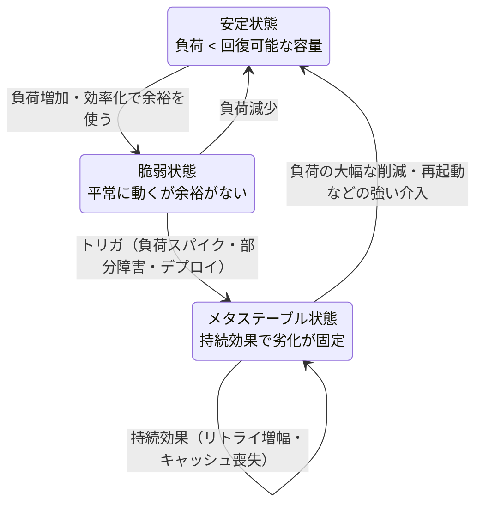

# 障害モデル (Failure Models: Crash, Byzantine, Gray & Metastable)

## 概要 (Overview)

分散アルゴリズムの正しさは、常に「**どんな故障を仮定したか**」の内側でしか成り立たない。[`consensus.md`](consensus.md) の Paxos/Raft は「ノードは止まるが嘘はつかない」「遅延はいつか収まる」という仮定に立ち、[`replication-partitioning.md`](replication-partitioning.md) の Dynamo 型複製は「故障は一時的で、ヒントはいずれ届く」という仮定に立つ。仮定が外れると、証明はあっても系は壊れる。

本ドキュメントは、この仮定そのものを分析対象にする。(1) プロセスの故障モデルの階層（crash-stop、crash-recovery、omission、timing、Byzantine）、(2) 時間の仮定（同期・非同期・部分同期）、(3) FLP 不可能性と故障検出器（Chandra–Toueg、φ accrual）、(4) 古典モデルが取りこぼす実運用の故障（gray failure、fail-slow、メタステーブル障害）、(5) Byzantine 耐性 (BFT) とそれをデータセンターがほとんど採用しない理由、を扱う。分析深度は Level 3。

## 方法論 (Methodology)

- 故障モデルを「**正しくないプロセスがどこまで悪く振る舞えるか**」の包含関係で整理する。強いモデル（Byzantine）に耐えるアルゴリズムは弱いモデル（crash）にも耐えるが、コストが高い。
- 時間モデルを「**遅延と処理速度の上限が存在し、既知か**」で整理し、各モデルで合意が解けるか、何台の故障まで耐えるかを対応づける。
- 理論の一次資料（Cristian[^cristian]、Lamport–Shostak–Pease[^lsp]、Fischer–Lynch–Paterson[^flp]、Dwork–Lynch–Stockmeyer[^dls]、Chandra–Toueg[^ct]、Castro–Liskov[^pbft]）と、実運用の故障研究（Huang ら[^gray]、Gunawi ら[^failslow]、Bronson ら[^metastable]、Huang ら OSDI '22[^metawild]、Alquraan ら[^partition]）を対比し、理論モデルと現実のずれを特定する。
- 実装上の数値（Cassandra の φ 閾値など）は公式ドキュメントで裏づけ、論文の実験値と設定の既定値を区別する。

## 発見事項 (Findings)

1. **故障モデルは包含関係をなす。** crash ⊂ omission ⊂ timing (performance) ⊂ Byzantine (arbitrary) の順に、故障したプロセスの振る舞いの自由度が増す[^cristian]。耐性のコストも同じ順に増え、crash 耐性の合意は 2f+1 台、Byzantine 耐性は 3f+1 台を要する[^dls][^lsp]。
2. **非同期モデルでは、1台の crash でも決定的な合意は不可能 (FLP)。** 遅いプロセスと停止したプロセスを有限時間で区別できないことが根本原因である[^flp]。実用系は部分同期[^dls]、故障検出器[^ct]、ランダム化のいずれかを仮定して回避し、仮定が崩れても safety は失わず liveness だけを失うように作る（[`consensus.md`](consensus.md)）。
3. **部分同期は「タイムアウトはいつか正しく働く」という仮定の形式化である。** DLS は、遅延の上限が存在するが未知のモデルと、既知の上限が未知の時刻 (GST) 以降にだけ成り立つモデルを定義した。どちらでも crash なら f < n/2、Byzantine なら f < n/3 で合意が解ける[^dls]。Paxos/Raft のタイムアウト設計はこのモデルの実装である。
4. **故障検出器は「不完全な判定」を前提にした部品である。** Chandra–Toueg は完全性 (completeness) と正確性 (accuracy) で故障検出器を分類し、誤判定を許す ◇S（いつかは1台の正しいプロセスを疑わなくなる）でも過半数が正しければ合意が解けることを示した[^ct]。さらに ◇W が合意に必要な最弱の故障検出器であることも証明されている[^cht]。φ accrual は二値判定ではなく疑いの度合いを連続値で出し、閾値の選択をアプリケーションに委ねる[^phi]。
5. **実運用の故障の多くは「止まらない」故障である。** gray failure は、故障検出器からは健全に見えるがアプリケーションからは異常に見える「差分可観測性 (differential observability)」として定義される[^gray]。fail-slow はハードウェアが動作しつつ性能だけが劣化する故障で、101 件の事例調査では、特定と隔離に数時間から数か月を要した例がある[^failslow]。
6. **メタステーブル障害は、トリガが消えても続く障害である。** リトライなどの持続効果 (sustaining effect) が仕事を増幅し、系を劣化状態に固定する[^metastable]。OSDI '22 の調査では、過去10年の AWS の大規模障害 15 件のうち少なくとも 4 件がこの型だった[^metawild]。
7. **データセンターの多くは BFT を採用せず crash 故障を仮定する。** 単一の運用主体の信頼境界、3f+1 台と O(n²) 通信のコスト、そして全レプリカが同じコードを動かす限り共通のバグには BFT も効かない、という3点が主な理由である。代わりにチェックサムや ECC で「任意の破損」を「検出可能な crash」に変換する。

## アーキテクチャ (Architecture)

### 故障モデルの包含関係


矢印の右ほど故障したプロセスの振る舞いが自由になり、耐性のコストが増える。厳密な包含関係は文献によって細部が異なる。crash-recovery は crash-stop の単純な一般化ではなく、安定記憶の有無で解ける問題が変わる別系統として扱われることも多い[^act]。凡例: 箱は故障モデル、矢印は「右のモデルは左のモデルの振る舞いを含む」。

| モデル | 故障プロセスの振る舞い | 代表的な仮定・前提 | 合意に必要な台数 (部分同期) |
|---|---|---|---|
| crash-stop (fail-stop) | 停止し、以後は何も送らない。fail-stop は停止が他から検出できる場合を指す[^schneider] | 停止後は戻らない | 2f+1[^dls] |
| crash-recovery | 停止後に復帰する。揮発状態は失われる | 安定記憶（fsync されたログ）[^act] | 2f+1（安定記憶あり） |
| omission | 一部のメッセージを送らない／受け取らない | 通信路は正しい | 2f+1 |
| timing (performance) | 正しい値を返すが、規定の時間内に返さない[^cristian] | 時間の上限が仕様に含まれる | モデル依存 |
| Byzantine (arbitrary) | 任意。矛盾した値を異なる相手に送る、共謀する | 認証の有無で結果が変わる[^lsp] | 3f+1[^dls] |

### 時間モデル

| モデル | 仮定 | 合意 | 実システムでの意味 |
|---|---|---|---|
| 同期 (synchronous) | 遅延・処理速度に既知の上限 | 解ける。署名付きなら Byzantine でも任意の f で解ける[^lsp] | 航空機の時分割バスなど、上限を物理的に保証できる系 |
| 非同期 (asynchronous) | 上限なし | 1台の crash で決定的には不可能[^flp] | インターネット、GC 停止、仮想マシンの一時停止 |
| 部分同期 (partial synchrony) | 上限は存在するが未知、または GST 以降にのみ成立[^dls] | crash: f < n/2、Byzantine: f < n/3 | Paxos/Raft/PBFT が仮定するモデル |

## 技術詳細 (Technical Details)

### 1. crash-stop と crash-recovery

理論の多くは crash-stop を仮定するが、実システムのプロセスは再起動する。crash-recovery では、復帰したプロセスは「停止前に約束したこと」（Paxos の promise、Raft の投票）を覚えていなければならない。これを忘れると、同じ term で二度投票して2人のリーダが生まれる。Aguilera–Chen–Toueg は crash-recovery の故障検出と合意を定式化し、安定記憶がない場合は、常時稼働するプロセスの数に追加の条件が要ることを示した[^act]。

実装上の帰結は明快である。合意の safety はディスクに書いたものが消えないことに依存する。fsync を省略する最適化や、書き込みを偽って完了させるストレージは、crash-recovery モデルを黙って Byzantine 側へずらす（[`../databases/storage-engines.md`](../databases/storage-engines.md)）。

### 2. FLP と、それを回避する3つの道

FLP の主張は、完全な非同期システムで1台でも停止しうるなら、必ず停止する決定的な合意アルゴリズムは存在しない、というものである[^flp]。証明の骨格は、決定がまだ決まっていない「二価 (bivalent)」な状態から、メッセージ配送の順序を敵対的に選ぶと永遠に二価のまま進めることを示す点にある。

| 回避策 | 追加する仮定 | 代表 |
|---|---|---|
| 部分同期 | いつかは遅延に上限が成り立つ[^dls] | Paxos、Raft、PBFT |
| 故障検出器 | 不完全だが、いつかは正確になる神託[^ct] | ◇S による Chandra–Toueg 合意 |
| ランダム化 | コイン投げ。確率 1 で（期待有限時間で）停止 | 確率的合意プロトコル |

部分同期の系では、ネットワークが荒れている間はリーダ選挙が空転し、合意が進まない。それでも二つの値が決まることはない。この「safety は無条件、liveness は条件付き」という非対称性が、実用プロトコルの設計原理である。設計の正しさは TLA+ などのモデル検査で確かめるのが標準になりつつある（[`../formal-methods/formal-verification-landscape.md`](../formal-methods/formal-verification-landscape.md)）。

### 3. 故障検出器 — Chandra–Toueg から φ accrual へ

Chandra–Toueg は故障検出器を2つの性質で分類した[^ct]。

- **完全性 (completeness)**: 停止したプロセスはいつかは疑われる。強い完全性ではすべての正しいプロセスが、弱い完全性では一部の正しいプロセスが疑う。
- **正確性 (accuracy)**: 正しいプロセスを疑わない。強い正確性は一度も疑わない、弱い正確性は少なくとも1台を疑わない。「◇（いつかは）」付きは、ある時点以降だけ成り立てばよい。

◇S（強い完全性 + いつかは弱い正確性）があれば、f < n/2 で合意が解ける[^ct]。Chandra–Hadzilacos–Toueg は ◇W が合意に必要な最弱の故障検出器であることを示した[^cht]。実務への含意は、故障検出器は誤ってよいということである。間違いの回数ではなく、「いつかは誤らなくなる」ことが正しさの条件になる。

実装はハートビートとタイムアウトで行う。固定タイムアウトは、短ければ遅いだけのノードを死亡と誤判定し、長ければ検出が遅れる。TCP の再送タイマが RTT の平均と分散から RTO を推定するのと同じ問題である（[`../networking/tcp-transport-congestion.md`](../networking/tcp-transport-congestion.md)）。

**φ accrual 故障検出器**[^phi] は、ハートビート到着間隔の分布を過去の窓から推定し、疑いの度合い φ を出力する。

```
φ(t_now) = −log10( P_later(t_now − T_last) )

  T_last   : 最後にハートビートを受け取った時刻
  P_later(Δ): 到着間隔が Δ より長くなる確率（推定分布の裾）
  前提     : 到着間隔は定常な分布に従う（原論文は正規分布、Cassandra は指数分布で近似）
  計算量   : 窓サイズ W に対し、平均・分散の逐次更新で O(1)
```

φ = 1 で判定すると誤判定率は約 10%、φ = 2 で約 1%、φ = 3 で約 0.1% になる。Cassandra は gossip 経由のハートビートに φ accrual を応用し、指数分布の方がよく合うと報告した[^cassandra]。同論文の 100 ノードの実験では、従来の検出器で約 2 分かかった故障検出が、φ = 5 で平均約 15 秒になった[^cassandra]。現在の Cassandra の既定閾値 `phi_convict_threshold` は 8 である[^cassandradoc]。

### 4. Gray failure — 差分可観測性

Huang らは、クラウドの大規模障害の多くが、二値の「停止」ではなく「劣化しているが検出されない」状態から始まることを指摘した[^gray]。その本質を**差分可観測性**として定義する。故障検出器（ハートビート、ヘルスチェック）とアプリケーション（実際のリクエスト）が異なる経路で系を観測するため、一方には健全に、他方には異常に見える。

例として、ハートビートを返すスレッドは動いているがディスク I/O が詰まっているノード、一部の宛先へのパケットだけを落とすスイッチがある。部分的なネットワーク分断 (partial partition) も同じ構造を持つ。Alquraan らは 25 の分散システムで 136 件の分断起因障害を分析し、その多くがデータ消失や削除データの復活などの深刻な結果を招き、単一ノードの隔離だけで決定的に再現することを示した[^partition]。ネットワークが信頼できるという前提が崩れる実例は、Bailis と Kingsbury がまとめている[^netreliable]。

対策の方向は「**アプリケーションの視点で観測する**」ことである。ヘルスチェックを実リクエストの経路に近づける、クライアント側の観測（エラー率、遅延）を集約して判定に使う、複数の観測点の多数決で隔離を決める、などがある。

### 5. Fail-slow — 動いているが遅い

Gunawi らは 12 の機関から 101 件の fail-slow ハードウェア事例を集め、ディスク、SSD、CPU、メモリ、ネットワークのすべてで性能故障が起きることを示した[^failslow]。主要な観察は次の通りである。

- **故障は形を変える**: fail-stop や一時故障が fail-slow に変わる。電源1台の故障で予備電源の供給が足りず CPU が 50% に絞られた例や、1台の不良ディスクが RAID カード全体の性能を食いつぶした例がある。頻発する一時エラーを再試行や ECC で隠し続けると、それ自体が性能劣化になる。
- **原因の連鎖が長い**: ファンが1台止まり、他のファンが最大回転になり、振動でディスク性能が落ちた例がある。
- **影響が連鎖する**: 劣化した1枚の NIC が、健全なマシン上のタスクスロットを占有し続け、クラスタ全体の性能を落とした。
- **検出に時間がかかる**: 特定と隔離に数時間から数か月を要する[^failslow]。

fail-slow は crash 前提のプロトコルにとって最悪の故障である。同期複製や過半数待ちでは、最も遅いレプリカが全体の速度を決めることがあるからだ。尾部遅延への対策として、ヘッジリクエスト（遅い応答を待たずに別レプリカへ再送する）などが知られる[^tail]。故障率の統計的な扱い（MTBF、共通原因故障）は [`../../foundations/mathematics/probability-statistics/reliability-theory.md`](../../foundations/mathematics/probability-statistics/reliability-theory.md) が基礎になる。

### 6. メタステーブル障害

Bronson らは、系の状態を3つに分けて定式化した[^metastable]。



要点は、トリガを取り除いても系が戻らないことにある。最も一般的な持続効果はリトライによる仕事の増幅であり、他にルックアサイドキャッシュの喪失（キャッシュが空になると下流への負荷が跳ね上がる）、遅いエラー処理経路、GC による悪循環が挙げられている[^metastable]。OSDI '22 の調査は 11 組織の 22 件を分析し、トリガと増幅機構をそれぞれ2種類に分類した[^metawild]。

対策は、正帰還ループの利得を構造的に 1 未満に抑えることである。リトライの配置を1か所に絞る、指数バックオフとジッタ[^brooker]、リトライ予算、サーキットブレーカ、ロードシェディングがその手段になる。リトライ増幅の定量的な扱いとセルベースアーキテクチャは [`../cloud/cloud-control-planes.md`](../cloud/cloud-control-planes.md) が詳しい。

### 7. Byzantine 耐性 — LSP から PBFT へ

Lamport–Shostak–Pease の「ビザンチン将軍問題」は、口頭メッセージ（偽造可能）では m 人の裏切り者に耐えるには 3m+1 人以上が必要で、署名付きメッセージ（偽造不可能）なら任意の人数の裏切り者に耐えられることを示した[^lsp]。ただし後者は同期モデルでの結果である。部分同期では、認証があっても Byzantine 耐性には n ≥ 3f+1 が必要になる[^dls]。

PBFT は、部分同期の下で実用的な性能の BFT 状態機械複製を初めて示した[^pbft]。3f+1 台のレプリカで、pre-prepare、prepare、commit の3フェーズを用い、各フェーズで 2f+1 台の一致を待つ。2f+1 台の集合はどの二つも少なくとも f+1 台で交わるので、少なくとも1台は正しいノードが含まれる。これが Paxos の過半数交差に相当する。NFS を複製した BFS は、非複製 NFS 比で約 3% の性能低下にとどまったと報告されている[^pbft]。

**それでもデータセンターの多くが crash 故障を仮定する理由**を挙げる。

- **コスト**: f 台の故障に耐えるのに 2f+1 台ではなく 3f+1 台が要る。通信は全対全で O(n²) になる。
- **共通モード故障に効かない**: BFT は「独立に故障する」ことを前提にする。全レプリカが同じバイナリを動かすなら、ソフトウェアのバグは全台で同時に起き、何台用意しても耐えられない。独立性を得るには N バージョンプログラミングのような実装多様性が要り、さらにコストがかかる。これは信頼性理論の共通原因故障 (common cause failure) と同じ構造である。
- **信頼境界が一つ**: 単一の運用主体が全ノードを管理するなら、「一部のノードだけが悪意を持つ」より「運用主体全体が侵害される」脅威の方が現実的で、BFT はそれを防げない。
- **代替手段**: チェックサム、ECC、エンドツーエンドの検証で、任意のデータ破損を「検出して停止する」crash 故障に変換する。ただし Ganesan らが示したように、この変換は実装で頻繁に破れる[^cords]。

BFT が選ばれるのは、相互に信頼しない主体がノードを運用する系（ブロックチェーン、組織間台帳）と、放射線や部品故障で任意の誤りが起こる安全重視系（[`../../engineering/aerospace/avionics-gnc.md`](../../engineering/aerospace/avionics-gnc.md) の冗長飛行計算機）である。

## セキュリティ考察 (Security Considerations)

- **侵害は Byzantine 故障である**: crash 前提のプロトコルでは、侵害されたノード1台が偽の投票や偽のログで safety を破れる。ノード間の相互認証 (mTLS) と最小権限は、侵害を「ネットワークから切り離された crash」に近づけるための前提条件である。
- **故障検出器への攻撃**: 遅延注入や選択的なパケット破棄は、故障検出器に健全なノードを疑わせ、リーダ交代を空転させる。φ accrual のような適応型検出器は、攻撃者が分布の推定を徐々に歪めることにも注意が要る。safety は保たれても可用性は奪われる。
- **メタステーブル状態を誘発する DoS**: 小さな負荷スパイクでも、脆弱状態の系をメタステーブル状態へ押し込めば、攻撃をやめた後も障害が続く。攻撃のコストに対して被害が非対称に大きくなる。ロードシェディングとリトライ予算は、可用性の防御でもある。
- **gray failure の隠蔽**: ヘルスチェックの経路だけを正常に保つ侵害や故障は検出をすり抜ける。判定にはアプリケーションの視点の観測を含める。
- **時刻の仮定の悪用**: リースや部分同期の上限は時計の正しさに依存する。時計を操作できる攻撃者は、リースの重複（2人のリーダ）を引き起こせる。時刻の仮定に依存する経路では、フェンシングトークンを併用する。

## 結論 (Conclusions)

- 分散アルゴリズムの正しさは故障モデルと時間モデルの組に対して成り立つ。crash ⊂ omission ⊂ timing ⊂ Byzantine の順に耐性のコストが上がり、合意の台数要件は crash で 2f+1、Byzantine で 3f+1 になる。
- FLP により非同期では決定的な合意は不可能で、実用系は部分同期、故障検出器、ランダム化のいずれかを仮定する。いずれも safety は無条件に守り、liveness だけを仮定に依存させる。
- 故障検出器は誤ってよく、「いつかは正確になる」ことが正しさの条件である。φ accrual は判定を連続値にし、誤判定率と検出速度のトレードオフをアプリケーションの閾値に委ねる。
- 実運用の深刻な障害の多くは、gray failure、fail-slow、メタステーブル障害といった「止まらない」故障であり、古典的な crash モデルの外側にある。観測をアプリケーションの視点に寄せ、正帰還ループの利得を抑えることが対策の中心になる。
- データセンターが BFT を避けるのは、コスト、共通モード故障、単一の信頼境界のためである。その代わり、破損を crash に変換する検証機構と、侵害を crash に近づける認証・分離に依存している。

### 次の接続先 (Related Topics)

- [`consensus.md`](consensus.md) — 本書の故障モデル（crash + 部分同期）の上に立つ合意プロトコル。
- [`replication-partitioning.md`](replication-partitioning.md) — 一時故障を前提にした hinted handoff と anti-entropy。
- [`../cloud/cloud-control-planes.md`](../cloud/cloud-control-planes.md) — リトライ増幅、メタステーブル障害、セルベースアーキテクチャの実務。
- [`../networking/tcp-transport-congestion.md`](../networking/tcp-transport-congestion.md) — RTO 推定という最も身近な故障検出器。
- [`../../foundations/mathematics/probability-statistics/reliability-theory.md`](../../foundations/mathematics/probability-statistics/reliability-theory.md) — 故障率、冗長系の信頼度、共通原因故障の数理。
- [`../formal-methods/formal-verification-landscape.md`](../formal-methods/formal-verification-landscape.md) — 故障モデルを仕様に含めたモデル検査。
- [`../../engineering/aerospace/avionics-gnc.md`](../../engineering/aerospace/avionics-gnc.md) — Byzantine 故障を実際に扱う冗長飛行計算機。

## 参考文献 (References)

[^cristian]: Cristian, F. (1991). Understanding Fault-Tolerant Distributed Systems. *Communications of the ACM*, 34(2), 56–78. DOI: 10.1145/102792.102801
[^schneider]: Schneider, F. B. (1990). Implementing Fault-Tolerant Services Using the State Machine Approach: A Tutorial. *ACM Computing Surveys*, 22(4), 299–319. DOI: 10.1145/98163.98167
[^lsp]: Lamport, L., Shostak, R., & Pease, M. (1982). The Byzantine Generals Problem. *ACM Transactions on Programming Languages and Systems*, 4(3), 382–401. DOI: 10.1145/357172.357176
[^flp]: Fischer, M. J., Lynch, N. A., & Paterson, M. S. (1985). Impossibility of Distributed Consensus with One Faulty Process. *Journal of the ACM*, 32(2), 374–382. DOI: 10.1145/3149.214121
[^dls]: Dwork, C., Lynch, N., & Stockmeyer, L. (1988). Consensus in the Presence of Partial Synchrony. *Journal of the ACM*, 35(2), 288–323. DOI: 10.1145/42282.42283
[^ct]: Chandra, T. D., & Toueg, S. (1996). Unreliable Failure Detectors for Reliable Distributed Systems. *Journal of the ACM*, 43(2), 225–267. DOI: 10.1145/226643.226647
[^cht]: Chandra, T. D., Hadzilacos, V., & Toueg, S. (1996). The Weakest Failure Detector for Solving Consensus. *Journal of the ACM*, 43(4), 685–722. DOI: 10.1145/234533.234549
[^act]: Aguilera, M. K., Chen, W., & Toueg, S. (2000). Failure Detection and Consensus in the Crash-Recovery Model. *Distributed Computing*, 13(2), 99–125. DOI: 10.1007/s004460050070
[^phi]: Hayashibara, N., Défago, X., Yared, R., & Katayama, T. (2004). The φ Accrual Failure Detector. *Proc. 23rd IEEE SRDS*, 66–78. DOI: 10.1109/RELDIS.2004.1353004
[^cassandra]: Lakshman, A., & Malik, P. (2010). Cassandra: A Decentralized Structured Storage System. *ACM SIGOPS Operating Systems Review*, 44(2), 35–40. DOI: 10.1145/1773912.1773922 — §5.3（φ accrual の gossip への応用、指数分布近似）、§6 Practical Experiences（100 ノードで約 2 分 → φ=5 で約 15 秒）。
[^cassandradoc]: [cassandra.yaml file configuration — Apache Cassandra 4.0 Documentation](https://cassandra.apache.org/doc/4.0/cassandra/configuration/cass_yaml_file.html) — Accessed: 2026-10-04 — `phi_convict_threshold` の既定値 8。
[^pbft]: Castro, M., & Liskov, B. (1999). Practical Byzantine Fault Tolerance. *Proc. 3rd USENIX OSDI*, 173–186. — [USENIX OSDI '99](https://www.usenix.org/legacy/events/osdi99/full_papers/castro/castro_html/castro.html) — Accessed: 2026-10-04 ／ 拡張版: Castro, M., & Liskov, B. (2002). Practical Byzantine Fault Tolerance and Proactive Recovery. *ACM Transactions on Computer Systems*, 20(4), 398–461. DOI: 10.1145/571637.571640
[^gray]: Huang, P., Guo, C., Zhou, L., Lorch, J. R., Dang, Y., Chintalapati, M., & Yao, R. (2017). Gray Failure: The Achilles' Heel of Cloud-Scale Systems. *Proc. 16th HotOS*, 150–155. DOI: 10.1145/3102980.3103005
[^failslow]: Gunawi, H. S., Suminto, R. O., Sears, R., Golliher, C., Sundararaman, S., Lin, X., Emami, T., Sheng, W., Bidokhti, N., et al. (2018). Fail-Slow at Scale: Evidence of Hardware Performance Faults in Large Production Systems. *Proc. 16th USENIX FAST*. — [PDF (USENIX)](https://www.usenix.org/system/files/conference/fast18/fast18-gunawi.pdf) — Accessed: 2026-10-04 ／ 拡張版: *ACM Transactions on Storage*, 14(3), 1–26. DOI: 10.1145/3242086
[^metastable]: Bronson, N., Aghayev, A., Charapko, A., & Zhu, T. (2021). Metastable Failures in Distributed Systems. *Proc. HotOS '21*, 221–227. DOI: 10.1145/3458336.3465286
[^metawild]: Huang, L., Magnusson, M., Muralikrishna, A. B., Estyak, S., Isaacs, R., Aghayev, A., Zhu, T., & Charapko, A. (2022). Metastable Failures in the Wild. *Proc. 16th USENIX OSDI*. — [USENIX OSDI '22](https://www.usenix.org/conference/osdi22/presentation/huang-lexiang) — Accessed: 2026-10-04
[^partition]: Alquraan, A., Takruri, H., Alfatafta, M., & Al-Kiswany, S. (2018). An Analysis of Network-Partitioning Failures in Cloud Systems. *Proc. 13th USENIX OSDI*. — [USENIX OSDI '18](https://www.usenix.org/conference/osdi18/presentation/alquraan) — Accessed: 2026-10-04
[^netreliable]: Bailis, P., & Kingsbury, K. (2014). The Network Is Reliable. *Communications of the ACM*, 57(9), 48–55. DOI: 10.1145/2643130
[^tail]: Dean, J., & Barroso, L. A. (2013). The Tail at Scale. *Communications of the ACM*, 56(2), 74–80. DOI: 10.1145/2408776.2408794
[^brooker]: Brooker, M. [Timeouts, retries, and backoff with jitter](https://aws.amazon.com/builders-library/timeouts-retries-and-backoff-with-jitter/) — Amazon Builders' Library — Accessed: 2026-10-04
[^cords]: Ganesan, A., Alagappan, R., Arpaci-Dusseau, A. C., & Arpaci-Dusseau, R. H. (2017). Redundancy Does Not Imply Fault Tolerance: Analysis of Distributed Storage Reactions to Single Errors and Corruptions. *Proc. 15th USENIX FAST*. — [USENIX FAST '17](https://www.usenix.org/conference/fast17/technical-sessions/presentation/ganesan) — Accessed: 2026-10-04
