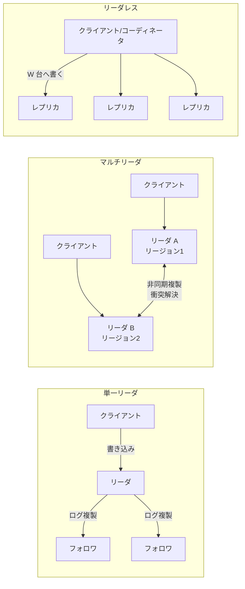
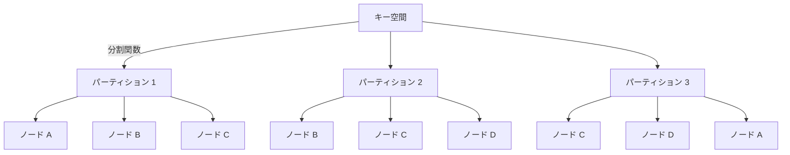
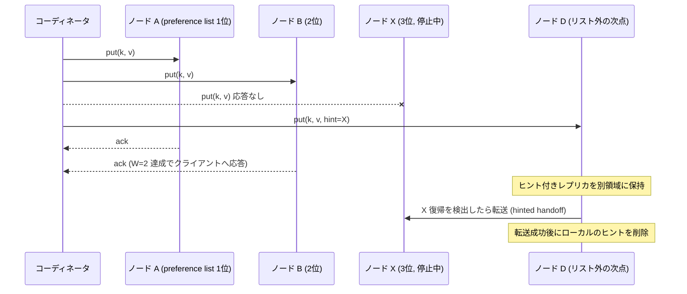
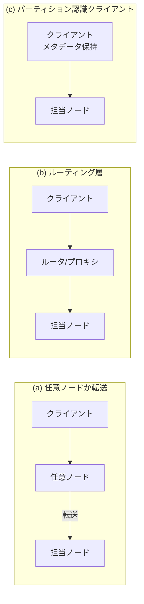

# 複製と分割 (Replication & Partitioning)

## 概要 (Overview)

[`consistency-models.md`](consistency-models.md) は「複製されたデータが何を保証するか」を、[`consensus.md`](consensus.md) は「単一のログに不可逆に一致する機構」を扱った。本ドキュメントはその手前にある二つの構造的な選択を扱う。一つは**複製 (replication)**、すなわち同じデータを複数ノードに置く方法である。もう一つは**分割 (partitioning / sharding)**、すなわち一台に収まらないデータをノード群へ分配する方法である。

複製は可用性・耐久性・読み取りスケールのために、分割は書き込みスケールと容量のために行う。実システムは両者を直交に組み合わせる。データをパーティションに切り、各パーティションを複製する。Dynamo・Cassandra・Bigtable・Spanner の設計差は、ほぼこの二軸でどこを選んだかで説明できる。

扱う範囲は、(1) 単一リーダ・マルチリーダ・リーダレスの3つの複製トポロジ、(2) Dynamo 型リーダレス系の機構（クォーラム、sloppy quorum、hinted handoff、read repair、Merkle tree による anti-entropy）、(3) 複製遅延が生む異常、(4) 範囲分割とハッシュ分割、consistent hashing と仮想ノード、リバランス、ホットキー、(5) リクエストルーティングである。分析深度は Level 3。

## 方法論 (Methodology)

- 複製は「**書き込みを誰が受け付け、どう順序づけるか**」で分類する。単一リーダは順序を1か所で決め、マルチリーダとリーダレスは順序決定を後回しにして衝突解決で埋め合わせる。
- 分割は「**キーからノードへの写像をどう作り、メンバー変化時にどれだけ動かすか**」で評価する。指標は負荷の均等性、範囲クエリの可否、移動量の3つである。
- 一次資料は Dynamo (SOSP 2007)[^dynamo]、Karger らの consistent hashing (STOC 1997)[^karger]、Cassandra[^cassandra]、Bigtable[^bigtable]、Spanner[^spanner]、CRDT[^crdt] の原論文に置く。Kleppmann の DDIA[^ddia] は体系的な整理の二次資料として用いる。
- 数値（N/R/W の典型値、SLA、φ 閾値など）は原論文の記述で裏づけ、どの系の実測か設計値かを区別して書く。

## 発見事項 (Findings)

1. **複製トポロジの本質は「順序をいつ決めるか」である。** 単一リーダは書き込み時に順序を決める（線形化しやすいがリーダが単一障害点・ボトルネック）。マルチリーダとリーダレスは書き込みを並行に受け付け、順序と衝突を読み取り時や背景処理で解決する。後者を選ぶと、衝突解決が設計の中心課題になる。
2. **`R + W > N` は読み書きクォーラムの交差を保証するが、線形化可能性までは保証しない。** Dynamo の典型構成は (N, R, W) = (3, 2, 2) である[^dynamo]。ただし sloppy quorum を使うと「N 台」が固定集合でなくなり、交差の保証そのものが平常時の近似になる。並行書き込み・部分失敗時の書き込み・LWW の時計ずれも、クォーラム系で古い値が読める原因になる[^ddia]。
3. **リーダレス系の収束は3段構えで担保される。** 一時故障には hinted handoff、読み取り経路には read repair、長期の乖離には Merkle tree による anti-entropy を用いる[^dynamo]。どれか一つでは足りず、3つを組み合わせてはじめて「いつかは収束する」が実装になる。
4. **複製遅延の異常はセッション保証で名前がつく。** read-your-writes、monotonic reads、consistent prefix（因果順の保持）の違反は、非同期複製の自然な帰結である[^terry][^ddia]。アプリケーションは自分がどの保証を必要とするかを明示しなければならない。
5. **分割は範囲かハッシュかで性格が決まる。** 範囲分割（Bigtable、Spanner）は範囲スキャンが効くが、単調増加キーで書き込みが一点に集中する。ハッシュ分割（Dynamo）は負荷を均すが、範囲クエリを失う。Cassandra は order preserving hash を使い、範囲分割寄りの選択をした[^cassandra]。
6. **consistent hashing の価値は「メンバー変化時の移動量が最小」な点にある。** ノード追加・削除で動くキーは平均で全体の 1/n 程度にとどまる[^karger]。ただし素朴な実装では負荷が偏るため、Dynamo は仮想ノードを導入し、最終的に「固定数・等サイズのパーティションをノードに割り当てる」方式（Strategy 3）に移行した[^dynamo]。
7. **ホットキーは分割方式では解けない。** 単一キーへのアクセス集中は、どのハッシュ関数でも1パーティションに落ちる。キーへの乱数接尾辞付与、読み取りのキャッシュ・複製、書き込みの集約など、アプリケーション層の対処が要る[^ddia]。

## アーキテクチャ (Architecture)

### 複製トポロジの比較

| 観点 | 単一リーダ | マルチリーダ | リーダレス (Dynamo 型) |
|---|---|---|---|
| 書き込み受付 | リーダのみ | 各リーダ（典型はリージョンごと） | 任意のレプリカ／コーディネータ |
| 順序決定 | リーダのログ順 | 決まらない（衝突解決が必要） | 決まらない（バージョン管理と衝突解決） |
| フェイルオーバ | 必要（合意またはフェンシング） | リーダ単位で局所的 | 不要（クォーラムで吸収） |
| 代表例 | Raft/Paxos 系、PostgreSQL ストリーミング複製 | 複数リージョン書き込み DB、オフラインクライアント | Dynamo、Cassandra |
| 主なリスク | フェイルオーバ時のデータ消失・split-brain | 衝突による更新消失 | クォーラム境界の古い読み取り、兄弟バージョンの増殖 |

### 二軸の合成 — パーティション × レプリカ

1台のノードは複数パーティションのレプリカを兼ねる。Spanner では各タブレット（データ配置の単位であるディレクトリの集合）の上に Paxos ステートマシンを1つ置き、複数の Paxos グループに跨る操作は分散トランザクションで繋ぐ[^spanner]。Dynamo では consistent hashing のリング上で、キー位置から時計回りに N 個の異なる物理ノードを選んだ「preference list」がレプリカ集合になる[^dynamo]。

## 技術詳細 (Technical Details)

### 1. 単一リーダ複製と複製遅延の異常

単一リーダは同期・非同期・半同期（1台だけ同期）を選べる。同期複製は耐久性が高いが、1台の遅延が全書き込みを止める。非同期複製はリーダ障害時にコミット済み書き込みを失いうる。合意プロトコル（[`consensus.md`](consensus.md)）は過半数同期によってこの二択を緩和する。

非同期フォロワから読むと、次の異常が起こる[^ddia][^terry]。

| 異常 | 症状 | 対策 |
|---|---|---|
| read-your-writes 違反 | 自分の書き込み直後に読むと反映されていない | 自分が更新しうるデータはリーダから読む、書き込み時刻以降の複製位置を要求する |
| monotonic reads 違反 | 再読み込みで時間が巻き戻る（新→旧） | ユーザーを同一レプリカに固定する（ハッシュによるスティッキー） |
| consistent prefix 違反 | 因果順が逆転して見える（回答が質問より先） | 因果関係のある書き込みを同一パーティションに置く、因果メタデータを付ける |

フェイルオーバ時には、新リーダが旧リーダの未複製書き込みを持たないことがある。旧リーダが復帰後も自分をリーダと信じると split-brain になる。単調増加するエポック番号（fencing token）で古いリーダの書き込みを拒否するのが標準の対策である（[`consistency-models.md`](consistency-models.md) のセキュリティ考察）。

### 2. マルチリーダと衝突解決

マルチリーダは複数データセンター構成やオフライン編集（各端末が「リーダ」）で現れる。並行書き込みの衝突は避けられないため、解決方式を選ぶ。

- **LWW (last writer wins)**: タイムスタンプ最大の値を残す。単純だが、並行書き込みのうち一方を黙って捨てる。時計ずれがあると「後の」書き込みも負けうる。
- **アプリケーション定義のマージ**: Dynamo はベクトルクロックで並行版（兄弟, siblings）を検出し、読み取り時にクライアントへ複数版を返して意味的に統合させる。ショッピングカートの和集合がその例である[^dynamo]。ベクトルクロックの肥大を防ぐため、(node, counter) 対が閾値（論文の例では 10）を超えると最古の対を捨てる。これは因果情報の損失と引き換えの近似である[^dynamo]。
- **CRDT (Conflict-free Replicated Data Types)**: 操作が可換になるように、または状態が半束 (semilattice) の上で単調に増えるようにデータ型を設計すれば、どの順で適用しても全レプリカが同じ状態に収束する（strong eventual consistency）[^crdt]。カウンタ（G-Counter / PN-Counter）、集合（OR-Set）、レジスタ、シーケンスなどが知られている。詳細は [`consistency-models.md`](consistency-models.md) にまとめた。

### 3. Dynamo 型リーダレス複製の機構

Dynamo は「常に書ける (always writeable)」ことを優先した[^dynamo]。その代償として、収束の責任を複数の機構に分散させている。

- **クォーラム**: 書き込みは preference list の上位 N 台に送り W 台の応答で成功、読み取りは R 台の応答で返す。`R + W > N` なら読みと書きの集合が交わる。典型値 (3, 2, 2)[^dynamo]。R や W を小さくすると遅延は下がるが、古い値を読みやすくなる。Dynamo のサービスは「99.9% のリクエストを 300ms 以内」という尾部遅延の SLA を目標にしており[^dynamo]、R/W の調整は主にこの尾部遅延のために行う。
- **sloppy quorum と hinted handoff**: 上位 N 台の一部が落ちていたら、リング上の次の健全なノードに「本来は X 宛て」というヒント付きで書く。可用性は上がるが、W 台が上位 N 台と重ならない可能性があるため、`R + W > N` の交差は厳密には成り立たない[^dynamo][^ddia]。Dynamo 自身も、hinted handoff はメンバーの入れ替わりが少なく故障が一時的な場合に最もよく働くと述べている[^dynamo]。
- **read repair**: 読み取り時に古い版を返したレプリカへ、最新版を書き戻す[^dynamo]。頻繁に読まれるキーは速く収束するが、読まれないキーは放置される。
- **Merkle tree による anti-entropy**: 長期の乖離（ヒントを持つノード自身の消失など）に備え、各ノードは担当する**キー範囲ごとに** Merkle tree を保持する[^dynamo]。二ノードは根のハッシュを比べ、異なる子だけを再帰的に降りて差分キーを特定する。差分の大きさに比例した転送量で済み、全キーの比較を避けられる。Merkle tree 自体は署名方式のためのハッシュ木として提案されたものである[^merkle]。弱点はキー範囲がメンバー変化で変わると木の再計算が必要になる点で、これも Dynamo が固定パーティション方式（§5）へ移った理由の一つである[^dynamo]。

### 4. 分割方式 — 範囲とハッシュ

| 方式 | 写像 | 長所 | 短所 | 代表例 |
|---|---|---|---|---|
| 範囲分割 | ソート済みキー区間 → パーティション | 範囲スキャン、局所性 | 単調増加キー（時刻・連番）で書き込みが末尾に集中 | Bigtable のタブレット[^bigtable]、Spanner[^spanner] |
| ハッシュ分割 | hash(key) の区間 → パーティション | 負荷が均等 | 範囲クエリは全パーティションへの scatter/gather | Dynamo[^dynamo] |
| 複合キー | 先頭列をハッシュ、残りをソート | パーティション内の範囲スキャン | 先頭列の偏りに弱い | Cassandra の partition key + clustering key[^ddia] |

範囲分割では、パーティションの分割・統合を負荷や大きさに応じて動的に行う。Bigtable はタブレットを行キー範囲で切り、Chubby → root タブレット → METADATA タブレットの3段の階層で位置を引く[^bigtable]。

二次インデックスの分割には2通りある。ドキュメントと同じパーティションにローカルインデックスを置く方式は、書き込みが速い代わりに読み取りが全パーティションへの scatter/gather になる。項 (term) で分割したグローバルインデックスは読み取りが速い代わりに、書き込みが複数パーティションに跨り、通常は非同期更新になる[^ddia]。

### 5. Consistent hashing、仮想ノード、リバランス

素朴な `hash(key) mod n` では、n が変わるとほぼ全キーが移動する。Karger らの consistent hashing はキーとノードを同じ円環上に写し、キーを時計回りで最初のノードに割り当てる[^karger]。ノード追加で動くのは新ノードの直前区間だけで、期待移動量は全体の約 1/n になる。各ノードを円上の複数点に置くと負荷の偏りが減る（論文でも各バケットの複数コピーを置く構成を扱う）[^karger]。同じ構造は Chord の DHT にも使われた[^chord]。

Dynamo は運用の中で分割方式を3段階で変えた[^dynamo]。

1. **Strategy 1**: ノードごとに T 個のランダムトークン、トークン値で分割。分割と配置が絡み合い、ノード追加のたびにキー範囲が変わってデータ移動と Merkle tree 再計算が発生した。
2. **Strategy 2**: ハッシュ空間を Q 個の等サイズパーティションに固定し、トークンは配置にだけ使う。
3. **Strategy 3**: Q 個の等サイズパーティションを、各ノードに Q/S 個ずつ割り当てる。負荷均等性が最も良く、メンバー情報も小さくなったため、Strategy 1 から移行した。

この「**固定数のパーティションを先に切り、ノードには丸ごと割り当てる**」方式は、ノード数よりはるかに多いパーティションを最初から作っておけば、リバランスがパーティション単位の移動だけで済むという意味で汎用的な設計である[^ddia]。対照的に Cassandra は複数トークンを使わず、負荷情報を見て軽いノードがリング上を移動する方式を選んだ[^cassandra]。

関連する写像として、rendezvous (highest random weight) hashing はキーごとに全ノードのスコアを計算して最大のノードを選ぶ。移動量最小の性質を保ちつつ、円環の管理が要らない[^hrw]。

リバランスで注意すべき点を挙げる。

- **自動か手動か**: 自動リバランスは、故障検出の誤判定（遅いだけのノードを死亡と判断）と組み合わさるとデータ移動が負荷をさらに上げ、障害を拡大しうる。多くの系が「提案は自動、実行は人間の承認」を選ぶ[^ddia]（[`failure-models.md`](failure-models.md) のメタステーブル障害）。
- **移動中の一貫性**: 移動中のパーティションへの書き込みは、旧所有者と新所有者のどちらが受け付けるかを、所有権のエポックで明示しなければならない。

### 6. ホットキーと負荷の偏り

ハッシュ分割は**キー間**の偏りを均すが、**単一キー**への集中（有名人のアカウント、フラッシュセールの商品）は均せない。Dynamo の計測でも、低負荷時は人気キーが少ないため不均衡率が高くなったと報告されている[^dynamo]。対処の例を挙げる。

- 書き込み側: キーに乱数接尾辞（例: 2 桁で 100 分割）を付けて分散し、読み取り時に全接尾辞を集約する。読み取りコストが増えるため、ホットと分かったキーに限定する[^ddia]。
- 読み取り側: キャッシュ層や読み取り専用レプリカの追加で吸収する。
- 検出: パーティション単位ではなくキー単位のアクセス統計を取らないと、偏りの原因を特定できない。

### 7. リクエストルーティング

クライアントがキーの所在をどう知るかは、3つの型に分かれる[^ddia]。

Dynamo はロードバランサ経由の汎用ルーティングと、パーティション認識クライアントの両方を提供した。後者はロードバランサと転送1ホップを省き、99.9 パーセンタイル遅延を少なくとも 30ms 下げた[^dynamo]。いずれの型でも「誰がどのパーティションを持つか」という**メタデータの一貫性**が要る。Dynamo/Cassandra はゴシップで伝播させ、Bigtable は Chubby、Cassandra は一部のメタデータを ZooKeeper に置いた[^bigtable][^cassandra]。メタデータストアには合意ベースの系（[`consensus.md`](consensus.md)）を使うのが一般的で、データ経路は結果整合でも制御経路は強一貫、という層の分け方になる。

## セキュリティ考察 (Security Considerations)

- **古い読み取りによる認可・残高判定の誤り**: 非同期フォロワやクォーラム境界からの古い読み取りは、失効済みの権限や残高不足を見逃す。失効・決済などの後戻りできない判定はリーダや線形化点で読む（[`consistency-models.md`](consistency-models.md)）。
- **衝突解決の悪用**: LWW はタイムスタンプが最大の書き込みを勝たせる。未来時刻を書ける主体は、以後の正当な更新を恒久的に負かせる。タイムスタンプはサーバ側で付与し、クライアント由来の時刻を順序の根拠にしない。
- **ホットキー攻撃とハッシュ予測**: パーティション関数が予測可能だと、攻撃者は同一パーティションに落ちるキーを大量に生成して特定ノードを狙い撃ちできる。キーに秘密のソルトを入れたハッシュを用い、テナント単位のレート制限を置く。
- **anti-entropy による汚染の拡散**: 修復機構は「最新版で上書き」するため、ディスク破損や侵害で不正なデータが「最新」と判定されると、健全なレプリカにまで伝播する。Ganesan らの故障注入実験では、Redis や Cassandra で1ノードの破損データが read repair や再同期を通じて健全なレプリカへ伝播した[^cords]。チェックサムを検証してから修復し、修復ログを監査する。
- **sloppy quorum と耐久性の錯覚**: W 台の ack が、リスト外のノードへのヒント付き書き込みを含みうる。ヒントを持つノードが転送前に失われると、ack 済みの書き込みが消える。耐久性要件の高いデータでは、sloppy quorum を無効にするか、ヒントの複製を要求する。

## 結論 (Conclusions)

- 複製トポロジの本質は「順序をいつ決めるか」にある。単一リーダは書き込み時に決め、マルチリーダとリーダレスは決定を先送りして衝突解決・バージョン管理・CRDT で補う。
- Dynamo 型リーダレス系はクォーラム、hinted handoff、read repair、Merkle tree による anti-entropy の4つを重ねて結果整合を実装している。sloppy quorum により `R + W > N` の交差は近似になる。
- 分割は範囲（スキャンに強い、ホットスポットに弱い）とハッシュ（均等、範囲クエリに弱い）の選択である。consistent hashing は移動量を最小にするが、実務では「固定数の等サイズパーティションを丸ごと割り当てる」方式が負荷均等性と運用性で優る。
- ホットキーとルーティングメタデータの一貫性は分割関数では解けず、アプリケーション層の工夫と合意ベースの制御平面で扱う。
- 複製と分割の弱点（古い読み取り、衝突解決、修復による汚染）は、そのまま整合性とセキュリティの弱点にもなる。

### 次の接続先 (Related Topics)

- [`consistency-models.md`](consistency-models.md) — 複製が提供する保証の側（セッション保証、CRDT、quorum）。
- [`consensus.md`](consensus.md) — 単一リーダ複製を故障に強くする機構。パーティションごとの合意グループ。
- [`failure-models.md`](failure-models.md) — 複製・分割の設計が前提とする故障の種類と故障検出。
- [`../databases/transactions-isolation.md`](../databases/transactions-isolation.md) — パーティションを跨ぐトランザクション。
- [`../cloud/cloud-databases-aurora-dynamodb.md`](../cloud/cloud-databases-aurora-dynamodb.md) — Dynamo の系譜をマネージドサービスとして実装した例。
- [`../networking/load-balancing-architecture.md`](../networking/load-balancing-architecture.md) — consistent hashing の L4/L7 負荷分散への応用。

## 参考文献 (References)

[^dynamo]: DeCandia, G., Hastorun, D., Jampani, M., Kakulapati, G., Lakshman, A., Pilchin, A., Sivasubramanian, S., Vosshall, P., & Vogels, W. (2007). Dynamo: Amazon's Highly Available Key-value Store. *Proc. 21st ACM SOSP*, 205–220. DOI: 10.1145/1294261.1294281 — §4.2–4.7（分割・複製・バージョン管理・hinted handoff・Merkle tree）、§6.1–6.4（(3,2,2)、300ms SLA、分割戦略 1–3、クライアント駆動ルーティング）。
[^karger]: Karger, D., Lehman, E., Leighton, T., Panigrahy, R., Levine, M., & Lewin, D. (1997). Consistent Hashing and Random Trees: Distributed Caching Protocols for Relieving Hot Spots on the World Wide Web. *Proc. 29th ACM STOC*, 654–663. DOI: 10.1145/258533.258660
[^cassandra]: Lakshman, A., & Malik, P. (2010). Cassandra: A Decentralized Structured Storage System. *ACM SIGOPS Operating Systems Review*, 44(2), 35–40. DOI: 10.1145/1773912.1773922 — §5.1（order preserving hash、軽負荷ノードの移動）、§5.2（Rack Aware / Datacenter Aware、ZooKeeper）。
[^bigtable]: Chang, F., Dean, J., Ghemawat, S., Hsieh, W. C., Wallach, D. A., Burrows, M., Chandra, T., Fikes, A., & Gruber, R. E. (2008). Bigtable: A Distributed Storage System for Structured Data. *ACM Transactions on Computer Systems*, 26(2), 1–26. DOI: 10.1145/1365815.1365816
[^spanner]: Corbett, J. C., et al. (2013). Spanner: Google's Globally-Distributed Database. *ACM Transactions on Computer Systems*, 31(3), 1–22. DOI: 10.1145/2491245
[^crdt]: Shapiro, M., Preguiça, N., Baquero, C., & Zawirski, M. (2011). Conflict-Free Replicated Data Types. *Proc. SSS 2011*, LNCS 6976, 386–400. DOI: 10.1007/978-3-642-24550-3_29
[^terry]: Terry, D. B., Demers, A. J., Petersen, K., Spreitzer, M. J., Theimer, M. M., & Welch, B. B. (1994). Session Guarantees for Weakly Consistent Replicated Data. *Proc. 3rd PDIS*, 140–149. DOI: 10.1109/PDIS.1994.331722
[^merkle]: Merkle, R. C. (1988). A Digital Signature Based on a Conventional Encryption Function. *Advances in Cryptology — CRYPTO '87*, LNCS 293, 369–378. DOI: 10.1007/3-540-48184-2_32
[^chord]: Stoica, I., Morris, R., Karger, D., Kaashoek, M. F., & Balakrishnan, H. (2001). Chord: A Scalable Peer-to-peer Lookup Service for Internet Applications. *Proc. ACM SIGCOMM 2001*, 149–160. DOI: 10.1145/383059.383071
[^hrw]: Thaler, D. G., & Ravishankar, C. V. (1998). Using Name-Based Mappings to Increase Hit Rates. *IEEE/ACM Transactions on Networking*, 6(1), 1–14. DOI: 10.1109/90.663936
[^cords]: Ganesan, A., Alagappan, R., Arpaci-Dusseau, A. C., & Arpaci-Dusseau, R. H. (2017). Redundancy Does Not Imply Fault Tolerance: Analysis of Distributed Storage Reactions to Single Errors and Corruptions. *Proc. 15th USENIX FAST*. — [USENIX FAST '17](https://www.usenix.org/conference/fast17/technical-sessions/presentation/ganesan) — Accessed: 2026-10-04 ／ 拡張版: *ACM Transactions on Storage*, 13(3), Article 20. DOI: 10.1145/3125497
[^ddia]: Kleppmann, M. (2017). *Designing Data-Intensive Applications*. O'Reilly Media. ISBN 978-1-449-37332-0 — 第5章 (Replication)、第6章 (Partitioning)。二次資料として体系的整理に使用。
