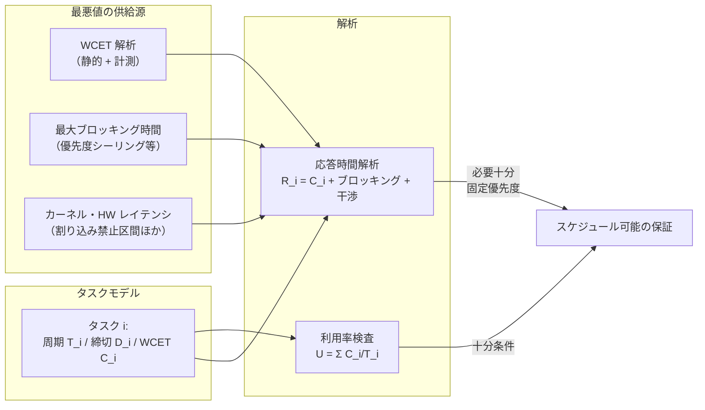

# リアルタイムシステム基礎 (Real-Time Systems Fundamentals)

## 概要 (Overview)

リアルタイムシステム (real-time system) とは、**計算結果の正しさが「値」だけでなく「時刻」にも依存する**システムである。締切 (deadline) までに正しい値を出せなければ、遅れて出た正しい値は無価値（ソフトリアルタイム）か、危害（ハードリアルタイム）になる。重要なのは、リアルタイム＝高速ではないことだ——要求されるのは速さではなく**決定性 (determinism)**、すなわち最悪ケースの挙動が事前に保証できることである。汎用 OS とハードウェアが過去半世紀「平均を速くする」方向（キャッシュ・投機・公平スケジューリング）に進化してきたのに対し、リアルタイムシステムはまさにその平均化機構が**最悪ケースを予測不能にする**という緊張関係の上に立っている。

本ドキュメントは、リアルタイムスケジューリング理論（固定優先度と EDF、スケジューラビリティ解析）、優先度逆転という古典的落とし穴、レイテンシの解剖、そして最悪実行時間 (WCET) 解析までを、`../operating-systems/process-thread-scheduling.md`（公平性指向のスケジューリング）と `../../hardware/cpu-architecture/`（平均指向のマイクロアーキテクチャ）の**対照編**として整理する。`../../hardware/robotics/control-systems.md` が要求した「1 kHz・低ジッタの制御ループ」が、なぜ・どうすれば保証できるのかに答える理論的土台である。

CLAUDE.md の方針に従い分析深度は Level 3（完全）を既定とし、各主張には原典論文（Liu & Layland ほか）と標準的教科書（Buttazzo）を典拠として付す。

## 方法論 (Methodology)

- 「速い」と「決定的」を峻別する軸をまず立て、以降のすべての議論（スケジューリング・ロック・キャッシュ）をこの軸で評価する。
- スケジューリング理論は、**周期タスクモデルという理想化**の上に成り立つことを明示し、理想化が壊れる箇所（ブロッキング・ジッタ・WCET の不確かさ）を実務の主題として扱う。
- 事故事例（Mars Pathfinder の優先度逆転）を理論の動機付けとして使い、対策（優先度継承）の限界まで含めて扱う。
- 数値は代表的な桁感（µs〜ms）を優先し、特定ハードウェアの精密値は扱わない。

## 発見事項 (Findings)

1. **リアルタイム性の分類は「締切を破ったときの損失関数」で決まる。** ハード（破った瞬間に危害・システム失敗: 制御ループ、エアバッグ）、ファーム（結果が無価値になるが致命でない: 映像フレーム）、ソフト（価値が漸減する: UI 応答）。同一システム内にこれらが混在するのが実際で、後述の混合クリティカリティ設計（`rtos-architectures.md`）の動機になる。
2. **固定優先度スケジューリングには利用率の理論限界がある。** 周期タスクに周期の短い順で優先度を付ける **レートモノトニック (rate-monotonic, RM)** は固定優先度の中で最適だが、スケジュール可能と保証できる CPU 利用率は `n(2^{1/n} − 1)`——タスク数が増えると **約 69.3% (ln 2)** に収束する[^liu-layland]。「CPU が 3 割空いているのに間に合わない」ことが理論的に起こりうる。
3. **EDF は利用率 100% まで保証するが、過負荷時の挙動で固定優先度に譲る。** 締切が最も近いタスクを実行する **EDF (earliest deadline first)** は動的優先度の最適解で、利用率 ≤ 100% ならスケジュール可能[^liu-layland]。しかし過負荷になると**どのタスクが落ちるか予測できない**（ドミノ倒し）のに対し、固定優先度は「低優先度から順に落ちる」という優雅な劣化をする。産業界で固定優先度が支配的な理由の一つがこの過負荷挙動である。
4. **優先度逆転は「ロックが優先度を無効化する」構造問題であり、実害を伴って実証済みである。** 低優先度タスクが持つロックを高優先度タスクが待つ間に、中優先度タスクが低優先度タスクを横取りすると、高優先度タスクが**無関係な中優先度タスクの分だけ**待たされる。1997 年の Mars Pathfinder は火星上でこれによるウォッチドッグリセットを繰り返し、地上から**優先度継承 (priority inheritance) を有効化するパッチ**で復旧した[^pathfinder]。優先度継承・優先度シーリング[^sha]はブロッキングを有界にするが、ゼロにはしない——解析には最大ブロッキング時間の算入が必要である。
5. **「割り込みからタスク起床まで」のレイテンシは複数の層の和であり、最悪値は平均値の数十〜数百倍になりうる。** 割り込み禁止区間、ISR 実行、スケジューラ起動、コンテキストスイッチ、そしてキャッシュ・TLB の再充填。さらに SMI (system management interrupt) や DMA によるバス競合など **OS の管理外の要因**が混入する。リアルタイム性能の指標が平均ではなく**最悪値とその分布（ヒストグラムの裾）** で測られるのはこのためである（`../../hardware/cpu-architecture/interrupts-exceptions-traps.md` が物理側の土台）。
6. **WCET はもはや「測る」ものではなく「論証する」ものである。** キャッシュ・分岐予測・アウトオブオーダ実行は実行時間を入力とマイクロアーキテクチャ状態の関数にし、素朴な計測は最悪ケースを踏む保証がない。静的解析（抽象解釈でキャッシュ状態を追跡）と計測ベースの混成が実務だが、**共有キャッシュ・メモリコントローラを持つマルチコアでは、他コアの挙動が自コアの WCET を左右する**ため、解析は質的に難しくなる[^wilhelm]。コア分離・キャッシュパーティショニングといった「予測可能性のためにハードウェアを単純化して使う」技法が標準になった。
7. **リアルタイム設計とは「平均性能を最悪保証に売る」一連の取引である。** キャッシュを分割すれば平均は落ち最悪は締まる。投機を切れば遅くなるが予測できる。ページフォルトを禁じればメモリ効率を失い決定性を得る。この取引の感覚が、汎用システム設計との最大の文化差である。

## アーキテクチャ (Architecture)

### タスクモデルとスケジューラビリティ解析の流れ



- **保証は連鎖である**: スケジューラビリティの証明は WCET・ブロッキング・カーネルレイテンシの最悪値を入力とするため、どれか一つでも「測っただけの楽観値」なら全体の保証が崩れる。リアルタイムシステムの検証が「動いた」ではなく「論証できた」を要求する理由がここにある。

### 汎用 OS との設計目標の対照

| 観点 | 汎用 OS（`../operating-systems/`） | リアルタイム |
|---|---|---|
| 最適化目標 | スループット・平均レイテンシ・公平性 | 最悪レイテンシの上界 |
| スケジューラ | CFS/EEVDF: 公平配分 | 固定優先度 or EDF: 締切 |
| メモリ | デマンドページング・オーバーコミット | 事前確保・ページ固定 (`mlockall`) |
| ロック | スリープ・公平性 | 優先度継承付き・保持時間の上界 |
| 割り込み | スループット優先の遅延処理 | 禁止区間の最小化・スレッド化 |
| 評価指標 | ベンチマークの平均・p99 | ヒストグラムの最大値（観測最悪） |

## 技術詳細 (Technical Details)

### 1. 周期タスクモデルとスケジューリング (Task Model & Scheduling)

標準モデルでは、タスク `τ_i` は周期 `T_i` ごとに起動し、WCET `C_i` の仕事を相対締切 `D_i` までに終える。利用率は `U = Σ C_i / T_i`。

**固定優先度 (RM/DM)**:

```
RM 可保証条件（十分条件, D_i = T_i）:
  U ≤ n·(2^(1/n) − 1)      n=2: 0.828, n→∞: ln 2 ≈ 0.693

応答時間解析（必要十分, 反復計算）:
  R_i = C_i + B_i + Σ_{j∈hp(i)} ⌈R_i / T_j⌉ · C_j     R_i ≤ D_i を検査
  （B_i: 最大ブロッキング, hp(i): τ_i より高優先度の集合）
```

- 利用率検査は簡便だが悲観的で、境界を超えても実際は間に合う場合が多い。設計の主力は**応答時間解析 (response time analysis)** であり、干渉（高優先度の横取り）とブロッキング（ロック待ち）を明示的に足し込む[^buttazzo]。
- 締切が周期より短い場合は締切単調 (deadline-monotonic, DM) が固定優先度の最適となる。

**EDF**: `U ≤ 1` が必要十分（`D_i = T_i` のとき）。理論上は 31% 分のハードウェアを節約できるが、実装（締切のキュー管理）・解析（過負荷時）・普及（既存 RTOS は固定優先度）を理由に、採用は限定的である。この「最適だが使われない」構図自体が、リアルタイム分野が理論より**保証の説明可能性**を重んじることの現れといえる。

### 2. 優先度逆転と資源共有プロトコル (Priority Inversion & Resource Protocols)

```
優先度: H (高) > M (中) > L (低)、H と L が mutex を共有

L がロック取得 → H が起床しロック待ち → M が起床し L を横取り
  ⇒ H は「M の実行時間ぶん」待たされる（逆転が M の数だけ延びる）
```

- **優先度継承 (priority inheritance)**: ロック保持者にブロックしている最高優先度を一時付与する。逆転は「保持者のクリティカルセクション長」まで縮む。ただし連鎖ブロッキング・デッドロックは防げない[^sha]。
- **優先度シーリング (priority ceiling)**: 各ロックに「そのロックを使う最高優先度」を静的に付与し、取得可否をシーリングで判定する。ブロッキングは**高々1回・1クリティカルセクション**に有界化され、デッドロックも構造的に排除される——静的な設計情報（誰がどのロックを使うか）を要求する代わりに強い保証を得る、リアルタイム設計の典型的な取引である[^sha]。
- Pathfinder の教訓は「理論の欠如」ではなく「**既知の理論が既定で無効だった**」ことにある（VxWorks の mutex は優先度継承がオプションだった）[^pathfinder]。安全側の既定値の重要性を示す事例として、`../security/`・`../../hardware/automotive/functional-safety-iso26262.md` の議論と響き合う。
- 言語メモリモデル・lock-free 構造（`../concurrency/lock-free-data-structures.md`）はブロッキング自体を消す選択肢だが、「wait-free でなければ最悪時間の保証にならない」点に注意（lock-free は個々のスレッドの完了を保証しない）。

### 3. レイテンシの解剖 (Anatomy of Latency)

割り込み発生からユーザタスクの応答までの遅延は、次の層の和になる:

| 層 | 内容 | 典型的な支配要因 |
|---|---|---|
| 割り込み遅延 | 割り込み禁止区間の残り + ベクタ分岐 | カーネル内の最長 IRQ-off 区間 |
| ISR 実行 | ハンドラ本体 | ISR で「やりすぎない」設計規律 |
| スケジューリング遅延 | 起床からディスパッチまで | プリエンプション不能区間・実行キュー操作 |
| コンテキストスイッチ | レジスタ・アドレス空間切替 | `../operating-systems/process-thread-scheduling.md` |
| **マイクロアーキ再充填** | キャッシュ・TLB・分岐予測器のミス | **最悪値を支配することが多い** |

- 最後の行が本質的で、コンテキストスイッチの「直接コスト」より、切替後にキャッシュ・TLB が冷えていることの**間接コスト**が最悪応答を支配する（`../../hardware/cpu-architecture/cache-memory-hierarchy.md`・`virtual-memory-mmu.md` の議論の裏面）。
- OS の外からの妨害——SMI（ファームウェアが OS に見えない時間を奪う）、DMA のメモリ帯域競合、周波数遷移 (DVFS) のストール——は、OS をどれだけ鍛えても残る。リアルタイムプラットフォームの選定が「CPU 性能表」ではなく**実測ヒストグラム（cyclictest 等）** で行われる理由である。
- 測定論としては、最悪値は分布の裾の問題であり、長時間・実負荷条件での観測が要る（`../observability/observability-performance-engineering.md` のレイテンシ計測方法論と接続する）。

### 4. WCET 解析 (Worst-Case Execution Time Analysis)

```
安全な WCET 上界の要件: 実際に起こりうるどの実行よりも大きいこと
有用な WCET 上界の要件: 過大評価が小さいこと（悲観の分だけ HW を過剰調達する）
```

- **静的解析**: 制御フローグラフ上で、ループ上界・到達可能パスを制約として与え、キャッシュ・パイプラインの状態を抽象解釈で追跡して命令列の時間を上界評価する。単純なインオーダ・コアでは実用的な精度が出る[^wilhelm]。
- **計測ベース**: 実機で大量計測し、極値統計等で上界を推定する。マイクロアーキテクチャが複雑で静的モデルが作れない場合の現実解だが、「最悪の初期状態を踏んだ」保証はない。
- **マルチコアの困難**: 共有 LLC・メモリコントローラ・インターコネクトを介して**他コアのワークロードが自コアの実行時間に干渉**する。対策は分離である——コア専有、キャッシュパーティショニング（way 分割やページ配色）、メモリ帯域の regulation。`../../hardware/cpu-architecture/dram-memory-controllers.md` のバンク競合・`cache-coherence.md` のコヒーレンストラフィックが、ここでは「保証を壊すノイズ源」として再登場する。
- タイミングの予測可能性を最初から設計目標にしたコア（投機の制限、スクラッチパッドメモリ）という潮流もあり、「平均を売って最悪を買う」取引がハードウェア設計にまで遡る。

## セキュリティ考察 (Security Considerations)

- **タイミングは攻撃面である。** リアルタイムシステムでは「遅くさせる」ことが「壊す」ことと等価になる。共有資源（キャッシュ・メモリ帯域・ロック）を経由して高クリティカリティタスクの WCET を膨らませる干渉攻撃は、機能を直接侵害せずに締切ミスを誘発できる。WCET 解析で用いた分離機構（パーティショニング・帯域 regulation）は、そのまま**サービス妨害への防御**でもある。
- **優先度と資源の設定は完全性保護の対象**: タスク優先度・アフィニティ・ロック属性の改竄は、コード改竄なしにシステムを不安定化できる（Pathfinder が偶然示したとおり、フラグ1つで挙動が激変する）。`../../hardware/robotics/control-systems.md` のパラメータ完全性の議論がそのまま適用される。
- **サイドチャネルとの表裏**: 実行時間が状態に依存しないこと（定時間実行）は、暗号実装ではサイドチャネル対策（`../../hardware/hardware-security/side-channels-tee-secure-boot.md`）として、リアルタイムでは WCET のタイト化として、同じ設計原理が別の動機で要求される。決定性の追求はセキュリティと利害が一致することが多い。
- ハードリアルタイム系は多くの場合安全関連系でもあり、時間保護 (temporal protection) は空間保護（メモリ分離）と並ぶ干渉からの自由 (freedom from interference) の柱として、`autosar-vehicle-software.md`・`rtos-architectures.md` の認証の文脈に接続する。

## 結論 (Conclusions)

リアルタイムシステムの理論は「速さ」の理論ではなく **「上界の存在を論証する」理論**である。スケジューラビリティ解析は WCET・ブロッキング・レイテンシという最悪値の連鎖の上に立ち、その各項が、汎用計算機が平均のために導入した機構（キャッシュ・投機・公平スケジューラ・遅延処理）とことごとく衝突する。リアルタイム設計の実務とは、この衝突を分離（パーティショニング）と規律（優先度プロトコル・ページ固定・ISR 最小化）で解消し、**平均性能を最悪保証に交換する**ことに尽きる。

### 続編への橋渡し

この理論を実装するカーネルたち——保証の強さと引き換えに何を要求するかが異なる設計群——を [`rtos-architectures.md`](rtos-architectures.md) で比較する。理論が要求した「有界なカーネルレイテンシ」「優先度継承」「時間・空間の分離」が、FreeRTOS から seL4・ARINC 653 までの設計空間にどう実装されているかを見る。

---

## 参考文献 (References)

[^liu-layland]: Liu, C. L. & Layland, J. W. (1973). Scheduling Algorithms for Multiprogramming in a Hard-Real-Time Environment. *Journal of the ACM*, 20(1), 46–61. DOI: 10.1145/321738.321743 — RM/EDF と利用率限界の原典。

[^sha]: Sha, L., Rajkumar, R. & Lehoczky, J. P. (1990). Priority Inheritance Protocols: An Approach to Real-Time Synchronization. *IEEE Transactions on Computers*, 39(9), 1175–1185. DOI: 10.1109/12.57058 — 優先度継承・優先度シーリングの原典。

[^pathfinder]: Jones, M. B. (1997). *What really happened on Mars?* — Glenn Reeves (JPL, Pathfinder ソフトウェアチームリーダー) の報告を含む記録。https://www.cs.cornell.edu/courses/cs614/1999sp/papers/pathfinder.html — Accessed: 2026-07-12. — 優先度逆転事故の一次証言。

[^wilhelm]: Wilhelm, R. et al. (2008). The Worst-Case Execution-Time Problem — Overview of Methods and Survey of Tools. *ACM Transactions on Embedded Computing Systems*, 7(3), 1–53. DOI: 10.1145/1347375.1347389 — WCET 解析の標準サーベイ。

その他の標準的典拠:

- Buttazzo, G. C. (2011). *Hard Real-Time Computing Systems: Predictable Scheduling Algorithms and Applications* (3rd ed.). Springer. — 応答時間解析・EDF・過負荷制御を含む標準教科書。
- Audsley, N., Burns, A., Richardson, M., Tindell, K. & Wellings, A. (1993). Applying New Scheduling Theory to Static Priority Pre-emptive Scheduling. *Software Engineering Journal*, 8(5), 284–292. — 応答時間解析の定式化。
