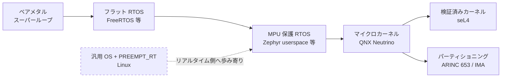
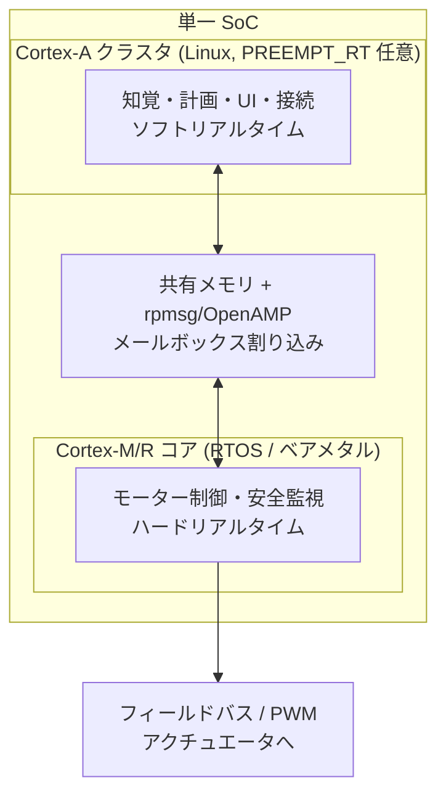

# RTOS アーキテクチャ (RTOS Architectures)

## 概要 (Overview)

`realtime-fundamentals.md` の理論が要求するもの——有界なカーネルレイテンシ、優先度継承、時間と空間の分離——を、実際のカーネルはどう実装しているか。本ドキュメントは、リアルタイムカーネルの設計空間を**「保証の強さと、その保証に払うコスト」のスペクトラム**として整理する: ベアメタルのスーパーループから、フラットアドレス空間の小型 RTOS (FreeRTOS)、保護と汎用性を足した Zephyr、メッセージパッシングのマイクロカーネル (QNX)、数学的に検証されたカーネル (seL4)、時間・空間を規格で分割するパーティショニング OS (ARINC 653) まで。あわせて、PREEMPT_RT によってリアルタイム側へ歩み寄った Linux との使い分け、単一 SoC 上に両者を共存させる混合クリティカリティ構成、そして安全規格認証がカーネル選定に課す制約を扱う。

`../operating-systems/` の Linux 内部分析、`../../hardware/hw-sw-interface/`（割り込み・ブート）、`../../hardware/robotics/`（1 kHz 制御ループの実行環境）、`../../hardware/aerospace/avionics-gnc.md`（冗長計算機）への相互参照で、両スタックを接続する。

CLAUDE.md の方針に従い分析深度は Level 3（完全）を既定とし、各主張には一次文献（seL4 の SOSP 論文、ARINC 653 仕様）と公式文書を典拠として付す。

## 方法論 (Methodology)

- カーネルを機能リストではなく**設計原理**——何を信頼し (TCB)、何を分離し、何を静的に決めるか——で比較する。
- 各アーキテクチャに「守れる保証」と「引き換えに要求するもの」（メモリ・レイテンシ・開発の静的性・コスト）を対で付す。
- Linux (PREEMPT_RT) を「RTOS の代替」ではなく**設計空間の一点**として同じ軸に載せ、使い分けの判断基準を明示する。
- 認証（IEC 61508 / DO-178C / ISO 26262）は技術要件ではなく**証拠の要件**として扱う——「何ができるか」ではなく「何を証明する文書と過程があるか」。

## 発見事項 (Findings)

1. **RTOS を RTOS たらしめるのは機能ではなく「上界の存在」である。** 完全プリエンプティブなカーネル、O(1) の固定優先度スケジューラ、有界な割り込み禁止区間、優先度継承付き mutex——どれも汎用 OS にもある要素だが、RTOS はそれらの**最悪値を仕様として文書化し保証する**。カーネル選定で見るべきはベンチマークの平均ではなく、最悪レイテンシの保証値とその測定条件である。
2. **設計空間の第一軸は「アドレス空間をどう扱うか」である。** フラット（FreeRTOS: カーネルとタスクが同一空間、故障は全体に波及、フットプリント数十 KB）→ MPU 保護（Zephyr のユーザモード: 領域単位の隔離）→ 完全な MMU 分離（QNX・Linux: プロセスモデル）。分離が強いほど故障封じ込めと認証が楽になり、レイテンシとメモリを払う。`../../hardware/cpu-architecture/virtual-memory-mmu.md` の機構が「信頼性の道具」として再登場する。
3. **マイクロカーネルはリアルタイム分野では傍流ではなく本流である。** 汎用 OS では性能問題とされたマイクロカーネル（ドライバ・FS をユーザ空間サーバへ、カーネルは IPC とスケジューリングのみ）は、QNX Neutrino が車載・医療・産業で数十年の実績を持つ[^qnx]。理由は明快で、**カーネルが小さいほど「有界性の証明」と「安全認証」の対象が小さくなる**からである。同期メッセージパッシング（送信側から受信側への優先度伝播つき）が優先度逆転をカーネル設計レベルで抑える。
4. **seL4 は「テストでなく証明」の到達点を示した。** 機能的正しさの機械検証（実装が仕様に一致することの定理証明）に加え、整数オーバーフローや不正ポインタの不在、そして WCET 解析までを備える汎用マイクロカーネルであり[^sel4]、「カーネルにバグがない」ことを前提にできる唯一級の選択肢である。代償は、その保証が特定の構成・特定のアーキテクチャに限られること、そしてカーネルの上に載せるものの正しさは別問題であることだ——**TCB の底が固くなっただけで、塔全体が正しくなるわけではない**。
5. **ARINC 653 のパーティショニングは「OS による連邦制」である。** 航空電子機器の統合モジュラーアビオニクス (IMA) では、単一計算機上の複数アプリケーションを**固定周期の時間スロット（時間分割）と MMU による空間分割**で相互隔離し、パーティション内は各自の OS/スケジューラで動く[^arinc653]。DAL の異なるソフトウェアの同居を認証可能にする枠組みであり、`../../hardware/automotive/ee-architecture.md` の ECU 統合・`../virtualization/` のハイパーバイザと同型の問題への、最も規律の強い解である。
6. **PREEMPT_RT のメインライン化（Linux 6.12, 2024）で「Linux で足りる範囲」が広がった。** スピンロックのスリープ化・割り込みのスレッド化・完全プリエンプションにより、適切に構成した Linux は数十〜数百 µs 級の最悪レイテンシに到達する。エコシステム（ドライバ・言語・コンテナ）を丸ごと使える利点は圧倒的で、実務の線引きは概ね: **周期 ≥ 1 ms・認証不要 → PREEMPT_RT Linux で足りることが多い / 周期 < 数百 µs・安全認証・故障時挙動の証明が要る → RTOS**。ただし Linux の保証は「観測上の最悪値」であり、「論証された上界」ではない——この質的差は認証の壁として残る。
7. **現代の主流は「使い分け」ではなく「共存」である。** ヘテロジニアス SoC（Cortex-A + Cortex-M/R)上で、Linux が知覚・計画・接続を、RTOS コアがモーター制御・安全監視を担い、共有メモリ + rpmsg で通信する AMP 構成が、ロボット（`../../hardware/robotics/robotics-fundamentals.md` の計算機階層）・車載・産業機器の標準形になった。「どの OS を選ぶか」は「どの機能をどの島に置くか」という配置問題に変わっている。

## アーキテクチャ (Architecture)

### 設計空間 — 保証の強さ × 払うコスト

| 設計 | 分離の単位 | 故障の封じ込め | 保証の性格 | 典型フットプリント/レイテンシ |
|---|---|---|---|---|
| ベアメタル | なし | なし（全体停止） | コード全体を自分で論証 | 最小・最速（µs 未満も可） |
| FreeRTOS 系 | なし（同一空間） | なし | カーネル API の有界性 | 数十 KB・数 µs 級 |
| Zephyr (userspace) | MPU 領域 | スレッド/領域単位 | 同上 + 空間保護 | 数百 KB 級 |
| QNX Neutrino | MMU プロセス | サーバ単位で再起動可 | マイクロカーネルの小ささ + 実績 | MB 級・数 µs〜数十 µs |
| seL4 | ケーパビリティ + MMU | オブジェクト単位 | **機械証明**（機能正しさ・WCET） | 小・ただし構築コスト大 |
| ARINC 653 | 時間 + 空間パーティション | パーティション単位 | 規格化されたスケジュール表 | 認証プロセス込みで高コスト |
| Linux PREEMPT_RT | MMU プロセス | プロセス単位 | 観測ベース（証明なし） | GB 級・数十〜数百 µs |

### 混合クリティカリティの標準構成（ヘテロジニアス SoC / AMP）

- 分離の実体はハードウェアである（別コア・別メモリ領域・別ペリフェラル割当）。ハイパーバイザ型（Jailhouse・Xen 等でコアを静的分割）は同じ発想を仮想化機構（`../virtualization/hardware-virtualization-containers.md`）で実現する変種。
- `../../hardware/robotics/robot-software-stack.md` の「決定性の島と分散システムの海」の境界が、ここでは**シリコン上の物理的な線**として引かれている。

## 技術詳細 (Technical Details)

### 1. リアルタイムカーネルの内部規律 (Kernel Disciplines)

- **スケジューラ**: 固定優先度・プリエンプティブが標準（優先度数 32〜256）。同一優先度内はラウンドロビンまたは FIFO。実行キューはビットマップ + 優先度別リストで **O(1)** を守る。tickless（必要な時刻にだけタイマ割り込み）は省電力だけでなくジッタ低減にも効く。
- **割り込み規律**: ISR は「確認・記録・起床」のみで即座に返し、実処理は優先度付きタスクに委ねる（deferred processing）。これにより「割り込みの重要度」と「処理の重要度」を分離でき、割り込み禁止区間はカーネル内の短い臨界区間だけに限定される。
- **メモリ規律**: ヒープの動的確保は起動時のみ、実行中は固定サイズブロックプール——断片化と確保時間の非決定性を排除する。汎用アロケータ（`../operating-systems/` の議論）が解いている問題を、「実行中に確保しない」ことで消している。
- **時間 API**: 絶対時刻ベースの周期起床（`sleep_until` 型）が基本。相対スリープの繰返しは誤差が累積する——制御周期の実装の基本規律であり、`../../hardware/timekeeping/clocks-time-synchronization.md` のクロック源がその土台になる。

### 2. QNX Neutrino — メッセージパッシングの徹底 (Microkernel in Practice)

- カーネルはスケジューリング・IPC・割り込み配送・タイマのみ。ドライバ・ファイルシステム・ネットワークスタックはすべてユーザ空間の「リソースマネージャ」であり、クラッシュしても再起動できる[^qnx]。
- IPC は**同期メッセージパッシング** (`MsgSend`/`MsgReceive`/`MsgReply`)。送信側は応答まで待つため、サーバは**クライアントの優先度で実行される**（優先度伝播）——マイクロカーネル構成でサーバが優先度逆転の温床になる問題を、IPC の意味論で解いている。
- POSIX API をマイクロカーネル上に実装しており、「マイクロカーネルの分離」と「Unix の開発体験」を両立させたことが、車載（デジタルコックピット・ADAS）での採用実績につながっている。

### 3. seL4 — 証明されたカーネル (Verified Kernel)

- 約 1 万行の C 実装に対し、抽象仕様 → 実行可能仕様 → C 実装の**精緻化 (refinement) の定理証明**を Isabelle/HOL で構築。「実装は仕様が許す挙動しかしない」が数学的事実になる[^sel4]。
- 資源アクセスはすべて**ケーパビリティ (capability)**——権限を表す偽造不能なトークン——経由で、権限の分配が明示的・検査可能になる。`../security/` の最小権限原則のカーネルレベル実装といえる。
- 限界も明確である: 証明は特定 ISA・特定構成・単一コア構成が中心で、マルチコアや検証対象外のユーザ空間コードには及ばない。seL4 が与えるのは「信頼の底板」であり、システム全体の保証はその上の設計の仕事として残る。

### 4. ARINC 653 と統合モジュラーアビオニクス (Partitioned OS & IMA)

- **時間分割**: メジャーフレーム内の固定スケジュール表で各パーティションに時間窓を割り当てる。パーティションがどれだけ暴走しても、他パーティションの時間窓は侵せない——`realtime-fundamentals.md` の干渉解析を「そもそも干渉できない」構造で置き換える。
- **空間分割**: パーティションごとの MMU 保護 + 静的なメモリ・I/O 割当。通信は規格化されたポート（サンプリング/キューイング）に限定。
- DO-178C の DAL（Design Assurance Level, A〜E）が異なるアプリケーションの同居を可能にし、連邦航空局系の認証実務と一体で運用される。`../../hardware/aerospace/avionics-gnc.md` の冗長計算機と組み合わさって、航空電子の計算基盤を構成する。車載で対応するのは ISO 26262 の ASIL 分解と「干渉からの自由」であり、`autosar-vehicle-software.md` で扱う。

### 5. Linux PREEMPT_RT — 汎用 OS の到達点と限界 (Linux as an RTOS)

- 機構: ほぼ全域のプリエンプション許可、spinlock の rt_mutex 化（スリープ可能・優先度継承付き）、割り込みハンドラのスレッド化（優先度を付けられる）、高分解能タイマ。ユーザ側の規律（`mlockall`、SCHED_FIFO、CPU isolation、`../../hardware/robotics/robot-software-stack.md` 参照）と組み合わせて初めて効く。
- 到達点: 適切なハードウェアと構成で最悪数十 µs 級（実測ベース）。1 kHz の制御ループ・オーディオ・産業制御の広い範囲を飲み込んだ。
- 限界: (1) 保証が**観測**であり論証でないこと——数千万行のカーネルに静的な上界解析は事実上不可能。(2) 安全認証の困難——変更速度と規模が「凍結して証明する」認証モデルと相性が悪い（Linux の機能安全利用を目指す取り組みはあるが、認証済み RTOS の代替には未達）。(3) SMI・ファームウェア起因の外乱は OS では消せない。
- 帰結として、Linux は混合クリティカリティ構成の「豊かな側の島」に置き、証明が要る仕事は認証済み RTOS・専用コアに置く、という発見事項 7 の分業に落ち着く。

### 6. 安全規格認証 — 証拠としてのカーネル (Certification)

| 規格 | 分野 | 完全性レベル | カーネルに要求されるもの |
|---|---|---|---|
| IEC 61508 | 産業（基本規格） | SIL 1–4 | 開発プロセス証拠・故障率解析・ツール適格性 |
| DO-178C | 航空 | DAL E–A | 要件↔コード↔テストの完全トレーサビリティ（DAL A は MC/DC 網羅） |
| ISO 26262 | 車載 | ASIL A–D | 同上 + 干渉からの自由の論証 (`../../hardware/automotive/functional-safety-iso26262.md`) |
| IEC 62304 | 医療 | Class A–C | ソフトウェアライフサイクル証拠 |

- 認証されるのは「カーネルのバイナリ」ではなく**「このカーネルをこの構成で使うことが安全だとする論証と証拠一式」**であり、ベンダは認証キット（安全マニュアル・テスト証拠・既知制限）を製品として販売する。商用 RTOS の価格の実体はコードではなくこの証拠である。
- 認証は構成を凍結する——「アップデートし続ける」現代のソフトウェア観と本質的に衝突し、再認証コストが SDV・OTA 時代の車載アーキテクチャ設計（`autosar-vehicle-software.md`）の主要な設計制約になっている。

## セキュリティ考察 (Security Considerations)

- **分離アーキテクチャは安全とセキュリティの共用インフラである。** MMU/MPU 分割・パーティショニング・ケーパビリティは、故障の封じ込め（安全）と侵害の封じ込め（セキュリティ）を同じ機構で提供する。逆に FreeRTOS 級のフラット空間では、任意の脆弱性が即カーネル権限に等しい——ネットワークに面する組み込み機器がフラット RTOS のままであることは、IoT セキュリティの構造的弱点である（Zephyr のユーザスペース導入はこの圧力への応答）。
- **カーネルの証明はエクスプロイト面を質的に狭める。** seL4 の検証はメモリ安全性違反の不在を含み、カーネルエクスプロイトのクラスを原理的に排除する。`../security/memory-safety-exploit-mitigations.md` の緩和策の積み上げに対し、「そもそもバグがないことを証明する」という対極のアプローチである。
- **ブートと更新の信頼連鎖**: RTOS 機器の secure boot・署名付き更新は `../../hardware/hw-sw-interface/boot-initialization.md`・`../../hardware/hardware-security/side-channels-tee-secure-boot.md` の機構に依存する。認証済み構成の凍結と脆弱性パッチの適時性という**安全とセキュリティの時間軸の衝突**が、この分野の未解決な運用課題である（車載の ISO/SAE 21434 と ISO 26262 の並走が示すとおり）。
- **リアルタイム性そのものの防御**: `realtime-fundamentals.md` で述べた干渉攻撃への防御（時間パーティショニング・帯域 regulation）は、ARINC 653 型の設計が最初から備えているものであり、セキュリティ要件としての「時間の分離」は今後、車載・産業にも規格として降りてくる方向にある。

## 結論 (Conclusions)

RTOS の設計空間は、**「どれだけ強い保証を、どれだけ小さい信頼基盤 (TCB) の上で、どれだけの証拠と共に出すか」**の一軸に整理できる。フラット RTOS は最小コストで有界性を、マイクロカーネルは分離と実績を、seL4 は数学的証明を、ARINC 653 は規格化された時間・空間の連邦制を提供し、PREEMPT_RT Linux はエコシステムを丸ごと持ち込む代わりに「観測ベースの保証」で妥協する。そして現代の実システムはこれらを**択一せず、ヘテロジニアス SoC 上の島として共存**させる——保証が要る仕事を小さく固い島に、豊かさが要る仕事を大きく柔らかい島に置く配置問題として。

### 続編への橋渡し

この配置問題を産業として最も大規模に規格化したのが車載である。[`autosar-vehicle-software.md`](autosar-vehicle-software.md) では、OSEK から AUTOSAR Classic/Adaptive への系譜を、「本ドキュメントの設計空間が業界標準としてどう制度化されたか」として読む。

---

## 参考文献 (References)

[^sel4]: Klein, G. et al. (2009). seL4: Formal Verification of an OS Kernel. *Proc. ACM SOSP 2009*, 207–220. DOI: 10.1145/1629575.1629596 — カーネルの機能的正しさの機械証明の原典。

[^qnx]: BlackBerry QNX. *QNX Neutrino RTOS: System Architecture* (公式アーキテクチャガイド). https://www.qnx.com/developers/docs/ — Accessed: 2026-07-12. — マイクロカーネル・同期メッセージパッシング・リソースマネージャの一次資料。

[^arinc653]: ARINC Specification 653: *Avionics Application Software Standard Interface* (Part 1: Required Services). SAE ITC / ARINC. — 時間・空間パーティショニングと APEX API の規格一次資料。

その他の標準的典拠:

- [The Linux Foundation — PREEMPT_RT / Real-Time Linux プロジェクト文書](https://wiki.linuxfoundation.org/realtime/start) — Accessed: 2026-07-12. — スリープするスピンロック・スレッド化割り込みの公式解説。
- [FreeRTOS Kernel Documentation](https://www.freertos.org/Documentation/RTOS_book.html) — Accessed: 2026-07-12. — フラット空間小型カーネルの代表実装の公式文書。
- [Zephyr Project Documentation — User Mode](https://docs.zephyrproject.org/latest/kernel/usermode/index.html) — Accessed: 2026-07-12. — MPU ベースの空間保護の実装例。
- RTCA DO-178C (2011). *Software Considerations in Airborne Systems and Equipment Certification*. — 航空ソフトウェア認証の規格。
- IEC 61508 (2010). *Functional Safety of Electrical/Electronic/Programmable Electronic Safety-related Systems*. — 機能安全の基本規格。
