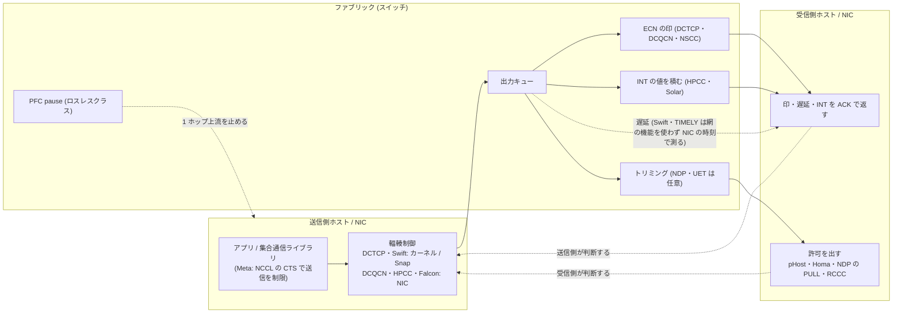
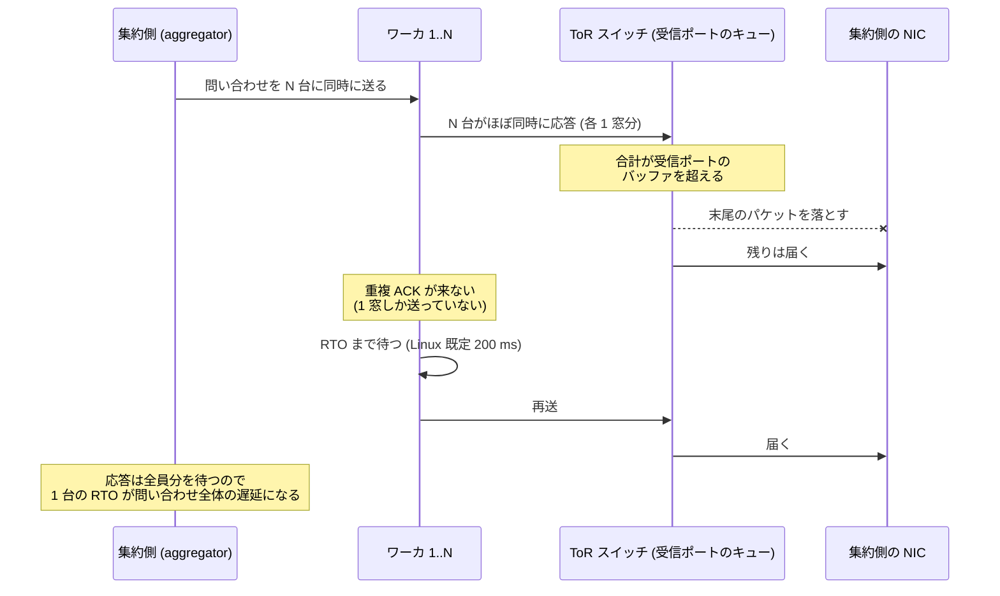

# データセンターの輻輳制御とトランスポート (Datacenter Congestion Control & Transport)

## 概要 (Overview)

本ドキュメントはデータセンターの中で使われる輻輳制御 (congestion control) とトランスポートプロトコルを扱う。インターネット向けの TCP の輻輳制御 (Reno・CUBIC・BBR) は [`tcp-transport-congestion.md`](tcp-transport-congestion.md) が扱い、その第 10 節がデータセンターへの短い橋渡しになっている。本書はその橋の先にあたる。DCTCP、RDMA 向けの DCQCN と TIMELY、PFC の故障と IRN、遅延を使う Swift、帯域内テレメトリを使う HPCC、受信側が送信を許可する pHost・NDP・Homa・ExpressPass、ハイパースケーラの独自トランスポート (AWS SRD・Google Falcon・Azure の RDMA・Alibaba Solar)、AI 学習のトラフィックと Ultra Ethernet Transport (UET) を順に読む。

検証する仮説は次のとおりである。データセンターではインターネットの制約が外れる。所有者は 1 つで、トポロジは既知、RTT は µs 級で、スイッチと NIC はプログラムできる。そのため輻輳制御は「端点が網の状態を推測する問題」から「ホスト・NIC・スイッチを一緒に設計する問題」に変わる。そして各方式の違いは主に、**どの信号を信じるか** (ロス・ECN・遅延・帯域内テレメトリ・受信側のクレジット) と、**制御ループをどこに置くか**で説明できる。

資料を読んだ結論として、この仮説はおおむね成り立つが、2 点で修正が要る。第 1 に、一緒に設計する範囲は対称ではない。研究では HPCC や NDP のようにスイッチに新しい機能を求める方式が成果を出した。一方で本番に広く入った方式 (Swift・SRD・Falcon) は、スイッチに求めるものをむしろ減らし、ホストと NIC の側に知恵を集めた。Swift の論文は遅延を信号に選んだ理由として、スイッチの機能や設定を気にせずに新しい世代のスイッチを入れられることを挙げている (Kumar et al. 2020)。UET もスイッチに必須とするのは ECMP と ECN の印付けだけで、パケットのトリミングは任意である (Hoefler et al. 2025)。第 2 に、制御ループの置き場所はトランスポートの外にまで広がった。Meta は AI 学習の網で DCQCN を止め、集合通信ライブラリ (NCCL) の受信側からの送信許可 (clear-to-send) で網に入る量を抑えている (Gangidi et al. 2024)。信号の選び方は運用の現実 (NIC の世代の混在、ファームウェアの不具合、パラメータの調整の難しさ) と、どの経路でパケットを散らすかという負荷分散の選択に強く縛られている。分析深度は Level 3。

## 方法論 (Methodology)

- **一次資料**: 各方式の原論文 (SIGCOMM・NSDI・CoNEXT・IEEE Micro) を本文から読み、パラメータと結果を確かめた。DCTCP は RFC 8257 (Informational) と原論文 (Alizadeh et al. 2010)、DCQCN は Zhu et al. (2015)、TIMELY は Mittal et al. (2015)、PFC の大規模運用は Guo et al. (2016)、IRN は Mittal et al. (2018、arXiv の拡張版)、Homa は Montazeri et al. (2018、arXiv の完全版)、NDP は Handley et al. (2017)、ExpressPass は Cho et al. (2017)、HPCC は Li et al. (2019)、Swift は Kumar et al. (2020)、Solar は Miao et al. (2022)、Azure は Bai et al. (2023)、Meta は Gangidi et al. (2024)、Falcon は Singhvi et al. (2025)、SRD は Shalev et al. (2020) である。
- **実装**: Linux カーネルの `net/ipv4/tcp_dctcp.c` を v7.3 のタグ (GitHub の torvalds/linux のミラー) で読み、行番号を記した。
- **標準と仕様**: IETF の文書の状態は 2026 年 11 月 7 日に Datatracker で確かめた (HPCC++ は draft-miao-ccwg-hpcc-03、CSIG は draft-ravi-ippm-csig-01、どちらも失効)。UET は UEC の仕様のページで版の履歴を確かめ、内容は仕様の著者による解説論文 (Hoefler et al. 2025、arXiv) を根拠にした。UEC 1.1 の内容は業界誌 (Network World) の報道だけが根拠で、仕様本文は読んでいない。Falcon の OCP 仕様は文書の存在と日付だけを確かめた。
- **数値の扱い**: ハイパースケーラの論文の数値 (Google・AWS・Microsoft・Alibaba・Meta) は自社の発表であり、外部からは検証できない。本文では「自社報告」と明記する。論文の評価がテストベッドかシミュレーションか本番かも分けて書く。BDP などの計算は本書が行ったもので、そう明記する。
- **担当範囲**: RoCEv2・PFC・DCQCN のハードウェアとしての実装、スイッチの共有バッファは [`../../hardware/networking/nic-switch-architecture.md`](../../hardware/networking/nic-switch-architecture.md)、ECMP とフローレット (CONGA・LetFlow) は [`dc-fabric-routing.md`](dc-fabric-routing.md)、AQM・ECN の印付け・L4S・PFC の QoS 上の位置付けは [`qos-traffic-management.md`](qos-traffic-management.md)、INT と IOAM の形式は [`network-verification-telemetry.md`](network-verification-telemetry.md)、AI クラスタのファブリック・InfiniBand・SHARP は [`../../hardware/accelerators/interconnects-scaleout-training.md`](../../hardware/accelerators/interconnects-scaleout-training.md)、ストレージの incast と HoL は [`nvme-over-fabrics.md`](nvme-over-fabrics.md) に委ねる。本書は輻輳制御のアルゴリズムと、その信号・制御の場所・故障の形に絞る。

## 発見事項 (Findings)

1. **データセンターでは、待ち行列の遅延が遅延の大半を占める。** DCTCP の論文が測った 6000 台規模のクラスタでは、ToR スイッチの 4 MB の共有バッファを 48 本の 1 Gbps ポートと 2 本の 10 Gbps ポートで分けていた。無負荷の RTT は 250 µs 未満だった (Alizadeh et al. 2010)。伝搬遅延が小さいので、キューが少し伸びるだけで遅延が何倍にもなる。キューが溢れて RTO が起きると、Linux の既定の最小 RTO (200 ms) は RTT の数百〜数千倍になる。データセンターの輻輳制御の目標は平均のスループットより、短いフローの完了時間 (FCT) の p99 や p99.9 を小さく保つことにある。
2. **DCTCP は ECN の「印の有無」を「印の割合」に変えた。** スイッチはキューが閾値 K を超えたパケットに印を付け、送信側は印の割合の移動平均 α で窓を cwnd × (1 − α/2) に減らす。Linux の `tcp_dctcp.c` はこれを α の 1024 倍の整数で計算し、ECN が合意できなかった接続では Reno に戻る。RFC 8257 は、DCTCP を従来の TCP と同じキューに混ぜると DCTCP が帯域を多く取るため、両者を分けることを推奨し、公衆のインターネットで使ってはならないとしている。
3. **RDMA の輻輳制御は PFC を前提にした上で PFC を発火させないための仕組みである。** DCQCN はスロースタートを持たず、フローを回線速度で始める。そのため PFC がないとロスが起き、DCQCN の論文自身が「DCQCN は PFC を不要にしない」と書く (Zhu et al. 2015)。ECN の閾値は PFC の閾値より低くなければならず、この順序が崩れると輻輳制御より先に PFC が働く。
4. **PFC の故障は理論上の懸念ではなく、本番で起きた。** Microsoft の報告では、デッドロックはないはずの Clos 網で、ARP が未解決のときのフラッディングと PFC が組み合わさってデッドロックが起きた。NIC の受信処理の不具合で NIC が pause を送り続ける PFC ストームも複数回起きた。0.4% のロスで RDMA のアプリケーションの実効スループットがゼロになるライブロックも見つかった。原因は go-back-0 の再送だった (Guo et al. 2016)。IRN は選択的再送と BDP による送信量の上限という 2 つの変更で、RoCE の NIC がロスのある網で PFC なしに動けることを示した (Mittal et al. 2018、シミュレーションと FPGA 合成による評価)。
5. **遅延を信号にする方式は勾配から目標値へ移った。** TIMELY は NIC のハードウェアタイムスタンプで測った RTT の勾配でレートを変えた。その後の解析では、TIMELY が不公平な状態のまま安定しうることが示された (Zhu et al. 2016)。Google の Swift は勾配を捨て、遅延の目標値に対する AIMD に作り直した。さらに RTT をファブリックの遅延とホストの遅延に分け、窓を 2 つ持つ。Google は短い RPC の末尾遅延 50 µs 未満、DCTCP の 10 分の 1 以下のロス率を報告している (自社報告)。
6. **テレメトリを使う方式は精度と引き換えにスイッチへの依存を増やす。** HPCC は各ホップのキュー長・送信バイト数・時刻をパケットに積ませ (5 ホップで 42 バイト)、リンクの使用率を η = 95% に保つよう窓を直接決める。テストベッドとシミュレーションで、DCQCN と TIMELY に比べて FCT を最大 95% 短くした。後継の HPCC++ の IETF 文書は個人提出のまま失効しており (2026 年 11 月時点)、標準化は進んでいない。
7. **受信側が送信を許可する方式は incast を構造的に消すが、網の中の混雑には別の手当てが要る。** NDP はスイッチのキューを 8 パケットに抑え、溢れたパケットのペイロードを切り落としてヘッダだけを優先して届け、受信側が PULL で送信を刻む。Homa は最初の RTTbytes だけを無許可で送り、残りを受信側の許可 (grant) とスイッチの優先度キューで SRPT に近い順に流す。UET はこの系譜を取り込み、受信側のクレジット方式 RCCC を任意の機能として持つ。仕様の著者自身が、RCCC は網の中の混雑には反応できないと書いている。
8. **パケット単位で散らすこと (spraying) と輻輳制御は切り離せない。** AWS SRD は 1 つのフローのパケットを多数の経路に散らし、経路ごとの RTT で混んだ経路を避け、順序の復元は上位層に任せる。SRD の論文は、散らすと incast はかえって悪化しうるので、全経路の合計のキューを小さく保つ輻輳制御が要ると書く (Shalev et al. 2020)。散らすための前提は、受信側が順序の入れ替わりを許すことである。Falcon・Solar・UET はいずれもこれを満たす。
9. **AI 学習の網では、輻輳制御がトランスポートからライブラリへ移った例がある。** Meta は 200G の網で DCQCN の閾値の調整に苦しんだ。400G ではファームウェアの変更で CNP の数え方に不具合が入ったため、DCQCN を止めて PFC と NCCL の受信側からの送信許可だけで運用している。Meta は、4 年間、深いバッファを持つスイッチから下流へ PFC が送られ続ける事態は起きていないと報告している (自社報告)。ただし論文自身が、この方式は GPU と網の速度の比に依存し、どこでも使えるわけではないと書いている。

## アーキテクチャ (Architecture)

### 制御ループの置き場所と信号



凡例: 実線はデータパケットと、スイッチが付け加える信号の流れ。点線は送信量を変える帰還の経路。送信側が判断する方式 (DCTCP・DCQCN・Swift・HPCC・SRD・NSCC) と、受信側が判断する方式 (pHost・NDP・Homa・ExpressPass・RCCC) の違いは、点線がどちらから出るかにある。PFC だけはホップごとの帰還で、端から端までの制御ではない。

### incast の時系列



Partition/Aggregate の応答は 1 つずつは小さい。DCTCP の論文の例では 43 台 × 2 KB = 86 KB で、1 Gbps で約 1 ms の量にすぎないが、それでもロスが起きていた (Alizadeh et al. 2010)。各ワーカは数パケットしか送らないため高速再送に必要な重複 ACK が揃わず、回復は RTO に頼ることになる。集約側は全員の応答を待つので、1 台の RTO が問い合わせ全体の遅延になる。

### 方式の比較

| 方式 | 信号 | 制御の場所 | スイッチに要るもの | 展開 (2026 年 11 月時点) | 知られた弱点 |
|---|---|---|---|---|---|
| DCTCP (2010、RFC 8257) | ECN の印の割合 | 送信側カーネル (窓) | ECN の閾値の印付け | Linux 本体に収録。多くの事業者の論文が比較対象に使う | 従来の TCP と同じキューで不公平。ECN の合意が要る。RTT の公平性は TCP と同じく長い RTT に不利 |
| DCQCN (2015) | ECN → 受信側 NIC が CNP | NIC (レート) | RED 型の ECN と PFC | RoCEv2 の事実上の標準。Azure で大規模運用 (自社報告) | パラメータが多く調整が難しい。NIC の世代ごとに実装が違う。PFC が前提 |
| TIMELY (2015) | RTT の勾配 | ホストソフトウェア (レート) | なし | Google が Swift の前に使用 (自社報告) | 不公平な状態で安定しうる (Zhu et al. 2016) |
| Swift (2020) | 遅延 (ファブリックとホストに分割) | ホスト (Snap)、のちに Falcon の NIC | なし (NIC の時刻) | Google の本番 (自社報告) | 遅延の目標値をトポロジと流数で調整する必要。網の外の遅延要因と区別が要る |
| HPCC (2019) | INT (キュー長・送信バイト・時刻) | NIC (窓) | INT に対応したスイッチ | 論文はテストベッド。Solar は HPCC 型の制御を使うと記述 | INT の帯域と MTU のコスト。スイッチの対応に依存。標準化は停滞 |
| pHost (2015) | 受信側のトークン | 受信側 | なし | 研究 | 網の中の混雑に反応しにくい |
| NDP (2017) | トリミングされたヘッダ | 受信側 (PULL) | トリミングと優先キュー | 研究。考え方は UET に取り込まれた | 専用のスイッチ機能。パケット単位の散布が前提 |
| Homa (2018) | 受信側の許可 + 優先度 | 受信側 | 優先度キュー (8 段程度) | 本体外の Linux モジュール。本流への取り込みはレビュー中 | 新しい API。TCP との共存に工夫が要る |
| ExpressPass (2017) | クレジットパケット | 受信側 + スイッチのレート制限 | クレジットのレート制限、対称な経路 | 研究 | 経路の対称性が必要。クレジットの空打ち |
| IRN (2018) | (ロス回復の改良) | NIC | なし (PFC を不要にする) | 研究 | 輻輳制御そのものは別に要る |
| SRD (2020) | 経路ごとの RTT とレート推定 | Nitro カード | なし (ECMP) | AWS の EFA・EBS (自社報告) | 順序の復元は上位層に。公開された詳細が少ない |
| Falcon (2023〜) | 遅延 (Swift) + 多経路 | NIC (ハードウェア) | なし | Intel の IPU (E2000 シリーズ) で実装。OCP に仕様を提出 | 新しい NIC が必要 |
| UET NSCC / RCCC (2025〜) | ECN と RTT / 受信側のクレジット | NIC | ECMP と ECN (トリミングは任意) | 仕様 1.0〜1.1。準拠をうたう NIC は初期段階 | 多数の任意機能の組み合わせ。RCCC は網の中の混雑に反応しない |
| Meta の CTS 方式 (2024) | 受信側の受け入れ可能なバッファ | 集合通信ライブラリ | PFC、深いバッファ、CTS 用の優先キュー | Meta の AI 学習の網 (自社報告) | GPU と網の速度の比に依存。チャネルの数と大きさの調整が要る |

## 技術詳細 (Technical Details)

### 1. データセンターが違う点: RTT・BDP・浅いバッファ・incast

- **BDP の計算 (本書の計算)**: 帯域遅延積 (BDP) は C × RTT である。RTT を 10 µs とすると、100 Gbps で 125 KB、400 Gbps で 500 KB、800 Gbps で 1 MB になる。1 つの窓が数十パケットから数百パケットになり、1 RTT で送れる量が小さなメッセージの大きさとほぼ同じになる。ExpressPass の論文は、RTT が数十 µs で数千のフローが同時に動くと、各フローが 1 RTT に 1 パケットしか送れないか、キューが大きく溜まるかのどちらかになると指摘する (Cho et al. 2017)。
- **浅い共有バッファ**: DCTCP の時代の ToR は 4 MB の共有メモリを 50 ポートで分けていた。ExpressPass の論文は、深いバッファを持つ製品でも 100 Gbps 世代では 10 Gbps 世代より Gbps あたりのバッファが 15% 少ないと書き、ポートあたり・Gbps あたりのバッファは速度が上がるほど減ると述べている。現行のスイッチ ASIC のバッファ容量は製品ごとに大きく違い、本書では一次資料で比べていない。
- **トラフィックの形**: DCTCP の測定では、トラフィックの 99.91% が TCP で、2 KB〜20 KB の問い合わせ、遅延に敏感な短いメッセージ、背景の大きなフローが混ざっていた (Alizadeh et al. 2010)。大きなフローがキューを満たすと、短いフローはロスがなくてもその後ろで待たされる (queue buildup)。Partition/Aggregate の応答の同期が incast を作り、ほかのポートの大きなフローがバッファを占めると、incast でないのにロスが起きる (buffer pressure)。
- **incast と RTO**: Vasudevan ら (SIGCOMM 2009) は、incast の対策として RTO を µs 単位の精度で計算し、最小値を下げることを提案した。Linux の RTO の最小値は既定で 200 ms で、v7.3 では `tcp_rto_min_us` とソケットごとの `TCP_RTO_MIN_US` で下げられる ([`tcp-transport-congestion.md`](tcp-transport-congestion.md) 第 3 節)。RTO を下げるのは症状への対処で、DCTCP 以降の方式はキューを溢れさせないことで RTO 自体を避けようとする。
- インターネットの輻輳制御は未知の経路で帯域を公平に分けることを目標にする。データセンターでは、短い RPC の FCT の末尾と、ストレージや AI 学習のような大きな転送のスループットを同時に満たすことが目標になる。Homa の論文は、メッセージの大きさがわかれば SRPT (残り処理時間が最短のものから送る) に近づけることで末尾遅延を縮められると論じ、公平に分けること自体を目標から外した (Montazeri et al. 2018)。

### 2. DCTCP: ECN の印の割合で窓を減らす

- RFC 8257 の仕組みでは、スイッチはキューの長さが閾値 K を超えたときに到着したパケットに CE を付ける。RFC はキューの長さを瞬間値で測るか平均で測るかを定めず、スイッチの実装に任せている。受信側は CE の状態が変わったときだけすぐに ACK を返し、それ以外は遅延 ACK (通常 2 パケットに 1 回) で現在の状態の ECE を付ける。これで送信側は印の付いたバイト数をおおよそ数えられる。送信側は約 1 RTT ごとに α ← (1 − g)·α + g·M (M は印の付いたバイトの割合) と更新し、cwnd ← cwnd × (1 − α/2) と減らす。ロスに対しては従来の TCP と同じく反応し、RTO では cwnd を 1 セグメント以下にする。
- **閾値 K と g**: 原論文は、キューが空にならない条件として K > (C × RTT)/7 (C はパケット/秒) を導いた。実験では 1 Gbps で K = 20、10 Gbps で K = 65 パケットを使った (Alizadeh et al. 2010)。本書の計算では、10 Gbps・RTT 100 µs・1500 バイトのパケットなら C × RTT は約 83 パケットで、下限は約 12 パケットになる。論文の 65 は下限よりかなり余裕を持たせた値である。RFC 8257 は g を実装に任せ、「いくつかの実装は 1/16 を使う」と書く。
- 原論文の評価では、TCP と同等以上のスループットを、バッファの使用量を 90% 減らして出した。運用の測定から作った負荷では、背景のトラフィックを 10 倍にしても前景に影響せず、前景を 10 倍にしても RTO が起きなかった (Alizadeh et al. 2010、テストベッド)。
- **共存の問題**: RFC 8257 第 5 節は、DCTCP は閾値が低いと TCP より緩やかに減速するため帯域を多く取るとし、従来の TCP と分けることを推奨する (例として、DSCP で DCTCP には AQM を、TCP には tail drop をかける構成を挙げる)。DCTCP には使うかどうかを交渉する仕組みがなく、両端の設定は帯域外で揃える必要がある。RFC は DCTCP を追加の対策なしに公衆のインターネットで使ってはならない (MUST NOT) とする。既知の問題として、ACK のロスによる印の数え違い、長い RTT のフローへの不利、ECN の交渉相手が従来型だったときの相互運用を挙げる。L4S はこの「印の割合で滑らかに減らす」制御をインターネットに持ち出すための別系統の仕組みで、網側の DualQ で古典的な TCP と分ける ([`qos-traffic-management.md`](qos-traffic-management.md))。

Linux の実装は α を 1024 倍の整数で持つ (`DCTCP_MAX_ALPHA` = 1024U、47 行)。g は `dctcp_shift_g` = 4 (g = 1/16、60 行) で、モジュールのパラメータとして 0〜10 の範囲で変えられる (62-65 行)。α の初期値 `dctcp_alpha_on_init` は 1024、つまり α = 1 である (75 行)。

```c
/* C: DCTCP alpha update, once per RTT, from delivered / delivered_ce
 *    packet counts; alpha is scaled by 1024 (DCTCP_MAX_ALPHA).
 * Source: net/ipv4/tcp_dctcp.c lines 152-164 (Linux v7.3) */
		/* alpha = (1 - g) * alpha + g * F */

		alpha -= min_not_zero(alpha, alpha >> dctcp_shift_g);
		if (delivered_ce) {

			/* If dctcp_shift_g == 1, a 32bit value would overflow
			 * after 8 M packets.
			 */
			delivered_ce <<= (10 - dctcp_shift_g);
			delivered_ce /= max(1U, delivered);

			alpha = min(alpha + delivered_ce, DCTCP_MAX_ALPHA);
		}
```

```c
/* C: window reduction on ECN: cwnd * (1 - alpha/2), alpha scaled by 1024,
 *    hence the shift by 11 (= divide by 2048); never below 2 segments.
 * Source: net/ipv4/tcp_dctcp.c lines 118-125 (Linux v7.3) */
__bpf_kfunc static u32 dctcp_ssthresh(struct sock *sk)
{
	struct dctcp *ca = inet_csk_ca(sk);
	struct tcp_sock *tp = tcp_sk(sk);

	ca->loss_cwnd = tcp_snd_cwnd(tp);
	return max(tcp_snd_cwnd(tp) - ((tcp_snd_cwnd(tp) * ca->dctcp_alpha) >> 11U), 2U);
}
```

- **RFC との違い**: RFC は印の割合をバイト数で数えるが、Linux は配送済みのパケット数 (`tp->delivered`) と CE 付きで配送されたパケット数 (`tp->delivered_ce`) の比を使う (`dctcp_update_alpha`、127-172 行)。更新は `snd_una` が前回の `snd_nxt` を越えたとき、つまり約 1 RTT に 1 回である。
- **ロスと ECN の合意の失敗**: ロスによる回復に入ったときは α を使わずに cwnd を半分にする (`dctcp_react_to_loss`、174-181 行、`dctcp_state` 183 行)。RTO は `CA_EVENT_LOSS` で同じ処理をする (202-205 行)。接続で ECN が合意できなかった場合、`dctcp_init` は輻輳制御を `dctcp-reno` に差し替え、ECT を付けるのをやめる (110-115 行)。`dctcp` の ops には `TCP_CONG_NEEDS_ECN` の印があり (265 行)、この印が付いた輻輳制御を選ぶと、ECN の sysctl の設定とは別に ECN を要求する。
- **PLB との結合**: v7.3 の DCTCP は α とは別に直前の RTT の印の割合 (`ce_ratio`) を PLB (Protective Load Balancing) に渡し、印が続いたら経路を変えるかを判断させる (149 行)。送信待ちのデータがない時点でも判断する (216 行)。PLB の考え方は第 10 節で扱う。
- **観測**: `ss -ti` は DCTCP の接続について `dctcp_get_info` が返す α、CE の状態、印の付いたバイト数と全体のバイト数を表示する (`dctcp_get_info`、219-245 行)。

### 3. RDMA の輻輳制御: DCQCN と TIMELY

RoCEv2 の NIC は再送の仕組みが単純で、ロスに弱い。そのため網は PFC でロスをなくし、その上で輻輳制御は PFC が発火しないように送信量を抑える。NIC とスイッチの実装、PFC の優先度の設計は [`../../hardware/networking/nic-switch-architecture.md`](../../hardware/networking/nic-switch-architecture.md) と [`qos-traffic-management.md`](qos-traffic-management.md) に譲り、ここではアルゴリズムを読む。

- **DCQCN の 3 つの役 (Zhu et al. 2015)**: スイッチ (CP) は RED 型で ECN の印を付ける。キューが Kmin 未満なら付けず、Kmin〜Kmax では確率を Pmax まで線形に上げ、Kmax を超えたらすべてに付ける。Kmin = Kmax = K、Pmax = 1 とすれば DCTCP と同じ印付けになる。受信側の NIC (NP) は、印の付いたパケットが届いたフローについて、50 µs に 1 回まで CNP (Congestion Notification Packet) を送り返す。送信側の NIC (RP) は CNP を受けると、レートを RC ← RC × (1 − α/2) に下げ、目標レート RT を下げる前の RC に置き、α ← (1 − g)·α + g とする。CNP が 55 µs 来なければ α ← (1 − g)·α と減衰させる。
- **増加の段階**: RP はタイマとバイトカウンタでレートを戻す。最初の F = 5 回は RC ← (RT + RC)/2 で目標へ急いで戻り (fast recovery)、その後は RT に一定量 RAI を足しながら近づく (additive increase)。両方のカウンタが F を超えると増加幅を大きくする (hyper increase)。論文はタイマを 55 µs、バイトカウンタを 10 MB とし、公平に収束させるために Kmax = 200 KB、Pmax = 1%、Kmin = 5 KB を推奨した。DCQCN はレートで制御する方式で、窓より実装が簡単で細かく制御できるため選ばれた。
- **スロースタートがない**: DCQCN のフローは、ホストにほかのフローがなければ回線速度で送り始める。論文は、そのため PFC がないとロスが起きるとし、DCQCN は PFC を不要にしないと明記している。ECN の閾値は PFC の閾値より低く置く必要があり、論文は共有バッファの大きさからその上限を計算している。
- **ハードウェアの状態**: RP はレートを制限しているフローごとにタイマとカウンタと α を NIC のダイの上に持つ。Azure の報告では、第 1 世代の NIC は DCQCN の大部分をファームウェアで実装し、CNP を NP 側でまとめていた。第 2・第 3 世代はハードウェアで実装し、CNP を RP 側でまとめていた。どちらも通知の粒度は同じだが、世代をまたいで通信すると、第 1 世代の受信側でキャッシュミスが増えたり、第 1 世代の送信側が過剰に減速したりした。Azure は新しい世代を古い世代に合わせる形で直した (Bai et al. 2023、自社報告)。
- **TIMELY (Mittal et al. 2015)**: Google の TIMELY は NIC のハードウェアタイムスタンプで µs 精度の RTT を測れるようになったことを前提に、スイッチの助けなしに遅延を信号にした。NIC のオフロードで最大 64 KB のセグメントごとに 1 回しか完了通知が来ないため、Vegas のような従来の遅延ベースの方式より信号が 1 桁少ない。TIMELY は RTT の値ではなく変化の速さ (勾配) でレートを変える。ただし RTT が下限 Tlow を下回れば勾配によらず増やし、上限 Thigh を超えれば減らす。論文は PFC のある網での OS バイパスのメッセージングで p99 の末尾遅延を 9 分の 1 にし、最適化したカーネルの DCTCP より 13 分の 1 にしたと報告した (自社報告、数百台規模のテストベッド)。
- **ECN か遅延か (Zhu et al. 2016)**: CoNEXT 2016 の解析は、TIMELY が任意の不公平な状態のまま安定しうることを示し、修正版 (Patched TIMELY) を提案した。DCQCN も安定性がパラメータに対して単調でないことを示した。結論として、スイッチの印付けの仕組みと、端から端までの遅延ベースの方式の根本的な限界から、ECN のほうが良い信号だと主張した。Google はその後、Swift で勾配を捨てて遅延の目標値に移っており (第 6 節)、遅延を使うこと自体は捨てていない。

### 4. PFC は最後の安全弁: デッドロック・ストーム・ライブロック・遅い受信側

Microsoft が 1 年半の RoCEv2 運用から報告した問題は、PFC と RDMA を組み合わせたときの故障の典型になっている (Guo et al. 2016)。

- **DSCP による PFC**: もとの PFC は優先度を VLAN タグで運ぶため、サーバ側のポートをトランクにする必要があり、L3 で経路制御する網に広げにくかった。Microsoft は優先度を DSCP で運ぶ方式を作り、主要なベンダーが対応した。PFC の pause フレーム自体には VLAN タグがないことを利用した。
- **ライブロック**: スイッチで IP ID の下位 1 バイトが 0xff のパケットを落とす (ロス率 1/256 = 0.4%) 実験で、4 MB のメッセージを送る RDMA の実効スループットはゼロになった。原因は go-back-0、つまりロスがあるとメッセージを先頭から送り直す再送だった。4 MB は約 4000 パケットなので、毎回どこかで落ちて永遠に終わらない。go-back-N に変えて直した。
- **デッドロック**: Clos 網は上り下りの経路に循環がないのでデッドロックしないはずだった。しかし、ARP のエントリが未完成 (IP は分かるが MAC が分からない) のとき、スイッチはロスレスのパケットを VLAN 内にフラッディングし、それが PFC の pause の伝播と組み合わさって循環依存を作った。対策はロスレスのパケットをフラッディングせずに落とすことだった。論文はブロードキャストとマルチキャストをロスレスのクラスに入れないよう勧めている。
- **PFC ストーム**: NIC の受信処理の不具合で、NIC が受け取ったパケットを処理できなくなり、pause を送り続けた。pause は上流へ伝わり、ToR、リーフ、ほかの ToR と広がって、網の広い範囲が止まった。Microsoft は NIC とスイッチの両方に、pause の送出が異常に長く続いたら PFC を止める監視 (watchdog) を入れた。Azure の 2023 年の報告では、すべてのスイッチと、ToR とサーバの間の FPGA カードに PFC watchdog を置き、キューが数百 ms 止まり続けたら PFC を無効にしてそのキューのパケットを捨てる (Bai et al. 2023)。
- **遅い受信側**: NIC がメモリの変換に使う MTT (Memory Translation Table) のキャッシュは 2000 エントリしかなく、4 KB のページでは 8 MB 分しか覆えない。キャッシュミスで受信処理が遅れると NIC が pause を送り、網の側から見ると輻輳と区別できない。2 MB の大きなページに変えて緩和した。
- **HoL と巻き添え**: PFC は優先度単位で上流のポート全体を止めるので、混雑していない宛先へのフローも止まる。DCQCN の論文は、混雑の元と無関係な「巻き添えのフロー」(victim flow) のスループットが、送信側を増やすたびに落ちる様子を示した (Zhu et al. 2015)。PFC で止まった区間は輻輳制御からは見えにくく、遅延ベースの方式は止まっていた時間を遅延として観測する。
- **長距離のヘッドルーム**: Azure は同じリージョンのデータセンター間でも RDMA を使い、RTT は数 µs から 2 ms まで広がった。PFC はスイッチが pause を送ってから上流が止まるまでに届くデータをバッファに受ける余地 (ヘッドルーム) を要するので、長いケーブルはバッファを圧迫する (Bai et al. 2023)。

### 5. IRN: ロスに耐える RDMA

- IRN (Improved RoCE NIC、Mittal et al. 2018) はPFC の問題に一つずつ対処するのではなく、そもそも PFC が要るのかを問うた。結論は NIC に 2 つの変更を加えれば要らない、というものだった。
- **選択的再送**: 受信側は順序の入れ替わったパケットを受け取り、送信側は失われたパケットだけを再送する。受信側は順序外のパケットが届くたびに NACK を返し、そこに累積の確認番号と、NACK を引き起こしたパケットの番号を載せる。TCP の SACK を簡略化した形である。送信側はビットマップで確認済みのパケットを追う。go-back-N のような余計な再送がなくなる。
- **BDP-FC**: 1 フローが網に出しておけるパケットの数を、データセンター内の最長経路の BDP で上限する。網のキューの溜まりを抑えると同時に、受信側が覚えておく順序外のパケットの数にも上限ができる。トポロジと経路が既知だから計算でき、少し大きめに見積もっても問題は小さい。
- Mellanox から得た RoCE のシミュレータでの評価では、PFC なしの IRN が PFC ありの RoCE より 6〜83% 良い性能を示した。FPGA 合成による見積もりでは、NIC の資源の増加は 3〜10% で、メッセージレートは落ちない。論文は iWARP が同じ考え方を早くから持っていたことを認め、iWARP が TCP の全機能を NIC に載せたのに対し、IRN は必要な部分だけを足す点で違うと位置付けた。
- IRN は輻輳制御そのものではなく、ロスを前提にできる NIC を作る提案である。これが成り立つと、輻輳制御は「PFC を発火させない」ためではなく「キューを短く保つ」ために選べるようになる。SRD・Falcon・UET はいずれもロスのある網での動作を前提にしており、この方向を実装した。

### 6. 遅延ベース: Swift

- Swift は TIMELY を Google の 5 年の本番経験で作り直したもので、Pony Express (Snap の上のユーザ空間のトランスポート) に実装された (Kumar et al. 2020)。論文は、DCTCP では規模が大きくなると ms 単位の末尾遅延がよく起きたと書く。
- **目標遅延の AIMD**: ACK を受けるたびに、遅延が目標値より小さければ 1 RTT あたり ai だけ増えるように窓を増やし、大きければ目標値からの超過の度合いに応じて乗算的に減らす。減らすのは 1 RTT に 1 回までである。遅延の最小値や平滑化した値ではなく、その時点の遅延を使い、ACK を意図的に遅らせない。目標値を使う形にしたことで、TIMELY より単純になった。
- **ファブリックとホストの分割**: RTT から、受信側の NIC とホストでの待ち (ACK に載せて返す) と送信側の NIC での受信遅延を引いた残りをファブリックの遅延とする。ファブリック用の窓 fcwnd とホスト用の窓 ecwnd を別々の目標値で動かし、実際の窓は min(fcwnd, ecwnd) とする。ホストの遅延は揺れが大きいので移動平均をかける。論文は、TCP が cwnd と受信側の広告窓の小さいほうを使うのと同じ形だと説明する。ホストが詰まっているのに網を責めて減速する、あるいはその逆を避けられる。
- **目標値の調整**: 目標値は固定の基本遅延に、ホップごとの遅延を経路のホップ数だけ足して決める。ホップ数は受け取った IP の TTL を既知の初期値から引いて求め、ACK で送り返す。さらに、競合するフローの数が N なら平均のキューが O(√N) で伸びることから、フローの数に応じて目標値を広げる (flow-based scaling)。トポロジが既知で距離に上限があるというデータセンターの性質をそのまま使っている。
- **大規模な incast**: 数千のフローが 1 台に集まると、窓が 1 パケットでも多すぎる。Swift は窓を最小 0.001 パケットまで下げられるようにし、1 未満の窓をパケット間の待ち時間に換算してペーシングする (窓 0.5 なら 2 RTT に 1 パケット)。
- **自社報告の結果**: 大規模なテストベッドで、短い RPC の末尾遅延 50 µs 未満、ほぼゼロのロス、サーバあたり約 100 Gbps を同時に達成し、これは負荷が 100% 近いときに最小遅延の 3 倍未満にあたる。本番では DCTCP の 10 分の 1 以下のロス率で、DCTCP が大きく劣化する O(10k) の incast を扱えると報告した。Swift の論文は受信側主導の方式 (pFabric・pHost・Homa・NDP) について、実装と運用が複雑で、あるテナントの大きな RPC が別のテナントの小さな RPC より優先される場合があるマルチテナント環境には合わないと批判している。
- その後、Google の Falcon はSwift の遅延ベースの制御と多経路の負荷分散を NIC のハードウェアに移した (第 11 節)。

### 7. テレメトリ: HPCC と HPCC++

- HPCC を作った背景として、Alibaba は RoCEv2 を DCQCN で数年運用し、PFC の pause を避けようと減速を強めると平均の帯域が落ち、帯域を取ろうとすると pause が増えるという板挟みを報告した。テスト用のクラスタでは、長く続いた PFC ストームで網全体のトラフィックが大きく落ちたことがあった (Li et al. 2019)。
- HPCC ではスイッチが各パケットに、出力ポートのキュー長 (80 バイト単位)、それまでの送信バイト数 (128 バイト単位)、時刻、リンクの速度を積む。受信側はそれを ACK に写して返す。送信側の NIC は各リンクについてキュー長と送信レート × 基本 RTT から網に出ているバイト数を見積もり、リンクの使用率 U を求める。窓は、最も混んだリンクの U が η になるよう W ← W / (U/η) + W_AI と一度に合わせる。ECN や遅延が「混んでいる」という印しか与えないのに対し、HPCC は「どれだけ減らせばよいか」を直接知る。
- **パラメータ**: η は使用率と一時的なキューの交換条件で、既定 95% (帯域の 5% を空けてキューをほぼゼロにする)。maxStage は加算的な増加を何回続けてから乗算的に合わせるかで、5 が安定のために十分保守的だとする。W_AI はリンクを共有するフローの数の想定 N から決める。論文は、テレメトリが遅れて届いても、窓で網に出す量を上限するので過剰に送り込まないと論じる。
- **テレメトリの代償**: HPCC は INT の汎用形式ではなく、ホップあたり 8 バイトの独自の詰め方を使い、データセンターの経路は 5 ホップ以内なので最大 42 バイト (1 KB のパケットの 4.2%) とした。評価ではすべてのパケットが 42 バイト大きいとみなした。INT 仕様の汎用の形式で同じ項目を運ぶと、ヘッダはこれより大きくなり、MTU と断片化の問題が出る ([`network-verification-telemetry.md`](network-verification-telemetry.md) 第 5 節)。スイッチが INT に対応していることが前提で、未対応のホップがあると信号が欠ける。
- 論文は商用のプログラマブルな NIC とスイッチで試作し、DCQCN と TIMELY に比べて FCT を最大 95% 短くし、大規模な incast でも混雑がほとんど起きなかった (テストベッドと NS3 のシミュレーション)。論文は本番への展開を述べていない。Alibaba の Solar (SIGCOMM 2022) は、パケットごとの ACK で HPCC のような細かい輻輳制御を行い、スイッチでは Solar 専用のキューを使うと書いている (Miao et al. 2022)。Solar の制御が HPCC そのものかは論文の記述からは確定できない。
- **HPCC++ の状況**: HPCC++ の IETF 文書は draft-miao-ccwg-hpcc-03 (2025 年 1 月 6 日) が最新で、個人提出の Internet-Draft として失効している (2026 年 11 月 7 日に Datatracker で確認)。似た考え方として、Google が提案した CSIG (Congestion Signaling、draft-ravi-ippm-csig-01、2024 年 2 月、失効) は、経路上のスイッチが最大のキュー遅延や最小の空き帯域といった 1 つの値だけを書き換える短いタグを使う。UEC 1.1 はこの CSIG を取り入れたと報道されている (第 12 節)。

### 8. 受信側主導とクレジット: pHost・NDP・Homa・ExpressPass

送信側がばらばらに速度を決めると、incast では受信側のリンクに入りきらない量が一度に来る。受信側は自分に向かうフローをすべて知っているので、受信側が送信の許可を出せば、受信側のリンクの混雑は構造的に起きない。

- **pHost (Gao et al. 2015)**: 受信側がトークンを配り、送信側はトークン 1 つにつき 1 パケットを送る。最初の RTT は無料のトークンで送れる。受信側は残りが最も少ないフローを優先してトークンを出すことで、専用のスイッチを要する pFabric に近い FCT を、普通のスイッチで目指した。Homa の論文は、pHost は無許可で送る量 (RTTbytes) より長いメッセージでは、届き始めた大きなメッセージを後から来た小さなメッセージが追い越せないと指摘している (Montazeri et al. 2018)。
- **NDP (Handley et al. 2017)**: スイッチのデータキューを 8 パケットに抑え、溢れたら到着したパケット (またはキューの末尾) のペイロードを切り落とし、ヘッダだけを優先度の高いキューで送る。ヘッダのキューとデータのキューは 10:1 の重み付き巡回で処理する。受信側は届いたヘッダやパケット 1 つにつき PULL パケットを 1 つ、インタフェースごとに 1 本のキューに積み、自分のリンクの速度で送り出す。送信側は PULL が来た分だけ送る。最初の RTT は回線速度で送り、接続のハンドシェイクを持たない。パケットごとに経路を散らすので、コアの混雑は起きにくいが、順序の入れ替わりを受け入れる必要がある。Linux と DPDK、ソフトウェアスイッチ、NetFPGA、P4 で実装された。UET の仕様には NDP の著者が加わっており、トリミングは UET の任意機能として入った。
- **Homa (Montazeri et al. 2018)**: メッセージを単位にし、最初の RTTbytes (論文の実装で約 10 KB) を無許可で送り、残りは受信側の grant で送る。受信側は残りが少ないメッセージに高い優先度を割り当て、スイッチの優先度キュー (8 段程度) で SRPT に近い順序を作る。1 つの送信側だけに許可を出すとその送信側が止まったときに受信側のリンクが遊ぶので、少数の送信側に同時に許可を出す (controlled overcommitment)。10 Gbps・負荷 80% で短いメッセージの往復の p99 を 15 µs 未満にした (論文の実装と測定)。
- **Homa の Linux モジュールの状況**: 本体外のモジュール (PlatformLab/HomaModule) は Linux 6.17.8 で動くことが確認されており、2026 年 1 月に TCP と共存させるための `homa_qdisc` を、2026 年 9 月に許可の仕組みの変更を加えた。本流への取り込みは 2024 年 10 月に始まり、net-next に向けたパッチの系列は 2025 年 10 月に v16、2026 年 3 月に v17、4 月に v18 が投稿された。2026 年 9 月 14 日の投稿は v20 での変更を記し、残りのコードは「この系列が受け入れられたら」続けると書いている。本書の執筆時点 (2026 年 11 月 7 日) で、本流への取り込みは確認できなかった。
- **ExpressPass (Cho et al. 2017)**: 受信側がクレジットパケットを送り、送信側はクレジット 1 つにつきデータを 1 パケット送る。スイッチはクレジットを各リンクで一定のレートに制限する。クレジットは 84 バイトの最小フレームで、データは 1538 バイトなので、クレジットの帯域を 84/(84 + 1538) ≈ 5% に制限すれば、データは残りの 95% に収まる。クレジットとデータが同じ経路を逆向きに通るよう、対称なハッシュの ECMP を使う。10 Gbps で DCTCP より最大 80 倍速く収束すると報告した (テストベッドとシミュレーション)。使われなかったクレジットが帯域を無駄にすることと、経路の対称性が要ることが代償である。
- **受信側主導の限界**: 受信側は自分のリンクの混雑は防げるが、網の中のリンクの混雑は知らない。UET の著者は、受信側のクレジット方式 RCCC は incast には強いが、網の中の混雑や送信側のリンクの混雑 (outcast) には反応できないので、送信側の NSCC と併用することを勧めている (Hoefler et al. 2025)。NDP はパケットを散らすことでコアの混雑を減らし、Homa はコアの混雑がほとんどないという前提を置く。

### 9. TCP を置き換えるか: Ousterhout の主張と反論

- Ousterhout の "It's Time to Replace TCP in the Datacenter" (arXiv、2022 年 10 月公開、2023 年 1 月改訂) は、TCP の 5 つの設計判断、つまりバイトストリーム、接続、帯域の公平な分配、送信側主導の輻輳制御、順序どおりの配送が、すべてデータセンターに合わないと論じた。たとえばバイトストリームではメッセージの境界がないので、複数のスレッドで 1 本の接続の要求を分け合えず、ソフトウェアでの負荷分散が難しい。順序どおりの配送はパケット単位の散布を妨げる。TCP は少しずつ直すことができないので、Homa のような別のプロトコルを gRPC などの RPC フレームワークに統合して置き換えるべきだとした。
- 反論として、Pepelnjak (ipSpace、2023 年 1 月) はTCP がそこまで悪いならなぜ広く使われ続けているのかと問い、受信側への流入を制御することの難しさを指摘した。Ousterhout は Homa の wiki で反論を返している。APNIC のブログ (Michaelson、2023 年 5 月) は、データセンターは平らなスイッチの網ではなく BGP で経路制御する大きな網であり、ロスや速度の不一致はなお起きると指摘した。さらに、普及したプロトコルを置き換える障壁は大きく、QUIC でさえ何年もかかったと書いた。Peterson (Systems Approach、2023 年 2 月) は主張を支持し、要求応答型の通信には TCP とは別の RPC 用トランスポートが必要だったと論じた。
- 2026 年 11 月時点で、ハイパースケーラは特定の用途で TCP を置き換えた。AWS は SRD、Google は Pony Express とその後継の Falcon、Alibaba はストレージ向けに Solar を使う。ただしどれも Homa ではなく、どれもハードウェアやユーザ空間の自社スタックとして実装され、汎用のカーネルの API にはなっていない。Ousterhout が問題にした点のうち、メッセージ単位の通信と順序の緩和はこれらの設計に共通して取り入れられた。受信側主導の制御は UET の RCCC と Meta の CTS 方式に部分的に現れているが、送信側主導の制御を置き換えるのではなく、それと並べて使われている。

### 10. 負荷分散との相互作用: スプレー・フローレット・PLB

- **3 つの粒度**: ECMP はフロー単位で経路を決めるので順序は保たれるが、大きなフローが重なると偏る。フローレット (CONGA・LetFlow) は、フローの中で送信が途切れた隙に経路を変えるので、途切れが経路間の遅延差より長ければ順序は崩れない。パケット単位の散布 (spraying) は最もよく均せるが、順序が必ず入れ替わる。経路制御の詳細は [`dc-fabric-routing.md`](dc-fabric-routing.md) 第 4 節に譲る。
- **順序の許容が前提**: 散布を使うには、受信側が順序の入れ替わりをロスと誤認しないことが要る。TCP の重複 ACK の閾値は入れ替わりに弱く、RACK-TLP は時刻で判断することで入れ替わりに耐えやすくなった ([`tcp-transport-congestion.md`](tcp-transport-congestion.md) 第 3 節)。RoCE の go-back-N は入れ替わりをロスとみなして再送を繰り返すので、Falcon の論文は、RoCE には多経路の仕組みがなく、経路を散らすとロス回復が悪化するので PFC が使われがちだと書く (Singhvi et al. 2025)。SRD は順序の復元を NIC ではなく上位層に任せた。NIC で順序を戻すには、メモリの帯域、並べ替えのバッファ、順序を管理する文脈の数といった資源が足りないからである (Shalev et al. 2020)。Solar はパケット 1 つを自己完結したストレージのデータブロックにすることで、並べ替えのバッファ自体を不要にした (Miao et al. 2022)。
- **散布と輻輳制御の結合**: SRD は経路ごとの RTT で混んだ経路を避け、過半数の経路で RTT が上がったら接続全体の混雑 (incast など) とみなす。UET では、送信側がパケットごとにエントロピー値 (EV、標準の UDP/IP では UDP の送信元ポート) を変えれば散布になり、固定すれば順序が保たれる。経路の選び方は無作為な散布、経路の状態を見る REPS などから選べ、トリミングされたパケットの NACK も負荷分散の混雑の信号として使う (Hoefler et al. 2025)。
- **PLB**: Google の PLB は、ECN の印が続いた接続の IPv6 フローラベルを変えて、ECMP に別の経路を選ばせる (Qureshi et al. 2022)。Linux v7.3 では DCTCP の中に組み込まれている (第 2 節)。散布やフローレットと違って順序の入れ替わりを接続の再ハッシュの瞬間だけに抑え、送信待ちのデータがないときに経路を変えれば入れ替わりは起きない。Falcon は PLB を下地の技術の 1 つに挙げている。

### 11. ハイパースケーラの独自トランスポート

- **AWS SRD (Shalev et al. 2020)**: SRD (Scalable Reliable Datagram) は Nitro カードに実装され、HPC と ML のフレームワークからは EFA (Elastic Fabric Adapter) のカーネルバイパスのインタフェースで使われる。InfiniBand のトランスポートは AWS の規模の要件に合わず、RoCE は大規模な網では現実的でない PFC を要するとして、独自に作った。1 つのフローのパケットを多数の経路に散らし、リンクが落ちたら経路制御の収束 (2〜3 桁長くかかる) を待たずに再送を別の経路に回す。配送は信頼できるが順序は保証しない。輻輳制御は BBR に似ており、接続ごとのレートの上限と、網に出すバイト数の上限を組み合わせ、ACK の到着の間隔から推定したレートと RTT の変化で調整する。EBS の io2 Block Express も SRD を使う ([`nvme-over-fabrics.md`](nvme-over-fabrics.md))。性能の数値は IEEE Micro の記事には少なく、公開の詳細は限られる。
- **Google Falcon**: Google は 2023 年 10 月 18 日の OCP Global Summit で Falcon を発表し、仕様を 2024 年第 1 四半期に OCP に提出するとした。OCP には 2024 年 4 月 4 日付の Falcon Transport Protocol 1.0 の文書があるが、文書の承認日の欄は「TBD」のままである。発表のブログは最初に使える製品を Intel の IPU E2000 シリーズとした。SIGCOMM 2025 の論文によれば、Falcon は ULP 変換層、要求応答の Transaction 層、Packet Delivery 層に分かれ、Packet Delivery 層が遅延ベースの輻輳制御、Timing Wheel によるペーシング、SACK による速いロス回復を、多経路の接続の上で行う。輻輳制御と多経路の負荷分散はプログラム可能な部分で動き、暗号化は PSP か IPsec で行う。RDMA と NVMe を運び、ロスがあり特別なスイッチの機能がない普通の Ethernet で動くことを目標にした。論文は Intel E2100 (200 Gbps の IPU) での実装を評価し、最大 200 Gbps、毎秒 1 億 2000 万操作で、混雑時の操作の完了時間は CX-7 の RoCE より最大 8 分の 1、ロスのある条件で実効スループットが最大 65% 高いと報告している (Singhvi et al. 2025、自社報告)。
- **Microsoft Azure (Bai et al. 2023)**: 2023 年 2 月時点で、Azure の通信の約 70% が RDMA で、リージョン内の RDMA はすべてのパブリックリージョンで使えた (自社報告)。PFC と DCQCN の組み合わせを維持し、その上で次の手当てをした。スイッチのソフトウェアを SONiC に統一して機種ごとの違いを吸収した。3 世代の NIC の DCQCN の実装の違いをファームウェアで揃えた。PFC watchdog をすべてのスイッチに置いた。DCQCN のパラメータは NIC と全体で 1 組しか持てないため、RTT の幅が大きいリージョン全体で効く値を、流体モデル、ラボ、テスト用クラスタの 3 段階で決めた。論文は、DCQCN はレートで制御するので RTT による不公平が起きないと報告している。
- **Alibaba Solar (Miao et al. 2022)**: Alibaba は EBS の網をユーザ空間 TCP (Luna) から、ストレージ向けの UDP の上のスタック (Solar) に移した。Solar は EBS のデータ経路全体を DPU (ALI-DPU) にオフロードし、ACK に載った経路の状態 (タイムアウト・RTT) と INT の混雑の情報で、RPC ごとに経路と送信量を決める。論文は、RoCE の PFC は大規模な網ではストームやデッドロックで到達性の危険になると書き、フロントエンドの網で PFC を使わない選択をした。ジャンボフレームは 8 KB ではなく 4 KB にし、多経路で incast が悪化する危険とのバランスを取った。Luna に比べて I/O の遅延を 20〜69% 下げたと報告している (自社報告)。
- 4 社とも標準の RoCE の再送と PFC への依存を減らす方向に進んだ。Azure だけは PFC と DCQCN を維持し、運用の仕組み (watchdog・SONiC・ファームウェアの統一) でその危険を抑えた。どの社も自社のハードウェア (Nitro・IPU・DPU) で輻輳制御とロス回復を NIC に入れ、スイッチには特別な機能をほとんど求めていない。

### 12. AI 学習のトラフィックと Ultra Ethernet Transport

- **トラフィックの形**: 集合通信 (all-reduce・all-gather・all-to-all) のアルゴリズムと並列化の方式は [`../../hardware/accelerators/interconnects-scaleout-training.md`](../../hardware/accelerators/interconnects-scaleout-training.md) に譲る。輻輳制御から見た特徴は、少数の非常に大きなフローが同期して周期的に流れることである。Meta の論文は、学習のトラフィックは UDP の 5 タプルのエントロピーが低く、ECMP では一部の経路に偏ると報告した。対策として、経路の固定 (path pinning)、1 つのメッセージを複数の QP に分けて送る QP scaling (LLM では係数 16) とスイッチが QP の番号もハッシュに入れる Enhanced ECMP の組み合わせ、トラフィックエンジニアリングを試した (Gangidi et al. 2024)。
- **Meta の輻輳制御の判断**: Meta は 200G の網で、PFC を減らすために ECN の閾値を厳しくした DCQCN を使ったが、閾値を厳しくすると PFC は減っても、一部の場合に集合通信のスループットが大きく落ちた (32 GPU の AllReduce では完了時間が約 5% 悪化した例を示している)。all-to-all で設定を変えて試すと、PFC のような指標が 2〜3 倍悪化する組み合わせもあった。400G では ECN の閾値を 2 倍にした既定の DCQCN で性能が落ち、調べるとファームウェアの変更で DCQCN の実装に不具合が入り、CNP の数え方が正しくなかった。Meta は 400G で DCQCN を使わず、PFC だけでフローを止め、NCCL の 2 段コピーの仕組みを受信側からの送信許可として使っている。送信側の CPU のプロキシは受信側からバッファの大きさと位置を載せた CTS を受け取って初めて RDMA WRITE を出す。CTS はスイッチで優先度の高いキューに入れる。チャネルの数とバッファの大きさの調整が要り、チャネルは GPU の計算と資源を取り合う (自社報告)。
- **UET の版の履歴**: UEC 仕様は 1.0 (2025 年 6 月 11 日)、1.0.1 (2025 年 9 月 5 日、RCCC の送信側のアルゴリズムの修正)、1.0.2 (2026 年 1 月 28 日、輻輳管理のアルゴリズムの修正)、1.0.3 (2026 年 7 月 16 日)、1.1 (2026 年 10 月 12 日) と改訂されてきた (UEC の仕様のページ、2026 年 11 月 7 日に確認)。
- **UET の配送の種類**: Packet Delivery Sublayer (PDS) は 4 つの配送の方式を持つ。順序を保証しない信頼配送 RUD は大量転送の既定で、散布を使える。順序を保証する ROD は経路を 1 本に固定し、RoCE や InfiniBand に近い。冪等な操作向けの RUDI は受信側の状態を持たない (HPC プロファイルのみ)。信頼性のない UUD もある (Hoefler et al. 2025)。
- **UET の輻輳制御**: NSCC (Network Signal-based Congestion Control) は送信側で窓を動かす方式で、すべての UE の NIC が持つ。ECN の印と RTT の 2 つの信号を組み合わせ、トリミングのようなロスの信号でボトルネックを見積もる Quick Adapt も使う。RCCC (Receiver Credit-based Congestion Control) は受信側がクレジットを配る任意の方式で、incast に強い。どちらも実行時に無効にでき、NSCC だけ、RCCC だけ、両方を組み合わせて使える。仕様の著者は RCCC を使うなら NSCC も有効にするよう勧めている (Hoefler et al. 2025)。
- **UET のスイッチとリンク**: UE のスイッチに必須なのは ECMP と出力側の基本的な ECN の印付けだけで、トリミングは任意である。トリミングされたパケットは、受信側に速い再送の要求を出させる。ただし、トリミングでは破損によるロスは検出できない。リンク層では、リンク単位の再送 (LLR) とクレジットによるフロー制御 (CBFC) が任意の機能で、CBFC は PFC と併用も置き換えもできる。PFC は必須ではない (Hoefler et al. 2025)。
- **UEC 1.1 (報道による)**: Network World の記事によれば、1.1 はスケールアップの網向けの簡略化したトランスポート (Unified Local プロファイル、ロスのない網を前提)、経路上のスイッチが最悪の値を書き込む CSIG のタグ (4 または 8 バイト)、NIC に固定せずに端点に読み込むプログラムとしての輻輳管理 (PCM)、スイッチでの縮約 (In-Network Collectives) を加えた。NSCC と RCCC は基本のアルゴリズムとして残り、CSIG の信号を使える。本書は 1.1 の仕様本文を読んでおらず、これらは報道による内容である。
- AI 学習の網は散布 (エントロピーの不足を経路の側で補う)、受信側主導 (同期した incast を受信側で整列させる)、ロスへの耐性 (トリミング・選択的再送で PFC を最後の手段にする) の 3 つを同時に求めている。UET はこれを 1 つの仕様の任意機能の組み合わせとしてまとめた。Meta のように深いバッファと PFC とライブラリの制御で運用する道もあり、2026 年 11 月時点でどちらが主流になるかは決まっていない。

### 13. 故障モード

- **incast の崩壊**: 同期した応答で受信ポートのバッファが溢れ、RTO で回復するまで問い合わせ全体が止まる。DCTCP の論文は本番のアプリケーションの回避策を記録している。応答を 2 KB に制限し、転送する要求を 10 ms の幅で意図的に遅らせて散らしていた (jittering)。jittering を止めると 95 パーセンタイル以下の応答時間は 10 分の 1 になったが、p99.9 は 2 倍になった (Alizadeh et al. 2010)。散らせば末尾は抑えられるが、その代わりに全員が待つ。Swift は 1 未満の窓とペーシングで O(10k) の incast を扱う。散布は incast を悪化させうる (Shalev et al. 2020)。
- **PFC のデッドロックと HoL**: 循環した pause の依存でトラフィックが永久に止まる (第 4 節)。止まった区間には混雑と無関係なフローも巻き込まれ、混雑が上流へ広がる (congestion spreading)。IRN の論文は PFC の問題として HoL、混雑の拡散、まれなデッドロックを挙げる (Mittal et al. 2018)。
- **PFC ストーム**: 故障した 1 台の NIC が網の広い範囲を止める。watchdog は止まったキューのパケットを捨てて被害を局所化するが、その間ロスレスのクラスはロスのある状態になる。
- **ライブロック**: go-back-0 や go-back-N の再送は、わずかなロスで実効スループットを大きく落とす (第 4 節)。ロスを想定しない設計に、ロスのない網でも残るロス (FCS エラーやスイッチの不具合) が当たると起きる。
- **異なる輻輳制御の不公平**: 同じキューで DCTCP と従来の TCP が競うと DCTCP が多く取る (RFC 8257)。Azure は、異なる世代の NIC の DCQCN が通信すると過剰な減速やキャッシュミスが起きたと報告した (Bai et al. 2023)。Homa は TCP と同じホストで共存させるために専用の qdisc を作った。遅延ベースの方式とキューを満たすロスベースの方式が同じキューを使うと、遅延ベースの側が先に減速する。Swift の論文は、WAN のフローや顧客の VM が選んだ輻輳制御と共存するため、ポートに約 10 本ある QoS のキューの一部を Swift 専用にし、重み付き公平キューイングで帯域の取り分を与えたと書く。完全な分離ではないが十分だったと報告している (Kumar et al. 2020)。
- **パラメータの感度**: DCQCN は Kmin・Kmax・Pmax・g・タイマ・バイトカウンタ・F・RAI など多くのパラメータを持ち、論文自身が DCTCP や QCN の推奨値をそのまま使えないと書く。Meta は調整を諦めて止め、Azure は NIC 全体で 1 組の値しか持てない制約の下で 3 段階の手順で決めた。ファームウェアの更新で実装が変わり、調整済みの値が効かなくなることもある (Gangidi et al. 2024)。
- **遅い受信側**: 受信側の NIC のキャッシュミスやホストの処理の遅れが pause を生み、網には輻輳に見える (Guo et al. 2016)。Swift がホストの遅延を別の窓で扱うのは、この区別のためである。
- **ECN の閾値の設定の誤り**: ECN の閾値が PFC の閾値より高いと、輻輳制御が反応する前に PFC が止める。Azure は、RTT の幅が大きい環境では Kmax − Kmin を大きく取った疎な印付けを使い、それでも PFC が ECN より先に発火しうると注意している (Bai et al. 2023)。閾値が低すぎるとスループットが出ず、DCTCP の K の下限 (C × RTT/7) はリンク速度に比例して上がる。速度を上げたのに閾値を据え置くと、キューが空になって帯域を使い切れない。

### 14. 設定と観測

- **DCTCP をデータセンターの中だけで使う**: Linux では `net.ipv4.tcp_congestion_control` を既定にするとすべての接続に効くので、RFC 8257 第 4.1 節が勧めるように、宛先のアドレスで選ぶほうが安全である。経路ごとに `ip route` の `congctl dctcp` で指定できる。スイッチでは DCTCP のトラフィックを DSCP で別のキューに分け、そのキューにだけ ECN の閾値をかける。
- **ホストの観測**: `ss -ti` で DCTCP の α (`dctcp:(ce_state,alpha,ab_ecn,ab_tot)`) を見る。α が常に大きければ閾値が低すぎるか持続的な混雑がある。`nstat` の ECN 関連のカウンタ (`TcpExtTCPDeliveredCE` など) で CE の到着を数える。
- **RDMA の観測**: NIC とスイッチの両面で、PFC の pause の送受信回数と止まっていた時間、CNP の送受信数、ECN の印の数を見る。Meta は DCQCN を止めた結果、NIC の pause の時間だけを見れば遅い受信側や一時的な混雑の影響を測れるようになったと書いている (Gangidi et al. 2024)。ツールの一覧は [`../../hardware/networking/nic-switch-architecture.md`](../../hardware/networking/nic-switch-architecture.md) の観測の節にある。
- **網の側の観測**: キューの長さの瞬間値とマイクロバーストは SNMP の数秒単位のカウンタでは見えない。帯域内テレメトリやキュー遅延が閾値を超えたときの報告が要る ([`network-verification-telemetry.md`](network-verification-telemetry.md))。

## セキュリティ考察 (Security Considerations)

- **単一の信頼領域が前提である。** データセンターの輻輳制御はどれも、すべての端点が同じ管理者のもとで正しくアルゴリズムを実装していることを前提にする。RFC 8257 は DCTCP を 1 つの管理領域の中に限っている。ECN の印、CNP、INT の値、受信側の許可はいずれも認証されず、受け取った側はそれを信じて送信量を決める。インターネットの TCP と同じく、網はアルゴリズムの遵守を強制できない ([`tcp-transport-congestion.md`](tcp-transport-congestion.md) のセキュリティ考察)。
- **RDMA の認証の欠如**: ReDMArk (Rothenberger et al. 2021) は、InfiniBand 系のアーキテクチャの保護の仕組みが、網の中の攻撃者にも端点の攻撃者にも不十分であることを示し、なりすましによるパケットの注入、QP をエラー状態にする DoS、許可のないメモリアクセスを実証した。CNP も同じ RoCEv2 のパケットなので、偽の CNP で他人のフローを減速させることは原理的に考えられる。ただし、CNP の偽装を実測した査読付きの研究は本書では見つけられなかった。
- **PFC と DCQCN の相互作用を突く攻撃**: LoRDMA (Wang et al., NDSS 2024) は、短い同時のバーストで PFC と DCQCN の相互作用を起こし、複数ホップ先のフローまで性能を落とす低レートの DoS を示した。DCQCN は減速したフローのレートを戻すのが遅いので、少ない攻撃量で長く効く。シミュレーションとクラウドの RDMA クラスタで評価し、NCCL のテストの通信性能を 18.23〜56.12% 落とした。
- **pause フレームの悪用**: Smolyar ら (USENIX Security 2015) は、SR-IOV の NIC を使う信頼できない仮想マシンが Ethernet の pause フレームを送ることで、無関係な仮想マシンのスループットと遅延を完全に支配できることを示した。対策として NIC がゲスト由来の pause フレームを落とすべきだとした。PFC ストームの監視 (第 4 節) は故障だけでなく、この種の悪用への備えにもなる。
- **共有資源のサイドチャネルと性能の分離**: Pythia (Tsai et al., USENIX Security 2019) は、RDMA の NIC のキャッシュの状態を通じて、別のクライアントが RDMA で公開されたデータのどこにアクセスしたかを遠隔から推測する攻撃を示した。Kong ら (NSDI 2023) は NIC の内部資源の競合を試験する Husky を作り、既存の性能分離の方式はどれも試験に通らなかったと報告した。同じキューや同じ NIC を共有するテナント間では、輻輳制御の帯域の公平性とは別に、NIC の内部資源とキューの占有が漏洩と干渉の経路になる。
- **テレメトリの偽装**: HPCC や Solar のように INT の値で送信量を決める方式では、値を書き換えられると送信量を操作できる。帯域内テレメトリを管理領域の外に漏らさないこと、テレメトリの偽装と漏洩への対策は [`network-verification-telemetry.md`](network-verification-telemetry.md) のセキュリティ考察が扱う。
- **暗号化の取り込み**: 新しいトランスポートは暗号化を最初から持つ。Falcon は PSP か IPsec で接続を暗号化し (Singhvi et al. 2025)、UET の TSS は任意の機能として AES-GCM (256 ビット鍵) で PDS と SES のヘッダとペイロードを認証・暗号化し、鍵は複数のジョブで共有できる secure domain ごとに管理する。UET はトリミングされたパケットで接続の状態 (PDC) を作らせないことも求めている (Hoefler et al. 2025)。ただし、ECN の印やトリミングといった網が付け加える信号は暗号化の外にあるので、網の中の攻撃者による信号の操作は暗号化だけでは防げない。

## 結論 (Conclusions)

- データセンターの輻輳制御の目標は短いフローの完了時間の末尾を小さく保つことである。µs 級の RTT、浅いバッファ、同期した incast という条件では、キューを短く保つこと自体が遅延の制御になる。
- 仮説の前半、つまり所有者が 1 つでトポロジが既知だから設計を変えられる、という点は資料で支持された。Swift のトポロジに応じた目標値、IRN の BDP による上限、HPCC の η による使用率の制御は、いずれもトポロジと距離を知っていることを使っている。
- 仮説の後半、つまり方式の違いは信号と制御の場所で説明できる、という点もおおむね成り立つ。ロス (古典 TCP)、ECN の割合 (DCTCP・DCQCN)、遅延 (TIMELY・Swift・Falcon・SRD)、テレメトリ (HPCC・Solar)、受信側の許可 (pHost・NDP・Homa・ExpressPass・RCCC・Meta の CTS) と並べると、各方式の弱点も信号の性質から説明できる。
- 修正が要る点は 2 つある。第 1 に、ホスト・NIC・スイッチの共同設計は非対称で、本番に広く入った方式はスイッチへの要求を減らし、NIC に知恵を集めた。NIC の世代の混在、ファームウェアの変化、スイッチの機種の違いという運用の現実が、スイッチの機能に依存する信号を不利にした。第 2 に、制御ループはトランスポートの外、集合通信ライブラリにまで広がった。
- PFC はロスのない網を作る手段から、最後の安全弁へと格下げされつつある。IRN、SRD、Falcon、Solar、UET はロスを前提に動けるよう設計された。一方で Meta と Azure は PFC を使い続け、watchdog と深いバッファと運用の手順でその危険を抑えている。
- パケット単位の散布と、順序の入れ替わりへの耐性と、輻輳制御は一体で設計されるようになった。散布は経路の偏りを消すが、incast を悪化させうるので、全経路を合計したキューを抑える制御と組み合わせる必要がある。
- TCP の置き換えは、Ousterhout が提案した形 (Homa をカーネルと RPC フレームワークに入れる) ではなく、各社のハードウェアのトランスポートとして進んだ。Homa の Linux への取り込みは 2026 年 11 月時点でもレビュー中である。
- 安全性は単一の信頼領域の前提に依存している。ECN の印、CNP、テレメトリ、pause フレームは認証されず、マルチテナントの環境では、信号の偽装、PFC を突く低レートの DoS、NIC の共有資源のサイドチャネルが現実の問題として報告されている。

### 次の接続先 (Related Topics)

- [`tcp-transport-congestion.md`](tcp-transport-congestion.md) — インターネットの TCP の輻輳制御、AccECN、RTO の最小値、RACK-TLP。本書の出発点。
- [`../../hardware/networking/nic-switch-architecture.md`](../../hardware/networking/nic-switch-architecture.md) — RoCEv2・PFC・DCQCN のハードウェア、スイッチの共有バッファ、NIC とスイッチの観測のカウンタ。
- [`dc-fabric-routing.md`](dc-fabric-routing.md) — ECMP のハッシュ、フローレット (CONGA・LetFlow)、WCMP。散布と PLB が載る経路制御。
- [`qos-traffic-management.md`](qos-traffic-management.md) — AQM と ECN の印付け、L4S の DualQ、PFC のクラス設計。DCTCP を分けるキューの作り方。
- [`network-verification-telemetry.md`](network-verification-telemetry.md) — INT と IOAM の形式とヘッダの会計、テレメトリの偽装と漏洩。HPCC が使う信号の側。
- [`../../hardware/accelerators/interconnects-scaleout-training.md`](../../hardware/accelerators/interconnects-scaleout-training.md) — AI クラスタのファブリック、集合通信のアルゴリズム、InfiniBand と SHARP。
- [`nvme-over-fabrics.md`](nvme-over-fabrics.md) — ストレージの incast と HoL、SRD・Solar・Azure の分離型ストレージ。
- [`kernel-network-stack.md`](kernel-network-stack.md) — ホストのペーシング (fq・EDT)、busy poll、カーネルバイパス。Swift のホスト側の遅延が生まれる場所。

## 参考文献 (References)

### 標準・仕様

- Bensley, S., Thaler, D., Balasubramanian, P., Eggert, L., & Judd, G. (2017). Data Center TCP (DCTCP): TCP Congestion Control for Data Centers. *RFC 8257*. — [rfc-editor.org](https://www.rfc-editor.org/rfc/rfc8257)
- [HPCC++: Enhanced High Precision Congestion Control (draft-miao-ccwg-hpcc-03)](https://datatracker.ietf.org/doc/draft-miao-ccwg-hpcc/) — Accessed: 2026-11-07. — 個人提出、失効。
- [Congestion Signaling (CSIG) (draft-ravi-ippm-csig-01)](https://datatracker.ietf.org/doc/draft-ravi-ippm-csig/) — Accessed: 2026-11-07. — 2024 年 2 月、失効。
- [Ultra Ethernet Consortium: UEC Specification](https://ultraethernet.org/specification) — Accessed: 2026-11-07. — 1.0 (2025-06-11) から 1.1 (2026-10-12) までの版の履歴。
- [OCP: Falcon Transport Protocol 1.0](https://www.opencompute.org/documents/falcon-spec-v1-1-pdf-1/) — Accessed: 2026-11-07. — 2024 年 4 月 4 日付の提出文書。

### 実装

- Linux kernel v7.3, `net/ipv4/tcp_dctcp.c`. — [github.com/torvalds/linux (tag v7.3)](https://github.com/torvalds/linux/blob/v7.3/net/ipv4/tcp_dctcp.c) — Accessed: 2026-11-07.
- [PlatformLab/HomaModule (README)](https://github.com/PlatformLab/HomaModule) — Accessed: 2026-11-07. — 本体外モジュールの対応版と更新の履歴。
- [LWN: [PATCH net-next] Begin upstreaming Homa transport protocol (2026-09-14)](https://lwn.net/Articles/1094511/) — Accessed: 2026-11-07.

### 論文 (ECN・RDMA・遅延・テレメトリ)

- Alizadeh, M., Greenberg, A., Maltz, D. A., Padhye, J., Patel, P., Prabhakar, B., Sengupta, S., & Sridharan, M. (2010). Data Center TCP (DCTCP). *Proc. ACM SIGCOMM 2010*, 63–74. DOI: 10.1145/1851182.1851192
- Vasudevan, V., Phanishayee, A., Shah, H., Krevat, E., Andersen, D. G., Ganger, G. R., Gibson, G. A., & Mueller, B. (2009). Safe and Effective Fine-grained TCP Retransmissions for Datacenter Communication. *Proc. ACM SIGCOMM 2009*. — [pdl.cmu.edu](https://pdl.cmu.edu/PDL-FTP/Storage/sigcomm147-vasudevan_abs.shtml)
- Zhu, Y., Eran, H., Firestone, D., Guo, C., Lipshteyn, M., Liron, Y., Padhye, J., Raindel, S., Yahia, M. H., & Zhang, M. (2015). Congestion Control for Large-Scale RDMA Deployments. *Proc. ACM SIGCOMM 2015*, 523–536. DOI: 10.1145/2785956.2787484
- Mittal, R., Lam, V. T., Dukkipati, N., Blem, E., Wassel, H., Ghobadi, M., Vahdat, A., Wang, Y., Wetherall, D., & Zats, D. (2015). TIMELY: RTT-based Congestion Control for the Datacenter. *Proc. ACM SIGCOMM 2015*, 537–550. DOI: 10.1145/2785956.2787510
- Zhu, Y., Ghobadi, M., Misra, V., & Padhye, J. (2016). ECN or Delay: Lessons Learnt from Analysis of DCQCN and TIMELY. *Proc. ACM CoNEXT 2016*. — [people.csail.mit.edu](https://people.csail.mit.edu/ghobadi/papers/ecn_vs_delay_conext_2016.pdf)
- Guo, C., Wu, H., Deng, Z., Soni, G., Ye, J., Padhye, J., & Lipshteyn, M. (2016). RDMA over Commodity Ethernet at Scale. *Proc. ACM SIGCOMM 2016*, 202–215. DOI: 10.1145/2934872.2934908
- Mittal, R., Shpiner, A., Panda, A., Zahavi, E., Krishnamurthy, A., Ratnasamy, S., & Shenker, S. (2018). Revisiting Network Support for RDMA. *Proc. ACM SIGCOMM 2018*, 313–326. DOI: 10.1145/3230543.3230557 (拡張版: arXiv:1806.08159)
- Li, Y., Miao, R., Liu, H. H., Zhuang, Y., Feng, F., Tang, L., Cao, Z., Zhang, M., Kelly, F., Alizadeh, M., & Yu, M. (2019). HPCC: High Precision Congestion Control. *Proc. ACM SIGCOMM 2019*, 44–58. DOI: 10.1145/3341302.3342085
- Kumar, G., Dukkipati, N., Jang, K., Wassel, H. M. G., Wu, X., Montazeri, B., Wang, Y., Springborn, K., Alfeld, C., Ryan, M., Wetherall, D., & Vahdat, A. (2020). Swift: Delay is Simple and Effective for Congestion Control in the Datacenter. *Proc. ACM SIGCOMM 2020*, 514–528. DOI: 10.1145/3387514.3406591
- Qureshi, M. A., Cheng, Y., Yin, Q., et al. (2022). PLB: Congestion Signals are Simple and Effective for Network Load Balancing. *Proc. ACM SIGCOMM 2022*, 207–218. DOI: 10.1145/3544216.3544226

### 論文 (受信側主導・クレジット)

- Gao, P. X., Narayan, A., Kumar, G., Agarwal, R., Ratnasamy, S., & Shenker, S. (2015). pHost: Distributed Near-Optimal Datacenter Transport Over Commodity Network Fabric. *Proc. ACM CoNEXT 2015*. DOI: 10.1145/2716281.2836086
- Handley, M., Raiciu, C., Agache, A., Voinescu, A., Moore, A. W., Antichi, G., & Wójcik, M. (2017). Re-architecting Datacenter Networks and Stacks for Low Latency and High Performance. *Proc. ACM SIGCOMM 2017*. DOI: 10.1145/3098822.3098825
- Cho, I., Jang, K., & Han, D. (2017). Credit-Scheduled Delay-Bounded Congestion Control for Datacenters. *Proc. ACM SIGCOMM 2017*. DOI: 10.1145/3098822.3098840
- Montazeri, B., Li, Y., Alizadeh, M., & Ousterhout, J. (2018). Homa: A Receiver-Driven Low-Latency Transport Protocol Using Network Priorities. *Proc. ACM SIGCOMM 2018*. (完全版: arXiv:1803.09615)
- Ousterhout, J. (2023). It's Time to Replace TCP in the Datacenter. arXiv:2210.00714v2.

### ハイパースケーラと AI 学習 (自社報告を含む)

- Shalev, L., Ayoub, H., Bshara, N., & Sabbag, E. (2020). A Cloud-Optimized Transport Protocol for Elastic and Scalable HPC. *IEEE Micro*, 40(6), 67–73. DOI: 10.1109/MM.2020.3016891
- Miao, R., Zhu, L., Ma, S., et al. (2022). From Luna to Solar: The Evolutions of the Compute-to-Storage Networks in Alibaba Cloud. *Proc. ACM SIGCOMM 2022*. DOI: 10.1145/3544216.3544238
- Bai, W., Abdeen, S. S., Agrawal, A., et al. (2023). Empowering Azure Storage with RDMA. *Proc. USENIX NSDI 2023*. — [usenix.org](https://www.usenix.org/conference/nsdi23/presentation/bai)
- Gangidi, A., Miao, R., Zheng, S., et al. (2024). RDMA over Ethernet for Distributed AI Training at Meta Scale. *Proc. ACM SIGCOMM 2024*. DOI: 10.1145/3651890.3672233
- Singhvi, A., Dukkipati, N., Chandra, P., et al. (2025). Falcon: A Reliable, Low Latency Hardware Transport. *Proc. ACM SIGCOMM 2025*. DOI: 10.1145/3718958.3754353
- Hoefler, T., Schramm, K., Spada, E., Underwood, K., et al. (2025). Ultra Ethernet's Design Principles and Architectural Innovations. arXiv:2508.08906.
- [Google Cloud Blog: Introducing Falcon: a reliable low-latency hardware transport (2023-10-18)](https://cloud.google.com/blog/topics/systems/introducing-falcon-a-reliable-low-latency-hardware-transport) — Accessed: 2026-11-07.
- [Network World: Ultra Ethernet 1.1 extends the specification to scale-up networks and adds programmable congestion control (2026-10-14)](https://www.networkworld.com/article/4235340/ultra-ethernet-1-1-extends-the-specification-to-scale-up-networks-and-adds-programmable-congestion-control.html) — Accessed: 2026-11-07.

### セキュリティ

- Smolyar, I., Ben-Yehuda, M., & Tsafrir, D. (2015). Securing Self-Virtualizing Ethernet Devices. *Proc. USENIX Security 2015*. — [usenix.org](https://www.usenix.org/conference/usenixsecurity15/technical-sessions/presentation/smolyar)
- Tsai, S.-Y., Payer, M., & Zhang, Y. (2019). Pythia: Remote Oracles for the Masses. *Proc. USENIX Security 2019*, 693–710.
- Rothenberger, B., Taranov, K., Perrig, A., & Hoefler, T. (2021). ReDMArk: Bypassing RDMA Security Mechanisms. *Proc. USENIX Security 2021*, 4277–4292. — [usenix.org](https://www.usenix.org/conference/usenixsecurity21/presentation/rothenberger)
- Kong, X., Chen, J., Bai, W., et al. (2023). Understanding RDMA Microarchitecture Resources for Performance Isolation. *Proc. USENIX NSDI 2023*, 31–48. — [usenix.org](https://www.usenix.org/conference/nsdi23/presentation/kong)
- Wang, S., Zhang, M., Du, Y., Chen, Z., Wang, Z., Xu, M., Xie, R., & Yang, J. (2024). LoRDMA: A New Low-Rate DoS Attack in RDMA Networks. *Proc. NDSS 2024*. — [ndss-symposium.org](https://ndss-symposium.org/ndss-paper/lordma-a-new-low-rate-dos-attack-in-rdma-networks)

### 論評

- [Pepelnjak, I.: Is It Time to Replace TCP in Data Centers? (ipSpace, 2023-01)](https://blog.ipspace.net/2023/01/data-center-tcp-replacement/) — Accessed: 2026-11-07.
- [Michaelson, G.: Death of TCP predicted: News at 11 (APNIC Blog, 2023-05-22)](https://blog.apnic.net/2023/05/22/death-of-tcp-predicted-news-at-11/) — Accessed: 2026-11-07.
- [Peterson, L.: It's TCP vs. RPC All Over Again (Systems Approach, 2023-02-20)](https://systemsapproach.substack.com/p/its-tcp-vs-rpc-all-over-again) — Accessed: 2026-11-07.
