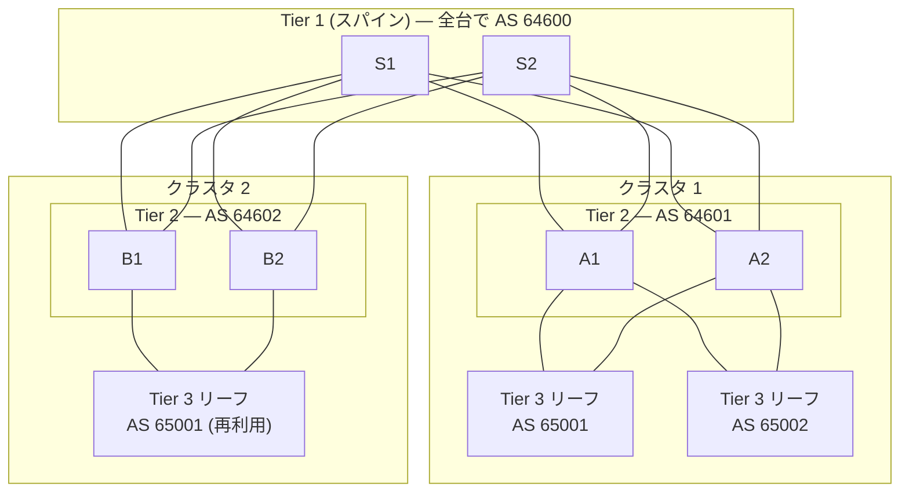
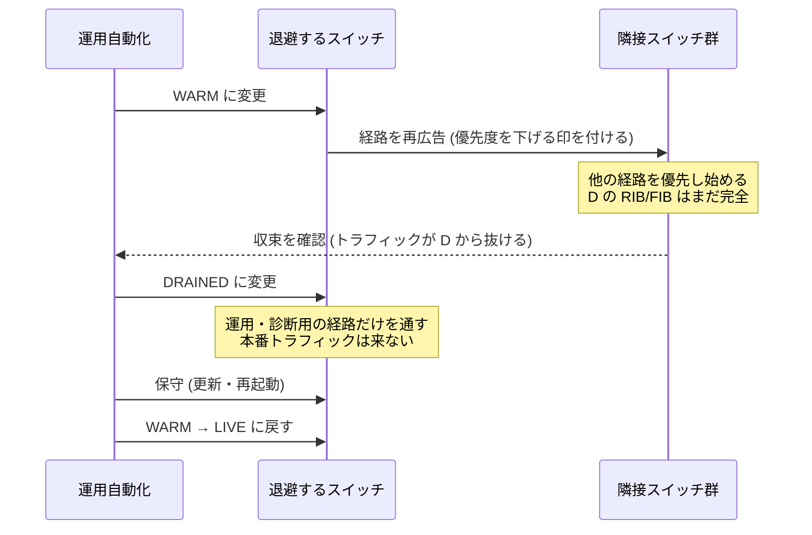

# データセンターファブリックの経路制御 (Data Center Fabric Routing: BGP, ECMP & Centralized Control)

## 概要 (Overview)

本ドキュメントはデータセンター内部のファブリック (fabric) で動く経路制御を扱う。対象は BGP を IGP の代わりに使う設計 (RFC 7938) と AS 番号の割り当て方、IPv6 リンクローカルでの BGP ピアリング (BGP unnumbered、RFC 8950)、リンクステート IGP とそのフラッディング削減 (RFC 9667) や RIFT (RFC 9692)、等コスト多経路 (ECMP) のハッシュと重み付け、フローレット (flowlet) 単位の負荷分散、故障の検出と収束、保守のための退避 (drain)、ハイパースケーラの集中制御 (Google の Firepath・Orion、Meta の BGP 設計)、そして故障モードとセキュリティである。

トポロジそのもの、つまりリーフスパイン (フォールデッド Clos) の構造、オーバーサブスクリプション、Clos (1953) の原典は [`../../engineering/datacenters/datacenter-fundamentals.md`](../../engineering/datacenters/datacenter-fundamentals.md) で扱った。要点だけ述べると、同じ安価なスイッチを多段に並べ、段の間をすべて結線することで、どの 2 点の間にも等しい長さの経路が多数ある網を作る。本書はその上で、経路をどう配り、パケットをどう散らすかを扱う。パスベクトルや Gao–Rexford 条件、RPKI といった BGP の基礎は [`ip-routing-bgp.md`](ip-routing-bgp.md)、ファブリックの上に載るテナント網 (VXLAN・Geneve) とその写像を配る EVPN は [`virtual-networks-overlay.md`](virtual-networks-overlay.md)、AI 学習用のファブリック (RoCE・パケットスプレー・Ultra Ethernet) は [`../../hardware/accelerators/interconnects-scaleout-training.md`](../../hardware/accelerators/interconnects-scaleout-training.md)、ホストとロードバランサ側の ECMP とコンシステントハッシュは [`load-balancing-architecture.md`](load-balancing-architecture.md) に委ねる。

中心テーゼは**ファブリックの経路制御の本題は最適な経路を選ぶことではなく、対称に並んだ多数の等コスト経路の集合を、故障と保守のたびに、できるだけ狭い範囲だけ書き換えることにある**ということである。Clos では経路の候補はトポロジで最初から決まっており、選ぶ余地はほとんどない。難しいのは毎日数百回起きる退避と復帰、リンクの故障、ソフトウェアの更新のたびに、その変化がファブリック全体へ波及しないようにすることである。BGP がデータセンターで標準になったのは、パスベクトルという方式そのものより、セッションごとにポリシーで伝播の範囲を区切れること、AS_PATH のループ検出を「谷 (valley)」を通る経路の遮断に転用できること、実装が成熟していて複数のベンダーで動くことが理由である。リンクステート IGP はフラッディングの削減を、集中制御はコントローラの故障範囲の分割を、それぞれ同じ問題への答えとして持つ。そして経路制御が見えない故障、つまりリンクは上がったまま一部のパケットだけが落ちるグレー障害 (gray failure) と、ファブリック全体に一斉に配られる設定やソフトウェアの変更が、実際の大規模障害の主因になっている。分析深度は Level 3。

## 方法論 (Methodology)

- **一次資料 (標準)**: BGP をデータセンターで使う設計は RFC 7938 (情報提供、2016 年 8 月)、AS 番号は RFC 6793・6996、ピアリングは RFC 8950・5082、多経路は RFC 2992・7911・10005、収束は RFC 5880・7130、保守は RFC 8326・6987・3277、リンクステート側は RFC 9667 (実験的、2024 年 10 月)・9692 (標準化トラック、2025 年 4 月)・9696 を使う。RFC の発行時期と種別は rfc-editor.org と datatracker で確認した。
- **一次資料 (事業者の論文)**: Google は Jupiter Rising (SIGCOMM 2015)・Orion (NSDI 2021)・Jupiter Evolving (SIGCOMM 2022)・WCMP (EuroSys 2014)、Meta は Running BGP in Data Centers at Scale (NSDI 2021) と Open/R の公式記事、Microsoft は Pingmesh (SIGCOMM 2015)・Gray Failure (HotOS 2017)・CorrOpt (SIGCOMM 2017) と、RFC 7938 の前身の Internet-Draft (2012 年) を使う。これらは自社システムについての自己報告であり、数値は各社の環境での実測値として扱う。
- **負荷分散の研究**: フローレットは FLARE (CCR 2007)、CONGA (SIGCOMM 2014)、HULA (SOSR 2016)、LetFlow (NSDI 2017) の原論文に基づく。性能の数値はいずれも著者自身のテストベッドかシミュレーションの値である。
- **実装**: BGP unnumbered の挙動は FRRouting の公式文書、resilient hashing は Linux カーネルの公式文書で確かめた。ベンダー固有の機能 (max-med、hash seed など) は機能の存在だけを述べ、既定値には踏み込まない。
- **時点**: Internet-Draft と RFC の状態は 2026 年 10 月時点で確認したものである。BGP PIC の Draft は 2026 年 8 月に失効しており、RFC にはなっていない。

## 発見事項 (Findings)

1. **データセンターで BGP が選ばれた理由は、パスベクトルという方式より、伝播の範囲をセッションごとに区切れることにある。** RFC 7938 は要件として、同じ装置を足すだけで横に拡張できること、少数の機能だけを使うこと、運用が簡単なこと、故障の範囲を小さくすること、ある程度の経路制御ができることの 5 つを挙げる (第 2.5 節)。そのうえで eBGP を選んだ理由として、状態機械がリンクステート IGP より単純なこと、各ルータが最良経路だけを伝えるので代替経路が見つかった時点で故障が隠れること、AS 番号の割り当てとループ検出で経路探索を制御できること、隣接ごとの RIB を見て障害を切り分けやすいことを挙げた (第 5.1 節)。その前身の Internet-Draft (2012 年) は Microsoft の Lapukhov らによるもので、10 万台を超えるサーバの規模を想定していた。
2. **AS 番号の割り当て方はループ検出を「谷」を通る経路の遮断に転用する仕組みである。** RFC 7938 では最上段 (Tier 1) の全スパインに同じ AS 番号を、クラスタごとの中段 (Tier 2) にクラスタで 1 つの AS 番号を、リーフ (Tier 3) に 1 台ずつ別の AS 番号を割り当てる (第 5.2.1 節)。同じ段のスイッチが同じ AS 番号を持つので、あるスパインの経路がリーフを経由して別のスパインに戻ると AS_PATH のループとして捨てられる。これにより、上・下・上と折り返す経路と、故障時の経路探索 (path hunting) が抑えられる (第 5.1 節)。
3. **2 オクテットの私用 AS 番号は 1,023 個しかなく、各社は 4 オクテット化か番号の再利用で対処している。** 私用の範囲は 64512〜65534 で、4 オクテットでは 4200000000〜4294967294 が使える (RFC 6996)。RFC 7938 はリーフの番号をクラスタ間で再利用し、そのために自分の AS 番号を含む経路を受け入れる allowas-in を使う。これは標準化されていない機能である (第 5.2.2 節)。Meta はポッドを BGP コンフェデレーションにすることで、2 オクテットの範囲のまま全データセンターで同じ番号の付け方を繰り返し、allowas-in を使わずに通常のループ検出を保っている。
4. **ECMP の束の更新は軽いが、ハッシュの割り当てが変わると既存のフローも動く。** ハッシュの値域を次ホップごとに区切る hash-threshold 方式 (RFC 2992) では、次ホップが 1 つ減ると残りの次ホップの区間も動く。resilient hashing は値域と次ホップの間にバケットの表を挟み、消えた次ホップのバケットだけを付け替える (Linux カーネル文書、RFC 7938 第 6.4 節)。同じハッシュ関数を各段で使うと、2 段目で値が偏る分極 (polarization) が起きる (RFC 7938 第 6.1 節)。
5. **ECMP は対称なトポロジを前提にしており、故障で非対称になると重み付けが必要になる。** Google の WCMP (EuroSys 2014) は、非対称になったトポロジで重みを付けると、フローごとの帯域のばらつきを ECMP 比で最大 25 分の 1 に減らせると報告した。Meta は 2021 年時点で重み付けを使っておらず、その理由として次ホップの複製でハードウェアの表を消費することを挙げている。BGP で帯域を広告する Link Bandwidth 拡張コミュニティは、2026 年 6 月に RFC 10005 として標準化された。
6. **フロー単位の ECMP では大きなフローの衝突を避けられず、フローレットがその回避策として研究されてきた。** フローの中の送信の途切れが経路間の遅延差より長ければ、その次のパケット群を別の経路に移しても順序は入れ替わらない (FLARE、2007 年)。CONGA は混雑の情報をファブリックの中で集めてフローレットの行き先を選び、LetFlow は行き先を無作為に選ぶだけでも、フローレットの長さが混雑に応じて自然に変わるために非対称なトポロジへ適応することを示した。AI 学習のファブリックはさらにパケット単位で散らして受信側で並べ直す方向へ進んでいる。
7. **収束の速さは、故障の影響が局所で閉じるかどうかで決まる。** Google の Jupiter (Firepath) では、中段と上段の間のリンク故障は 125 ms で迂回できたが、ToR と中段の間のリンク故障は全スパインの経路を書き換える必要があり 4,000 ms かかった (Jupiter Rising 表 4)。RFC 7938 も、故障の影響範囲が広いほど通知する装置が増えて収束が遅れると書く (第 7.4 節)。Meta は事前に決めたバックアップ経路と経路の集約で、ポッドの中の故障をポッドの外へ見せない設計にした。
8. **保守のための退避は日常業務であり、その手順自体が経路制御の設計に組み込まれている。** Meta は LIVE・WARM・DRAINED の 3 状態をポリシーとして実装し、1 日平均 242 回の退避と復帰を、1 回平均 36 秒で、一時的な損失なしに行っていると報告した。標準側では、受信側に LOCAL_PREF を下げさせる GRACEFUL_SHUTDOWN コミュニティ (RFC 8326) が同じ目的を持つ。
9. **集中制御は経路計算を一か所にまとめるが、コントローラの故障範囲を分割することが新しい設計課題になる。** Jupiter Rising (2015 年) によれば、Google は標準の分散プロトコルではなく、中央のマスターがリンク状態を配り各スイッチが経路を計算する独自の Firepath を使ってきた。2021 年に公表された SDN の制御平面 Orion はファブリックの制御を 4 つの「色」に分け、1 つのコントローラの故障がファブリック容量の 25% を超えて影響しないようにした。また制御が届かないスイッチが多いときには、迂回をやめて現状の転送を維持する (fail static)。
10. **大きな障害の主因は経路制御が見えない故障と、ファブリック全体への変更の配布である。** Meta が 2 年間に経験した BGP 関連の重大障害 14 件のうち、8 件はソフトウェアの誤り、10 件は変更の配布中に起きた。Microsoft の CorrOpt は 15 のデータセンターの約 35 万本のリンクを調べ、パケットの破損 (corruption) は混雑による損失と違って利用率に連動せず、リンクごとに安定して続くことを示した。リンクが上がっている限り、経路制御はこのような故障を迂回しない。

## アーキテクチャ (Architecture)

### 5 段 Clos と RFC 7938 の AS 番号



凡例: 線はすべて 1 対 1 の eBGP セッションを張るポイントツーポイントのリンク。AS 番号の値は説明用で、RFC 7938 の例とは異なる。同じ段のスイッチは同じ AS 番号を持つので、L1 が A1 から受けた経路を A2 に返しても A2 は自分の AS 番号を AS_PATH に見つけて捨てる。これが谷を通る経路 (A1 → L1 → A2) の遮断になる。リーフの AS 番号をクラスタ間で再利用すると、クラスタ 1 の L1 (65001) はクラスタ 2 の L3 (65001) の経路を自分の番号を含むとして捨ててしまうため、allowas-in で受け入れる必要がある。

### 制御平面の選択肢

| 方式 | 経路情報の配り方 | 伝播の範囲を区切る手段 | 主な代償 | 出典 |
|---|---|---|---|---|
| eBGP (RFC 7938 型) | 隣接間の eBGP、全プレフィックスを全リーフに | AS 番号の割り当てと AS_PATH のループ検出 | 集約しないと表が大きい。allowas-in に依存 | RFC 7938 |
| BGP + コンフェデレーション + 集約 (Meta) | ポッド内はコンフェデレーション、ポッド間は eBGP | コミュニティで経路の種類を付け、ポリシーで伝播先を限定 | ポリシーの集合が大きく、配布順の誤りが障害になる | Abhashkumar ら 2021 |
| リンクステート IGP (IS-IS/OSPF) | 全ノードへフラッディング | エリア分割、フラッディング削減 (RFC 9667) | 密な網では同じ更新を何度も受け取る | RFC 9667 |
| RIFT | 北向きにリンクステート、南向きに既定経路 | 段 (level) の構造そのもの | 新しいプロトコルで実装と運用経験が少ない | RFC 9692 |
| 集中制御 (Firepath、Orion) | 中央がリンク状態や経路を配り、スイッチが転送表を作る | コントローラの領域と色の分割 | 制御網とコントローラの故障が相関した故障に見える | Singh ら 2015、Ferguson ら 2021 |

### 退避の流れ (Meta の 3 状態と RFC 8326)



RFC 8326 の手順も構造は同じで、セッションを切る前に GRACEFUL_SHUTDOWN を付けて再広告し、隣接側が他の経路へ移ってからセッションを閉じる。先に経路を移してからセッションを切ることで、収束中に経路のない時間を作らない。

## 技術詳細 (Technical Details)

### 1. BGP を IGP として使う (RFC 7938)

- **ピアリングの形**: 隣接するスイッチ間のリンクごとに、1 ホップの eBGP セッションを張る。iBGP と違ってルートリフレクタもフルメッシュも要らず、セッションの状態はリンクの状態と一致する。Meta も並列リンクを別々の /31 のサブネットと別々のセッションとして扱い、セッションとインターフェースの対応を明確にしている。
- **多経路**: BGP の通常の最良経路選択では、AS_PATH が完全に一致する経路しか ECMP の束に入らない。リーフごとに AS 番号が違えば、同じプレフィックスへの経路でも AS_PATH が異なるため、長さが同じなら束に入れる「multipath relax」が必要になる (RFC 7938 第 6.2 節、FRR の `bgp bestpath as-path multipath-relax`)。
- **経路探索 (path hunting)**: BGP は経路が消えると、まだ取り消しが届いていない長い迂回経路を順に試し、最後に到達不能と判断する。インターネットでは最悪で隣接数の階乗に比例するメッセージが必要になり、MRAI タイマー (広告の最小間隔) がこの過程を秒〜分の単位に引き延ばす。Clos では、同じ段に同じ AS 番号を付けるとこのような長い迂回経路はループとして捨てられるため、探索の対象がなくなる (RFC 7938 第 5.1 節)。Meta はさらに AS_PATH の長さを制限するポリシーを加え、MRAI を 0 にした。伝播の範囲をポリシーで区切っているので、即時に広告しても更新がファブリック全体へ広がらないためである。
- **AS 番号の空間**: 2 オクテットの私用範囲 64512〜65534 は 1,023 個で、リーフに 1 台ずつ割り当てると数千ラック規模で足りなくなる。4 オクテットの私用範囲 (4200000000〜4294967294、RFC 6996) を使えば足りるが、RFC 7938 の執筆時点では一部の実装が 4 オクテットに対応していなかった (第 5.2.2 節)。RFC 6996 自身も私用範囲を広げた理由としてデータセンターでの BGP の利用を挙げている。
- **番号の再利用と allowas-in**: RFC 7938 はリーフの番号をクラスタ間で再利用し、リーフの上り側のセッションで自分の AS 番号を含む経路を受け入れる。これは AS_PATH のループ検出を部分的に止めることを意味する。Meta はポッドを BGP コンフェデレーション (RFC 5065) にして、ポッドの中の番号の構造をすべてのポッドで同じにし、外にはポッドの番号だけを見せた。これで allowas-in なしに番号を再利用できる。
- **集約**: RFC 7938 は全リーフが全プレフィックスを持つ設計で、集約を慎重に扱う。最上段のスイッチは各サーバのサブネットへ 1 本の経路しか持たないため、中段で集約すると 1 本のリンク故障でその集約の一部がブラックホールになる (第 5.2.3 節、第 8.2 節)。Meta は逆に全段で階層的に集約し、各スイッチの経路表を数千件に抑えた。集約しなければ 10 万件を超えるという。この集約が成り立つのは次節のバックアップ経路でポッドの中の故障を中で吸収しているからである。

### 2. ピアリングのアドレス: BGP unnumbered と RFC 8950

- **問題**: 数万本のリンクに /31 の IPv4 アドレスを配り、両端の設定を一致させる作業は、自動化しても誤りの原因になる。
- **RFC 8950 (2020 年、RFC 5549 を置き換え)**: IPv4 の経路 (NLRI) を IPv6 の次ホップ付きで広告する方式を定める。次ホップの長さが 16 または 32 バイトなら IPv6 であり、32 バイトの場合はグローバルアドレスの後にリンクローカルアドレスが続く。対応は Extended Next Hop Encoding 機能 (capability code 5) で交渉する。
- **BGP unnumbered**: IPv6 のリンクローカルアドレスはインターフェースが上がれば自動で付くので、これでセッションを張り、IPv4 の経路も RFC 8950 で同じセッションに載せれば、リンクに IPv4 アドレスを一切配らずに済む。FRRouting では `neighbor <インターフェース名> interface` で設定し、`v6only` を付けると IPv4 での接続を試さずにリンクローカルでセッションを張る。相手のリンクローカルアドレスは IPv6 のルータ広告 (RA) で知る。
- **注意点**: RA で相手を見つける動作は FRR などの実装の機能であり、標準化されたピア発見の手順ではない。リンクローカルの次ホップは同じリンクの中でしか意味を持たないため、別のリンクへ再広告する場合は次ホップを書き換える必要がある。traceroute で中間のスイッチを識別するには、各スイッチのループバックアドレスを ICMP の送信元にする設定が別に必要になる。
- **設定の効果**: リンクごとの設定がインターフェース名と、そのリンクに適用するピアグループ (相手の段) だけになり、配線の段を間違えたかどうかはピアグループの不一致として検出しやすくなる。

### 3. リンクステート IGP と RIFT

- **フラッディングの問題**: リンクステート IGP では、変化を検知したノードがリンク状態の広告 (LSP/LSA) をすべての隣接へ送り、受け取ったノードもすべての隣接へ転送する。リーフスパインでは各ノードの隣接数が多く、同じ更新を何十回も受け取って処理し、捨てることになる。RFC 9667 はこれが重要な更新の処理を遅らせ、処理が追いつかなければ更新を落として収束をさらに遅らせると書く。
- **動的フラッディング (RFC 9667、実験的)**: フラッディングに使うリンクを、全ノードに届く疎な部分グラフ (flooding topology) に限る。Area Leader が部分グラフを計算して配る集中方式と、全ノードが同じアルゴリズムで計算する分散方式がある。部分グラフのリンクが切れて孤立したノードは、一時的に他のリンクでもフラッディングする (temporary flooding)。RFC は耐障害性のために 2 重連結の部分グラフを勧めている。
- **RIFT (RFC 9692、標準化トラック、2025 年 4 月)**: Clos と fat tree のための専用プロトコルで、上向き (北向き) にはリンクステートで全トポロジを伝え、下向き (南向き) には既定経路だけを配る。リーフの状態は小さくなるが、既定経路だけでは故障したスパインを避けられないため、故障時に具体的なプレフィックスを広告する自動分解 (disaggregation) を持つ。複数のプレーンに分かれたファブリックでは、到達できないことを広告する負の分解が必要になる。最上段のノードだけを設定すれば残りの段を自動で決める ZTP も持つ。運用上の適用範囲は RFC 9696 (情報提供) が扱う。
- **Open/R (Meta)**: Meta は 2017 年の公式記事で、データセンターのファブリックは長年 BGP だけで運用してきたと述べ、Terragraph のために作った経路制御基盤 Open/R を、自社の FBOSS とスイッチの上でファブリックの一部に使い始めたと書いた。Open/R は複製された key-value ストアで状態を配り、リンクローカルのマルチキャストで隣接を発見する。
- **トレードオフ**: リンクステートは全トポロジを知るので、迂回路の事前計算 (LFA や TI-LFA、[`mpls-segment-routing.md`](mpls-segment-routing.md)) や重み付けに必要な情報を持つ。一方でフラッディングを抑える仕組みが必要で、伝播の範囲をポリシーで細かく区切ることは BGP より難しい。BGP は隣接ごとのポリシーで範囲を区切れるが、トポロジ全体の情報を持たないので、重み付けには RFC 10005 のような追加の仕組みが要る。

### 4. ECMP: ハッシュ、分極、重み付け

- **ハッシュの入力**: 通常は送信元・宛先の IP アドレス、プロトコル、送信元・宛先ポートの 5 タプルで、IPv6 ではフローラベルも使える。VXLAN などのトンネルでは、外側の UDP の送信元ポートに内側のフローのハッシュを書き込むことで、アンダーレイに内側のフローを見せずに分散させる ([`virtual-networks-overlay.md`](virtual-networks-overlay.md))。
- **分極 (polarization)**: リーフで「ハッシュの値が偶数なら上り 1、奇数なら上り 2」と分けたとき、次の段のスイッチが同じハッシュ関数と同じ入力を使うと、上り 1 に来たパケットはすべて偶数のハッシュを持つので、次の段でも一部の次ホップにしか分散しない。対策はスイッチごとにハッシュの種 (seed) や入力のフィールドを変えることである。RFC 7938 は L2 のリンク集約を ECMP の下に重ねる場合に、2 段目で使えるエントロピーが減って偏りが起きる危険を指摘している (第 6.1 節)。
- **次ホップが変わるときの再割り当て**: RFC 2992 の hash-threshold 方式では、N 個の次ホップがハッシュ値域を N 等分した区間を持つ。1 つが消えると残りの N−1 個で値域を等分し直すため、消えた次ホップ以外のフローも一部が別の次ホップへ移る。単純な `hash mod N` ではほぼすべてのフローが移る。移ったフローは順序の入れ替わりや、ステートフルな機器 (ロードバランサ、ファイアウォール) での接続の切断を起こす。
- **resilient hashing**: ハッシュ値でまずバケットを選び、バケットが次ホップを指す表を挟む。次ホップが消えたときは、その次ホップを指していたバケットだけを残りの次ホップへ付け替える。Linux カーネルの実装では、一定時間トラフィックの来ないバケットを idle として扱い、重みが変わったときは idle のバケットから移す。idle のバケットが足りずに偏りが残る時間の上限は別のタイマーで決める。RFC 7938 第 6.4 節は、この一貫性には追加のハードウェア資源 (TCAM など) が要ると書く。

```text
Pseudocode: resilient next-hop group (bucket table)
Assumptions: B buckets (B >> number of next hops N), hash(pkt) is uniform,
             each bucket stores (nexthop, last_used_time).
Lookup:  O(1) per packet.  Remove a next hop: O(B) scan, but only the
         buckets of the removed next hop change owner (about B/N of them).

lookup(pkt):
    b = hash(pkt) mod B
    bucket[b].last_used = now
    return bucket[b].nexthop

remove_nexthop(h):
    for each bucket b with bucket[b].nexthop == h:
        bucket[b].nexthop = least_loaded_remaining_nexthop()
    # buckets pointing to other next hops are untouched,
    # so their flows keep their path

rebalance_after_weight_change():
    for each bucket b on an over-weight next hop:
        if now - bucket[b].last_used > IDLE_TIMER:   # idle: no live flow
            bucket[b].nexthop = an under-weight next hop
    # if not enough idle buckets exist, imbalance persists until
    # UNBALANCED_TIMER expires; then busy buckets are moved (flows break)
```

- **重み付け (WCMP、UCMP)**: ECMP はすべての次ホップの先に同じ容量があることを前提にする。故障でトポロジが非対称になると、この前提は成り立たなくなる。Meta の論文は、リーフ R の 4 本の上りのうち 1 本の先にあるスイッチ F が、4 本の上りのうち 1 本を失った場合を例に挙げる。F は R から来る 1/4 のトラフィックを 3 本で運ぶことになるため、上りの負荷を揃えるには R から F へ送る割合を 1/4 から 3/15 に下げる必要がある。ハードウェアでの重み付けは多くの場合、次ホップを表の中で重みの数だけ複製して実現するため、表の資源を消費する。WCMP (Zhou ら 2014) はこの表の大きさの制約の下で重みを近似する方法を扱った。BGP で重みを伝えるには、リンク帯域を浮動小数点 (バイト毎秒) で載せる拡張コミュニティ (RFC 10005、2026 年 6 月) が使える。RFC 10005 はこの値を最良経路の選択に使ってはならないとし、組織の境界で除去することを勧めている。RIFT も帯域に基づく重み付けを仕様に含む。
- **大きなフローと衝突**: フロー単位のハッシュでは、少数の大きなフロー (elephant flow) が同じリンクに重なると、他のリンクが空いていても混雑する。Google は Jupiter の混雑の要因の一つとして、故障時やフローの大きさにばらつきがあるときのハッシュの不完全さを挙げている。
- **フローレット**: FLARE (Kandula ら 2007) は、フローの中で一定時間以上送信が途切れたら、次のパケット群を別の経路に移してよいとした。途切れが経路間の遅延差より長ければ順序は入れ替わらない。CONGA (Alizadeh ら 2014) は、リーフ間でトンネルのヘッダに混雑の度合いを載せて送り返し、送り元のリーフが最も空いた経路をフローレットごとに選ぶ。テストベッドでは ECMP 比で約 5 倍のフロー完了時間の改善を報告したが、専用の ASIC を前提とする。HULA (Katta ら 2016) は、各スイッチが隣接ごとに最良経路の混雑だけを持つ形にして状態を減らし、P4 で書けるプログラマブルなスイッチで動くようにした。LetFlow (Vanini ら 2017) は混雑を測らず、フローレットごとに無作為に経路を選ぶ。混雑した経路ではフローレットの途切れが長くなって経路を移る機会が増えるため、非対称なトポロジにも適応し、テストベッドでは CONGA の 10〜20% 以内のフロー完了時間を示した。
- **AI 学習のファブリックとの違い**: 汎用のファブリックは多数の短いフローを前提にし、フロー単位かフローレット単位で順序を守る。AI 学習では少数の巨大なフローが周期的に流れるため、フロー単位のハッシュでは衝突が致命的になる。そのため、パケット単位で散らして受信側で順序の入れ替わりを許す方向や、スイッチによる適応的な経路選択が採られる ([`../../hardware/accelerators/interconnects-scaleout-training.md`](../../hardware/accelerators/interconnects-scaleout-training.md))。

### 5. 故障の検出と収束

- **検出**: RFC 7938 が主な検出手段とするのは、リンクが落ちたらすぐ eBGP セッションを閉じる fast fallover である (第 7.1 節)。ポイントツーポイントのリンクでは物理層の断がそのまま BGP の断になり、hold タイマーの満了を待たない。RFC 7938 は keepalive だけに頼ると収束に数秒以上かかり、多くの実装では hold タイマーの最小値が 3 秒だと書いている。光が出ているのにパケットが通らない故障や、片方向だけの故障は物理層では検出できないため、BFD (RFC 5880) を使う。BFD の検出時間は送信間隔と、何回続けて受信できなかったら落ちたとみなすかの倍数の積で決まる。リンク集約 (LAG) の上の BFD は、メンバーリンクごとに動かす RFC 7130 が出るまで限られていた。
- **局所的な修復と全体の収束**: Clos では、ある次ホップが消えても多くの場合は同じ束の他の次ホップが残るので、スイッチは束から 1 つ取り除くだけでよい。この操作はプレフィックスの数によらず、束を共有するすべての経路に一度で効く。Jupiter の表では、中段と上段の間のリンク故障は 125 ms、上段の筐体の故障は 325 ms で局所的に迂回できた。一方で ToR と中段の間のリンク故障では、全スパインがその ToR のプレフィックスについて特定の中段を避ける必要があり、4,000 ms かかった。
- **取り消しの嵐**: リーフと中段の間のリンクが切れると、RFC 7938 型の設計ではそのリーフのプレフィックスの取り消しが最上段まで伝わり、最上段から全クラスタへ広がる。RFC 7938 は、このときの制御平面への影響範囲は最悪で網全体だと書く (第 7.4 節)。中段のスイッチは上の全スパインからの更新を待つため、更新が届く時刻のばらつきは数秒に及び得る (第 7.3 節)。Meta はポッドの中にバックアップ経路を用意し、FSW と RSW の間のリンクが切れても、FSW が別の RSW と別の FSW を経由する経路 (同じ AS_PATH 長の複数の経路を ECMP で使う) に切り替える。FSW は集約経路を広告しているので、上の SSW には何も通知しない。Meta は、ファブリック全体への再広告が起きるのはルータが全隣接を失ったときだけで、それには数十から数百本のリンクの故障が必要だと書いている。
- **マイクロループ**: 中段のスイッチがプレフィックスを失ったが、最上段のスイッチがまだそれを指しているとき、パケットが中段と最上段の間を往復する一時的なループが起きる (RFC 7938 第 7.5 節)。対策として、中段にはクラスタ内のサーバのサブネットを覆う集約の、最上段にはデータセンター全体を覆う集約の破棄経路 (discard route) を置く。具体的な経路を失ったパケットは上へ戻されずにその場で捨てられる。
- **ADD-PATH と BGP PIC**: BGP は通常、各プレフィックスについて最良経路 1 本しか隣接へ広告しない。RFC 7911 (ADD-PATH、2016 年) はパス識別子を付けて複数の経路を広告し、受信側が代替経路を事前に持てるようにする。BGP PIC (Prefix Independent Convergence) は、多数のプレフィックスが同じ次ホップの束を共有する階層的な転送表を作り、故障時に束だけを書き換えて、プレフィックスの数によらない時間で切り替える。PIC の IETF 文書 (draft-ietf-rtgwg-bgp-pic) は情報提供の Internet-Draft として改訂が続いたが、2026 年 8 月時点で失効しており、仕様としてはベンダーの実装に依存する。RFC 7938 は、多くの実装で ADD-PATH が iBGP でしか正しく動かないことを、外部コントローラとのピアリングの制約として挙げている (第 8.1 節)。
- **グレースフルリスタートとの相互作用**: BGP のプロセスを再起動する間、隣接側が古い経路を保持して転送を続けるグレースフルリスタートは、保守を楽にする一方で、版の違う実装の間で時間の設定が食い違うと障害になる。Meta の事例では、旧版は古い経路を 30 秒保持し、新版は全隣接から End-of-RIB を受け取るまで最大 120 秒経路を送らなかった。そのため旧版が古い経路を捨てた後に新版の経路が届き、約 90 秒の通信断が起きた。

### 6. 保守と退避 (drain)

- **GRACEFUL_SHUTDOWN (RFC 8326、2018 年)**: 既知のコミュニティ 65535:0 を付けた経路について、受信側が LOCAL_PREF を下げる (推奨値は 0)。セッションを切る前に、自分が送る経路と受け取る経路の両方にこの印を付けて優先度を下げ、隣接が代替経路へ移ってからセッションを閉じる。RFC 8326 の中心は eBGP のセッションで、受信側のポリシーでこのコミュニティに反応する設定が必要になる。悪用すれば隣接が入りのトラフィックを操作できるため、使われ方の監視を勧めている。
- **AS_PATH の水増し (prepend)**: 退避するスイッチが自分の AS 番号を余分に付けて広告すると、AS_PATH の長さで経路が選ばれる Clos では、他の等コスト経路が優先される。LOCAL_PREF を設定しない構成でも効くが、すべての経路が水増しされた場合 (たとえば同じ段の全スイッチを同時に退避した場合) はその経路が残って使われる。退避は「代替経路があるときだけ避けられる」ものであり、到達性を失わせる操作ではない。
- **IGP とプロセス起動時の対応物**: OSPF ではリンクのコストを最大にして通過トラフィックを避けさせる stub router 広告 (RFC 6987)、IS-IS では overload ビット (RFC 3277 がブラックホールの回避に使う手順を述べる) が同じ役割を持つ。BGP の実装の多くは、起動直後に MED を最大にして広告する機能 (max-med) を持ち、転送表の書き込みが終わる前にトラフィックを引き寄せないようにする。
- **Meta の 3 状態**: LIVE は本番トラフィックを運ぶ状態、DRAINED は運用と診断用のプレフィックスだけを通す状態で、その間に WARM を挟む。WARM では RIB と FIB を完全に保ったまま、そのスイッチを経由する経路の優先度を下げて広告し、ECMP の束を調整してリンクが過負荷にならないようにする。BGP が収束して本番トラフィックが抜けたことを確かめてから DRAINED に移す。退避中もスイッチの管理面には到達でき、診断用のプレフィックスは通る。
- **意図 (intent) としての退避 (Orion)**: Orion は「このクラスタを退避する」という高い水準の意図を受け取り、各アプリケーションが自分の状態を変えて下位の意図を作り、最終的にスイッチのフロー状態を書き換えるという階層的な伝播で実現する。分散プロトコルでの退避がポリシーの書き換えで行われるのに対し、集中制御では計算の入力として扱われる。

### 7. 集中制御とハイパースケーラの設計

- **Google Firepath (Jupiter Rising、2015 年)**: Google は標準の OSPF・IS-IS・BGP を使わず、独自の制御平面を作った。理由として論文は当時の標準プロトコルには等コスト多経路の良い実装がなかったこと、質の高いオープンソースの経路制御スタックがなかったこと、数百から数千のスイッチでのブロードキャスト型のプロトコルのオーバーヘッドと OSPF のエリア設計の難しさ、数百台のスイッチの BGP 設定を管理する負担を挙げている。Firepath では、各スイッチが静的なトポロジ全体 (cluster config) を最初から持ち、自分のインターフェースの状態をマスターへ送る。マスターは版番号付きのリンク状態データベース (LSD) を、帯域外の制御網 (CPN) の上の UDP マルチキャストで全スイッチへ配る。ネットワーク全体の LSD は 64 KB に収まり、各スイッチは自分で ECMP 付きの最短経路を計算する。つまりトポロジの状態の配布は集中、転送表の計算は分散である。マスターは冗長化され、選出は粘着的 (一度選ばれたら変わりにくい) にしてある。BGP はファブリックの縁で外部と経路を交換するためだけに使う。
- **配線の検証**: Jupiter の Neighbor Discovery (ND) は、設定されたトポロジから各ポートの相手を予測し、実際に見えた相手と照合する。物理層が上がっていても ND が上がらなければ、そのポートは経路制御に渡されない。配線の誤りでできたリンクを使うとループが起き得るため、物理層の状態だけでリンクを有効にしない設計である。
- **Orion (2021 年)**: Jupiter、キャンパス網、B4 (WAN) を制御する SDN の制御平面である。論文は Firepath との関係を述べていない。マイクロサービスがネットワーク情報ベース (NIB) を通じて状態をやり取りする。論文は制御をハードウェアから切り離すと運命共有 (fate sharing) が失われることを最大の教訓の一つに挙げる。制御サーバや制御網の故障は、データプレーンが正常でも「多数のスイッチが一斉に故障した」ように見える。そこで Orion は、到達できないスイッチが少数なら避ける経路に切り替え (fail closed)、多数なら反応せずに既存の転送を維持する (fail static)。どちらにするかは迂回によって失う容量の閾値で決める。またファブリック全体の経路を計算する IBR-C を 4 つの色に分け、各色がスパインブロックの 25% だけを制御するようにした。設定や更新も色ごとに時間をずらして配る。代償として、色をまたいだ経路の統合が複雑になり、色の間で非対称な故障が起きたときは経路が最適でなくなる。
- **Jupiter Evolving (2022 年)**: Google は Jupiter を、スパイン層を持つ Clos から、集約ブロックの間を MEMS の光回線スイッチ (OCS) で直接つなぐ構成へ移した。トポロジ自体を動的に組み替え、集中制御のトラフィックエンジニアリングで重み付きの経路を計算する。論文は本番のトラフィックでは Clos と同等のスループットが得られたと報告している。この段階では、等コスト経路の対称性は前提ではなく、コントローラが重みを計算する対象になる。
- **Meta (2021 年)**: Meta はサーバのポッド (最大 48 台の RSW と最大 16 台の FSW) とスパインプレーン (SSW) からなるファブリックを、BGP だけで運用している。設計の原則は均一性と単純さで、同じ段のスイッチは、自分が広告するプレフィックスとピアのアドレスを除いて同じ設定を持つ。経路には生成時に種類を表すコミュニティを付け、すべてのポリシーをそのコミュニティに対する照合で書く。経路は送る側の出力ポリシーと受ける側の入力ポリシーの両方に一致したときだけ交換され、どの規則にも一致しない経路は捨てられる。BGP の実装は FBOSS の上で動く自社製の C++ のエージェントで、必要な機能だけを実装し、RFC からは外れないようにしている。単体テスト、エミュレーション、カナリアからなる検証と、段階的な配布の仕組みを持ち、12 か月のうち 52% の期間は何らかの配布が進行中だった。
- **Microsoft**: RFC 7938 の前身の Internet-Draft (2012 年) は Microsoft の Lapukhov と Arista の Premji によるもので、BGP をデータセンターの唯一の制御プロトコルとして使った経験をまとめ、10 万台を超えるサーバの規模を想定していた。私用の AS 番号を 4 オクテットに拡張した RFC 6996 も、当時 Microsoft にいた Mitchell によるものである。Microsoft が開発しオープンソース化したネットワーク OS の SONiC では、BGP は FRRouting を載せた専用のコンテナで動く。Microsoft の現在のファブリックの経路設計を第一者が詳しく記した論文は、今回は見つからなかった。運用の側では、全サーバ間で TCP の ping を打って遅延と損失を測る Pingmesh (Guo ら 2015) が、経路制御が検出しない故障を見つける手段として公表されている。

### 8. 故障モード

- **グレー障害と静かな損失**: Huang ら (2017) は、クラウドの大きな障害の多くは、システムの故障検出器が正常と判断しているのに一部の利用者には異常が見える「グレー障害」から生じると論じ、この見え方の差を differential observability と呼んだ。ファブリックでは、ポートは上がっていて BGP も BFD も正常なのに、特定のハッシュ値のパケットだけが落ちる、あるいは CRC エラーで一定の割合が落ちる、という形で現れる。ECMP は 5 タプルごとに経路を変えるので、損失は特定の接続にだけ現れ、ping で再現しないことが多い。CorrOpt (Zhuo ら 2017) は、パケット破損が利用率に連動しないこと、そして破損するリンクを止めると容量が減ることから、ToR 間の最低限の経路数を保てる範囲で止めるリンクを選ぶ仕組みを作った。
- **制御網の故障**: Jupiter では、各筐体が制御網 (CPN) へ現用と予備の 2 本のリンクを持っていたが、当初は両方のリンクの健全性を常時監視していなかった。機器が古くなると CPN のリンクに片方向の故障が起き、経路制御プロトコルが想定していない状態を引き起こした。集中制御では制御網そのものが重要な依存先になる。
- **全体の同時再起動**: Jupiter では、電源の事故でファブリック全体が同時に再起動したとき、手作業なしには収束しなかった。スイッチの組み込み CPU の上で、生存確認の ND と経路計算が CPU を奪い合い、経路の大量の変化で ND が heartbeat に応答できなくなり、リンクが上がったり落ちたりを繰り返したためである。
- **リンクのフラップ**: 上下を繰り返すリンクはそのたびに ECMP の束の更新と、伝播の範囲によっては取り消しと再広告を起こす。resilient hashing を使っていなければ、フラップのたびに他のフローの経路も変わる。Meta は障害のあるスイッチを監視して自動で退避させる運用を、経路の不安定さへの対策の一つに挙げている。
- **AS 番号の設定の誤り**: リーフに隣のリーフと同じ AS 番号を誤って付けると、allowas-in を使っていない設計では互いの経路をループとして捨てるため、到達できないサーバができる。逆に allowas-in を使う設計では、本来ループとして捨てるべき経路も受け入れる余地ができる。どちらの場合もセッションは正常に上がるため、セッションの監視では気づかない。
- **ファブリックの中の経路漏れ**: リーフが上から受け取った経路を別のスパインに再広告すると、そのリーフがスパイン間の中継点になり、細いリーフの上りに大量のトラフィックが流れ込む。既定経路や集約経路をサーバ側や別の段から誤って広告した場合も、多くのトラフィックがそこへ吸い込まれる。RFC 7938 型の AS 番号の付け方は谷を通る経路の多くを AS_PATH で防ぐが、AS 番号を再利用する設計や allowas-in を使う設計ではこの防御が弱くなる。Meta が送る側と受ける側の両方のポリシーに一致した経路だけを交換するのは、片側の設定の誤りがそのまま漏れにならないようにするためである。
- **ファブリック全体への変更**: 均一な設定は自動化と推論を容易にするが、同じ誤りを全台に同時に配る経路にもなる。Meta の事例では、ある段でコミュニティの付け方を変え、別の段でそのコミュニティに作用するポリシーを変える必要があった。後者を先に適用しなければならなかったのに、配布の順序が逆になり、データセンターの中にブラックホールができた。別の事例では、隣接から受け取るプレフィックスの数を制限する機能 (max-route limit) の実装の誤りで、以前に受け取ったプレフィックスまで数え直したため、多数のセッションが切断された。Google も、BGP の設定を変更している最中に監視システムが同じ CLI から設定を読み、不完全な設定が適用された事例を報告している。Orion が色ごとに変更をずらして配るのは、この種の故障の影響範囲を 25% に抑えるためである。

## セキュリティ考察 (Security Considerations)

- **前提となる信頼モデル**: ファブリックの経路制御は、全スイッチが同じ運用者の管理下にあることを前提にしている。インターネットの BGP のように、相手の AS が嘘をつく可能性を考えた仕組み (RPKI、[`ip-routing-bgp.md`](ip-routing-bgp.md)) は内部では使われない。そのため脅威は主に、ファブリックに接続された機器 (侵害されたサーバ、誤って接続された機器) からの経路の注入と、制御平面への攻撃と、自動化の経路の侵害の 3 つになる。
- **セッションの保護**: BGP セッションの認証として長く使われた TCP MD5 署名 (RFC 2385) は、TCP-AO (RFC 5925) に置き換えられた。TCP-AO は鍵の切り替えとより強い MAC を扱える。GTSM (RFC 5082) は送信側が TTL を 255 にして送り、受信側が 255 のパケットだけを受け入れることで、隣接していない場所から偽装したパケットでルータの CPU を消費させる攻撃を防ぐ。GTSM は認証ではなく、同じリンクにいる攻撃者や、侵害された隣接には効かない。1 ホップの eBGP だけで組むファブリックでは、全セッションに GTSM を適用できる。
- **unnumbered の自動ピアリング**: RA で相手を見つけてリンクローカルでセッションを張る構成は、配線しただけでセッションが上がるという利便性と引き換えに、ファブリックのポートに接続した機器が BGP の隣接になりうる。サーバ側を向くポートでは自動ピアリングを使わず、相手の AS 番号の範囲を限定し (`remote-as external` だけに頼らない)、ピアグループのポリシーで受け入れるプレフィックスを限ることが必要になる。
- **受け取る経路の制限**: RFC 8212 は、ポリシーが設定されていない eBGP セッションでは経路を受け入れも広告もしないことを既定にした。ファブリックでは、サーバやサービスとピアリングする場合 (RFC 7938 第 5.1 節のコントローラや、エニーキャストの VIP を広告するロードバランサ) に、受け入れるプレフィックスの範囲を限り、既定経路や集約経路を受け入れないことが重要になる。Meta のように、どの規則にも一致しない経路を捨てる設計が既定の防御になる。受け取るプレフィックスの数の上限 (max-prefix) は経路の大量注入を止めるが、超えたときにセッションを切ると到達性も失う。Meta の事例が示すように、この機能の実装の誤り自体が障害の原因にもなる。
- **コミュニティの扱い**: ポリシーを経路のコミュニティで書く設計では、コミュニティを付けられる者が経路の伝播の範囲や退避の状態を操作できる。外部 (サーバ、他の組織) から受け取った経路のコミュニティは境界で消すか、上書きする必要がある。GRACEFUL_SHUTDOWN や RFC 10005 の帯域のコミュニティも、RFC 自身が境界での除去や監視を勧めている。
- **制御平面の保護 (CoPP)**: スイッチの CPU は ASIC に比べて桁違いに遅いため、BGP、BFD、ARP/ND、ICMP など CPU に上がるパケットを種類ごとに帯域制限する。Jupiter の全体再起動の事例は、正規の経路制御の負荷だけでも、生存確認のプロトコルが CPU を奪われて止まりうることを示している。攻撃者が同じ状態を外から作れないように、CPU に届くパケットの種類と量を制限する。
- **管理面の分離**: 集中制御では、制御網 (Jupiter の CPN) とコントローラが網全体の転送を決めるため、これらへの侵入は全スイッチの侵害に等しい。管理と制御の通信は本番のデータプレーンから分けた帯域外の網に置き、コントローラと設定配布の経路を認証し、変更を監査する。分散制御でも、設定生成と配布の自動化が同じ役割を担っている。Orion の色の分割や Meta の段階的な配布は、運用上の誤りに対する仕組みであると同時に、侵害されたときに一度に書き換えられる範囲を限る仕組みとしても働く。
- **オーバーレイとの境界**: テナントのトラフィックをアンダーレイから切り離すオーバーレイ ([`virtual-networks-overlay.md`](virtual-networks-overlay.md)) では、テナント側からアンダーレイの経路制御が見えないことが前提になる。ホストがアンダーレイの BGP に直接参加する設計 (ホストでの BGP、ロードバランサの VIP 広告) では、そのホストの侵害がアンダーレイへの経路注入につながるため、ホスト向けセッションのプレフィックスを厳しく限る。

## 結論 (Conclusions)

- データセンターのファブリックでは経路の候補がトポロジで決まっており、経路制御の仕事は選ぶことより、等コスト経路の束を故障と保守のたびに狭い範囲だけ書き換えることにある。BGP が標準になったのは、セッションごとのポリシーと AS 番号の割り当てで伝播の範囲を区切れるからであり、リンクステート IGP はフラッディングの削減で、集中制御はコントローラの領域の分割で、同じ問題に答えている。
- AS 番号の割り当ては、ループ検出を谷を通る経路の遮断と経路探索の抑制に転用する仕組みである。番号が足りない問題には4 オクテット化、allowas-in による再利用、コンフェデレーションによる構造の再利用という 3 つの答えがあり、後の 2 つはループ検出の効き方を変える。
- ECMP は対称なトポロジを前提にし、その前提は故障と大きなフローで崩れる。resilient hashing は束の変化の影響を限り、重み付け (WCMP、RFC 10005) は非対称を補い、フローレットは大きなフローの衝突を避ける。AI 学習のファブリックはさらにパケット単位の分散へ進んだ。
- 収束を速くする最も効果的な方法は、プロトコルを速くすることではなく、故障を局所で閉じることである。Jupiter の 125 ms と 4,000 ms の差、Meta のバックアップ経路と集約は、いずれも影響範囲の設計から来ている。
- 大きな障害の主因は経路制御が見えないグレー障害と、均一な設定やソフトウェアを全台に配る過程の誤りである。対策は能動的な計測 (Pingmesh)、破損リンクの選択的な停止 (CorrOpt)、変更の段階的な配布と影響範囲の分割 (Meta の配布の仕組み、Orion の色) であり、これらは運用の誤りと侵害の両方に対する防御として働く。

### 次の接続先 (Related Topics)

- [`../../engineering/datacenters/datacenter-fundamentals.md`](../../engineering/datacenters/datacenter-fundamentals.md) — リーフスパインのトポロジ、オーバーサブスクリプション、Clos の原典。本書の経路制御が載る物理構造。
- [`ip-routing-bgp.md`](ip-routing-bgp.md) — BGP の機構、Gao–Rexford 条件、RPKI。本書はその BGP を建物の中で使う場合を扱った。
- [`virtual-networks-overlay.md`](virtual-networks-overlay.md) — ファブリックの上のテナント網と EVPN。アンダーレイとオーバーレイの分担。
- [`load-balancing-architecture.md`](load-balancing-architecture.md) — ECMP とコンシステントハッシュの上に作るロードバランサ。次ホップの変化がステートフルな機器に与える影響。
- [`mpls-segment-routing.md`](mpls-segment-routing.md) — 通信事業者の網での迂回 (TI-LFA) とエントロピーラベル。リンクステートで迂回路を事前計算する方式。
- [`qos-traffic-management.md`](qos-traffic-management.md) — 混雑したリンクでの配分と PFC。ECMP で避けきれない混雑への対処。
- [`tcp-transport-congestion.md`](tcp-transport-congestion.md) — DCTCP と、ECN の印を見て ECMP の経路を選び直す PLB。端点の側からの混雑への対処。
- [`datacenter-congestion-control.md`](datacenter-congestion-control.md) — パケットの散布と順序の許容を前提にする輻輳制御 (SRD・Falcon・UET)。経路の選び方と送信量の制御の結合。
- [`../../hardware/accelerators/interconnects-scaleout-training.md`](../../hardware/accelerators/interconnects-scaleout-training.md) — パケットスプレーと適応的な経路選択を使う AI 学習のファブリック。
- [`../../hardware/networking/nic-switch-architecture.md`](../../hardware/networking/nic-switch-architecture.md) — ECMP の束やバケットの表を収めるスイッチ ASIC の構造。
- [`../distributed-systems/failure-models.md`](../distributed-systems/failure-models.md) — グレー障害を含む故障モデル。

## 参考文献 (References)

**一次資料 (RFC と Internet-Draft)**

- Lapukhov, P., Premji, A., & Mitchell, J. (Ed.) (2016). Use of BGP for Routing in Large-Scale Data Centers. *RFC 7938*. — [rfc-editor.org](https://www.rfc-editor.org/rfc/rfc7938) — Accessed: 2026-10-26。要件 (第 2.5 節)、AS 番号 (第 5.2 節)、ECMP (第 6 節)、収束とマイクロループ (第 7 節)、集約 (第 8.2 節)。
- [draft-lapukhov-bgp-routing-large-dc-00: Using BGP for routing in large-scale data centers](https://datatracker.ietf.org/doc/html/draft-lapukhov-bgp-routing-large-dc-00) — Accessed: 2026-10-26。2012 年 7 月、Lapukhov (Microsoft)・Premji (Arista)。
- Vohra, Q., & Chen, E. (2012). BGP Support for Four-Octet Autonomous System (AS) Number Space. *RFC 6793*.
- Mitchell, J. (2013). Autonomous System (AS) Reservation for Private Use. *RFC 6996*. — [rfc-editor.org](https://www.rfc-editor.org/rfc/rfc6996) — Accessed: 2026-10-26
- Traina, P., McPherson, D., & Scudder, J. (2007). Autonomous System Confederations for BGP. *RFC 5065*.
- Litkowski, S., Agrawal, S., Ananthamurthy, K., & Patel, K. (2020). Advertising IPv4 Network Layer Reachability Information (NLRI) with an IPv6 Next Hop. *RFC 8950*. — [rfc-editor.org](https://www.rfc-editor.org/rfc/rfc8950) — Accessed: 2026-10-26
- Hopps, C. (2000). Analysis of an Equal-Cost Multi-Path Algorithm. *RFC 2992*.
- Walton, D., Retana, A., Chen, E., & Scudder, J. (2016). Advertisement of Multiple Paths in BGP. *RFC 7911*. — [rfc-editor.org](https://www.rfc-editor.org/rfc/rfc7911) — Accessed: 2026-10-26
- Mohapatra, P., Das, R. (Ed.), Mohanty, S. (Ed.), Krier, S., Szarecki, R. J., & Gattani, A. (2026). BGP Link Bandwidth Extended Community. *RFC 10005*. — [rfc-editor.org](https://www.rfc-editor.org/rfc/rfc10005) — Accessed: 2026-10-26
- [draft-ietf-rtgwg-bgp-pic-23: BGP Prefix Independent Convergence](https://datatracker.ietf.org/doc/draft-ietf-rtgwg-bgp-pic/) — Accessed: 2026-10-26。2026 年 2 月の版を最後に失効。
- Katz, D., & Ward, D. (2010). Bidirectional Forwarding Detection (BFD). *RFC 5880*.
- Bhatia, M., et al. (Eds.) (2014). Bidirectional Forwarding Detection (BFD) on Link Aggregation Group (LAG) Interfaces. *RFC 7130*.
- Francois, P. (Ed.), Decraene, B. (Ed.), Pelsser, C., Patel, K., & Filsfils, C. (2018). Graceful BGP Session Shutdown. *RFC 8326*. — [rfc-editor.org](https://www.rfc-editor.org/rfc/rfc8326) — Accessed: 2026-10-26
- Retana, A., et al. (2013). OSPF Stub Router Advertisement. *RFC 6987*. / McPherson, D. (2002). Intermediate System to Intermediate System (IS-IS) Transient Blackhole Avoidance. *RFC 3277*.
- Li, T. (Ed.), Psenak, P. (Ed.), Chen, H., Jalil, L., & Dontula, S. (2024). Dynamic Flooding on Dense Graphs. *RFC 9667*. — [rfc-editor.org](https://www.rfc-editor.org/rfc/rfc9667) — Accessed: 2026-10-26
- Przygienda, T. (Ed.), Head, J. (Ed.), Sharma, A., Thubert, P., Rijsman, B., & Afanasiev, D. (2025). RIFT: Routing in Fat Trees. *RFC 9692*. — [rfc-editor.org](https://www.rfc-editor.org/rfc/rfc9692) — Accessed: 2026-10-26
- Wei, Y. (Ed.), Zhang, Z., Afanasiev, D., Thubert, P., & Przygienda, T. (2025). Routing in Fat Trees (RIFT) Applicability and Operational Considerations. *RFC 9696*.
- Gill, V., Heasley, J., Meyer, D., Savola, P. (Ed.), & Pignataro, C. (2007). The Generalized TTL Security Mechanism (GTSM). *RFC 5082*. — [rfc-editor.org](https://www.rfc-editor.org/rfc/rfc5082) — Accessed: 2026-10-26
- Touch, J., Mankin, A., & Bonica, R. (2010). The TCP Authentication Option. *RFC 5925*. / Heffernan, A. (1998). Protection of BGP Sessions via the TCP MD5 Signature Option. *RFC 2385*.
- Mauch, J., Snijders, J., & Hankins, G. (2017). Default External BGP (EBGP) Route Propagation Behavior without Policies. *RFC 8212*.

**一次資料 (事業者の論文と公式文書)**

- Singh, A., Ong, J., Agarwal, A., et al. (2015). Jupiter Rising: A Decade of Clos Topologies and Centralized Control in Google's Datacenter Network. *Proc. ACM SIGCOMM 2015*, 183–197. DOI: 10.1145/2785956.2787508 — 第 5.2 節 (Firepath、ND)、表 4 (収束時間)、第 6 節 (混雑と障害)。
- Ferguson, A. D., Gribble, S., Hong, C.-Y., et al. (2021). Orion: Google's Software-Defined Networking Control Plane. *18th USENIX NSDI*. — [usenix.org](https://www.usenix.org/conference/nsdi21/presentation/ferguson) — Accessed: 2026-10-26。fail closed / fail static (第 3.2 節)、IBR-C の色の分割。
- Poutievski, L., Mashayekhi, O., Ong, J., et al. (2022). Jupiter Evolving: Transforming Google's Datacenter Network via Optical Circuit Switches and Software-Defined Networking. *Proc. ACM SIGCOMM 2022*. DOI: 10.1145/3544216.3544265
- Zhou, J., Tewari, M., Zhu, M., Kabbani, A., Poutievski, L., Singh, A., & Vahdat, A. (2014). WCMP: Weighted Cost Multipathing for Improved Fairness in Data Centers. *Proc. EuroSys 2014*. DOI: 10.1145/2592798.2592803
- Abhashkumar, A., Subramanian, K., Andreyev, A., Kim, H., Salem, N. K., Yang, J., Lapukhov, P., Akella, A., & Zeng, H. (2021). Running BGP in Data Centers at Scale. *18th USENIX NSDI*, 65–81. — [usenix.org](https://www.usenix.org/conference/nsdi21/presentation/abhashkumar) — Accessed: 2026-10-26。AS 番号とコンフェデレーション (第 2.4 節)、集約 (第 2.5 節)、退避の 3 状態 (第 3 節)、収束 (第 4.1 節)、SEV (第 6.3 節)。
- [Open/R: Open routing for modern networks](https://engineering.fb.com/2017/11/15/connectivity/open-r-open-routing-for-modern-networks/) — Accessed: 2026-10-26。Meta Engineering、2017 年。
- Guo, C., Yuan, L., Xiang, D., et al. (2015). Pingmesh: A Large-Scale System for Data Center Network Latency Measurement and Analysis. *Proc. ACM SIGCOMM 2015*. DOI: 10.1145/2829988.2787496
- Huang, P., Guo, C., Zhou, L., Lorch, J. R., Dang, Y., Chintalapati, M., & Yao, R. (2017). Gray Failure: The Achilles' Heel of Cloud-Scale Systems. *Proc. HotOS 2017*. DOI: 10.1145/3102980.3103005
- Zhuo, D., Ghobadi, M., Mahajan, R., Förster, K.-T., Krishnamurthy, A., & Anderson, T. (2017). Understanding and Mitigating Packet Corruption in Data Center Networks. *Proc. ACM SIGCOMM 2017*.

**負荷分散の研究**

- Kandula, S., Katabi, D., Sinha, S., & Berger, A. (2007). Dynamic Load Balancing Without Packet Reordering. *ACM SIGCOMM Computer Communication Review*, 37(2), 51–62. DOI: 10.1145/1232919.1232925
- Alizadeh, M., Edsall, T., Dharmapurikar, S., et al. (2014). CONGA: Distributed Congestion-Aware Load Balancing for Datacenters. *Proc. ACM SIGCOMM 2014*, 503–514. DOI: 10.1145/2619239.2626316
- Katta, N., Hira, M., Kim, C., Sivaraman, A., & Rexford, J. (2016). HULA: Scalable Load Balancing Using Programmable Data Planes. *Proc. ACM SOSR 2016*. DOI: 10.1145/2890955.2890968
- Vanini, E., Pan, R., Alizadeh, M., Taheri, P., & Edsall, T. (2017). Let It Flow: Resilient Asymmetric Load Balancing with Flowlet Switching. *14th USENIX NSDI*, 407–420. — [usenix.org](https://www.usenix.org/conference/nsdi17/technical-sessions/presentation/vanini) — Accessed: 2026-10-26

**実装の文書**

- [FRRouting User Guide: BGP](https://docs.frrouting.org/en/latest/bgp.html) — Accessed: 2026-10-26。`neighbor PEER interface`、`v6only`、`bgp bestpath as-path multipath-relax`。
- [Linux Kernel Documentation: Resilient Next-hop Groups](https://docs.kernel.org/networking/nexthop-group-resilient.html) — Accessed: 2026-10-26
- [SONiC Architecture](https://github.com/sonic-net/SONiC/wiki/Architecture) — Accessed: 2026-10-26。BGP コンテナと FRR。
