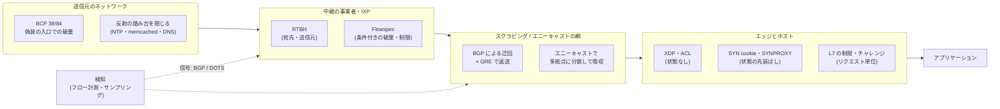
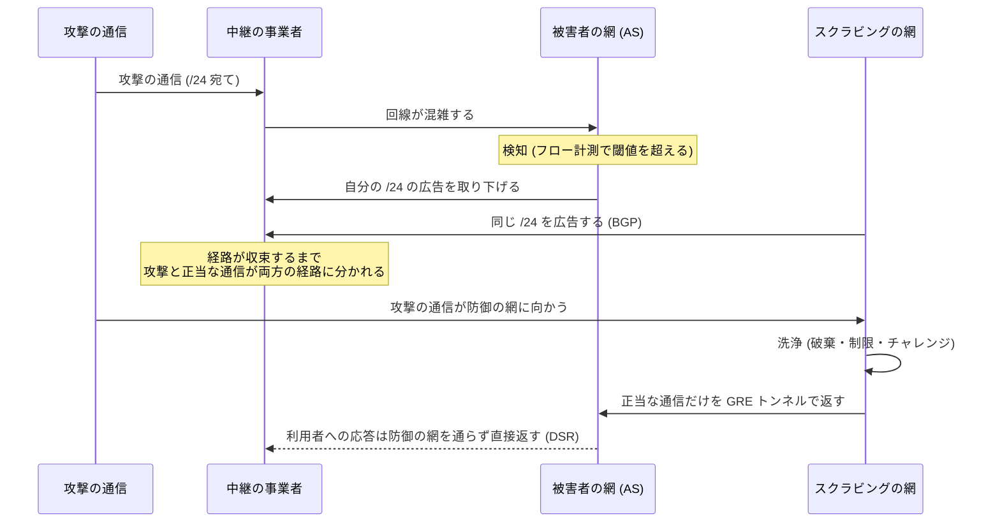

# DDoS 対策のアーキテクチャ (DDoS Mitigation: Detection, Absorption & Filtering)

## 概要 (Overview)

本ドキュメントは分散型サービス妨害 (Distributed Denial of Service, DDoS) を防ぐ側の仕組みを扱う。対象は、ネットワークが攻撃をどこで検知し、どこで吸収し、どこで捨てるかという防御の配置である。攻撃の分類 (反射・増幅、ボットネット、アプリケーション層の攻撃)、増幅率、観測された最大規模は [`../security/attack-lifecycle.md`](../security/attack-lifecycle.md) に委ね、本書では防御の議論に必要な範囲だけを述べる。個々の部品については、送信元の偽装と BCP 38 は [`ip-addressing-icmp-dhcp-nat.md`](ip-addressing-icmp-dhcp-nat.md)、SYN cookie は [`tcp-transport-congestion.md`](tcp-transport-congestion.md)、XDP と L4Drop は [`kernel-network-stack.md`](kernel-network-stack.md)、conntrack 表の枯渇と SYNPROXY は [`packet-filtering-conntrack.md`](packet-filtering-conntrack.md)、エニーキャストは [`ip-routing-bgp.md`](ip-routing-bgp.md) と [`cdn-edge-delivery.md`](cdn-edge-delivery.md)、吸収点としての LB は [`load-balancing-architecture.md`](load-balancing-architecture.md) で説明している。本書はそれらを、防御の層の全体の中に位置付け直す。

中心テーゼは、**DDoS の防御は、攻撃より大きな容量を攻撃の経路に置くこと (容量の配置) と、正当な通信と区別できた地点でできるだけ上流で安く捨てること (早く安い廃棄) の 2 つで決まる**ということである。攻撃する側の費用は小さい。反射を使えば他人の帯域で撃てるし、ボットネットは他人の機器で撃つ。防御する側は自分の回線より大きな攻撃を自分の手元では止められない。そのため、防御の手段はすべて「どこで、どの粒度で、誰の権限で捨てるか」の選択になる。上流で粗く捨てるほど安いが、正当な通信を巻き込む。手元で細かく捨てるほど正確だが、そこまで攻撃が届く容量が要る。

この見方から 3 つの帰結が出る。(1) 宛先ごと捨てる RTBH は最も安いが、攻撃者の目的 (宛先に届かなくすること) を防御側が代わりに達成してしまう。Flowspec やスクラビングは粒度を細かくする手段で、そのぶん運用の危険と遅延を持ち込む。(2) 攻撃の多くは数分で終わるため、人の判断を待つ防御は間に合わない。検知と遮断の自動化が前提になるが、自動化された遮断は誤検知や巻き添えも自動で広げる。(3) 状態を持つ装置 (ステートフルファイアウォール、L7 のプロキシ) は防御の部品であると同時に、攻撃者が消費できる資源である。アプリケーション層の攻撃は量ではなく処理の単価の差を突くので、帯域の対策は効かない。本書は (1) 経済の非対称、(2) 送信元のネットワーク、(3) 中継の事業者 (RTBH と Flowspec)、(4) スクラビングセンター、(5) エニーキャストによる吸収、(6) ホストとエッジ、(7) 検知、(8) アプリケーション層、(9) 協調のための信号 (DOTS)、(10) 故障モードの順に整理する。分析深度は Level 3。

## 方法論 (Methodology)

- **一次資料**: 仕組みの定義は IETF の RFC を根拠とする。RTBH は RFC 3882・RFC 5635・RFC 7999、Flowspec は RFC 8955・RFC 8956・RFC 9117、送信元の検証は BCP 38 (RFC 2827) と BCP 84 (RFC 3704・RFC 8704)、DOTS は RFC 8811・RFC 8783・RFC 9132・RFC 9133、DoS 一般の考え方は IAB の RFC 4732 を使う。フロー計測は IPFIX の RFC 5470・RFC 7011 と sFlow v5 の仕様を使う。
- **査読付き論文**: 黒穴化 (blackholing) の実効性は IXP での測定 (Giotsas et al. 2017、Nawrocki et al. 2019、Dietzel et al. 2018)、エニーキャストの耐性はルート DNS への攻撃の分析 (Moura et al. 2016)、攻撃の費用は DDoS 代行サービスの調査 (Karami et al. 2016) を根拠とする。
- **事業者の一次情報**: Cloudflare・Google・AWS・GitHub の障害報告と技術解説、Akamai と Cloudflare の製品文書を使う。事業者自身の数値は、その事業者が自社の網で観測した値か、仕様や契約の上の目標値である。本文では「観測値」と「仕様値・目標値」を区別して書く。攻撃の規模の推移はいずれも各社の観測であり、業界全体の値ではない。
- **障害事例**: Flowspec による障害は、Cloudflare (2013 年) の自社の事後報告と、CenturyLink/Level 3 (2020 年) の事業者自身の障害報告 (Reason For Outage) の再掲と第三者の分析を突き合わせた。後者の RFO の原文は顧客向けの文書で、本書では MacStadium の状況ページに再掲されたものを参照した。
- **扱わないこと**: 攻撃の道具や攻撃の手順は扱わない。仕組みの説明は防御の判断に必要な範囲にとどめる。

## 発見事項 (Findings)

1. **DDoS は費用の非対称の上に成り立ち、防御は 1 パケットあたりの処理の単価を攻撃より安くする競争である。** DDoS 代行サービス (booter) の月額は 10〜300 ドルで、30 秒から 1〜3 時間の攻撃を何度でも出せる (Karami et al. 2016)。反射型の攻撃は他人のサーバの帯域を、ボットネットは他人の機器を使う。HTTP/2 Rapid Reset では、Google が「サーバは取り消されたリクエストにも大きな処理をするが、クライアントはほとんど費用を払わない」と述べている。防御の設計原則は、攻撃のパケットを正当なものと区別できた最も手前の地点で、最も安い処理で捨てることになる。
2. **帯域を狙う攻撃は被害者の手元では解決できない。容量の大きい上流に防御を置くしかない。** 自分の回線を超える攻撃は、回線の手前で混雑を起こすので、手元の装置でいくら正確に選別しても間に合わない。Cloudflare は外部との接続の容量を 500 Tbps 以上と公表している (2026 年 4 月)。これは実際の通信量ではなく接続の容量 (仕様値) で、同社はそのうち平時の最大利用を超える部分を「DDoS の予算」と呼ぶ。同社が観測した最大の攻撃は 31.4 Tbps (35 秒間) だった。
3. **RTBH は最も安い防御だが、宛先への到達性を自分で消し、しかも攻撃を半分程度しか止めない。** 宛先ベースの RTBH は攻撃された宛先へのすべての通信を上流で捨てる。RFC 5635 は、これが攻撃を「完成させる」ことを認めたうえで、巻き添えを網内の他の宛先に広げないための手段として位置付けている。大規模な IXP の 104 日間の測定では、黒穴化の要求は平均して不要な通信の約 50% しか落とせず、約 3.4 万件の要求のうち DDoS の兆候と相関したのは約 3 分の 1 だった (Nawrocki et al. 2019)。
4. **Flowspec は細かい粒度の遮断を BGP で全ルータに配るが、その配布の仕組み自体が網全体を止める経路になる。** RFC 8955 はパケット長・ポート・TCP フラグなどを条件にした遮断や帯域制限を BGP で配る。粒度が細かいぶん巻き添えは減る。しかし、規則が即座に網内のすべてのルータに届く。2013 年の Cloudflare では、存在し得ないパケット長 (99,971〜99,985 バイト) を条件にした 1 つの規則で全拠点のルータがメモリを使い切って停止し、約 1 時間止まった。2020 年の CenturyLink/Level 3 では、1 つのアドレスを遮断するはずの規則に意図せずワイルドカードが入り、BGP のセッションが確立できなくなって 4 時間以上の障害になった。
5. **スクラビングへの迂回は経路の広告の粒度と切り替えの時間に縛られる。** オンデマンド型では攻撃を受けてから BGP の広告を変え、通信をスクラビングセンターに引き込む。インターネットで受け入れられる経路は IPv4 で /24 までなので、迂回の単位も /24 以上になる。2018 年の GitHub (1.35 Tbps の memcached 反射攻撃) では、検知から迂回の指示まで 5 分、断続的な不通を含めて約 9 分かかった。洗浄後の通信は GRE トンネルで戻すため、経路 MTU が 24 バイト減り、TCP の MSS の調整が要る。
6. **攻撃の大半は人の対応より早く終わる。検知と遮断は自動で行う前提になり、宛先ごとの閾値は分散させた攻撃に回避される。** Cloudflare の 2026 年上半期の報告では、ネットワーク層の攻撃の 90.60% が 10 分以内に終わり、96.62% が 500 Mbps 未満だった。同社は「警報が分析者に届くころには攻撃は終わっている」と書く。宛先の 1 アドレスあたりの量で閾値を決める検知は、プレフィックス内の多数のアドレスに少しずつ攻撃を撒く手法 (カーペットボミング) では閾値を超えない。プレフィックス全体を 1 つの宛先とみなす集約が要る。
7. **アプリケーション層の攻撃には帯域の対策が効かず、プロトコルの処理の単価の差を個々の実装で塞ぐことになる。** HTTP/2 Rapid Reset (CVE-2023-44487) では、Google が毎秒 3 億 9,800 万、Cloudflare が 2 億 100 万、AWS が 1 億 5,500 万のリクエストを観測した。Cloudflare の観測では攻撃に使われた機器は約 2 万台と小さい。同時ストリーム数の上限は、取り消したストリームの枠がすぐ空くので効かない。各社の対策は取り消しの比率を接続ごとに数え、乱用する接続を丸ごと閉じることだった。2024 年の CONTINUATION フラッドと 2025 年の MadeYouReset (CVE-2025-8671) は、同じ種類の問題が HTTP/2 の別の箇所に残っていたことを示した。
8. **反射の踏み台を減らす対策は、プロトコルと実装の既定値の変更として進んだ。** NTP の monlist は ntpd 4.2.7p26 で廃止され、memcached は 1.5.6 (2018 年) で UDP を既定で無効にした。DNS は応答の比率を制限する RRL、ANY への応答の縮小 (RFC 8482)、再帰の応答の利用者への限定 (RFC 5358) を持つ。QUIC は送信元のアドレスを確かめるまで受信量の 3 倍しか送らない上限を仕様に入れた (RFC 9000)。いずれも自分を守るのではなく、自分が他人への攻撃に使われることを防ぐ対策である。
9. **防御の装置が持つ状態は、攻撃の標的になる。** 攻撃の経路に置いたステートフルファイアウォールや LB は、接続ごとに状態を作るため、偽装した送信元からの SYN や UDP で表を埋められる ([`packet-filtering-conntrack.md`](packet-filtering-conntrack.md))。状態を持つ前に安く捨てる層 (XDP、SYN cookie、状態を持たない ACL) を状態を持つ層の手前に置く順序が、防御の構成の基本になる。
10. **協調の信号 (RTBH・Flowspec・DOTS) は、防御のための権限を他のネットワークに渡す仕組みであり、その権限の検証が弱いと攻撃の道具になる。** RFC 7999 は BLACKHOLE コミュニティを付けた経路を受けるときに、相手がそのプレフィックスを広告する権限を持つかを確かめるよう求める。確かめなければ、第三者のアドレスを黒穴化させる妨害ができる。DOTS は相互認証と、要求元のドメインが持つ資源だけを対象にする認可を必須にしている (RFC 8811)。

## アーキテクチャ (Architecture)

### 防御の層と置き場所

DDoS の防御は通信の経路に沿って 5 つの場所に分かれる。左ほど容量が大きく粒度が粗い。右ほど粒度が細かいが、そこまで攻撃が届く容量が要る。



凡例: 実線は通信の経路、破線は検知から遮断への信号。送信元のネットワークの対策は被害者ではなく第三者が行うもので、被害者の側からは制御できない。

各層の性質を表にまとめる。

| 場所 | 手段 | 捨てる粒度 | 1 パケットの費用 | 巻き添え | 誰が判断するか |
|---|---|---|---|---|---|
| 送信元のネットワーク | BCP 38/84、踏み台の閉鎖 | 偽装した送信元、公開すべきでないサービス | 最小 (入口の照合) | ほぼなし | 送信元の事業者 (被害者ではない) |
| 中継の事業者・IXP | 宛先ベースの RTBH | 宛先アドレス (/32 など) のすべて | 最小 (経路表の 1 行) | 宛先への正当な通信のすべて | 被害者が依頼し、上流が実行 |
| 中継の事業者・IXP | 送信元ベースの RTBH | 送信元アドレスのすべて | 最小 (uRPF の照合) | その送信元の正当な通信 | 上流の事業者 (自網内に限る) |
| 中継の事業者・IXP | Flowspec | 5 つ組・長さ・フラグなどの条件 | 小 (ルータの ACL) | 条件に合う正当な通信 | 被害者または上流 |
| スクラビングの網 | 迂回と洗浄 | パケットや接続の単位 | 中 (専用の装置) | 誤検知の分 | 防御の事業者 |
| エッジとホスト | XDP、SYN cookie、L7 の制限 | パケット、接続、リクエスト | 層ごとに増える | 誤検知の分 | 自組織 |

### 検知から遮断までの時間

防御の時間は検知までの時間 (time to detect) と、遮断が効き始めるまでの時間 (time to mitigate) の和で決まる。後者には規則を作る時間と、BGP の更新が届く時間、迂回なら経路が切り替わる時間が入る。常時迂回型 (always-on) は、平時から通信を防御の網に通すので、経路を切り替える時間がない。オンデマンド型は平時の遅延と費用が小さいが、攻撃を受けてから経路を切り替える時間がかかる。



凡例: GitHub の 2018 年の事例はこの流れを ChatOps の手動の指示で行った。最後の応答は防御の網を通らず直接返る構成が多く、その場合、防御の網は通信の片方向しか見られない (技術詳細 §4)。

## 技術詳細 (Technical Details)

### 1. 経済の非対称と防御の原則

- **攻撃の費用**: Karami et al. (2016) は DDoS 代行サービスを調べ、月額 10〜300 ドルの契約で、30 秒から 1〜3 時間の攻撃を 1〜4 本同時に、回数の制限なく出せると報告した。これらのサービスは「自分の網の負荷試験のため」と称するが、実態は DDoS の代行である。攻撃する側は反射の踏み台やボットネットという他人の資源を使うので、攻撃の規模に比例した費用を払わない。
- **防御の費用**: 防御する側は、攻撃の最大規模を超える容量と、それを捨てる処理を平時から用意しておく必要がある。この差は技術では埋まらない。そこで防御は、容量を多くの利用者で共有するか (エニーキャストの網、スクラビングの事業者)、捨てる処理の単価を下げるか (状態を持たない破棄、ハードウェアの ACL、XDP) のどちらかで対抗する。
- **IAB の整理**: RFC 4732 は DoS への対策の一般原則として、相手を確かめる前に状態を持たないこと (第 4.1.1 節。例として SYN cookie とクライアントパズルを挙げる)、送信元を確かめる前に要求より大きな応答を返すプロトコルを作らないこと (第 3.2 節)、攻撃の通信をより攻撃者に近い地点で捨てること (第 4.4.2.1 節。サーバで捨てても、希少な回線はすでに使われている) を挙げる。最後の原則は被害者には制御できない場所での対策になるので、事業者間の協調 (§3、§9) と、送信元の側の対策 (§2) が要る。

### 2. 送信元のネットワーク: 偽装と踏み台を減らす

- **BCP 38 と BCP 84**: BCP 38 (RFC 2827) はネットワークの入口で、その接続の先にあるはずのない送信元アドレスを持つパケットを捨てることを求める。BCP 84 (RFC 3704) は複数の上流を持つネットワークでの方法 (uRPF の厳格モード・緩和モードなど) を整理し、RFC 8704 は非対称経路でも正当な通信を捨てにくい拡張版の uRPF (EFP-uRPF) を加えた。偽装の防止の仕組みと普及の遅さは [`ip-addressing-icmp-dhcp-nat.md`](ip-addressing-icmp-dhcp-nat.md) で扱った。DDoS の防御の立場では、偽装ができなければ反射型の攻撃が成り立たないこと、そしてこの対策の利益は導入した網ではなく他人が受けることが要点である。
- **NTP**: monlist は、最近通信した最大 600 個のアドレスの一覧を返す管理用の問い合わせで、小さな要求に大きな応答を返した。2013 年 12 月から悪用され (CVE-2013-5211)、ntpd 4.2.7p26 で無効にされ、mrulist という別の問い合わせに置き換えられた。更新できない場合は `restrict default ... noquery` で状態の問い合わせを拒否する (CISA TA14-013A)。
- **memcached**: memcached 1.5.6 (2018 年) は UDP を既定で無効にした (CVE-2018-1000115)。memcached はもともと内部の網で使うキャッシュで、インターネットに UDP で公開されていたことが 5 万倍級の増幅を生んだ。GitHub への 1.35 Tbps の攻撃 (2018 年 2 月) はこの直前に起きた。
- **DNS**: 再帰の応答は自組織の利用者に限る (RFC 5358、BCP 140)。権威サーバは同じ応答を同じ送信元の範囲に繰り返し返す量を制限する応答の比率の制限 (Response Rate Limiting, RRL) を使う。BIND の実装では制限中の応答を捨てるか、切り詰めた応答 (TC ビット付き) を返す。切り詰めた応答を受けた正当なクライアントは TCP で問い直せるが、送信元を偽装した要求は TCP の 3 ウェイハンドシェイクを完了できない (ISC KB)。ANY への応答を最小にする RFC 8482 も増幅率を下げる。
- **QUIC**: QUIC のサーバはクライアントのアドレスを確かめるまで受信量の 3 倍までしか送らず、最初のパケットは 1,200 バイト以上でなければならない (RFC 9000)。プロトコルの設計の段階で反射の踏み台にならないようにした例である ([`http-quic-evolution.md`](http-quic-evolution.md))。

### 3. 中継の事業者: RTBH と Flowspec

- **宛先ベースの RTBH**: RFC 3882 (2004 年) と RFC 5635 (2009 年) が記述する。各ルータにあらかじめ破棄用の経路 (例: 次ホップを TEST-NET の 192.0.2.1 にして null インタフェースに向ける) を置き、攻撃された宛先の経路をその次ホップで広告すると、網の入口ですべての通信が捨てられる。RFC 5635 は、攻撃の対象への影響は「完全」であり、宛先を到達不能にすることで攻撃を「完成させる」と認めている。それでも使われるのは、網内の他の宛先や回線を巻き添えから守れるからである。
- **BLACKHOLE コミュニティ**: RFC 7999 (2016 年) は事業者ごとに異なっていた黒穴化の合図を、共通のコミュニティ値 65535:666 に統一した。受け取った側は NO_EXPORT か NO_ADVERTISE を付けて自網の外に広げないこと、相手がそのプレフィックスを広告する権限を持つ場合にだけ従うことが求められる。黒穴化する範囲はできるだけ細かく (IPv4 で /32、IPv6 で /128) することが推奨されるが、通常のインターネットでは /24 より細かい経路は受け入れられないので、黒穴化の経路だけを特別に受ける設定が要る。
- **送信元ベースの RTBH**: RFC 5635 は、uRPF と組み合わせて送信元のアドレスで捨てる方法を示した。攻撃元のアドレスを破棄用の次ホップで広告すると、uRPF の検査に失敗したパケットが捨てられる。ただし、そのアドレスとの通信はすべて止まり、送信元が偽装されていれば正当な利用者のアドレスを止めることになる。RFC 5635 は、この広告を自網の外に出さず、他の網からは受け取らないことを求めている。
- **IXP での黒穴化**: IXP は多くのネットワークが集まる地点で、黒穴化を提供すると被害者に近い多くの経路で同時に捨てられる。Giotsas et al. (2017) は、数百のネットワーク (大手の中継の事業者と約 50 の IXP を含む) が黒穴化を提供し、2014〜2017 年に黒穴化された経路が 6 倍に増え、同時に最大約 5,000 プレフィックスに達したと推定した。Nawrocki et al. (2019) は、IXP の参加者がすべて黒穴化の要求に従うわけではないため、平均して不要な通信の約 50% しか落ちないと測定した。Dietzel et al. (2018) は、黒穴化に条件 (プロトコルやポート) を付けて巻き添えを減らす仕組み (Advanced Blackholing、Stellar) を IXP で評価している。
- **Flowspec**: RFC 8955 (2020 年、RFC 5575 を置き換え) は、遮断の条件を BGP の経路として配る。条件は宛先・送信元のプレフィックス、IP プロトコル、ポート、ICMP の種類、TCP フラグ、パケット長、DSCP、断片の 12 種類で、動作は拡張コミュニティで指定する (帯域の制限 `traffic-rate-bytes`・`traffic-rate-packets`、標本の採取、別の VRF への転送、DSCP の書き換え)。IPv6 版は RFC 8956 である。宛先ベースの RTBH との違いは「この宛先の UDP の送信元ポート 11211 だけ」のように攻撃の特徴だけを捨てられることにある。
- **Flowspec の検証**: 他の AS から受けた Flowspec の規則は、宛先のプレフィックスを含み、その規則の送り手がその宛先の最適な unicast の経路の送り手と同じでなければ受け入れない (RFC 8955 の第 6 節)。これは「自分宛ての通信の遮断だけを依頼できる」ことを保証するための検査である。RFC 9117 (2021 年) は自 AS 内の中央の制御装置から規則を配れるようにこの検査を緩めたが、その結果、iBGP で受けた規則は信頼されることになり、不正な iBGP の話者の危険を明記している。
- **Flowspec の運用の危険**: RFC 8955 は、設定の誤った話者や不正な話者が規則を大量に送る可能性を挙げ、受け入れる規則の数を制限する必要があるとする。規則はルータの ACL の資源 (ハードウェアの TCAM など) を使い、受け取った瞬間に網内のすべてのルータに適用される。2013 年の Cloudflare の障害では、パケット長 99,971〜99,985 バイトという実在し得ない条件を含む規則で、Juniper のルータがメモリを使い切って停止した。多くは自動で再起動できず管理用のポートにも届かなかったため、復旧に約 1 時間かかった。2020 年 8 月 30 日の CenturyLink/Level 3 では、1 つのアドレスを遮断するはずの規則に意図せずワイルドカードが入った。RFO によれば、この規則が BGP のセッションの確立を妨げた。Cloudflare の分析では、同社が経路を取り下げても CenturyLink の網は広告を続け、世界の通信量が 3.5% 減り、10:03 から 14:30 (UTC) ごろまで影響が続いた。
- **Flowspec を安全に使う条件**: 受け入れる規則の数の上限、規則の内容の検査 (範囲の妥当性)、自網の外から受けた規則の動作の制限 (帯域の制限以外の動作は境界で外す。RFC 8955 の第 12 節)、規則を配る前の試験用の網での確認、規則の有効期限の管理が要る。Flowspec は「網全体に即座に配られる設定の変更」であり、設定の変更と同じ審査と段階的な展開を必要とする。

### 4. スクラビングセンター

- **迂回の仕組み**: 防御の事業者が被害者のプレフィックスを BGP で広告し、通信を自社の網に引き込む。洗浄した通信は、GRE トンネル、専用線の VLAN、またはプロキシ (VIP から元のサーバへの対応付け) で被害者に返す。Akamai Prolexic の BGP 迂回は、広告できる /24 (IPv6 は /48) 以上のプレフィックス、BGP の広告の能力、GRE への対応を条件にしている。/24 より細かいプレフィックスはインターネットで広く受け入れられないので、1 つのサーバを守るためでも /24 の全体を迂回する。
- **常時迂回型とオンデマンド型**: 常時迂回型は平時から通信を防御の網に通し、平時の通信を基準 (ベースライン) として学習できる。代わりに平時の遅延と費用が増える。オンデマンド型は攻撃を受けてから迂回する。Akamai の契約の文書では事前に設定した対策に合う攻撃の遮断までの時間を 0 秒としているが、オンデマンドの顧客の時間は顧客が通知して経路を切り替えたあとから数え、経路がインターネット全体に伝わる時間に依存すると明記している (仕様値・契約値)。GitHub の 2018 年の事例は 17:21 (UTC) の検知から 17:26 の迂回の指示まで 5 分、断続的な不通が 17:30 まで続いた (観測値)。同社は監視からの自動の迂回を検討すると書いた。
- **戻り経路の MTU**: GRE で返すと、IPv4 の外側のヘッダ 20 バイトと GRE のヘッダ 4 バイトで、トンネル内の MTU は 1,476 バイトになる。Cloudflare の Magic Transit の文書は、インタフェースの MTU を変えるより TCP の MSS を 1,436 バイト以下に抑える (MSS クランプ) ことを推奨する。応答を防御の網を通さずに直接返す構成 (DSR) では、MSS は SYN-ACK に入るので、クランプは被害者側の送信の経路に置く必要がある。MSS の調整は TCP にしか効かず、UDP やトンネルの中のトンネルではトンネルの MTU を下げる。ICMP の「断片化が必要」が届かない経路では経路 MTU 探索が失敗し、大きなパケットだけが黙って落ちる ([`ip-addressing-icmp-dhcp-nat.md`](ip-addressing-icmp-dhcp-nat.md) の PMTUD ブラックホール)。
- **片方向しか見えない洗浄**: DSR の構成では、防御の網は入ってくる方向の通信しか見ない。両方向を見て状態を作る通常の接続追跡 ([`packet-filtering-conntrack.md`](packet-filtering-conntrack.md)) はそのままでは使えない。Cloudflare は、片方向の経路で TCP の接続の状態を推定し、正当な接続に属さないパケットを捨てる仕組み (Advanced TCP Protection、flowtrackd) を持つ。

### 5. エニーキャストによる吸収

- **分散させて吸収する**: 同じプレフィックスを多くの拠点から広告すると、攻撃の通信は送信元に近い拠点に分かれる ([`ip-routing-bgp.md`](ip-routing-bgp.md))。ボットネットの機器が世界中に散らばっていれば、攻撃はその分布に従って多くの拠点に分散する。1 拠点の容量では受けられない攻撃でも、合計の容量で受けられる。
- **吸収か撤退か**: Moura et al. (2016) は、2015 年 11 月 30 日と 12 月 1 日のルート DNS への攻撃 (平常の約 100 倍の負荷) を分析し、攻撃を受けた拠点の取り得る方針を 2 つに整理した。拠点が攻撃を吸収すると、被害はその拠点に閉じるが、その拠点に振り分けられた利用者は応答を受けにくくなる。拠点が経路を取り下げると、攻撃と正当な通信の両方が他の拠点に移る。移った先が吸収できなければ、障害は拠点から拠点へ広がる。同じ論文は、攻撃を受けた拠点の近くにある別のサービスにも巻き添えがあったことを示している。
- **Cloudflare の構成**: Cloudflare は全拠点のすべてのサーバで全サービスを動かす。2025 年の 31.4 Tbps の攻撃では、攻撃を受けた拠点のすべてのサーバがそれぞれ独立に攻撃を認識してパケットを捨て始め、中央のスクラビングセンターへの転送はなかった (同社の説明)。各サーバでは、ドライバの中で動く XDP のプログラムの連なりの先頭近くに L4Drop が置かれ、eBPF で書かれた遮断の規則に照らして捨てる。サーバごとの検知のデーモン (dosd) は通信の標本を分析し、同じ拠点の他のサーバと最も多い送り手の表を共有して同じ判断に至る。2021 年の同社の説明では、L3/4 の攻撃の 98.6% をこのサーバごとの dosd が検知していた。XDP の機械の側は [`kernel-network-stack.md`](kernel-network-stack.md) で扱う。
- **エニーキャストの限界**: 攻撃の送信元が特定の地域に偏っていると、その地域の拠点に集中する。また、エニーキャストで守れるのは、エニーキャストで広告しているアドレスだけである。元のサーバ (オリジン) のアドレスが知られていれば、攻撃者はそこを直接狙う ([`cdn-edge-delivery.md`](cdn-edge-delivery.md) のオリジンの遮蔽)。

### 6. ホストとエッジ

この層の個々の仕組みは他の文書で説明しているので、ここでは防御の構成の中での順序だけを述べる。

- **状態を持たない破棄を先に置く**: XDP やルータのハードウェアの ACL のように、パケットごとに状態を持たずに判定できる処理で、明らかな攻撃 (使っていないポートへの UDP、既知の反射元のポートから来る断片など) を最初に捨てる ([`kernel-network-stack.md`](kernel-network-stack.md))。
- **状態を作る前に相手を確かめる**: SYN cookie は SYN を受けても状態を作らず、正しい ACK が返ってきた時点で初めて接続を作る ([`tcp-transport-congestion.md`](tcp-transport-congestion.md))。SYNPROXY はこれをファイアウォールの conntrack の手前で行い、確認できた接続だけを表に入れる ([`packet-filtering-conntrack.md`](packet-filtering-conntrack.md))。追跡が不要な通信 (権威 DNS の UDP など) は `notrack` で conntrack から外す。
- **量の制限**: 送信元ごとの接続数や新しい接続の比率の上限で、1 つの送信元が資源を独占するのを防ぐ。ただし、ボットネットの攻撃は多数の送信元から少しずつ来るので、送信元ごとの上限だけでは止まらない。
- **LB は最前線**: インターネットに面した LB は、この層の防御が集まる場所である ([`load-balancing-architecture.md`](load-balancing-architecture.md))。

### 7. 検知

- **フロー計測**: ルータは通信をフロー (5 つ組などで区別した流れ) ごとに集計して、NetFlow や IPFIX (RFC 7011) で送る。フローの記録は、一定時間パケットが来ないとき (アイドルタイムアウト) か、長く続くフローを定期的に区切るとき (RFC 5470 の第 5.1.1 節。実装ではアクティブタイムアウトと呼ぶ) に送られる。そのため、長く続く攻撃のフローはタイムアウトの設定の分だけ遅れて見える。sFlow は N 個に 1 個のパケットを無作為に取り出してヘッダをそのまま送る方式で、仕様は標本の送出を最大 1 秒までしか遅らせてはならないと定めている。遅延は小さいが、標本なので少量の通信は見落とす。
- **基準との比較**: 検知は宛先ごと・プロトコルごとの量を平時の基準と比べて行う。固定の閾値は設定が簡単だが、平時の量が時間帯で変わる宛先では誤検知か見逃しになる。平時の量を指数移動平均などで学習し、その何倍かを閾値にする方法が使われる。常時迂回型の防御は平時の通信を見ているので基準を作りやすい。
- **時間の予算**: Cloudflare の 2026 年上半期の報告では、ネットワーク層の攻撃の 90.60% が 10 分以内に終わった。フローのタイムアウト、検知の評価の間隔、規則の配布、BGP の収束の合計がこれより長ければ、遮断が効く前に攻撃は終わり、遮断は攻撃が終わったあとの正当な通信を捨てることになる。遮断の規則には有効期限を付け、攻撃が止まったら自動で外す。
- **カーペットボミング**: 攻撃をプレフィックス内の多数のアドレスに少しずつ分けると、どの 1 アドレスも宛先ごとの閾値を超えない。DigiCert (Vercara) や Corero などの事業者は、これが宛先ごとの閾値と標本による検知を回避するために使われていると報告している (事業者の観測で、割合の定義は事業者ごとに異なる)。対策は宛先のアドレスに加えて、宛先のプレフィックス全体の合計を 1 つの宛先として監視することである。遮断も宛先ごとの RTBH では効率が悪く、プレフィックス全体の迂回か、攻撃の特徴 (送信元ポートなど) での Flowspec になる。

宛先ごとの量とプレフィックスごとの量を同時に監視する検知の骨格を擬似コードで示す。

```text
# Pseudocode: per-destination and per-prefix volumetric detection
# Assumptions: samples arrive from sFlow/IPFIX with a sampling rate N;
#   prefixes are the operator's own announced prefixes (e.g. /24);
#   baseline is an EWMA updated only while no alert is active.
# Complexity: O(1) expected per sample (hash lookups);
#   memory O(active destinations + own prefixes).

on sample(pkt, N):
    bytes = pkt.length * N                      # scale up by sampling rate
    dst_bucket[pkt.dst][now_window] += bytes
    pfx_bucket[prefix_of(pkt.dst)][now_window] += bytes

every window W (e.g. 1-5 s):
    for each key k in dst_bucket and pfx_bucket:
        rate = bucket[k][last_window] / W
        if rate > max(abs_floor[k], factor * baseline[k]):
            raise_alert(k, rate, top_signatures(k))   # proto, src port, size
        else if no_alert(k):
            baseline[k] = alpha * rate + (1 - alpha) * baseline[k]
    # carpet bombing: many dst under threshold, prefix aggregate above it
```

### 8. アプリケーション層の攻撃

- **帯域の対策が効かない理由**: HTTP のリクエストは TLS の上で届き、1 つ 1 つは正当なリクエストと同じ形をしている。攻撃の量はネットワーク層の基準では小さく、サーバの処理 (TLS の終端、ヘッダの展開、データベースへの問い合わせ) の単価が高いことを突く。そのため、ネットワーク層の遮断では見分けられない。
- **リクエスト単位の対策**: 送信元・経路・ヘッダの組ごとのリクエストの比率の制限、キャッシュによる元のサーバの保護、ボットの判定、チャレンジがある。チャレンジは正当な利用者に小さな費用 (JavaScript の実行や計算) を払わせ、攻撃する側の費用を増やす。計算の費用を払わせる考え方は Dwork と Naor (1992) の proof-of-work に遡り、Tor は 2023 年の 0.4.8 で、負荷が高いときだけ接続元に計算の問題を解かせ、払った手間の大きい接続を優先するオニオンサービスの防御を入れた。送信元のアドレスで制限できない (匿名化されている) 環境での例である。
- **HTTP/2 Rapid Reset (CVE-2023-44487)**: HTTP/2 はストリームを開いてすぐ RST_STREAM で取り消せる。同時ストリーム数の上限は開いているストリームにしか数えないので、取り消した枠はすぐに次のリクエストに使える。サーバはストリームの構造の確保、ヘッダの展開、URL とリソースの対応付けまで処理してしまう。2023 年 8〜10 月に、Google は毎秒 3 億 9,800 万、Cloudflare は 2 億 100 万、AWS は 1 億 5,500 万のリクエストを観測した (各社の観測)。
- **Rapid Reset の対策**: Google は、個々のリクエストを拒否するのではなく、乱用を検知したら TCP の接続を丸ごと閉じること、GOAWAY は穏やかな終了ではなく新しいストリームの作成を直ちに止める形で使うこと、接続ごとの統計を取ること (例: 100 リクエストを超え、その 50% 以上が取り消された接続)、同時ストリーム数の上限を超えた接続を閉じることを推奨した。1 秒あたりの取り消しの数だけを制限すると、まとめて送る変種に回避される。Cloudflare は、取り消しを数えて乱用する接続を GOAWAY で閉じ、攻撃元のアドレスに一定時間 HTTP/2 を使わせない (HTTP/1.x ではこの乱用ができない) 対策を加え、高価な L7 の処理の手前の TLS のプロキシで止めるようにした。
- **後続の問題**: 2024 年 4 月の CERT/CC の VU#421644 は、多くの HTTP/2 の実装が 1 つのストリームのヘッダに続く CONTINUATION フレームの数を制限せず、END_HEADERS が来るまで受け続けてメモリや CPU を使い切ることを示した (CONTINUATION フラッド。報告者は Bartek Nowotarski)。1 つの接続でもサーバを止められる。2025 年 8 月の MadeYouReset (CVE-2025-8671、VU#767506) は、クライアントが取り消すのではなく、仕様に合ったフレームでサーバ自身にストリームをリセットさせ、Rapid Reset の対策を回避した。いずれも、プロトコルの 1 操作あたりのサーバの処理の上限を実装ごとに設ける必要を示している。

### 9. 協調のための信号: DOTS

- **目的**: DDoS Open Threat Signaling (DOTS) は、攻撃を受けている側 (DOTS クライアント) が、上流の防御の事業者 (DOTS サーバ) に遮断を依頼する標準の手順である (アーキテクチャは RFC 8811、要件は RFC 8612)。RTBH や Flowspec が BGP の上で経路として合図するのに対し、DOTS は専用の通信路を持つ。サーバの後ろで実際に通信を洗浄する装置を緩和装置 (mitigator) と呼ぶ。
- **2 つのチャネル**: シグナルチャネル (signal channel、RFC 9132、RFC 8782 を置き換え) は、遮断の依頼と状態の報告を運ぶ。CoAP を DTLS (UDP) か TLS (TCP) の上で使い、CBOR で符号化し、既定のポートは 4646 である。攻撃で回線が混雑していてもパケットの損失に耐えるように設計され、定期的なハートビートでチャネルの喪失を検知する。依頼には対象 (`target-prefix` など) と有効期間 (`lifetime`、推奨値 3,600 秒) を入れる。`trigger-mitigation` を false にすると、シグナルチャネルが途絶えたときにだけ遮断を始める依頼を事前に置ける。データチャネル (data channel、RFC 8783) は、別名や許可・拒否の一覧などの設定を平時にやり取りする。攻撃中は使えないことがある。
- **攻撃中のフィルタの切り替え**: RFC 9133 はデータチャネルで平時に登録しておいたフィルタを、攻撃中にシグナルチャネルから有効・無効にする手順を定める。攻撃中にデータチャネルで新しいフィルタを作る必要がなくなる。
- **認証と認可**: DOTS クライアントはサーバに対して自分を認証しなければならない (RFC 9132)。DOTS サーバは、要求元のドメインが持たない資源に対する依頼を拒否しなければならない (RFC 8811)。中継の事業者なら割り当てたプレフィックスで確かめられるが、第三者の防御の事業者には、ACME の手順で IP アドレスの管理権を確かめる方法が挙げられている。この確認は攻撃がないときに行う。

### 10. 故障モード

| 故障 | 何が起きるか | 緩和 |
|---|---|---|
| RTBH の巻き添え | 宛先への正当な通信がすべて止まる。プレフィックスを広く黒穴化すると隣のアドレスも止まる | 黒穴化を /32 に限る、Flowspec や条件付きの黒穴化で攻撃の特徴だけ捨てる、有効期限を付ける |
| RTBH が効かない | 一部の上流や IXP の参加者が要求に従わず、通信の半分程度が届き続ける | 黒穴化だけに頼らず、上流での迂回と組み合わせる |
| Flowspec の誤った規則 | 規則が網全体に即座に配られ、ルータの停止や BGP の喪失を起こす | 規則の数と内容の検査、段階的な展開、規則の有効期限、境界での動作の制限 |
| 迂回の遅れ | オンデマンドの迂回が経路の収束まで効かない。短い攻撃には間に合わない | 常時迂回型、自動の迂回、事前の試験 |
| 戻り経路の MTU | GRE の 24 バイトで大きなパケットが落ち、接続が確立しても転送が止まる | MSS クランプ (1,436 バイト以下)、トンネルの MTU の設定、ICMP を捨てない |
| 防御の装置の状態の枯渇 | 攻撃の経路上のステートフルファイアウォールや LB の表が埋まり、防御が先に止まる | 状態を持たない破棄と SYN cookie を手前に置く、防御の層の順序を守る |
| 撤退の連鎖 | エニーキャストの拠点が経路を取り下げ、攻撃と正当な通信が隣の拠点に移って次々に止まる | 撤退の条件を慎重にする、吸収できる拠点の容量を確保する |
| 誤検知の自動化 | 平時の急増 (販売の開始、報道) を攻撃と判定して正当な通信を捨てる | 基準の学習、段階的な対応 (制限 → チャレンジ → 破棄)、遮断の有効期限 |

## セキュリティ考察 (Security Considerations)

DDoS の防御の仕組みの多くは、他のネットワークに「この通信を捨ててくれ」と依頼する権限を扱う。その権限の検証と、防御を外部に任せることの依存が、この分野に固有の問題になる。

| 危険 | 何を悪用するか | 主な防御 |
|---|---|---|
| 黒穴化の合図の悪用 | BGP はコミュニティの追加や改変を防げない | 相手が広告する権限を持つプレフィックスだけで黒穴化を受ける、NO_EXPORT を付ける、送信元ベースの広告は他の網から受けない |
| Flowspec による妨害 | 他人のプレフィックスへの遮断の規則 | RFC 8955 の第 6 節の検証、境界での動作の制限、iBGP の話者の管理 |
| DOTS の偽の依頼 | 他人の資源への遮断の依頼 | 相互認証、資源の所有の確認 (ACME)、依頼できる範囲の制限 |
| 陽動としての DDoS | 運用者の注意を DDoS に向けさせる | DDoS への対応中も他の警報を監視する |
| 防御の事業者への集中 | 少数の大手に防御が集まる | 複数の事業者、元のサーバの遮蔽、事業者が止まったときの計画 |

- **合図の悪用**: RFC 7999 は、BGP にはコミュニティの不正な改変を防ぐ仕組みがなく、BGPsec があっても途中の話者がコミュニティを追加・削除できると述べる。黒穴化のコミュニティを不正に付けられると、到達性を奪う DoS になる。受ける側は、相手がそのプレフィックスを広告する権限を持つことを厳格なフィルタで確かめる。経路の起点の正しさの検証 (RPKI、[`ip-routing-bgp.md`](ip-routing-bgp.md)) は黒穴化の経路にも関係するが、/32 のような細かい経路を RPKI の ROA でどう扱うかは事業者の設定に依存する。
- **陽動**: DDoS は運用者の注意を引きつけ、その間に別の侵入を行う陽動に使われることがある ([`../security/attack-lifecycle.md`](../security/attack-lifecycle.md))。防御の自動化は人を DDoS の対応から解放して他の監視に回すという意味でも重要である。
- **試験の法的・倫理的な範囲**: DDoS の防御を試すために負荷をかけてよいのは、自分が管理する資産に対してだけであり、経路上の事業者の許可も要る。クラウドでは事業者の方針がこれを定めている。AWS は、事前に承認されたパートナーだけが、自分のアカウントで Shield Advanced の保護対象に登録した資源に対して試験できるとし、帯域・パケット数・リクエスト数の上限を設け、AWS の資源から試験の通信を出すことや増幅攻撃の模擬を禁じている。Azure も承認された試験のパートナーを通すことを求めている。他人の資源に向けた試験、DDoS 代行サービスの利用、許可のない反射の踏み台の利用は、目的が試験でも違法になり得る。
- **集中の危険**: 大規模な攻撃を吸収できる容量を持つ事業者は少ない。多くのサイトが同じ防御の事業者に頼ると、その事業者の障害 (2013 年の Cloudflare の Flowspec の障害のような) がすべての顧客に同時に及ぶ。Dyn への 2016 年の攻撃は、DNS の事業者への集中が同じ構造の危険を持つことを示した ([`dns-resolution.md`](dns-resolution.md))。防御の事業者は TLS の終端や通信の内容を見る位置にも立つので、信頼の集中でもある ([`cdn-edge-delivery.md`](cdn-edge-delivery.md))。
- **透明性**: 防御の事業者の公表する攻撃の規模や件数は、自社の網で見えた値である。自社の能力の宣伝でもあるので、他社の値と比べるときは観測の範囲と定義を確かめる。

## 結論 (Conclusions)

- DDoS の防御は攻撃より大きな容量を攻撃の経路に置くことと、正当な通信と区別できた最も上流の地点で安く捨てることの 2 つに尽きる。攻撃は他人の資源を使うので費用が小さく、防御は容量の共有 (エニーキャストの網、スクラビングの事業者) と破棄の単価の引き下げ (状態を持たない破棄、XDP) で対抗する。
- 防御の手段はどこで、どの粒度で、誰の権限で捨てるかの選択である。宛先ベースの RTBH は最も安いが攻撃を完成させ、実測では通信の半分程度しか止めない。Flowspec は粒度を細かくするが、網全体に即座に配られる規則が網全体を止める経路になる。スクラビングは粒度と正確さを得る代わりに、迂回の遅れと戻り経路の MTU を持ち込む。
- 攻撃の多くは 10 分以内に終わるため、検知と遮断は自動で行う前提になる。宛先ごとの閾値はカーペットボミングに回避されるので、プレフィックス全体の集約が要る。自動化された遮断には有効期限と段階的な対応を付け、誤検知を自動で広げないようにする。
- アプリケーション層の攻撃はプロトコルの処理の単価の差を突くので、帯域の対策は効かない。HTTP/2 Rapid Reset、CONTINUATION フラッド、MadeYouReset は、プロトコルの 1 操作あたりのサーバの処理の上限を実装ごとに設ける必要を繰り返し示した。
- 反射の踏み台を減らす対策 (BCP 38/84、monlist の廃止、memcached の UDP の無効化、DNS の RRL、QUIC の 3 倍の上限) は、自分ではなく他人を守る対策である。協調の信号 (RTBH、Flowspec、DOTS) は遮断の権限を他のネットワークに渡す仕組みで、自分のプレフィックスに限るという認可の検証がその安全を決める。

### 次の接続先 (Related Topics)

- [`../security/attack-lifecycle.md`](../security/attack-lifecycle.md) — 攻撃の側から見た DDoS の 3 つの層、増幅率、最大規模の推移、陽動としての DDoS。
- [`ip-routing-bgp.md`](ip-routing-bgp.md) — RTBH と Flowspec が乗る BGP のポリシーの機構、エニーキャスト、RPKI。
- [`packet-filtering-conntrack.md`](packet-filtering-conntrack.md) — 防御の装置自身の状態の枯渇と SYNPROXY、`notrack`。
- [`kernel-network-stack.md`](kernel-network-stack.md) — XDP と L4Drop、パケットの単価を下げるカーネルの仕組み。
- [`cdn-edge-delivery.md`](cdn-edge-delivery.md) — エニーキャストの網での吸収とオリジンの遮蔽。
- [`http-quic-evolution.md`](http-quic-evolution.md) — HTTP/2 の多重化と QUIC の 3 倍の上限。
- [`qos-traffic-management.md`](qos-traffic-management.md) — 攻撃を受けても経路制御と管理の通信を守る制御プレーンのポリシング。

## 参考文献 (References)

**一次資料 (RFC・仕様)**

- Turk, D. (2004). Configuring BGP to Block Denial-of-Service Attacks. *RFC 3882*.
- Kumari, W., & McPherson, D. (2009). Remote Triggered Black Hole Filtering with Unicast Reverse Path Forwarding (uRPF). *RFC 5635*.
- King, T., Dietzel, C., Snijders, J., Doering, G., & Hankins, G. (2016). BLACKHOLE Community. *RFC 7999*.
- Loibl, C., Hares, S., Raszuk, R., McPherson, D., & Bacher, M. (2020). Dissemination of Flow Specification Rules. *RFC 8955*.
- Loibl, C., Raszuk, R., & Hares, S. (2020). Dissemination of Flow Specification Rules for IPv6. *RFC 8956*.
- Uttaro, J., Alcaide, J., Filsfils, C., Smith, D., & Mohapatra, P. (2021). Revised Validation Procedure for BGP Flow Specifications. *RFC 9117*.
- Ferguson, P., & Senie, D. (2000). Network Ingress Filtering: Defeating Denial of Service Attacks which employ IP Source Address Spoofing. *RFC 2827* (BCP 38).
- Baker, F., & Savola, P. (2004). Ingress Filtering for Multihomed Networks. *RFC 3704* (BCP 84).
- Sriram, K., Montgomery, D., & Haas, J. (2020). Enhanced Feasible-Path Unicast Reverse Path Forwarding. *RFC 8704* (BCP 84).
- Handley, M., & Rescorla, E. (Eds.). (2006). Internet Denial-of-Service Considerations. *RFC 4732*.
- Mortensen, A., Reddy.K, T., Andreasen, F., Teague, N., & Compton, R. (2020). DDoS Open Threat Signaling (DOTS) Architecture. *RFC 8811*.
- Mortensen, A., Reddy.K, T., & Moskowitz, R. (2019). DDoS Open Threat Signaling (DOTS) Requirements. *RFC 8612*.
- Boucadair, M. (Ed.), Shallow, J., & Reddy.K, T. (2021). Distributed Denial-of-Service Open Threat Signaling (DOTS) Signal Channel Specification. *RFC 9132*.
- Boucadair, M., & Reddy.K, T. (Eds.). (2020). Distributed Denial-of-Service Open Threat Signaling (DOTS) Data Channel Specification. *RFC 8783*.
- Nishizuka, K., Boucadair, M., Reddy.K, T., & Nagata, T. (2021). Controlling Filtering Rules Using Distributed Denial-of-Service Open Threat Signaling (DOTS) Signal Channel. *RFC 9133*.
- Sadasivan, G., Brownlee, N., Claise, B., & Quittek, J. (2009). Architecture for IP Flow Information Export. *RFC 5470*.
- Claise, B. (Ed.), Trammell, B. (Ed.), & Aitken, P. (2013). Specification of the IP Flow Information Export (IPFIX) Protocol for the Exchange of Flow Information. *RFC 7011*.
- Iyengar, J., & Thomson, M. (Eds.). (2021). QUIC: A UDP-Based Multiplexed and Secure Transport. *RFC 9000*.
- Abley, J., Gudmundsson, O., Majkowski, M., & Hunt, E. (2019). Providing Minimal-Sized Responses to DNS Queries That Have QTYPE=ANY. *RFC 8482*.
- Damas, J., & Neves, F. (2008). Preventing Use of Recursive Nameservers in Reflector Attacks. *RFC 5358* (BCP 140).
- [sFlow Version 5, sFlow.org (Phaal, P., & Lavine, M., 2004)](https://sflow.org/sflow_version_5.txt) — Accessed: 2026-10-26。無作為の標本の採取と、標本の送出を最大 1 秒までしか遅らせないこと。

**査読付き論文**

- Karami, M., Park, Y., & McCoy, D. (2016). Stress Testing the Booters: Understanding and Undermining the Business of DDoS Services. *Proceedings of the 25th International Conference on World Wide Web (WWW '16)*. https://doi.org/10.1145/2872427.2883004
- Giotsas, V., Richter, P., Smaragdakis, G., Feldmann, A., Dietzel, C., & Berger, A. (2017). Inferring BGP Blackholing Activity in the Internet. *Proceedings of the ACM Internet Measurement Conference (IMC '17)*. https://doi.org/10.1145/3131365.3131379
- Nawrocki, M., Blendin, J., Dietzel, C., Schmidt, T. C., & Wählisch, M. (2019). Down the Black Hole: Dismantling Operational Practices of BGP Blackholing at IXPs. *Proceedings of the ACM Internet Measurement Conference (IMC '19)*, 435–448. https://netd.cs.tu-dresden.de/pub/nbdsw-dbhdo-19.html — 著者の公開ページで書誌と要旨を確認した。DOI は未確認。
- Dietzel, C., Wichtlhuber, M., Smaragdakis, G., & Feldmann, A. (2018). Stellar: Network Attack Mitigation using Advanced Blackholing. *Proceedings of the 14th International Conference on emerging Networking EXperiments and Technologies (CoNEXT '18)*. https://doi.org/10.1145/3281411.3281413
- Moura, G. C. M., de O. Schmidt, R., Heidemann, J., de Vries, W. B., Müller, M., Wei, L., & Hesselman, C. (2016). Anycast vs. DDoS: Evaluating the November 2015 Root DNS Event. *Proceedings of the ACM Internet Measurement Conference (IMC '16)*. https://doi.org/10.1145/2987443.2987446
- Dwork, C., & Naor, M. (1992). Pricing via Processing or Combatting Junk Mail. *Advances in Cryptology — CRYPTO '92*, LNCS 740, 139–147. https://www.wisdom.weizmann.ac.il/~naor/PAPERS/pvp.pdf

**障害の報告と事業者の一次情報**

- [Today's Outage Post Mortem, Cloudflare (2013-03-03)](https://blog.cloudflare.com/todays-outage-post-mortem-82515/) — Accessed: 2026-10-26。Flowspec の規則 (パケット長 99,971〜99,985) による Juniper のルータの停止、09:47〜10:49 (UTC)。
- [Analysis of Today's CenturyLink/Level(3) Outage, Cloudflare (2020-08-30)](https://blog.cloudflare.com/analysis-of-todays-centurylink-level-3-outage/) — Accessed: 2026-10-26。経路の取り下げが反映されなかったこと、世界の通信量の 3.5% の減少、14:30 (UTC) ごろの解消。
- [CenturyLink/Level 3 Outage, MacStadium Status (2020)](https://status.macstadium.com/incidents/q4qfhq90ppr8) — Accessed: 2026-10-26。CenturyLink の RFO の再掲 (Flowspec の規則、意図しないワイルドカード、14:14 GMT の全体の設定変更)。
- [February 28th DDoS Incident Report, GitHub Blog (2018-03-01)](https://github.blog/news-insights/company-news/ddos-incident-report/) — Accessed: 2026-10-26。1.35 Tbps・126.9 Mpps の memcached 反射攻撃、検知から迂回の指示まで 5 分。
- [500 Tbps of capacity: 16 years of scaling our global network, Cloudflare (2026-04-10)](https://blog.cloudflare.com/500-tbps-of-capacity/) — Accessed: 2026-10-26。外部との接続の容量の定義、31.4 Tbps の攻撃のサーバごとの処理、L4Drop と dosd。
- [A deep-dive into Cloudflare's autonomous edge DDoS protection, Cloudflare (2021-03-18)](https://blog.cloudflare.com/deep-dive-cloudflare-autonomous-edge-ddos-protection/) — Accessed: 2026-10-26。dosd、L4Drop による標本の採取、L3/4 の攻撃の 98.6% の検知。
- [DDoS Protection components, Cloudflare Docs](https://developers.cloudflare.com/ddos-protection/about/components/) — Accessed: 2026-10-26。dosd、flowtrackd、片方向の経路での Advanced TCP Protection、中央の検知。
- [Maximum transmission unit and maximum segment size, Cloudflare Magic Transit Docs](https://developers.cloudflare.com/magic-transit/reference/mtu-mss/) — Accessed: 2026-10-26。GRE の 24 バイト、MTU 1,476、MSS クランプ 1,436。
- [Cloudflare DDoS Threat Report H1 2026, Cloudflare (2026-08-11)](https://blog.cloudflare.com/ddos-threat-report-2026-h1/) — Accessed: 2026-10-26。10 分以内に終わった攻撃 90.60%、500 Mbps 未満 96.62%、1 Tbps 超の攻撃 935 回。
- [Network Map, Cloudflare](https://www.cloudflare.com/network/) — Accessed: 2026-10-26。すべての拠点で全サービスを動かすこと。
- [Akamai Prolexic product brief, Akamai (2023)](https://akamai.com/content/dam/site/en/documents/product-brief/2023/akamai-prolexic-product-brief.pdf) — Accessed: 2026-10-26。常時迂回型とオンデマンド型、遮断までの時間の SLA (仕様値)。
- [Akamai Service Level Agreement (Texas DIR contract schedule), Carahsoft](https://www.carahsoft.com/buy/slg-contracts/txdir/5687-sla/docFileDownload/449140/82acf852-a2f5-4326-9c7b-b47cbfd3478d) — Accessed: 2026-10-26。Routed GRE の条件 (/24・/48、BGP、GRE)、オンデマンドの時間の数え方。公開された契約の文書の写しで、現行の契約の条件とは異なり得る。
- [How it works: The novel HTTP/2 'Rapid Reset' DDoS attack, Google Cloud (2023-10-10)](https://cloud.google.com/blog/products/identity-security/how-it-works-the-novel-http2-rapid-reset-ddos-attack) — Accessed: 2026-10-26。費用の非対称、接続を閉じる対策、GOAWAY の使い方、取り消しの比率の例。
- [HTTP/2 Rapid Reset: deconstructing the record-breaking attack, Cloudflare (2023-10-10)](https://blog.cloudflare.com/technical-breakdown-http2-rapid-reset-ddos-attack/) — Accessed: 2026-10-26。毎秒 2 億 100 万リクエスト、約 2 万台、同時ストリーム数の上限が効かない理由、IP Jail。
- [How AWS protects customers from DDoS events, AWS Security Blog (2023-10-10)](https://aws.amazon.com/blogs/security/how-aws-protects-customers-from-ddos-events) — Accessed: 2026-10-26。CloudFront で観測した毎秒約 1 億 5,500 万リクエスト。
- [VU#421644: HTTP/2 CONTINUATION frames can be utilized for DoS attacks, CERT/CC (2024-04-03)](https://kb.cert.org/vuls/id/421644) — Accessed: 2026-10-26。
- [VU#767506: HTTP/2 implementations are vulnerable to "MadeYouReset" DoS attack, CERT/CC (2025-08-13)](https://www.kb.cert.org/vuls/id/767506) — Accessed: 2026-10-26。CVE-2025-8671。
- [Introducing Proof-of-Work Defense for Onion Services, Tor Project (2023-08-23)](https://blog.torproject.org/introducing-proof-of-work-defense-for-onion-services) — Accessed: 2026-10-26。

**反射の踏み台の対策**

- [NTP Amplification Attacks Using CVE-2013-5211 (TA14-013A), CISA](https://www.cisa.gov/news-events/alerts/2014/01/13/ntp-amplification-attacks-using-cve-2013-5211) — Accessed: 2026-10-26。monlist、4.2.7 への更新、`noquery`。
- [CVE-2013-5211, Ubuntu Security](https://ubuntu.com/security/CVE-2013-5211) — Accessed: 2026-10-26。4.2.7p26 での monlist の無効化と mrulist への置き換え。
- [CVE-2018-1000115, Debian Security Tracker](https://security-tracker.debian.org/tracker/CVE-2018-1000115) — Accessed: 2026-10-26。memcached 1.5.6 での UDP の既定の無効化。
- [Using the Response Rate Limiting Feature, ISC Knowledge Base](https://kb.isc.org/docs/aa-00994) — Accessed: 2026-10-26。BIND の RRL の目的と仕組み、15 秒の既定の窓。

**検知と試験の方針 (事業者の文書)**

- [2024: Year of the Carpet Bomb in DDoS, DigiCert (Vercara)](https://vercara.digicert.com/resources/2024-year-of-the-carpet-bomb-in-ddos) — Accessed: 2026-10-26。宛先ごとの閾値と標本による検知の回避 (事業者の観測)。
- [Carpet bomb DDoS attacks, Corero](https://corero.com/threat-report-carpet-bomb-intro/) — Accessed: 2026-10-26。宛先ごとの閾値を下回る攻撃。
- [DDoS Simulation Testing Policy, AWS](https://aws.amazon.com/security/ddos-simulation-testing/) — Accessed: 2026-10-26。承認されたパートナー、Shield Advanced の保護対象、量の上限、禁止事項。
- [Test through simulations, Azure DDoS Protection, Microsoft Learn](https://learn.microsoft.com/en-us/azure/ddos-protection/test-through-simulations) — Accessed: 2026-10-26。承認された試験のパートナーと、自分のサブスクリプションの公開 IP に限ること。
