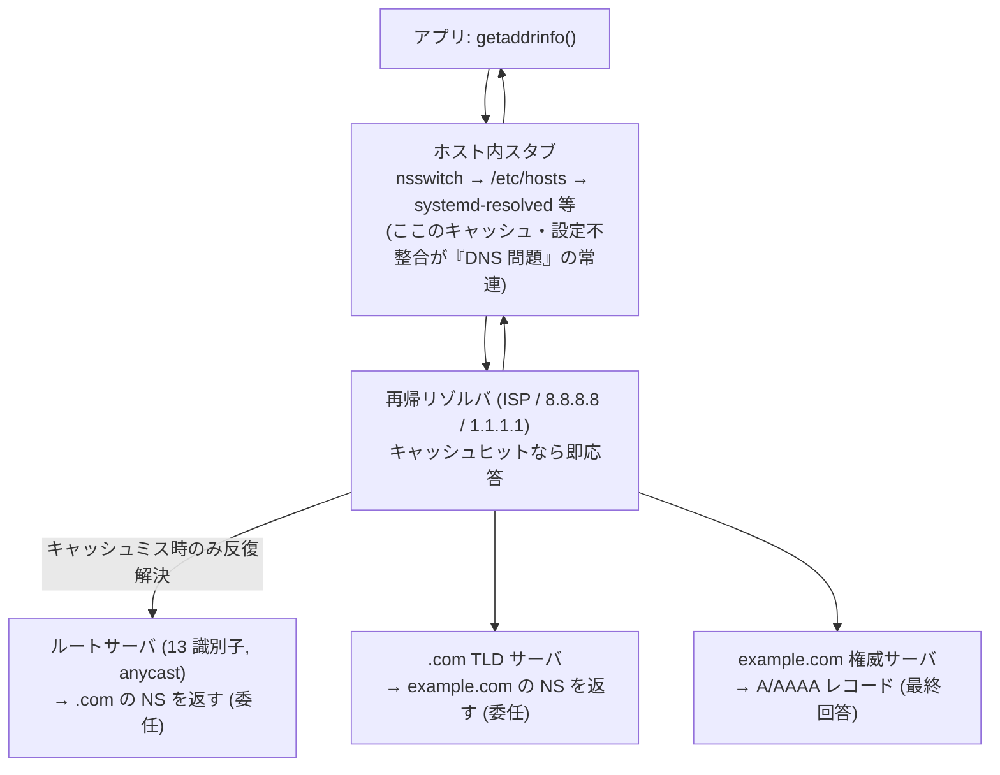

# DNS の構造と解決 (DNS: Delegation, Caching & Trust)

## 概要 (Overview)

すべての通信は名前から始まる。DNS (Domain Name System) は「名前 → 値」を引くだけの素朴なプロトコルに見えるが、その実体は**世界最大の分散データベース**であり、階層的委任 (delegation) と TTL 付きキャッシュによる、最古にして最大規模の結果整合性 (eventual consistency) システムである。

中心テーゼは二つ。第一に、**DNS のスケーラビリティは「木構造の委任」ではなく「キャッシュ」が支えている**。ルートサーバが世界の全クエリを捌けるのは、実際にはほとんど誰もルートまで引かないからである。TTL はこのキャッシュの一貫性と可用性を取引するダイヤルであり、DNS ベースの負荷分散・フェイルオーバ・サービス移行はすべて TTL の操作に還元される。第二に、**DNS は設計時に信頼を考えなかった**。応答の真正性 (DNSSEC) も経路の秘匿 (DoT/DoH) も後付けであり、その移行は 20 年経っても道半ばである。

「It's always DNS」という運用者の格言が示す通り、DNS はインターネットの単一障害点として振る舞い続けている (Dyn 2016, Facebook 2021)。本書は (1) 委任とキャッシュの構造、(2) 解決の実経路 (ホスト内スタックを含む)、(3) TTL の運用意味論、(4) 毒入れと DNSSEC、(5) DoT/DoH と集中化のトレードオフ、を整理する。加えて、(6) 再帰リゾルバの内部 (QNAME 最小化・サーバ選択・TCP への切り替え)、(7) 権威側の設計 (エニーキャスト・ゾーン転送・複数事業者と DNSSEC の複数署名者)、(8) 新しいレコード型 (SVCB/HTTPS・CAA) と EDNS Client Subnet、(9) DNSSEC の鍵の運用と 2018 年・2026 年のルート KSK の交代、(10) 公開された障害の事後報告と、毒入れ以外の攻撃 (SAD DNS・NXNS・TsuNAME・KeyTrap など) を扱う。分析深度は Level 3。

## 方法論 (Methodology)

- プロトコルの原典 (RFC 1034/1035) の設計判断を、当時の制約 (UDP 512B、1980 年代のネットワーク) から説明し、その後の拡張 (EDNS0, DNSSEC, DoH) を「制約の緩和」と「欠落の補修」に分類して追う。
- 障害と攻撃は公開ポストモーテム・一次分析 (Kaminsky 報告、Facebook の障害報告) を根拠とし、教訓を構造 (キャッシュ・委任・依存関係) に帰着させる。
- 「DNS の問題」の多くはホスト内のリゾルバスタックで起きるため、ワイヤ上のプロトコルだけでなく `getaddrinfo` からスタブリゾルバまでの経路を明示的に扱う。
- 数値 (キャッシュヒット率・検証率など) は変動が大きいため桁感と傾向で述べ、断定値を避ける。
- **一次資料**: 拡張の部分は RFC (QNAME 最小化の RFC 9156、TCP の要件の RFC 7766/9210、断片化の回避の RFC 9715、SVCB/HTTPS の RFC 9460、ECS の RFC 7871、複数署名者の RFC 8901、NSEC3 の指針の RFC 9276、DDR の RFC 9462、ODoH の RFC 9230 など)、事業者の事後報告 (Slack 2021、Akamai 2021、InternetNZ 2023、AWS 2025)、査読付きの計測・攻撃の論文 (IMC・USENIX Security・CCS・SIGCOMM) を根拠とする。報道は事後報告の所在を探すためにだけ使った。
- **実装**: リゾルバの内部は Unbound 1.26.2 (`release-1.26.2` タグ) のソースを読み、ファイル名と行番号を記した。BIND と Knot Resolver の挙動は、公開資料で確認できた範囲に限る。
- **時点**: 普及率と計測値は 2026 年 11 月 7 日に確認した値で、本文に時点を書く。2026 年 10 月 11 日のルート KSK の交代は、ICANN の発表と直後の APNIC の計測までを扱う。
- **担当範囲**: mDNS/DNS-SD/LLMNR は [`multicast-service-discovery.md`](multicast-service-discovery.md)、DNS を使う反射攻撃と応答の比率の制限 (RRL) は [`ddos-mitigation.md`](ddos-mitigation.md)、MX・SPF・DKIM・DANE は [`email-delivery-authentication.md`](email-delivery-authentication.md)、CDN の DNS による誘導は [`cdn-edge-delivery.md`](cdn-edge-delivery.md)、Facebook 2021 の事後報告は [`network-verification-telemetry.md`](network-verification-telemetry.md) が扱う。本書は DNS に固有の部分を書き、これらの話題はリンクで済ませる。

## 発見事項 (Findings)

1. **DNS は「名前空間の所有権の分散」を委任で実装した。** ルート → TLD (`.com`) → 権威サーバ (`example.com`) と NS レコードで管理権限を下ろす木構造により、中央の登録機関なしに名前空間全体が運営される。逆に言えば、**上位ゾーンは下位の可用性の人質**であり、TLD の障害はその配下全ドメインの障害である。
2. **実際の解決はほぼキャッシュで完結する。** フルの反復解決 (ルート → TLD → 権威) は稀で、再帰リゾルバ (ISP・パブリック DNS) のキャッシュが木の上部を吸収する。NS レコードの TTL は長く (日単位)、ルート・TLD への実クエリは全体のごく一部にすぎない。**13 のルートサーバ (実体は anycast で 2,000 超のインスタンス。2026-11-07 時点で 2,048) が世界を支えられる理由はキャッシュの側にある**。
3. **TTL は一貫性のダイヤルであり、DNS 運用のほぼ全てである。** 長い TTL = 低負荷・高耐障害性・遅い変更伝搬。短い TTL = 速い切替・高負荷・リゾルバ障害への脆さ。サービス移行前に TTL を下げておく「TTL 短縮の儀式」、ヘルスチェック連動の DNS フェイルオーバ、GeoDNS は、いずれも「古い答えをどこまで許すか」の調整である。ただし**TTL は勧告であって命令ではない** (無視・上書きするリゾルバが実在する) ことが移行計画を狂わせる定番要因になる。
4. **UDP 1 往復という設計は速さと引き換えに、なりすましと増幅を構造化した。** コネクションレスで送信元検証がないため、(a) 応答の偽造競争 (キャッシュポイズニング) と (b) 送信元を偽った小さな質問で大きな応答を第三者に浴びせる**増幅攻撃** (DNSSEC で応答が肥大するほど倍率が上がる皮肉) が可能になった。Kaminsky (2008) が毒入れを実用速度にしたことで、ソースポートのランダム化が緊急配備され、根本対策として DNSSEC が押されたが、**DNSSEC は署名 (真正性) であって暗号化 (秘匿) ではない**。この点の誤解は今も広く残る。
5. **「最後の平文」を塞ぐ DoT/DoH は、分散を集中に置き換えた。** スタブ→リゾルバ間の平文 (ISP や公衆 Wi-Fi から丸見え) を TLS/HTTPS で包む代わりに、クエリは少数の大手リゾルバ (Google, Cloudflare 等) に集まる。**盗聴への防御と、単一事業者への可視性の集中**という交換であり、プライバシの定義そのものが争点になった稀有な移行である。
6. **DNS 障害の本質は「依存の環」である。** Facebook (2021) は BGP 撤回で権威 DNS が消えた結果、名前が引けない → 社内ツールも入館システムも同じ名前空間に依存 → 復旧作業自体が阻害される連鎖を起こした。DNS は依存グラフの根に位置するため、**「DNS の障害」は常に「DNS に依存する全システムの障害」として現象する**。ネガティブキャッシュ (NXDOMAIN も TTL 付きで記憶される) が復旧を遅らせる足枷になる点も含め、障害モードは構造から予測できる。
7. **DNSSEC の失敗は元に戻せないことで長引く。** 親ゾーンの DS レコードは子の都合と関係なく親の TTL でキャッシュされる。Slack (2021-09-30) は Route 53 のワイルドカードの応答の不具合で障害を起こし、DS を取り下げた後に署名もやめた。`.com` の DS の TTL (既定 24 時間) が切れるまで、DS を覚えたリゾルバでは SERVFAIL が続いた。.nz (2023-05-29) でも、鍵の交代の手順と DS の TTL のずれから、古い鍵の状態を覚えたリゾルバで検証が失敗した。DNSSEC の運用では、次の状態に進むより前の状態に戻るほうが遅い。
8. **毒入れへの防御は推測の空間を広げる一方的な対策の積み重ねであり、副チャネルで繰り返し崩されている。** ソースポートのランダム化 (RFC 5452)、0x20 (Dagon ら 2008)、DNS Cookies (RFC 7873) は、どれもリゾルバが単独で入れられるが、推測の空間を広げるだけである。SAD DNS (Man ら CCS 2020) は ICMP のエラーの全体のレート制限を副チャネルにしてソースポートを先に当て、公開リゾルバの 34% 超が攻撃できるとした。MaginotDNS (Li ら USENIX Security 2023) は、フォワーダと再帰リゾルバを兼ねるサーバのバイリウィック (bailiwick) 検査の穴を突いた。根本の対策が署名の検証 (DNSSEC) であることは変わらない。
9. **DNSSEC の可用性のための設計が、計算量攻撃の入口になった。** 鍵の一部が壊れていても検証を通せるよう、仕様はどれかが成功するまで鍵と署名の組を試すと読める書き方をしている。KeyTrap (CVE-2023-50387、Heftrig ら CCS 2024) は 1 つの応答でリゾルバの CPU の命令数を約 200 万倍にし、実装によってはリゾルバを最長 16 時間止めた。修正は検証する署名と NSEC3 の計算の回数に上限を置く (Unbound では各 8 回) という、仕様の外の制限だった。
10. **DNS の障害の原因はプロトコルから DNS のデータを書き換える自動化に移りつつある。** Akamai (2021-07-22) では設定の更新が約 1 時間の障害を起こした。AWS の us-east-1 (2025-10-19〜20) では DynamoDB の DNS 管理系の競合状態 (race condition) で、リージョンのエンドポイントのレコードが空になった。どちらも攻撃ではなく権威のデータを作って配る自社の制御系が原因だった。DNS は依存グラフの根にあるため、制御系の誤りは Dyn 2016 の攻撃と同じ広さで現れる。

## アーキテクチャ (Architecture)

### 解決の全経路 — ブラウザからルートまで

- **スタブ** (OS 内・転送のみ) と**再帰リゾルバ** (反復解決とキャッシュを担う) と**権威サーバ** (ゾーンの正本を持つ) は役割が全く違う。「DNS サーバ」という語はこの三者を混同しがちである。
- 委任の糊: 子ゾーンの NS 名が子ゾーン自身の中にある場合 (`ns1.example.com` が `example.com` の NS)、循環を断つために親が **glue レコード** (NS の IP) を持つ。glue の不整合・期限切れ NS (lame delegation) は「たまに引けない」型の悩ましい障害を作る。

### 権威側の構成 — 隠しプライマリと複数事業者

```mermaid
flowchart LR
    subgraph Owner["ゾーンの所有者"]
        HP["隠しプライマリ (hidden primary)<br/>ゾーンの元データと署名鍵<br/>NS には載せない"]
    end
    subgraph ProvA["事業者 A (エニーキャスト)"]
        A1["セカンダリ群<br/>同じアドレスを多拠点から広告"]
    end
    subgraph ProvB["事業者 B (エニーキャスト)"]
        B1["セカンダリ群"]
    end
    P["親ゾーン (TLD)<br/>NS: A と B の両方<br/>DS: KSK のハッシュ"]
    R["再帰リゾルバ<br/>SRTT で速い NS を選ぶ"]
    HP -- "NOTIFY (RFC 1996)" --> A1
    HP -- "NOTIFY" --> B1
    A1 -- "IXFR/AXFR を要求<br/>(TSIG または XoT)" --> HP
    B1 -- "IXFR/AXFR を要求" --> HP
    P -. "委任" .-> A1
    P -. "委任" .-> B1
    R --> A1
    R --> B1
```

凡例: 実線は制御とデータの流れ (NOTIFY はプライマリからの通知、ゾーン転送はセカンダリからの要求)、点線は親ゾーンからの委任。

- ゾーンの元データを持つプライマリを NS に載せないことで、元データと署名鍵を問い合わせの攻撃面から外せる。公開されるのはセカンダリだけである。
- ゾーン転送で同期できるのは標準のレコードだけである。事業者の独自機能 (地理による応答、ヘルスチェック連動、apex の ALIAS) は、各事業者の API に同じ設定を入れて揃える必要がある。各事業者が応答時に自分の鍵で署名する場合は、DNSSEC の複数署名者の構成 (技術詳細 §4) が要る。

### 主要レコード型 — 名前に載る値の種類

| 型 | 内容 | 備考 |
|---|---|---|
| A / AAAA | IPv4 / IPv6 アドレス | 解決の主目的 |
| NS | 委任先ネームサーバ | 木構造の骨格 |
| CNAME | 別名 → 正規名 | 頂点 (zone apex) には置けない制約が ALIAS/ANAME 亜種を生んだ |
| MX | メール受け入れ先 | 優先度付き |
| TXT | 任意文字列 | SPF/DKIM/DMARC・所有権確認など「何でも置き場」化 |
| SOA | ゾーンの管理情報 | ネガティブキャッシュ TTL もここ |
| DS / DNSKEY / RRSIG | DNSSEC の信頼チェーン | 親ゾーンの DS が子の鍵をつなぐ |
| SVCB / HTTPS | 接続パラメータ (ALPN, ECH 鍵…) | 「A を引いてから試す」を 1 往復に畳む新世代 |
| CAA | 証明書を発行してよい CA | RFC 8659。CA は発行前の確認が義務 (CA/Browser Forum、2017 年 9 月から) |
| `*` (ワイルドカード) | 存在しない名前への合成応答 | 型ではなく所有者名の規則 (RFC 4592)。存在する名前には一致しない |

## 技術詳細 (Technical Details)

### 1. ワイヤの制約と拡張 — 512 バイトの呪縛

- 原設計は UDP 512B 上限。**EDNS0** が上限を拡張したが、大きな UDP 応答は IP フラグメンテーションの喪失・毒入れ耐性の低下を招くため、現代の運用は「大きい応答は TC (truncated) フラグで TCP へ誘導」に回帰しつつある (DNS Flag Day 2020 のバッファサイズ縮小勧告)。**「DNS = UDP」は既に近似でしかなく**、DoT/DoH/DoQ を含め輸送は多様化した。
- **フラグデイ (Flag Day)**: 2019 年 2 月 1 日の DNS Flag Day で、主要なリゾルバは EDNS に正しく応答しない権威サーバのための回避策 (EDNS なしでの再送など) を取り除いた。2020 年 10 月 1 日の DNS Flag Day 2020 は、EDNS のバッファの既定値として 1232 バイトを勧めた。IPv6 の最小 MTU 1280 バイトから IPv6 と UDP のヘッダ 48 バイトを引いた値で、仕様の変更ではなくよりよい情報がないときの既定値である。Unbound 1.26.2 の既定もこの値である (`doc/example.conf.in` 143 行の `edns-buffer-size: 1232`)。
- **TCP は必須**: RFC 7766 (2016) が TCP の実装を必須にし、RFC 9210 (BCP 235、2022) は「すべてのリゾルバとサーバは UDP と TCP の両方の問い合わせを受けなければならない」と運用の要件に引き上げた。ネットワークの運用者も DNS の TCP を通さなければならず、UDP の問い合わせが先にない TCP の問い合わせを拒んではならない。TCP 53 番を塞ぐファイアウォールは、大きな応答 (DNSSEC・多数の A レコード) だけが引けない障害を作る。
- **断片化の回避**: 断片化された UDP の応答では、2 つ目以降の断片にポート番号もクエリ ID も載らない。このため経路外の攻撃者が偽の断片を差し込める (Herzberg & Shulman 2013)。RFC 9715 (2025 年 1 月、Informational) は、応答側に IPv6 の断片化を避けること、要求側に断片化された応答を組み立てずに捨てることを求める。UDP のペイロードの上限にはインタフェースと網の MTU から計算した値と 1400 バイトのうち小さいほうを使う。Flag Day 2020 の 1232 バイトは、MTU の情報がないときの保守的な値にあたる。
- クエリの実務: 並行する A/AAAA、ハッピーアイボール (v4/v6 競争)、検索ドメインの補完 (`ndots` 問題。Kubernetes で `example.com.cluster.local` への無駄クエリが 5 倍発生する類) など、**1 回の名前解決の裏で複数クエリが飛ぶ**のが常態である。

### 2. キャッシュの意味論 — TTL・ネガティブキャッシュ・serve-stale

- キャッシュは応答の RRset 単位。**NXDOMAIN (不在) も SOA の値に基づき記憶される** (ネガティブキャッシュ, RFC 2308)。「作ったばかりのレコードが引けない」のは伝搬待ちではなく、**不在の記憶**が残っているせいであることが多い (DNS に push の伝搬は存在せず、あるのはキャッシュの失効だけである)。
- **serve-stale** (RFC 8767): 権威に到達できないとき、期限切れキャッシュを暫定的に返す拡張。「古い答えは無応答より良い」という現実主義で、権威 DNS への DDoS (Dyn 型) の被害を緩和した実績から標準化された。一貫性を可用性に売る判断を明文化したものである。
- キャッシュの毒に対する構造的防御: 応答の受理には (クエリ ID, ソースポート, 質問名) の一致が要る。Kaminsky 攻撃は「存在しないサブドメインを大量に聞く」ことで競争機会を無限に作った。対策のソースポートランダム化はエントロピーを 16bit → 32bit にしただけであり、**根本解決 (署名) までのつなぎが 20 年続いている**のが現状である。

### 3. 再帰リゾルバの内部 — 何を、どこに聞き、いつ諦めるか

- **QNAME 最小化 (RFC 9156)**: リゾルバは各段の権威サーバに、その段の委任を知るのに要るラベルだけを送る。`www.example.com` の解決でルートに送るのは `com` だけになる。RFC 9156 (2021 年 11 月、RFC 7816 を廃止) は、問い合わせの型に NS ではなく A か AAAA を勧める (NS を使っても得るものはない)。ラベルの多い名前で問い合わせが増えすぎないよう、追加の問い合わせは最大 10 回 (MAX_MINIMISE_COUNT) とし、最初の 4 回 (MINIMISE_ONE_LAB) は 1 ラベルずつ増やす目安も示す。途中で NXDOMAIN が返れば、その下の名前も存在しないとして打ち切れる (RFC 8020)。空の非終端に NXDOMAIN を返す壊れた権威サーバがあるため、実装は既定で完全な名前での再試行に戻る。Unbound の `qname-minimisation-strict: no` がこの退避である (`doc/example.conf.in` 594-600 行)。
- **サーバの選択 (SRTT)**: ゾーンの NS が複数あるとき、リゾルバは過去の応答時間を平滑化した値 (smoothed RTT, SRTT) で選ぶ。Unbound 1.26.2 は最も速いサーバから 400 ms の幅 (`RTT_BAND`、`iterator/iterator.h` 104 行) に入るサーバの中から無作為に選ぶ。未知のサーバには仮に 376 ms (`UNKNOWN_SERVER_NICENESS`、`iterator/iterator.c` 76 行) を与えるので、未知のサーバは速いサーバと同じ幅に入り、ときどき試される。この探索によって、エニーキャストの拠点の変化や新しい NS が拾われる。DNSSEC の検証に失敗したアドレスには、選択の値に 480,000 (ms 単位) の罰則 (`BLACKLIST_PENALTY`、同 80 行) が加わる。
- **再送とタイムアウト**: 再送までの待ち時間 (RTO) は TCP と同じく SRTT + 4 × RTTVAR で計算し、50 ms から 120 秒の範囲に収める (`util/rtt.c` 47-62 行。計算は Stevens の教科書に倣ったとコメントにある)。応答しない NS を 1 つ含むゾーンでは、そのサーバが選ばれた問い合わせが待ち時間を払い、以後そのサーバは避けられる。NS をすべて同じ事業者・同じ網に置くと、この切り替え先がなくなる。
- **積極的な NSEC キャッシュ (RFC 8198)**: 署名された NSEC (または NSEC3) の範囲をキャッシュし、範囲内の名前への問い合わせに権威へ聞かずに NXDOMAIN を合成する。水責め攻撃の緩和になる一方、権威が誤った NSEC を返すと、その誤りが範囲全体に広がる。Slack の障害 (§10) がこの例である。Unbound 1.26.2 では既定で有効である (`aggressive-nsec: yes`、`doc/example.conf.in` 604 行)。
- **偽応答への一方的な対策**: ソースポートとクエリ ID のランダム化 (RFC 5452、2009 年)、問い合わせ名の大文字と小文字を無作為に変え、応答にそのまま写させる 0x20 (Dagon ら CCS 2008)、クライアントとサーバが互いを確かめる DNS Cookies (RFC 7873) がある。0x20 は英字の少ない短い名前では効果が小さく、大文字と小文字を保たない権威サーバもあるため、Unbound では既定で無効である (`use-caps-for-id: no`、同 608 行)。
- **serve-stale の既定**: RFC 8767 の serve-stale は Unbound 1.26.2 では既定で無効 (`serve-expired: no`) で、有効にすると期限切れの応答を TTL 30 秒で返す (`serve-expired-reply-ttl: 30`、同 759-773 行)。一貫性と可用性のどちらを取るかを、運用者に明示的に選ばせる設計である。

### 4. 権威側の設計 — エニーキャスト・ゾーン転送・複数事業者

- **エニーキャスト**: 権威サーバは、同じアドレスを多数の拠点から BGP で広告するエニーキャストで配るのが標準になった。ルートサーバは 13 の識別子を 12 の組織が運用し、2026-11-07 時点で 2,048 のインスタンスが動いている (root-servers.org)。エニーキャストは利用者を近い拠点に寄せ、攻撃を拠点ごとに分ける。攻撃を受けた拠点が攻撃を吸収するか経路を撤退するかは [`ddos-mitigation.md`](ddos-mitigation.md) で扱う。
- **ゾーン転送**: プライマリはゾーンの変更を NOTIFY (RFC 1996) でセカンダリに知らせ、セカンダリは差分の IXFR (RFC 1995) か全体の AXFR (RFC 5936) で取りに来る。転送は TSIG (RFC 8945) の共有鍵で認証し、XoT (RFC 9103、2021 年) で TLS により秘匿できる。ゾーンの多い運用では、カタログゾーン (RFC 9432、2023 年) でゾーンの一覧そのものを DNS のゾーンとして配る。SOA の serial は変更の順序を表し、増やし忘れるとセカンダリは変更を取りに行かない。SOA の expire を過ぎてもプライマリに届かないセカンダリは、そのゾーンへの応答をやめる。プライマリが落ちてもしばらくは動き、expire の時刻にまとめて止まるという障害の形になる。
- **複数事業者と複数署名者**: Dyn 2016 以降、権威を 2 社以上に置く構成が広がった。各事業者が応答時に自分の鍵で署名する場合は、RFC 8901 (2020 年、Informational) の複数署名者のモデルが要る。モデル 1 では所有者が共通の KSK を持ち、各事業者の ZSK をまとめた DNSKEY の集合に署名する。モデル 2 では事業者ごとに KSK と ZSK を持ち、親には事業者の数だけ DS を置く。どちらのモデルでも、各事業者の DNSKEY の集合に他の事業者の ZSK を入れなければならない。入れないと、ある事業者から DNSKEY を得てキャッシュしたリゾルバが、別の事業者の署名を検証できない。
- **TTL の戦略**: Moura ら (IMC 2019) は、TTL を延ばした ccTLD で応答時間が 183 ms から 28.7 ms に下がった例を報告し、委任の境界をまたぐレコード (NS など) は親と子の両方に別の TTL で載りうるため、実際のキャッシュの寿命は複数の要因で決まることを示した。運用上は、平常時は長くし、変更の前に下げる (発見事項 3) のが基本である。ただし親の側にある NS と DS の TTL は子からは変えられない。Slack の事例では、`.com` の DS の TTL は既定で 24 時間で、Google Public DNS は上限を 6 時間に絞っていた。

### 5. レコードの意味論 — SVCB/HTTPS・apex・ワイルドカード・CAA

- **SVCB/HTTPS (RFC 9460、2023 年 11 月)**: 1 つのレコードに接続先と接続のパラメータを載せる。SvcPriority が 0 なら AliasMode (別名への委任)、1 以上なら ServiceMode (接続先の候補とパラメータ) である。パラメータには `alpn` (h2・h3 などの対応プロトコル)、`port`、`ipv4hint`/`ipv6hint`、`ech` がある。HTTPS レコードが引ければ、クライアントは `http://` への要求を `https://` への 307 リダイレクトを受けたものとして扱う (HSTS に似る)。`alpn` に h3 があれば、TCP で接続してから Alt-Svc で QUIC に移る手順を省ける ([`http-quic-evolution.md`](http-quic-evolution.md))。
- **ECH の鍵の配布**: TLS の Encrypted Client Hello (RFC 9849、2026 年 3 月) の公開鍵は、HTTPS レコードの `ech` パラメータで配る (RFC 9848、2026 年 3 月)。ECH を使うクライアントは、ClientHello を送る前に SVCB の解決を終えなければならない。経路上で `ech` を取り除かれれば ECH は使えないので、SNI の秘匿は DNS の秘匿と真正性 (DoH と DNSSEC) に依存する ([`tls-internals.md`](tls-internals.md))。
- **apex の CNAME**: CNAME は同じ名前に他のデータと共存できず (RFC 1034 §3.6.2)、ゾーンの頂点には SOA と NS が必ずある。このため `example.com` そのものを CDN の名前に CNAME で向けられない。DNS 事業者は ALIAS・ANAME・CNAME flattening などと呼ぶ独自機能で、権威サーバの側で別名を解決して A/AAAA として返す。標準ではないので事業者間で互換性がなく、複数事業者の構成で揃えにくい。HTTPS レコードの AliasMode は apex に置けるが、HTTPS レコードを引くクライアントにしか効かない。Slack は 2 回目の DNSSEC の試行で、厳格なリゾルバが apex の CNAME を拒むことに気付き、ALIAS に移した (Slack 2021)。
- **ワイルドカード (RFC 4592)**: `*.example.com` は、存在しない名前に対してだけ合成した応答を返す。名前が存在すれば (別の型しか持たない場合や、下にレコードがある空の非終端を含めて)、ワイルドカードは一致しない。ワイルドカードが A しか持たない場合、合成される名前への AAAA の問い合わせは NODATA になり、DNSSEC ではこの否定をワイルドカードの NSEC の型ビットマップで示す。Slack の障害は、このビットマップに実在する型が載っていなかったことによる。
- **CAA (RFC 8659)**: どの CA が証明書を発行してよいかを宣言する。CA/Browser Forum の決定で、2017 年 9 月から CA は発行前に CAA を確認しなければならない。CAA は発行の時点で CA が確かめるもので、TLS のクライアントは検証に使わない。CA の侵害や誤発行への対策は [`tls-internals.md`](tls-internals.md) の Certificate Transparency と組み合わせて考える。

### 6. EDNS Client Subnet — CDN の精度とプライバシとキャッシュ

- **仕組み**: RFC 7871 (2016 年 5 月、Informational) は、再帰リゾルバがクライアントのアドレスの先頭部分 (IPv4 は /24、IPv6 は /56 を推奨) を権威に伝える EDNS のオプションを定める。権威は応答が有効な範囲 (scope prefix) を返し、リゾルバはその範囲ごとに応答をキャッシュする。
- **精度の利得と費用**: Akamai はクライアントのプレフィクスで誘導する end-user mapping を導入し、公開リゾルバの利用者について、誘導先までの距離が 8 分の 1、RTT とダウンロード時間が半分になり、最初のバイトまでの時間が 30% 改善したと報告した。同時に DNS の問い合わせは 8 倍に増えた (Chen ら SIGCOMM 2015)。問い合わせの増加は、キャッシュがプレフィクスごとに分かれる代償である。
- **プライバシ**: RFC 7871 自身が、クライアントのアドレスが解決の経路上のすべてのサーバと網に見える問題を認め、既定で無効にして利点のある場合だけ有効にするよう勧めている。文書は既存の振る舞いを記録したもので、この方式を推奨するものではないと断っている。
- **事業者の選択**: Google Public DNS は ECS に対応する権威サーバをアドレスごとに自動で検出して ECS を送る。Cloudflare の 1.1.1.1 は ECS を送らない (Akamai のデバッグ用の名前を除く)。同じ CDN でも、利用者がどの公開リゾルバを使うかで誘導の精度が変わる。CDN 側の誘導の仕組みは [`cdn-edge-delivery.md`](cdn-edge-delivery.md) で扱う。

### 7. DNSSEC — 署名の木とその重さ

- 機構: ゾーンの RRset に署名 (RRSIG) を付け、ゾーンの公開鍵 (DNSKEY) のハッシュを**親ゾーンの DS レコード**に登録する。ルートの鍵だけを信頼の錨 (trust anchor) とし、ルート → TLD → ゾーンと検証が連鎖する。不在の証明には NSEC/NSEC3 (存在する名前の範囲を署名) を使う。「ない」ことの証明が「ある」ことより難しい、という一般則の好例。
- 現実: 署名済みゾーンも検証するリゾルバも増えたが普及は部分的で、地域差が大きい (APNIC の計測では、検証するリゾルバを使う利用者は 2026 年 10 月時点で世界の約 4 割、国によって大きく異なる)。理由は運用の重さに集約される: 鍵の順回転 (rollover) の失敗はゾーン全体の SERVFAIL に直結し、「署名しない」より「署名を失敗する」方が痛い。ルート鍵の交代 (KSK rollover, 2018) が何年も準備を要した事実が、この重さを物語る。
- DNSSEC が守るのは**リゾルバまでの応答の真正性**であり、スタブ→リゾルバ間や、クエリ内容の秘匿は守らない。そこは DoT/DoH の守備範囲で、両者は代替ではなく補完である。
- **ルートの KSK の交代**: 最初の交代は 2017 年 10 月の予定が延期され、2018 年 10 月 11 日に KSK-2017 (鍵タグ 20326) への切り替えとして行われた。2 回目の KSK-2024 (鍵タグ 38696) は 2025 年 1 月 11 日にルートゾーンに公開され、2026 年 10 月 11 日からルートの DNSKEY の集合の署名に使われている。ICANN は 2026 年 10 月 15 日に予定どおり完了したと発表し、少数のシステムで問題の報告があり、交代との関係を調べているとした。旧鍵の失効は 2027 年 1 月に予定されている。APNIC の計測では、交代の前後で検証する利用者の比率は世界全体で 39.7% から 40.6% に上がった。一方で、比較した 13,538 の網のうち 58 の網で比率が 50% 以上、660 の網で 10% 以上下がった (ブラジルは 54% から 50%)。下がった網が新しい鍵を信頼できずに検証を止めたのか、利用者が検証しないリゾルバに移ったのかは、この計測からは分からない。
- **アルゴリズムの交代**: Verisign は 2023 年に .edu・.net・.com の署名を RSA/SHA-256 (アルゴリズム 8) から ECDSA P-256/SHA-256 (アルゴリズム 13) に移し始め、.com は同年 12 月にアルゴリズム 13 の DS をルートに公開した。署名が小さくなり、応答が 1232 バイトに収まりやすくなる。アルゴリズムの交代では新旧の両方で署名する期間を挟み、その間に親の DS を差し替える。
- **NSEC3 の費用**: NSEC3 は名前の列挙を防ぐためにハッシュを使うが、ハッシュの反復を増やすほど権威と検証側の CPU を消費する。RFC 9276 (BCP 236、2022 年) は反復 0 回・ソルトなしを求め、反復の多いゾーンを検証側が署名なし (insecure) として扱うか SERVFAIL にすることを認めた。同 RFC の付録の測定では、150 回の反復で権威の処理能力は 0 回のときの 38% に落ちる。

### 8. DoT / DoH / DoQ — 輸送の暗号化と権力の再配置

| 方式 | 輸送 | 特徴 |
|---|---|---|
| DoT (RFC 7858) | TLS/853 | 専用ポート。見えないが「DNS を使っている」ことは分かる。ブロックも容易 |
| DoH (RFC 8484) | HTTPS/443 | Web と不可分。検閲・企業フィルタから区別困難。ブラウザが OS を飛び越して使える |
| DoQ (RFC 9250) | QUIC/853 | HoL なし・0-RTT ([`http-quic-evolution.md`](http-quic-evolution.md) の利得の直接適用) |

- DoH の論争点はプロトコルではなく**配置**にある: ブラウザが既定で特定事業者の DoH に切り替えると、(a) OS・ネットワーク管理者の設定 (スプリット DNS、フィルタリング) が迂回され、(b) クエリの可視性が少数事業者に集中する。技術的には同じ暗号化でも、**誰のポリシが適用されるか**が変わる。プロトコル設計が統治構造を変えた例として記憶に値する。
- 折衷の方向: Discovery of Designated Resolvers (DDR) による「今のネットワークのリゾルバを暗号化で使う」、Oblivious DoH (プロキシで「誰が」と「何を」を分離) など、集中を緩和する機構が続いている。
- **ブラウザの既定**: Firefox は 2020 年 2 月 25 日から、米国の利用者について DoH を既定で有効にした。接続先は Cloudflare と NextDNS から選べる。網の DNS フィルタとの衝突を避けるため、Firefox は OS のリゾルバで `use-application-dns.net` を引き、NOERROR 以外 (または A/AAAA なし) が返れば既定の DoH を無効にする。このカナリアドメイン (canary domain) は、利用者が自分で DoH を有効にした場合には効かない。Mozilla 自身が、標準の仕組みができるまでの暫定措置と位置づけている。Chrome は 83 (2020 年 5 月) から、利用者が今使っている DNS 事業者が DoH に対応していれば、同じ事業者の DoH に切り替える方式を取った。接続先の事業者を変えないという点で、Firefox とは逆の選択である。
- **DDR と DNR**: DDR (RFC 9462、2023 年 11 月) では、クライアントは設定された平文のリゾルバに `_dns.resolver.arpa` の SVCB を問い合わせ、同じ運用者の DoH・DoT・DoQ の接続先を知る。検証付きの発見では、接続先の証明書に元のリゾルバの IP アドレスが入っていなければならない。家庭のルータのような私設アドレスのリゾルバは証明書で検証できないため、IP アドレスが同じ場合に限る日和見的な発見 (opportunistic discovery) になる。DNR (RFC 9463) は DHCP と RA で暗号化リゾルバを直接配る。どちらも今の網のリゾルバを暗号化して使う方向であり、集中を進めずに盗聴を防ぐ。
- **ODoH (RFC 9230、2022 年 6 月、Experimental)**: クライアントは問い合わせを接続先 (target) の公開鍵で HPKE により暗号化し、プロキシ経由で送る。プロキシはクライアントの IP アドレスを知るが内容を知らず、接続先は内容を知るがクライアントの IP アドレスを知らない。安全性は、プロキシと接続先が結託しないことに依存する。
- **集中の計測**: Moura ら (IMC 2020) は、欧州とオセアニアの 2 つの ccTLD の権威サーバに届く問い合わせの 30% 超が、5 つの大手クラウド事業者から来ていることを示した。集中は障害とプライバシの面で危険を増やす一方、大手が QNAME 最小化のような新機能を入れれば多数の利用者に一度に効くという面もある。

### 9. 名前空間の統治 — 私的な名前のための予約

- 組織の中だけで使う名前に、勝手な TLD (`.corp`・`.lan` など) を使う慣行は、その文字列が後でルートに委任されると衝突する。ICANN の理事会は 2024 年 7 月 29 日の決議 (2024.07.29.06) で `.internal` をルートゾーンに恒久的に委任しないと決め、私的な用途に使えるようにした。SSAC の SAC113 (2020 年) の勧告に応えたものである。
- IETF の側では家庭網の名前に `home.arpa` (RFC 8375、2018 年)、DNS 以外の名前解決の仕組みのための疑似 TLD に `.alt` (RFC 9476、2023 年) を予約した。`.local` はマルチキャスト DNS の名前で ([`multicast-service-discovery.md`](multicast-service-discovery.md))、ユニキャストの DNS の内部ドメインに使うと mDNS と衝突する。
- `.internal` はルートに委任されないので、DNSSEC の検証側から見ると、ルートの不在証明で「存在しない」と示される名前である。検証するリゾルバから内部の `.internal` のゾーンへ転送する構成では、そのゾーンを検証の例外 (Unbound の `domain-insecure` など) にしないと、ルートの不在証明と矛盾して SERVFAIL になる。

### 10. 公開された障害の事例

| 事例 | 何が起きたか | 構造上の教訓 |
|---|---|---|
| Dyn (2016-10-21) | Mirai のボットネットを含む数千万の IP アドレスからの DDoS が 2 波にわたって権威 DNS を襲い、Dyn を唯一の権威とする多数のサイトが引けなくなった | 権威の単一事業者への依存。複数事業者と serve-stale が広がるきっかけになった |
| Akamai (2021-07-22) | 15:45 UTC の設定の更新が、DNS で利用者を配信サーバに割り当てる系の不具合を引き起こし、約 1 時間、顧客のサイトが引けなかった。Akamai は攻撃ではないと発表した | 設定の配布経路が全顧客の共通の障害点。設定のロールバックで回復した |
| Slack (2021-09-30) | DNSSEC の 3 回目の有効化で、Route 53 がワイルドカードの NODATA に型ビットマップの誤った NSEC を返した。積極的な NSEC キャッシュを持つリゾルバ (Google Public DNS) は A まで否定した。DS を外した後に署名をやめたため、DS を覚えたリゾルバで SERVFAIL になった。約 24 時間、オンラインの利用者の 1% 未満に影響した | 戻せない変更 (§7)。ワイルドカードを持つドメインで事前に試験していなかった |
| Facebook (2021-10-04) | 変更作業でバックボーンが切れ、DNS サーバが自分を不健全とみなして BGP の広告を取り下げた | DNS の健全性の判定が経路と結び付いていた。詳細は [`network-verification-telemetry.md`](network-verification-telemetry.md) |
| .nz (2023-05-29〜31) | ac.nz の KSK の交代で、新旧のレジストリシステムの DS の TTL の違い (1 時間と 1 日) と OpenDNSSEC の手順の進め方が重なり、古い鍵の状態をキャッシュしたリゾルバで検証が失敗した。InternetNZ は鍵の交代を止め、2024 年 7 月に再開した | 署名ツールのタイマと、実際のキャッシュの寿命のずれ |
| AWS us-east-1 (2025-10-19〜20) | DynamoDB の DNS 管理系 (計画を作る DNS Planner と、Route 53 に適用する 3 つの DNS Enactor) で、遅れた Enactor が古い計画で新しい計画を上書きし、続く掃除で古い計画が消され、リージョンのエンドポイントのレコードが空になった。23:48 PDT に始まり、DNS は翌 2:25 に復旧した。依存するサービスを含めた回復は 14:20 まで続いた | DNS を書き換える自動化の競合状態。AWS は修正まで、この自動化を全世界で止めた |

6 つの事例のうち、外部からの攻撃は Dyn だけである。残りは署名の運用、設定の配布、DNS を書き換える自動化、DNS の健全性の判定という、事業者自身の制御系から起きた。どの事例でも、障害の長さは原因の修正の速さだけでなく、キャッシュに残った古い答え (DS・否定応答・空のレコード) の TTL で決まった。

### 11. 観測の入口 (Observability)

| 疑問 | 道具 |
|---|---|
| 名前は何に解決されるか・どの経路か | `dig +trace` (反復解決の再現)、`dig @8.8.8.8` (リゾルバ指定比較)、`delv` (DNSSEC 検証付き) |
| ホスト内のどの層が答えたか | `resolvectl query` / `resolvectl statistics` (systemd-resolved)、`/etc/nsswitch.conf` の確認 |
| キャッシュに何が残っているか | `resolvectl flush-caches`、リゾルバ側の TTL 残量 (`dig` の ANSWER の TTL) |
| 委任は健全か | `dig NS +norecurse` を親側に (glue/lame の確認)、DNSViz (DNSSEC チェーンの可視化) |
| 障害の切り分け | 「権威は答えるか (`dig @権威`)」→「リゾルバは答えるか」→「スタブは答えるか」の三分探索 |
| SERVFAIL の理由は何か | 拡張 DNS エラー (Extended DNS Errors, RFC 8914)。`dig` が表示する `EDE: 6 (DNSSEC Bogus)` などが、SERVFAIL の内訳を示す |
| リゾルバは各 NS をどう評価しているか | `unbound-control dump_infra` (サーバごとの RTT と EDNS の状態) |
| エニーキャストのどの拠点が答えたか | `dig +nsid` (RFC 5001)、`dig CH TXT hostname.bind` |

## セキュリティ考察 (Security Considerations)

- **キャッシュポイズニング**: 偽応答の競争 (Kaminsky 型) に加え、フラグメンテーションを突く亜種・帯域内の中間者など。防御はソースポートランダム化・0x20 エンコーディング (大文字小文字の乱数化)・DNSSEC 検証・トランスポート暗号化の重ね掛けであり、単独で十分な層はない。
- **増幅・反射 DDoS**: 偽装ソースへの大応答 (ANY クエリ・DNSSEC 応答で増幅率数十倍) は、DNS 自体でなく**第三者を撃つ武器**として DNS を使う。対策は BCP 38 (ソース偽装の出口フィルタ)・レートリミット (RRL)・ANY の廃止 (RFC 8482)。逆に DNS が標的になった例が Dyn (2016, Mirai ボットネット) である。単一 DNS プロバイダ依存の SaaS が軒並み巻き添えになり、**権威 DNS の冗長化 (複数プロバイダ)** が教訓として定着した。
- **オープンリゾルバ**: 誰からの問い合わせにも再帰的に答えるリゾルバ (オープンリゾルバ) は、送信元を偽装した問い合わせを受けて被害者に大きな応答を返す、増幅攻撃の踏み台になる。家庭用ルータなどの設定の誤りで意図せず公開されていることが多い。リゾルバの再帰の応答は自組織の利用者のアドレスに限るのが原則である (RFC 5358、BCP 140)。反射と増幅の全体像は [`../security/attack-lifecycle.md`](../security/attack-lifecycle.md) で扱う。
- **水責め攻撃 (ランダムサブドメイン攻撃)**: 存在しないランダムなサブドメイン (`a8f3k2.example.com` のような名前) を大量に問い合わせると、どの名前もキャッシュに載っていないため、リゾルバはすべてを権威サーバへ問い合わせる。権威サーバと、間にあるリゾルバの両方が負荷で応答できなくなる。問い合わせはボットネットや、乗っ取った端末からキャッシュリゾルバ経由で送られるため、送信元で区別しにくい。対策は存在しない名前の応答 (NXDOMAIN) の多いゾーンへの問い合わせのレート制限と、DNSSEC の不在証明 (NSEC) をキャッシュして、範囲内の存在しない名前にはリゾルバが自分で答える方式 (RFC 8198) である。
- **DNS はデータチャネルになる**: TXT/NULL クエリに載せた DNS トンネリング (C2・データ持ち出し) は、「DNS だけは通す」境界設定の裏をかく古典であり、防御側はクエリ長・エントロピー・頻度の異常検知とログ (パッシブ DNS) で対抗する。パッシブ DNS はインシデント対応の一級資料 (ドメインの過去の解決先の追跡) でもある。
- **登録・移管の層が最弱点になりうる**: レジストラアカウントの乗っ取り・期限切れドメインの再取得 (だれかの依存先を居抜きで奪う)・typosquatting は、プロトコルの外側で名前の信頼を破る。レジストリロック・自動更新・依存ドメインの棚卸しが防御になる。
- **副チャネルによる毒入れ**: SAD DNS (Man ら CCS 2020) は、Linux などの OS が ICMP のエラーに全体で 1 つのレート制限を持つことを使い、開いている UDP のソースポートを外から推測した。ポートとクエリ ID を別々に当てられるため、推測の空間は掛け算から足し算に縮む。論文は公開リゾルバの 34% 超が攻撃できるとし、Linux は 5.10 でこのレート制限の値を無作為にした (CVE-2020-25705)。MaginotDNS (Li ら USENIX Security 2023) は、フォワーダと再帰リゾルバを兼ね、キャッシュを共有するサーバ (CDNS) のバイリウィック検査の穴を突き、BIND と Microsoft DNS で `.com` のような TLD の全体を乗っ取れることを示した。調べた公開 DNS サーバの最大 41.8% が CDNS で、その少なくとも 35.5% が攻撃できた。
- **NXNS 攻撃**: Afek ら (USENIX Security 2020) は、攻撃者の権威サーバが glue のない多数の NS 名を含む委任を返すと、リゾルバがそれぞれの NS 名を解決しようと被害者のゾーンへ問い合わせることを示した。リゾルバが交わすパケットの数で 1,620 倍超の増幅になる。対策は一度に解決する NS 名の数を絞る MaxFetch(k) で、各社のリゾルバが修正した。
- **TsuNAME**: Moura ら (IMC 2021) は、2 つのゾーンの NS が互いを指す循環した委任に対して、一部のリゾルバとその背後のクライアントが問い合わせを繰り返し、権威に過大な負荷をかけることを示した。.nz では 2020 年に、この誤設定のあるドメイン 2 つで全体の通信量が 50% 増えた。対策はリゾルバ側の循環の検出と、権威側での循環の検査 (CycleHunter) である。
- **KeyTrap (CVE-2023-50387)**: 攻撃者は同じ鍵タグを持つ多数の DNSKEY と多数の RRSIG を含むゾーンを用意し、検証するリゾルバに組み合わせの数だけ署名の検証をさせる。NSEC3 の最近接の祖先の証明 (closest encloser proof) で同様に CPU を使わせるのが CVE-2023-50868 である。Heftrig ら (CCS 2024) は、1 つの応答で CPU の命令数が約 200 万倍になり、リゾルバが 170 秒から 16 時間止まることを示した。Unbound は 1.19.1 (2024-02-13) で修正し、1.26.2 では 1 つの RRset の署名の検証を 8 回 (`MAX_VALIDATE_RRSIGS`、`validator/val_sigcrypt.c` 84 行)、1 つのメッセージの NSEC の検証を 8 回 (`MAX_VALIDATE_NSECS`、同 86 行)、NSEC3 のハッシュの計算を 8 回 (`MAX_NSEC3_CALCULATIONS`、`validator/val_nsec3.h` 106 行) までに制限している。暗号を破る攻撃ではなく、DNSSEC の保護を迂回するものでもない。
- **ダングリングレコードによるサブドメインの乗っ取り**: 削除したクラウドの資源 (ストレージのバケット、アプリケーションの名前、IP アドレス) を指す CNAME や A が残っていると、攻撃者はその資源を取り直して、サブドメインで自分の内容を配り、証明書まで取れる。Liu ら (CCS 2016) は、Alexa の上位 1 万のうち 277 ドメインと 52 の .edu のゾーンで、攻撃できるダングリングレコードを 467 件見つけた。防御は資源を手放す前に DNS のレコードを消す手順と、外部を指すレコードの定期的な棚卸しである。
- **プライバシ**: クエリ列は行動履歴そのものである。QNAME minimization (RFC 9156。ルートに `www.example.com` 全体を聞かず `.com` だけ聞く) のような「知る必要のない者に知らせない」改修が進むが、リゾルバ事業者への可視性集中 (DoH の論点) は残る。

## 結論 (Conclusions)

- DNS は委任で所有権を、キャッシュでスケールを実現した分散システムであり、その一貫性モデルは「TTL 付き結果整合性」である。運用の技術 (TTL 操作・フェイルオーバ・移行) はすべて「古い答えをどこまで許容するか」の管理に還元される。
- 1980 年代の善意の設計 (UDP 1 往復・検証なし) は、毒入れと増幅という 2 大攻撃面を残した。DNSSEC (真正性)・DoT/DoH (秘匿)・QNAME minimization (最小開示) は 3 方向からの後付け補修であり、いずれも「動いているものを止めずに直す」制約下で 10〜20 年単位の移行を続けている。
- DoH の論争が示す通り、DNS の設計変更は権力の再配置である。誰がクエリを見られるか、誰のフィルタが適用されるかは、プロトコルの形が決める。技術選定はこの統治的側面まで含めて行う必要がある。
- 2020 年代の障害と攻撃は、DNS の弱点がプロトコルの外へ移ったことを示している。署名と鍵の運用 (Slack・.nz)、DNS を書き換える自動化 (Akamai・AWS)、実装の計算量 (KeyTrap)、OS の副チャネル (SAD DNS) である。DNSSEC を検証する利用者は約 4 割まで増えたが、その運用の失敗はキャッシュの TTL の分だけ長引き、すぐには戻せない。変更の手順には「親の TTL の間は元に戻せない」ことを最初から組み込む必要がある。
- 依存グラフの根という位置は変わらないため、「It's always DNS」は今後も正しい。防御的設計の要点は、権威の冗長化・TTL とネガティブキャッシュの理解・ホスト内スタックの把握・そして「DNS が死んだとき復旧手段は DNS に依存していないか」という問いである。

### 次の接続先 (Related Topics)

- [`tls-internals.md`](tls-internals.md) — DoT/DoH の基盤。SNI/ECH と並ぶ「最後の平文」問題の相方。
- [`http-quic-evolution.md`](http-quic-evolution.md) — DoQ の輸送。HTTPS レコード (SVCB) は接続確立の 1 往復をここに畳む。
- [`tcp-transport-congestion.md`](tcp-transport-congestion.md) — TC フラグで落ちてくる先の TCP。
- [`multicast-service-discovery.md`](multicast-service-discovery.md) — 同じレコード型をリンクの上のマルチキャストで引く mDNS と、PTR・SRV・TXT でサービスを探す DNS-SD。
- [`cdn-edge-delivery.md`](cdn-edge-delivery.md) — DNS による PoP への誘導と、ECS の精度とキャッシュの交換の CDN 側。
- [`ddos-mitigation.md`](ddos-mitigation.md) — DNS を踏み台にする反射攻撃と RRL、エニーキャストの拠点の吸収と撤退。
- [`network-verification-telemetry.md`](network-verification-telemetry.md) — Facebook 2021 の事後報告と、変更作業を止める仕組みの検証。
- [`email-delivery-authentication.md`](email-delivery-authentication.md) — MX・SPF・DKIM・DMARC・DANE。DNS をメールの信頼の置き場に使う側。
- [`../distributed-systems/consistency-models.md`](../distributed-systems/consistency-models.md) — TTL キャッシュの一貫性を位置づける語彙 (結果整合性)。
- [`../../hardware/timekeeping/clocks-time-synchronization.md`](../../hardware/timekeeping/clocks-time-synchronization.md) — DNSSEC 署名の有効期間検証が依存する「正しい時刻」。
- [`proxies-anonymity-censorship.md`](proxies-anonymity-censorship.md) — DNS の注入による検閲 (GFW・GFWatch・Wallbleed)、ODoH と OHTTP、プロキシ利用時の DNS リーク。

## 参考文献 (References)

**一次資料 (Primary — RFC・論文・一次報告)**

- Mockapetris, P. (1987). Domain Names — Concepts and Facilities / Implementation and Specification. *RFC 1034 / RFC 1035*. — [rfc-editor.org](https://www.rfc-editor.org/rfc/rfc1034) — Accessed: 2026-07-05。
- Mockapetris, P., & Dunlap, K. J. (1988). Development of the Domain Name System. *SIGCOMM '88*. DOI: 10.1145/52324.52338 — 設計判断の当事者による記録。
- Arends, R., et al. (2005). DNS Security Introduction and Requirements. *RFC 4033–4035*. — [rfc-editor.org](https://www.rfc-editor.org/rfc/rfc4033) — Accessed: 2026-07-05。DNSSEC の仕様。
- Hoffman, P., & McManus, P. (2018). DNS Queries over HTTPS (DoH). *RFC 8484*。Hu, Z., et al. (2016). DNS over TLS. *RFC 7858*。 — Accessed: 2026-07-05。
- US-CERT (2008). Multiple DNS implementations vulnerable to cache poisoning. *VU#800113*. — [kb.cert.org](https://www.kb.cert.org/vuls/id/800113) — Accessed: 2026-07-05。Kaminsky 攻撃の公式勧告。
- Meta Engineering (2021). More details about the October 4 outage. — [engineering.fb.com](https://engineering.fb.com/2021/10/05/networking-traffic/outage-details/) — Accessed: 2026-07-05。BGP+DNS 連鎖障害の一次ポストモーテム。

- Damas, J., & Neves, F. (2008). Preventing Use of Recursive Nameservers in Reflector Attacks. *RFC 5358* (BCP 140). — Accessed: 2026-10-18。オープンリゾルバの対策。
- Fujiwara, K., Kato, A., & Kumari, W. (2017). Aggressive Use of DNSSEC-Validated Cache. *RFC 8198*. — Accessed: 2026-10-18。NSEC のキャッシュによるランダムサブドメイン攻撃の緩和。

以下は 2026-11-07 の拡充で追加した (Accessed: 2026-11-07)。

*RFC (プロトコル・運用)*

- Bortzmeyer, S., Dolmans, R., & Hoffman, P. (2021). DNS Query Name Minimisation to Improve Privacy. *RFC 9156*. — [rfc-editor.org](https://www.rfc-editor.org/rfc/rfc9156) — Accessed: 2026-11-07。
- Hubert, A., & van Mook, R. (2009). Measures for Making DNS More Resilient against Forged Answers. *RFC 5452*。Eastlake, D., & Andrews, M. (2016). Domain Name System (DNS) Cookies. *RFC 7873*。 — Accessed: 2026-11-07。
- Dickinson, J., et al. (2016). DNS Transport over TCP — Implementation Requirements. *RFC 7766*。Kristoff, J., & Wessels, D. (2022). DNS Transport over TCP — Operational Requirements. *RFC 9210* (BCP 235). — [rfc-editor.org](https://www.rfc-editor.org/rfc/rfc9210) — Accessed: 2026-11-07。
- Fujiwara, K., & Vixie, P. (2025). IP Fragmentation Avoidance in DNS over UDP. *RFC 9715*. — [rfc-editor.org](https://www.rfc-editor.org/rfc/rfc9715) — Accessed: 2026-11-07。
- Lawrence, D., et al. (2020). Serving Stale Data to Improve DNS Resiliency. *RFC 8767*。Bortzmeyer, S., & Huque, S. (2016). NXDOMAIN: There Really Is Nothing Underneath. *RFC 8020*。Kumari, W., et al. (2020). Extended DNS Errors. *RFC 8914*。 — Accessed: 2026-11-07。
- Ohta, M. (1996). Incremental Zone Transfer in DNS. *RFC 1995*。Vixie, P. (1996). A Mechanism for Prompt Notification of Zone Changes (DNS NOTIFY). *RFC 1996*。Lewis, E., & Hoenes, A. (2010). DNS Zone Transfer Protocol (AXFR). *RFC 5936*。Dupont, F., et al. (2020). Secret Key Transaction Authentication for DNS (TSIG). *RFC 8945*。Toorop, W., et al. (2021). DNS Zone Transfer over TLS. *RFC 9103*。van Dijk, P., et al. (2023). DNS Catalog Zones. *RFC 9432*。 — Accessed: 2026-11-07。
- Huque, S., Aras, P., Dickinson, J., Vcelak, J., & Blacka, D. (2020). Multi-Signer DNSSEC Models. *RFC 8901*. — [rfc-editor.org](https://www.rfc-editor.org/rfc/rfc8901) — Accessed: 2026-11-07。
- Hardaker, W., & Dukhovni, V. (2022). Guidance for NSEC3 Parameter Settings. *RFC 9276* (BCP 236). — [rfc-editor.org](https://www.rfc-editor.org/rfc/rfc9276) — Accessed: 2026-11-07。
- Schwartz, B., Bishop, M., & Nygren, E. (2023). Service Binding and Parameter Specification via the DNS (SVCB and HTTPS Resource Records). *RFC 9460*。同 (2026). Bootstrapping TLS Encrypted ClientHello with DNS Service Bindings. *RFC 9848*。Rescorla, E., et al. (2026). TLS Encrypted Client Hello. *RFC 9849*。 — [rfc-editor.org](https://www.rfc-editor.org/rfc/rfc9460) — Accessed: 2026-11-07。
- Hallam-Baker, P., Stradling, R., & Hoffman-Andrews, J. (2019). DNS Certification Authority Authorization (CAA) Resource Record. *RFC 8659*。Lewis, E. (2006). The Role of Wildcards in the Domain Name System. *RFC 4592*。 — Accessed: 2026-11-07。
- Contavalli, C., van der Gaast, W., Lawrence, D., & Kumari, W. (2016). Client Subnet in DNS Queries. *RFC 7871*. — [rfc-editor.org](https://www.rfc-editor.org/rfc/rfc7871) — Accessed: 2026-11-07。
- Huitema, C., Dickinson, S., & Mankin, A. (2022). DNS over Dedicated QUIC Connections. *RFC 9250*。Pauly, T., et al. (2023). Discovery of Designated Resolvers. *RFC 9462*。Boucadair, M., et al. (2023). DHCP and Router Advertisement Options for the Discovery of Network-designated Resolvers (DNR). *RFC 9463*。Kinnear, E., McManus, P., Pauly, T., Verma, T., & Wood, C. A. (2022). Oblivious DNS over HTTPS. *RFC 9230*。 — Accessed: 2026-11-07。
- Pfister, P., & Lemon, T. (2018). Special-Use Domain 'home.arpa.'. *RFC 8375*。Kumari, W., & Hoffman, P. (2023). The .alt Special-Use Top-Level Domain. *RFC 9476*。 — Accessed: 2026-11-07。

*論文 (計測・攻撃)*

- Dagon, D., Antonakakis, M., Vixie, P., Jinmei, T., & Lee, W. (2008). Increased DNS Forgery Resistance Through 0x20-Bit Encoding. *ACM CCS 2008*. DOI: 10.1145/1455770.1455798
- Herzberg, A., & Shulman, H. (2013). Fragmentation Considered Poisonous, or: One-domain-to-rule-them-all.org. *IEEE CNS 2013*, 224–232.
- Chen, F., Sitaraman, R. K., & Torres, M. (2015). End-User Mapping: Next Generation Request Routing for Content Delivery. *ACM SIGCOMM 2015*, 167–181. DOI: 10.1145/2785956.2787500
- Liu, D., Hao, S., & Wang, H. (2016). All Your DNS Records Point to Us: Understanding the Security Threats of Dangling DNS Records. *ACM CCS 2016*, 1414–1425. DOI: 10.1145/2976749.2978387
- Moura, G. C. M., Heidemann, J., Schmidt, R. de O., & Hardaker, W. (2019). Cache Me If You Can: Effects of DNS Time-to-Live. *ACM IMC 2019*, 101–115.
- Afek, Y., Bremler-Barr, A., & Shafir, L. (2020). NXNSAttack: Recursive DNS Inefficiencies and Vulnerabilities. *USENIX Security 2020*, 631–648.
- Man, K., Qian, Z., Wang, Z., Zheng, X., Huang, Y., & Duan, H. (2020). DNS Cache Poisoning Attack Reloaded: Revolutions with Side Channels. *ACM CCS 2020*. DOI: 10.1145/3372297.3417280
- Moura, G. C. M., Castro, S., Hardaker, W., Wullink, M., & Hesselman, C. (2020). Clouding up the Internet: How Centralized is DNS Traffic Becoming? *ACM IMC 2020*, 42–49. DOI: 10.1145/3419394.3423625
- Moura, G. C. M., Castro, S., Heidemann, J., & Hardaker, W. (2021). TsuNAME: Exploiting Misconfiguration and Vulnerability to DDoS DNS. *ACM IMC 2021*, 398–418。補足: [tsuname.sidnlabs.nl](https://tsuname.sidnlabs.nl/) — Accessed: 2026-11-07。
- Li, X., Lu, C., Liu, B., Zhang, Q., Li, Z., Duan, H., & Li, Q. (2023). The Maginot Line: Attacking the Boundary of DNS Caching Protection. *USENIX Security 2023*, 3153–3170.
- Heftrig, E., Schulmann, H., Vogel, N., & Waidner, M. (2024). The Harder You Try, The Harder You Fail: The KeyTrap Denial-of-Service Algorithmic Complexity Attacks on DNSSEC. *ACM CCS 2024*. — [arXiv:2406.03133](https://arxiv.org/abs/2406.03133) — Accessed: 2026-11-07。

*事後報告・事業者の一次資料*

- Slack Engineering (2021). [What Happened During Slack's DNSSEC Rollout](https://slack.engineering/what-happened-during-slacks-dnssec-rollout/) — Accessed: 2026-11-07。
- Amazon Web Services (2025). [Summary of the Amazon DynamoDB Service Disruption in the Northern Virginia (US-EAST-1) Region](https://aws.amazon.com/message/101925/) — Accessed: 2026-11-07。
- InternetNZ (2023). [DNSSEC chain validation issue: technical incident report](https://internetnz.nz/news-and-articles/dnssec-chain-validation-issue-technical-incident-report/) — Accessed: 2026-11-07 (本文は取得できず、Huston による要約で確認)。Huston, G. (2024). [DNSSEC and .nz](https://blog.apnic.net/2024/04/18/dnssec-and-nz/) — Accessed: 2026-11-07。
- Akamai (2021). 2021-07-22 の障害の顧客向け説明 (NANOG のメーリングリストへの転載で確認)。[NANOG: Global Akamai Outage](https://mailman.nanog.org/pipermail/nanog/2021-July/214358.html) — Accessed: 2026-11-07。
- ICANN (2026). [ICANN Reports Root Zone KSK Rollover Completed as Planned](https://www.icann.org/en/announcements/details/icann-reports-root-zone-ksk-rollover-completed-as-planned-15-10-2026-en) — Accessed: 2026-11-07。Wessels, D., & Arends, R. (2026). [The 2024–2026 Root Zone KSK Rollover: Updates and Observations](https://blog.verisign.com/security/2024-2026-root-zone-ksk-rollover-updates-observations/) — Accessed: 2026-11-07。
- APNIC Blog (2026). [Rolling the root key: What happened?](https://blog.apnic.net/2026/10/21/rolling-the-root-key-what-happened/) — Accessed: 2026-11-07。
- Verisign (2023). [COM zone operational announcement: DNSSEC algorithm rollover](https://lists.dns-oarc.net/pipermail/dns-operations/2023-December/022390.html) — Accessed: 2026-11-07。
- ICANN Board (2024). [Approved Resolutions, Special Meeting of the ICANN Board, 29 July 2024](https://www.icann.org/en/board-activities-and-meetings/materials/approved-resolutions-special-meeting-of-the-icann-board-29-07-2024-en) — Accessed: 2026-11-07。決議 2024.07.29.06 (.INTERNAL)。
- DNS Flag Day. [DNS Flag Day 2020](https://www.dnsflagday.net/2020/) — Accessed: 2026-11-07。
- Mozilla (2020). [Firefox continues push to bring DNS over HTTPS by default for US users](https://blog.mozilla.org/en/products/firefox/firefox-continues-push-to-bring-dns-over-https-by-default-for-us-users/)。Mozilla Support. [Canary domain - use-application-dns.net](https://support.mozilla.org/en-US/kb/canary-domain-use-application-dnsnet)。Chromium Blog (2020). [A safer and more private browsing experience with Secure DNS](https://blog.chromium.org/2020/05/a-safer-and-more-private-browsing-DoH.html) — Accessed: 2026-11-07。
- Google. [Google Public DNS: EDNS Client Subnet guidelines](https://developers.google.com/speed/public-dns/docs/ecs)。Cloudflare. [1.1.1.1 FAQ](https://developers.cloudflare.com/1.1.1.1/faq/) — Accessed: 2026-11-07。
- Root Server Operators. [root-servers.org](https://root-servers.org/) — Accessed: 2026-11-07。インスタンス数 (2,048)。
- ISC (2024). [CVE-2023-50387: KeyTrap - Extreme CPU consumption in DNSSEC validator](https://kb.isc.org/cve-2023-50387) — Accessed: 2026-11-07。

*実装*

- NLnet Labs. Unbound 1.26.2 (`release-1.26.2` タグ)。`iterator/iterator.h` (104 行 `RTT_BAND`)、`iterator/iterator.c` (76-80 行)、`util/rtt.c` (47-62 行)、`validator/val_sigcrypt.c` (84-86 行)、`validator/val_nsec3.h` (106 行)、`doc/example.conf.in` (143・594-608・759-773 行)、`doc/Changelog` (2024-02-13 の KeyTrap の修正)。 — [github.com/NLnetLabs/unbound](https://github.com/NLnetLabs/unbound) — Accessed: 2026-11-07。

**二次資料 (Secondary — 解説・計測)**

- Liu, C., & Albitz, P. *DNS and BIND* (5th ed.), O'Reilly — 運用視点の古典的教科書。
- APNIC Labs — [DNSSEC validation measurement](https://stats.labs.apnic.net/dnssec) — Accessed: 2026-07-05。検証率の継続計測。
- Cloudflare Blog — [A deep dive into DNS](https://blog.cloudflare.com/tag/dns/) 各記事、Dyn 攻撃分析 — Accessed: 2026-07-05。
