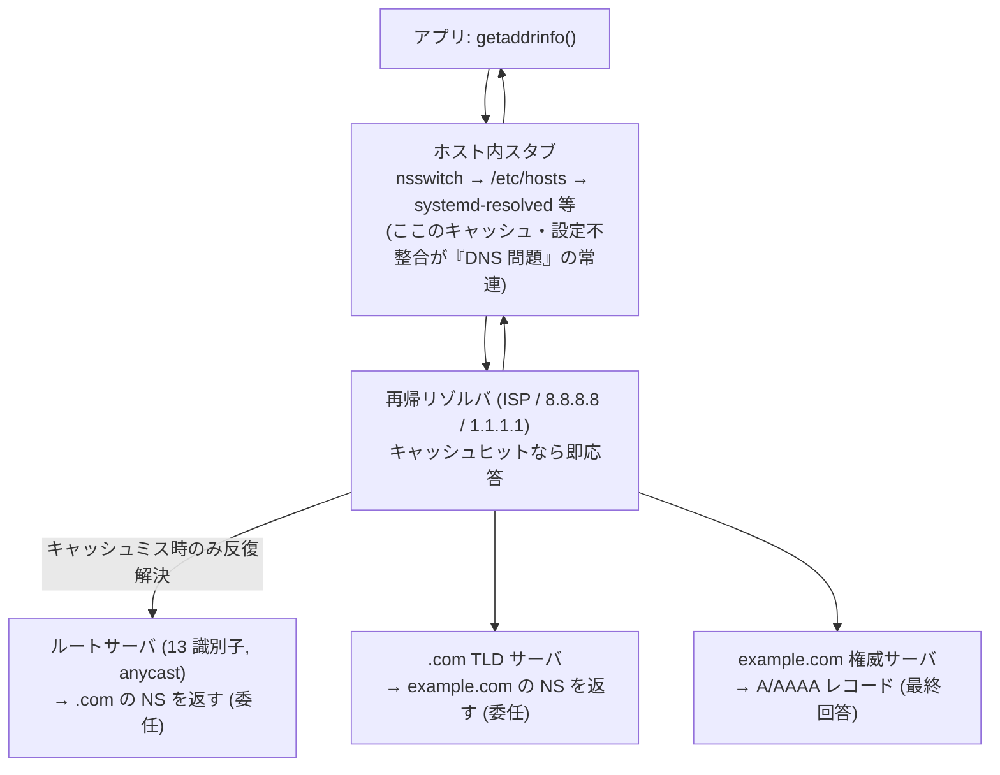

# DNS の構造と解決 (DNS: Delegation, Caching & Trust)

## 概要 (Overview)

すべての通信は名前から始まる。DNS (Domain Name System) は「名前 → 値」を引くだけの素朴なプロトコルに見えるが、その実体は**世界最大の分散データベース**であり、階層的委任 (delegation) と TTL 付きキャッシュによる、最古にして最大規模の結果整合性 (eventual consistency) システムである。

中心テーゼは二つ。第一に、**DNS のスケーラビリティは「木構造の委任」ではなく「キャッシュ」が支えている**。ルートサーバが世界の全クエリを捌けるのは、実際にはほとんど誰もルートまで引かないからである。TTL はこのキャッシュの一貫性と可用性を取引するダイヤルであり、DNS ベースの負荷分散・フェイルオーバ・サービス移行はすべて TTL の操作に還元される。第二に、**DNS は設計時に信頼を考えなかった**。応答の真正性 (DNSSEC) も経路の秘匿 (DoT/DoH) も後付けであり、その移行は 20 年経っても道半ばである。

「It's always DNS」という運用者の格言が示す通り、DNS はインターネットの単一障害点として振る舞い続けている (Dyn 2016, Facebook 2021)。本書は (1) 委任とキャッシュの構造、(2) 解決の実経路 (ホスト内スタックを含む)、(3) TTL の運用意味論、(4) 毒入れと DNSSEC、(5) DoT/DoH と集中化のトレードオフ、を整理する。分析深度は Level 3。

## 方法論 (Methodology)

- プロトコルの原典 (RFC 1034/1035) の設計判断を、当時の制約 (UDP 512B、1980 年代のネットワーク) から説明し、その後の拡張 (EDNS0, DNSSEC, DoH) を「制約の緩和」と「欠落の補修」に分類して追う。
- 障害と攻撃は公開ポストモーテム・一次分析 (Kaminsky 報告、Facebook の障害報告) を根拠とし、教訓を構造 (キャッシュ・委任・依存関係) に帰着させる。
- 「DNS の問題」の多くはホスト内のリゾルバスタックで起きるため、ワイヤ上のプロトコルだけでなく `getaddrinfo` からスタブリゾルバまでの経路を明示的に扱う。
- 数値 (キャッシュヒット率・検証率など) は変動が大きいため桁感と傾向で述べ、断定値を避ける。

## 発見事項 (Findings)

1. **DNS は「名前空間の所有権の分散」を委任で実装した。** ルート → TLD (`.com`) → 権威サーバ (`example.com`) と NS レコードで管理権限を下ろす木構造により、中央の登録機関なしに名前空間全体が運営される。逆に言えば、**上位ゾーンは下位の可用性の人質**であり、TLD の障害はその配下全ドメインの障害である。
2. **実際の解決はほぼキャッシュで完結する。** フルの反復解決 (ルート → TLD → 権威) は稀で、再帰リゾルバ (ISP・パブリック DNS) のキャッシュが木の上部を吸収する。NS レコードの TTL は長く (日単位)、ルート・TLD への実クエリは全体のごく一部にすぎない。**13 のルートサーバ (実体は anycast で千超のインスタンス) が世界を支えられる理由はキャッシュの側にある**。
3. **TTL は一貫性のダイヤルであり、DNS 運用のほぼ全てである。** 長い TTL = 低負荷・高耐障害性・遅い変更伝搬。短い TTL = 速い切替・高負荷・リゾルバ障害への脆さ。サービス移行前に TTL を下げておく「TTL 短縮の儀式」、ヘルスチェック連動の DNS フェイルオーバ、GeoDNS は、いずれも「古い答えをどこまで許すか」の調整である。ただし**TTL は勧告であって命令ではない** (無視・上書きするリゾルバが実在する) ことが移行計画を狂わせる定番要因になる。
4. **UDP 1 往復という設計は速さと引き換えに、なりすましと増幅を構造化した。** コネクションレスで送信元検証がないため、(a) 応答の偽造競争 (キャッシュポイズニング) と (b) 送信元を偽った小さな質問で大きな応答を第三者に浴びせる**増幅攻撃** (DNSSEC で応答が肥大するほど倍率が上がる皮肉) が可能になった。Kaminsky (2008) が毒入れを実用速度にしたことで、ソースポートのランダム化が緊急配備され、根本対策として DNSSEC が押されたが、**DNSSEC は署名 (真正性) であって暗号化 (秘匿) ではない**。この点の誤解は今も広く残る。
5. **「最後の平文」を塞ぐ DoT/DoH は、分散を集中に置き換えた。** スタブ→リゾルバ間の平文 (ISP や公衆 Wi-Fi から丸見え) を TLS/HTTPS で包む代わりに、クエリは少数の大手リゾルバ (Google, Cloudflare 等) に集まる。**盗聴への防御と、単一事業者への可視性の集中**という交換であり、プライバシの定義そのものが争点になった稀有な移行である。
6. **DNS 障害の本質は「依存の環」である。** Facebook (2021) は BGP 撤回で権威 DNS が消えた結果、名前が引けない → 社内ツールも入館システムも同じ名前空間に依存 → 復旧作業自体が阻害される連鎖を起こした。DNS は依存グラフの根に位置するため、**「DNS の障害」は常に「DNS に依存する全システムの障害」として現象する**。ネガティブキャッシュ (NXDOMAIN も TTL 付きで記憶される) が復旧を遅らせる足枷になる点も含め、障害モードは構造から予測できる。

## アーキテクチャ (Architecture)

### 解決の全経路 — ブラウザからルートまで

- **スタブ** (OS 内・転送のみ) と**再帰リゾルバ** (反復解決とキャッシュを担う) と**権威サーバ** (ゾーンの正本を持つ) は役割が全く違う。「DNS サーバ」という語はこの三者を混同しがちである。
- 委任の糊: 子ゾーンの NS 名が子ゾーン自身の中にある場合 (`ns1.example.com` が `example.com` の NS)、循環を断つために親が **glue レコード** (NS の IP) を持つ。glue の不整合・期限切れ NS (lame delegation) は「たまに引けない」型の悩ましい障害を作る。

### 主要レコード型 — 名前に載る値の種類

| 型 | 内容 | 備考 |
|---|---|---|
| A / AAAA | IPv4 / IPv6 アドレス | 解決の主目的 |
| NS | 委任先ネームサーバ | 木構造の骨格 |
| CNAME | 別名 → 正規名 | 頂点 (zone apex) には置けない制約が ALIAS/ANAME 亜種を生んだ |
| MX | メール受け入れ先 | 優先度付き |
| TXT | 任意文字列 | SPF/DKIM/DMARC・所有権確認など「何でも置き場」化 |
| SOA | ゾーンの管理情報 | ネガティブキャッシュ TTL もここ |
| DS / DNSKEY / RRSIG | DNSSEC の信頼チェーン | 親ゾーンの DS が子の鍵をつなぐ |
| SVCB / HTTPS | 接続パラメータ (ALPN, ECH 鍵…) | 「A を引いてから試す」を 1 往復に畳む新世代 |

## 技術詳細 (Technical Details)

### 1. ワイヤの制約と拡張 — 512 バイトの呪縛

- 原設計は UDP 512B 上限。**EDNS0** が上限を拡張したが、大きな UDP 応答は IP フラグメンテーションの喪失・毒入れ耐性の低下を招くため、現代の運用は「大きい応答は TC (truncated) フラグで TCP へ誘導」に回帰しつつある (DNS Flag Day 2020 のバッファサイズ縮小勧告)。**「DNS = UDP」は既に近似でしかなく**、DoT/DoH/DoQ を含め輸送は多様化した。
- クエリの実務: 並行する A/AAAA、ハッピーアイボール (v4/v6 競争)、検索ドメインの補完 (`ndots` 問題。Kubernetes で `example.com.cluster.local` への無駄クエリが 5 倍発生する類) など、**1 回の名前解決の裏で複数クエリが飛ぶ**のが常態である。

### 2. キャッシュの意味論 — TTL・ネガティブキャッシュ・serve-stale

- キャッシュは応答の RRset 単位。**NXDOMAIN (不在) も SOA の値に基づき記憶される** (ネガティブキャッシュ, RFC 2308)。「作ったばかりのレコードが引けない」のは伝搬待ちではなく、**不在の記憶**が残っているせいであることが多い (DNS に push の伝搬は存在せず、あるのはキャッシュの失効だけである)。
- **serve-stale** (RFC 8767): 権威に到達できないとき、期限切れキャッシュを暫定的に返す拡張。「古い答えは無応答より良い」という現実主義で、権威 DNS への DDoS (Dyn 型) の被害を緩和した実績から標準化された。一貫性を可用性に売る判断を明文化したものである。
- キャッシュの毒に対する構造的防御: 応答の受理には (クエリ ID, ソースポート, 質問名) の一致が要る。Kaminsky 攻撃は「存在しないサブドメインを大量に聞く」ことで競争機会を無限に作った。対策のソースポートランダム化はエントロピーを 16bit → 32bit にしただけであり、**根本解決 (署名) までのつなぎが 20 年続いている**のが現状である。

### 3. DNSSEC — 署名の木とその重さ

- 機構: ゾーンの RRset に署名 (RRSIG) を付け、ゾーンの公開鍵 (DNSKEY) のハッシュを**親ゾーンの DS レコード**に登録する。ルートの鍵だけを信頼の錨 (trust anchor) とし、ルート → TLD → ゾーンと検証が連鎖する。不在の証明には NSEC/NSEC3 (存在する名前の範囲を署名) を使う。「ない」ことの証明が「ある」ことより難しい、という一般則の好例。
- 現実: 署名済みゾーンも検証するリゾルバも増えたが普及は部分的で、地域差が大きい (APNIC の計測で検証率は世界平均 3 割前後、国によって 1 割未満〜9 割超)。理由は運用の重さに集約される: 鍵の順回転 (rollover) の失敗はゾーン全体の SERVFAIL に直結し、「署名しない」より「署名を失敗する」方が痛い。ルート鍵の交代 (KSK rollover, 2018) が何年も準備を要した事実が、この重さを物語る。
- DNSSEC が守るのは**リゾルバまでの応答の真正性**であり、スタブ→リゾルバ間や、クエリ内容の秘匿は守らない。そこは DoT/DoH の守備範囲で、両者は代替ではなく補完である。

### 4. DoT / DoH / DoQ — 輸送の暗号化と権力の再配置

| 方式 | 輸送 | 特徴 |
|---|---|---|
| DoT (RFC 7858) | TLS/853 | 専用ポート。見えないが「DNS を使っている」ことは分かる。ブロックも容易 |
| DoH (RFC 8484) | HTTPS/443 | Web と不可分。検閲・企業フィルタから区別困難。ブラウザが OS を飛び越して使える |
| DoQ (RFC 9250) | QUIC/853 | HoL なし・0-RTT ([`http-quic-evolution.md`](http-quic-evolution.md) の利得の直接適用) |

- DoH の論争点はプロトコルではなく**配置**にある: ブラウザが既定で特定事業者の DoH に切り替えると、(a) OS・ネットワーク管理者の設定 (スプリット DNS、フィルタリング) が迂回され、(b) クエリの可視性が少数事業者に集中する。技術的には同じ暗号化でも、**誰のポリシが適用されるか**が変わる。プロトコル設計が統治構造を変えた例として記憶に値する。
- 折衷の方向: Discovery of Designated Resolvers (DDR) による「今のネットワークのリゾルバを暗号化で使う」、Oblivious DoH (プロキシで「誰が」と「何を」を分離) など、集中を緩和する機構が続いている。

### 5. 観測の入口 (Observability)

| 疑問 | 道具 |
|---|---|
| 名前は何に解決されるか・どの経路か | `dig +trace` (反復解決の再現)、`dig @8.8.8.8` (リゾルバ指定比較)、`delv` (DNSSEC 検証付き) |
| ホスト内のどの層が答えたか | `resolvectl query` / `resolvectl statistics` (systemd-resolved)、`/etc/nsswitch.conf` の確認 |
| キャッシュに何が残っているか | `resolvectl flush-caches`、リゾルバ側の TTL 残量 (`dig` の ANSWER の TTL) |
| 委任は健全か | `dig NS +norecurse` を親側に (glue/lame の確認)、DNSViz (DNSSEC チェーンの可視化) |
| 障害の切り分け | 「権威は答えるか (`dig @権威`)」→「リゾルバは答えるか」→「スタブは答えるか」の三分探索 |

## セキュリティ考察 (Security Considerations)

- **キャッシュポイズニング**: 偽応答の競争 (Kaminsky 型) に加え、フラグメンテーションを突く亜種・帯域内の中間者など。防御はソースポートランダム化・0x20 エンコーディング (大文字小文字の乱数化)・DNSSEC 検証・トランスポート暗号化の重ね掛けであり、単独で十分な層はない。
- **増幅・反射 DDoS**: 偽装ソースへの大応答 (ANY クエリ・DNSSEC 応答で増幅率数十倍) は、DNS 自体でなく**第三者を撃つ武器**として DNS を使う。対策は BCP 38 (ソース偽装の出口フィルタ)・レートリミット (RRL)・ANY の廃止 (RFC 8482)。逆に DNS が標的になった例が Dyn (2016, Mirai ボットネット) である。単一 DNS プロバイダ依存の SaaS が軒並み巻き添えになり、**権威 DNS の冗長化 (複数プロバイダ)** が教訓として定着した。
- **DNS はデータチャネルになる**: TXT/NULL クエリに載せた DNS トンネリング (C2・データ持ち出し) は、「DNS だけは通す」境界設定の裏をかく古典であり、防御側はクエリ長・エントロピー・頻度の異常検知とログ (パッシブ DNS) で対抗する。パッシブ DNS はインシデント対応の一級資料 (ドメインの過去の解決先の追跡) でもある。
- **登録・移管の層が最弱点になりうる**: レジストラアカウントの乗っ取り・期限切れドメインの再取得 (だれかの依存先を居抜きで奪う)・typosquatting は、プロトコルの外側で名前の信頼を破る。レジストリロック・自動更新・依存ドメインの棚卸しが防御になる。
- **プライバシ**: クエリ列は行動履歴そのものである。QNAME minimization (RFC 9156。ルートに `www.example.com` 全体を聞かず `.com` だけ聞く) のような「知る必要のない者に知らせない」改修が進むが、リゾルバ事業者への可視性集中 (DoH の論点) は残る。

## 結論 (Conclusions)

- DNS は委任で所有権を、キャッシュでスケールを実現した分散システムであり、その一貫性モデルは「TTL 付き結果整合性」である。運用の技術 (TTL 操作・フェイルオーバ・移行) はすべて「古い答えをどこまで許容するか」の管理に還元される。
- 1980 年代の善意の設計 (UDP 1 往復・検証なし) は、毒入れと増幅という 2 大攻撃面を残した。DNSSEC (真正性)・DoT/DoH (秘匿)・QNAME minimization (最小開示) は 3 方向からの後付け補修であり、いずれも「動いているものを止めずに直す」制約下で 10〜20 年単位の移行を続けている。
- DoH の論争が示す通り、DNS の設計変更は権力の再配置である。誰がクエリを見られるか、誰のフィルタが適用されるかは、プロトコルの形が決める。技術選定はこの統治的側面まで含めて行う必要がある。
- 依存グラフの根という位置は変わらないため、「It's always DNS」は今後も正しい。防御的設計の要点は、権威の冗長化・TTL とネガティブキャッシュの理解・ホスト内スタックの把握・そして「DNS が死んだとき復旧手段は DNS に依存していないか」という問いである。

### 次の接続先 (Related Topics)

- [`tls-internals.md`](tls-internals.md) — DoT/DoH の基盤。SNI/ECH と並ぶ「最後の平文」問題の相方。
- [`http-quic-evolution.md`](http-quic-evolution.md) — DoQ の輸送。HTTPS レコード (SVCB) は接続確立の 1 往復をここに畳む。
- [`tcp-transport-congestion.md`](tcp-transport-congestion.md) — TC フラグで落ちてくる先の TCP。
- [`../distributed-systems/consistency-models.md`](../distributed-systems/consistency-models.md) — TTL キャッシュの一貫性を位置づける語彙 (結果整合性)。
- [`../../hardware/timekeeping/clocks-time-synchronization.md`](../../hardware/timekeeping/clocks-time-synchronization.md) — DNSSEC 署名の有効期間検証が依存する「正しい時刻」。

## 参考文献 (References)

**一次資料 (Primary — RFC・論文・一次報告)**

- Mockapetris, P. (1987). Domain Names — Concepts and Facilities / Implementation and Specification. *RFC 1034 / RFC 1035*. — [rfc-editor.org](https://www.rfc-editor.org/rfc/rfc1034) — Accessed: 2026-07-05。
- Mockapetris, P., & Dunlap, K. J. (1988). Development of the Domain Name System. *SIGCOMM '88*. DOI: 10.1145/52324.52338 — 設計判断の当事者による記録。
- Arends, R., et al. (2005). DNS Security Introduction and Requirements. *RFC 4033–4035*. — [rfc-editor.org](https://www.rfc-editor.org/rfc/rfc4033) — Accessed: 2026-07-05。DNSSEC の仕様。
- Hoffman, P., & McManus, P. (2018). DNS Queries over HTTPS (DoH). *RFC 8484*。Hu, Z., et al. (2016). DNS over TLS. *RFC 7858*。 — Accessed: 2026-07-05。
- US-CERT (2008). Multiple DNS implementations vulnerable to cache poisoning. *VU#800113*. — [kb.cert.org](https://www.kb.cert.org/vuls/id/800113) — Accessed: 2026-07-05。Kaminsky 攻撃の公式勧告。
- Meta Engineering (2021). More details about the October 4 outage. — [engineering.fb.com](https://engineering.fb.com/2021/10/05/networking-traffic/outage-details/) — Accessed: 2026-07-05。BGP+DNS 連鎖障害の一次ポストモーテム。

**二次資料 (Secondary — 解説・計測)**

- Liu, C., & Albitz, P. *DNS and BIND* (5th ed.), O'Reilly — 運用視点の古典的教科書。
- APNIC Labs — [DNSSEC validation measurement](https://stats.labs.apnic.net/dnssec) — Accessed: 2026-07-05。検証率の継続計測。
- Cloudflare Blog — [A deep dive into DNS](https://blog.cloudflare.com/tag/dns/) 各記事、Dyn 攻撃分析 — Accessed: 2026-07-05。
