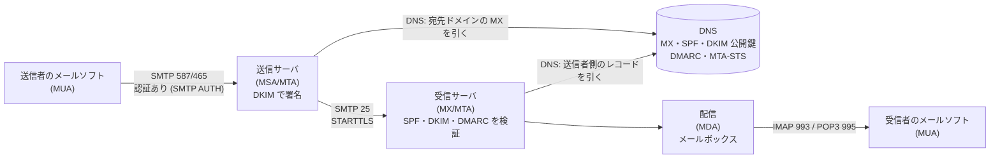

# メールの配送と送信者認証 (Email Delivery & Sender Authentication: SMTP, SPF, DKIM, DMARC & Transport Security)

## 概要 (Overview)

本ドキュメントは電子メールが届くまでの仕組みと、その送信者を確かめる仕組みを扱う。メールは [`dns-resolution.md`](dns-resolution.md) の DNS で宛先のサーバを探し、[`tcp-transport-congestion.md`](tcp-transport-congestion.md) の TCP の上で SMTP (Simple Mail Transfer Protocol) によって中継され、受信者のメールボックスから IMAP や POP3 で読まれる。対象は SMTP による配送の構成、メッセージの形式、送信者を確かめる SPF・DKIM・DMARC、経路の暗号化 (STARTTLS・MTA-STS・DANE)、エンドツーエンドの暗号化 (S/MIME・OpenPGP) である。

中心テーゼは、**SMTP は送信者を名乗るだけで送れる設計のまま世界に広がり、送信者認証はその上に DNS を使って後から重ねられた**ということである。SMTP では、送信者は配送用の差出人 (エンベロープ) も、受信者が画面で見る差出人 (ヘッダの From) も自由に書ける。SPF は配送用の差出人のドメインが送信元の IP アドレスを許可しているかを、DKIM はメッセージに付いた署名がどのドメインのものかを確かめる。どちらも、受信者が実際に目にする From のドメインとは別のものを確かめている。DMARC はこの食い違いを埋め、SPF か DKIM で確かめたドメインが From のドメインと一致すること (アライメント) を求めた。

暗号化も同じく後付けで、しかも失敗しても平文で送り続ける作りになっている。STARTTLS は相手が対応していれば暗号化し、途中で対応の表示を消されれば平文に戻る。MTA-STS と DANE はこれを「暗号化できなければ送らない」に変える仕組みである。2024 年以降、Google・Yahoo・Microsoft が大量送信者に SPF・DKIM・DMARC を求めたことで、送信者認証は任意の設定から事実上の必須に変わった。それでも、認証が証明するのは「どのドメインが送ったか」までであり、似たドメインや乗っ取られたアカウントからの詐欺メールは認証を通る。分析深度は Level 3。

## 方法論 (Methodology)

- **一次資料**: IETF の RFC を中心にする。SMTP は RFC 5321、メッセージ形式は RFC 5322、SPF は RFC 7208、DKIM は RFC 6376、DMARC は 2026 年に標準化された RFC 9989 (旧版の RFC 7489 を置き換えた)、MTA-STS は RFC 8461、DANE for SMTP は RFC 7672 である。配送の安全性の実測は Durumeric et al. (2015)、エンドツーエンド暗号化への攻撃は Poddebniak et al. (2018) の査読付き論文を使う。
- **事業者の要件は事業者の文書で確かめる**: Google・Yahoo・Microsoft の要件は、それぞれの事業者の公式の文書で確かめる。要件は改定されるため、確認した日付を付ける。
- **被害額は公的統計の値を使う**: ビジネスメール詐欺 (BEC) の被害額は FBI の IC3 (Internet Crime Complaint Center) の年次報告の値を使う。届け出にもとづく値であり、実際の被害の総額ではない。
- **担当範囲**: DNS の解決と DNSSEC は [`dns-resolution.md`](dns-resolution.md)、TLS のハンドシェイクと証明書は [`tls-internals.md`](tls-internals.md)、署名と鍵管理の一般論は [`../security/applied-cryptography.md`](../security/applied-cryptography.md) に委ねる。本書はそれらをメールがどう組み合わせて使っているかに集中する。

## 発見事項 (Findings)

1. **メールの差出人は 3 種類あり、人が見るのはそのうち 1 つだけである。** SMTP のやり取りで示す配送用の差出人 (MAIL FROM、エンベロープ送信者)、メッセージ本体のヘッダにある From、そして From に添える表示名である。エラーの返送先になるのは配送用の差出人で、メールソフトが表示するのはヘッダの From と表示名である。SMTP はこの 3 つが一致することを求めておらず、なりすましはこの食い違いを突く。
2. **SPF と DKIM は人が見ていないドメインを確かめている。** SPF は配送用の差出人のドメインについて、送信元の IP アドレスが許可されているかを確かめる。DKIM は署名に書かれたドメイン (d= タグ) の公開鍵で署名を確かめる。攻撃者が自分のドメインで SPF と DKIM を正しく設定し、ヘッダの From だけを銀行のドメインにすれば、どちらも合格する。
3. **DMARC の要点はヘッダの From とのアライメントである。** DMARC はSPF か DKIM のどちらかが合格し、かつ合格したドメインがヘッダの From のドメインと一致することを求める。さらに、合格しなかったメールの扱い (何もしない・迷惑メールにする・拒否する) をドメインの所有者が DNS で宣言できる。2026 年の RFC 9989 で、DMARC は情報提供の RFC から標準化過程の RFC になった。
4. **転送とメーリングリストが、認証の最大の敵である。** 転送するサーバは元の送信者の SPF で許可された IP アドレスを持たないため、転送されたメールは SPF に落ちる。メーリングリストは件名にタグを付けたり本文に案内を足したりするため、DKIM の署名が壊れる。2014 年に大手のメール事業者が DMARC を拒否 (p=reject) に設定すると、メーリングリスト経由のメールが大量に届かなくなった。ARC (RFC 8617) は、中継したサーバが受け取った時点の認証結果を署名付きで引き継ぐための仕組みである。
5. **経路の暗号化は失敗すると平文に戻る作りになっている。** STARTTLS は、相手のサーバが対応を表示したときだけ暗号化に切り替える。途中の攻撃者がこの表示を消せば、送信側は平文で送る。Durumeric et al. (2015) は、Gmail が受け取ったメールの 20% 超が、ネットワーク上の攻撃者によって平文で届いていた国が 7 か国あったと報告している。MTA-STS (HTTPS で方針を公開) と DANE (DNSSEC で証明書を固定) は、暗号化できなければ送らない動作に変える。
6. **大手事業者の要件が送信者認証を事実上の必須にした。** Google は 2024 年 2 月 1 日から、Gmail に 1 日 5,000 通を超えて送る送信者に SPF・DKIM・DMARC (方針は none でもよい) と From のアライメント、ワンクリックの配信停止を求めた。Yahoo も同時期に同様の要件を設け、Microsoft は 2025 年 5 月 5 日から Outlook.com などで同様の要件を適用した。標準化から 10 年以上普及しなかった DMARC が、受信側の大手が要件にしたことで一気に広がった。
7. **エンドツーエンドの暗号化はほとんど使われず、使われても壊れやすい。** S/MIME と OpenPGP は本文を受信者の公開鍵で暗号化するが、鍵の配布と管理の手間から一般には普及していない。件名や宛先などのヘッダは暗号化されない。EFAIL (Poddebniak et al. 2018) は、暗号文を書き換えて HTML の外部参照を埋め込み、復号した平文を攻撃者のサーバへ送らせる攻撃を示した。調べた S/MIME クライアント 35 のうち 23、OpenPGP クライアント 28 のうち 10 に、そうした流出の経路があった。
8. **送信者認証が証明するのは「どのドメインが送ったか」までである。** DMARC で守れるのは、自分のドメインそのものを名乗るなりすましだけである。1 文字違いの似たドメイン、表示名だけの偽装、乗っ取られた正規のアカウントからのメールは、認証をすべて通る。FBI の IC3 には 2024 年に BEC の届け出が 21,442 件あり、届け出られた被害額は約 27.7 億ドルだった。認証の普及と並行して、送金の手続きや本人確認といったメールの外の対策が要る。

## アーキテクチャ (Architecture)

### 配送の経路



凡例: MUA (Mail User Agent) はメールソフト、MSA (Mail Submission Agent) は利用者からメールを受け付けるサーバ、MTA (Mail Transfer Agent) はサーバ間で中継するサーバ、MDA (Mail Delivery Agent) はメールボックスに格納する部分である。実際には送信側・受信側ともに複数の中継 (フィルタ、転送、メーリングリスト) を挟むことがある。

### どの差出人を何が確かめるか

| 差出人の種類 | どこに書かれるか | 確かめる仕組み | 受信者に見えるか |
|---|---|---|---|
| 配送用の差出人 (MAIL FROM、Return-Path) | SMTP のやり取り (エンベロープ) | SPF | ほぼ見えない (ヘッダの Return-Path に残る) |
| HELO/EHLO の名前 | SMTP のやり取りの最初 | SPF (HELO の検査) | 見えない |
| 署名ドメイン (DKIM の d=) | DKIM-Signature ヘッダ | DKIM | ほぼ見えない |
| ヘッダの From のドメイン | メッセージ本体のヘッダ | DMARC (SPF か DKIM のドメインとのアライメント) | 見える |
| 表示名 ("経理部" など) | From ヘッダの名前部分 | なし | 最も目立つ |

最も目立つ表示名を確かめる仕組みが存在しない、という点がこの表の要点である。

### SMTP のやり取りの例

送信サーバ (C) が受信サーバ (S) にメールを渡す SMTP のやり取りを示す (RFC 5321 の手順にもとづく例。ドメインとアドレスは説明用)。

```text
S: 220 mx.example.net ESMTP
C: EHLO mail.example.com
S: 250-mx.example.net
S: 250-STARTTLS
S: 250 SIZE 52428800
C: STARTTLS
S: 220 Ready to start TLS
   (ここから TLS で暗号化。暗号化後に EHLO をやり直す)
C: MAIL FROM:<bounce@example.com>        ← 配送用の差出人 (SPF の対象)
S: 250 OK
C: RCPT TO:<alice@example.net>
S: 250 OK
C: DATA
S: 354 End data with <CRLF>.<CRLF>
C: From: "Example Billing" <billing@example.com>   ← ヘッダの From (DMARC の対象)
C: To: alice@example.net
C: Subject: Invoice
C: DKIM-Signature: v=1; d=example.com; s=sel1; ...  ← 署名ドメイン (DKIM の対象)
C:
C: (本文)
C: .
S: 250 OK queued
C: QUIT
```

`250-STARTTLS` の行が攻撃者に消されると、送信サーバは STARTTLS を送らず平文のまま続ける (技術詳細 §6)。本文の終わりは「改行・ピリオド・改行」の 1 行で示すため、この終わりの解釈がサーバごとに違うと SMTP smuggling が成り立つ (セキュリティ考察)。

## 技術詳細 (Technical Details)

### 1. SMTP による配送

- **蓄積転送**: SMTP は郵便のように、各サーバがメールを受け取って保管し、次のサーバへ渡す。受信サーバが 4xx (一時的な失敗) を返せば、送信サーバはキューに保管したまま時間を置いて送り直す。数日間送れなければ諦めて、配送用の差出人に不達の通知 (バウンス) を返す。5xx (恒久的な失敗) ならすぐに諦める。
- **宛先の探し方**: 送信サーバは宛先のドメインの MX レコードを DNS で引き、優先度の高い (値の小さい) サーバから順に接続を試みる。MX がなければ、ドメインの A/AAAA レコードのアドレスに送る。
- **ポートの役割分担**: サーバ間の中継は 25 番ポートを使う。利用者のメールソフトから送信サーバへの投稿 (submission) は 587 番ポート (RFC 6409) で、SMTP AUTH (RFC 4954) による利用者の認証を伴う。接続の最初から TLS を使う 465 番ポートもあり、RFC 8314 は投稿には STARTTLS より最初から TLS を使う方式を推奨している。多くのプロバイダは利用者の回線から外部の 25 番ポートへの接続を遮断している (OP25B: Outbound Port 25 Blocking)。感染した端末がスパムを直接送るのを防ぐためである。
- **オープンリレー**: 初期の SMTP サーバは誰から受け取ったメールでも、どこへでも中継した。これがスパムの踏み台として悪用されたため、現在のサーバは「自分のドメイン宛て」か「認証した自分の利用者から」のメールしか受け付けない。
- **バックスキャッター**: 不達の通知は配送用の差出人に返るため、他人のアドレスを差出人に偽装したスパムが届かなかったとき、無関係な人に大量の不達通知が届く。受信サーバが受け取ったあとで拒否するのではなく、SMTP のやり取りの途中で拒否すれば、通知を返す責任は送信側に残る。

### 2. メッセージの形式

- **エンベロープとヘッダ**: SMTP の MAIL FROM と RCPT TO は封筒の宛名、メッセージ本体 (RFC 5322) の From・To・Subject は便箋の頭書きにあたる。配送に使われるのは封筒の側である。Bcc の受信者が To や Cc に現れないのは、RCPT TO にだけ書かれるからである。
- **主なヘッダ**: From、To、Cc、Subject、Date、Message-ID のほか、各サーバが中継のたびに先頭へ追記する Received ヘッダがある。Received を下から上へ読むと経路をたどれる。ただし攻撃者は、自分が送り出す前の Received を偽って書けるため、信用できるのは自分の管理するサーバが付けた行より上だけである。受信サーバはSPF・DKIM・DMARC の検証結果を Authentication-Results ヘッダに記録する。
- **MIME**: 本来の SMTP は 7 ビットの ASCII テキストしか運べなかった。MIME (RFC 2045 ほか) は日本語などの文字や添付ファイルを base64 などで ASCII に符号化し、multipart で本文と添付を区切る。添付ファイルの名前や種類はこの MIME のヘッダに書かれ、メールソフトの表示とフィルタの判定はそれに頼る。

### 3. メールボックスの読み出し

- **POP3** (RFC 1939。暗号化した接続は 995 番): メールを端末にダウンロードし、通常はサーバから消す。1 台の端末で読む時代の設計である。
- **IMAP** (現行は IMAP4rev2、RFC 9051。暗号化した接続は 993 番): メールをサーバに置いたまま、フォルダや既読の状態もサーバで管理する。複数の端末から同じメールボックスを読む使い方に向く。
- 現在の大手のメールサービスは、Web の画面や独自の API で読むのが主流で、IMAP・POP3 は外部のメールソフトとの互換のために残っている。外部のメールソフト向けにパスワードだけで IMAP 接続を許すと、多要素認証を迂回する経路になるため、OAuth による接続 ([`../apis/authentication-tokens-specification.md`](../apis/authentication-tokens-specification.md)) へ移す事業者が増えている。

### 4. SPF と DKIM

- **SPF の仕組み** (RFC 7208): ドメインの所有者は DNS の TXT レコード (`v=spf1 ...`) に、そのドメインを配送用の差出人としてメールを送ってよいサーバを書く。`ip4:`・`ip6:` でアドレスを、`include:` で外部の配信事業者のレコードを、`mx`・`a` でそのドメインのサーバを指定し、最後に `-all` (それ以外は不合格) か `~all` (それ以外は不合格扱いを弱める softfail) を置く。受信サーバは送信元の IP アドレスと配送用の差出人のドメインを照合し、pass・fail・softfail・neutral・none・temperror・permerror のいずれかの結果を出す。
- **SPF の制約**: 評価中の DNS の参照は 10 回までに制限されている。`include:` を重ねて外部サービスを足していくと上限を超え、permerror になってすべてのメールが SPF に落ちる。また SPF は送信元の IP アドレスを見るため、転送されたメールは転送サーバのアドレスから届き、元のドメインの SPF に落ちる。転送サーバが配送用の差出人を自分のドメインに書き換える SRS (Sender Rewriting Scheme) は、この問題への対処である。
- **DKIM の仕組み** (RFC 6376): 送信サーバは本文のハッシュと選んだヘッダ (From は必須) に秘密鍵で署名し、DKIM-Signature ヘッダとして付ける。ヘッダには署名ドメイン (`d=`)、セレクタ (`s=`)、署名したヘッダの一覧 (`h=`)、本文のハッシュ (`bh=`) が入る。受信サーバは `セレクタ._domainkey.署名ドメイン` の TXT レコードから公開鍵を取り出して検証する。セレクタがあるため、1 つのドメインが複数の鍵を並行して使え、鍵の切り替えもできる。
- **DKIM の制約**: 途中のサーバが空白や改行を変えても検証できるよう、正規化 (canonicalization) の方式を選べる (simple と relaxed)。それでも、件名へのタグの付加や本文への案内の追記は署名を壊す。本文の先頭から一部だけを署名する `l=` タグを使うと、署名の後ろに攻撃者が内容を足せるため、使うべきでない。鍵の長さについて、Google は個人の Gmail アカウント宛てには 1024 ビット以上を必須、2048 ビットを推奨としている。DKIM は転送されても壊れないが、正しく署名されたメールを第三者が大量に再送する「DKIM リプレイ」には無力である。

### 5. DMARC

- **判定の規則** (RFC 9989): 受信サーバはヘッダの From のドメインについて `_dmarc.ドメイン` の TXT レコードを引く。SPF が合格して配送用の差出人のドメインが From と一致するか、DKIM が合格して署名ドメインが From と一致すれば、DMARC は合格する。一致の判定には、組織のドメイン (`mail.example.com` と `example.com` など) が同じならよい relaxed と、完全一致を求める strict がある。
- **方針の宣言**: `p=none` (何もしない、報告だけ受け取る)、`p=quarantine` (迷惑メールとして扱う)、`p=reject` (受け取りを拒否する) のいずれかを宣言する。`rua=` に書いたアドレスには、受信事業者から集計報告 (どの IP アドレスから、何通が、合格・不合格だったか) が届く。導入はまず `p=none` で報告を集めて自分のドメインから送っている正規のサービスをすべて洗い出し、SPF と DKIM を整えてから quarantine、reject へ進めるのが定石である。報告を見ずに reject にすると、請求書や通知を送る外部サービスのメールが届かなくなる。
- **RFC 9989 での変更**: DMARC は 2015 年の RFC 7489 では、IETF の標準ではなく情報提供の文書だった。2026 年の RFC 9989 で標準化過程の文書 (Proposed Standard) になり、集計報告と失敗報告は RFC 9990・RFC 9991 に分かれた。組織のドメインの判定は外部の Public Suffix List に頼る方式から、DNS の階層を上へたどって DMARC レコードを探す方式 (tree walk) に変わった。一部のメールにだけ方針を適用する `pct=` タグは廃止され、試験運用を示す `t=` タグに置き換わった。既存の `v=DMARC1` のレコードはそのまま使える。
- **メーリングリストとの衝突と ARC**: 2014 年に Yahoo と AOL が自社ドメインを `p=reject` にすると、そのドメインの利用者がメーリングリストに投稿したメールは、リストが件名や本文を変えて DKIM が壊れ、リストのサーバから送られて SPF も一致しないため、DMARC に落ちて大量に拒否された。対処として、多くのメーリングリストは From を自分のアドレスに書き換えるようになった。ARC (Authenticated Received Chain、RFC 8617) は、中継したサーバが受け取った時点の認証結果を署名付きのヘッダで引き継ぎ、最終の受信サーバが中継者を信頼すればその結果を採用できるようにする。

### 6. 経路の暗号化

- **STARTTLS** (RFC 3207): 平文で接続したあと、受信サーバが EHLO の応答で STARTTLS に対応していると示したときだけ、TLS に切り替える。サーバ間の中継では相手の証明書を検証しない「暗号化できればする」(日和見暗号化、opportunistic encryption) の運用が普通である。暗号化できなくても配送を止めないので普及したが、途中の攻撃者が `250-STARTTLS` の行を消すか、TLS の開始に失敗させれば、平文に戻せる (STARTTLS ストリッピング)。偽の MX レコードで別のサーバに誘導する攻撃にも、証明書を検証しない限り気づけない。
- **実測された格下げ攻撃**: Durumeric et al. (2015) は、Alexa 上位 100 万ドメインのメールサーバと、Gmail が 1 年間に送受信した接続を調べた。大手事業者は暗号化と認証を既定で行う一方、70 万を超える長い裾のサーバで暗号化を正しく設定していたのは 35%、DMARC の方針を宣言していたのは 1.1% だった。さらに、Gmail が受け取ったメールの 20% 超が、ネットワーク上の攻撃者によって平文で届いていた国が 7 か国あった。
- **STARTTLS の実装の欠陥**: 平文から TLS に切り替える途中には、切り替え前に送り込まれたコマンドを切り替え後のものとして処理してしまう欠陥 (コマンドインジェクション) が生じやすい。Poddebniak et al. (2021) は、メールソフトとサーバの STARTTLS の実装に 40 を超える欠陥を見つけ、最初から TLS で接続する方式を推奨した。
- **MTA-STS** (RFC 8461): ドメインの所有者は「このドメインの MX は TLS 必須で、証明書はこの名前で検証せよ」という方針を `https://mta-sts.ドメイン/.well-known/mta-sts.txt` に公開し、DNS の TXT レコードで方針の版を示す。送信サーバは方針を一定期間キャッシュし、その間は TLS で接続できない、または証明書が合わないサーバには送らない。最初の取得時だけは攻撃に弱い (初回の信頼、TOFU) が、HTTPS の証明書で守られるため DNSSEC がなくても使える。
- **DANE for SMTP** (RFC 7672): MX のサーバの証明書や公開鍵のハッシュを TLSA レコードとして DNS に書き、DNSSEC で署名する。送信サーバは DNSSEC で検証した TLSA と相手の証明書を照合する。初回の信頼の問題がない代わりに、送受信の両方が DNSSEC に対応している必要がある ([`dns-resolution.md`](dns-resolution.md))。
- **TLS-RPT** (RFC 8460): 受信側のドメインが報告先を DNS に書いておくと、送信事業者から TLS 接続の成否の集計が届く。MTA-STS や DANE を強制にする前に、どの経路で失敗しているかを知るための仕組みで、DMARC の集計報告と同じ役割を経路の暗号化について果たす。

### 7. エンドツーエンドの暗号化

- **S/MIME と OpenPGP**: S/MIME (RFC 8551) は X.509 証明書と認証局を使い、OpenPGP (現行は RFC 9580) は利用者どうしの署名による信頼の網か、鍵サーバ・事前の交換を使う。どちらも本文と添付を受信者の公開鍵で暗号化し、送信者の秘密鍵で署名する。経路の暗号化と違い、途中のサーバや受信者のメール事業者も中身を読めない。
- **守れないもの**: 件名・宛先・日時などのヘッダは配送に必要なため、暗号化されない (件名の暗号化は拡張で試みられているが、対応は限られる)。誰が誰といつやり取りしたかというメタデータは残る。
- **普及しない理由**: 送る前に相手の公開鍵を手に入れ、それが本物だと確かめる手間がかかる。鍵をなくすと過去のメールも読めなくなる。サーバ側で本文を検索したり、迷惑メールやマルウェアを検査したりできなくなる。企業内の S/MIME (証明書を一括配布できる環境) を除けば、一般の利用はごく少ない。
- **EFAIL** (Poddebniak et al. 2018): 攻撃者は傍受した暗号文を書き換え (CBC/CFB モードの改変しやすさを使う)、復号後の平文の前後に HTML の画像タグなどを埋め込んだメールを受信者に送る。受信者のメールソフトが復号して HTML を表示すると、平文が画像の URL の一部として攻撃者のサーバに送られる。過去に傍受したメールにも使える。対策は改ざんを検知できる暗号化 (AEAD。[`../security/applied-cryptography.md`](../security/applied-cryptography.md)) への移行と、改ざんされた暗号文を表示しないこと、外部コンテンツの自動読み込みを止めることである。

### 8. 大手事業者の送信者要件 (2026-11-23 時点で確認)

| 事業者 | 適用開始 | 主な要件 |
|---|---|---|
| Google (Gmail) | 2024 年 2 月 1 日 | すべての送信者: SPF か DKIM、正引きと逆引きの DNS、TLS、迷惑メール率 0.3% 未満 (0.1% 未満を推奨)。1 日 5,000 通超の送信者: SPF・DKIM・DMARC (p=none 可)、From と SPF か DKIM のドメインの一致、販促メールのワンクリック配信停止 (RFC 8058) |
| Yahoo | 2024 年 2 月 (配信停止の要件は 2024 年 6 月) | 大量送信者: SPF と DKIM、DMARC (p=none 以上で、From と一致して通ること)、List-Unsubscribe ヘッダ (RFC 8058 のワンクリック方式を強く推奨)、配信停止の依頼を 2 日以内に反映、迷惑メール率 0.3% 未満。大量送信者とみなす通数の基準は示さない方針 |
| Microsoft (Outlook.com、Hotmail、Live) | 2025 年 5 月 5 日 | 1 日 5,000 通超の送信者: SPF・DKIM・DMARC (p=none 以上で、SPF か DKIM と一致)。満たさないメールはまず迷惑メールフォルダへ振り分け、拒否 (550 5.7.515) は後日とされた。現在は Microsoft のサポート文書がこの拒否のエラーを説明しているが、拒否を始めた日は公式に告知されていない |

Google・Yahoo・Microsoft の要件は、いずれも事業者の公式の文書で確認した。

## セキュリティ考察 (Security Considerations)

| 攻撃 | 何を悪用するか | 主な防御 |
|---|---|---|
| 自分のドメインのなりすまし | ヘッダの From を自由に書ける | SPF・DKIM・DMARC を整え、DMARC を reject まで進める |
| 似たドメイン (1 文字違い、別の TLD) | DMARC は From のドメインそのものしか守らない | 似たドメインの事前登録と監視、受信側での新しいドメインの警告 |
| 表示名の偽装 | 表示名を確かめる仕組みがない | 外部からのメールへの印付け、送金依頼などの別経路での確認 |
| 正規アカウントの乗っ取り | 乗っ取られたアカウントのメールは認証をすべて通る | 多要素認証、パスワードだけの IMAP/SMTP 接続の廃止、異常な送信の検知 |
| STARTTLS ストリッピング | 暗号化の失敗時に平文へ戻る | MTA-STS か DANE で TLS を必須にする、TLS-RPT で失敗を監視 |
| SMTP smuggling | 本文の終わりの解釈がサーバごとに違う | 標準外の終わりの記号を受け付けない設定、サーバの更新 |
| DKIM リプレイ | 正しい署名付きのメールを第三者が再送できる | 署名の有効期限 (x= タグ) を短くする、同じヘッダを重ねて署名する (oversigning) |
| オープンリレーとバックスキャッター | 誰のメールでも中継する、偽の差出人に不達通知が返る | 中継の制限、SMTP のやり取りの途中での拒否 |

- **SMTP smuggling の仕組み**: SMTP の本文は「改行 (CRLF)・ピリオド・改行」で終わる。2023 年 12 月に SEC Consult の Timo Longin が公表した SMTP smuggling では、送信側のサーバが本文の一部とみなす標準外の終わり (`<LF>.<CR><LF>` など) を、受信側のサーバが本文の終わりとして解釈する。その後ろに書いた 2 通目のメールは、受信側からは正規の送信サーバが送ったメールに見え、SPF を通ってしまう。Postfix (CVE-2023-51764)、Sendmail (CVE-2023-51765)、Exim (CVE-2023-51766) で対応が行われた (CERT/CC VU#302671)。同じ文書を 2 つの実装が違う規則で区切ると検査をすり抜けられる、という型は、HTTP のリクエストスマグリングや IP の断片化を使った検知回避 ([`ip-addressing-icmp-dhcp-nat.md`](ip-addressing-icmp-dhcp-nat.md)) と同じである。
- 認証は信頼の証明ではない。SPF・DKIM・DMARC がすべて合格したメールは、「From のドメインの管理者が送信を許したサーバから送られた」ことを示すだけで、内容が正しいことも、送信者に悪意がないことも示さない。攻撃者は自分で取得したドメインに正しく認証を設定できる。BEC が狙うのは、取引先や経営者を装った送金依頼である。FBI の IC3 によると、2024 年の BEC の届け出は 21,442 件、届け出られた被害額は約 27.7 億ドルで、被害額では投資詐欺に次ぐ 2 位だった。送金先の変更を別の経路 (電話など) で確かめる手続きのような、メールの外の対策が欠かせない。
- DMARC の報告は情報源でもある。集計報告には、自分のドメインを名乗って送られたメールの送信元の IP アドレスと通数が含まれる。なりすましの規模を知る手がかりになる一方、報告先を外部の解析サービスにすると、自分の送信経路の情報を第三者に渡すことになる。
- メールソフトそのものも攻撃面である。HTML の表示、外部画像の自動読み込み、添付ファイルのプレビューは、追跡 (開封の検知)、EFAIL のような平文の流出、マルウェアの実行の入口になる。外部コンテンツを既定で読み込まない設定と、添付ファイルの種類による制限は、送信者認証とは独立に必要な対策である。

## 結論 (Conclusions)

- SMTP は送信者が差出人を自由に名乗れる設計のまま普及した。配送用の差出人、ヘッダの From、表示名という 3 つの差出人のうち、受信者が見るのはヘッダの From と表示名で、最も目立つ表示名を確かめる仕組みはない。
- SPF と DKIM はそれぞれ配送用の差出人と署名ドメインという、人が見ていないドメインを確かめる。DMARC はそれをヘッダの From に結びつけ、ドメインの所有者が不合格時の扱いを宣言できるようにした。転送とメーリングリストが認証を壊す問題は、SRS、From の書き換え、ARC で部分的に補われている。
- 経路の暗号化は失敗すると平文に戻る作りで、実際に格下げ攻撃が観測されている。MTA-STS と DANE はこれを暗号化必須に変える。エンドツーエンドの暗号化は鍵の管理の手間から一般には普及せず、改ざんできる暗号方式では EFAIL のような攻撃を受ける。
- 2024〜2025 年の大手事業者の要件によって、送信者認証は事実上の必須になった。それでも認証が証明するのは「どのドメインが送ったか」までであり、似たドメイン、表示名の偽装、乗っ取られたアカウントによる詐欺には、メールの外の確認手続きで備える必要がある。

### 次の接続先 (Related Topics)

- [`dns-resolution.md`](dns-resolution.md) — MX・TXT・TLSA レコードを引く仕組みと、DANE の前提となる DNSSEC。
- [`tls-internals.md`](tls-internals.md) — STARTTLS と MTA-STS が使う TLS のハンドシェイクと証明書の検証。
- [`../security/applied-cryptography.md`](../security/applied-cryptography.md) — DKIM の署名、S/MIME と OpenPGP の暗号化、EFAIL への対策となる AEAD。
- [`../apis/authentication-tokens-specification.md`](../apis/authentication-tokens-specification.md) — IMAP・SMTP の接続をパスワードから OAuth へ移すときのトークンの扱い。
- [`../security/llm-application-security.md`](../security/llm-application-security.md) — メールの本文を読む AI エージェントへの間接プロンプトインジェクション (EchoLeak など)。
- [`ip-addressing-icmp-dhcp-nat.md`](ip-addressing-icmp-dhcp-nat.md) — 送信元の IP アドレスと逆引き、SPF が前提にするアドレスの性質。

## 参考文献 (References)

**一次資料 (RFC・査読付き論文)**

- Klensin, J. (2008). Simple Mail Transfer Protocol. *RFC 5321*. — SMTP のやり取り、応答コード、MX による配送。
- Resnick, P. (Ed.). (2008). Internet Message Format. *RFC 5322*. — From・To・Received などのヘッダ。
- Gellens, R., & Klensin, J. (2011). Message Submission for Mail. *RFC 6409*. / Siemborski, R., & Melnikov, A. (Eds.). (2007). SMTP Service Extension for Authentication. *RFC 4954*.
- Moore, K., & Newman, C. (2018). Cleartext Considered Obsolete: Use of Transport Layer Security (TLS) for Email Submission and Access. *RFC 8314*.
- Hoffman, P. (2002). SMTP Service Extension for Secure SMTP over Transport Layer Security. *RFC 3207*.
- Kitterman, S. (2014). Sender Policy Framework (SPF) for Authorizing Use of Domains in Email, Version 1. *RFC 7208*.
- Crocker, D., Hansen, T., & Kucherawy, M. (Eds.). (2011). DomainKeys Identified Mail (DKIM) Signatures. *RFC 6376*.
- Kucherawy, M., & Zwicky, E. (Eds.). (2015). Domain-based Message Authentication, Reporting, and Conformance (DMARC). *RFC 7489*. — 旧版 (情報提供の文書)。
- Herr, T., & Levine, J. (Eds.). (2026). Domain-Based Message Authentication, Reporting, and Conformance (DMARC). *RFC 9989*. — 標準化過程の現行版。RFC 7489 と RFC 9091 を置き換える。集計報告は RFC 9990、失敗報告は RFC 9991。
- Andersen, K., Long, B., Blank, S., & Kucherawy, M. (Eds.). (2019). The Authenticated Received Chain (ARC) Protocol. *RFC 8617*.
- Margolis, D., Risher, M., Ramakrishnan, B., Brotman, A., & Jones, J. (2018). SMTP MTA Strict Transport Security (MTA-STS). *RFC 8461*. / Margolis, D., Brotman, A., Ramakrishnan, B., Jones, J., & Risher, M. (2018). SMTP TLS Reporting. *RFC 8460*.
- Dukhovni, V., & Hardaker, W. (2015). SMTP Security via Opportunistic DNS-Based Authentication of Named Entities (DANE) Transport Layer Security (TLS). *RFC 7672*.
- Myers, J., & Rose, M. (1996). Post Office Protocol - Version 3. *RFC 1939*. / Melnikov, A., & Leiba, B. (2021). Internet Message Access Protocol (IMAP) - Version 4rev2. *RFC 9051*.
- Freed, N., & Borenstein, N. (1996). Multipurpose Internet Mail Extensions (MIME) Part One: Format of Internet Message Bodies. *RFC 2045*.
- Schaad, J., Ramsdell, B., & Turner, S. (2019). Secure/Multipurpose Internet Mail Extensions (S/MIME) Version 4.0 Message Specification. *RFC 8551*. / Wouters, P., Huigens, D., Winter, J., & Niibe, Y. (Eds.). (2024). OpenPGP. *RFC 9580*.
- Levine, J., & Herkula, T. (2017). Signaling One-Click Functionality for List Email Headers. *RFC 8058*.
- Durumeric, Z., Adrian, D., Mirian, A., Kasten, J., Bursztein, E., Lidzborski, N., Thomas, K., Eranti, V., Bailey, M., & Halderman, J. A. (2015). Neither Snow Nor Rain Nor MITM... An Empirical Analysis of Email Delivery Security. *Proceedings of the 2015 Internet Measurement Conference (IMC '15)*, 27–39. https://doi.org/10.1145/2815675.2815695
- Poddebniak, D., Dresen, C., Müller, J., Ising, F., Schinzel, S., Friedberger, S., Somorovsky, J., & Schwenk, J. (2018). Efail: Breaking S/MIME and OpenPGP Email Encryption using Exfiltration Channels. *27th USENIX Security Symposium*, 549–566.
- Poddebniak, D., Ising, F., Böck, H., & Schinzel, S. (2021). Why TLS is better without STARTTLS: A Security Analysis of STARTTLS in the Email Context. *30th USENIX Security Symposium*.

**事業者の要件・事例・統計 (時期で変わる値)**

- [Email sender guidelines, Google Workspace Admin Help](https://support.google.com/a/answer/81126) — Accessed: 2026-10-18。すべての送信者と 1 日 5,000 通超の送信者の要件、DKIM 鍵長、迷惑メール率。
- [Sender Best Practices, Yahoo Sender Hub](https://senders.yahooinc.com/best-practices/) — Accessed: 2026-11-23。2024 年 2 月からの大量送信者の要件 (SPF、DKIM、DMARC、List-Unsubscribe、2 日以内の配信停止、迷惑メール率 0.3% 未満)。/ [FAQs, Yahoo Sender Hub](https://senders.yahooinc.com/faqs/) — Accessed: 2026-11-23。通数の基準を示さないこと、List-Unsubscribe の要件を 2024 年 6 月から適用すること。
- [Strengthening Email Ecosystem: Outlook's New Requirements for High-Volume Senders, Microsoft Defender for Office 365 Blog (2025-04-02, 2025-04-30 更新)](https://techcommunity.microsoft.com/blog/microsoftdefenderforoffice365blog/strengthening-email-ecosystem-outlook%E2%80%99s-new-requirements-for-high%E2%80%90volume-senders/4399730) — Accessed: 2026-11-23。1 日 5,000 通超の送信者の要件、2025-05-05 からの迷惑メールフォルダへの振り分けと、拒否は後日とすること。
- [Fix NDR error 550 5.7.515 in Outlook.com, Microsoft Support](https://support.microsoft.com/en-us/outlook/fix-ndr-error-550-5-7-515-in-outlook-com) — Accessed: 2026-11-23。認証の要件を満たさないメールを拒否するときのエラー。拒否を始めた日は書かれていない。
- [VU#302671: SMTP end-of-data uncertainty can be abused to spoof emails and bypass policies, CERT/CC](https://kb.cert.org/vuls/id/302671) — Accessed: 2026-10-18。SMTP smuggling の概要、各実装の対応。
- [2024 Internet Crime Report, FBI IC3](https://www.ic3.gov/AnnualReport/Reports/2024_IC3Report.pdf) — Accessed: 2026-10-18。BEC の届け出件数 21,442 件と被害額 2,770,151,146 ドル (報告書の表で確認)。
- [FBI's IC3 Finds Almost $8.5 Billion Lost to Business Email Compromise in Last Three Years, Nacha](https://www.nacha.org/news/fbis-ic3-finds-almost-85-billion-lost-business-email-compromise-last-three-years) — Accessed: 2026-10-18。
