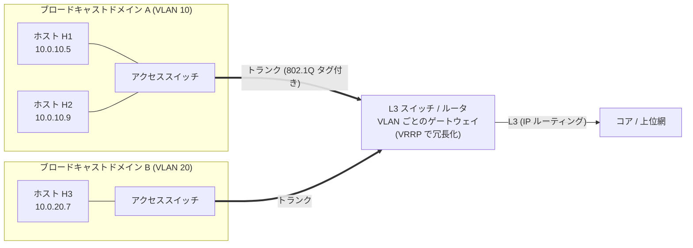
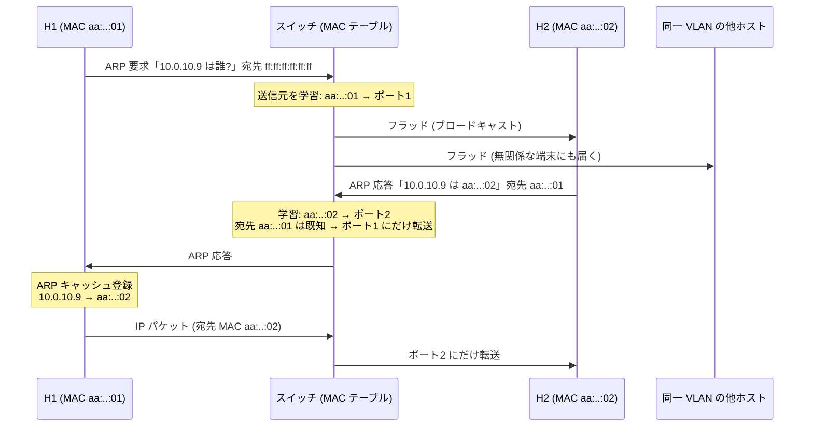

# LAN とスイッチング (Ethernet LAN Switching: Frames, Learning Bridges, ARP, VLAN & Spanning Tree)

## 概要 (Overview)

本ドキュメントは、[`tcp-transport-congestion.md`](tcp-transport-congestion.md) や [`ip-routing-bgp.md`](ip-routing-bgp.md) が前提にしている、その下の層を扱う。同じ建物・同じラック・同じ Wi-Fi に繋がった機器どうしが、最初の 1 フレームをどうやって届けるかという層である。対象は Ethernet のフレームと MAC アドレス、学習ブリッジ (learning bridge) としてのスイッチ、IP アドレスから MAC アドレスを引く ARP (Address Resolution Protocol)、論理的に LAN を分ける VLAN (Virtual LAN)、ループを断つスパニングツリー (STP: Spanning Tree Protocol)、そして L2 と L3 の境界に置かれるデフォルトゲートウェイの冗長化である。

中心テーゼは、**L2 は「相手の居場所を知らなくても届く」ことを、ブロードキャストと推測で実現した層だ**ということである。スイッチは宛先を知らなければ全ポートに撒き (フラッディング)、届いたフレームの送信元を見て居場所を学ぶ。ARP は「この IP は誰か」を全員に叫び、答えを無条件に信じる。この設計のおかげで、L2 は設定なしで繋がる。一方で代償が 3 つある。(1) 同じ LAN にいる者を全員信頼する平坦な信頼モデル、(2) フレームに寿命 (TTL) がないためループが許されず、STP で冗長経路を刈り取らなければならないこと、(3) ブロードキャストドメインの大きさがそのまま負荷と障害の範囲になること、である。

現代のネットワーク設計の多くは、この代償への応答として読める。L2 を小さく保って L3 で囲む、リンク集約で「刈らない冗長」を作る、データセンターでは L2 の意味論そのものを捨ててオーバーレイに置き換える ([`virtual-networks-overlay.md`](virtual-networks-overlay.md))、といった動きである。本書は (1) フレームと MAC アドレス、(2) 学習ブリッジ、(3) ARP、(4) VLAN、(5) STP/RSTP/MSTP、(6) 刈らない冗長と L3 化、(7) L2/L3 境界とゲートウェイ冗長、を整理し、最後に L2 固有の攻撃面と防御を対で示す。分析深度は Level 3。

## 方法論 (Methodology)

- **一次資料**: Ethernet の原典 (Metcalfe & Boggs 1976)、スパニングツリーの原典 (Perlman 1985)、IETF の RFC (ARP は RFC 826、アドレス衝突検出は RFC 5227、VRRP は RFC 5798、IPv6 の近隣探索は RFC 4861、RA Guard は RFC 6105) を優先する。IEEE 802.3 / 802.1Q / 802.1AX / 802.1AE / 802.1X の標準本文は有償のため、構造の記述は標準の公開概要と、標準準拠を謳う実装文書 (Linux カーネル、Cisco・Juniper の設定ガイド) で相互確認した。
- **数値の種類を区別する**: フレーム長・タグ長・ビット幅のように**標準が定める値**と、MAC テーブルの保持時間や DAI のレート制限のように**実装の既定値**とを区別して書く。後者は機種やソフトウェア版で変わるため、「既定値」と明記したうえで複数ベンダーの一致を確認したものだけを載せる。
- **担当範囲**: 物理層の信号 (PAM 変調・SerDes) は [`../../hardware/signal-integrity/serdes-link-architecture.md`](../../hardware/signal-integrity/serdes-link-architecture.md)、NIC とスイッチ ASIC の内部構造 (ディスクリプタリング・TCAM・共有バッファ) は [`../../hardware/networking/nic-switch-architecture.md`](../../hardware/networking/nic-switch-architecture.md)、無線 LAN の MAC 層は [`../../hardware/peripherals/wifi-architecture.md`](../../hardware/peripherals/wifi-architecture.md)、車載 Ethernet と TSN は [`../../engineering/automotive/automotive-ethernet-tsn.md`](../../engineering/automotive/automotive-ethernet-tsn.md) に委ねる。本書はそれらの間にある「フレームをどこへ送るか」の論理に集中する。
- 各機構を「どの前提 (設定不要・全員信頼・ループなし) を守るために、何を代償にしたか」で説明し、攻撃と防御は必ず対で扱う。

## 発見事項 (Findings)

1. **スイッチの転送表は台帳ではなく推測のキャッシュである。** スイッチは送信元 MAC アドレスを見て「このアドレスはこのポートの先にいる」と学び、一定時間 (実装既定値は 300 秒が一般的) 使われなければ忘れる。宛先が表になければ全ポートに撒く。誰も正解を教えない代わりに設定が要らない、という取引であり、表が溢れれば (MAC フラッディング攻撃)、あるいは表とホストの記憶がずれれば (ARP と MAC テーブルの保持時間の不一致)、ユニキャストが黙ってブロードキャストに退化する。
2. **ARP は認証のない宣言であり、L2 の脆弱性の大半はここから来る。** ARP 応答には「誰が言ったか」を検証する仕組みがなく、多くの実装は頼んでいない応答 (gratuitous ARP) でもキャッシュを書き換える。同じ LAN にいれば誰でも「デフォルトゲートウェイは私だ」と宣言でき、中間者攻撃 (MITM) が成立する。防御 (DAI など) はプロトコルの外、つまりスイッチが DHCP のやり取りを盗み見て正解表を作ることで後付けされた。
3. **Ethernet には TTL がない。だからループは「遅くなる」ではなく「止まる」。** IP パケットは TTL で必ず死ぬが、Ethernet フレームにはその欄がない。ループがあるとブロードキャストは無限に複製され、リンクと CPU を埋め尽くす (ブロードキャストストーム)。STP は冗長な経路を論理的に遮断して木を作るが、それは帯域の半分を捨てる設計でもある。L2 の冗長化の歴史は、この捨てた帯域を取り戻す歴史である。
4. **STP の収束時間はタイマから決まる。速くするにはタイマを捨てて合意に置き換えるしかなかった。** 古典的な STP (802.1D) は既定値で 30〜50 秒かけてポートを転送状態にする (forward delay 15 秒 × 2、場合により max age 20 秒が加わる)。RSTP (802.1w、現在は 802.1Q に統合) は隣接スイッチ間の提案と合意 (proposal/agreement) でこれを秒未満に縮めた。「待てば安全」から「確認すれば安全」への置き換えであり、分散合意の一般的な設計判断と同じ形をしている。
5. **VLAN は物理配線と論理的な所属を切り離したが、信頼の境界は L3 に残った。** VLAN は 12 ビットの ID (使えるのは 4094) で 1 本の配線に複数の LAN を重ねる。ただし VLAN 間の通信は必ずルータ (L3) を通り、フィルタをかけられるのもそこである。トランクの自動交渉やネイティブ VLAN の扱いを誤ると、境界を飛び越えるフレームを作れてしまう (VLAN ホッピング)。
6. **「L2 を広げる」は 20 年かけて否定された。** 大規模なキャンパスやデータセンターでは、ブロードキャストドメインが大きいほど障害の範囲が広がる。2002 年に Beth Israel Deaconess Medical Center で起きた数日間のネットワーク障害は、仕様の直径を超えて肥大化した L2 網でのスパニングツリーの不安定化として報告されている。現代の定石は、アクセス層の近くで L3 に切り替え、L2 が必要な箇所ではオーバーレイ (VXLAN/EVPN) で論理的に作ることである。
7. **L2 の防御はすべて「平坦な信頼」を部分的に取り消す機構である。** ポートセキュリティ、DHCP スヌーピング、DAI、BPDU ガード、802.1X、MACsec はどれも、「同じ LAN にいるなら信じる」という既定の挙動を、ポートごと・端末ごとの許可に置き換える。これはゼロトラストが L3 以上で主張していることの、L2 版の先行事例である。

## アーキテクチャ (Architecture)

### 層の中での位置

凡例: 細線はアクセスポート (タグなし、1 つの VLAN に所属)、太線はトランク (複数 VLAN をタグで多重)。ブロードキャストは囲みの中だけに届き、囲みの間は必ず L3 の装置を通る。

### 用語の対応 — 衝突ドメインとブロードキャストドメイン

| 概念 | 範囲を決める装置 | 現代の意味 |
|---|---|---|
| 衝突ドメイン (collision domain) | リピータ・ハブは広げ、スイッチのポートが区切る | 全二重のスイッチ接続では衝突自体が起きず、ほぼ歴史的な概念 |
| ブロードキャストドメイン (broadcast domain) | スイッチは広げ、ルータ (L3) と VLAN が区切る | ARP・DHCP・未知ユニキャストのフラッドが届く範囲であり、負荷と障害の範囲そのもの |
| VLAN | スイッチの設定 | 1 つの VLAN が 1 つのブロードキャストドメインになる |
| サブネット (IP) | L3 の設定 | 通常は 1 VLAN = 1 サブネットに対応させる |

### 最初の 1 パケット — ARP と MAC 学習

H1 (10.0.10.5) が同じ VLAN の H2 (10.0.10.9) へ初めて送るとき、スイッチの MAC テーブルも H1 の ARP キャッシュも空だとする。

要点: 最初の 1 往復で、スイッチは誰からも教わらずに 2 台の居場所を学ぶ。代わりに、ARP 要求は同じ VLAN の全員に届き、全員がそれを処理する。宛先が別のサブネットなら、H1 は H2 ではなくデフォルトゲートウェイの MAC アドレスを ARP で引き、フレームはゲートウェイ宛てになる (§7)。

## 技術詳細 (Technical Details)

### 1. Ethernet フレームと MAC アドレス

- **フレームの構造** (Ethernet II 形式): プリアンブル 7B + SFD (Start Frame Delimiter) 1B のあとに、宛先 MAC 6B・送信元 MAC 6B・EtherType 2B・ペイロード 46〜1500B・FCS (Frame Check Sequence、CRC-32) 4B が続く。フレームの間には 12B 分の IFG (Inter-Frame Gap) を空ける。したがって最小フレーム 64B は回線上で 84B 分の時間を占め、10GbE での最大フレームレートは約 14.88 Mpps になる。この算術がスイッチと NIC の設計を規定する様子は [`../../hardware/networking/nic-switch-architecture.md`](../../hardware/networking/nic-switch-architecture.md) で扱う。
- **EtherType と長さの二重の意味**: この 2B は、値が 1500 以下なら IEEE 802.3 の「長さ」、0x0600 (1536) 以上なら上位プロトコルの種類 (IPv4 は 0x0800、ARP は 0x0806、IPv6 は 0x86DD、VLAN タグは 0x8100) と解釈される。後付けの互換性を値の範囲で捌いた例である。
- **最小 64B の由来**: 共有媒体の CSMA/CD (Carrier Sense Multiple Access with Collision Detection) では、送信者は自分のフレームが遠端で衝突したことを、送信を終える前に知る必要があった。10 Mb/s で 512 ビット時間 (51.2 µs) というスロット時間が、網の往復遅延の上限と最小フレーム長 (64B = 512 ビット) を同時に決めた (Metcalfe & Boggs 1976 の設計の延長)。スイッチによる全二重接続が普及して衝突は起きなくなったが、最小長の規則と短いフレームの詰め物 (パディング) はフレーム形式の一部として残っている。
- **最大長と MTU**: ペイロードの上限 1500B が IP の MTU の標準値になった。データセンターでは 9000B 級のジャンボフレームが使われるが、標準の外側の値であり、経路上の全機器で揃えないと大きいフレームだけが黙って捨てられる。オーバーレイが MTU を削る問題は [`virtual-networks-overlay.md`](virtual-networks-overlay.md) を参照。
- **MAC アドレスの構造**: 48 ビット。上位 24 ビットが IEEE の割り当てる OUI (Organizationally Unique Identifier)、下位 24 ビットを製造者が採番する。先頭オクテットの最下位ビットが I/G ビット (1 ならマルチキャスト)、その隣が U/L ビット (1 ならローカル管理アドレス) である。全ビット 1 の `ff:ff:ff:ff:ff:ff` がブロードキャスト。IPv4 マルチキャストは `01:00:5e` で始まるアドレスへ、IPv6 マルチキャストは `33:33` で始まるアドレスへ写像される。
- **ランダム化された MAC アドレス**: 製造時の固有アドレスは、端末を場所をまたいで追跡する識別子になる。そのため現在のスマートフォンや OS は、Wi-Fi 接続先ごとにローカル管理アドレス (U/L ビット = 1) をランダムに生成するのが標準的な挙動になった。IEEE 802c-2017 はローカル管理アドレス空間を 4 つの区画に分ける SLAP (Structured Local Address Plan) を定め、ランダム化をその区画の中に収める枠組みを与えている。MAC アドレスを「端末の識別子」として使う古い運用 (MAC アドレス認証・DHCP の固定割り当て) は、この変化で前提を失いつつある。

### 2. 学習ブリッジ — スイッチは何を覚えるか

- **3 つの動作**: (1) 受け取ったフレームの送信元 MAC と受信ポートを表に記録する (学習)。(2) 宛先 MAC が表にあればそのポートだけに送る (転送)。宛先が受信ポートと同じなら捨てる (フィルタ)。(3) 宛先が表にない、またはブロードキャスト・マルチキャストなら、受信ポート以外の全ポートに送る (フラッディング)。IEEE 802.1Q はこの表を filtering database と呼ぶ。
- **エージング**: 記録は使われなければ消える。標準の推奨値に従い、実装の既定値は 300 秒が一般的である (Juniper・Alaxala などの設定ガイドで一致)。短すぎればフラッドが増え、長すぎれば端末が移動したあとも古いポートへ送り続ける。端末が黙っている限りスイッチは居場所を知らない、という性質がこの層のすべての挙動の根にある。
- **ハードウェア実装**: 表は ASIC 内のハッシュ表 (かつての呼び名は CAM テーブル) で、容量は機種ごとに有限である。転送方式には、フレーム全体を受け取って FCS を確認してから送るストアアンドフォワードと、宛先アドレスを読んだ時点で送り始めるカットスルーがある。後者は遅延が小さい代わりに、壊れたフレームを次へ流してしまう。
- **障害モード — ユニキャストの退化**: 表の記録が消えた宛先へのユニキャストは、黙ってフラッドに変わる。典型例が非対称ルーティングである。ルータの ARP キャッシュ (Cisco IOS の既定値は 4 時間 = 14400 秒) がスイッチの MAC テーブル (既定値 300 秒) より長く生きていると、戻りの通信が別経路を通る宛先について、行きの通信が延々とフラッドされる。Cisco はこの現象を「Unicast Flooding in Switched Campus Networks」として文書化しており、対処は 2 つのタイマを近づけることである。症状は「スイッチ網なのに無関係なポートでパケットキャプチャが見える」という形で現れ、性能の問題であると同時に盗聴の機会にもなる。

### 3. ARP — IP アドレスから MAC アドレスを引く

- **形式** (RFC 826): ハードウェア種別・プロトコル種別・アドレス長に続いて、操作 (1 = 要求、2 = 応答)、送信元 MAC (SHA)、送信元 IP (SPA)、目標 MAC (THA)、目標 IP (TPA) を持つ。要求はブロードキャストで送り、応答は通常ユニキャストで返す。ARP は IP の上ではなく、EtherType 0x0806 で Ethernet に直接乗る。
- **キャッシュと更新規則**: 受け取った側は答えをキャッシュする。RFC 826 の受信処理では、自分宛てでない要求であっても、すでにキャッシュにある送信元の対応を上書きする。つまり**問い合わせていない情報でも、正しそうなら書き換える**のがプロトコルの本来の挙動である。キャッシュの寿命は実装依存で、Linux は到達確認の状態機械 (近隣表) で管理し、Cisco IOS は 4 時間で失効させる。
- **gratuitous ARP とアドレス衝突検出**: 自分の IP アドレスを自分で問い合わせる、または宣言する ARP を gratuitous ARP と呼ぶ。RFC 5227 はこれを 2 種類に整理した。送信元 IP を 0.0.0.0 にして他人のキャッシュを汚さずに「このアドレスを使っている人はいるか」を確かめる ARP プローブと、使用開始を宣言して周囲のキャッシュを更新させる ARP アナウンスメントである。フェイルオーバーで IP アドレスを別の機器に移したとき、周囲に新しい MAC を一斉に覚え直させるのも、この宣言の正当な使い方である。
- **プロキシ ARP**: ルータが、別のセグメントにいるホストの代わりに自分の MAC アドレスで応答する機構。サブネットの設定を誤ったホストでも通信できてしまうため障害を隠しやすく、現在は既定で無効にすることが多い。クラウドの VPC では仮想スイッチが ARP 応答を合成しており、ARP のブロードキャスト自体が存在しない ([`virtual-networks-overlay.md`](virtual-networks-overlay.md))。
- **IPv6 での置き換え**: IPv6 は ARP を廃し、ICMPv6 の近隣探索 (NDP: Neighbor Discovery Protocol、RFC 4861) で同じ役割を果たす。ブロードキャストの代わりに、目標アドレスから導いた要請ノードマルチキャスト (solicited-node multicast) に問い合わせるため、無関係な端末の処理負荷は減る。ただし認証がない点は変わらない。暗号で守る SEND (RFC 3971) は標準化されたものの、ほとんど普及していない。

### 4. VLAN — 配線と所属を切り離す

- **タグの形式** (IEEE 802.1Q): 送信元 MAC の直後に 4B のタグを挿入する。内訳は TPID (Tag Protocol Identifier) 0x8100 が 2B、PCP (Priority Code Point、優先度) 3 ビット、DEI (Drop Eligible Indicator) 1 ビット、VID (VLAN ID) 12 ビットである。VID 0 は「優先度だけを示すタグ」、0xFFF は予約のため、使える VLAN は 4094 個になる。
- **アクセスポートとトランクポート**: アクセスポートはタグなしのフレームを受け取り、スイッチの内部で 1 つの VLAN に所属させる。端末は VLAN の存在を知らない。トランクポートは複数の VLAN をタグで区別して運ぶ。トランク上でタグを付けずに運ぶ VLAN をネイティブ VLAN と呼び、これがセキュリティ上の弱点になる (セキュリティ考察を参照)。
- **VLAN 間の通信は L3 を通る**: VLAN が違えば、同じスイッチにいても L2 では届かない。通信させるにはルータ、またはスイッチ内部のルーティング機能 (L3 スイッチの SVI: Switched Virtual Interface) が必要で、そこがアクセス制御をかけられる場所になる。VLAN の分割は、ブロードキャストドメインを分けると同時に、フィルタの施行点を作る操作でもある。
- **二重タグと規模の限界**: 通信事業者が顧客の VLAN を丸ごと運ぶために、外側にもう 1 枚タグを重ねる方式が IEEE 802.1ad (Q-in-Q、外側の TPID は 0x88A8) である。それでも ID は 12 ビットの組にすぎず、数万テナントを扱うクラウドでは足りない。VXLAN の 24 ビット VNI への移行と、その本質がフラッドから照会への置き換えだったことは [`virtual-networks-overlay.md`](virtual-networks-overlay.md) で扱う。

### 5. スパニングツリー — ループを断つ代わりに帯域を捨てる

- **問題**: 冗長化のためにスイッチを環状に繋ぐと、ブロードキャストは環を回り続け、各スイッチで複製されて指数的に増える。Ethernet フレームには TTL がないため、自然には消えない。MAC テーブルも、同じ送信元が複数のポートから交互に現れることで暴れる (MAC フラッピング)。
- **アルゴリズム** (Perlman 1985、のちの IEEE 802.1D): スイッチは BPDU (Bridge Protocol Data Unit) を交換し、次の順に木を作る。(1) ブリッジ ID (優先度 + MAC アドレス) が最小のスイッチをルートブリッジに選ぶ。優先度は 4096 の倍数で設定し (既定値 32768)、下位 12 ビットには VLAN 番号を埋め込む実装が一般的である。(2) 各スイッチは、ルートまでのパスコスト合計が最小のポートをルートポートにする。(3) 各リンクで、ルートに最も近い側のポートを指定ポート (designated port) にする。(4) どちらにもならなかったポートをブロックする。パスコストはリンク速度に反比例する値で、1998 年版の 16 ビット値 (100 Mb/s = 19、1 Gb/s = 4、10 Gb/s = 2) では高速リンクを区別できなくなり、のちに 32 ビット値に拡張された。
- **タイマと収束**: ルートは hello time (既定 2 秒) ごとに BPDU を送る。各ポートは max age (既定 20 秒) の間 BPDU が来なければ情報を捨て、listening と learning の状態をそれぞれ forward delay (既定 15 秒) ずつ経てから転送を始める。したがって新しいリンクの転送開始には 30 秒、障害を間接的に検知した場合は最大 50 秒かかる。トポロジ変化はルート方向に TCN (Topology Change Notification) で伝えられ、ルートが全体に変化を告げると、各スイッチは MAC テーブルの保持時間を一時的に forward delay まで縮めて古い記録を流す。既定のタイマは直径 7 ホップを前提に計算されており、それを超えて広げた網では収束が保証されない。
- **RSTP** (IEEE 802.1w、現在は 802.1Q に統合): ポートの状態を discarding・learning・forwarding の 3 つに整理し、役割にルートへの代替経路 (alternate) と同一セグメントへの予備 (backup) を加えた。指定ポートは提案 (proposal) を送り、受け取った側が自分の他のポートを同期 (ブロックまたはエッジ) させてから合意 (agreement) を返すと、タイマを待たずに転送を始める。端末が繋がるポートはエッジポートとして即座に転送状態にし、リンクの上下でトポロジ変化を起こさない。適切に設計された網 (ポイントツーポイント接続でエッジポートを明示) では秒未満で収束する。
- **MSTP** (IEEE 802.1s、同じく 802.1Q に統合): 複数の VLAN をいくつかのインスタンスにまとめ、インスタンスごとに別の木を作る。VLAN 群ごとにブロックするリンクを変えれば、遮断されて遊んでいた帯域の一部を使える。Cisco の PVST+ (VLAN ごとに 1 つの木) は独自方式で、VLAN 数に比例して BPDU と CPU 負荷が増える。
- **障害モード**: STP は「BPDU が届かない = 相手はいない」と解釈する。そのため、片方向だけ通じるリンク (光ファイバの片芯断) や、CPU 過負荷で BPDU を処理できないスイッチは、ブロックすべきポートを開いてループを作る。この解釈の危うさに対処するのがループガードや UDLD (UniDirectional Link Detection、Cisco の独自方式) で、「沈黙は安全ではない」という点で分散システムの故障検知 ([`../distributed-systems/failure-models.md`](../distributed-systems/failure-models.md)) と同じ問題を抱えている。

### 6. 刈らない冗長 — リンク集約、ファブリック、L3 化

- **リンク集約** (IEEE 802.1AX、LACP: Link Aggregation Control Protocol): 複数の物理リンクを 1 本の論理リンクに束ねる。STP からは 1 本に見えるため、ブロックされずに全リンクを使える。フレームの順序を保つため、分散はフロー単位 (MAC・IP・ポート番号のハッシュ) で行う。したがって 1 本の大きなフローは 1 本の物理リンクの速度を超えられない。2 台のスイッチにまたがって束ねる MLAG (Multi-Chassis LAG) は各社の独自方式である。
- **L2 ファブリックの試み**: TRILL (RFC 6325) と SPB (IEEE 802.1aq) は、L2 の中でリンクステート型のルーティング (IS-IS) を走らせ、STP の木を全経路の利用に置き換えようとした。標準化されたものの、データセンターでは主流にならなかった。
- **L3 への置き換え**: 現在のデータセンターは、リーフ・スパインの全リンクを L3 で張り、ECMP (Equal-Cost Multi-Path) で全経路を使う ([`../../engineering/datacenters/datacenter-fundamentals.md`](../../engineering/datacenters/datacenter-fundamentals.md))。IP には TTL があり、ルーティングプロトコルがループを前提に設計されているため、STP そのものが不要になる。L2 の到達性が必要なワークロード (VM の移動など) には、L3 の上に VXLAN/EVPN で論理的な L2 を作る。キャンパス網でも、アクセススイッチまで L3 にする設計 (routed access) が増えている。**L2 を物理的に広げる代わりに、論理的に作る**という転換である。

### 7. L2 と L3 の境界 — デフォルトゲートウェイの冗長化

- **ゲートウェイの役割**: ホストは宛先 IP が自分のサブネット外なら、デフォルトゲートウェイの MAC アドレスを ARP で引き、フレームをゲートウェイ宛てに送る。IP ヘッダの宛先は最終宛先のまま、MAC ヘッダの宛先だけが次のホップになる。L2 の宛先はホップごとに書き換わり、L3 の宛先は端から端まで変わらない。この二重構造が「層」の実体である。
- **単一障害点の解消** (VRRP、RFC 5798): ホストには 1 つのゲートウェイ IP しか設定されていないことが多い。VRRP は複数のルータで仮想ルータを構成し、仮想 IP と仮想 MAC アドレス (IPv4 では `00:00:5e:00:01:{VRID}`) を、その時点のマスタだけが名乗る。マスタが落ちるとバックアップが同じ仮想 MAC を名乗り、gratuitous ARP でスイッチの MAC テーブルを更新させる。ホストの ARP キャッシュは書き換える必要がない。Cisco の HSRP は同じ目的の独自方式である。
- **障害モード**: 両方のルータが自分をマスタだと思う状態 (スプリットブレイン) では、同じ仮想 MAC が 2 か所から現れ、MAC テーブルが揺れて通信が断続する。VRRP の広告が届かない原因は、多くの場合、間の L2 網 (VLAN の設定漏れや STP のブロック) にある。

## セキュリティ考察 (Security Considerations)

L2 の既定の信頼モデルは「同じブロードキャストドメインにいる者は全員信頼する」である。攻撃者が社内のポート、会議室の Wi-Fi、侵害した端末のどれか 1 つを手に入れれば、その VLAN の全員に対して次の攻撃が成立しうる。防御はどれも、平坦な信頼をポート単位・端末単位の許可に置き換える機構である。

| 攻撃 | 何を悪用するか | 主な防御 |
|---|---|---|
| MAC フラッディング | MAC テーブルの容量が有限で、溢れると未知ユニキャストがフラッドされる (§2) | ポートセキュリティ (ポートあたりの学習数上限)、ストーム制御 |
| ARP スプーフィング / ARP ポイズニング | ARP に認証がなく、頼んでいない応答でもキャッシュが書き換わる (§3) | DHCP スヌーピング + DAI (Dynamic ARP Inspection)、重要な宛先の静的 ARP、上位層の暗号化 |
| 不正 DHCP サーバ | DHCP の応答にも認証がなく、偽のゲートウェイや DNS を配れる | DHCP スヌーピング (サーバ側ポートだけを信頼) |
| VLAN ホッピング (スイッチなりすまし) | トランクの自動交渉 (Cisco の DTP) で、端末がトランクを確立する | 端末側ポートをアクセスに固定し、自動交渉を無効にする |
| VLAN ホッピング (二重タグ) | トランクのネイティブ VLAN はタグなしで運ばれるため、外側タグだけが剥がされる | 未使用の VLAN をネイティブ VLAN にする、ネイティブ VLAN にもタグを付ける |
| STP の乗っ取り | 最小のブリッジ ID を名乗る BPDU を送れば、ルートになって通信を自分に集められる | 端末側ポートの BPDU ガード、ルートガード |
| IPv6 の不正 RA | ルータ広告 (RA) に認証がなく、偽のデフォルトルータを名乗れる | RA Guard (RFC 6105) |
| MAC アドレスのなりすまし | MAC アドレスは送信者が自由に書ける | 802.1X によるポート認証、MACsec (IEEE 802.1AE) によるリンクの暗号化と認証 |

- **DAI の仕組み**: DAI は ARP の外側で正解表を作る。スイッチが DHCP のやり取りを盗み見て (DHCP スヌーピング)、どのポートにどの IP と MAC の組が割り当てられたかを記録し、信頼しないポート (端末側) から届いた ARP をその表と照合して、合わないものを捨てる。静的 IP の端末には ARP ACL を別途書く。Cisco の実装では、信頼しないポートの ARP を既定で毎秒 15 パケットに制限し、超えたポートは error-disable 状態にする。スイッチ間のリンクを信頼しない設定にすると正当な ARP まで捨てて通信が止まるため、信頼の設定そのものが運用上の弱点にもなる。
- **二重タグ攻撃の性質**: 攻撃者は、外側にネイティブ VLAN、内側に標的の VLAN を指定したフレームを送る。最初のスイッチは外側タグを剥がし、ネイティブ VLAN なのでタグを付けずにトランクへ送る。次のスイッチは内側タグを見て標的の VLAN に届ける。届くのは片方向だけだが、応答を必要としない攻撃には十分である (CVE-2005-4440)。原因はネイティブ VLAN という互換性のための例外であり、例外を使わないのが根本的な対策である。
- **802.1X と MACsec**: 802.1X は、端末がポートに繋がった時点で EAP (Extensible Authentication Protocol) による認証を求め、認証が済むまで通信を通さない。ただしポート単位の認証であり、認証後に同じポートの後ろへ別の機器を差し込まれる攻撃には弱い。MACsec はリンク上のフレームを暗号化し、フレームごとに完全性と送信元を検証して、この穴を塞ぐ。無線 LAN が WPA2/WPA3 で最初から行っていることを有線に持ち込んだ形である ([`../../hardware/peripherals/wifi-architecture.md`](../../hardware/peripherals/wifi-architecture.md))。車載 Ethernet でも同じ理由で MACsec が使われる ([`../../engineering/automotive/automotive-ethernet-tsn.md`](../../engineering/automotive/automotive-ethernet-tsn.md))。
- **L2 の防御は最後の砦ではない**: L2 の対策を重ねても、ARP スプーフィングのような攻撃面は形を変えて残る。中間者に通信を取られても内容を守れるのは、上位層の暗号化と認証 ([`tls-internals.md`](tls-internals.md)) だけである。L2 の対策は攻撃の手間を上げ、検知の機会を作るものとして位置づけるのが現実的である。
- **可用性の攻撃面**: ブロードキャストストームは、攻撃者がいなくても、配線の誤り 1 本で VLAN 全体を止める。ストーム制御 (ブロードキャスト・マルチキャストの帯域上限)、BPDU ガード、ブロードキャストドメインを小さく保つ設計は、セキュリティ対策であると同時に障害の範囲を限る対策でもある。

## 結論 (Conclusions)

- Ethernet の LAN は、「相手の居場所を知らなくても届く」ことを、フラッディングと送信元の学習、そして ARP の問い合わせで実現した。設定なしで繋がる便利さは、同じ LAN の全員を信頼する平坦なモデルと、ブロードキャストが届く範囲がそのまま障害と攻撃の範囲になるという性質を代償にしている。
- Ethernet に TTL がないことが、L2 の冗長化の歴史を決めた。STP は木を作るために帯域を捨て、RSTP はタイマを合意に置き換えて収束を速め、リンク集約は 1 本に見せかけることで刈られずに済ませた。最終的にデータセンターは L2 を物理的に広げることをやめ、L3 の上に論理的な L2 を作る方向へ移った。
- L2 の攻撃 (MAC フラッディング、ARP スプーフィング、VLAN ホッピング、STP の乗っ取り) は、どれもプロトコルに認証がないことと、互換性のための例外 (ネイティブ VLAN、トランクの自動交渉) を突く。防御はすべてプロトコルの外から後付けされた、ポート単位の許可の仕組みである。最終的な機密性は上位層の暗号化に委ねるしかない。
- この層を理解すると、上位層の多くの設計が L2 の代償への応答として読める。サブネットの切り方、VLAN の分割、ゲートウェイの冗長化、そしてクラウドがフラッドを捨てて照会に置き換えたことである。

### 次の接続先 (Related Topics)

- [`virtual-networks-overlay.md`](virtual-networks-overlay.md) — VLAN の限界を超えるオーバーレイ。フラッドを照会に置き換えた VXLAN/EVPN とクラウド VPC。
- [`ip-routing-bgp.md`](ip-routing-bgp.md) — L2 の上で、TTL とルーティングプロトコルでループを扱う L3。
- [`kernel-network-stack.md`](kernel-network-stack.md) — ホストの中でフレームを受け取ってから TCP/IP に渡すまでの経路。
- [`../../hardware/networking/nic-switch-architecture.md`](../../hardware/networking/nic-switch-architecture.md) — MAC テーブルとフレーム転送を実装するスイッチ ASIC の内部。
- [`../../hardware/peripherals/wifi-architecture.md`](../../hardware/peripherals/wifi-architecture.md) — 同じ L2 の意味論を無線で実現する Wi-Fi と、そのリンク層暗号化。
- [`../../engineering/datacenters/datacenter-fundamentals.md`](../../engineering/datacenters/datacenter-fundamentals.md) — L3 で張るリーフ・スパインの物理構成。
- [`../distributed-systems/failure-models.md`](../distributed-systems/failure-models.md) — 「沈黙を不在とみなす」故障検知の危うさ。STP の片方向リンク問題の一般形。

## 参考文献 (References)

**一次資料 (Primary — 原典論文・標準)**

- Metcalfe, R. M., & Boggs, D. R. (1976). Ethernet: Distributed Packet Switching for Local Computer Networks. *Communications of the ACM*, 19(7), 395–404. https://doi.org/10.1145/360248.360253 — Ethernet の原典 (7 月号。複写版の一部は「No. 5」と表記しており、号数の表記に揺れがある)。中央制御のない共有媒体と衝突検出の設計。
- Perlman, R. (1985). An Algorithm for Distributed Computation of a Spanning Tree in an Extended LAN. *ACM SIGCOMM Computer Communication Review*, 15(4), 44–53. https://doi.org/10.1145/318951.319004 — スパニングツリーの原典。
- Plummer, D. C. (1982). An Ethernet Address Resolution Protocol. *RFC 826*. — ARP の形式と受信処理 (キャッシュ更新規則)。
- Cheshire, S. (2008). IPv4 Address Conflict Detection. *RFC 5227*. — ARP プローブと ARP アナウンスメント。
- Narten, T., Nordmark, E., Simpson, W., & Soliman, H. (2007). Neighbor Discovery for IP version 6 (IPv6). *RFC 4861*. — IPv6 で ARP を置き換える近隣探索。
- Arkko, J., Kempf, J., Zill, B., & Nikander, P. (2005). SEcure Neighbor Discovery (SEND). *RFC 3971*. — 近隣探索を暗号で守る仕組み (普及は限定的)。
- Nadas, S. (2010). Virtual Router Redundancy Protocol (VRRP) Version 3 for IPv4 and IPv6. *RFC 5798*. — ゲートウェイ冗長化と仮想 MAC アドレス。
- Levy-Abegnoli, E., Van de Velde, G., Popoviciu, C., & Mohacsi, J. (2011). IPv6 Router Advertisement Guard. *RFC 6105*. — 不正 RA への L2 での対策。
- Perlman, R., Eastlake, D., Dutt, D., Gai, S., & Ghanwani, A. (2011). Routing Bridges (RBridges): Base Protocol Specification. *RFC 6325*. — TRILL。L2 の中でリンクステートルーティングを行う試み。
- Bernardos, CJ., & Mourad, A. (2020). Structured Local Address Plan (SLAP) Quadrant Selection Option for DHCPv6. *RFC 8948*. — IEEE 802c-2017 の SLAP 区画の要約を含む。
- IEEE Std 802.3 (Ethernet)、IEEE Std 802.1Q-2022 (Bridges and Bridged Networks。RSTP・MSTP・VLAN を含む)、IEEE Std 802.1AX (Link Aggregation)、IEEE Std 802.1AE (MACsec)、IEEE Std 802.1X (Port-Based Network Access Control)、IEEE Std 802.1ad (Provider Bridges)、IEEE Std 802c-2017 (Local Address Space)。— [IEEE 802.1 Working Group](https://1.ieee802.org/) — Accessed: 2026-10-18。標準本文は有償のため、構造の記述は下記の実装文書で相互確認した。

**実装文書 (Implementation — 既定値の確認に使用)**

- [Ethernet Bridging, The Linux Kernel documentation](https://docs.kernel.org/networking/bridge.html) — Accessed: 2026-10-18。802.1Q-2022 準拠のブリッジ実装と STP の扱い。
- [IP Sysctl, The Linux Kernel documentation](https://docs.kernel.org/networking/ip-sysctl.html) — Accessed: 2026-10-18。`arp_accept`・`arp_ignore`・`arp_announce` など、gratuitous ARP の受け入れ方の制御。
- [Understanding Rapid Spanning Tree Protocol (802.1w), Cisco](https://www.cisco.com/c/en/us/support/docs/lan-switching/spanning-tree-protocol/24062-146.html) — Accessed: 2026-10-18。RSTP のポートの状態と役割、proposal/agreement、トポロジ変化の扱い。
- [Understand and Tune Spanning Tree Protocol Timers, Cisco](https://www.cisco.com/c/en/us/support/docs/lan-switching/spanning-tree-protocol/19120-122.html) — Accessed: 2026-10-18。hello time・max age・forward delay の既定値と直径 7 の前提。
- [Unicast Flooding in Switched Campus Networks, Cisco](https://www.cisco.com/c/en/us/support/docs/switches/catalyst-6000-series-switches/23563-143.html) — Accessed: 2026-10-18。非対称ルーティングと ARP・MAC テーブルの保持時間の不一致によるフラッディング。
- [Configuring Dynamic ARP Inspection, Cisco Catalyst 9300 Series (IOS XE 17.9)](https://www.cisco.com/c/en/us/td/docs/switches/lan/catalyst9300/software/release/17-9/configuration_guide/sec/b_179_sec_9300_cg/configuring_dynamic_arp_inspection.html) — Accessed: 2026-10-18。DAI と DHCP スヌーピングの関係、既定のレート制限。
- [mac-table-aging-time, Juniper Networks](https://juniper.net/documentation/en_US/junos13.2/topics/reference/configuration-statement/mac-table-aging-time-bridging.html) — Accessed: 2026-10-18。MAC テーブル保持時間の既定値 300 秒 (他社の既定値との一致を確認)。
- [arp timeout, *Cisco IOS in a Nutshell* (O'Reilly)](https://www.oreilly.com/library/view/cisco-ios-in/0596008694/re45.html) — Accessed: 2026-10-18。Cisco IOS の ARP キャッシュ寿命の既定値 14400 秒 (Cisco Community の回答と一致。Cisco の公式コマンドリファレンスでは確認できなかった)。
- [bridge-priority, Juniper Networks](https://juniper.net/documentation/en_US/junos13.2/topics/reference/configuration-statement/bridge-priority-edit-protocols-stp.html) — Accessed: 2026-10-18。ブリッジ優先度は 4096 刻み、既定値 32768。

**事例・脆弱性 (Case studies)**

- [Berinato, S. All Systems Down, CIO magazine (Computerworld 転載)](https://www.computerworld.com/article/2581420/all-systems-down.html) — Accessed: 2026-10-18。2002 年の Beth Israel Deaconess Medical Center の L2 網障害。原因の技術的詳細は当事者の説明に基づく報告であり、独立した検証はない。
- [CVE-2005-4440](https://www.cve.org/CVERecord?id=CVE-2005-4440) — Accessed: 2026-10-18。802.1Q の二重タグによる VLAN ホッピング。
