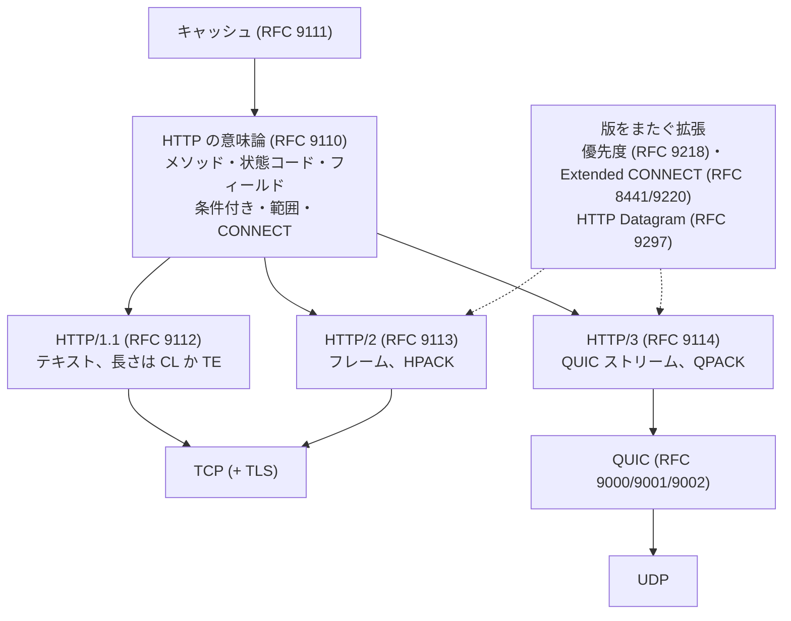
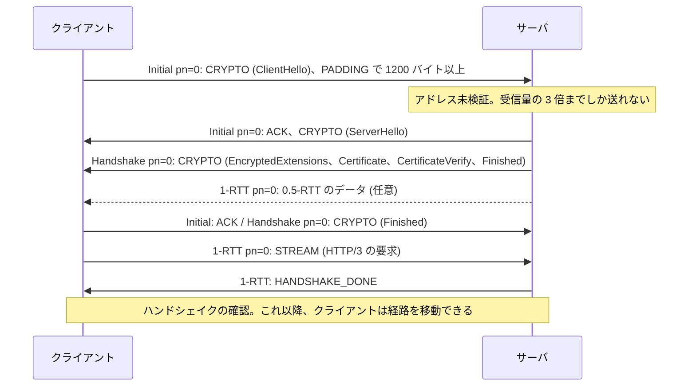

# HTTP の進化と QUIC (HTTP/1.1 → HTTP/2 → QUIC/HTTP3)

## 概要 (Overview)

HTTP の 30 年は、「**Web ページ 1 枚のために数十〜数百のリソースを、いかに少ない往復と待ち時間で運ぶか**」という一つの問題への応答の歴史である。HTTP/1.1 は接続の使い回し (keep-alive) を、HTTP/2 は 1 接続上の多重化を導入したが、多重化は TCP の順序保証と衝突して**トランスポート層の HoL ブロッキング**を露呈した（[`tcp-transport-congestion.md`](tcp-transport-congestion.md)）。

その解が **QUIC** である。QUIC は UDP 上にトランスポートを作り直し、ストリームを一次概念とし、TLS 1.3 をハンドシェイクに統合し、**トランスポートヘッダごと暗号化してミドルボックスから隠す**。HTTP/3 はその上の HTTP マッピングである。QUIC は「性能改善」であると同時に、**プロトコルを進化可能に保つための構造改革**（硬直化対策）である点が本質的に重要である。

本ドキュメントは、各世代が「何を解き、何を残したか」の連鎖として HTTP/1.1 → 2 → QUIC/3 を整理する。分析深度は Level 3。

この連鎖の下には、版が変わっても変わらない層がある。メソッド・状態コード・キャッシュ・条件付きリクエストといった HTTP の意味論 (semantics) は 2022 年に RFC 9110/9111 として版から切り離された。HTTP/1.1・HTTP/2・HTTP/3 は、同じ意味論をバイト列に載せる別々のワイヤ形式 (wire format) として RFC 9112/9113/9114 に分かれた。本書はこの分離を軸に、次の内容も扱う。

- 意味論の層: メソッドの安全性と冪等性、キャッシュ、条件付きリクエストと範囲リクエスト、仲介者 (proxy) と CONNECT・Extended CONNECT
- サーバから送る仕組み: Server Push の撤去、103 Early Hints、優先度 (RFC 9218)、WebSocket・SSE・ロングポーリング
- メッセージの区切りの曖昧さから生じるリクエストスマグリング (request smuggling)
- QUIC の内部: 損失検出と輻輳制御 (RFC 9002)、経路移動とステートレスリセット、硬直化を防ぐ仕掛け (QUIC v2・GREASE・スピンビット)、拡張 (DATAGRAM・マルチパス)
- UDP の上に作り直したことによる CPU のコスト、2026 年時点の展開とフォールバック、MASQUE によるトンネル

## 方法論 (Methodology)

- 各世代を「解決した問題／持ち込んだ新しい問題」の対で記述し、次世代への必然性を示す。
- 遅延の会計を「ハンドシェイク往復数 × RTT」で統一的に数え、0-RTT までの短縮の系譜を追う。
- QUIC は RFC 9000/9001/9114 を規範とし、設計判断（UDP 採用、暗号化範囲、コネクション ID）の「なぜ」を優先する。
- Web 性能の運用の細部 (CDN のキャッシュ階層と無効化、優先度の調整) には立ち入らず、プロトコルが定める意味論と構造に集中する。
- **一次資料**: RFC 9110–9114 (意味論・キャッシュ・各版)、RFC 9204 (QPACK)、RFC 9218 (優先度)、RFC 9000–9002 (QUIC)、RFC 9221 (DATAGRAM)、RFC 9287 (QUIC ビットの GREASE)、RFC 9368/9369 (互換バージョン交渉と QUIC v2)、RFC 8441/9220 (Extended CONNECT)、RFC 8470 (HTTP の 0-RTT)、RFC 8297 (103 Early Hints)、RFC 9297/9298/9484 (MASQUE) を使う。標準化の途中にある草案 (Multipath QUIC、ACK 頻度、QUIC-LB) の状態は、2026-11-07 時点の IETF Datatracker の表示で確かめた。
- **実装**: Linux の UDP のオフロードは `include/uapi/linux/udp.h` を v4.17・v4.18・v5.0・v7.3 のタグで読み、ソケットオプションが入った版を確かめた。カーネル内の QUIC は v7.4-rc1 の `net/` に存在しないことを確かめ、パッチの状況は LWN とメーリングリストで追った。
- **性能の主張**: Google 自身の展開報告 (Langley et al. 2017) と、第三者の測定 (Zhang et al. WWW 2024) を分けて書く。前者は 2016 年頃の Google の環境での値、後者は 2022 年頃のブラウザと 1 Gbps の実験網での値である。
- **普及率**: Cloudflare Radar (Cloudflare が受けた要求の割合)、W3Techs (サイトの割合)、HTTP Archive の Web Almanac (クロールしたページの割合) は測るものが違う。1 つの値に丸めず、それぞれ日付と定義を付けて並べる。
- **担当範囲**: TLS 1.3 の内部は [`tls-internals.md`](tls-internals.md)、TCP の輻輳制御は [`tcp-transport-congestion.md`](tcp-transport-congestion.md)、CDN のキャッシュ階層は [`cdn-edge-delivery.md`](cdn-edge-delivery.md)、L7 の負荷分散は [`load-balancing-architecture.md`](load-balancing-architecture.md)、gRPC は [`rpc-serialization.md`](rpc-serialization.md)、Rapid Reset などの HTTP/2 の DoS は [`ddos-mitigation.md`](ddos-mitigation.md)、WebTransport と MoQ は [`webrtc-realtime-media.md`](webrtc-realtime-media.md)、スマグリングの攻撃手法は [`../security/web-application-vulnerabilities.md`](../security/web-application-vulnerabilities.md) が扱う。

## 発見事項 (Findings)

1. **HTTP/1.1 の限界は「1 接続 1 リクエスト直列」。** keep-alive で接続確立は償却したが、応答は順番待ち。パイプライン化は仕様にあったが**応答順序の強制とミドルボックスの非対応で死んだ**。ブラウザは接続を 6 本並べるという力技で凌ぎ、それは輻輳制御の観点では「1 フローであるべきものが 6 フロー分の取り分を主張する」ことを意味した。
2. **HTTP/2 は「HTTP 層の HoL」を解き、「TCP 層の HoL」を残した。** 単一 TCP 接続上にストリームを多重化しフレームで織り込むことで、アプリ層の順番待ちは消えた。しかし TCP は全ストリームを**一本のバイト列**として運ぶため、1 セグメントのロスが**無関係なストリームまで**塞ぐ。ロス率の高い網では HTTP/1.1 の 6 接続に劣る場面すらある、という皮肉な結果が QUIC の直接の動機になった。
3. **ヘッダ圧縮は「圧縮という名の共有状態」。** HPACK は接続単位の動的テーブルで既出ヘッダを参照に置き換える。この共有状態は (a) CRIME 系攻撃への配慮（秘密と攻撃者制御値を同じ圧縮文脈に入れない設計）、(b) QUIC では順序保証がストリーム単位になるため**そのまま使えない**（QPACK で再設計）という2つの重要な帰結を持つ。
4. **QUIC の最重要設計は暗号化の範囲である。** ペイロードだけでなく、**トランスポートのヘッダ・制御情報まで暗号化**する。ミドルボックスが読めない＝依存できない＝**将来の変更を壊せない**。TCP が陥った硬直化（ossification）への構造的な予防であり、「性能のための機能」ではなく「進化可能性のための機能」である。
5. **コネクション ID が「接続 = 4 タプル」を解体した。** QUIC の接続は IP/ポートではなく**コネクション ID** で識別され、Wi-Fi→モバイル回線の切替（NAT リバインディング含む）を**接続を保ったまま**跨げる (connection migration)。モバイル時代のトランスポートとしての要件が、TCP には後付け不能な形で組み込まれている。
6. **0-RTT は「速さと引き換えのリプレイ危険」。** 再訪時、TLS 1.3 の事前共有鍵で**最初のパケットからアプリデータ**を送れる。ただし 0-RTT データは**リプレイされうる**ため、冪等でない操作を載せてはならない。プロトコルの都合がアプリケーション設計の制約（冪等性の明示）として滲み出す例。
7. **ユーザ空間実装がイテレーションを変えた。** TCP はカーネル常駐で進化が OS 更新に縛られるが、QUIC はライブラリとしてアプリと共に配布される。Google が Chrome とサーバの両端を持って実験を繰り返し標準化に持ち込んだ経緯自体が、「両端を握れば進化できる」こと（硬直化の教訓の裏返し）を実証している。
8. **意味論とワイヤ形式を分けたことで、仲介者は版を自由に変換できるようになった。その変換点が新しい攻撃面になった。** RFC 9110 の意味論は版に依存しないので、CDN はクライアントと HTTP/3 で話し、オリジンとは HTTP/1.1 で話せる。一方で、HTTP/2 で受けた要求を HTTP/1.1 に書き直す箇所では、HTTP/2 では曖昧でなかった長さの指定が再び曖昧になる。Kettle (2021) の H2.CL・H2.TE のスマグリングは、この書き直しの隙を突いたものである。
9. **サーバから送る仕組みは「送る」から「知らせる」へ後退した。** HTTP/2 の Server Push は、使っていたのが HTTP/2 のサイトの 1.25% (Web Almanac 2021) で、後の再集計では 0.7% だった。性能が改善しない例が多く、Chrome 106 で既定で無効になった。代わりの 103 Early Hints は、取りに行くリソースの候補を知らせるだけで、取るかどうかはキャッシュの状態を知るブラウザが決める。長く続く双方向の通信は、WebSocket が HTTP/2 と HTTP/3 の 1 ストリームに載るようになった (RFC 8441・9220)。
10. **リクエストスマグリングは HTTP/1.1 の区切り方の曖昧さから生じる。HTTP/2 を端から端まで使えばほぼ消える。** HTTP/1.1 では要求の終わりを `Content-Length` と `Transfer-Encoding` のどちらでも示せ、要求と要求の間に区切りの記号がない。HTTP/2 と HTTP/3 では長さはフレームが決める。Kettle (2025) は、前段とオリジンの間を HTTP/1.1 にしている限りこの問題は形を変えて残ると論じ、その研究で 35 万ドルを超える脆弱性報奨金を得たと報告した。
11. **QUIC はユーザ空間に置いた代わりに CPU を余分に使う。** Google の初期の実装では、サーバの CPU 使用量は TLS/TCP の約 3.5 倍で、最適化の後も約 2 倍だった (Langley et al. 2017)。第三者の測定 (Zhang et al. 2024) では、1 Gbps の網で Chrome の HTTP/3 のデータレートは HTTP/2 より最大 45.2% 低く、原因は受信側の処理 (UDP の受信パケット数とユーザ空間での ACK の生成) だった。Linux には UDP の GSO (v4.18) と GRO (v5.0) が入ったが、カーネル内の QUIC は v7.4-rc1 の時点でまだ本体に入っていない。
12. **HTTP/3 の普及率は測り方で 2 倍違う。TCP へのフォールバックは今も前提である。** 2025 年の Cloudflare の観測では要求の 21% が HTTP/3 だった。W3Techs では 2026 年 11 月の時点でサイトの 41.2% が HTTP/3 に対応している。Google の 2016 年の測定では、クライアントの 4.4% が UDP の遮断などで QUIC を使えず、その多くは企業の網の中にいた。企業向けのファイアウォールには TLS の検査に回すために QUIC を遮断する設定を推奨するものもある。
13. **硬直化は暗号化だけでは防げない。値を変え続けて、ミドルボックスが固定値に頼れないようにする必要がある。** 2016 年 10 月、Google が QUIC のヘッダの平文の 1 ビットを変えると、あるファイアウォールが最初のパケットだけを通して後続を捨て、TCP へのフォールバックも働かなくなった (Langley et al. 2017)。標準化後の QUIC は予約したバージョン番号の GREASE、QUIC ビットの GREASE (RFC 9287)、定数だけを変えた QUIC v2 (RFC 9369) で、ヘッダの値が変わりうることを網に覚えさせ続けている。

## アーキテクチャ (Architecture)

### スタックの比較

```
   HTTP/1.1            HTTP/2               HTTP/3
 ┌───────────┐     ┌───────────────┐    ┌───────────────┐
 │ HTTP/1.1  │     │ HTTP/2        │    │ HTTP/3        │
 │ (テキスト) │     │ ストリーム/フレーム │    │ (QPACK)       │
 ├───────────┤     │ (HPACK)       │    ├───────────────┤
 │ TLS (任意) │     ├───────────────┤    │ QUIC          │
 ├───────────┤     │ TLS 1.2+ (必須※)│    │  ・ストリーム多重 │
 │ TCP       │     ├───────────────┤    │  ・信頼性/輻輳制御│
 │           │     │ TCP           │    │  ・TLS 1.3 統合  │
 └───────────┘     └───────────────┘    ├───────────────┤
                                        │ UDP           │
 ※ h2 は事実上 TLS 必須                  └───────────────┘
 (ブラウザが平文 h2 を実装しない)          信頼性・順序はストリーム単位
```

### 遅延の会計 — データ到達までの往復数

| | TCP+TLS1.2 | TCP+TLS1.3 | QUIC 初回 | QUIC 再訪 (0-RTT) |
|---|---|---|---|---|
| トランスポート確立 | 1 RTT | 1 RTT | （統合） | （統合） |
| 暗号ハンドシェイク | 2 RTT | 1 RTT | 1 RTT | 0 |
| **リクエスト送信まで** | **3 RTT** | **2 RTT** | **1 RTT** | **0 RTT** |

- QUIC はトランスポート確立と鍵交換を**同じ往復に重ねる**。「接続してから暗号化する」という層の直列を崩したことが短縮の本体である。

### HoL ブロッキングの局在化

```
 HTTP/2 over TCP:                        HTTP/3 over QUIC:
  ストリーム A ──┐                        ストリーム A ── QUIC ストリーム A (独立に再送・配送)
  ストリーム B ──┼─ 単一バイト列 → TCP     ストリーム B ── QUIC ストリーム B
  ストリーム C ──┘                        ストリーム C ── QUIC ストリーム C
  ↑ どれかのセグメントロスで              ↑ ロスの影響は当該ストリームの中だけ。
    A/B/C 全部が順序待ちで停止              他ストリームは先に進める
```

### 意味論とワイヤ形式の分離 (RFC 9110–9114)



凡例: 実線の矢印は「上の層が下の層に載る」関係。点線は主に HTTP/2 と HTTP/3 で使う拡張であることを示す (Extended CONNECT と HTTP Datagram は HTTP/1.1 にも対応する形を持つ)。仲介者は意味論を保ったままワイヤ形式だけを変えられる。

### QUIC のハンドシェイクとパケット番号空間



凡例: `pn` はパケット番号。Initial・Handshake・Application Data (0-RTT と 1-RTT が共有する) の 3 つの空間ごとに、パケット番号は 0 から数え、ACK と損失検出も空間ごとに行う (RFC 9002 §4.1、付録 A.2)。ある暗号化レベルの ACK が、別のレベルのパケットの再送を誤って引き起こさないようにするためである。ClientHello を運ぶデータグラムを 1200 バイト以上にする規定と 3 倍の送信制限は RFC 9000 §8.1、経路移動をハンドシェイクの確認の後に限る規定は RFC 9000 §9 にある。

## 技術詳細 (Technical Details)

### 1. HTTP/1.1 — 直列の限界と 6 接続の力技

- keep-alive・チャンク転送で「接続ごとの儀式」は償却されたが、**1 接続上の応答は厳密に直列**。遅い 1 レスポンス（動的生成・大きい画像）が後続を塞ぐ。これが元祖 HoL ブロッキングである。
- パイプライン化（複数リクエストを先出し）は応答が**リクエスト順**でなければならず、途中の 1 つが遅いと結局塞がる上、非対応プロキシが壊すため、主要ブラウザはすべて無効化した。**「仕様に書いても網が壊すなら存在しないのと同じ」**。これは硬直化の初期の実例である。
- 現実解はドメインあたり 6 接続＋ドメインシャーディング。輻輳制御の公平性を歪め（6 フロー分の cwnd）、確立コストも 6 倍払う。プロトコルの欠陥を運用で埋めた時代である。

### 2. HTTP/2 — フレーム・ストリーム・HPACK

- **バイナリフレーミング**: 接続を HEADERS/DATA 等のフレーム列にし、各フレームはストリーム ID を持つ。複数リクエスト/レスポンスが 1 接続に**織り込まれ**、アプリ層の順番待ちは消える。
- **HPACK (RFC 7541)**: 静的テーブル（頻出ヘッダ 61 種）＋接続ごとの動的テーブルで、繰り返されるヘッダを索引参照に置き換える。Cookie のような巨大ヘッダの反復送信という HTTP/1.1 の無駄への答え。gzip 圧縮でなく索引方式なのは **CRIME 攻撃**（圧縮率の変化から秘密を1文字ずつ当てる）の教訓であり、「圧縮文脈の共有は側チャネル」という原則がプロトコル設計に反映されている。
- **サーバプッシュは死んだ**: 依頼される前にリソースを送る仕組みは、キャッシュ状態を知らずに送る無駄が実測で勝り、Chrome が撤去、HTTP/3 では既定無効が実態。**「良さそうな機能」が計測に敗れた**例として記録に値する。
- **優先度制御も作り直された**: h2 の依存ツリー方式は複雑すぎて実装がばらけ、シンプルな urgency ベースの Extensible Priorities (RFC 9218) に置き換えられた。

### 3. QUIC トランスポート (RFC 9000)

- **ストリーム**: 双方向/単方向のバイトストリームを軽量に多重化。**信頼性・順序はストリーム単位**で、再送もストリーム単位のフレームで行う。ロスの影響の局在化はこの構造から従う。フロー制御も「接続全体」と「ストリームごと」の二段。
- **ACK と再送**: TCP と異なりパケット番号は**再送でも再利用しない**（再送は新番号のパケットに旧フレームを積み直す）。再送曖昧性（Karn 問題）が構造的に消え、RTT 測定が常に正確になる。TCP が 40 年抱えてきた問題を設計で解消した箇所である。
- **輻輳制御は交換可能**: 既定は NewReno 相当 (RFC 9002) だが、CUBIC/BBR を含め実装の自由。ユーザ空間実装ゆえ、デプロイと実験のサイクルが桁違いに速い。
- **コネクション ID と経路移動**: 接続の同一性を CID が担い、経路変更時は**新経路の検証**（往復の疑似ハンドシェイク）を経て移行する。CID は経路ごとに付け替え可能で、経路をまたぐ追跡（linkability）を抑える配慮まで仕様に含まれる。
- **ヘッダ保護**: パケット番号すら暗号化される。観測者に見えるのは初期ハンドシェイクの最小限と CID 程度で、**「ミドルボックスが賢くなれない」ことを保証する**。将来のバージョン交渉を守るための意図的な情報最小化 (GREASE を含む) が貫かれている。

### 4. TLS 1.3 統合と 0-RTT

- QUIC は TLS 1.3 の**ハンドシェイクだけ**を借り、レコード層は使わない（鍵は QUIC 自身のパケット保護に供給される）。トランスポートと鍵交換が 1 往復に同居する構造。
- **0-RTT**: 再訪クライアントは前回の事前共有鍵で初手からアプリデータを暗号化して送る。**リプレイ耐性がない**。ネットワーク上の攻撃者は 0-RTT パケットを複製して再投函できるため、サーバは 0-RTT では冪等・無害な操作しか処理してはならない (HTTP なら安全メソッドに限る等)。「1 往復の節約」が**アプリの冪等性設計**という要件に化ける、層を貫くトレードオフ。
- **アンプ制限**: アドレス未検証のうちは、サーバは受信量の **3 倍まで**しか送れない。送信元詐称による増幅 DoS（QUIC を反射器にする攻撃）への仕様レベルの防御。

### 5. QPACK (RFC 9204) — 順序なし世界のヘッダ圧縮

- HPACK の動的テーブルは「全ヘッダブロックが同一順序で届く」ことを前提にしていた。QUIC ではストリームごとに到着順が違うので成立しない。
- QPACK は動的テーブルの更新を**専用の単方向ストリーム**に分離し、各ヘッダブロックは「参照するテーブル状態の番号」を宣言する。未達なら**そのストリームだけ**が待つ。圧縮率と HoL 復活リスクのダイヤルを実装が選べる構造にした。これは「共有状態と多重化は本質的に緊張する」ことへの明示的な回答。

### 6. HTTP/3 (RFC 9114) と現実の展開

- HTTP/3 は「HTTP セマンティクス (RFC 9110) を QUIC ストリームに写像する」薄い層である。リクエスト/レスポンスは 1 双方向ストリーム、制御は単方向ストリーム。
- 発見は `Alt-Svc` ヘッダまたは DNS の **HTTPS レコード**で「UDP/443 で h3 が使える」ことを広告する。UDP がブロックされる網（企業 FW 等）では TCP へフォールバックする。つまり、**TCP は失敗時の保険として残り続ける**。
- Web 以外への波及が本命という見方もある: **MASQUE**（QUIC 上のプロキシ/VPN）、**WebTransport**（ブラウザからの低遅延双方向通信）、**Media over QUIC** など、「ユーザ空間で進化できる汎用トランスポート」としての利用が広がっている。WebTransport と Media over QUIC の標準化の状況と、WebRTC との関係は [`webrtc-realtime-media.md`](webrtc-realtime-media.md) で扱う。

### 7. HTTP の意味論の層 (RFC 9110)

- **2022 年 6 月の再編**: RFC 9110 (意味論)、9111 (キャッシュ)、9112 (HTTP/1.1)、9113 (HTTP/2)、9114 (HTTP/3) が同時に出版され、RFC 7230–7235 と 7540 を置き換えた。版ごとの RFC はメッセージをどうバイト列にするかだけを定め、メソッドや状態コードの意味は RFC 9110 を参照する。
- **安全性と冪等性**: GET・HEAD・OPTIONS・TRACE は安全 (safe) なメソッドで、サーバの状態を変えないことを約束する。PUT・DELETE と安全なメソッドは冪等 (idempotent) で、同じ要求を何度送っても結果が 1 回と同じになる。クライアントは冪等でない要求を自動で再送すべきでなく (SHOULD NOT)、プロキシは自動で再送してはならない (MUST NOT。RFC 9110 §9.2.2)。L7 ロードバランサのリトライ ([`load-balancing-architecture.md`](load-balancing-architecture.md)) も、0-RTT に載せてよい要求の範囲 (§4) も、この区別に従う。
- **再送してよいかを伝える仕組み**: 冪等でない要求でも、サーバが処理していないと分かれば再送できる。HTTP/2 では GOAWAY に「ここまでのストリームは処理するかもしれない」最後のストリーム ID を載せ、それより後のストリームと REFUSED_STREAM で閉じたストリームは未処理と分かる (RFC 9113 §8.7)。HTTP/3 では H3_REQUEST_REJECTED が同じ役割を持つ。HTTP/1.1 には同じ仕組みがなく、接続が切れたときに要求が処理されたかどうかをクライアントは知る手段を持たない。
- **ホップごとのフィールド**: `Connection`・`Keep-Alive`・`Transfer-Encoding`・`Upgrade` は 1 区間 (hop) の接続だけに関わるフィールドで、端から端までの意味論には含まれない。HTTP/2 はこれらを含むメッセージを不正 (malformed) として扱い、HTTP/1.x から変換する仲介者に削除を求める (RFC 9113 §8.2.2)。`TE` だけは `trailers` の値に限って許される。gRPC が HTTP/2 のトレーラ (trailer) を使えるのはこの規定による ([`rpc-serialization.md`](rpc-serialization.md))。

### 8. キャッシュ・条件付きリクエスト・範囲リクエスト (RFC 9111・RFC 9110 §13–14)

ここでは HTTP が定めるキャッシュの約束だけを扱う。CDN のキャッシュキーの設計、階層、無効化は [`cdn-edge-delivery.md`](cdn-edge-delivery.md) で扱う。

- **鮮度 (freshness)**: 応答の有効期間は `Cache-Control: max-age` (共有キャッシュでは `s-maxage` が優先) か `Expires` で示す。どちらもなく `Last-Modified` だけがあるとき、キャッシュは経験的な期間を推定してよく、RFC 9111 §4.2.2 は「最終更新からの経過時間の 10% 程度」を典型例として挙げる。明示しない応答は意図より長く再利用される可能性がある。
- **保存してよいかの指示**: `no-store` は保存そのものを禁じる。`no-cache` は保存を許すが、再利用の前に毎回オリジンでの再検証を求める。名前から受ける印象とは逆で、取り違えると機密の応答が共有キャッシュに残る。`private` は共有キャッシュでの保存を禁じる。`must-revalidate` は期限切れの応答を検証なしに使うことを禁じ、オリジンに届かないときは 504 を返すよう求める。
- **`Vary` と副次的なキー**: `Vary: Accept-Encoding` のように応答が要求のフィールドに依存すると宣言すると、キャッシュは名前の挙がったフィールドが一致する要求にだけその応答を再利用する (RFC 9111 §4.1)。`Vary: *` は常に一致しない。宣言が漏れると、圧縮した応答を非対応のクライアントに返すといった誤配信が起きる。
- **期限切れの扱いの拡張**: `stale-while-revalidate` と `stale-if-error` (RFC 5861) は、期限切れの応答を返しながら裏で再検証すること、オリジンの障害時に古い応答で代用することを許す拡張である。RFC 9111 の本体には含まれない。
- **検証子と条件付きリクエスト**: `ETag` (強い検証子と、`W/` を付けた弱い検証子) と `Last-Modified` が応答の版を示す。条件は `If-Match` → `If-Unmodified-Since` → `If-None-Match` → `If-Modified-Since` → `If-Range` の順に評価する (RFC 9110 §13.2.2)。GET の再検証では `If-None-Match` が偽なら 304 を返し、本文を送らない。更新では `If-Match` が偽なら 412 を返して処理しない。後者は、2 人が同じ資源を読んで順に書き戻すときに先の書き込みが消える問題 (lost update) を防ぐ楽観的な排他制御になる。
- **範囲リクエスト**: `Range: bytes=…` に対して 206 で部分を返し、複数の範囲は `multipart/byteranges` で返す。満たせない範囲には 416 を返す。途中で切れたダウンロードの再開や動画のシークに使う。部分を組み合わせてよいのは強い検証子が一致する場合だけで、`If-Range` に弱い検証子は使えない。重なった範囲や細かく乱れた範囲を大量に指定する要求は DoS になりうるため、サーバは無視するか拒否してよい (RFC 9110 §14.2)。2011 年の Apache の CVE-2011-3192 は、この種の要求でメモリを使い切らせるものだった。

### 9. 仲介者と CONNECT・Extended CONNECT

- **3 種類の仲介者**: RFC 9110 §3.7 は、クライアントが選ぶ転送プロキシ (forward proxy)、オリジンの前に置かれクライアントからはオリジンに見えるゲートウェイ (gateway、逆プロキシ reverse proxy)、中身を解釈せずにバイトを中継するトンネル (tunnel) を区別する。CDN と L7 ロードバランサはゲートウェイであり、HTTP の版の変換・キャッシュ・ヘッダの書き換えはここで起きる。
- **CONNECT**: `CONNECT host:port` に 2xx が返ると、その接続は宛先への TCP のトンネルになる (RFC 9110 §9.3.6)。HTTP/1.1 では接続 1 本がトンネル 1 本になるが、HTTP/2 と HTTP/3 では CONNECT は 1 ストリームだけをトンネルにし、同じ接続の他のストリームは使い続けられる (RFC 9113 §8.5)。
- **Extended CONNECT**: RFC 8441 (2018 年 9 月) は、サーバが `SETTINGS_ENABLE_CONNECT_PROTOCOL` を送った接続で、CONNECT に `:protocol` 疑似ヘッダを付けることを許した。`:protocol` には `websocket`・`connect-udp`・`connect-ip`・`webtransport` などが入る。RFC 9220 (2022 年 6 月) は同じ仕組みを HTTP/3 に定め、知らない `:protocol` には 501 を返すよう求める。HTTP の 1 ストリームを任意のプロトコルの入れ物にする汎用の仕組みであり、§10 の WebSocket と §17 の MASQUE はどちらもこの上に載る。
- **HTTP Datagram と Capsule**: RFC 9297 は Extended CONNECT のストリームに紐づく信頼性のないデータグラムを定めた。HTTP/3 では QUIC の DATAGRAM フレーム (§14) で運び、HTTP/1.1 と HTTP/2 ではストリームの中の Capsule という型付きの区切りに包んで運ぶ。下位層が順序保証のない運搬手段を持つ場合だけ、その性質が上まで届く。

### 10. Server Push の撤去と代わりの手段

- **Server Push の撤去**: Chrome は Chrome 106 で HTTP/2 の Server Push を既定で無効にした。理由として、Chrome と Akamai の分析で性能の改善がはっきりせず、悪化する例も多かったこと、HTTP/3 では仕様にあっても多くのサーバとクライアントが実装しなかったことを挙げている。利用率は HTTP/2 のサイトの 1.25% (Web Almanac 2021) で、再集計では 0.7% に下がっていた。サーバはクライアントのキャッシュに何があるかを知らないので、既にあるリソースを送って帯域を使い、本当に必要な応答を遅らせることがある。HTTP/3 の Push は、クライアントが `MAX_PUSH_ID` を送らない限りサーバが使えない (RFC 9114 §4.6)。
- **103 Early Hints**: RFC 8297 (2017 年、Experimental) の 103 は、最終の応答の前に `Link: rel=preload` などを送る中間応答である。Chrome は Chrome 103 (2022 年 6 月) からページの遷移 (トップレベルのナビゲーション) に限って対応し、preload と preconnect を処理する。HTTP/1.1 で届いた 103 と、サブリソースや iframe の 103 は無視し、最初の 103 だけを処理する。オリジンが HTML を作っている間 (データベースの問い合わせなど) の待ち時間に、CSS や JavaScript の取得を始められる。取るかどうかはブラウザが決めるので、Push の「キャッシュにあるものを送る」問題は起きない。Web Almanac 2024 では、デスクトップのトップページの 2.9% が 103 を返し、その約 9 割が Shopify のサイトだった。
- **優先度 (RFC 9218)**: 2022 年 6 月の Extensible Priorities は、緊急度 `u` (0〜7、既定 3、小さいほど優先) と、届いた分から使えるかどうかを示す `i` (既定 false) の 2 つの値だけで優先度を表す。端から端まで届く `Priority` ヘッダと、ホップごとに後から変更する `PRIORITY_UPDATE` フレーム (HTTP/2 は種別 0x10、HTTP/3 は 0xF0700) がある。RFC 7540 の依存ツリーを捨てた理由として RFC 9218 は、実装と相互運用が進まなかったこと、多くのサーバが信号を無視したこと、クライアントごとに同じ状況で全く違う信号を送るので解釈が難しかったこと、同じ接続の他の要求との相対値なのでストリーム間の順序が保証されない HTTP/3 に合わないことを挙げる。RFC 9113 §5.3.2 は RFC 7540 の優先度の信号を非推奨とした。

長く続く通信の方式を次の表で比べる。

| 方式 | 仕組み | 向き | 下位の運搬 | 向く用途と注意 |
|---|---|---|---|---|
| ロングポーリング | 応答を保留し、事象が起きたら返す。返すたびにクライアントが次の要求を出す | サーバ → クライアント (疑似) | 通常の要求と応答 | どこでも通る。事象ごとに要求のヘッダの費用がかかり、返してから次の要求までの間の事象は遅れる |
| SSE (Server-Sent Events) | `text/event-stream` の 1 応答を開いたまま流し続ける。切れると `Last-Event-ID` を付けて再接続する | サーバ → クライアント | 1 つの応答 | 通知やトークン単位のストリーミング。HTTP/1.1 ではホストあたりの同時接続数の上限 (ブラウザでは通常 6) を食う。HTTP/2 以上では 1 ストリームで済む |
| WebSocket (RFC 6455、2011 年) | HTTP/1.1 の `Upgrade` で接続をメッセージ単位の双方向の通信に切り替える | 双方向 | HTTP/1.1 では TCP 接続 1 本を占有。HTTP/2 は RFC 8441、HTTP/3 は RFC 9220 で 1 ストリーム | チャットや共同編集。接続 1 本の占有と、仲介者のアイドルタイムアウトへの対策 (ping) が必要 |
| WebTransport | Extended CONNECT で開いたセッションの中で、複数のストリームとデータグラムを使う | 双方向、信頼性の有無を選べる | HTTP/3 (HTTP/2 版もある) | 低遅延のメディアやゲーム。標準化の状況は [`webrtc-realtime-media.md`](webrtc-realtime-media.md) |

### 11. QUIC の損失検出と輻輳制御 (RFC 9002)

- **ACK の形**: QUIC の ACK フレームは受け取ったパケット番号の範囲をいくつでも並べられ、受信側が ACK を遅らせた時間 (ACK Delay) も載せる。TCP の SACK はオプション領域 (最大 40 バイト) に収まる 3〜4 区間しか示せず、遅延 ACK の時間は送信側から見えない。パケット番号を再送で再利用しないこと (§3) と合わせ、QUIC の送信側は RTT と損失を TCP より正確に知る。
- **損失の判定**: 後から送ったパケットへの ACK が届いた時点で、それより 3 個 (kPacketThreshold) 以上前のパケット、または max(smoothed_rtt, latest_rtt) の 9/8 倍 (kTimeThreshold) 以上前に送ったパケットを失われたとみなす。時間の下限は 1 ms (kGranularity) である (RFC 9002 §6.1)。並べ替えに強くするため、パケット数の閾値を 3 未満にしてはならない。
- **PTO (Probe Timeout)**: 末尾のパケットが失われて後続の ACK が来ないときは、PTO = smoothed_rtt + max(4 × rttvar, kGranularity) + max_ack_delay で探査のパケットを送る (§6.2.1)。Initial と Handshake の空間では max_ack_delay を 0 とする。最初の RTT の推定値は 333 ms (kInitialRtt) である。TCP の RTO と違い、PTO の時間切れだけでは輻輳ウィンドウを縮めない。探査を送って ACK を待ち、本当に失われたかは通常の損失判定で決める。
- **輻輳制御**: 既定の動きは NewReno 型で、初期ウィンドウは min(10 × 最大データグラム長, max(14,720 バイト, 2 × 最大データグラム長))、最小ウィンドウは最大データグラム長の 2 倍、損失時の縮小率は 0.5 である (§7)。PTO の 3 倍 (kPersistentCongestionThreshold) を超える期間に送ったパケットがすべて失われると持続的な輻輳 (persistent congestion) とみなし、ウィンドウを最小に落とす (§7.6)。送信のペーシングを推奨する (§7.7)。輻輳制御の方式は実装が選べ、CUBIC や BBR を使う実装も多い。輻輳制御そのものの理論は [`tcp-transport-congestion.md`](tcp-transport-congestion.md) で扱う。
- **ACK の頻度**: RFC 9000 は受信側に、ACK を要するパケットを 2 個受け取るごとに ACK を返すことを推奨する。高い帯域ではこの ACK の生成が受信側の CPU を使う (§15)。送信側が受信側に ACK の間隔を指示する拡張 draft-ietf-quic-ack-frequency は、2026-02-05 の第 14 版のあと期限切れになり、WG の状態は「WG の合意済み、文書化 (write-up) 待ち」と表示されている (2026-11-07 時点)。

### 12. 経路の移動・NAT リバインディング・ステートレスリセット

- **移動できるのはクライアントだけ**: RFC 9000 の版では、経路を変えられるのはクライアントだけで、ハンドシェイクの確認の前には移動できない (RFC 9000 §9)。サーバは `disable_active_migration` で移動を拒める。サーバが別のアドレスへ移ってほしいときは `preferred_address` を示し、クライアントが移るかどうかを決める。
- **経路の検証**: 新しいアドレスからパケットが届くと、相手は 8 バイトの予測できない値を載せた PATH_CHALLENGE を送り、同じ値の PATH_RESPONSE が返るまで、その経路をまだ検証していないものとして扱う。PATH_CHALLENGE を運ぶデータグラムも 1200 バイト以上にし、未検証の経路には 3 倍の送信制限がかかる。攻撃者が被害者のアドレスを詐称して「移動した」と見せかけ、サーバの送信を被害者に向けることを防ぐためである。
- **NAT リバインディング**: NAT の対応表が切れて送信元のポートだけが変わる場合は、同じ経路とみなして輻輳制御と RTT の状態を引き継いでよい。アドレスが変わる本当の移動では、新しい経路の輻輳制御を初期状態から始める (§9.4)。TCP では 4 タプルが変わると接続が切れ、HTTP/2 の上の全ストリームとともにアプリケーションが再接続することになる。
- **コネクション ID と追跡**: 新しい経路では、まだどの経路でも使っていないコネクション ID に切り替え、複数のアドレスで同じ ID を使ってはならない (§9.5)。ID を使い回すと、観測者が Wi-Fi とモバイル回線の 2 つの経路を同じ端末のものと結びつけられるからである。そのためエンドポイントは NEW_CONNECTION_ID で予備の ID を前もって相手に渡しておく。逆に、サーバ側のロードバランサが移動後のパケットを同じサーバに届けるには、ID にサーバの識別子を埋め込む必要がある。その形式を定める QUIC-LB (draft-ietf-quic-load-balancers) は 2026-10-23 の第 22 版で、まだ RFC になっていない ([`load-balancing-architecture.md`](load-balancing-architecture.md))。
- **ステートレスリセット**: サーバが再起動して接続の状態を失うと、届いたパケットを復号できず、正規の CONNECTION_CLOSE も送れない。そこで事前にコネクション ID ごとに 16 バイトのリセットトークンを相手に渡しておき、状態を失った側は末尾にそのトークンを置いた普通のパケットに見えるデータグラムを返す (§10.3)。予測できないビットを 38 ビット以上含める必要から、最小の長さは 21 バイトになる。トークンは秘密鍵と ID から導出して、状態がなくても同じ値を再計算できるようにする。

### 13. バージョン・GREASE・スピンビット

- **変えない部分の約束**: RFC 8999 は、どの版の QUIC でも変わらない性質 (ロングヘッダとショートヘッダの区別、バージョン番号とコネクション ID の位置) だけを定める。ミドルボックスが頼ってよいのはここだけで、それ以外は版ごとに変わりうる。
- **バージョン交渉と GREASE**: サーバは知らない版の Initial に、対応する版を並べた Version Negotiation パケットを返す。`0x?a?a?a?a` の形の番号は交渉を試すための予約値で、クライアントが意図的に送ることで、知らない版を捨てる実装を早く見つけられる (RFC 9000 §15)。トランスポートパラメータにも、31 × N + 27 の形の予約 ID がある (§18.1)。
- **QUIC v2 (RFC 9369、2023 年 5 月)**: 版の番号 0x6b3343cf、Initial の鍵を導く salt、HKDF のラベル、Retry の鍵、ロングヘッダのパケット種別の値だけを v1 から変えた版である。機能は同じで、目的は硬直化の経路をつぶすこと (v1 の定数に頼るミドルボックスを動かなくする) と、互換バージョン交渉 (RFC 9368) を実際に使わせることにある。RFC 9368 の互換交渉では余分な往復なしに v1 から v2 に切り替えられる。
- **QUIC ビットの GREASE (RFC 9287、2022 年 8 月)**: 先頭バイトの 0x40 のビットは v1 では常に 1 で、ミドルボックスが QUIC を見分ける目印に使える。`grease_quic_bit` を交換した相手どうしはこのビットを予測できない値にする。RFC 9287 は、毎回同じ値を送ることは「資産より負債」であると述べる。
- **スピンビット**: ショートヘッダの 1 ビットを、RTT ごとに 0 と 1 が入れ替わるように動かす。網の運用者は暗号を解かずに RTT を観測できる。使うかどうかは任意で、使う実装も無作為に選んだ 16 経路 (またはコネクション ID) に 1 つ以上ではこのビットを無効にしなければならない (RFC 9000 §17.4)。両端が独立に無効にするので、全体では約 8 経路に 1 つで無効になる。無効の経路が常にあることで、「スピンビットが動かない通信は怪しい」とする判定を防ぐ。運用者の観測と利用者のプライバシーの間で、仕様が落とし所を決めた箇所である。

### 14. 拡張 — DATAGRAM とマルチパス

- **DATAGRAM (RFC 9221、2022 年 3 月)**: フレーム種別 0x30/0x31 と、`max_datagram_frame_size` のトランスポートパラメータで交渉する。失われても再送しない一方で、輻輳制御の対象になり、ACK を要する。フロー制御の対象ではなく、受信側は資源が足りなければ捨ててよい。QUIC の暗号化と輻輳制御の上で、UDP に近い性質の運搬を提供するもので、リアルタイムのメディアや、MASQUE の IP・UDP のトンネル (§17) に使う。トンネルの中の TCP を再送の対象にすると、外と内で再送が重なるので、トンネルにはデータグラムが向く。
- **マルチパス QUIC**: 経路の移動 (§12) は一度に 1 経路しか使わない。draft-ietf-quic-multipath は、Wi-Fi とモバイル回線のような複数の経路を同時に使い、経路ごとにパケット番号空間と輻輳制御を持たせる。2026-03-17 の第 21 版が IESG の承認を経て RFC Editor の待ち行列にあり、2026-11-07 時点で編集者の割り当て待ちで、RFC 番号はまだない。TCP の MPTCP と同じ目的を、ミドルボックスが TCP のオプションを消す問題なしに実現する。

### 15. UDP の上の実装のコスト

- **初期の Google の測定**: YouTube の配信で測ると、QUIC のサーバの CPU 使用量は TLS/TCP の約 3.5 倍だった。主な原因は暗号、UDP パケットの送受信、QUIC の内部状態の管理の 3 つだった。手で最適化した ChaCha20、カーネルの共有メモリのリングでの受信 (`PACKET_RX_RING`)、キャッシュ効率のよいデータ構造で、約 2 倍まで下げた (Langley et al. 2017 §6.7)。
- **パケットあたりの費用**: TCP では、カーネルと NIC が大きな塊を分割して送り (TSO)、受信したパケットをまとめる (GRO) ので、システムコールとスタックの処理は 64KB 程度の塊ごとに 1 回で済む。UDP の QUIC は、そのままではデータグラム 1 個ごとに 1 回かかる。Linux は v4.18 で送信側のソケットオプション `UDP_SEGMENT` (UDP GSO) を、v5.0 で受信側の `UDP_GRO` を加えた (v7.3 の `include/uapi/linux/udp.h` 37–38 行。v4.17 には両方なく、v4.18 には `UDP_SEGMENT` だけがある)。`sendmmsg`/`recvmmsg` でシステムコールの回数も減らせる。
- **第三者の測定**: Zhang et al. (WWW 2024) は 1 Gbps の実験網で、Chrome の HTTP/3 のダウンロードのデータレートが HTTP/2 より最大 45.2% 低いことを示した。軽いクライアント (cURL など) でも、約 500〜600 Mbps (論文の箇所によって値が違う) を超えると HTTP/3 は HTTP/2 に及ばなかった。測定したダウンロードで、UDP の層が受け取ったパケットは平均 74.4 万個で、TCP の 5.8 万個の 10 倍以上だった。試した QUIC の実装はどれも UDP GRO を使っておらず、ACK の生成もユーザ空間で行っていた。著者らは受信側の UDP GRO、ACK の間引き (§11)、`recvmmsg` を対策に挙げる。動画のビットレートの低下は最大 9.8%、100 サイトのページ読み込み時間の差は平均 3.0% だった。CPU が律速するのは帯域が十分にあるときで、損失の多い無線の区間では QUIC の利点 (§3・§12) が効く。
- **暗号のオフロード**: TCP の TLS にはカーネルの kTLS と、その下で NIC に暗号を任せる仕組みがある ([`tls-internals.md`](tls-internals.md))。QUIC はパケットごとに暗号化し、ヘッダ保護も加えるので、同じ形でのオフロードは難しい。カーネル内に QUIC を置く Xin Long のパッチ (データの処理はカーネル、ハンドシェイクはユーザ空間の tlshd) は、2026-05-31 の第 12 版が確認できた最新の投稿で、v7.4-rc1 の `net/` には `quic/` がない。LWN (2025-07) によると、添付の測定ではカーネル内の TLS がカーネル内の QUIC の約 3 倍のスループットを出した試験があり、暗号を切った QUIC と素の TCP でも TCP が 4 倍以上速い場合があった。原因としてセグメント分割のオフロードがないこと、送信時の余分なコピー、ヘッダの暗号化が挙げられている。
- **配置への帰結**: このコストのため、QUIC はクライアントと最初のエッジの間 (損失と移動の多い区間) で使い、エッジからオリジンや DC の中は TCP と TLS のまま、という配置がよく見られる ([`cdn-edge-delivery.md`](cdn-edge-delivery.md) のプロトコル変換)。パケット処理の経路は [`kernel-network-stack.md`](kernel-network-stack.md) で扱う。

### 16. 展開の現状と発見・フォールバック

HTTP/3 の普及率を示す値は 3 つあり、それぞれ測るものが違う。

| 出典 | 測っているもの | 値 |
|---|---|---|
| Cloudflare Radar 2025 Year in Review | Cloudflare が受けた要求の版の割合 (2025-01-01〜12-02) | HTTP/2 50%、HTTP/1.x 29%、HTTP/3 21% (2024 年は HTTP/3 20.5%) |
| W3Techs | HTTP/3 に対応するサイトの割合 | 41.2% (2026 年 11 月) |
| HTTP Archive Web Almanac 2024 | クロールしたトップページ | HTTP/3 で読み込まれたのは 7% (デスクトップ)〜9% (モバイル)。Alt-Svc で h3 を広告するのは約 27%。HTTPS レコードを持つのは約 12% で、h3 を含むのは 9〜10% |

Web Almanac の 7〜9% が低いのは、クローラが各ページを初回の訪問として読み込むので、Alt-Svc の広告を次の接続に使えないからである。Almanac 自身は、実際の対応は 30% 近いと見積もっている。

- **発見の 2 つの経路**: `Alt-Svc` (RFC 7838) はまず TCP で接続し、その応答で「UDP/443 で h3 が使える」と知らせるので、初回の接続には使えない。DNS の HTTPS レコード (RFC 9460、2023 年 11 月) は名前解決の時点で ALPN に `h3` を示せるので、最初の接続から QUIC を試せる。ECH の鍵の配布もこのレコードに載る。
- **競争とフォールバック**: 2017 年の Chrome は Alt-Svc で QUIC を知った次の接続で QUIC と TLS/TCP を同時に試し、TCP の開始を最大 300 ms 遅らせて QUIC を優先していた (Langley et al. 2017 §3.8)。先に確立したほうを使うので、UDP が遮断されていても待たされるのは最大でこの遅延分である。厄介なのは、遮断せずに途中から捨てる網である。ハンドシェイクは通り、その後のパケットが消えると、競争で QUIC を選んだ後に通信が止まる。
- **UDP の遮断と絞り込み**: 2016 年 11 月の Google の測定では、QUIC を試した動画のクライアントの 95.3% が成功し、4.4% は UDP か QUIC の遮断、または経路の MTU が小さすぎるために使えなかった。その多くは企業の網だった。0.3% は UDP の帯域を絞る網の中にいて、Google はそうした AS で QUIC を止め、運用者に絞り込みを外すよう求めた (同 §7.2)。Palo Alto Networks の PAN-OS の文書は、TLS の復号と検査に回すため、UDP/80・443 の QUIC を遮断してブラウザを TLS/TCP にフォールバックさせる設定を推奨している。

### 17. MASQUE — HTTP の上のトンネル

- **CONNECT-UDP と CONNECT-IP**: RFC 9298 (2022 年 8 月) の CONNECT-UDP は、Extended CONNECT (`:protocol` = `connect-udp`) で開いたストリームを UDP のプロキシにし、データグラムを HTTP Datagram (§9) で運ぶ。RFC 9484 (2023 年 10 月) の CONNECT-IP は IP パケットそのものを運び、アドレスの割り当て (ADDRESS_ASSIGN) と経路の広告 (ROUTE_ADVERTISEMENT) を Capsule で交換する。どちらも URI テンプレート (既定は `/.well-known/masque/udp/{target_host}/{target_port}/` など) で宛先を示す。
- **入れ子の QUIC**: CONNECT-UDP のトンネルの中に、宛先との QUIC の接続をもう 1 本通せる。プロキシは外側の QUIC だけを終端し、内側の暗号は解けない。プロキシを 2 段にすれば、1 段目は利用者のアドレスを、2 段目は宛先を知るが、両方を知る者はいなくなる。プロキシの側から見ると、トンネルの通信は普通の HTTP/3 の通信と区別しにくい。VPN としての位置付けは [`vpn-tunneling.md`](vpn-tunneling.md) で扱う。
- **応用: iCloud Private Relay**: Apple の Private Relay は、Apple が運用する入口の中継と、Akamai・Cloudflare・Fastly などが運用する出口の中継の 2 段を、QUIC の上の MASQUE でつなぐ。入口は `mask.icloud.com` で、TCP/TLS へのフォールバック用に `mask-h2.icloud.com` がある。ミュンヘン工科大学の測定 (Sattler et al.、APNIC Blog 2023-01) では、入口の一部に Akamai の AS が使われ、ある試験では入口と出口が同じ AS の同じ最終ホップのルータの後ろにあった。運用者が別でも、網の上で同じ事業者に集まると、利用者と宛先を結びつけられる可能性が残る。

## セキュリティ考察 (Security Considerations)

- **0-RTT リプレイ**は本プロトコル群の最重要注意点（技術詳細 §4）。「GET なら安全」も厳密には API 設計次第であり、副作用のある GET を持つシステムは 0-RTT を受ける資格がない。
- **UDP 増幅と初期パケット**: QUIC の Initial パケットは最低 1200 バイトを要求され（小さな問い合わせで大きな応答を引き出させない）、3 倍アンプ制限・Retry トークンによる送信元検証が重ねられている。リフレクション DoS の教訓が仕様に焼き込まれた形。
- **可視性のトレードオフ**: トランスポート暗号化は硬直化と検閲・改竄への防御である一方、**ネットワーク運用者の診断・IDS の可視性を奪う**。復号なしで観測できるのは CID とスピンビット（RTT 計測用に自発的に露出する 1 ビット、実装は任意）程度。エンタープライズでは「QUIC を落として TCP にフォールバックさせ、TLS 中間検査に通す」運用が現実に行われており、**誰のための可視性か**という論点は未決着のまま推移している。
- **圧縮側チャネルの継承**: CRIME/BREACH の教訓は HPACK/QPACK 設計に反映されているが、「攻撃者が制御する値と秘密を同じ動的テーブル文脈に入れない」責務の一部はアプリ/実装に残る。
- **実装の若さ**: TCP スタックの数十年の枯れに対し、QUIC 実装は多数が並立し歴史が浅い。状態機械・フロー制御・0-RTT 境界の実装バグは今後も出る前提で、実装多様性はリスクでもあり単一文化回避でもある。

### リクエストスマグリングと区切りの曖昧さ

攻撃の手順と Web アプリケーションへの影響は [`../security/web-application-vulnerabilities.md`](../security/web-application-vulnerabilities.md) が扱う。ここでは、プロトコルのどの性質が攻撃を可能にするかを見る。

- **HTTP/1.1 の 2 つの長さ**: HTTP/1.1 のメッセージは接続の上に区切りなく並び、本文の長さは `Content-Length` (CL) か `Transfer-Encoding: chunked` (TE) で示す。両方があると TE が優先する。そうしたメッセージはスマグリングの試みかもしれないので誤りとして扱うべきで、転送する仲介者は CL を取り除いてから TE で処理し、サーバは拒否するか TE で処理したうえで、応答の後に接続を閉じなければならない (RFC 9112 §6.3)。前段と後段の一方でもこの規則から外れると、2 つの実装が同じバイト列を別の位置で区切る。CL.TE と TE.CL の名前は、前段と後段がそれぞれどちらの長さを使ったかを表す。
- **HTTP/2 への書き直し (H2.CL・H2.TE)**: HTTP/2 の本文の長さは DATA フレームが決めるので、CL と TE の食い違いは起きない。しかし前段が HTTP/2 で受けて後段に HTTP/1.1 で送ると、要求に含まれた `content-length` や `transfer-encoding` を後段が長さとして読む。Kettle (2021) は、Netflix の前段 (Netty、CVE-2021-21295) が `content-length` を検証せずに書き直していた H2.CL と、AWS の ALB が `transfer-encoding` を通していた H2.TE を示した。ヘッダの値に CR や LF を入れて、書き直した後の HTTP/1.1 で新しいヘッダ行を作る手口もある。RFC 9113 §8.2 はフィールドの値に NUL・CR・LF を含む要求、接続に固有のフィールドを含む要求、`content-length` が DATA フレームの合計と一致しない要求を不正として扱うよう求め、その理由として HTTP/1.1 への転送時のスマグリングを挙げる。
- **2025 年の変種**: Kettle (2025) は、前段が CL を無視して後段が CL に従う 0.CL を、後段が本文を待たずに応答する経路と組み合わせて悪用する方法と、`Expect: 100-continue` によってヘッダと本文の処理が 2 段階に分かれることを使う方法を示した。Akamai の CVE-2025-32094 はこの研究で見つかったものである。著者の結論は、前段とオリジンの間も HTTP/2 にすること (upstream HTTP/2) が唯一の根本的な対策だというものである。同じ論文は 2025 年の公開の時点で、nginx・Akamai・CloudFront・Fastly がオリジンへの HTTP/2 にまだ対応していなかったと記している。
- **HTTP/3 での位置**: HTTP/3 の長さも QUIC のストリームとフレームが決めるので、HTTP/1.1 の曖昧さは持ち込まれない。ただしエッジで HTTP/3 を終端してオリジンへ HTTP/1.1 で送る配置 (§15) では、HTTP/2 と同じ書き直しの問題がそのまま残る。

### 0-RTT を受けるサーバの扱い (RFC 8470)

- **全部を受けるか、全部を断るか**: TLS は early data を一括して受けるか断るかしか選べず、受けたら全部を処理しなければならない (RFC 8470)。要求ごとに選ぶ手段は、ハンドシェイクの完了まで処理を遅らせるか、`425 Too Early` を返してクライアントに 1-RTT で送り直させることである。クライアントは安全なメソッドだけを early data に載せてよい。
- **仲介者の印**: ハンドシェイクの完了前に要求を転送する仲介者は、`Early-Data: 1` を付けなければならない。オリジンはこの印を見て、副作用のある処理なら 425 を返せる。CDN が 0-RTT を受けてオリジンには 1-RTT で転送する構成でも、オリジンにはリプレイの可能性が伝わる。
- **複数のサーバの間の一貫性**: 同じセッションチケットの 0-RTT が別のサーバに届いたとき、一方が処理し、他方も処理するとリプレイが成立する。RFC 8470 は、他のインスタンスが違う判断をするかもしれないなら、ハンドシェイクの完了前に early data を処理してはならないと求め、負荷が高いときは選んで処理するより全部を断るほうがよいと勧める。TLS の側のリプレイ対策 (チケットの使い捨て) は [`tls-internals.md`](tls-internals.md) で扱う。

### 追跡・圧縮・その他の攻撃面

- **コネクション ID による追跡**: 経路が変わっても同じ ID を使うと、観測者は 2 つの経路を同じ端末に結びつけられる (技術詳細 §12)。仕様は新しい経路で新しい ID を使うことを求めるが、ID の発行と切り替えのタイミングは実装に任される。経路が変わる前に予備の ID がなければ、古い ID を使い続けるか通信を止めるかを選ぶことになる。
- **ステートレスリセットのトークン**: リセットトークンを知った第三者は、正規の接続を一方的に切れる。トークンはコネクション ID と秘密の鍵から導出し、ID ごとに違う値にする必要がある (RFC 9000 §10.3)。
- **経路の移動を使った攻撃**: 被害者のアドレスを送信元に詐称したパケットで「移動」を装うと、サーバの送信を被害者に向けられる。経路の検証が終わるまでの 3 倍の送信制限と、PATH_CHALLENGE の予測できない値が、これを防ぐ (技術詳細 §12)。
- **圧縮の側チャネル**: CRIME (2012 年) は TLS と SPDY のヘッダの DEFLATE 圧縮を、BREACH (2013 年) は応答の本文の gzip 圧縮を攻撃した。攻撃者が制御する文字列と秘密を同じ圧縮文脈に入れ、圧縮後の長さの変化から秘密を 1 文字ずつ推測する。HPACK と QPACK は値全体が一致したときだけ索引を使うので、1 文字ずつの推測はできず、推測は値全体を当てる形に限られる。QPACK はさらに、`Cookie` や `Authorization` のような値を索引に入れない「索引しない」印 (N ビット) を定め、仲介者がその値を索引付きで符号化し直すことを禁じる (RFC 9204 §7.1)。BREACH は本文の圧縮の問題なので、HTTP/2 や HTTP/3 にしても解決しない。
- **HTTP/2 の処理の単価を使った DoS**: Rapid Reset (CVE-2023-44487)、CONTINUATION フラッド、MadeYouReset は、1 フレームあたりのサーバの処理がクライアントの費用より大きいことを突く。各攻撃と対策は [`ddos-mitigation.md`](ddos-mitigation.md) で扱う。QUIC と HTTP/3 でも、ストリームを開いてすぐ取り消す操作は同じようにできるので、ストリーム数とその取り消しの回数を接続ごとに数える対策は同じく必要になる。
- **範囲リクエストと DoS**: 重なった範囲を大量に指定する要求は、サーバに同じ本文を何度も組み立てさせる (技術詳細 §8)。範囲の数と重なりの上限を設ける。

| 脅威 | 原因 | 主な対策 |
|---|---|---|
| リクエストスマグリング | HTTP/1.1 の 2 つの長さの指定と、HTTP/2 から HTTP/1.1 への書き直し | オリジンまで HTTP/2 以上を使う。曖昧なメッセージを拒否する (RFC 9112 §6.3、RFC 9113 §8.2) |
| 0-RTT のリプレイ | early data にはリプレイ耐性がない | 安全なメソッドに限る。`Early-Data` と 425 (RFC 8470)。複数のサーバで判断を揃える |
| UDP の増幅 | 送信元を詐称した Initial | 1200 バイト以上の Initial、3 倍の送信制限、Retry |
| コネクション ID による追跡 | 経路をまたいだ同じ ID | 経路ごとに新しい ID (RFC 9000 §9.5) |
| 移動を装った誘導 | 詐称したアドレスへの移動 | 経路の検証と 3 倍の送信制限 |
| 圧縮の側チャネル | 攻撃者の値と秘密が同じ圧縮文脈に入る | 値全体の一致だけで索引を使う。秘密は索引しない (N ビット)。本文の圧縮は別に対策する |
| ストリームの取り消しを使った DoS | 1 操作あたりの処理の非対称 | 接続ごとの取り消しの計数と、乱用する接続の切断 |
| 硬直化 | ミドルボックスが平文の固定値に頼る | ヘッダの暗号化、GREASE、QUIC v2 |

## 結論 (Conclusions)

- HTTP の各世代は前世代の残した問題への応答である: 直列 (1.1) → 多重化と TCP-HoL (2) → トランスポート再設計 (QUIC/3)。「どの層の HoL を、どの層で解くか」が一貫した主題であり、最終的に**信頼性の単位をストリームに下ろす**ことで解決された。
- QUIC の本質は速度よりも**進化可能性の回復**にある。トランスポートの暗号化は「ミドルボックスに依存されない」ための構造であり、TCP の硬直化という歴史への直接の応答である。
- 0-RTT・アンプ制限・QPACK はいずれも「性能・セキュリティ・多重化の緊張」を仕様が明示的に裁いた箇所であり、層を貫く設計判断の教材として優れている。
- TCP が消えるわけではない: フォールバック先として、また硬直化した網の最大公約数として残る。トランスポートは今や「単一の正解」ではなく、**ワークロードと網の条件で選ぶもの**になった。
- 意味論とワイヤ形式の分離は、版の変換を仲介者の日常業務にした。その結果、HTTP の安全性は、どこで変換し、変換の前後で長さとフィールドをどれだけ厳密に検証するかに左右される。リクエストスマグリングへの根本的な対策は検査の強化よりも、曖昧な区切り方を持つ HTTP/1.1 を経路から除くことである。
- 「送る」機能は撤去され、「知らせる」機能が残った。Server Push から 103 Early Hints への移行と、依存ツリーから RFC 9218 への移行は、どちらもサーバの推測をクライアントの判断に置き換え、仕様を単純にした変更である。
- QUIC の利点は損失・移動・高い RTT の区間で最も大きく、帯域が十分な区間では CPU のコストが前に出る。UDP の GSO/GRO、ACK の間引き、カーネル内の実装が揃うまで、クライアントとエッジの間は QUIC、エッジから奥は TCP という使い分けが合理的な配置として続く。
- 硬直化の防止は一度の設計で終わらない。GREASE、QUIC ビットの乱数化、QUIC v2 は、ヘッダの値が変わりうることを網に示し続ける運用である。

### 次の接続先 (Related Topics)

- [`tcp-transport-congestion.md`](tcp-transport-congestion.md) — 本書の前提。TCP の構造的限界と輻輳制御（QUIC にもそのまま載る）。
- [`../apis/authentication-tokens-specification.md`](../apis/authentication-tokens-specification.md) — この輸送路の上で運ばれる認証。0-RTT の冪等性制約はトークン設計にも波及する。
- [`../distributed-systems/consensus.md`](../distributed-systems/consensus.md) — RPC の下回り。接続移行・多重化はサービス間通信 (gRPC 等) の挙動を変える。
- [`../android/platform-architecture.md`](../android/platform-architecture.md) — モバイルこそ connection migration の主戦場（Wi-Fi⇄セルラー切替）。
- [`tls-internals.md`](tls-internals.md) — QUIC が借りる TLS 1.3 のハンドシェイク、0-RTT のチケット、kTLS。
- [`cdn-edge-delivery.md`](cdn-edge-delivery.md) — キャッシュの階層と無効化、エッジでのプロトコル変換。本書 §8 の意味論の運用側。
- [`load-balancing-architecture.md`](load-balancing-architecture.md) — L7 の負荷分散、HTTP/2 の接続の偏り、コネクション ID によるルーティング。
- [`ddos-mitigation.md`](ddos-mitigation.md) — Rapid Reset・CONTINUATION フラッド・MadeYouReset と QUIC の増幅対策の運用。
- [`webrtc-realtime-media.md`](webrtc-realtime-media.md) — QUIC の上の WebTransport と Media over QUIC。
- [`vpn-tunneling.md`](vpn-tunneling.md) — MASQUE を VPN の系譜の中で見る。
- [`kernel-network-stack.md`](kernel-network-stack.md) — UDP の GSO/GRO が働くカーネルの受信と送信の経路。
- [`../security/web-application-vulnerabilities.md`](../security/web-application-vulnerabilities.md) — リクエストスマグリングの攻撃手順と Web アプリケーションへの影響。
- [`proxies-anonymity-censorship.md`](proxies-anonymity-censorship.md) — Private Relay・OHTTP を含む知識を分ける中継と、GFW による QUIC の Initial の復号と遮断。

## 参考文献 (References)

**一次資料 (Primary — RFC・原論文)**

- RFC 9000 (2021). *QUIC: A UDP-Based Multiplexed and Secure Transport*. — [rfc-editor.org](https://www.rfc-editor.org/rfc/rfc9000) — Accessed: 2026-07-02。
- RFC 9001 (2021). *Using TLS to Secure QUIC* ／ RFC 9002 (2021). *QUIC Loss Detection and Congestion Control*. — [RFC 9001](https://www.rfc-editor.org/rfc/rfc9001) — Accessed: 2026-07-02。
- RFC 9114 (2022). *HTTP/3* ／ RFC 9204 (2022). *QPACK* ／ RFC 9218 (2022). *Extensible Prioritization Scheme for HTTP*. — [RFC 9114](https://www.rfc-editor.org/rfc/rfc9114) — Accessed: 2026-07-02。
- RFC 9113 (2022). *HTTP/2*（7540 の改訂）／ RFC 7541 (2015). *HPACK* ／ RFC 8446 (2018). *TLS 1.3*。
- Langley, A., et al. (2017). The QUIC Transport Protocol: Design and Internet-Scale Deployment. *SIGCOMM '17*. DOI: 10.1145/3098822.3098842 — Google 展開期の設計判断と実測（ユーザ空間実装・硬直化回避の一次証言）。

**一次資料 (RFC・草案、2026-11 の拡充分)**

- RFC 9110 (2022). *HTTP Semantics* ／ RFC 9111 (2022). *HTTP Caching* ／ RFC 9112 (2022). *HTTP/1.1*. — [RFC 9110](https://www.rfc-editor.org/rfc/rfc9110) / [RFC 9111](https://www.rfc-editor.org/rfc/rfc9111) / [RFC 9112](https://www.rfc-editor.org/rfc/rfc9112) — Accessed: 2026-11-07。§9.2 (安全性と冪等性)、§13.2.2 (条件の評価順)、§14 (範囲)、RFC 9111 §4.1・§4.2.2・§5.2、RFC 9112 §6.3・§11.2。
- RFC 9113 (2022). *HTTP/2*. — [rfc-editor.org](https://www.rfc-editor.org/rfc/rfc9113) — Accessed: 2026-11-07。§5.3.2 (優先度の非推奨)、§8.2 (フィールドの検証)、§8.5 (CONNECT)、§8.7 (再送の可否)。
- RFC 9000 (2021) §8–10・§15・§17.4・§18.1 ／ RFC 9002 (2021) §4.1・§6・§7. — [RFC 9000](https://www.rfc-editor.org/rfc/rfc9000) / [RFC 9002](https://www.rfc-editor.org/rfc/rfc9002) — Accessed: 2026-11-07。
- RFC 8999 (2021). *Version-Independent Properties of QUIC*. — [rfc-editor.org](https://www.rfc-editor.org/rfc/rfc8999) — Accessed: 2026-11-07。
- RFC 9204 (2022). *QPACK* §7.1 (圧縮の側チャネル). — [rfc-editor.org](https://www.rfc-editor.org/rfc/rfc9204) — Accessed: 2026-11-07。
- RFC 9218 (2022). *Extensible Prioritization Scheme for HTTP*. — [rfc-editor.org](https://www.rfc-editor.org/rfc/rfc9218) — Accessed: 2026-11-07。
- RFC 9221 (2022). *An Unreliable Datagram Extension to QUIC*. — [rfc-editor.org](https://www.rfc-editor.org/rfc/rfc9221) — Accessed: 2026-11-07。
- RFC 9287 (2022). *Greasing the QUIC Bit*. — [rfc-editor.org](https://www.rfc-editor.org/rfc/rfc9287) — Accessed: 2026-11-07。
- RFC 9368 (2023). *Compatible Version Negotiation for QUIC* ／ RFC 9369 (2023). *QUIC Version 2*. — [RFC 9369](https://www.rfc-editor.org/rfc/rfc9369) — Accessed: 2026-11-07。
- RFC 8441 (2018). *Bootstrapping WebSockets with HTTP/2* ／ RFC 9220 (2022). *Bootstrapping WebSockets with HTTP/3* ／ RFC 6455 (2011). *The WebSocket Protocol*. — [RFC 9220](https://www.rfc-editor.org/rfc/rfc9220) — Accessed: 2026-11-07。
- RFC 8470 (2018). *Using Early Data in HTTP*. — [rfc-editor.org](https://www.rfc-editor.org/rfc/rfc8470) — Accessed: 2026-11-07。
- RFC 8297 (2017). *An HTTP Status Code for Indicating Hints* ／ RFC 5861 (2010). *HTTP Cache-Control Extensions for Stale Content*。
- RFC 9297 (2022). *HTTP Datagrams and the Capsule Protocol* ／ RFC 9298 (2022). *Proxying UDP in HTTP* ／ RFC 9484 (2023). *Proxying IP in HTTP*. — [RFC 9484](https://www.rfc-editor.org/rfc/rfc9484) — Accessed: 2026-11-07。
- RFC 7838 (2016). *HTTP Alternative Services* ／ RFC 9460 (2023). *Service Binding and Parameter Specification via the DNS (SVCB and HTTPS Resource Records)*。
- [IETF Datatracker: draft-ietf-quic-multipath (第 21 版、2026-03-17、RFC Editor の待ち行列)](https://datatracker.ietf.org/doc/draft-ietf-quic-multipath/) — Accessed: 2026-11-07。
- [IETF Datatracker: draft-ietf-quic-ack-frequency (第 14 版、2026-02-05、期限切れ・write-up 待ち)](https://datatracker.ietf.org/doc/draft-ietf-quic-ack-frequency/) — Accessed: 2026-11-07。
- [IETF Datatracker: draft-ietf-quic-load-balancers (第 22 版、2026-10-23)](https://datatracker.ietf.org/doc/draft-ietf-quic-load-balancers/) — Accessed: 2026-11-07。

**一次資料 (実装)**

- Linux kernel v4.17 / v4.18 / v5.0 / v7.3. `include/uapi/linux/udp.h` (v7.3 では 37–38 行に `UDP_SEGMENT`・`UDP_GRO`)。v7.4-rc1 の `net/` (`quic/` がないことの確認)。— [github.com/torvalds/linux (v7.3)](https://github.com/torvalds/linux/blob/v7.3/include/uapi/linux/udp.h) — Accessed: 2026-11-07
- [netdev: [PATCH net-next v12 01/15] net: define IPPROTO_QUIC and SOL_QUIC constants (2026-05)](https://lore.kernel.ime.usp.br/netdev/20260603103924.643f1ea4@kernel.org/t/) — Accessed: 2026-11-07。カーネル内の QUIC のパッチの最新の版。

**一次資料 (論文・事業者の測定)**

- Langley, A., Riddoch, A., Wilk, A., Vicente, A., Krasic, C., Zhang, D., et al. (2017). The QUIC Transport Protocol: Design and Internet-Scale Deployment. *Proc. ACM SIGCOMM '17*, 183–196. DOI: 10.1145/3098822.3098842 — §3.8 (Alt-Svc と 300 ms の競争)、§6.7 (CPU 使用量)、§7.2 (UDP の遮断)、§7.5 (ミドルボックスによる硬直化)。Google 自身の測定。
- Zhang, X., Jin, S., He, Y., Hassan, A., Mao, Z. M., Qian, F., & Zhang, Z.-L. (2024). QUIC is not Quick Enough over Fast Internet. *Proc. ACM Web Conference 2024 (WWW '24)*, 2713–2722. — [arXiv:2310.09423](https://arxiv.org/abs/2310.09423) — Accessed: 2026-11-07
- [Cloudflare: The 2025 Cloudflare Radar Year in Review (2025-12)](https://blog.cloudflare.com/radar-2025-year-in-review) — Accessed: 2026-11-07。HTTP の版の割合は Cloudflare が受けた要求での値。
- [HTTP Archive: Web Almanac 2024, HTTP chapter](https://almanac.httparchive.org/en/2024/http) — Accessed: 2026-11-07。HTTP/3・Alt-Svc・HTTPS レコード・103 Early Hints の割合。
- [W3Techs: Usage statistics of HTTP/3 for websites](https://w3techs.com/technologies/details/ce-http3) — Accessed: 2026-11-07。2026 年 11 月の値。
- [Chrome for Developers: Removing HTTP/2 Server Push from Chrome](https://developer.chrome.com/blog/removing-push) — Accessed: 2026-11-07。Chrome 106 での既定の無効化、利用率 1.25% と 0.7%。
- [Chromium: 103 Early Hints (docs/early-hints.md)](https://chromium.googlesource.com/chromium/src/+/02f1e485ab5eeda0e804b261d97d5e7e77458cdc/docs/early-hints.md) — Accessed: 2026-11-07。Chrome 103 からの対応と、無視する 103 の条件。
- Kettle, J. (2021). HTTP/2: The Sequel is Always Worse. *Black Hat USA 2021 / DEF CON 29*. — [portswigger.net/research/http2](https://portswigger.net/research/http2) — Accessed: 2026-11-07
- Kettle, J. (2025). HTTP/1.1 Must Die: The Desync Endgame. *Black Hat USA 2025*. — [portswigger.net/research/http1-must-die](https://portswigger.net/research/http1-must-die) — Accessed: 2026-11-07
- [Palo Alto Networks: PAN-OS 10.0 Administrator's Guide, Define Traffic to Decrypt (QUIC の遮断の推奨)](https://origin-docs.paloaltonetworks.com/content/techdocs/en_US/pan-os/10-0/pan-os-admin/decryption/define-traffic-to-decrypt.html) — Accessed: 2026-11-07。

**二次資料 (Secondary)**
- [Corbet, J. QUIC for the kernel, LWN (2025-07-22)](https://lwn.net/Articles/1029851/) — Accessed: 2026-11-07。カーネル内の QUIC の設計と、添付の測定 (kTLS・TCP との比較)。
- Sattler, P., et al. [An investigation into Apple's new Relay network, APNIC Blog (2023-01-25)](https://blog.apnic.net/2023/01/25/an-investigation-into-apples-new-relay-network/) — Accessed: 2026-11-07。iCloud Private Relay の入口と出口の構成、`mask.icloud.com` と `mask-h2.icloud.com`。

- Rescorla, E. ほか, TLS 1.3 / 0-RTT リプレイに関する解説群（IETF TLS WG 資料）. — [datatracker.ietf.org/wg/tls](https://datatracker.ietf.org/wg/tls/documents/) — Accessed: 2026-07-02。
- HTTP Archive / Cloudflare Radar — HTTP/3 採用率の継続計測。 — [radar.cloudflare.com](https://radar.cloudflare.com/) — Accessed: 2026-07-02。
