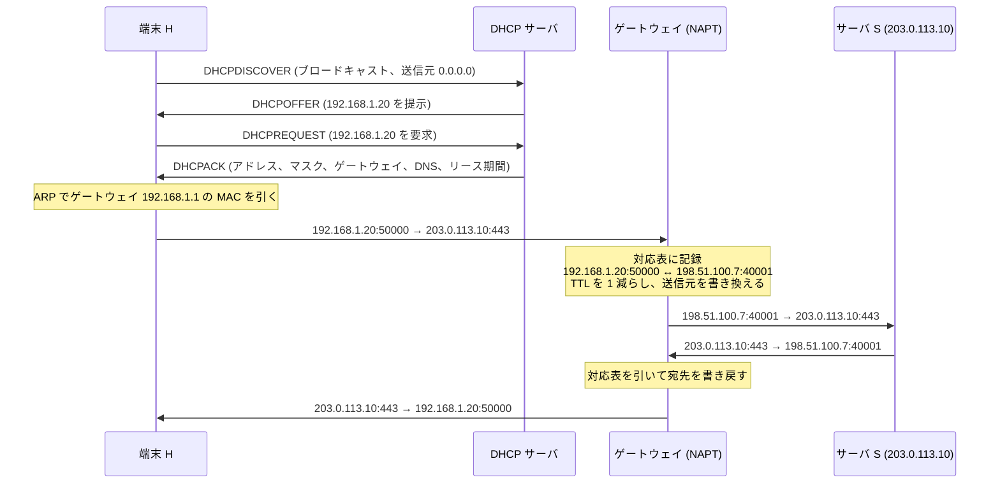

# IP の基礎 (IP Fundamentals: Addressing, Fragmentation, ICMP, DHCP, NAT & IPv6)

## 概要 (Overview)

本ドキュメントは [`ethernet-lan-switching.md`](ethernet-lan-switching.md) が扱った LAN の 1 段上、つまり LAN をまたいでパケットを届ける IP (Internet Protocol) の層を扱う。経路表の作り方 (OSPF・BGP) は [`ip-routing-bgp.md`](ip-routing-bgp.md) に、信頼性と輻輳制御は [`tcp-transport-congestion.md`](tcp-transport-congestion.md) に委ね、ここではその間にある道具立てを整理する。IPv4 のヘッダとアドレス、CIDR とサブネット、断片化と MTU、IP の制御チャネルである ICMP、アドレスを配る DHCP、アドレスを書き換える NAT、そして IPv6 である。

中心テーゼは、**IP の約束は「宛先アドレスに向けて、できる範囲で運ぶ」だけであり、IP の周辺で起きる問題の多くはこの最小の約束を補う仕組みのほうから生じる**ということである。IP は届くことも順序も保証しない代わりに、TTL によってループからは必ず抜け出す (L2 にはなかった性質である)。アドレスは世界で一意な識別子であると同時に、プレフィックスによって位置も表す。この単純さの上に、アドレス不足を補う NAT、MTU の違いを補う断片化と経路 MTU 探索、設定の手間を補う DHCP が積み重なった。

その結果は 3 つの形で現れる。(1) NAT は状態を持つ中間装置として、端末どうしが直接アドレスを指定し合えるという前提 (エンドツーエンド原則) を崩し、NAT 越えという別の技術体系を生んだ。(2) ICMP は IP の不具合を知らせる唯一の経路なのに、セキュリティ上の理由で一律に遮断されがちで、その遮断が「接続はできるのに大きなデータだけ届かない」障害を生む。(3) IPv6 はアドレス不足を根本から解消するが、IPv4 と並行して運用する期間が長く、両方の攻撃面を同時に抱える。本書は (1) IPv4 ヘッダ、(2) アドレッシングと CIDR、(3) 断片化と MTU、(4) ICMP、(5) DHCP、(6) NAT、(7) IPv6 の順に整理し、最後にこの層の攻撃面と防御を対で示す。分析深度は Level 3。

## 方法論 (Methodology)

- **一次資料**: IETF の RFC を中心にする。IPv4 は RFC 791、ICMP は RFC 792、DHCP は RFC 2131、CIDR は RFC 4632、プライベートアドレスは RFC 1918、NAT の挙動要件は RFC 4787、IPv6 は RFC 8200、断片化の評価は RFC 8900 (BCP 230) である。断片化の問題を最初に定式化した Kent & Mogul (1987) と、断片化を使った検知回避を示した Ptacek & Newsham (1998) も原典として参照する。
- **時期で変わる数値は日付を付ける**: IPv4 アドレスの枯渇の時期と IPv6 の普及率は、測る主体と定義によって値が違う。普及率は「何を数えたか (利用者の割合か、通信量の割合か)」と測定日を明記し、複数の測定の幅として示す。
- **担当範囲**: ルータの中の最長一致と経路表 (RIB/FIB) は [`ip-routing-bgp.md`](ip-routing-bgp.md)、クラウドの NAT ゲートウェイとプライベートアドレスの運用は [`virtual-networks-overlay.md`](virtual-networks-overlay.md) と [`../cloud/cloud-network-topology.md`](../cloud/cloud-network-topology.md)、ホストの中でのパケット処理は [`kernel-network-stack.md`](kernel-network-stack.md) に委ねる。本書はそれらが共通に前提にしている IP そのものの約束と、その約束を補う仕組みに集中する。
- 各機構を「IP の最小の約束のどこを補うか」と「補った結果として何が壊れやすくなったか」の対で説明し、攻撃と防御は必ず対で扱う。

## 発見事項 (Findings)

1. **IP の約束は最小限であり、TTL だけは確実に守る。** IP はパケットを失っても、順序を入れ替えても、重複させてもよい (ベストエフォート)。信頼性は上の層 (TCP) か、アプリケーションが担う。一方で TTL は経由したルータごとに 1 ずつ減り、0 になったパケットは捨てられる。経路表が一時的に食い違ってループができても、パケットは必ずどこかで消える。L2 のブロードキャストストームが IP では起きない理由はここにある。
2. **アドレスは識別子と位置を兼ねており、CIDR は位置の側を集約する仕組みである。** IPv4 アドレスは 32 ビットの一意な番号だが、上位のプレフィックスは「どのネットワークにいるか」を表す。CIDR (Classless Inter-Domain Routing) はクラスという固定の区切りを捨て、任意の長さのプレフィックスで経路をまとめられるようにした。同じアドレスが「誰か」と「どこか」を兼ねるため、端末が移動するとアドレスが変わり、アドレスを識別子として使うアプリケーションとの間に摩擦が生じる。
3. **NAT はアドレスを節約する代わりに、エンドツーエンド原則を崩した。** IANA の未割り当てプールは 2011 年 2 月に尽き、地域インターネットレジストリ (RIR) も 2011〜2019 年に通常の在庫を使い切った。不足を補ったのが、多数の端末に 1 つのグローバルアドレスを共有させる NAPT (Network Address and Port Translation) である。NAPT は内側から始まった通信の対応表を状態として持つため、外側から内側の端末を指定して通信を始めることはできない。ビデオ通話やゲームの P2P 通信が STUN・TURN・ICE という NAT 越えの仕組みを必要とするのはこのためである。
4. **NAT はファイアウォールではない。外から届かないのは、変換の副作用として状態がないからである。** 外側から始まった通信が内側に届かないのは、アドレスを変換したからではなく、対応表に記録がないからである。同じ効果はアドレスを変換しないステートフルファイアウォールで得られる。IPv6 で NAT がなくなると「外から丸見えになる」という懸念は、この 2 つを混同したところから来る (RFC 4864)。
5. **ICMP を一律に遮断すると、IP の不具合を知らせる経路そのものが失われる。** 経路 MTU 探索 (PMTUD: Path MTU Discovery) は、途中のルータが返す ICMP の「断片化が必要」メッセージで経路上の最小 MTU を知る。ファイアウォールがこれを捨てると、TCP の接続確立や小さなパケットは通るのに、MTU を超える最初の大きなパケットから先が届かなくなる (RFC 2923 が「PMTUD ブラックホール」と呼ぶ障害)。ICMP は攻撃にも使われるが、遮断する種類は選ばなければならない (RFC 4890)。
6. **断片化は仕様上は動くが、運用上は壊れやすい。** IPv4 のルータはパケットを分割して先へ送れるが、断片が 1 つでも失われればパケット全体が失われる。先頭以外の断片にはポート番号がないため、ファイアウォールや NAT は判断材料を失う。IETF は RFC 8900 で、断片化に頼らない設計を上の層に求めた。IPv6 はルータでの断片化そのものを廃止し、送信元だけが分割できるようにした。
7. **DHCP は時間で区切った貸し出しであり、認証を持たない。** DHCP はアドレスを「期限付きで貸す」。期限 (リース) の半分で更新を試み、更新できなければ期限切れで返す。サーバが落ちても、使われなくなったアドレスはいずれ回収される。一方で応答に認証がないため、同じ LAN にいる者は偽のゲートウェイや DNS サーバを配れる。防御は DHCP の外、スイッチの DHCP スヌーピングに頼る ([`ethernet-lan-switching.md`](ethernet-lan-switching.md))。
8. **IPv6 は利用者の約半数に届いたが、IPv4 との並行運用はまだ続く。** Google の測定では、同社のサービスに IPv6 で接続した利用者の割合が 2026 年 3 月 28 日に 50.10% に達した (Internet Society Pulse の 2026 年 4 月の報告による)。ただし国による差が大きく、別の測定主体の値はこれより低い。IPv6 は 128 ビットのアドレスだけでなく、固定長のヘッダ、ブロードキャストの廃止、アドレスの自動生成 (SLAAC) という設計の違いを持ち込んだ。並行運用の間は、IPv4 と IPv6 の両方の設定と攻撃面を管理しなければならない。

## アーキテクチャ (Architecture)

### 端末がインターネットに出るまで

家庭や社内の端末 H (プライベートアドレス) が、インターネット上のサーバ S に初めて接続するまでの流れを示す。

凡例: アドレスは文書用に予約された範囲 (RFC 5737 の 192.0.2.0/24・198.51.100.0/24・203.0.113.0/24) と RFC 1918 のプライベートアドレスを使っている。サーバ S はゲートウェイのアドレス 198.51.100.7 しか見ない。S から H に向けて新しく通信を始めようとしても、ゲートウェイの対応表に記録がないため届かない。

### IPv4 と IPv6 のヘッダの違い

| 項目 | IPv4 (RFC 791) | IPv6 (RFC 8200) | 変更の意味 |
|---|---|---|---|
| アドレス長 | 32 ビット | 128 ビット | 不足の解消。サブネットは通常 /64 |
| ヘッダ長 | 20〜60B (オプションで可変) | 40B 固定 | ルータの処理を単純にする。オプションは拡張ヘッダへ |
| ヘッダチェックサム | あり (ホップごとに再計算) | なし | リンク層と上位層のチェックサムに任せ、TTL を変えるたびの再計算をなくした |
| 寿命 | TTL | Hop Limit | 名前の変更。意味は同じ |
| 断片化 | 送信元とルータが行う | 送信元だけが行う (拡張ヘッダ) | ルータは大きすぎるパケットを捨てて ICMPv6 で知らせる |
| 最小 MTU | 68B (全ホストが再組み立てできる大きさは 576B) | 1280B | 経路 MTU が小さすぎる問題を下から抑えた |
| ブロードキャスト | あり | なし (マルチキャストで代替) | ARP の代わりに近隣探索 (NDP) を使う |
| フローラベル | なし | 20 ビット | 同じ流れのパケットに印を付ける (ECMP のハッシュなどに使う) |

### 特別な用途のアドレス (IPv4)

| 範囲 | 用途 | 根拠 |
|---|---|---|
| 10.0.0.0/8、172.16.0.0/12、192.168.0.0/16 | プライベートアドレス。インターネットには経路を広告しない | RFC 1918 |
| 100.64.0.0/10 | 通信事業者の NAT (CGN) の内側で使う共有アドレス | RFC 6598 |
| 169.254.0.0/16 | リンクローカル。DHCP で取得できないときの自動設定、クラウドのメタデータサービス | RFC 3927 |
| 127.0.0.0/8 | ループバック (自分自身) | RFC 6890 |
| 224.0.0.0/4 | マルチキャスト | RFC 6890 |
| 192.0.2.0/24、198.51.100.0/24、203.0.113.0/24 | 文書・例示用 | RFC 5737 |

特別な用途のアドレスは IANA の登録簿で管理されており、RFC 6890 がその枠組みを定めている。

## 技術詳細 (Technical Details)

### 1. IPv4 ヘッダと転送

- **ヘッダの項目** (RFC 791): バージョン (4)、ヘッダ長、DSCP/ECN (優先度と輻輳通知)、全長、断片化用の識別子・フラグ・断片オフセット、TTL、プロトコル番号、ヘッダチェックサム、送信元アドレス、宛先アドレスが並ぶ。プロトコル番号は上に載るものを示し、ICMP は 1、TCP は 6、UDP は 17 である。ECN を輻輳制御がどう使うかは [`tcp-transport-congestion.md`](tcp-transport-congestion.md) で、DSCP を網がどう扱い、どこで書き換えるかは [`qos-traffic-management.md`](qos-traffic-management.md) で扱う。
- **ルータが行うこと**: 宛先アドレスで経路表を最長一致で引き、次のホップを決める。TTL を 1 減らし、0 になれば捨てて送信元に ICMP の時間超過を返す。TTL が変わるので、ヘッダチェックサムを計算し直す。次のホップへのリンクが Ethernet なら、ARP で次のホップの MAC アドレスを引いてフレームに包む。IP の宛先は端から端まで変わらず、MAC の宛先だけがホップごとに変わる。
- IP のベストエフォートとは、パケットが届いたかを確かめず、届かなかったことも必ず知らせるわけではない、という意味である。ICMP のエラーは「届けられなかったことを知らせられる場合には知らせる」補助であり、ICMP が返ってこないことは届いたことを意味しない。

### 2. アドレッシングと CIDR

- **プレフィックスとホスト部**: アドレスを上位のプレフィックス (ネットワーク部) と下位のホスト部に分け、境界を `/26` のようなプレフィックス長かサブネットマスク (255.255.255.192) で示す。同じプレフィックスを持つ宛先へは直接 (ARP で) 届け、違う宛先はデフォルトゲートウェイに渡す。この判断がホストの経路選択のすべてである。
- **計算の例**: 192.168.10.0/26 はホスト部が 6 ビットなので 2^6 = 64 個のアドレスを持つ。範囲は 192.168.10.0〜192.168.10.63 である。先頭の .0 はネットワークそのもの、末尾の .63 はブロードキャストに使うため、ホストに割り当てられるのは 62 個になる。同じ /24 を /26 で 4 つに分ければ、.0/26、.64/26、.128/26、.192/26 の 4 サブネットになる。2 台しかつながらないルータ間のリンクでは、ネットワークとブロードキャストのアドレスを省いた /31 を使える (RFC 3021)。
- **クラスから CIDR へ**: 初期の IPv4 はアドレスの先頭ビットでクラス A (/8)・B (/16)・C (/24) を決めていた。中規模の組織には C では小さく B では大きすぎ、B の割り当てがアドレスを急速に消費した。1993 年に導入された CIDR (現行の仕様は RFC 4632) はクラスを廃止し、必要な大きさのプレフィックスを割り当てると同時に、隣り合うプレフィックスを 1 つの経路にまとめられるようにした。経路表の規模の問題とその後の推移は [`ip-routing-bgp.md`](ip-routing-bgp.md) を参照。
- **枯渇の経緯**: IANA の未割り当てプールは 2011 年 2 月に尽きた。1 月 31 日に APNIC へ 2 つの /8 ブロックが配られ、2 月 3 日に最後の 5 つが 5 つの RIR に 1 つずつ配られた (RIPE NCC は 2 月 3 日を枯渇の日として告知している。どちらの日を枯渇とみなすかで、資料の日付が数日異なる)。各 RIR の通常の在庫は、APNIC が 2011 年 4 月、LACNIC が 2014 年 6 月、ARIN が 2015 年 9 月、AFRINIC が 2017 年 4 月、RIPE NCC が 2019 年 11 月に尽きた。現在の新規需要は回収したアドレスの再配布、アドレスの売買、NAT による共有で賄われている。
- **アドレス計画の失敗の形**: プライベートアドレスはどの組織も同じ範囲を使うため、組織の統合や VPN 接続、クラウドとの接続でアドレスが重複する。後から番号を振り直すのは高くつくため、重複を避けるアドレス計画が先に要る ([`../cloud/cloud-network-topology.md`](../cloud/cloud-network-topology.md))。

### 3. 断片化と MTU

- **IPv4 の断片化**: パケットが次のリンクの MTU より大きく、DF (Don't Fragment) ビットが立っていなければ、ルータはパケットを分割する。各断片は元のパケットと同じ識別子を持ち、断片オフセット (8B 単位) と「まだ続く」を示す MF ビットで位置を示す。再組み立ては最終的な宛先だけが行い、途中のルータは行わない。
- 断片化が壊れやすい理由は 4 つある。(1) 断片が 1 つでも失われるとパケット全体を送り直すことになり、損失率が断片の数だけ増える (Kent & Mogul 1987 の指摘)。(2) TCP・UDP のポート番号は先頭の断片にしかないため、ポートで判断するファイアウォールや NAT、負荷分散装置は 2 番目以降の断片を正しく扱えない。(3) 受信側は全断片がそろうまでメモリを確保して待つため、再組み立ての資源を狙った攻撃の対象になる。(4) 識別子は 16 ビットしかなく、高速なリンクでは短時間で一巡して別のパケットの断片と混ざる危険がある。RFC 8900 (2020 年) はこれらを整理し、断片化を廃止はしないものの、上位層が自分で大きさを調整し、IP の断片化には頼らないことを求めた。
- **経路 MTU 探索** (PMTUD、IPv4 は RFC 1191、IPv6 は RFC 8201): 送信元は DF ビットを立てて送り、途中で MTU を超えたルータは「断片化が必要 (IPv6 では Packet Too Big)」の ICMP を、次のリンクの MTU を添えて返す。送信元はこれを受けて大きさを下げる。ICMP が途中で捨てられると、送信元は大きさを下げる理由を知らないまま送り直し続ける (RFC 2923 の PMTUD ブラックホール)。
- **ICMP に頼らない対策**: パケット化層の経路 MTU 探索 (PLPMTUD、RFC 4821 / RFC 8899) は、ICMP を待たずに大きさを変えた試験パケットを送り、届いたかどうかで MTU を推定する。トンネルや PPPoE の手前のルータが、通過する TCP の SYN に書かれた MSS (Maximum Segment Size) を書き換えて小さくする MSS クランプも広く使われている。オーバーレイのヘッダが MTU を削る問題は [`virtual-networks-overlay.md`](virtual-networks-overlay.md) で扱う。

### 4. ICMP

- **主なメッセージ** (ICMP は RFC 792、ICMPv6 は RFC 4443): エコー要求・エコー応答 (ping)、宛先到達不能 (ネットワーク・ホスト・ポートに届かない、断片化が必要など、コードで理由を区別する)、時間超過 (TTL が 0 になった)、リダイレクト (同じリンク上により良い次ホップがあると知らせる) がある。ICMP は IP の上に載るが、IP の一部として実装される。
- **traceroute の仕組み**: TTL を 1、2、3 と増やしながらパケットを送ると、TTL が尽きた地点のルータが時間超過を返す。その送信元を並べると経路上のルータが分かる。ルータが ICMP の生成を制限していたり、行きと帰りで経路が違ったりするため、表示される経路と遅延は目安である。
- IPv6 では ICMPv6 が必須である。IPv6 は ARP を廃して ICMPv6 の近隣探索 (NDP、RFC 4861) を使い、ルータ広告もアドレス自動設定も ICMPv6 で行う。経路 MTU 探索も ICMPv6 の Packet Too Big に頼る。IPv4 の感覚で ICMPv6 を一律に遮断すると、近隣探索と MTU の調整ができずに通信が成り立たなくなる。RFC 4890 は ICMPv6 のうち通さなければならないもの、通すべきもの、捨ててよいものを種類ごとに分類している。
- **生成の制限**: ルータは ICMP エラーの送信頻度を制限する (RFC 4443 は ICMPv6 エラーの送信レート制限を必須としている)。攻撃者が大量のエラーを誘発してルータの CPU を消費させるのを防ぐためである。制限があるため、ICMP が返ってこないことから「経路上で捨てられた」と断定はできない。

### 5. DHCP

- **4 段階のやり取り** (RFC 2131): 端末はまだアドレスを持たないため、送信元 0.0.0.0、宛先 255.255.255.255 のブロードキャストで DHCPDISCOVER を送る。サーバが DHCPOFFER で候補のアドレスを示し、端末が DHCPREQUEST で 1 つを選び、サーバが DHCPACK で確定する。UDP を使い、サーバ側は 67 番、端末側は 68 番のポートである。DHCPACK には、アドレスのほかにサブネットマスク、デフォルトゲートウェイ、DNS サーバ、リース期間などがオプションとして載る。
- **リースと更新**: アドレスは期限付きの貸し出しである。端末はリース期間の半分 (T1、既定値はリース期間 × 0.5) で、借りたサーバに直接更新を求める。応答がなければ、期間の 87.5% (T2) でどのサーバにでも届くようにブロードキャストで更新を求める。期限までに更新できなければアドレスを手放す。サーバ側の記録が失われても、使われなくなったアドレスはリースが切れれば回収される。状態を永続させず、時間で必ず消える状態 (ソフトステート) にしておく設計である。
- **重複の確認**: RFC 2131 は、サーバがアドレスを提示する前に、そのアドレスが使われていないことを ICMP のエコー要求などで確かめるべき (SHOULD) としている。端末の側でも、受け取ったアドレスを使う前に ARP で重複を確かめる (RFC 5227 の ARP プローブ。[`ethernet-lan-switching.md`](ethernet-lan-switching.md) を参照)。
- **リレーエージェント**: ブロードキャストはルータを越えないため、サブネットごとにサーバを置かずに済むよう、ルータが DHCP の要求を中継する。中継するルータは自分のアドレスを giaddr 欄に書き、サーバはその値でどのサブネットのアドレスを配るかを決める。オプション 82 (RFC 3046) を使えば、要求がどのスイッチのどのポートから来たかも伝えられる。
- **IPv6 の場合**: IPv6 では、ルータ広告に従って端末が自分でアドレスを作る SLAAC (§7) が基本で、DHCPv6 (RFC 8415) はアドレスの管理を集中させたい場合や、DNS サーバなどの追加情報を配る場合に使う。

### 6. NAT と NAPT

- **2 つの形** (RFC 3022): 内側のアドレスと外側のアドレスを 1 対 1 で書き換える基本の NAT と、ポート番号まで書き換えて多数の内側の端末に 1 つの外側アドレスを共有させる NAPT がある。家庭のルータやクラウドの NAT ゲートウェイの「NAT」は、ほぼすべて後者である。NAPT は (内側のアドレス, 内側のポート) と (外側のアドレス, 外側のポート) の対応を、通信ごとに表に記録する。
- **ポートの上限**: ポート番号は 16 ビットなので、外側の 1 アドレスで同時に使える対応は、プロトコルごと・宛先ごとにおよそ 6 万 4 千個が上限になる。多数の端末が同じ宛先へ大量に接続するとポートが尽き、新しい接続が作れなくなる (ポート枯渇)。端末側の OS が送信元に使う一時ポートの範囲も有限で、IANA の定める動的ポートは 49152〜65535 (RFC 6335)、Linux の既定値は 32768〜60999 である。
- **挙動の違いと要件** (UDP は RFC 4787、TCP は RFC 5382): NAT の挙動は対応の作り方 (マッピング) と、外から届くパケットの通し方 (フィルタリング) の 2 軸で分類される。RFC 4787 は内側の同じアドレスとポートには宛先によらず同じ外側のポートを使う「エンドポイント非依存マッピング」を必須とした (REQ-1)。NAT 越えの技術がこの性質に頼っているためである。ほかに、UDP の対応を 2 分未満で消してはならないこと (REQ-5。既定値は 5 分以上を推奨)、内側の端末どうしが外側のアドレスで互いを指定したときに折り返して届けること (ヘアピン、REQ-9) を求めている。
- **アプリケーションへの影響**: FTP のように本文中に IP アドレスを書くプロトコルは、NAT が本文まで書き換えないと動かない。そのための書き換え機能 (ALG: Application Level Gateway) は、暗号化された通信には効かない。Linux での ALG (conntrack の helper) の実装と、それが既定で無効にされた経緯は [`packet-filtering-conntrack.md`](packet-filtering-conntrack.md) で扱う。P2P の通信では STUN (RFC 8489) で外側から見える自分のアドレスとポートを調べ、ICE (RFC 8445) で候補の経路を試し、直接つながらなければ TURN (RFC 8656) の中継サーバを使う。
- **通信事業者の NAT** (CGN、RFC 6888): IPv4 アドレスが足りない通信事業者は、加入者にも 100.64.0.0/10 の共有アドレス (RFC 6598) を配り、事業者の設備で NAPT を行う。加入者の家庭のルータでも NAPT をかけると、変換が 2 段になる。1 つのグローバルアドレスを多数の加入者が共有するため、不正アクセスの調査ではアドレスと時刻だけでは利用者を特定できない。そのため、サーバ側でも送信元ポートを記録することが推奨されている (RFC 6302)。
- **クラウドでの形**: クラウドの NAT ゲートウェイは同じ NAPT を分散システムとして実装したもので、対応表という状態を持つために課金とスケールの上限がある。その構造は [`virtual-networks-overlay.md`](virtual-networks-overlay.md) で扱う。

### 7. IPv6

- **アドレスの表記と種類**: 128 ビットを 16 ビットずつ 8 つに区切り、16 進数で書く。先頭の 0 は省略でき、0 が続く区間は 1 か所だけ `::` で縮められる。表記を一意にする規則は RFC 5952 が定める (例: `2001:db8::1`。2001:db8::/32 は文書用)。リンクの中だけで使うリンクローカル (fe80::/10)、組織内で使うユニークローカル (ULA、fc00::/7、RFC 4193)、インターネットで使うグローバルユニキャスト (現在は 2000::/3 から割り当て) がある。1 つのインターフェースが複数のアドレスを同時に持つのが普通である。
- **/64 と SLAAC**: サブネットのプレフィックスは通常 /64 で、残りの 64 ビットがインターフェース識別子になる。端末はルータ広告 (RA) でプレフィックスを知り、インターフェース識別子を自分で決めてアドレスを作る (SLAAC: Stateless Address Autoconfiguration、RFC 4862)。かつてはインターフェース識別子を MAC アドレスから作っていたため、場所が変わっても同じ下位 64 ビットで端末を追跡できた。現在は、ランダムな識別子を一定期間ごとに作り直す一時アドレス (RFC 8981) を使うのが一般的である。
- **ヘッダの単純化** (RFC 8200): ヘッダは 40B の固定長で、オプションは「次ヘッダ」の欄で数珠つなぎにする拡張ヘッダに移した。ヘッダチェックサムは廃止した。ルータは断片化を行わず、MTU を超えるパケットは捨てて ICMPv6 の Packet Too Big を返す。全リンクの MTU は 1280B 以上でなければならない。断片化が必要なら、送信元が断片化用の拡張ヘッダを付けて行う。
- **ブロードキャストの廃止**: IPv6 にはブロードキャストがなく、近隣探索はマルチキャストで行う ([`ethernet-lan-switching.md`](ethernet-lan-switching.md))。全端末に届く送信がなくなったことで、無関係な端末の処理負荷が減った。
- **移行の仕組み**: 現在の主流は、端末が IPv4 と IPv6 の両方を持つデュアルスタックである。両方で接続できる相手には IPv6 を少しだけ先に試し、つながらなければ IPv4 に切り替える Happy Eyeballs (現行版は RFC 8305) を使う。IPv6 のつながりの悪さが利用者の待ち時間にならないようにするための工夫である。IPv6 だけの網から IPv4 のサーバに届ける方式として、NAT64 (RFC 6146) と DNS64 (RFC 6147)、端末側の変換を組み合わせた 464XLAT (RFC 6877) がある。後者は IPv6 だけのモバイル網で広く使われている。
- **普及の状況** (2026-10-18 時点で確認した値): Google の測定では、同社のサービスに IPv6 で接続した利用者の割合が 2026 年 3 月 28 日に 50.10% となった。前年 6 月にも 49.56% まで近づいたあと 50% を下回っていた (Internet Society Pulse、2026 年 4 月 21 日)。同じ報告は国による差を示しており、フランスやインドが 70% を超える一方、10% 前後の国もある。Cloudflare や APNIC など測定主体によって値は異なり、Pulse が複数の測定を平均した値は約 43% である。「利用者の割合」と「通信量の割合」は別の量であり、どちらの値かを区別して読む必要がある。

## セキュリティ考察 (Security Considerations)

IP は送信元アドレスを検証しない。ICMP と DHCP は認証を持たない。NAT は状態を持つ。この層の攻撃の多くは、この 3 つの性質のどれかを突く。

| 攻撃 | 何を悪用するか | 主な防御 |
|---|---|---|
| 送信元アドレスの偽装 | IP は送信元アドレスを確かめない | 入口でのフィルタリング (BCP 38 / RFC 2827)、uRPF (RFC 3704) |
| 反射・増幅型の DDoS | 偽装した送信元に、要求より大きな応答を返させる | 偽装の防止、増幅に使えるサービス (オープンリゾルバなど) を閉じる、レート制限 |
| Smurf 攻撃 | ブロードキャスト宛ての ICMP エコー要求に全端末が応答する | ルータで指示付きブロードキャストを転送しない (RFC 2644 で既定値を変更) |
| ICMP リダイレクトの悪用 | 偽のリダイレクトで経路を書き換えさせる | 端末でリダイレクトを受け入れない設定 |
| 断片化を使った攻撃と検知回避 | 重なる断片、再組み立ての資源、IDS と端末の再組み立ての違い | 重なる断片の破棄 (IPv6 は RFC 5722 で禁止)、断片の正規化、再組み立てのタイムアウトと上限 |
| DHCP の枯渇・なりすまし | 偽の MAC アドレスでアドレスを使い切る、偽のサーバで偽のゲートウェイを配る | DHCP スヌーピング、ポートあたりの要求数の制限 ([`ethernet-lan-switching.md`](ethernet-lan-switching.md)) |
| IPv6 の見落とし | OS が既定で IPv6 を有効にしており、IPv4 だけを監視・制御している | IPv6 にも同じポリシーを適用する、使わないなら無効にする |
| 不正なルータ広告 | RA に認証がなく、偽のデフォルトルータやプレフィックスを配れる | RA Guard (RFC 6105) |

- 偽装の防止は、自分のためではなく他人のための対策である。BCP 38 はネットワークの入口で「その接続の先にあるはずのない送信元アドレス」を持つパケットを捨てることを求める。これを行っても自分のネットワークが守られるわけではなく、自分のネットワークが他人への攻撃の発射台になるのを防ぐ。導入の動機が弱いため普及は遅く、CAIDA の Spoofer プロジェクトに基づく Internet Society の 2013 年の推計では、観測された AS の約 25% が偽装を許していた。この値は 2005〜2013 年の測定にもとづくもので、現在の値は Spoofer プロジェクトの公開データで AS 別・国別に確かめる必要がある。偽装できる限り、反射型の DDoS は成り立ち続ける。
- ICMP は捨てる種類を選ぶ。Smurf やリダイレクトの悪用を理由に ICMP を一律に遮断すると、PMTUD が動かなくなる (技術詳細 §3)。外向きの「断片化が必要 / Packet Too Big」と時間超過は通し、リダイレクトは受け入れない、といった種類ごとの判断が要る。IPv6 では近隣探索も ICMPv6 なので、一律の遮断は通信そのものを止める (RFC 4890)。
- 断片化は検知を逃れる手段になる。IDS と保護対象の端末が、重なり合う断片をそれぞれ違う規則で組み立てると、IDS が見たデータと端末が受け取ったデータが食い違う。Ptacek & Newsham (1998) はこれを挿入 (insertion) と回避 (evasion) として体系化した。対策は IDS やファイアウォールの手前で断片を組み立て直して正規化するか、重なる断片を捨てることである。
- NAT は防御の層として数えない。NAPT の内側に外から届かないのは対応表がないからで、内側から一度でも通信を始めれば、その対応を通って応答が戻る。マルウェアが外へ接続する通信や、UPnP でルータに穴を開ける通信は止められない。IPv6 でグローバルアドレスを端末に配るときは、明示的なステートフルファイアウォールを置く (RFC 4864)。
- IPv6 の走査は難しいが不可能ではない。/64 のサブネットには 2^64 個のアドレスがあり、IPv4 のように総当たりで端末を探すのは現実的でない。ただし、手で設定した短いアドレス (::1 など)、MAC アドレスから作った識別子、DNS の逆引きなどから候補を絞れる (RFC 7707)。走査されにくさを前提にした防御は、アドレスの付け方を変えるだけで崩れる。
- CGN の下では、追跡に送信元ポートが要る。1 つのアドレスを多数の利用者が共有すると、サーバのログにアドレスと時刻しかなければ、攻撃の発信元を事業者に照会しても特定できない。RFC 6302 は、インターネットに公開するサーバが送信元ポートと正確な時刻も記録することを推奨している。

## 結論 (Conclusions)

- IP は「宛先に向けて、できる範囲で運ぶ」ことしか約束せず、TTL によってループからだけは確実に抜け出す。アドレスは識別子と位置を兼ね、CIDR はその位置の側をまとめて経路表を小さく保つ。
- アドレス不足を補った NAPT は、状態を持つことでエンドツーエンド原則を崩し、NAT 越え、ポート枯渇、ログでの利用者特定という新しい問題を生んだ。外から届かないことは状態がないことの副作用であって、ファイアウォールの代わりにはならない。
- MTU の違いを補う断片化は運用上壊れやすく、現在の設計は断片化を避けて経路 MTU を探る方向にある。その探索は ICMP に頼っているため、ICMP の一律の遮断は自分の通信を壊す。DHCP は時間で必ず消える貸し出しとして障害に強い一方、認証を持たず、防御を L2 に頼る。
- IPv6 はアドレス不足を解消し、ヘッダを単純にし、ブロードキャストをなくした。利用者の約半数が IPv6 で接続するようになったが、並行運用の間は IPv4 と IPv6 の両方を同じ水準で管理しなければならない。

### 次の接続先 (Related Topics)

- [`ethernet-lan-switching.md`](ethernet-lan-switching.md) — IP の下の層。ARP、近隣探索の L2 側、DHCP スヌーピングと RA Guard。
- [`ip-routing-bgp.md`](ip-routing-bgp.md) — 最長一致の経路表を誰がどう作るか。CIDR の集約と経路表の規模。
- [`tcp-transport-congestion.md`](tcp-transport-congestion.md) — IP のベストエフォートの上で信頼性を作る層。MSS と ECN の受け側。
- [`dns-resolution.md`](dns-resolution.md) — 名前からアドレスを引く仕組みと、反射・増幅型 DDoS に使われるオープンリゾルバ。
- [`virtual-networks-overlay.md`](virtual-networks-overlay.md) — クラウドの NAT ゲートウェイ、プライベートアドレス、カプセル化による MTU の削減。
- [`../cloud/cloud-network-topology.md`](../cloud/cloud-network-topology.md) — 複数の VPC とオンプレミスをつなぐときのアドレス計画と重複。
- [`kernel-network-stack.md`](kernel-network-stack.md) — ホストの中で IP パケットを受け取り、組み立て、上の層に渡す経路。

## 参考文献 (References)

**一次資料 (RFC・原典論文)**

- Postel, J. (1981). Internet Protocol. *RFC 791*. — IPv4 のヘッダ、断片化、TTL。
- Postel, J. (1981). Internet Control Message Protocol. *RFC 792*. — ICMP のメッセージ形式。
- Droms, R. (1997). Dynamic Host Configuration Protocol. *RFC 2131*. — DHCP の 4 段階のやり取り、リース、T1/T2 の既定値、リレーエージェント。
- Rekhter, Y., Moskowitz, B., Karrenberg, D., de Groot, G. J., & Lear, E. (1996). Address Allocation for Private Internets. *RFC 1918*.
- Fuller, V., & Li, T. (2006). Classless Inter-domain Routing (CIDR): The Internet Address Assignment and Aggregation Plan. *RFC 4632*.
- Cotton, M., Vegoda, L., Bonica, R., & Haberman, B. (2013). Special-Purpose IP Address Registries. *RFC 6890*.
- Weil, J., Kuarsingh, V., Donley, C., Liljenstolpe, C., & Azinger, M. (2012). IANA-Reserved IPv4 Prefix for Shared Address Space. *RFC 6598*.
- Mogul, J., & Deering, S. (1990). Path MTU Discovery. *RFC 1191*. / McCann, J., Deering, S., Mogul, J., & Hinden, R. (2017). Path MTU Discovery for IP version 6. *RFC 8201*.
- Lahey, K. (2000). TCP Problems with Path MTU Discovery. *RFC 2923*. — PMTUD ブラックホールの原因と症状。
- Mathis, M., & Heffner, J. (2007). Packetization Layer Path MTU Discovery. *RFC 4821*.
- Bonica, R., Baker, F., Huston, G., Hinden, R., Troan, O., & Gont, F. (2020). IP Fragmentation Considered Fragile. *RFC 8900* (BCP 230).
- Kent, C. A., & Mogul, J. C. (1987). Fragmentation Considered Harmful. *ACM SIGCOMM Computer Communication Review*, 17(5), 390–401. https://doi.org/10.1145/55483.55524
- Srisuresh, P., & Egevang, K. (2001). Traditional IP Network Address Translator (Traditional NAT). *RFC 3022*.
- Audet, F., & Jennings, C. (2007). Network Address Translation (NAT) Behavioral Requirements for Unicast UDP. *RFC 4787* (BCP 127). — マッピングとフィルタリングの分類、REQ-1・REQ-5・REQ-9。
- Perreault, S., Yamagata, I., Miyakawa, S., Nakagawa, A., & Ashida, H. (2013). Common Requirements for Carrier-Grade NATs (CGNs). *RFC 6888*.
- Durand, A., Gashinsky, I., Lee, D., & Sheppard, S. (2011). Logging Recommendations for Internet-Facing Servers. *RFC 6302*.
- Petit-Huguenin, M., Salgueiro, G., Rosenberg, J., Wing, D., Mahy, R., & Matthews, P. (2020). Session Traversal Utilities for NAT (STUN). *RFC 8489*. / Keranen, A., Holmberg, C., & Rosenberg, J. (2018). Interactive Connectivity Establishment (ICE). *RFC 8445*. / Reddy, T., et al. (2020). Traversal Using Relays around NAT (TURN). *RFC 8656*.
- Cotton, M., Eggert, L., Touch, J., Westerlund, M., & Cheshire, S. (2011). Internet Assigned Numbers Authority (IANA) Procedures for the Management of the Service Name and Transport Protocol Port Number Registry. *RFC 6335*.
- Deering, S., & Hinden, R. (2017). Internet Protocol, Version 6 (IPv6) Specification. *RFC 8200*.
- Conta, A., Deering, S., & Gupta, M. (2006). Internet Control Message Protocol (ICMPv6) for the Internet Protocol Version 6 (IPv6) Specification. *RFC 4443*.
- Thomson, S., Narten, T., & Jinmei, T. (2007). IPv6 Stateless Address Autoconfiguration. *RFC 4862*. / Gont, F., Krishnan, S., Narten, T., & Draves, R. (2021). Temporary Address Extensions for Stateless Address Autoconfiguration in IPv6. *RFC 8981*.
- Schinazi, D., & Pauly, T. (2017). Happy Eyeballs Version 2: Better Connectivity Using Concurrency. *RFC 8305*.
- Bagnulo, M., Matthews, P., & van Beijnum, I. (2011). Stateful NAT64. *RFC 6146*. / Mawatari, M., Kawashima, M., & Byrne, C. (2013). 464XLAT: Combination of Stateful and Stateless Translation. *RFC 6877*.
- Davies, E., & Mohacsi, J. (2007). Recommendations for Filtering ICMPv6 Messages in Firewalls. *RFC 4890*.
- Van de Velde, G., Hain, T., Droms, R., Carpenter, B., & Klein, E. (2007). Local Network Protection for IPv6. *RFC 4864*.
- Ferguson, P., & Senie, D. (2000). Network Ingress Filtering: Defeating Denial of Service Attacks which employ IP Source Address Spoofing. *RFC 2827* (BCP 38).
- Gont, F., & Chown, T. (2016). Network Reconnaissance in IPv6 Networks. *RFC 7707*.
- Ptacek, T. H., & Newsham, T. N. (1998). *Insertion, Evasion, and Denial of Service: Eluding Network Intrusion Detection*. Secure Networks, Inc. Technical Report. — 断片化と再組み立ての違いを使った IDS 回避の体系化。

**普及と枯渇の状況 (時期で変わる値)**

- [18 Years Later, IPv6 Reaches Majority, Internet Society Pulse (2026-04-21)](https://pulse.internetsociety.org/en/blog/18-years-later-ipv6-reaches-majority/) — Accessed: 2026-10-18。Google の測定で 2026-03-28 に 50.10%、国別の差、複数測定の平均約 43%。
- [IPv6 Statistics, Google](https://www.google.com/intl/en/ipv6/statistics.html) — Accessed: 2026-10-18。Google のサービスに IPv6 で接続した利用者の割合の推移。
- [IPv4 Address Report, APNIC Labs (Geoff Huston)](https://labs.apnic.net/ipv4/report.html) — Accessed: 2026-10-18。各 RIR の在庫が尽きた日付。
- [IPv4 Exhaustion: RIPE NCC Update, RIPE NCC Services WG mailing list](https://mailman.ripe.net/archives/list/ncc-services-wg@ripe.net/thread/DFP6XPIK76YVA3H4L66NQEXARWYQ2W5I/) — Accessed: 2026-10-18。IANA の未割り当てプールが 2011-02-03 に尽きたことの告知。
- [Spoofer, CAIDA](https://spoofer.caida.org/summary.php) — Accessed: 2026-10-18。送信元アドレスの偽装が可能なネットワークの AS 別・国別の測定。
- [Initial Longitudinal Analysis of IP Source Spoofing Capability on the Internet, Internet Society (2013)](https://www.internetsociety.org/resources/doc/2013/initial-longitudinal-analysis-of-ip-source-spoofing-capability-on-the-internet/) — Accessed: 2026-10-18。AS の約 25% が偽装を許すという推計。
