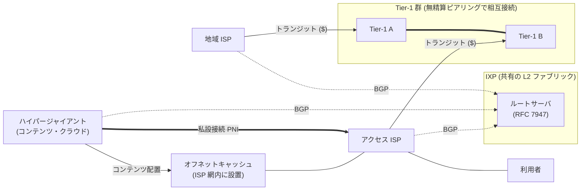

# IP ルーティングと BGP (IP Routing & BGP)

## 概要 (Overview)

IP の転送は、突き詰めれば一つの原語に還元される。それは、宛先アドレスに対する**最長一致 (longest-prefix match, LPM)** である。ルータは経路表からもっとも長く一致するプレフィックスを選び、対応する次ホップへパケットを渡す。それだけだ。問題は「その経路表を誰がどう作るか」であり、ここでインターネットは根本的に二層に割れる: 一組織の内側 (IGP) と、約 7〜8 万の**自律システム (Autonomous System, AS)** をまたぐ外側 (EGP) である。

外側を担う **BGP (Border Gateway Protocol)** は、しばしば「インターネットの経路制御プロトコル」と紹介されるが、その本質は最短経路探索ではない。BGP は**各 AS が自らの商業的・政策的意思を経路選択として実行するための機構**であり、インターネット全体の経路は誰も設計していない。7 万の AS がローカルポリシーを適用した結果の**創発**である。それが発散せずに収束するのは技術的保証ではなく、顧客・プロバイダ・ピアという経済関係が偶然にも安定条件 (Gao–Rexford) を満たしているからにすぎない。

その経済関係そのもの、つまり誰が誰にいくら払って接続するかも本書の対象である。対象はトランジット (transit) と無精算ピアリング (settlement-free peering)、有料ピアリング (paid peering)、IXP (Internet Exchange Point) のルートサーバ、そして事業者の階層を飛び越えるハイパージャイアント (hypergiant) のオフネットキャッシュである。教科書の「Tier-1 を頂点とする階層」は 2010 年前後から平坦化し、2009 年 7 月には 150 の AS がドメイン間トラフィックの半分以上を発信していた (Labovitz et al. 2010)。経路制御の技術はこの商取引の上で動いている。

もう一つの主題は信頼である。BGP は「隣接ルータの広告は正しい」と無条件に信じる 1980 年代の設計を引きずり、**経路ハイジャック (prefix hijacking)** と**経路リーク (route leak)** は運用事故としても攻撃としても現実に起き続けている。RPKI による部分的修復、BGPsec の不発、そしてフィルタリングという地道な運用が支える現状までを扱う。2026 年には ROV (Route Origin Validation) で有効と判定される経路が約 7 割に達したが、起点を偽った攻撃と経路リークは ROV では止まらず、AS_PATH を検証する ASPA はまだ Internet-Draft の段階にある。

データセンター内部の BGP (RFC 7938・ECMP・BGP unnumbered・BFD・ADD-PATH の詳細・TCP-AO と GTSM) は [`dc-fabric-routing.md`](dc-fabric-routing.md)、MPLS・Segment Routing・高速迂回・L3VPN は [`mpls-segment-routing.md`](mpls-segment-routing.md)、RTBH と Flowspec は [`ddos-mitigation.md`](ddos-mitigation.md)、エニーキャストによる要求の振り分けは [`cdn-edge-delivery.md`](cdn-edge-delivery.md)、設定の検証と Facebook 2021 年の障害は [`network-verification-telemetry.md`](network-verification-telemetry.md)、クラウド事業者のバックボーンは [`../cloud/cloud-network-topology.md`](../cloud/cloud-network-topology.md) に委ねる。分析深度は Level 3。

## 方法論 (Methodology)

- 「転送 (データプレーン)」と「経路計算 (制御プレーン)」を峻別し、LPM・RIB/FIB という転送側の原語を先に固定してから、経路表を作る側 (IGP → BGP) を積み上げる。
- BGP は仕様 (RFC 4271) の逐条ではなく、**「なぜ経路ベクトルか」「なぜ収束するか」「なぜ信頼が壊れているか」** という3つの問いを軸に分析する。安定性の議論は Gao–Rexford の原論文に、ポリシーの実像は Caesar–Rexford のサーベイに基づく。
- 経路表の規模など時事性の高い数値は時点を明記する。年末の値は Huston の年次報告 (BGP in 2025、2026 年 1 月)、直近の値は CIDR Report (2026 年 11 月 7 日の生成分) で確かめ、両者の差は測定点と時点の違いとして扱う。
- **相互接続**: 平坦化は Labovitz et al. (SIGCOMM 2010) と Arnold et al. (IMC 2020)、IXP の規模は Ager et al. (SIGCOMM 2012)、オフネットキャッシュは Netflix Open Connect の公式文書と Böttger et al. (CCR 2018) に基づく。ネットワーク利用料の議論は Internet Society の報告と報道で 2026 年 11 月時点の状況を確かめた。政策論争は利害関係者の主張が中心なので、立場を明示して引く。
- **経路のセキュリティ**: RFC の発行日と状態は rfc-editor.org と datatracker で確認した (ASPA の Draft は 2026 年 11 月 4 日の状態)。ROV の普及率は NIST RPKI Monitor の値 (ARIN 58 の資料、2026 年 10 月 2 日取得) と IPinfo の集計 (2026 年 9 月 28 日) を突き合わせる。両者は数え方が違う (プレフィックス数と IPv4 アドレス数) ので、範囲で示す。
- **事件**: RIPE NCC (2008 年)、Cloudflare (2019 年)、MANRS (2020 年・2022 年)、Kentik と Coinbase (2018 年・2022 年) の事後分析を一次資料とする。被害額は事業者自身の発表か事後分析の推計であり、独立した検証はない。
- クラウド専用線接続 (Direct Connect 型) を終点に置き、「一般の技術者が BGP に実際に触れる場面」へ着地させる。

## 発見事項 (Findings)

1. **転送の原語は最長一致ただ一つであり、経路制御の複雑さはすべて「表を作る側」にある。** ルータは **RIB (Routing Information Base)** で複数プロトコルの候補を保持し、勝者だけを **FIB (Forwarding Information Base)** に落とす。この RIB/FIB 分離が「重い政策判断」と「ナノ秒の表引き」を両立させる。FIB 側の物理は [`../../hardware/networking/nic-switch-architecture.md`](../../hardware/networking/nic-switch-architecture.md) の TCAM/LPM 専用構造、ホスト側は [`kernel-network-stack.md`](kernel-network-stack.md) の IP 層ルーティング判定である。
2. **CIDR は経路表爆発への応急処置であり、その効果は経済的動機 (マルチホーミング・トラフィック制御) による非集約で常に侵食されている。** デフォルトフリーゾーン (DFZ) の IPv4 経路表は 2025 年末に**約 104〜105 万経路** (Huston)、2026 年 11 月 7 日には 1,090,028 経路 (CIDR Report) に達し、TCAM 容量という「シリコンの予算」を直撃する。その約半分 (51.8%) は集約できたはずのより特定的なプレフィックス (more-specific) である。集約の失敗はグローバルに転嫁されるコストである。
3. **リンクステート IGP は「全員が同じ地図を持つ」ことを前提とし、その前提こそが AS 間で成立しない。** OSPF/IS-IS はトポロジ全体をフラッディングで共有し各自 Dijkstra を回すが、AS 間では (a) 誰も内部トポロジを晒したくない、(b) 経路選択の基準 (ポリシー) が AS ごとに異なり単一メトリックに還元できない、(c) 規模がフラッディングを許さない。**経路ベクトル (path vector)** は「AS_PATH という履歴つき伝聞」だけを交換することでこの3つを同時に満たす設計である。
4. **BGP は最短経路プロトコルではなく経済契約の実行系である。** 経路決定は LOCAL_PREF → AS_PATH 長 → MED → … という**政策の梯子**であり、最上段の LOCAL_PREF は距離と無関係に「顧客経路 > ピア経路 > プロバイダ経路」という金銭的序列を符号化するのが定石である。パケットは最短ではなく**最も儲かる/安い**経路を流れる。
5. **インターネットが収束するのは Gao–Rexford 条件という経済的偶然による。** 各 AS が自己利益で LOCAL_PREF を設定する系は、一般には永久振動しうる (安定解が存在しない設定が構成できる)。Gao–Rexford は「顧客経路を優先し、顧客から学んだ経路だけを全員に再広告する (valley-free)」という条件下で収束を証明した。そしてこの条件は、商業インターネットの経済構造が**もとから満たしている**。安定性は設計されたのではなく、経済に相乗りしている。
6. **BGP の信頼モデルは「全員紳士」であり、RPKI は起点だけを署名する部分的修復である。** 広告の真正性を検証する機構は原設計に存在せず、誤設定一つで他国のトラフィックを吸い込める (YouTube 事件, 2008)。RPKI/ROA は「このプレフィックスを起点広告してよい AS」を暗号学的に証明するが、**AS_PATH の偽造は防げず**、経路全体を署名する BGPsec は増分導入性の欠如ゆえに事実上不発である。
7. **エニーキャストはルーティングを負荷分散に転用する。** 同一プレフィックスを世界中の拠点から広告すれば、BGP の経路選択が各クライアントを「経路的に近い」拠点へ自動的に振り分ける。DNS ルートサーバ (13 識別子・千超の実体、[`dns-resolution.md`](dns-resolution.md)) と CDN・DDoS 吸収の基盤であり、「経路制御の副作用を機能に昇格させた」設計である。
8. **クラウド利用者が BGP に触れる場面は専用線接続と VPC ルートテーブルである。** Direct Connect 型の専用線では仮想インタフェース上の BGP セッションで VPC プレフィックスとオンプレ経路を交換し、クラウド側のルートテーブルが「どのプレフィックスをどこへ」という政策境界になる。インターネットの縮図が一顧客のネットワーク設計に再現される。
9. **インターネットの階層は平坦化し、トラフィックの大半はトランジットを通らない。** 110 の事業者の計測では、上位 150 の AS がドメイン間トラフィックに占める割合は 2007 年 7 月の 30% から 2009 年 7 月には 50% 超へ増えた (Labovitz et al. 2010)。2020 年の測定では、クラウド事業者は Tier-1・Tier-2 を通らずにインターネットの 76% 超へ届く (Arnold et al. 2020)。Tier-1 はトラフィックの運び手としてより、経路の到達性の最後の保証として残っている。
10. **IXP は 1 か所で数万の対等接続を成り立たせ、ルートサーバがその接続の手間を一対多にまとめる。** 欧州の大規模 IXP の 1 つでは、約 400 の参加者の間で可能な対等接続の 67% (5 万超) が張られていた。その数は 2010 年時点で推定されていたインターネット全体の対等接続の数 (約 4 万) を超えていた (Ager et al. 2012)。ルートサーバ (RFC 7947) は AS_PATH に自分を入れず、一対多の BGP セッションで多数の参加者の経路を仲介する。
11. **MED とルートリフレクタは Gao–Rexford 条件を満たす網でも AS 内部の振動を起こしうる。** MED は同じ隣接 AS から来た経路の間でしか比べないので、比較の結果が経路の到着順に依存する。ルートリフレクタやコンフェデレーションで各ルータが一部の出口しか見ないと、これに IGP コストの差が加わって永久に振動しうる (RFC 3345)。
12. **ROV の普及で、起点を偽らない誤広告は止まるようになった。残る主な脅威は起点を偽る攻撃と経路リークである。** 2026 年秋には、ROV で有効と判定される経路はプレフィックス数でおよそ 68〜77% に達した (NIST RPKI Monitor、IPinfo)。一方、2022 年の Celer Bridge 事件では、攻撃者は Amazon の AS 番号を起点に偽装して RPKI で「有効」と判定させた。IRR には偽のオブジェクトを登録し、上流のフィルタも通過した (Kentik)。
13. **経路リークへの標準の対策は関係の申告 (RFC 9234) と関係の公開 (ASPA) の 2 段で進んでいる。** RFC 9234 (2022 年 5 月) は BGP セッションに Provider・Customer・Peer などの役割を交渉させ、OTC (Only to Customer) 属性で「顧客にしか渡してはいけない経路」に印を付ける。ASPA は各 AS が自分の上流を RPKI で公開し、受信側が AS_PATH の上り・下りの形を検証する方式である。2026 年 11 月時点でまだ IESG の評価中で、RFC にはなっていない。
14. **経路の事故の多くは公開の観測点から外部の者にも再構成できる。** RouteViews と RIPE RIS の経路収集器は世界中の事業者から BGP の全経路を受け取り、記録を公開している。2008 年の YouTube 事件の分単位の経過も、2011 年 1 月のエジプトの遮断で大半の経路が撤回された様子も、これらの記録から復元された (RIPE NCC 2008、Dainotti et al. 2011)。BGP には中央の管理者がいない。その代わりに公開の観測点が監査の役を担っている。

## アーキテクチャ (Architecture)

### AS レベルのインターネット — 谷なし経路 (valley-free)

```
            [Tier-1 A] ────peer──── [Tier-1 B]        ── 顧客─プロバイダ ($: 下が上に払う)
              ／   ＼                  ／               ── ピア (無精算・相互交換)
            $／     ＼$              $／
        [ISP X]     [ISP Y] ──peer── [ISP Z]
          $／           ＼$             ＼$
    [AS 100 顧客]      [AS 200 顧客]   [AS 300 顧客]

  valley-free: 経路は「上り (顧客→プロバイダ) 0 回以上 → ピア 0..1 回 → 下り 0 回以上」
  例: AS100 → X → A → B → Z → AS300 は正当 (上り上り・ピア・下り下り)
  例: X → A → 下り → Y → 上り → B は「谷」— Y がタダで A・B 間を運ぶことになり、広告されない
```

### 経路の工場 — eBGP/iBGP と RIB→FIB

```
  隣接AS ──eBGP──▶ [境界ルータ]                        制御プレーン
                     Adj-RIB-In (受信広告そのまま)
                       │ 入力ポリシー (フィルタ・LOCAL_PREF 付与)
                       ▼
                     Loc-RIB ◀── iBGP (AS 内全ルータで一貫した外部経路像を共有;
                       │           フルメッシュ or ルートリフレクタ)
                       │ 決定プロセス (政策の梯子) → 最良経路を1本選ぶ
                       ▼ 出力ポリシー (誰に何を広告するか = 経済関係の実装)
                     Adj-RIB-Out ──eBGP──▶ 隣接AS
  ──────────────────────────────────────────────────────
                     FIB (最良経路のみ・LPM 特化構造)      データプレーン
                       └─ ASIC の TCAM/専用トライ、ホストではカーネルの経路表
```

### 相互接続の形態



凡例: 実線の矢印はトランジット契約 (矢印の根元が費用を払う)、二重線は無精算の直接接続 (Tier-1 同士の相互接続と、ハイパージャイアントとアクセス ISP の私設接続)、点線は IXP のルートサーバとの BGP セッション (経路だけを仲介し、データは参加者同士が IXP のスイッチ上で直接交換する)。オフネットキャッシュは ISP の網の中に置かれたハイパージャイアントのサーバで、利用者への配信は ISP 網内で完結する。

| 接続の形態 | 費用の流れ | 交換する経路 | 典型的な使い手 | 本書の節 |
|---|---|---|---|---|
| トランジット | 顧客がプロバイダに払う (帯域やポート単位) | プロバイダは全経路 (フルルート) を渡し、顧客の経路を全世界へ広告 | 中小 ISP・企業・コンテンツ事業者 | 技術詳細 6 |
| 無精算ピアリング (公衆 IXP・私設) | 各自が自分の回線とポートの費用を負担し、相互の精算はない | 互いの自網と顧客の経路だけ | Tier-1 同士、ISP とコンテンツ事業者 | 技術詳細 6 |
| 有料ピアリング | 片方が他方に払うが、渡すのは互いの顧客の経路だけ | 互いの自網と顧客の経路だけ | トラフィックの比が大きく偏る組み合わせ | 技術詳細 6 |
| IXP ルートサーバ | IXP の会費とポート料 | ルートサーバが参加者の経路を仲介 (一対多) | 中小の参加者、とりあえず多数と繋ぎたい事業者 | 技術詳細 6 |
| オフネットキャッシュ | 機器は配信側が無償で提供し、ISP は場所・電力・回線を負担 (Netflix の場合) | ISP がキャッシュと BGP を張り、配信する利用者のアドレス範囲を伝える | Netflix・Google などの大手配信事業者 | 技術詳細 6 |

## 技術詳細 (Technical Details)

### 1. 最長一致と経路表の経済

- **LPM**: `10.1.0.0/16` と `10.1.2.0/24` が併存すれば、`10.1.2.5` 宛は後者に従う。より特定的な広告が常に勝つ。この性質は集約 (親プレフィックスの下に例外を掘る) を可能にすると同時に、**ハイジャックの武器**にもなる (セキュリティ考察参照)。
- **CIDR (RFC 4632)**: クラスの廃止と任意長プレフィックスにより、プロバイダ単位の集約 (provider aggregation) で DFZ の成長を一度は抑えた。しかしマルチホーミング (自前 AS で複数プロバイダに接続) とトラフィック工学的な**細分化広告 (deaggregation)** が集約を破り、経路数は増加を続ける。
- **表の物理的圧力**: DFZ フルルート (IPv4 で約 105〜109 万、2025 年末〜2026 年 11 月) を line rate で引くには TCAM ないし専用トライ構造が要り、その容量はシリコン面積と電力に直結する ([`../../hardware/networking/nic-switch-architecture.md`](../../hardware/networking/nic-switch-architecture.md))。FIB 容量超過は「表に載らない経路が捨てられる/遅い経路に落ちる」障害として顕在化した実例があり、**経路表の成長は全ルータ保有者への外部化されたコスト**である。
- **512k day (2014 年 8 月 12 日)**: 一部の旧型ルータは TCAM の既定の割り当てが IPv4 で 512K 経路だった。この日、Verizon (AS701) を起点とするより特定的な経路が短時間に約 2.2 万〜3 万広告され (数え方は Huston、RFC 7908、Dyn で異なる)、IPv4 の経路表が 512K を超えた。測定点によって最大値は約 51.5 万〜52.8 万と報告されている (BGPmon、Dyn)。漏れた経路は数分で撤回されたが、上限に達したルータでは経路を載せられない障害が数時間続いた。RFC 7908 はこれを内部向けのより特定的な経路の誤った漏出 (Type 6) の例に挙げている。Huston によれば、漏れた経路を除いた通常の表もその日の数時間後に 512K を超えており、上限への到達は月の単位まで予測できた出来事だった。
- **成長の数字 (2025 年末、Huston)**: IPv4 は約 104〜105 万エントリで、純増は年約 4.4 万 (前年の約 5.2 万から減速)。集約後の根のプレフィックスは 50.6 万、より特定的なものは 54.4 万。IPv6 は 24.18 万エントリで年 9% (約 2.03 万) 増え、より特定的なものが 57% を占める。IPv6 のプレフィックスの 45% は /48 である。AS 数は IPv4 で 7.79 万、IPv6 で 3.61 万。Huston は IPv4 の AS 数の伸びの鈍化を、多くの市場での飽和の兆候と読んでいる。直近の CIDR Report (2026 年 11 月 7 日) では、IPv4 は 1,090,028 経路で、すべて集約すれば 604,546 になる。経路系に見える AS は 79,852 である。
- **IPv6 の脱集約**: IPv6 は割り当てが大きく (/32 以上)、プロバイダ単位で集約しやすいはずだった。実際には各組織が /48 を個別に広告してマルチホーミングと経路制御を行うため、表は IPv4 より速い率で伸び続けている。広告を受け入れる最長は慣行で IPv4 が /24、IPv6 が /48 であり (RFC 7454 第 6.1.3 節)、これより長い経路は多くの網で捨てられる。この慣行が DFZ の大きさの事実上の下限の粒度を決めている。

### 2. IGP — 同じ地図・同じ計算

- **OSPF/IS-IS (リンクステート)**: 各ルータが自分のリンク状態 (LSA) を**フラッディング**で全域に配り、全員が同一のトポロジデータベースから **Dijkstra** で最短経路木を計算する。収束は速く (秒未満〜数秒)、ループは計算の正しさで排除される。規模はフラッディングと再計算のコストで律速され、**エリア分割** (OSPF エリア / IS-IS レベル) で階層化する。エリア境界では要約が入り、「全員同じ地図」は域内に限定される。
- IGP のメトリックは単一次元 (帯域由来のコスト等) であり、管理主体が一つだから成立する。この前提が崩れる AS 間には持ち込めない。ここが経路ベクトルへの分岐点である。
- **OSPF のエリアと LSA の種類**: OSPFv2 (RFC 2328) はエリア 0 (バックボーン) を中心に他のエリアを星形につなぎ、エリアの間の経路は必ずバックボーンを通る。これはエリアの間で距離ベクトルのように振る舞う部分のループを防ぐためである。トポロジの全体を運ぶのはエリア内の LSA だけで、エリアの外へは要約だけが出る。

| LSA | 生成者 | 届く範囲 | 内容 |
|---|---|---|---|
| Type 1 (Router) | 各ルータ | エリア内 | 自分のリンクとコスト |
| Type 2 (Network) | 共有セグメントの DR | エリア内 | そのセグメントにつながるルータの一覧 |
| Type 3 (Summary) | エリア境界ルータ (ABR) | 他のエリア | エリア内のプレフィックスとコスト (トポロジは含まない) |
| Type 4 (ASBR Summary) | ABR | 他のエリア | AS 境界ルータ (ASBR) までのコスト |
| Type 5 (AS External) | ASBR | stub 以外の全エリア | 外部から再配布した経路 |
| Type 7 (NSSA External) | NSSA 内の ASBR | その NSSA (ABR で Type 5 に変換) | NSSA の外部経路 (RFC 3101) |

  stub エリアは Type 5 を受け取らず、代わりに既定経路を受ける。これはエリアの中のルータの表を小さくするための仕組みである。
- **IS-IS のレベル**: IS-IS (ISO/IEC 10589、IP 向けは RFC 1195) はレベル 1 (エリア内) とレベル 2 (エリア間のバックボーン) の 2 階層を持ち、ルータは L1・L2・L1/L2 のいずれかになる。OSPF と違い、エリアの境界はリンクの上にあり、ルータはどれか 1 つのエリアに属する。IP ではなく CLNS の上で動くので、IP の側の誤設定や攻撃から独立している。TLV で拡張しやすいので、IPv6 や Segment Routing の情報も同じ枠組みで運べる。大規模な事業者網の多くが IS-IS を選ぶのはこのためである。
- **SPF の計算時刻と収束**: リンクステート IGP の収束時間は故障の検出、LSA の生成とフラッディング、SPF の計算、FIB の更新の和である。François et al. (2005) は、実機での各段の計測とシミュレーションから、安定性を損なわずに大規模 ISP 網で 1 秒未満の収束が達成できることを示した。そこでは重要なプレフィックスから先に FIB を書き換える優先付けが大きく効いていた。故障が続くと SPF を何度も回すことになるので、計算は遅延 (back-off) させる。RFC 8405 (2018 年 6 月) は、ベンダー間でこの遅延を揃える状態機械を定めた。最初の事象は短い遅延 (例として 50 ms) で計算し、事象が続く間は長い遅延 (例として 5 秒) に切り替える。各ルータが同じ内容の LSDB からほぼ同時に計算すれば、一時的なループ (マイクロループ) の発生と持続が減る。
- **高速迂回**: 計算が終わるまでの数百 ms の間も転送を守るのが事前計算の迂回路 (LFA・TI-LFA) である。その機構と、迂回中の経路が IGP の収束後の経路と一致する条件は [`mpls-segment-routing.md`](mpls-segment-routing.md) が扱う。データセンター内部のフラッディング削減 (RFC 9667) と RIFT は [`dc-fabric-routing.md`](dc-fabric-routing.md) に譲る。
- **IGP と BGP の結合**: BGP の次ホップは多くの場合 AS の出口ルータのループバックであり、そこへ届く経路と距離は IGP が決める。決定プロセスの hot-potato の段 (下表) がそれを使う。そのため、IGP のコストを 1 本変えるだけで AS の外へ出るトラフィックの出口が大量に入れ替わりうる。IGP の変更は AS 内部だけの話では済まない。

### 3. BGP の機構 — TCP 上の増分プロトコル

- **BGP は TCP (ポート 179) 上で動く** ([`tcp-transport-congestion.md`](tcp-transport-congestion.md))。信頼配送をトランスポートに任せるため周期的な全表再送がなく、初回同期後は**差分 (UPDATE) のみ**を送る。セッション断＝全経路撤回であり、TCP セッションの生死が経路の生死に直結する (このためセッション保護が重要になる。セキュリティ考察参照)。
- **eBGP と iBGP**: AS 間のセッションが eBGP、AS 内で外部経路を配り直すのが iBGP。iBGP はループ防止のため「iBGP で学んだ経路を iBGP へ再広告しない」規則を持ち、素朴にはフルメッシュが要る。**ルートリフレクタ (RFC 4456)** がこの O(n²) を階層化で抑える。
- **主要パス属性**: **AS_PATH** (通過 AS の列。ループ検出と距離の粗い尺度を兼ねる)、**LOCAL_PREF** (AS 内ローカルな優先度・政策の主役)、**MED** (隣接 AS への「こちらの入口で入ってほしい」という弱い希望)、**コミュニティ (RFC 1997)** (経路に貼る自由なタグ。「この経路は顧客由来」「欧州では広告するな」等、政策の運搬手段)。
- **決定プロセス**: 上から順に比較し、決まった時点で終わる**政策の梯子**である。

| 段 | 比較 | 意味 |
|---|---|---|
| 1 | LOCAL_PREF 最大 | 経済関係 (顧客 > ピア > プロバイダ) — 距離より先に金 |
| 2 | AS_PATH 最短 | 距離の粗い代理変数。プリペンドで操作可能 |
| 3 | ORIGIN → MED 最小 | 隣接 AS からの入口指定という弱い希望 |
| 4 | eBGP > iBGP → IGP コスト最小 | hot-potato — 自網から最速で追い出す |

  AS_PATH 長は梯子の2段目にすぎず、1段目の LOCAL_PREF が経済関係を反映する。これが「BGP は最短経路を選ばない」の機構的実体である。

  上の 4 段は要約である。RFC 4271 (第 9.1 節) と RFC 4456 が定める順序に、実装が独自の段を足した全体は次のとおりである。各段で決まらない候補だけが次の段へ進む。

| 順 | 比較 | 定義 | 補足 |
|---|---|---|---|
| 0 | 次ホップに到達できない経路を除く | RFC 4271 9.1.2 | IGP で次ホップへの経路がなければ候補にならない |
| 1 | 重み (weight) 最大 | 実装独自 (Cisco 系) | ルータ内だけの値で、他のルータへは伝わらない |
| 2 | LOCAL_PREF 最大 | RFC 4271 9.1.1 | AS 内で共有する政策の主役 |
| 3 | 自ルータが生成した経路を優先 | 実装独自 | network 文や集約で作った経路 |
| 4 | AIGP 最小 | RFC 7311 (実装により有無) | 複数の IGP 領域をまたぐ距離 |
| 5 | AS_PATH 最短 | RFC 4271 9.1.2.2 (a) | AS_SET は 1 と数える。コンフェデレーションの区間は数えない |
| 6 | ORIGIN 最小 (IGP < EGP < INCOMPLETE) | 同 (b) | 歴史的な属性で、現在は政策ではほとんど使わない |
| 7 | MED 最小 | 同 (c) | 既定では同じ隣接 AS から来た経路の間だけで比べる |
| 8 | eBGP を iBGP より優先 | 同 (d) | コンフェデレーション内の eBGP は iBGP 扱い |
| 9 | 次ホップまでの IGP コスト最小 | 同 (e) | hot-potato。ここで同値なら BGP multipath の候補になる |
| 10 | 最も古い eBGP 経路 | 実装独自 (RFC 5004 の考え方) | 経路の入れ替わり (churn) を減らす |
| 11 | BGP Identifier (Router ID) 最小 | 同 (f) | ルートリフレクタ経由では ORIGINATOR_ID で比べる (RFC 4456) |
| 12 | CLUSTER_LIST 最短 | RFC 4456 | 反射を経た回数の少ない経路 |
| 13 | 隣接のアドレス最小 | 同 (g) | 最後の決め手 |

  政策は順 2 で決まり、順 5〜9 は距離と出口の調整、順 10 以降は決定性のための決め手である。実装ごとの差 (順 1・3・4・10 の有無や既定) があるため、マルチベンダの網で同じ選択を期待するなら、政策は LOCAL_PREF とコミュニティで明示的に書く。
- **収束と経路探索 (path hunting)**: 経路消失時、各 AS は手持ちの代替経路を順に試しては撤回する連鎖が走り、収束まで数十秒〜数分かかりうる (Labovitz らの計測)。広告間隔を抑える **MRAI** タイマは振動を減らすが遅延も足す。BGP は本質的に**結果整合 (eventually consistent) な経路の分散データベース**であり、収束途中はループも黒穴も過渡的に生じる。一貫性の語彙は [`../distributed-systems/consistency-models.md`](../distributed-systems/consistency-models.md) と接続する。TCP の輻輳制御が RTT (ミリ秒) で回るのに対し BGP の収束は分単位であり、**障害時にユーザが体感する「数分の断」はトランスポートでなく経路層の時定数**であることが多い。
- **収束の計測**: Labovitz et al. (2000) は、計測用のプレフィックスを意図的に広告・撤回して観測し、2 年間の計測で、ドメイン間の経路の切り替えが平均で約 3 分かかり、一部の切り替えは最大 15 分に及ぶ経路の揺れを起こすことを示した (雑誌版、2001 年)。経路が消えるときは、各 AS が手持ちの代替経路を 1 本ずつ試しては撤回する経路探索が起き、更新が MRAI の間隔ごとに段階的に伝わる。そのため、撤回は新しい経路の広告より遅く収束する。新しい経路の広告は 70% が 90 秒以内に収束したのに対し、撤回は同じ時間内に 5% しか収束しなかった。
- **タイマ**: RFC 4271 は MRAI の目安を eBGP で 30 秒、iBGP で 5 秒、保持時間 (hold time) を 90 秒としている。キープアライブは保持時間の 3 分の 1 である。保持時間に頼った故障検出は 1 分以上かかるので、隣接の故障は BFD で検出する ([`dc-fabric-routing.md`](dc-fabric-routing.md))。
- **MED の非決定性と永久振動**: MED は同じ隣接 AS から来た経路の間でしか比べない。そのため、A は B に MED で勝ち、B は C に別の段で勝ち、C は A に勝つという非推移的な比較が起こり、最良経路が比較の順序 (経路の到着順) で変わる。実装はこれを避けるため、隣接 AS ごとに経路をまとめてから比べる設定 (deterministic MED) を持つ。さらに、ルートリフレクタやコンフェデレーションの下では、各ルータが一部の出口しか見ない。そこに MED と IGP コストが絡むと、ルータ同士の選択が互いを打ち消して永久に振動しうる (RFC 3345 の Type I・Type II)。RFC 3345 の回避策はクラスタ間の IGP コストをクラスタ内より大きくすること、MED を受け取らないこと、LOCAL_PREF で MED の段に届く前に決めること、反射の階層を 1 段にすることである。MED を常に AS をまたいで比べる設定 (always-compare-med) については、MED の値は AS ごとの政策で決まり比べられないので「おそらく悪い考え」としている。
- **ルートリフレクタの代償**: ルートリフレクタ (RFC 4456、2006 年) は自分が選んだ最良経路 1 本だけをクライアントへ反射する。そのため、クライアントは他の出口を知らず (経路の隠蔽)、障害時の切り替えが遅れ、ECMP にも使えない。さらに、リフレクタ自身の IGP 上の位置で最良経路を選ぶので、クライアントから見た最寄りの出口 (hot-potato) が選ばれない。前者には ADD-PATH (RFC 7911) で複数経路を配る方法 (詳細は [`dc-fabric-routing.md`](dc-fabric-routing.md))、後者にはクライアントの位置から計算する Optimal Route Reflection (RFC 9107) がある。ループ防止には ORIGINATOR_ID と CLUSTER_LIST を使う。
- **コンフェデレーション**: AS を複数の小 AS (sub-AS) に分け、その間は eBGP に近い規則で、外からは 1 つの AS に見せる方式 (RFC 5065)。iBGP のフルメッシュを sub-AS の中に閉じ込められる。RFC 3345 の振動はコンフェデレーションでも起こる。データセンターでの使い方 (Meta のポッド) は [`dc-fabric-routing.md`](dc-fabric-routing.md) にある。
- **コミュニティと Large Communities**: コミュニティは事業者が顧客に公開する API の役割を持つ。RFC 1997 の 4 オクテットのコミュニティ (`AS:値`) は 2 オクテットの AS 番号しか入らない。4 オクテットの AS 番号のために、RFC 8092 (2017 年) の Large Communities は `全体管理者:データ1:データ2` の 12 オクテットに広げた。多くのトランジット事業者は「このコミュニティを付ければ、指定の地域やピアへ広告しない」「プリペンドを 3 回する」「LOCAL_PREF をピア並みに下げる」といった動作をコミュニティの値で公開している。顧客は経路に値を付けるだけで、上流の政策を遠隔から操作できる。標準で定義された値としては NO_EXPORT・NO_ADVERTISE (RFC 1997)、GRACEFUL_SHUTDOWN (RFC 8326、[`dc-fabric-routing.md`](dc-fabric-routing.md))、BLACKHOLE (RFC 7999、[`ddos-mitigation.md`](ddos-mitigation.md)) がある。コミュニティは推移的に伝わるので、意図しない遠方の AS の政策を発動させる攻撃面にもなる (セキュリティ考察)。
- **Graceful Restart と LLGR**: 制御プレーンの再起動 (ソフトウェアの更新など) のたびにセッション断を全経路の撤回として扱うと、転送は生きているのに経路が消える。Graceful Restart (RFC 4724) では、隣接が再起動の間も経路を「古い (stale)」印付きで保持し、転送を続ける。再起動時間の上限は能力の 12 ビットの欄で表せる約 68 分 (4,095 秒) である。Long-Lived Graceful Restart (RFC 9494、2023 年 11 月) は、さらに長い時間、LLGR_STALE コミュニティを付けて経路を保持する。それらの経路は最も劣る経路として扱われ、他に経路があればそちらが勝つ。LLGR は既定で無効でなければならず、アドレスファミリごとに明示的に有効にする。どちらも「転送平面は生きている」という前提が外れると、存在しない経路へ転送し続ける黒穴になる。
- **経路の振動の抑制 (Route Flap Damping)**: RFC 2439 (1998 年) は変化を繰り返す経路にペナルティを積み、閾値を超えたら一定時間使わない仕組みを定めた。しかし Mao et al. (2002) が示したように、接続の多い網では 1 回の変化で経路探索が多数の更新を生む。そのため、正常な経路まで抑制されて収束が遅れた。RFC 7196 (2014 年 5 月) は、抑制の閾値 (suppress threshold) を少なくとも 6,000、保守的な運用者は 12,000 以上にするよう勧告した。Cisco の既定 2,000、Juniper の既定 3,000 は攻撃的すぎるとし、閾値 6,000 では抑制されるプレフィックスが 2,000 のときより約 90% 減ると引用している。

### 4. Gao–Rexford — なぜ発散しないか

- 各 AS が勝手にポリシーを書く系では、循環する選好 (A は B 経由を好み、B は C 経由を、C は A 経由を…) により**安定解のない振動**が構成できることが知られている。つまり BGP の収束は無条件には保証されない。
- Gao–Rexford (2001) の条件: (G1) 顧客・プロバイダ関係に循環がない (支払いの階層が DAG)、(G2) 顧客経路をピア・プロバイダ経路より優先する、(G3) **輸出規則**: 顧客から学んだ経路は全員に広告してよいが、ピア・プロバイダから学んだ経路は顧客にしか広告しない。この3条件下で BGP は必ず安定状態に収束する。
- (G2)(G3) は倫理綱領ではなく損益計算そのものである: 顧客経路は運ぶと金になり、ピア・プロバイダ間のトランジットをタダで提供する「谷」は損にしかならない。**プロトコルの安定性が経済合理性の副産物として得られている**。これは、分散システムの収束証明が市場構造に依存しているという、他に類例の少ない構図である。ただし条件は自然に満たされやすいだけで強制はされず、これを破る誤設定が**経路リーク**として現実に起きる。

### 5. トラフィックエンジニアリングとクラウド接続

- **出方向**は LOCAL_PREF で自由に制御できるが、**入り方向**は他 AS の決定に委ねられるため間接手段しかない: **AS_PATH プリペンド** (自 AS を重ねて経路を「長く見せる」)、MED、細分化広告、コミュニティによるプロバイダへの依頼。マルチホーミングの実務はこの非対称との格闘である。
- **エニーキャスト (anycast)**: 同一プレフィックスを複数拠点から起点広告すると、BGP は各視点で「近い」拠点を選ぶ。これにより負荷分散・耐障害・DDoS の希釈 (攻撃が拠点群に分散吸収される) が一挙に得られる。DNS ルートサーバがこの代表例であり、詳細は [`dns-resolution.md`](dns-resolution.md) の議論に譲る。制約もある: 経路変動で拠点が切り替わると TCP のような状態を持つ接続は切れるため、短命トランザクション (DNS/UDP) や接続移行に耐える設計と相性がよい。
- **クラウド接続**: インターネット**トランジット**経由 (経路は DFZ 任せ・品質保証なし) に対し、**専用線接続 (AWS Direct Connect 型)** は物理専用リンク上に**仮想インタフェース (VIF)** を切り、その上の BGP セッションでクラウド側が VPC プレフィックスを、顧客側がオンプレ経路を広告する。これは一般企業のエンジニアが BGP 設定に直面する最も普通の場面である。VPC の**ルートテーブル**は「このプレフィックスは IGW へ・これは VGW へ・これはピアリングへ」という宣言的な政策境界であり、AS 間ポリシーの縮小再演といえる。
- **データセンター内の BGP**: 大規模 Clos ファブリック ([`../../engineering/datacenters/datacenter-fundamentals.md`](../../engineering/datacenters/datacenter-fundamentals.md)) では、IGP のフラッディングを嫌い **eBGP をラック単位の AS で組む**設計 (RFC 7938) が定着した。ECMP による多経路分散と組み合わせ、「AS 間プロトコルが建物内の標準になる」という転用が起きている。その AS 番号の割り当て・ECMP・退避・集中制御との比較は [`dc-fabric-routing.md`](dc-fabric-routing.md) が扱う。

### 6. インターネットの相互接続と経済

- **トランジット・無精算ピアリング・有料ピアリング**: トランジットは「インターネット全体への到達性」を売る契約で、プロバイダは顧客の経路を全世界に広告し、顧客には全経路か既定経路を渡す。ピアリングは「互いの顧客への到達性」の交換で、受け取った経路を自分の上流や他のピアへは流さない。Gao–Rexford の輸出規則 (G3) は、この契約の違いを BGP の広告範囲として書いたものである。無精算かどうかは、大手が公開するピアリング方針の条件で決まる。たとえば AT&T の方針は米国の東海岸・中部・西海岸にそれぞれ 2 か所以上の計 6 か所以上での接続を求め、流量の比が 2:1 を超える相手には輸送費の分担を求める (AT&T Global IP Network Peering Policy)。条件を満たさない側が払うのが有料ピアリングで、渡す経路の範囲はピアリングと同じまま、費用だけがトランジットのように一方向に流れる。
- **Tier-1**: どこにもトランジット費用を払わず、他の Tier-1 と無精算でつながるだけで全経路に届く網を Tier-1 と呼ぶ。Tier-1 同士の接続が切れると、それぞれの網にだけつながっている (シングルホームの) 顧客同士は互いに届かなくなる。これは BGP の障害ではなく契約の結果である。2024 年 5 月には Cogent (AS174) が Tata (AS6453) との接続を制限すると通知し、アジア太平洋とインドの一部の経路が Cogent から見えなくなったと NANOG で報告された。Cogent だけが運用する C ルート DNS サーバに一部の網から届かなくなった、という報告もある。同年 6 月に接続は戻ったとされる。
- **IXP**: 多数の網が 1 つのスイッチ群 (共有の L2 ファブリック) に接続し、その上で相互に BGP を張る場所である。私設接続 (PNI、2 社の間の専用の回線) に比べると、1 本のポートで多数の相手とつながるので、ピアリングの限界費用が小さい。Ager et al. (2012) が調べた欧州の大規模 IXP では、約 400 の参加者が可能な組み合わせの 67% (5 万超) の対等接続を張り、1 日に約 10 PB を交換していた。この数は当時の公開の経路データから推定された全インターネットの対等接続の数 (2010 年で約 4 万) を上回っていた。IXP の対等接続の大半は公開の経路収集器からは見えない、ということでもある。
- **ルートサーバ (RFC 7947・7948)**: n 社と個別に BGP を張る代わりに、ルートサーバ 1 台とだけセッションを張れば、他の参加者の経路をまとめて受け取れる。データはルートサーバを通らず、参加者同士が直接交換する。ルートサーバは AS_PATH に自分の AS を入れず、NEXT_HOP・MED・コミュニティも書き換えない (RFC 7947)。参加者は、受け取った経路の AS_PATH の先頭が隣接 (ルートサーバ) の AS でなくても受け入れる設定にする。問題は、ルートサーバが全員のために 1 本の最良経路を選ぶことである。参加者ごとのフィルタでその経路が落ちると、他に政策上許される経路があってもその参加者には何も届かない (経路の隠蔽)。対策は参加者ごとの Loc-RIB を持つか、ADD-PATH で複数経路を渡すことである。多くのルートサーバは RPKI と IRR で参加者の広告を検査してから仲介する。そのため、ルートサーバの運用者は IXP 全体のフィルタの品質を決める立場にある。
- **PeeringDB**: 各網のピアリングの方針、接続している IXP と施設、ルートサーバの利用、連絡先を、網自身が登録する公開のデータベースである。運用者は相手を探し、自動化の道具が IXP の接続や max-prefix の値を引くのに使う。内容は自己申告なので、IRR と同じく正確さは登録者の手入れ次第である。
- **平坦化とハイパージャイアント**: Labovitz et al. (2010) は、2007〜2009 年の 110 の事業者の計測 (200 EB 超) から、ドメイン間トラフィックの大半が大手のコンテンツ事業者・データセンター・CDN と消費者向けの網の間で直接流れるようになったことを示した。上位 150 の AS (DFZ の約 3 万の AS のうち) の割合は 2 年で 30% から 50% 超へ増えた。Google だけで 2009 年 7 月に 5% 超である。Arnold et al. (2020) は、Google・Microsoft・IBM などのクラウド事業者が Tier-1・Tier-2 を通らずにインターネットの 76% 超に届くこと (hierarchy-free reachability) を示した。この指標で彼らより上にいるのは、Level 3 と Hurricane Electric だけだった。彼ら自身のバックボーンと、それを持つことの意味は [`../cloud/cloud-network-topology.md`](../cloud/cloud-network-topology.md) に譲る。
- **オフネットキャッシュ**: 平坦化の最終段は配信事業者のサーバをアクセス ISP の網の中に置くことである。Netflix は Open Connect Appliance を条件を満たす ISP に無償で提供し、ISP は場所・電力・回線を出す。ISP はキャッシュと BGP を張り、どの利用者のアドレスをどのキャッシュから配るかを経路で伝える。Netflix は IXP と私設接続での無精算の相互接続も行っている (Netflix Open Connect)。Böttger et al. (2018) は、2016 年時点で 6 大陸の 233 か所以上にこのサーバがあることを外部から測定した。Google の Google Global Cache も同じ型である。ISP にとっては上流のトランジットの流量が減り、配信事業者にとっては利用者までの経路の大部分を自社で制御できる。CDN 側の仕組みは [`cdn-edge-delivery.md`](cdn-edge-delivery.md) が扱う。
- **ネットワーク利用料 (sending party network pays)**: 平坦化で費用の流れが変わったことに対し、アクセス ISP の側からは「大量に送る側が網の費用を負担すべきだ」という主張が出ている。韓国は 2016 年に施行した相互接続の基準の改正で、ISP 間の接続に送信側が払う精算を事実上導入した。Internet Society は、これにより韓国の網内にコンテンツを置く費用が上がり、ISP がその費用を配信事業者に転嫁したと分析している (ISOC 2022)。SK Broadband と Netflix の訴訟 (2020 年 4 月提訴、2021 年 6 月に一審は SK Broadband 勝訴) は、2023 年 9 月に両社が提携を結んで訴えを取り下げ、終わった。支払いの有無は公表されていない。EU では、欧州委員会が 2026 年 1 月に Digital Networks Act を提案し、IP 相互接続の紛争の任意の調停の仕組みを含めた。欧州議会 ITRE 委員会の報告者案 (2026 年 11 月 10 日に委員会へ提示予定) は、EU の利用者への最大トラフィックの 2% 以上を送る事業者に交渉を義務付け、不調なら規制当局が拘束力のある決定を出す内容を含む。Internet Society などは、これが利用料の事実上の義務化になると反対している。2026 年 11 月時点で、法案は欧州議会の委員会の段階にある。

### 7. 計測と観測

- **経路収集器**: RouteViews (オレゴン大学) と RIPE RIS (RIPE NCC) は、世界の事業者と BGP セッションを張って受け取った経路を、更新の記録 (MRT 形式) と表の定期的なダンプとして公開している。2016 年時点で RouteViews は 18、RIS は 13 の収集器を持ち、それぞれ約 380 と約 600 の観測点 (vantage point) とつながっていた (Orsini et al. 2016)。BGPStream (CAIDA、IMC 2016) はこれらの過去と実時間のデータを同じ API で読む道具である。RIS Live は RIS の更新を実時間で配信する。観測点は収集器と BGP を張ることを選んだ網に偏っており、IXP の多くの対等接続や小さな網の内部の選択は見えない (前節の Ager et al.)。
- **Looking Glass**: 事業者が自網のルータの経路表や traceroute を外部に公開する窓口である。収集器が「多くの網がどう見ているか」を示すのに対し、Looking Glass は「その網のルータが実際にどの経路を選んだか」を示す。障害の切り分けで「経路が届いているか」と「選ばれているか」を区別するのに使う。
- **経路の監視と RPKI の確認**: 自分のプレフィックスがどの起点から、どの長さで見えているかを常時監視すると、ハイジャックやリークを数分で検知できる。Celer Bridge 事件の後に Kentik が指摘したように、Amazon の空間の新しい /24 が見え始めた時点で警報を出せたはずだった。ただし、起点が偽装されていると監視でも正当な経路に見えうる。
- **障害の検出 (IODA)**: Georgia Tech の IODA は、3 つの信号を組み合わせて国や AS の単位の大規模な断を検出する。経路収集器から見た到達可能なアドレスの塊 (BGP)、IPv4 空間への能動的な探査、未使用のアドレスに届く背景のトラフィック (ネットワーク望遠鏡) である。断が起きたことは分かるが、原因 (停電、ケーブル切断、政府の遮断) の特定には別の分析が要る (APNIC Blog 2024)。
- **国家による遮断**: 2011 年 1 月 27 日の夜 (UTC)、エジプトの事業者はほぼ一斉に BGP の経路を撤回し、国のほとんどが約 5 日半インターネットから切り離された。Dainotti et al. (2011) は、BGP の撤回の時刻、能動的な探査への応答、ネットワーク望遠鏡のトラフィックを突き合わせ、撤回が 22:12〜22:34 (GMT) の約 20 分の間に事業者ごとに順に進み、BGP で見えていた 2,928 の IPv4 プレフィックスのうち約 2,500 が消えた経過を再構成した。1 つの事業者の 83 のプレフィックスだけは 1 月 31 日まで残り、その後ほぼ同時に撤回された。経路の撤回は国の規模の遮断の最も直接的な手段であり、観測からも最もはっきり見える。

### 8. 故障モード

| 故障 | 機構 | 典型的な影響 | 対策 |
|---|---|---|---|
| 経路リーク | Gao–Rexford の輸出規則の違反 (プロバイダから学んだ経路を別のプロバイダへ) | 小さな網に世界のトラフィックが集まり、容量が崩壊 | 顧客セッションの prefix フィルタ、max-prefix、RFC 9234 の役割と OTC、ASPA |
| 起点の誤り・ハイジャック | 他者のプレフィックスや、そのより特定的な範囲を起点広告 | トラフィックの吸い込み、黒穴、盗聴 | ROV、最小の ROA (RFC 9319)、IRR フィルタ、経路監視 |
| より特定的な経路の大量漏出 | 内部向けや最適化装置が作った細分化経路の外部への広告 | FIB の溢れ (512k day)、LPM で正当な経路が負ける | max-prefix、/24・/48 より長い経路の拒否、ROA の maxLength を絞る |
| 経路探索と遅い収束 | 撤回時に代替経路を順に試す | 数分の断や揺れ | BFD による速い検出、ADD-PATH、PIC ([`dc-fabric-routing.md`](dc-fabric-routing.md)) |
| MED・反射による永久振動 | 一部の出口しか見ないルータ同士の選択の打ち消し合い | 経路と転送先が周期的に変わり続ける | RFC 3345 の設計規則、deterministic MED、ADD-PATH |
| 過剰な振動抑制 | Route Flap Damping の閾値が低すぎる | 正常な経路まで長時間使えなくなる | RFC 7196 の閾値 (6,000 以上) |
| Graceful Restart の黒穴 | 転送平面も止まっているのに古い経路を保持 | 保持時間の間の黒穴 | 再起動時間を短く、BFD と GR の関係を確認 |
| 相互接続の紛争 | 契約の終了や容量の未増設 | シングルホームの網同士が互いに届かない、混雑 | マルチホーミング、複数の Tier-1 からのトランジット |
| 設定の一斉配布 | 全ルータに同じ誤った政策を配る | 広範囲の到達性の喪失 | 段階的な配布と事前の検証 ([`network-verification-telemetry.md`](network-verification-telemetry.md)) |

## セキュリティ考察 (Security Considerations)

- **経路ハイジャック (prefix hijacking)**: 他者のプレフィックス (またはその**より特定的な**プレフィックス。LPM ゆえ必ず勝つ) を起点広告する。2008 年の **YouTube 事件**が教科書的実例: パキスタンの ISP が国内検閲用の `/24` 広告を誤って全世界へ流し、YouTube のトラフィックが数時間吸い込まれた (RIPE NCC が RIS の観測データで経過を再構成している)。悪意の例では、暗号資産サービスへの BGP ハイジャックとフィッシングを組み合わせた窃取事案が複数報告されており、**「経路を握る者は暗号化の外側を握る」**。TLS 証明書発行のドメイン検証すら経路依存である点は [`tls-internals.md`](tls-internals.md) の信頼連鎖と交差する。
- **経路リーク (route leak)**: 悪意なき Gao–Rexford 違反 (プロバイダから学んだ経路を別のプロバイダへ再広告する等) により、小さな AS が突如「世界のトランジット」になり容量崩壊する。ハイジャックと異なり起点は正しいため、**RPKI では検出できない**クラスの障害である。
- **経路リークの分類と標準の対策**: RFC 7908 (2016 年 6 月) は経路リークを 6 種に分類した。Type 1 は 2 つの上流の間の折り返し、Type 2〜4 はピアと上流の間の不正な受け渡し、Type 5 は受け取った経路の AS_PATH を消して自分が起点のように再広告するもの、Type 6 は内部向けのより特定的な経路の漏出である。RFC 9234 (2022 年 5 月) は、OPEN メッセージで各セッションの役割 (Provider・Customer・RS・RS-Client・Peer) を交渉させる。役割の組み合わせが合わなければセッションを拒否する。さらに、経路に OTC 属性 (型 35) を付ける。プロバイダやピアから受け取った経路には OTC が付き、OTC 付きの経路はプロバイダやピアへ送らない。顧客から OTC 付きの経路が来たらリークとみなして捨てる。これは Gao–Rexford の輸出規則 (G3) をプロトコルの中に書き込んだものである。ただし、OTC は推移的な属性で署名されていないので、途中の AS が消せば効かない。また、すべての上流が対応して初めて全体を守れる。
- **ASPA (Autonomous System Provider Authorization)**: 各 AS が「自分の上流 (プロバイダ) はこれらの AS である」と RPKI に署名して公開する。受信側は AS_PATH の各隣接の組がこの申告と整合するかを確かめ、上り・頂点・下りの形 (valley-free) にならない経路をリークまたは偽造として捨てる。ROV が起点だけを守るのに対し、ASPA は経路の形を守る。BGPsec と違って経路ごとの暗号計算はルータに要らず、検証は ROV と同じく RPKI のキャッシュから配られたデータとの照合で済む。2026 年 11 月 4 日時点で、検証の手順の Draft (draft-ietf-sidrops-aspa-verification-29、標準化トラック) は IESG に提出済みで AD の評価中であり、RFC 番号はまだない。それでも RPKI のリポジトリには 3,389 の ASPA オブジェクトが作られており、全 5 RIR が 2026 年末までに作成を支援する予定である (ARIN 58、2026 年 10 月)。ASPA は自分の上流を公開した AS に対する偽造だけを検出できる。普及の初期は RPKI の ROA と同じく公開した側から守られていく。
- **RPKI (RFC 6480) と起点検証 (RFC 6811)**: 地域レジストリを信頼の根とする証明書基盤で **ROA (Route Origin Authorization)** (「プレフィックス P は AS X が起点広告してよい (最大長 L まで)」という宣言) を署名し、ルータは広告を valid / invalid / not-found に分類して invalid を落とす。誤設定型ハイジャックには実効的で、主要トランジット事業者の invalid 破棄採用により保護は年々広がるが、カバレッジは部分的であり、**AS_PATH の末尾 (起点の位置) に正規の起点 AS を偽装して付ける攻撃 (forged-origin) は素通しする**。署名されているのは「起点」だけである。
- **ROV の普及 (2026 年秋)**: NIST RPKI Monitor の値 (2026 年 10 月 2 日取得、ARIN 58 の資料) では、ROV で有効と判定される経路は IPv4 と IPv6 でともに約 76〜77% に達した。2025 年第 4 四半期は約 60〜62% だった。IPinfo の集計 (2026 年 9 月 28 日) では、経路のプレフィックス数の 70.3% (IPv4 は 68%、IPv6 は 79%) が有効で、IPv4 のアドレス空間で数えると 65.0% が有効な経路の中にあった。無効 (invalid) のアドレスは 0.08% にすぎない。IPinfo はこの 1 年の増加の大きな部分を中国の網での ROA の登録 (同国の IPv4 アドレスの 3.7% から 83.0%) に帰している。数え方 (プレフィックス数かアドレス数か) と収集の時点で値が変わるので、「7 割前後」と幅で読むべきである。ROA の作成は保護の半分にすぎず、他の網が無効な経路を捨てて初めて効く。
- **ROA の maxLength**: ROA の最大長を広く取る (例えば /16 の ROA に maxLength /24) と、攻撃者は使われていない /24 を、起点を偽った経路で RPKI 上有効なまま広告できる。LPM ではより特定的な経路が勝つので、これは正当な /16 からトラフィックを奪う。RFC 9319 (BCP 185、2022 年 10 月) は maxLength を原則使わず、実際に広告するプレフィックスだけを列挙した最小の ROA を出すよう勧告した。2022 年の Celer Bridge 事件では、Amazon の ROA は /10 から /24 までの広告を許す緩いものだった。攻撃者は起点を Amazon の AS14618 に偽装して /24 を広告し、RPKI 上有効と判定された (Kentik)。
- **BGPsec (RFC 8205) の教訓**: AS_PATH 全体をホップごとに署名すれば経路偽造は防げる。しかし全ルータでの経路ごと署名・検証コスト、集約との非両立、そして**隣接が対応して初めて意味を持つ (増分導入の利得がない)** という構造により、実運用への展開は事実上進んでいない。「暗号学的に正しい設計」より「一人目から得をする設計」が普及する。これは DNSSEC の停滞 ([`dns-resolution.md`](dns-resolution.md)) と同型の、インターネットにおける増分導入性 (incremental deployability) の教訓である。BGPsec の経路は次の AS を名指しして署名するので、経路ごとに署名をやり直す必要があり、複数の経路を 1 つの UPDATE にまとめることもできない。署名の鎖が途中の非対応の AS で切れると、そこから先は普通の BGP に戻る。2026 年 11 月時点で、公開の本番網での展開の報告は見当たらない。代わりに、署名を経路ではなく関係 (ASPA) に付けて計算をルータの外に出す方向が主流になった。
- **セッション自体への攻撃**: BGP は長寿命 TCP セッションであり、RST 注入・データ注入・SYN flood の標的になる。防御は **TCP MD5 (RFC 2385) → TCP-AO (RFC 5925)** による認証、**GTSM (RFC 5082)** (TTL=255 で送り、届く値を検査して「隣接以外からのパケット」を物理的に排除)、制御プレーンポリシングの併用が定石である ([`tcp-transport-congestion.md`](tcp-transport-congestion.md) のオフパス攻撃の議論の続きにあたる)。TCP-AO と GTSM の運用上の詳細と、データセンターでの使い方は [`dc-fabric-routing.md`](dc-fabric-routing.md) が扱う。
- **運用の現実**: 今日のインターネットを実際に守っているのは暗号ではなく**フィルタリング**である。IRR データベースに基づく顧客経路フィルタ、max-prefix 制限 (リークの爆発を遮断)、大手間の peer-lock (経路に現れてよい AS を相互に固定) がそれに当たる。**MANRS** はこれら (フィルタリング・アンチスプーフィング・連絡先整備・RPKI) を運用規範として束ねる業界イニシアティブであり、参加は任意である。BGP セキュリティは技術より**規範と評判**で駆動されているのが実態である (RFC 7454 が運用側の対策を体系化している)。MANRS の事務局は 2024 年 1 月に Internet Society から Global Cyber Alliance へ移り、参加者は 2024 年の 1 年で 1,071 から 1,190 に増えた (MANRS 2024 Update)。
- **IRR フィルタの弱点**: IRR (Internet Routing Registry) は RPSL で書かれた route オブジェクトと as-set を集めたデータベースで、上流はこれを展開して顧客の prefix フィルタを作る。しかし RADB や ALTDB のような RIR 以外の IRR は、登録者がそのアドレスの持ち主かどうかを確かめない。Du et al. (2022) は、2021 年 10 月の RADB では ROA と照合できた記録のうち RPKI と一致したのが IPv4 で 38%、IPv6 で 60% にすぎないことを示した。RIR が運営する IRR (RIPE で 73%・82%、APNIC で 98%・99%) よりはるかに低い。原因は古い記録、細かすぎる記録、顧客と上流の関係が変わった後の放置である。Celer Bridge 事件の攻撃者は ALTDB に偽の as-set と route オブジェクトを登録し、IRR から作られる上流のフィルタを通過した (Kentik)。IRRd の第 4 版以降は IRR の記録を RPKI と照合して矛盾する記録を除けるので、IRR を使うなら RPKI との照合を併用する。
- **既定で拒否と特殊な範囲の除外**: RFC 8212 (2017 年) は、政策が設定されていない eBGP セッションでは経路を受け取りも送りもしないことを既定とした。初期設定のままのルータがリークを起こすことを防ぐためである。受信のフィルタには、IANA の特殊用途の登録簿で Global が False の範囲 (私用アドレスなど)、IPv6 では IANA が割り振っていない範囲 (bogon)、自分自身のプレフィックス、IXP の LAN のプレフィックスを入れる (RFC 7454 第 6.1 節)。顧客以外から受け取る経路の AS_PATH に私用 AS 番号が含まれていれば捨てる (同第 9 節)。割り振りに基づく bogon のフィルタは IANA の変更から 1 か月以内に更新する必要があり、更新できないなら設定しないほうがよいとされる。古い bogon のリストは後に割り振られた正当なアドレスを捨てる障害になるからである。
- **コミュニティを通じた遠隔操作**: コミュニティは署名されず、多くの網が受け取ったものをそのまま次へ渡す。Streibelt et al. (2018) は、中継の AS の約 14% がコミュニティを転送し、観測されたコミュニティの半数以上が 4 つを超える AS を越えて伝わることを示した。そのうえで、遠方の攻撃者が他者の経路に黒穴化や経路の操作のコミュニティを付けて、ハイジャックなしに被害を起こせることを実証した。上流は自分の動作を起こすコミュニティを直接の顧客から来たものに限って受け付け、それ以外は取り除く。
- **事件の比較**: 主要な事件を、手口と、どの対策で止まったかの観点で並べる。

| 事件 (年月日、UTC) | 手口 | 規模と時間 | 止められた対策 | 出典 |
|---|---|---|---|---|
| Pakistan Telecom / YouTube (2008-02-24) | AS17557 が YouTube の 208.65.152.0/22 の中の /24 を起点広告し、上流の PCCW (AS3491) が転送 | 18:47〜21:01 の約 2 時間 14 分。YouTube は 20:18 に /25 を 2 本広告して取り返した | ROV (当時は存在せず)、上流の顧客 prefix フィルタ | RIPE NCC (2008) |
| Amazon Route 53 / MyEtherWallet (2018-04-24) | eNet (AS10297) 経由で Route 53 の権威 DNS のアドレスのより特定的な経路を広告し、偽の DNS 応答で利用者を偽サイトへ誘導 | 約 2 時間 (11:05〜13:03 頃)。偽サイトの証明書は自己署名で、ブラウザは警告を出していた | ROV (Amazon は事件の数か月後に ROA を発行)、DNSSEC | Internet Society (2018)、Kentik (2022) |
| DQE / Verizon (2019-06-24) | DQE (AS33154) の BGP 最適化装置が作った細分化経路が顧客の Allegheny (AS396531) を経て Verizon (AS701) へ漏れ、Verizon が無検査で全世界へ広告 (Type 1 のリークと細分化の組み合わせ) | 10:30 開始。Cloudflare は最大で全体のトラフィックの約 15% を失った | ROV (Cloudflare の ROA は maxLength /20)、max-prefix、IRR フィルタ | Cloudflare (2019) |
| Rostelecom (2020-04-01) | AS12389 が Akamai・Cloudflare・Amazon などのプレフィックスを起点広告。数は集計により 4,569〜8,800 超 | 19:28 から約 1 時間 | 上流のフィルタ (MANRS は転送した AS174・AS3356 の対応を指摘)、ROV | MANRS (2020)、ThousandEyes (2020) |
| KLAYswap (2022-02-03) | Kakao の 2 つのより特定的な /24 を広告し、KLAYswap が読み込む Kakao の JavaScript SDK を改ざん版にすり替え | 01:04〜04:00 の間の約 2 時間。被害は約 22 億ウォン (約 190 万ドル) | ROV (2 つのプレフィックスには ROA がなかった) | MANRS (2022) |
| Celer Bridge (2022-08-17) | QuickHostUK (AS209243) の上流経由で、Amazon の 44.235.216.0/24 を AS14618 起点に偽装して広告。ALTDB に偽の IRR オブジェクトを事前登録 | 19:39〜22:07 頃の約 3 時間。32 人、約 23.5 万ドル | 最小の ROA (RFC 9319)、ASPA。ROV と IRR フィルタは通過された | Coinbase (2022)、Kentik (2022) |

  暗号資産を狙った 3 件 (Route 53、KLAYswap、Celer Bridge) では、TLS は最後の防壁にならなかった。Route 53 の事件では偽サイトの証明書は自己署名で、警告を無視して先へ進んだ利用者が被害に遭った。KLAYswap と Celer Bridge では、攻撃者が経路を握っている間に対象のドメインの証明書を取得したと報告されている (S2W、Coinbase)。経路を握れば、ドメイン検証 (HTTP や DNS への応答) を攻撃者が満たせてしまうからである。CA/Browser Forum は 2024 年 8 月に Ballot SC-067 を可決し、ドメイン検証と CAA の確認を網の上の複数の地点から行うこと (Multi-Perspective Issuance Corroboration) を CA に求めた。局所的なハイジャックでは全地点を同時に騙しにくくするための対策である ([`tls-internals.md`](tls-internals.md))。

## 結論 (Conclusions)

- 転送は LPM という単一の原語であり、複雑さはすべて経路表を作る制御プレーンに集約される。RIB/FIB 分離はその複雑さをナノ秒の表引きから隔離する構造である。
- インターネットの経路制御は「域内は同じ地図で最短経路 (リンクステート)、域間は伝聞と政策 (経路ベクトル)」の二層であり、後者の BGP は距離ではなく経済契約を実行する。収束すら Gao–Rexford 条件という経済構造への相乗りで得られている。BGP は、技術的保証と経済的偶然の境界線上にあるプロトコルである。
- 信頼は原設計に存在せず、RPKI (起点のみ署名) とフィルタリング・MANRS という運用規範が事後的に穴を塞いでいる。完全解 BGPsec の不発は、インターネットでは**増分導入性が正しさに優越する**ことの決定的な実例である。
- エニーキャスト・マルチホーミング・クラウド専用線は、この経路制御機構を負荷分散・冗長化・ハイブリッド接続という応用へ転用したものであり、VPC ルートテーブルに至るまで「プレフィックスと政策」という同じ語彙が貫通している。
- 経路制御を動かす経済は平坦化した。トラフィックの大半はハイパージャイアントとアクセス ISP の直接接続、IXP、ISP 網内のキャッシュを流れ、Tier-1 は到達性の最後の保証へ役割を移した。費用の流れの変化はネットワーク利用料という政策の争点として EU と韓国で表に出ている。
- 経路のセキュリティは「起点の検証」から「経路の形の検証」へ進んでいる。ROV は 2026 年に経路の約 7 割を有効と判定するまで広がり、起点を偽らない誤広告の多くを止められるようになった。残る穴は起点の偽装と経路リークで、RFC 9234 の役割と OTC、ASPA、最小の ROA、IRR と RPKI の照合がそれを埋めにいく。いずれも、公開した側と検証する側の双方が増えて初めて効く。
- BGP の弱さを補っているのは公開の観測である。RouteViews と RIPE RIS の記録、Looking Glass、IODA があれば、ハイジャックも国家による遮断も外部の誰でも再構成し検証できる。中央の管理者がいない経路系では、透明性が監査の代わりを務めている。

### 次の接続先 (Related Topics)

- [`dns-resolution.md`](dns-resolution.md) — エニーキャストの最大の応用 (ルートサーバ)。DNSSEC の停滞は BGPsec と同型の増分導入性問題。
- [`tcp-transport-congestion.md`](tcp-transport-congestion.md) — BGP のトランスポートは TCP。セッション保護 (TCP-AO) と、輻輳 (ミリ秒) vs 経路収束 (分) の時定数の対比。
- [`kernel-network-stack.md`](kernel-network-stack.md) — ホスト側の FIB (カーネル IP 層の経路判定)。
- [`dc-fabric-routing.md`](dc-fabric-routing.md) — データセンター内部の BGP (RFC 7938)、ECMP、BGP unnumbered、BFD、ADD-PATH と PIC、コンフェデレーションの実例。
- [`cdn-edge-delivery.md`](cdn-edge-delivery.md) — エニーキャストによる要求の振り分けと、オフネットキャッシュの配信側の仕組み。
- [`../cloud/cloud-network-topology.md`](../cloud/cloud-network-topology.md) — 平坦化を担うクラウド事業者の網と、専用線接続・Transit Gateway の経路表の設計。
- [`tls-internals.md`](tls-internals.md) — 経路を握った攻撃者がドメイン検証で証明書を取れる問題と、複数地点からの検証。
- [`mpls-segment-routing.md`](mpls-segment-routing.md) — 事業者網で IGP と MP-BGP の上に載る MPLS・Segment Routing と L3VPN (VRF・RD・RT)。
- [`ddos-mitigation.md`](ddos-mitigation.md) — BGP を DDoS の遮断の合図に使う RTBH (BLACKHOLE コミュニティ) と Flowspec、スクラビングへの経路の迂回。
- [`network-verification-telemetry.md`](network-verification-telemetry.md) — BGP と IGP の設定から収束後の転送を予測する検証 (Batfish・Minesweeper) と、変更作業が経路障害を起こした事後報告。
- [`../distributed-systems/consistency-models.md`](../distributed-systems/consistency-models.md) — BGP は結果整合な経路の分散データベースであり、収束途中の不整合 (ループ・黒穴) はこの語彙で読める。
- [`../../hardware/networking/nic-switch-architecture.md`](../../hardware/networking/nic-switch-architecture.md) — FIB の物理: TCAM・LPM 専用構造と表容量の経済。
- [`../../engineering/datacenters/datacenter-fundamentals.md`](../../engineering/datacenters/datacenter-fundamentals.md) — Clos ファブリックと ECMP。BGP がデータセンター内部の標準になった現場。

## 参考文献 (References)

**一次資料 (Primary — RFC・原論文)**

- Rekhter, Y., Li, T., & Hares, S. (Eds.) RFC 4271 (2006). *A Border Gateway Protocol 4 (BGP-4)*. — [rfc-editor.org](https://www.rfc-editor.org/rfc/rfc4271) — Accessed: 2026-07-18。BGP-4 の現行仕様。
- Gao, L., & Rexford, J. (2001). Stable Internet Routing Without Global Coordination. *IEEE/ACM Transactions on Networking*, 9(6), 681–692. DOI: 10.1109/90.974523 — valley-free 条件下の収束証明の原典。
- Caesar, M., & Rexford, J. (2005). BGP Routing Policies in ISP Networks. *IEEE Network*, 19(6), 5–11. — ISP の実運用ポリシー (政策の梯子の実像) のサーベイ。
- Labovitz, C., Ahuja, A., Bose, A., & Jahanian, F. (2000). Delayed Internet Routing Convergence. *SIGCOMM 2000*. DOI: 10.1145/347059.347428 — 経路探索 (path hunting) と分単位収束の計測。
- Lepinski, M., & Kent, S. RFC 6480 (2012). *An Infrastructure to Support Secure Internet Routing*. — [rfc-editor.org](https://www.rfc-editor.org/rfc/rfc6480) — Accessed: 2026-07-18。RPKI アーキテクチャ。
- Lepinski, M., & Sriram, K. (Eds.) RFC 8205 (2017). *BGPsec Protocol Specification*. — [rfc-editor.org](https://www.rfc-editor.org/rfc/rfc8205) — Accessed: 2026-07-18。
- RFC 4632 (CIDR) ／ RFC 4456 (ルートリフレクタ) ／ RFC 1997 (コミュニティ) ／ RFC 6811 (起点検証) ／ RFC 5925 (TCP-AO) ／ RFC 5082 (GTSM) ／ RFC 7454 (BGP 運用セキュリティ) ／ RFC 7938 (データセンターでの BGP)。
- Labovitz, C., Ahuja, A., Bose, A., & Jahanian, F. (2001). Delayed Internet Routing Convergence. *IEEE/ACM Transactions on Networking*, 9(3), 293–306. — 雑誌版。平均約 3 分・最大 15 分、Tup と Tdown の収束の差 (第 IV 節)。
- Labovitz, C., Iekel-Johnson, S., McPherson, D., Oberheide, J., & Jahanian, F. (2010). Internet Inter-Domain Traffic. *Proc. ACM SIGCOMM 2010*, 75–86. DOI: 10.1145/1851182.1851194 — 110 の事業者・200 EB 超の計測。上位 150 の AS の割合 (30% → 50% 超)。
- Arnold, T., He, J., Jiang, W., Calder, M., Cunha, I., Giotsas, V., & Katz-Bassett, E. (2020). Cloud Provider Connectivity in the Flat Internet. *Proc. ACM IMC 2020*, 230–246. DOI: 10.1145/3419394.3423613 — hierarchy-free reachability (76% 超)。
- Ager, B., Chatzis, N., Feldmann, A., Sarrar, N., Uhlig, S., & Willinger, W. (2012). Anatomy of a Large European IXP. *Proc. ACM SIGCOMM 2012*, 163–174. DOI: 10.1145/2342356.2342393 — 約 400 の参加者、5 万超の対等接続、1 日約 10 PB。
- Böttger, T., Cuadrado, F., Tyson, G., Castro, I., & Uhlig, S. (2018). Open Connect Everywhere: A Glimpse at the Internet Ecosystem through the Lens of the Netflix CDN. *ACM SIGCOMM Computer Communication Review*, 48(1). — [ccronline.sigcomm.org](https://ccronline.sigcomm.org/2018/open-connect-everywhere-a-glimpse-at-the-internet-ecosystem-through-the-lens-of-the-netflix-cdn/) — Accessed: 2026-11-07。2016 年の測定で 233 か所以上。
- Dainotti, A., Squarcella, C., Aben, E., Claffy, K. C., Chiesa, M., Russo, M., & Pescapè, A. (2011). Analysis of Country-wide Internet Outages Caused by Censorship. *Proc. ACM IMC 2011*, 1–18. — [caida.org](https://www-old.caida.org/publications/papers/2011/outages_censorship/) — Accessed: 2026-11-07。エジプトの撤回の時刻 (22:12〜22:34 GMT)、2,928 のうち約 2,500 の消失、83 のプレフィックス。
- Orsini, C., King, A., Giordano, D., Giotsas, V., & Dainotti, A. (2016). BGPStream: A Software Framework for Live and Historical BGP Data Analysis. *Proc. ACM IMC 2016*, 429–444. — [bgpstream.caida.org](https://bgpstream.caida.org/) — Accessed: 2026-11-07。2016 年の収集器と観測点の数。
- François, P., Filsfils, C., Evans, J., & Bonaventure, O. (2005). Achieving Sub-second IGP Convergence in Large IP Networks. *ACM SIGCOMM Computer Communication Review*, 35(3), 33–44.
- Mao, Z. M., Govindan, R., Varghese, G., & Katz, R. H. (2002). Route Flap Damping Exacerbates Internet Routing Convergence. *Proc. ACM SIGCOMM 2002*.
- Du, B., Akiwate, G., Krenc, T., Testart, C., Marder, A., Huffaker, B., Snoeren, A. C., & Claffy, K. C. (2022). IRR Hygiene in the RPKI Era. *Proc. PAM 2022*. — [caida.org](https://www.caida.org/catalog/papers/2022_irr_hygiene_rpki_era/) — Accessed: 2026-11-07。RADB と RIR の IRR の RPKI との一致率 (2021 年 10 月)。
- Streibelt, F., Lichtblau, F., Beverly, R., Feldmann, A., Pelsser, C., Smaragdakis, G., & Bush, R. (2018). BGP Communities: Even more Worms in the Routing Can. *Proc. ACM IMC 2018*. — [people.csail.mit.edu](https://people.csail.mit.edu/gsmaragd/publications/IMC2018-Communities-attacks) — Accessed: 2026-11-07。中継の AS の約 14% がコミュニティを転送。

**一次資料 (RFC と Internet-Draft、2026-11-07 に rfc-editor.org と datatracker で確認)**

- RFC 2328 (1998). *OSPF Version 2*. ／ RFC 3101 (2003). *The OSPF Not-So-Stubby Area (NSSA) Option*. ／ RFC 1195 (1990). *Use of OSI IS-IS for Routing in TCP/IP and Dual Environments*.
- Decraene, B., Litkowski, S., Gredler, H., Lindem, A., Francois, P., & Bowers, C. (2018). Shortest Path First (SPF) Back-Off Delay Algorithm for Link-State IGPs. *RFC 8405*. — [rfc-editor.org](https://www.rfc-editor.org/rfc/rfc8405) — Accessed: 2026-11-07
- McPherson, D., Gill, V., Walton, D., & Retana, A. (2002). Border Gateway Protocol (BGP) Persistent Route Oscillation Condition. *RFC 3345*. — [rfc-editor.org](https://www.rfc-editor.org/rfc/rfc3345) — Accessed: 2026-11-07
- RFC 4456 (2006). *BGP Route Reflection: An Alternative to Full Mesh Internal BGP (IBGP)*. ／ RFC 9107 (2021). *BGP Optimal Route Reflection (BGP ORR)*. — [rfc-editor.org](https://www.rfc-editor.org/rfc/rfc9107) — Accessed: 2026-11-07
- Traina, P., McPherson, D., & Scudder, J. (2007). Autonomous System Confederations for BGP. *RFC 5065*. ／ Walton, D., Retana, A., Chen, E., & Scudder, J. (2016). Advertisement of Multiple Paths in BGP. *RFC 7911*.
- RFC 7311 (2014). *The Accumulated IGP Metric Attribute for BGP*. ／ RFC 5004 (2007). *Avoid BGP Best Path Transitions from One External to Another*.
- RFC 8092 (2017). *BGP Large Communities Attribute*. ／ RFC 7999 (2016). *BLACKHOLE Community*. ／ RFC 8326 (2018). *Graceful BGP Session Shutdown*.
- RFC 4724 (2007). *Graceful Restart Mechanism for BGP*. — [rfc-editor.org](https://www.rfc-editor.org/rfc/rfc4724) — Accessed: 2026-11-07
- RFC 9494 (2023). *Long-Lived Graceful Restart for BGP*. — [rfc-editor.org](https://www.rfc-editor.org/rfc/rfc9494) — Accessed: 2026-11-07
- RFC 2439 (1998). *BGP Route Flap Damping*. ／ RFC 7196 (2014). *Making Route Flap Damping Usable*. — [rfc-editor.org](https://www.rfc-editor.org/rfc/rfc7196) — Accessed: 2026-11-07
- RFC 7947 (2016). *Internet Exchange BGP Route Server*. — [rfc-editor.org](https://www.rfc-editor.org/rfc/rfc7947) — Accessed: 2026-11-07 ／ RFC 7948 (2016). *Internet Exchange BGP Route Server Operations*.
- Sriram, K., Montgomery, D., McPherson, D., Osterweil, E., & Dickson, B. (2016). Problem Definition and Classification of BGP Route Leaks. *RFC 7908*. — [rfc-editor.org](https://www.rfc-editor.org/rfc/rfc7908) — Accessed: 2026-11-07
- Azimov, A., Bogomazov, E., Bush, R., Patel, K., & Sriram, K. (2022). Route Leak Prevention and Detection Using Roles in UPDATE and OPEN Messages. *RFC 9234*. — [rfc-editor.org](https://www.rfc-editor.org/rfc/rfc9234) — Accessed: 2026-11-07
- RFC 9319 (BCP 185) (2022). *The Use of maxLength in the Resource Public Key Infrastructure (RPKI)*. — [rfc-editor.org](https://www.rfc-editor.org/rfc/rfc9319) — Accessed: 2026-11-07
- Mauch, J., Snijders, J., & Hankins, G. (2017). Default External BGP (EBGP) Route Propagation Behavior without Policies. *RFC 8212*. ／ RFC 7454 (BCP 194) (2015). *BGP Operations and Security*。第 6.1 節 (特殊な範囲・bogon・長すぎる経路)、第 8 節 (max-prefix)、第 9 節 (私用 AS 番号)。
- [draft-ietf-sidrops-aspa-verification-29: BGP AS_PATH Verification Based on Autonomous System Provider Authorization (ASPA) Objects](https://datatracker.ietf.org/doc/draft-ietf-sidrops-aspa-verification/) — Accessed: 2026-11-07。2026 年 10 月 16 日の版。IESG の状態は AD Evaluation::Revised I-D Needed、RFC 番号なし。

**一次資料 (統計・計測)**

- Huston, G. (2026). BGP in 2025. *The ISP Column*. — [ispcol.potaroo.net](https://ispcol.potaroo.net/2026-01/bgp2025.html) — Accessed: 2026-11-07。IPv4・IPv6 の経路数、根とより特定的なプレフィックス、AS 数、増加率。IPv4 の純増は記事の文章 (約 4.4 万) と表 (約 5.4 万) で食い違う。
- [CIDR Report](https://www.cidr-report.org/as2.0/) — Accessed: 2026-11-07。2026 年 11 月 7 日生成分: 1,090,028 経路、集約後 604,546、79,852 AS。
- Huston, G. (2014). What's So Special about 512?. *The ISP Column*. — [ispcol.potaroo.net](https://ispcol.potaroo.net/2014-09/512.html) — Accessed: 2026-11-07
- [Dyn: 512K (NANOG 62 lightning talk)](https://archive.nanog.org/sites/default/files/tuesday_lt_cowie_512k.pdf) — Accessed: 2026-11-07 ／ [BGPmon の報告 (outages メーリングリスト)](https://puck.nether.net/pipermail/outages/2014-August/006974.html) — Accessed: 2026-11-07
- [ARIN 58: Routing Security (NIST RPKI Monitor の値、2026 年 10 月 2 日取得)](https://www.arin.net/participate/meetings/ARIN58/materials/ARIN58_routingsecurity.pdf) — Accessed: 2026-11-07。ROV の有効率の推移、ASPA の作成数。
- [IPinfo: RPKI now protects 70% of Internet routes](https://ipinfo.io/blog/rpki-protects-70-internet-routes) — Accessed: 2026-11-07。2026 年 9 月 28 日のデータ。
- [APNIC Blog: IODA: Internet Outage Detection and Analysis (2024-09-11)](https://blog.apnic.net/2024/09/11/ioda-internet-outage-detection-and-analysis/) — Accessed: 2026-11-07
- [RouteViews](https://www.routeviews.org/) ／ [RIPE RIS](https://www.ripe.net/analyse/internet-measurements/routing-information-service-ris/) ／ [PeeringDB](https://www.peeringdb.com/) — Accessed: 2026-11-07

**一次資料 (事件の事後分析)**

- [RIPE NCC: YouTube Hijacking: A RIPE NCC RIS case study](https://www.ripe.net/about-us/news/youtube-hijacking-a-ripe-ncc-ris-case-study/) — Accessed: 2026-11-07。2008 年 2 月 24 日の時刻と AS 番号。
- [Internet Society: What Happened? The Amazon Route 53 BGP Hijack to Take Over Ethereum Cryptocurrency Wallets (2018-04)](https://www.internetsociety.org/blog/2018/04/amazons-route-53-bgp-hijack/) — Accessed: 2026-11-07
- [Cloudflare: How Verizon and a BGP Optimizer Knocked Large Parts of the Internet Offline Today (2019-06-24)](https://blog.cloudflare.com/how-verizon-and-a-bgp-optimizer-knocked-large-parts-of-the-internet-offline-today/) — Accessed: 2026-11-07
- [MANRS: Not just another BGP Hijack (2020-04)](https://manrs.org/2020/04/not-just-another-bgp-hijack/) — Accessed: 2026-11-07 ／ [ThousandEyes: Rostelecom Route Hijack Highlights BGP Security](https://www.thousandeyes.com/blog/rostelecom-route-hijack-highlights-bgp-security) — Accessed: 2026-11-07
- [MANRS: KlaySwap – Another BGP Hijack Targeting Crypto Wallets (2022-02)](https://manrs.org/2022/02/klayswap-another-bgp-hijack-targeting-crypto-wallets/) — Accessed: 2026-11-07 ／ [S2W: Post-mortem of KLAYswap Incident through BGP Hijacking](https://medium.com/s2wblog/post-mortem-of-klayswap-incident-through-bgp-hijacking-en-3ed7e33de600) — Accessed: 2026-11-07 (本文は取得できず、報道と検索結果の要約で内容を確認)
- [CA/Browser Forum: Ballot SC067v3: Require domain validation and CAA checks to be performed from multiple Network Perspectives (2024-08)](https://cabforum.org/2024/08/05/ballot-sc067v3-require-domain-validation-and-caa-checks-to-be-performed-from-multiple-network-perspectives-corroboration) — Accessed: 2026-11-07
- [Coinbase: Celer Bridge incident analysis (2022)](https://www.coinbase.com/blog/celer-bridge-incident-analysis) — Accessed: 2026-11-07 ／ [Kentik: BGP Hijacks Targeting Cryptocurrency Services (2022)](https://www.kentik.com/blog/bgp-hijacks-targeting-cryptocurrency-services/) — Accessed: 2026-11-07。偽装した起点、緩い ROA、ALTDB の偽オブジェクト、Route 53 事件後の ROA の発行。

**一次資料 (相互接続と政策)**

- [Netflix Open Connect](https://openconnect.netflix.com/en/) — Accessed: 2026-11-07。機器の無償提供、無精算の相互接続、1,000 超の ISP。 ／ [Google Edge Network (peering.google.com)](https://peering.google.com/) — Accessed: 2026-11-07
- [AT&T Global IP Network Peering Policy](https://www.corp.att.com/peering/) — Accessed: 2026-11-07。接続地点と流量比の条件。
- [NANOG: Cogent–TATA peering dispute (2024-05)](https://seclists.org/nanog/2024/May/115) — Accessed: 2026-11-07。運用者による影響の報告。
- [Internet Society: Internet Impact Brief: South Korea's Interconnection Rules (2022)](https://www.internetsociety.org/resources/doc/2022/south-koreas-interconnection-rules/) — Accessed: 2026-11-07
- [Next TV: Netflix Settles Network Usage Dispute With Korea's SK Broadband (2023-09)](https://nexttv.com/news/netflix-settles-network-usage-dispute-with-koreas-sk-broadband) — Accessed: 2026-11-07
- [Internet Society: Digital Networks Act: The European Parliament Must Correct Course (2026-11-03)](https://internetsociety.org/blog/2026/11/digital-networks-act-the-european-parliament-must-correct-course) — Accessed: 2026-11-07。利用料に反対する立場からの解説。ITRE 委員会の報告者案の内容と日程。
- [MANRS 2024 Update](https://manrs.org/wp-content/uploads/2025/02/MANRS-2024-Update.pdf) — Accessed: 2026-11-07。Global Cyber Alliance への移管と参加者数。

**二次資料 (Secondary)**

- Kurose, J. F., & Ross, K. W. (2021). *Computer Networking: A Top-Down Approach* (8th ed.). Pearson. — ルーティング全般の教科書的整理 (第5章)。
- RIPE NCC (2008). *YouTube Hijacking: A RIPE NCC RIS Case Study*. — 2008 年事件の観測データに基づく一次的再構成 (RIPE NCC 公開レポート)。
