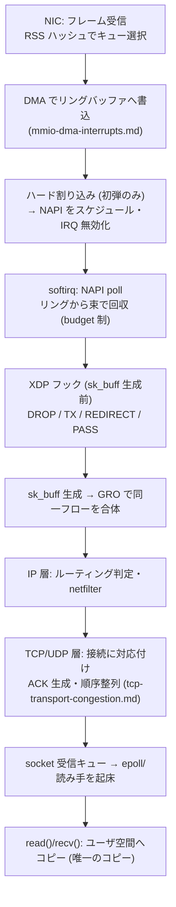

# カーネルネットワークスタック (Kernel Network Stack: sk_buff, NAPI & XDP)

## 概要 (Overview)

[`tcp-transport-congestion.md`](tcp-transport-congestion.md) と [`http-quic-evolution.md`](http-quic-evolution.md) はプロトコルの**意味論**を扱った。本ドキュメントはその足元、**パケットが NIC の DMA リングからアプリケーションの `read` に届くまでの機械**を扱う。対象は sk_buff・割り込みと NAPI・GRO/GSO・マルチコアへの分配・qdisc、そして XDP/DPDK というバイパスの系譜である。

中心テーゼは、この層の設計が**二つの経済**に支配されているということ。第一に**割り込みの経済**: パケットごとに割り込んでいたらコアは通知処理だけで沈む (livelock) が、ポーリングだけでは暇なときに CPU を捨てる。NAPI はこの間を動的に往復するハイブリッドである。第二に**単価の経済**: ネットワーク処理のコストは「バイトあたり」ではなく「**パケットあたり**」が支配的で、10GbE の 64B 最小フレームは毎秒 1,488 万発 (1 発あたり約 67ns)、100GbE では約 6.7ns であり、L3 キャッシュミス 1 回で予算が消える。スタックの至る所にあるバッチ化 (GRO/GSO/TSO) と、最後は「カーネルを通らない」という選択 (XDP, DPDK) は、すべてこの単価との戦いである。

本書は (1) RX/TX の貫通経路、(2) sk_buff という万能コンテナ、(3) 割り込み制御とマルチコア分配 (RSS/RPS/RFS)、(4) バッチとオフロード、(5) qdisc と送信側の待ち行列、(6) XDP から DPDK までのバイパス系譜、を Linux を参照実装として整理する。分析深度は Level 3。

## 方法論 (Methodology)

- 1 個のパケットの RX 経路を NIC から socket まで貫通的に追い、各段を「どの経済 (割り込み単価・コピー単価・ロック競合) への対処か」で説明する。
- 定量は物理から導ける値 (ラインレートのパケット数、1 パケットあたりの時間予算) を錨とし、実装依存の数値は桁感として扱う。
- バイパス技術は「カーネルの何を捨てると何を失うか」の交換条件で比較し、宣伝値ではなく査読付きの実測 (XDP: CoNEXT '18) を根拠とする。
- プロトコルの意味論 (輻輳制御・再送) は既存ドキュメントに、NIC より下 (PCIe・DMA・割り込みの機構) は [`../../hardware/hw-sw-interface/`](../../hardware/hw-sw-interface/) に委ねる。

## 発見事項 (Findings)

1. **sk_buff は「パケットのパスポート」である。** データ本体を指すポインタ群と、全層のメタデータ (どの NIC から来たか、L2/L3/L4 ヘッダ位置、チェックサム状態、所属 socket…) を一つの構造体に載せ、スタックを縦断させる。ヘッダの付け外しはポインタ操作 (headroom/tailroom) で行い、**層をまたいでもコピーしない**。この設計が Linux のスタックを 1 回のコピー (socket ↔ ユーザ空間) で済ませている。
2. **NAPI は「割り込みは初弾だけ」という発明である。** 最初のパケットで割り込み → 以後は割り込みを**切って**ポーリングで束ねて処理 → 尽きたら割り込みを戻す。負荷が低いときは割り込みの応答性、高いときはポーリングの効率に自動で寄る。割り込み livelock (受信が多いほど仕事が進まない) への 2001 年の回答が、今も全ドライバの基本形である。
3. **1 本の TCP 接続は 1 コアでしか処理できない。だから分配はハッシュで行う。** RSS は NIC がフローハッシュで受信キューをコア群に振り分ける機構であり、順序を守るためフロー内は必ず同じキューに落とす。ここで生まれる「フロー単位の並列性」という粒度は、コア数を増やしてもエレファントフロー 1 本は速くならないという限界も規定する。
4. **バッチ化は受信 (GRO) と送信 (GSO/TSO) で対称に働く。** パケット単価が支配的なら、答えは「パケットを大きくする」ことである。GRO は到着した同一フローのセグメントを 64KB 級に束ねてからスタックに通し、GSO/TSO は逆に、スタックを巨大セグメントのまま通し分割を最後 (できれば NIC ハード) まで遅延する。**スタックの中では MTU より大きいパケットが流れている**のが現代の常態である。
5. **送信側の待ち行列 (qdisc) は輻輳制御の共犯者である。** バッファブロート ([`tcp-transport-congestion.md`](tcp-transport-congestion.md)) への対処はデバイス直前の層に実装される: fq_codel (滞留時間で落とす AQM)、fq (フロー分離とペーシング。BBR が要求)、BQL (ドライバキューへの供給量をバイト単位で自動調整)。アルゴリズム (CUBIC/BBR) だけ見ていても輻輳挙動は説明できず、この層の設定が結果を変える。
6. **XDP は「カーネルを捨てずにカーネルを飛ばす」中間解である。** eBPF プログラムをドライバ内・**sk_buff 生成前**に走らせ、DDoS 弾き・転送・ロードバランスを 1 コア数千万 pps 級で処理する (CoNEXT '18 で単コア 24Mpps のドロップ性能)。DPDK のような全部盗り (カーネル排除・コア占有・スタック自作) と、汎用性の間の実用的な均衡点であり、eBPF ([`../operating-systems/ebpf-kernel-programmability.md`](../operating-systems/ebpf-kernel-programmability.md)) の代表的な着地先である。

## アーキテクチャ (Architecture)

### RX — パケットが read() に届くまで



### TX — write() がワイヤに出るまで (要点)

```
 write() → socket バッファへコピー → TCP がセグメント化を「しない」(GSO: 64KB のまま)
   → IP → qdisc (fq_codel/fq: AQM・ペーシング) → BQL がドライバキューへの供給を絞る
   → ドライバがリングに載せ doorbell → NIC が TSO で分割・チェックサム計算 → ワイヤ
```

### パケット単価の予算感

| リンク | 64B フレームのラインレート | 1 パケットの時間予算 |
|---|---|---|
| 1GbE | 約 149 万 pps | 約 672ns |
| 10GbE | 約 1,488 万 pps | 約 67ns |
| 100GbE | 約 1 億 4,880 万 pps | **約 6.7ns** |

DRAM アクセス 1 回 (約 100ns、[`../../hardware/cpu/cache-memory-hierarchy.md`](../../hardware/cpu/cache-memory-hierarchy.md)) が予算を桁で超える。つまり、最小フレーム連打をカーネルの通常経路で受け切るのは物理的に不可能であり、バッチ化・オフロード・バイパスは選択ではなく必然である。

## 技術詳細 (Technical Details)

### 1. sk_buff の解剖

- 構造: メタデータ (デバイス, プロトコル, ヘッダ各層へのオフセット, ハッシュ, タイムスタンプ, 所属 socket, cgroup…) ＋データ領域へのポインタ (`head/data/tail/end`)。データ先頭の前に **headroom** を確保しておき、カプセル化 (VLAN, トンネル) はコピーでなくポインタ後退で行う。
- 大きなパケットは線形部分＋ページ断片 (frags) の**非線形構造**で持つ。そのため GRO の合体も TSO の分割もページ参照の付け替えで済む。clone (メタデータだけ複製しデータ共有) と copy の区別も同じ思想。
- 含意: sk_buff の確保・解放・キャッシュライン移動そのものがパケット単価の主成分であり、XDP が「sk_buff を作る前」に走ることの意味はまさにここにある。

### 2. 割り込み制御とマルチコア分配

- **NAPI の poll budget**: 1 回の softirq で処理する上限 (既定 300 級) を設け、ネットワークが他の仕事を飢えさせないようにする。溢れれば `ksoftirqd` (通常優先度のスレッド) へ降格する。**高負荷時にネットワーク処理が「ただのプロセス」と競合し始める**のはこの構造による。
- **RSS** (ハード): NIC が 5-tuple ハッシュで受信キューを選び、キューごとに別コアへ割り込む。**RPS** (ソフト): キューが足りない NIC 用に同じ分配をソフトで再現。**RFS**: 「そのフローを read しているアプリのいるコア」へ運んでキャッシュ局所性を取る。**XPS** は送信側の対応物。
- 調律の勘所は「フローの処理を最後までどのコアで完結させるか」であり、IRQ affinity・アプリの CPU ピン止め・RFS の整合が崩れるとコア間のキャッシュライン運搬 ([`../../hardware/cpu/cache-coherence.md`](../../hardware/cpu/cache-coherence.md)) が単価に上乗せされる。

### 3. オフロードの分業 — NIC は既に小さなコンピュータである

- チェックサム計算・分割 (TSO)・合体 (LRO/GRO のハード版)・VLAN・トンネルのカプセル化・暗号化 (kTLS オフロード) まで、定型処理は NIC へ降ろすのが常道。カーネルはポリシと例外処理に集中する。
- GRO がソフトで残る理由: ハード合体 (LRO) は情報を破壊しうる (再分割で元に戻せない) ため、ルータ/ブリッジ用途では可逆な GRO が要る。つまり、**オフロードは「戻せるか」が採否を分ける**。
- さらに進むと SmartNIC/DPU (NIC 上の汎用コアで OVS や ストレージまで処理) に至るが、これは「どこまでをホスト CPU の仕事とするか」という配置問題の再交渉である。

### 4. ソケット層とコピーの削減

- 通常経路のコピーは socket ↔ ユーザ空間の 1 回。これすら惜しい場合: `sendfile`/`splice` (ファイル → socket をカーネル内で直結、静的配信の定石)、`MSG_ZEROCOPY` (送信バッファをピン止めして DMA、完了通知が非同期に返る。小さい送信では管理コストで逆転する)、io_uring の提供する固定バッファ送受信 ([`../operating-systems/block-io-stack.md`](../operating-systems/block-io-stack.md) と同じ道具立てがネットワークにも来ている)。
- 受信側ゼロコピーは本質的に難しい: データがどの接続宛か分かるのは**読んでから**なので、あらかじめユーザのバッファに直接置けない。ヘッダ分割＋ページ差し替え・io_uring の zero-copy RX など、NIC の協力を前提にした限定解が現在地である。

### 5. バイパスの系譜 — 何を捨てると何を得るか

| 手法 | 実行場所 | 得るもの | 捨てるもの |
|---|---|---|---|
| 通常スタック | カーネル | 全機能 (TCP, netfilter, 観測) | 単価 (数百 ns/pkt) |
| **XDP** | ドライバ内 eBPF (skb 生成前) | 単コア数十 Mpps の drop/redirect | 検証器の制約内のみ・TCP は書けない |
| **AF_XDP** | カーネルが素通しでユーザ空間リングへ | ゼロコピー受け渡し＋通常 NIC 共存 | プロトコル処理は自前 |
| **DPDK** | ユーザ空間ドライバ (カーネル排除) | 最小単価・完全制御 | カーネル機能全部・コア占有 (busy-poll)・スタック自作 |
| RDMA | NIC ハード | CPU 非介在の遠隔メモリアクセス | 専用 NIC・専用プログラミングモデル |

- XDP の設計上の勝ち筋は「**既存カーネルとの共存**」: 同じ NIC で XDP (DDoS 弾き) と通常スタック (SSH) が同居でき、専用コアも要らない。Cloudflare の DDoS 対策 (L4Drop) はこの実戦例。
- DPDK 側の勝ち筋は決定論: busy-poll はレイテンシの分散を抑え、テール要件の厳しい NFV・取引系で選ばれる。「**平均を買うか、テールを買うか**」が分水嶺である。

### 6. 観測の入口 (Observability)

| 疑問 | 道具 |
|---|---|
| NIC・リングで落ちていないか | `ethtool -S` (rx_dropped, rx_missed)、`ip -s link` |
| softirq が飽和していないか | `/proc/net/softnet_stat` (dropped, time_squeeze)、`top` の si% |
| どこで捨てられたか | `dropwatch`、eBPF (`kfree_skb` トレース)、`nstat` (SNMP カウンタ) |
| 接続ごとの状態 | `ss -ti` (cwnd, rtt, 再送。[`tcp-transport-congestion.md`](tcp-transport-congestion.md) の実測窓口) |
| qdisc の滞留 | `tc -s qdisc` (backlog, drops, marks) |
| フロー分配の偏り | `/proc/interrupts`、`ethtool -x` (RSS テーブル) |

## セキュリティ考察 (Security Considerations)

- **パケットパーサはリモート攻撃面の最前線である。** 細工されたフレームはドライバ・GRO・トンネル解析のバグを**認証前・接続前**に直撃する (例: 断片化処理の脆弱性群)。sk_buff のポインタ演算という設計自体が、境界検査の誤りを即メモリ破壊にする。リモートから到達可能なカーネルコードとして、この層は最も高い監査密度に値する。
- **SYN flood と状態枯渇**: 接続確立前の状態 (半開接続・conntrack エントリ) は攻撃者が無償で消費させられる資源であり、SYN cookie (状態を持たず ISN に符号化) が古典的対処。netfilter の conntrack テーブル枯渇も同型の問題で、「**認証前に確保する状態を最小化する**」が設計原則になる (QUIC のアドレス検証・アンプ制限 ([`http-quic-evolution.md`](http-quic-evolution.md)) も同じ原則の別実装)。
- **XDP/eBPF は防御の道具でもある**: パケット単価が最小の地点 (skb 生成前) で落とすことは、DDoS 対策として構造的に正しい位置であり、検証器 ([`../operating-systems/ebpf-kernel-programmability.md`](../operating-systems/ebpf-kernel-programmability.md)) がその安全性を担保する。一方でオフロード・SmartNIC への処理移譲は、ホストの観測 (tcpdump に映らないトラフィック) と信頼境界 (NIC ファームウェア) の再考を要求する。
- **タイミングと観測のサイドチャネル**: RX タイムスタンプや RST/ICMP の応答差は、スキャンや OS 指紋採取 (fingerprinting) に使われる。共有 NIC のキュー競合はテナント間の存在検知に転用されうる。共有 = 観測面という一般則はこの層でも成り立つ。

## 結論 (Conclusions)

- カーネルネットワークスタックは「割り込みの経済」と「パケット単価の経済」への 30 年分の適応である。NAPI・GRO/GSO・RSS はそれぞれ通知・単価・並列性への回答であり、個々の機構は経済で説明すると一貫して見える。
- sk_buff の「コピーしないための構造」と socket 境界の 1 コピーという非対称が Linux スタックの性能特性を規定し、それでも足りない領域のために sendfile/MSG_ZEROCOPY/io_uring が残りを補う。
- ラインレートの物理 (100GbE で 6.7ns/pkt) は汎用スタックの守備範囲を超えており、XDP (共存型) と DPDK (占有型) の選択は「カーネルの機能と観測性をどこまで捨てられるか」「平均とテールのどちらを買うか」という交換条件の問題である。
- この層はリモートから到達可能なカーネルコードであり、性能設計 (状態の事前確保・オフロード) がそのまま攻撃面設計 (枯渇・観測の穴) になる。輻輳制御の上物だけでなく、この機械を含めて初めて「ネットワークの挙動」は説明できる。

### 次の接続先 (Related Topics)

- [`tcp-transport-congestion.md`](tcp-transport-congestion.md) — 本書の真上。ここで運ばれるセグメントの意味論 (再送・輻輳制御)。qdisc/ペーシングは両者の境界。
- [`../../hardware/hw-sw-interface/mmio-dma-interrupts.md`](../../hardware/hw-sw-interface/mmio-dma-interrupts.md) — 本書の真下。リングバッファ・DMA・割り込み合体の機構。
- [`../operating-systems/ebpf-kernel-programmability.md`](../operating-systems/ebpf-kernel-programmability.md) — XDP の実行基盤 (検証器・JIT・マップ)。
- [`../operating-systems/block-io-stack.md`](../operating-systems/block-io-stack.md) — 同型の進化 (単価との戦い・リング・ポーリング・io_uring) のストレージ版。対で読む。
- [`../../hardware/cpu/cache-coherence.md`](../../hardware/cpu/cache-coherence.md) — コア間分配 (RSS/RFS) の性能を規定する下部構造。

## 参考文献 (References)

**一次資料 (Primary — 論文・公式ドキュメント)**

- Salim, J. H., Olsson, R., & Kuznetsov, A. (2001). Beyond Softnet. *Proceedings of the 5th Annual Linux Showcase & Conference (USENIX)*. — NAPI (割り込み livelock 対策) の原典。
- Høiland-Jørgensen, T., et al. (2018). The eXpress Data Path: Fast Programmable Packet Processing in the Operating System Kernel. *CoNEXT '18*. DOI: 10.1145/3281411.3281443 — XDP の設計と単コア 24Mpps の実測。
- Linux Kernel Documentation — [Scaling in the Linux Networking Stack (RSS/RPS/RFS/XPS)](https://www.kernel.org/doc/html/latest/networking/scaling.html)、[NAPI](https://www.kernel.org/doc/html/latest/networking/napi.html)、[Segmentation Offloads](https://www.kernel.org/doc/html/latest/networking/segmentation-offloads.html)、[MSG_ZEROCOPY](https://www.kernel.org/doc/html/latest/networking/msg_zerocopy.html) — Accessed: 2026-07-05。
- DPDK Documentation — [doc.dpdk.org](https://doc.dpdk.org/guides/) — Accessed: 2026-07-05。ポールモードドライバとユーザ空間スタックの一次資料。

**二次資料 (Secondary — 解説)**

- Corbet, J. (2009). JLS2009: Generic receive offload. *LWN.net*. — [lwn.net](https://lwn.net/Articles/358910/) — Accessed: 2026-07-05。GRO の設計 (可逆な合体) の解説。
- Cloudflare Blog — [L4Drop: XDP DDoS Mitigations](https://blog.cloudflare.com/l4drop-xdp-ebpf-based-ddos-mitigations/) — Accessed: 2026-07-05。XDP の実戦投入例。
- Gregg, B. *BPF Performance Tools*, Addison-Wesley — ネットワークスタックの eBPF 観測手法。
