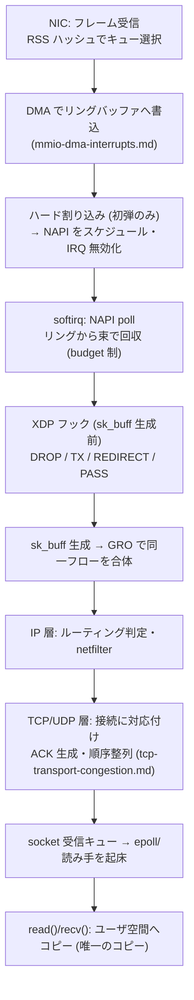
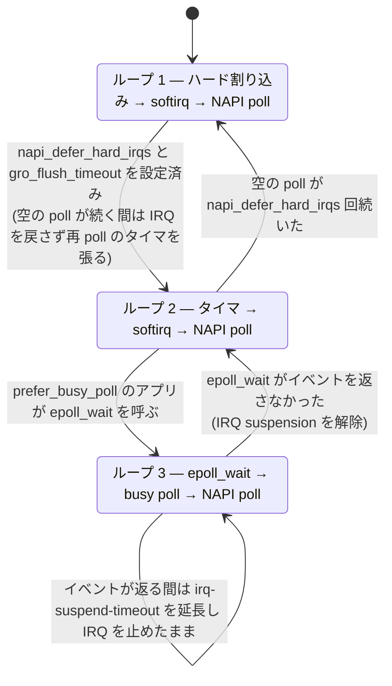

# カーネルネットワークスタック (Kernel Network Stack: sk_buff, NAPI & XDP)

## 概要 (Overview)

[`tcp-transport-congestion.md`](tcp-transport-congestion.md) と [`http-quic-evolution.md`](http-quic-evolution.md) はプロトコルの**意味論**を扱った。本ドキュメントはその足元、**パケットが NIC の DMA リングからアプリケーションの `read` に届くまでの機械**を扱う。対象は sk_buff・割り込みと NAPI・GRO/GSO・マルチコアへの分配・qdisc、そして XDP/DPDK というバイパスの系譜である。

中心テーゼは、この層の設計が**二つの経済**に支配されているということ。第一に**割り込みの経済**: パケットごとに割り込んでいたらコアは通知処理だけで沈む (livelock) が、ポーリングだけでは暇なときに CPU を捨てる。NAPI はこの間を動的に往復するハイブリッドである。第二に**単価の経済**: ネットワーク処理のコストは「バイトあたり」ではなく「**パケットあたり**」が支配的で、10GbE の 64B 最小フレームは毎秒 1,488 万発 (1 発あたり約 67ns)、100GbE では約 6.7ns であり、L3 キャッシュミス 1 回で予算が消える。スタックの至る所にあるバッチ化 (GRO/GSO/TSO) と、最後は「カーネルを通らない」という選択 (XDP, DPDK) は、すべてこの単価との戦いである。

本書は (1) RX/TX の貫通経路、(2) sk_buff という万能コンテナ、(3) 割り込み制御とマルチコア分配 (RSS/RPS/RFS)、(4) バッチとオフロード、(5) qdisc と送信側の待ち行列、(6) XDP から DPDK までのバイパス系譜、を Linux を参照実装として整理する。加えて、(7) NAPI の予算・スレッド化・busy poll・IRQ 抑止 (IRQ suspension)、(8) ソケット層の資源 (バッファのメモリ計上・listen のキュー・SO_REUSEPORT・epoll・io_uring)、(9) ゼロコピーの各方式 (MSG_ZEROCOPY・TCP_ZEROCOPY_RECEIVE・devmem TCP・io_uring zcrx・kTLS)、(10) カーネル内の経路表と近隣表、(11) 時刻印と送出時刻 (EDT・TSQ)、(12) コンテナのネットワークを組む部品 (netns・veth)、(13) パケットが落ちる場所と調律、(14) 他の OS とバイパス論争の現在地、を扱う。分析深度は Level 3。

## 方法論 (Methodology)

- 1 個のパケットの RX 経路を NIC から socket まで貫通的に追い、各段を「どの経済 (割り込み単価・コピー単価・ロック競合) への対処か」で説明する。
- 定量は物理から導ける値 (ラインレートのパケット数、1 パケットあたりの時間予算) を錨とし、実装依存の数値は桁感として扱う。
- バイパス技術は「カーネルの何を捨てると何を失うか」の交換条件で比較し、宣伝値ではなく査読付きの実測 (XDP: CoNEXT '18) を根拠とする。
- プロトコルの意味論 (輻輳制御・再送) は既存ドキュメントに、NIC より下 (PCIe・DMA・割り込みの機構) は [`../../hardware/hw-sw-interface/`](../../hardware/hw-sw-interface/) に委ねる。
- **ソースの版**: Linux の既定値と処理の順序は、執筆時点 (2026-11-07) の最新安定版 v7.3 のソースで行番号を確認した。機能が入った版は、該当するファイル・定数・文書の節が各版のタグに含まれるかで確かめた (例: `SOMAXCONN` は v5.3 で 128、v5.4 で 4096。`io_uring/zcrx.c` は v6.14 になく v6.15 にある)。
- **担当範囲**: netfilter・conntrack は [`packet-filtering-conntrack.md`](packet-filtering-conntrack.md)、qdisc のスケジューリング (fq_codel・CAKE・HTB) は [`qos-traffic-management.md`](qos-traffic-management.md)、ディスクリプタリングとオフロードのハードウェアは [`../../hardware/networking/nic-switch-architecture.md`](../../hardware/networking/nic-switch-architecture.md)、CNI は [`../cloud/kubernetes-networking.md`](../cloud/kubernetes-networking.md) に委ね、本書では機構と接点だけを述べる。
- **性能の主張**: カーネルとバイパスの比較は、査読付きの測定 (Cai et al., SIGCOMM 2021。Cai & Karsten, SIGMETRICS 2024。Marty et al., SOSP 2019) を根拠にする。電力削減の割合のような開発者側の数値は、開発者の主張として区別して書く。

## 発見事項 (Findings)

1. **sk_buff は「パケットのパスポート」である。** データ本体を指すポインタ群と、全層のメタデータ (どの NIC から来たか、L2/L3/L4 ヘッダ位置、チェックサム状態、所属 socket…) を一つの構造体に載せ、スタックを縦断させる。ヘッダの付け外しはポインタ操作 (headroom/tailroom) で行い、**層をまたいでもコピーしない**。この設計が Linux のスタックを 1 回のコピー (socket ↔ ユーザ空間) で済ませている。
2. **NAPI は「割り込みは初弾だけ」という発明である。** 最初のパケットで割り込み → 以後は割り込みを**切って**ポーリングで束ねて処理 → 尽きたら割り込みを戻す。負荷が低いときは割り込みの応答性、高いときはポーリングの効率に自動で寄る。割り込み livelock (受信が多いほど仕事が進まない) への 2001 年の回答が、今も全ドライバの基本形である。
3. **1 本の TCP 接続は 1 コアでしか処理できない。だから分配はハッシュで行う。** RSS は NIC がフローハッシュで受信キューをコア群に振り分ける機構であり、順序を守るためフロー内は必ず同じキューに落とす。ここで生まれる「フロー単位の並列性」という粒度は、コア数を増やしてもエレファントフロー 1 本は速くならないという限界も規定する。
4. **バッチ化は受信 (GRO) と送信 (GSO/TSO) で対称に働く。** パケット単価が支配的なら、答えは「パケットを大きくする」ことである。GRO は到着した同一フローのセグメントを 64KB 級に束ねてからスタックに通し、GSO/TSO は逆に、スタックを巨大セグメントのまま通し分割を最後 (できれば NIC ハード) まで遅延する。**スタックの中では MTU より大きいパケットが流れている**のが現代の常態である。
5. **送信側の待ち行列 (qdisc) は輻輳制御の共犯者である。** バッファブロート ([`tcp-transport-congestion.md`](tcp-transport-congestion.md)) への対処はデバイス直前の層に実装される: fq_codel (滞留時間で落とす AQM)、fq (フロー分離とペーシング。BBR が要求)、BQL (ドライバキューへの供給量をバイト単位で自動調整)。アルゴリズム (CUBIC/BBR) だけ見ていても輻輳挙動は説明できず、この層の設定が結果を変える。HTB や CAKE によるクラス分けとシェーピングは [`qos-traffic-management.md`](qos-traffic-management.md) で扱う。
6. **XDP は「カーネルを捨てずにカーネルを飛ばす」中間解である。** eBPF プログラムをドライバ内・**sk_buff 生成前**に走らせ、DDoS 弾き・転送・ロードバランスを 1 コア数千万 pps 級で処理する (CoNEXT '18 で単コア 24Mpps のドロップ性能)。DPDK のような全部盗り (カーネル排除・コア占有・スタック自作) と、汎用性の間の実用的な均衡点であり、eBPF ([`../operating-systems/ebpf-kernel-programmability.md`](../operating-systems/ebpf-kernel-programmability.md)) の代表的な着地先である。
7. **softirq の予算は「パケット数」と「時間」の二重の上限である。** v7.3 の `net_rx_action()` は 1 回の処理で全 NAPI を合わせて 300 パケット (`net.core.netdev_budget`) か 2 jiffies (`netdev_budget_usecs` の既定値 `2 * USEC_PER_SEC / HZ`) のどちらかに達すると打ち切り、`time_squeeze` を 1 増やす。`/proc/net/softnet_stat` の 3 列目が増え続けるなら、パケットが落ちる前から受信処理は CPU を取り合っている。
8. **割り込みとポーリングの綱引きは、2020 年代に入って利用者側へ権限が移った。** スレッド化 NAPI (v5.12)、`SO_PREFER_BUSY_POLL` (v5.11)、epoll の文脈ごとの busy poll 設定 `EPIOCSPARAMS` (v6.9)、IRQ suspension (v6.13)、スレッド化 NAPI の busy poll (v6.19) と、「いつ割り込みを止めるか」をアプリケーションが宣言する仕組みが増えた。Cai と Karsten の測定 (SIGMETRICS 2024) は、カーネルとバイパスの性能差の大きな部分が非同期の割り込みに由来し、それを抑えた Linux はスタックの機能が近いバイパスと同程度の性能を出すと報告している。
9. **100Gbps 級ではプロトコル処理より受信側のコピーが支配的になる。** Cai ら (SIGCOMM 2021) は Linux で 1 コアあたり約 42Gbps しか出ず、主なボトルネックがカーネルからアプリケーションへのデータのコピーであることを示した。受信側のゼロコピーは長く「NIC の協力が要る限定解」だったが、ヘッダとペイロードを分けて受け取るヘッダ分割 (header split) を前提に、GPU などのデバイスメモリへ直接受ける devmem TCP (受信 v6.12、送信 v6.16) と、ユーザ空間のメモリへ直接受ける io_uring zcrx (v6.15) が本体に入った。どちらもヘッダは通常の TCP スタックが処理するので、カーネルを捨てずにコピーだけを捨てる設計である。
10. **listen のキューは 2 段で、上限の効き方は直感と違う。** SYN を受けた段階の要求ソケット (SYN キュー) と、3 ウェイハンドシェイクが終わって `accept()` を待つ受付キューがある。v7.3 の `tcp_conn_request()` は、要求ソケットの数が `listen()` に渡した backlog (`somaxconn` で頭打ち) を超えたら SYN cookie に切り替え、受付キューが満杯なら SYN そのものを捨てて `ListenOverflows` を数える。`tcp_max_syn_backlog` が効くのは SYN cookie を無効にしたときの残り 1/4 の扱いだけで、SYN キューの上限そのものではない。
11. **リモートから突かれる TCP/IP の脆弱性は、性能のために持つデータ構造に集まる。** SegmentSmack (CVE-2018-5390) は順序外キューの整理を、FragmentSmack (CVE-2018-5391) は断片の再組立てを何度も起こさせて CPU を使い果たさせる。SACK Panic (CVE-2019-11477) は再送キューの skb を分割させ、整数の桁あふれでカーネルを止める。順序外キュー・断片表・再送キューは、攻撃者が処理の最悪の計算量を選べる場所になる。

## アーキテクチャ (Architecture)

### RX — パケットが read() に届くまで



### TX — write() がワイヤに出るまで (要点)

```
 write() → socket バッファへコピー → TCP がセグメント化を「しない」(GSO: 64KB のまま)
   → IP → qdisc (fq_codel/fq: AQM・ペーシング) → BQL がドライバキューへの供給を絞る
   → ドライバがリングに載せ doorbell → NIC が TSO で分割・チェックサム計算 → ワイヤ
```

### パケット単価の予算感

| リンク | 64B フレームのラインレート | 1 パケットの時間予算 |
|---|---|---|
| 1GbE | 約 149 万 pps | 約 672ns |
| 10GbE | 約 1,488 万 pps | 約 67ns |
| 100GbE | 約 1 億 4,880 万 pps | **約 6.7ns** |

DRAM アクセス 1 回 (約 100ns、[`../../hardware/cpu/cache-memory-hierarchy.md`](../../hardware/cpu/cache-memory-hierarchy.md)) が予算を桁で超える。つまり、最小フレーム連打をカーネルの通常経路で受け切るのは物理的に不可能であり、バッチ化・オフロード・バイパスは選択ではなく必然である。

### NAPI を駆動する 3 つのループ

カーネル文書 (`Documentation/networking/napi.rst`, v7.3) は、NAPI の poll を呼ぶ経路を 3 つに整理している。どのループが主導権を持つかで、遅延と CPU 消費の釣り合いが決まる。



凡例: 状態は poll を起動する経路、遷移の矢印はその経路に切り替わる条件。`irq-suspend-timeout` はアプリケーションが止まったときに割り込みを戻す安全装置でもある。

文書によれば、`gro_flush_timeout` と `napi_defer_hard_irqs` を設定しないとループ 3 はループ 1 から主導権を取れず、`irq-suspend-timeout` を設定しても目に見える効果が出ないことがある。IRQ suspension は単独の設定ではなく、ループ 2 の割り込み延期と組み合わせて初めて働く。

### パケットが落ちる場所の地図

| 段 | 落ちる理由 | 見る場所 |
|---|---|---|
| NIC・リング | RX リングが空き不足 (ドライバの補充が追いつかない) | `ip -s link` の missed (`rx_missed_errors`)、`ethtool -S` (名前はドライバ固有) |
| XDP | プログラムが `XDP_DROP` を返す、または `XDP_REDIRECT` 先の失敗 | XDP プログラム自身の統計、drop reason `XDP` |
| CPU ごとの backlog (RPS・非 NAPI 経路) | キュー長が `netdev_max_backlog` (既定 1000) を超えた、または flow limit | `/proc/net/softnet_stat` の 2 列目と 11 列目、drop reason `CPU_BACKLOG` |
| softirq の予算 | 落ちはしないが打ち切られる (リングに溜まり、やがて NIC で落ちる) | `softnet_stat` の 3 列目 (`time_squeeze`) |
| IP・netfilter・経路 | 経路なし、rp_filter、規則で破棄 | `nstat` (`IpInNoRoutes` など)、drop reason `IP_INNOROUTES`・`IP_RPFILTER`・`NETFILTER_DROP` |
| 近隣 (ARP/ND) | 解決待ちキューの溢れ、解決失敗 | drop reason `NEIGH_QUEUEFULL`・`NEIGH_FAILED`、`ip -s neigh` |
| listen | SYN キュー・受付キューの溢れ | `nstat` (`TcpExtListenOverflows`, `TcpExtListenDrops`)、`ss -lnt` の Recv-Q |
| ソケット | 受信バッファ超過、TCP のメモリ上限 (`tcp_mem`) | `nstat` (`TcpExtTCPRcvQDrop`, `TcpExtPruneCalled`)、drop reason `SOCKET_RCVBUFF`・`PROTO_MEM` |
| qdisc (送信) | キュー長・AQM・fq の horizon 超過 | `tc -s qdisc`、drop reason `QDISC_DROP` |

凡例: 「drop reason」は v5.17 で入った `kfree_skb_reason()` が記録する `enum skb_drop_reason` の名前 (接頭辞 `SKB_DROP_REASON_` を省略)。v7.3 の `include/net/dropreason-core.h` には 125 個が定義されており、`skb:kfree_skb` トレースポイントで理由ごとに集計できる。

## 技術詳細 (Technical Details)

### 1. sk_buff の解剖

- 構造: メタデータ (デバイス, プロトコル, ヘッダ各層へのオフセット, ハッシュ, タイムスタンプ, 所属 socket, cgroup…) ＋データ領域へのポインタ (`head/data/tail/end`)。データ先頭の前に **headroom** を確保しておき、カプセル化 (VLAN, トンネル) はコピーでなくポインタ後退で行う。
- 大きなパケットは線形部分＋ページ断片 (frags) の**非線形構造**で持つ。そのため GRO の合体も TSO の分割もページ参照の付け替えで済む。clone (メタデータだけ複製しデータ共有) と copy の区別も同じ思想。
- 含意: sk_buff の確保・解放・キャッシュライン移動そのものがパケット単価の主成分であり、XDP が「sk_buff を作る前」に走ることの意味はまさにここにある。

### 2. 割り込み制御とマルチコア分配

- **NAPI の poll budget**: 1 回の softirq で処理する上限 (既定 300 級) を設け、ネットワークが他の仕事を飢えさせないようにする。溢れれば `ksoftirqd` (通常優先度のスレッド) へ降格する。**高負荷時にネットワーク処理が「ただのプロセス」と競合し始める**のはこの構造による。
- **RSS** (ハード): NIC が 5-tuple ハッシュで受信キューを選び、キューごとに別コアへ割り込む。**RPS** (ソフト): キューが足りない NIC 用に同じ分配をソフトで再現。**RFS**: 「そのフローを read しているアプリのいるコア」へ運んでキャッシュ局所性を取る。**XPS** は送信側の対応物。
- 調律の勘所は「フローの処理を最後までどのコアで完結させるか」であり、IRQ affinity・アプリの CPU ピン止め・RFS の整合が崩れるとコア間のキャッシュライン運搬 ([`../../hardware/cpu/cache-coherence.md`](../../hardware/cpu/cache-coherence.md)) が単価に上乗せされる。

#### 2.1 予算の実装

NAPI の予算は 2 層ある。ドライバの poll 1 回あたりの上限 (weight、既定 64) と、softirq 1 回で全 NAPI を合わせた上限 (`netdev_budget`) である。既定値は 1 か所にまとまっている。

```c
/* C (Linux v7.3): net/core/hotdata.c lines 14-22
 * Purpose: default NAPI budgets and the per-CPU backlog limit */
	.netdev_budget = 300,
	/* Must be at least 2 jiffes to guarantee 1 jiffy timeout */
	.netdev_budget_usecs = 2 * USEC_PER_SEC / HZ,

	.tstamp_prequeue = 1,
	.max_backlog = 1000,
	.qdisc_max_burst = 1000,
	.dev_tx_weight = 64,
	.dev_rx_weight = 64,
```

打ち切りの判定は `net_rx_action()` の中にある。

```c
/* C (Linux v7.3): net/core/dev.c lines 8049-8061
 * Purpose: stop the RX softirq when the packet or time budget runs out */
		n = list_first_entry(&list, struct napi_struct, poll_list);
		budget -= napi_poll(n, &repoll);

		/* If softirq window is exhausted then punt.
		 * Allow this to run for 2 jiffies since which will allow
		 * an average latency of 1.5/HZ.
		 */
		if (unlikely(budget <= 0 ||
			     time_after_eq(jiffies, time_limit))) {
			/* Pairs with READ_ONCE() in softnet_seq_show() */
			WRITE_ONCE(sd->time_squeeze, sd->time_squeeze + 1);
			break;
		}
```

- 打ち切られた NAPI は poll リストに戻され、`NET_RX_SOFTIRQ` が再び立つ (同 8064-8070 行)。softirq の再実行が続くと、処理は `ksoftirqd` という通常のスレッドに移る。この段階では、ネットワーク処理は CFS/EEVDF のスケジューラ ([`../operating-systems/process-thread-scheduling.md`](../operating-systems/process-thread-scheduling.md)) の上で他のスレッドと CPU を分け合う。
- `netdev_budget` を上げると 1 回の softirq でより多く処理できるが、同じ CPU のアプリケーションの遅延が伸びる。`time_squeeze` が増えているときにまず見るべきは予算の値ではなく、RSS の偏りや IRQ affinity による CPU の偏りである。
- 時間の上限は jiffies 単位なので、`HZ=250` のカーネルでは 2 jiffies が 8ms にあたる。既定値の注釈が言う「平均 1.5/HZ の遅延」はこの粒度から来る。

#### 2.2 スレッド化 NAPI と busy poll

- **スレッド化 NAPI (threaded NAPI, v5.12)**: NAPI の処理を softirq ではなく NAPI ごとのカーネルスレッド (`napi/<ifname>-<napi-id>`) で行う。`/sys/class/net/<dev>/threaded` で切り替える。スレッドになれば優先度・CPU の割り当て・cgroup の制御を通常のスレッドと同じ道具で扱え、softirq が任意のプロセスの文脈を借りて走る問題 (処理時間がそのプロセスに計上される) を避けられる。
- **busy poll**: `SO_BUSY_POLL` (または `net.core.busy_read`・`busy_poll`) を設定したソケットでは、受信を待つシステムコールの中でアプリケーションのスレッドが直接 NAPI の poll を呼ぶ。割り込み→softirq→起床という 3 回の受け渡しを飛ばすので遅延は縮むが、待っている間は CPU を燃やす。カーネル文書自身が「NAPI busy polling の本番利用はあまり知られていない」と書いている。
- **epoll での busy poll**: epoll のインスタンスに登録したソケットがすべて同じ NAPI ID (`SO_INCOMING_NAPI_ID`) を持つ場合に働く。そのため、受付スレッドが NAPI ID ごとに接続を振り分けるか、SO_REUSEPORT に BPF を付けて NAPI ID で振り分ける設計が要る。v6.9 からは `EPIOCSPARAMS` ioctl で epoll のインスタンスごとに busy poll の時間・予算・`prefer_busy_poll` を設定できる。
- **IRQ の抑止 (`SO_PREFER_BUSY_POLL`, v5.11)**: アプリケーションが「定期的に busy poll する」と約束すると、ドライバは割り込みを止めたままにする。約束は `gro_flush_timeout` の間 busy poll が来なければ取り消される。ここで `gro_flush_timeout` は「割り込みを延期する時間」と「アプリケーションが止まったときの安全装置」の 2 役を兼ねるため、1 つの値で両方を満たせなかった。
- **IRQ suspension (v6.13)**: Joe Damato と Martin Karsten のパッチで、安全装置の役を NAPI ごとの `irq-suspend-timeout` に分けた。epoll_wait がイベントを返す間はこのタイマが延長されて割り込みは止まったままになり、イベントが返らなかった時点で通常の延期 (`gro_flush_timeout`・`napi_defer_hard_irqs`) に戻る。LWN は全面的な busy wait に近い遅延を、割り込み延期に近い CPU 使用率で得られ、データセンターで最大 30% の効率改善が見込めるという開発者の主張を紹介している (30% は開発者の測定値で、独立した追試は確認していない)。
- **スレッド化 NAPI の busy poll (v6.19)**: NAPI 専用のカーネルスレッドが休まず poll し続けるモード。転送装置や AF_XDP のように、1 コアを専有してでも割り込みを完全になくしたい用途向けで、CPU 使用率は常に 100% になる。DPDK のポールモードと同じ交換条件を、カーネルのスタックを残したまま選べるようになった。

#### 2.3 page_pool とヘッダ分割

- **page_pool (v4.18)**: RX リングに補充するページを NAPI ごとに再利用する割り当て器。DMA のマッピングを使い回すので、ページごとの `dma_map`/`dma_unmap` (IOMMU 有効時には特に高価) を避けられる。XDP と skb の両方の経路で、解放されたページを同じプールへ戻す。v7.3 の文書は netlink で各プールのメモリ使用量と再利用の統計を出せると記している。
- **ヘッダ分割 (header split)**: NIC がパケットを L4 の境界で切り、ヘッダとペイロードを別のバッファに書く機能 (`ethtool -G <dev> tcp-data-split on`)。ヘッダはカーネルのメモリに置いて通常どおり処理し、ペイロードだけを別のメモリ (ユーザ空間や GPU) に置ける。後述の devmem TCP と io_uring zcrx はこれを前提にしている。
- **XDP の 3 つの置き場所**: ドライバ内 (native, `XDP_FLAGS_DRV_MODE`)、skb を作った後の汎用フック (generic, `XDP_FLAGS_SKB_MODE`)、NIC 上 (offload, `XDP_FLAGS_HW_MODE`) がある (`include/uapi/linux/if_link.h` v7.3 1954-1956 行)。generic は skb を作った後に走るため、XDP の利点である「skb を作る前に落とす」が失われる。機能を試すための互換経路と考えるのがよい。

### 3. オフロードの分業 — NIC は既に小さなコンピュータである

- チェックサム計算・分割 (TSO)・合体 (LRO/GRO のハード版)・VLAN・トンネルのカプセル化・暗号化 (kTLS オフロード) まで、定型処理は NIC へ降ろすのが常道。カーネルはポリシと例外処理に集中する。
- GRO がソフトで残る理由: ハード合体 (LRO) は情報を破壊しうる (再分割で元に戻せない) ため、ルータ/ブリッジ用途では可逆な GRO が要る。つまり、**オフロードは「戻せるか」が採否を分ける**。
- さらに進むと SmartNIC/DPU (NIC 上の汎用コアで OVS や ストレージまで処理) に至るが、これは「どこまでをホスト CPU の仕事とするか」という配置問題の再交渉である。

### 4. ソケット層とコピーの削減

- 通常経路のコピーは socket ↔ ユーザ空間の 1 回。これすら惜しい場合: `sendfile`/`splice` (ファイル → socket をカーネル内で直結、静的配信の定石)、`MSG_ZEROCOPY` (送信バッファをピン止めして DMA、完了通知が非同期に返る。小さい送信では管理コストで逆転する)、io_uring の提供する固定バッファ送受信 ([`../operating-systems/block-io-stack.md`](../operating-systems/block-io-stack.md) と同じ道具立てがネットワークにも来ている)。
- 受信側ゼロコピーは本質的に難しい: データがどの接続宛か分かるのは**読んでから**なので、あらかじめユーザのバッファに直接置けない。ヘッダ分割＋ページ差し替え・io_uring の zero-copy RX など、NIC の協力を前提にした限定解が現在地である。

#### 4.1 ソケットのメモリ計上

- 各ソケットは送受信バッファの上限 (`sk_sndbuf`/`sk_rcvbuf`) を持ち、実際にキューに積まれた量を `sk_wmem_alloc`/`sk_rmem_alloc` で数える。数える単位はペイロードではなく skb の `truesize` (データ領域とメタデータを含む実メモリ量) である。小さなパケットを大量に受けると、ペイロードの合計がバッファより十分小さくてもバッファは満杯になる。
- TCP の既定値は v7.3 で、`tcp_rmem` が 4KiB/128KiB/最大 32MiB、`tcp_wmem` が 4KiB/16KiB/最大 4MiB である。最大値はメモリ量の 1/128 で頭打ちになる (`net/ipv4/tcp.c` 5370-5382 行)。最大値は自動調整 (autotuning) の上限であり、`setsockopt(SO_RCVBUF)` で明示した値は自動調整を止める。
- TCP 全体の上限 `tcp_mem` はページ数で min/pressure/max の 3 段を持つ。起動時に空きページの 1/16 を基準として決まる。

```c
/* C (Linux v7.3): net/ipv4/tcp.c lines 5189-5197
 * Purpose: boot-time defaults of the global TCP memory thresholds (pages) */
static void __init tcp_init_mem(void)
{
	unsigned long limit = nr_free_buffer_pages() / 16;

	limit = max(limit, 128UL);
	sysctl_tcp_mem[0] = limit / 4 * 3;		/* 4.68 % */
	sysctl_tcp_mem[1] = limit;			/* 6.25 % */
	sysctl_tcp_mem[2] = sysctl_tcp_mem[0] * 2;	/* 9.37 % */
}
```

- pressure を超えると TCP は「メモリ圧迫モード」に入り、各ソケットのバッファを縮めて順序外キューを刈り込む (`PruneCalled`)。max を超えると新しいデータを捨てる。この上限はホスト全体で 1 つなので、遅い読み手が多数いるサーバ (大量の WebSocket 接続など) では、1 本の接続の問題ではなく全接続が同時に遅くなる形で現れる。

#### 4.2 listen のキューと SYN cookie

`listen(fd, backlog)` の backlog は `net.core.somaxconn` (v5.4 から既定 4096、それ以前は 128) で頭打ちにされ (`net/socket.c` 1993-1995 行)、SYN キューと受付キューの両方の判定に使われる。

```c
/* C (Linux v7.3): net/ipv4/tcp_input.c lines 7652-7666
 * Purpose: SYN handling on a listener: switch to SYN cookies or drop */
	if (!isn) {
		syncookies = READ_ONCE(net->ipv4.sysctl_tcp_syncookies);

		if (syncookies == 2 || inet_csk_reqsk_queue_is_full(sk)) {
			want_cookie = tcp_syn_flood_action(sk,
							   rsk_ops->slab_name);
			if (!want_cookie)
				goto drop;
		}
	}

	if (sk_acceptq_is_full(sk)) {
		NET_INC_STATS(sock_net(sk), LINUX_MIB_LISTENOVERFLOWS);
		goto drop;
	}
```

- `inet_csk_reqsk_queue_is_full()` は要求ソケットの数を `sk_max_ack_backlog` (= backlog) と比べる (`include/net/inet_connection_sock.h` 290-293 行)。SYN キューが溢れても、SYN cookie が有効 (`tcp_syncookies=1` が既定、`tcp_ipv4.c` 3457 行) なら状態を持たずに応答するので接続は続く。
- 受付キューが満杯のときは、SYN cookie の有無に関係なく SYN を捨てる。アプリケーションの `accept()` が遅いことがそのまま「SYN が無視される」症状になり、クライアントからは SYN の再送 (1 秒、3 秒…と伸びる) による接続遅延に見える。`ss -lnt` の Recv-Q (受付キューの長さ) と Send-Q (backlog) を比べるのが最初の確認である。
- `tcp_max_syn_backlog` (既定はハッシュ表の大きさの 1/128、最小 128。`tcp_ipv4.c` 3435 行) は、SYN cookie を無効にしたとき、キューの最後の 1/4 を「過去に通信したことのある宛先」に取っておく判定に使われる (`tcp_input.c` 7722-7735 行)。名前に反して SYN キューの上限ではない。

#### 4.3 SO_REUSEPORT と epoll — 待ち手の分配

- **SO_REUSEPORT (v3.9)**: 同じポートに複数のソケットを `bind` させ、カーネルがフローのハッシュで新しい接続 (UDP ならデータグラム) をソケットに振り分ける。1 つの listen ソケットを全スレッドが奪い合う形から、スレッドごとに listen ソケットを持つ形に変わり、受付キューのロック競合が消える。代わりに、listen ソケットを閉じるとそのソケットの SYN キューと受付キューにいた接続は中断される。v5.14 の `net.ipv4.tcp_migrate_req` はこれらを同じポートの別の listen ソケットへ移せるようにした (移し先は `BPF_SK_REUSEPORT_SELECT_OR_MIGRATE` の BPF プログラムで選べる)。プロセスを入れ替えながら無停止で再起動する用途の残課題を埋める機能である。
- **BPF による振り分け (v4.5, `SO_ATTACH_REUSEPORT_CBPF/EBPF`)**: ハッシュの代わりに BPF プログラムがソケットを選ぶ。受信した CPU や NAPI ID でソケットを選べば、RSS で決まったコアとアプリケーションのスレッドを揃えられる (§2 の「最後までどのコアで完結させるか」の実装手段)。
- **epoll の群れの問題 (thundering herd)**: 複数のスレッドが同じ listen ソケットを別々の epoll インスタンスで待つと、1 本の接続で全員が起こされる。`EPOLLEXCLUSIVE` (v4.5) はこれを「少なくとも 1 つ」を起こす動作に変えるが、起こす相手は選べない。根本の対策は SO_REUSEPORT でソケットそのものを分けることである。
- epoll はソケットのキューに待ち手を登録し、データ到着時にコールバックで準備完了リストへ載せる。そのため `epoll_wait` のコストは監視している fd の数ではなく、準備完了の数に比例する。select/poll が毎回全 fd を走査するのとの違いがここにある。

#### 4.4 io_uring のネットワーク機能

io_uring ([`../operating-systems/block-io-stack.md`](../operating-systems/block-io-stack.md)) は、ストレージと同じリングの協定をソケットにも広げた。主な機能が入った版は次のとおりである (いずれも `include/uapi/linux/io_uring.h` の定数が各版のタグに含まれるかで確認)。

| 機能 | 版 | 何を省くか |
|---|---|---|
| 提供バッファのリング (`IORING_REGISTER_PBUF_RING`) | v5.19 | 受信の前にバッファを確保しておく必要。データが来た時点でカーネルがプールから選ぶ |
| multishot recv (`IORING_RECV_MULTISHOT`) | v6.0 | 受信のたびに要求を出し直すこと。1 つの要求が複数の完了を返す |
| ゼロコピー送信 (`IORING_OP_SEND_ZC`) | v6.0 | 送信時のコピー。MSG_ZEROCOPY と同じくページを固定し、完了を 2 回 (送信の受付と、バッファの解放可能) 通知する |
| ゼロコピー受信 zcrx (`IORING_REGISTER_ZCRX_IFQ`) | v6.15 | 受信時のコピー。§4.5 参照 |

提供バッファと multishot を組み合わせると、受信待ちの接続が何万本あってもバッファは実際に届いたデータの分だけ要る。接続ごとに受信バッファを先に確保する従来の `recv` のメモリ問題への答えである。

#### 4.5 ゼロコピーの各方式

| 方式 | 方向 | 版 | 仕組み | 制約 |
|---|---|---|---|---|
| `sendfile`/`splice` | 送信 | 古くから | ページキャッシュのページを skb に直接付ける | 送り元がファイル |
| `MSG_ZEROCOPY` | 送信 | v4.14 | ユーザのページを固定して DMA し、完了をエラーキューで通知 | 文書は「おおむね 10KB 以上の書き込みでしか効かない」と明記。完了通知の処理が要る |
| `TCP_ZEROCOPY_RECEIVE` | 受信 | v4.18 | 受信したページをユーザの `mmap` 領域に差し替える | ペイロードがページにちょうど収まる構成 (原典のパッチは 4096B のペイロードに IPv6 と TCP のヘッダを足した MTU 4168 で試験) が要る。`mmap`/`munmap` のコストとプロセスの VM ロックの競合 |
| devmem TCP | 受信 v6.12、送信 v6.16 | 同左 | dmabuf (GPU などのメモリ) を RX キューに割り当て、ペイロードを直接置く。アプリは cmsg でトークンを受け取り、`SO_DEVMEM_DONTNEED` で返す | ヘッダ分割・フロー誘導 (flow steering)・RSS が必須。ホストの CPU はペイロードを読めない |
| io_uring zcrx | 受信 | v6.15 | ユーザ空間のメモリを RX キューに割り当て、ペイロードを直接置く | 同上。NIC の設定 (キューの切り出し・フロー誘導) は現状アプリの外で `ethtool` で行う |
| AF_XDP (`XDP_ZEROCOPY`) | 双方向 | v4.18 (AF_XDP)、ドライバ依存 | UMEM をユーザと NIC で共有。ドライバが非対応なら `XDP_COPY` に落ちる | TCP は通らない。プロトコル処理は自前 |

- 受信のゼロコピーが近年まで実用にならなかったのは、§4 冒頭のとおり宛先が分かるのが読んだ後だからである。devmem TCP と zcrx はこれを **NIC の RX キュー単位でメモリの持ち主を決める** ことで解いた。フロー誘導で特定のフローを特定のキューに入れ、そのキューのバッファをあらかじめ GPU やユーザのメモリにしておく。代わりに、キューの割り当てという NIC の設定がアプリケーションの設計の一部になる。
- devmem TCP の動機は機械学習の分散学習である。従来は「GPU → ホスト → 網 → ホスト → GPU」と 2 回のホスト経由のコピーがあり、ホストのメモリ帯域と PCIe のルートコンプレックスを通る帯域を消費していた (カーネル文書 `devmem.rst`)。RDMA (GPUDirect) と同じ目的を、TCP のまま達成しようとしている ([`../../hardware/accelerators/interconnects-scaleout-training.md`](../../hardware/accelerators/interconnects-scaleout-training.md))。

#### 4.6 kTLS とその offload

- kTLS (v4.13 で送信、v4.17 で受信のソフトウェア実装、v4.18 で NIC の offload) は、TLS のハンドシェイクをユーザ空間のライブラリで済ませた後、レコードの暗号化と復号をカーネルの ULP (upper layer protocol) に移す。目的は暗号化そのものの高速化より、`sendfile` を TLS でも使えるようにすることである (平文のままでは暗号化のためにユーザ空間へのコピーが要る)。TLS 自体の構造は [`tls-internals.md`](tls-internals.md) で扱う。
- カーネル文書 (`tls-offload.rst`) は、CPU が暗号化する `TLS_SW` と、NIC がパケット単位で暗号化する `TLS_HW` を区別する。`TLS_HW` では TCP の再送でパケットの境界とレコードの境界がずれるため、NIC とカーネルの間でレコードの位置を合わせ直す resync の手順が要る。オフロードは「戻せるか」が採否を分けるという §3 の原則が、ここでは「再送されたときに NIC が状態を作り直せるか」という形で現れる。

### 5. バイパスの系譜 — 何を捨てると何を得るか

| 手法 | 実行場所 | 得るもの | 捨てるもの |
|---|---|---|---|
| 通常スタック | カーネル | 全機能 (TCP, netfilter, 観測) | 単価 (数百 ns/pkt) |
| **XDP** | ドライバ内 eBPF (skb 生成前) | 単コア数十 Mpps の drop/redirect | 検証器の制約内のみ・TCP は書けない |
| **AF_XDP** | カーネルが素通しでユーザ空間リングへ | ゼロコピー受け渡し＋通常 NIC 共存 | プロトコル処理は自前 |
| **DPDK** | ユーザ空間ドライバ (カーネル排除) | 最小単価・完全制御 | カーネル機能全部・コア占有 (busy-poll)・スタック自作 |
| RDMA | NIC ハード | CPU 非介在の遠隔メモリアクセス | 専用 NIC・専用プログラミングモデル |

- XDP の設計上の勝ち筋は「**既存カーネルとの共存**」: 同じ NIC で XDP (DDoS 弾き) と通常スタック (SSH) が同居でき、専用コアも要らない。Cloudflare の DDoS 対策 (L4Drop) はこの実戦例。
- DPDK 側の勝ち筋は決定論: busy-poll はレイテンシの分散を抑え、テール要件の厳しい NFV・取引系で選ばれる。「**平均を買うか、テールを買うか**」が分水嶺である。

#### 5.1 バイパスの利得の再評価

| 研究 | 主張 | 本書での位置付け |
|---|---|---|
| netmap (Rizzo, USENIX ATC 2012) | パケット I/O の API を作り直し、900MHz の 1 コアで 10GbE の最小フレーム (14.88Mpps) を送受信 | システムコールあたりのバッチと事前確保したバッファの効果。FreeBSD には `netmap(4)` として標準で入っている |
| mTCP (Jeong et al., NSDI 2014) | ユーザ空間の TCP で、パケットとソケットの両方でバッチ化。8 コアの短い TCP トランザクションで Linux 3.10.12 比 25 倍 (SO_REUSEPORT なし)、5 倍 (SO_REUSEPORT あり) | SO_REUSEPORT なしの Linux が伸びない原因は共有の受付キューだと論文自身が分析している。SO_REUSEPORT で縮まった差の残りが、バッチ化とシステムコールの削減の効果である |
| Snap (Marty et al., SOSP 2019) | Google のユーザ空間のホストネットワーク。RPC の負荷でカーネルのスタック比 3 倍超の Gbps/コア。アプリケーションを移さずにネットワーク機能を透過的に更新でき、フリートの半数超に配備 | 性能だけでなく **開発と配備の速度** (カーネルの更新を待たない) が動機。マイクロカーネル的な分離 |
| Cai et al. (SIGCOMM 2021) | 100Gbps の Linux は 1 コア約 42Gbps。支配的なのはプロトコル処理ではなく受信データのコピー | バイパスの利得の多くはゼロコピーから来る。カーネル内のゼロコピー受信 (§4.5) はここを狙う |
| Cai & Karsten (SIGMETRICS 2024) | 非同期の割り込みが主なオーバーヘッド。小さな改変で Linux のスループットが最大 45% 上がり、テール遅延を損なわない | 割り込みの抑止を同等にすれば、機能の近いスタックどうしの差は小さい。著者の Karsten は上流の IRQ suspension (§2.2) の作者の 1 人で、論文の補足資料は割り込み抑止の実装を上流に提出したと記している |

- この系列が示すのは、「カーネルを捨てると速い」の中身は、(a) 割り込みをやめてポーリングする、(b) コピーをやめる、(c) ロックと共有状態をコアごとに分ける、(d) 汎用機能 (netfilter・観測) を通らない、の組み合わせだということである。Linux は (a) を busy poll と IRQ suspension で、(b) を devmem TCP・zcrx で、(c) を SO_REUSEPORT と RFS で取り込んできた。最後まで残るのは (d) と、カーネルの更新周期に縛られない開発速度である。
- Windows は Windows Server 2012 で RIO (Registered I/O) を Winsock の拡張として加えた。事前に登録したバッファと、要求・完了のキューを使い、完了をユーザモードでシステムコールなしにポーリングできる。io_uring (2019 年の v5.1) と同じ「登録済みバッファとリング」の設計を、7 年ほど早くソケット専用に入れた例である。RSS などの既存の機能と共存し、特殊な NIC を要しない。

### 6. 観測の入口 (Observability)

| 疑問 | 道具 |
|---|---|
| NIC・リングで落ちていないか | `ethtool -S` (rx_dropped, rx_missed)、`ip -s link` |
| softirq が飽和していないか | `/proc/net/softnet_stat` (dropped, time_squeeze)、`top` の si% |
| どこで捨てられたか | `dropwatch`、eBPF (`kfree_skb` トレース)、`nstat` (SNMP カウンタ) |
| 接続ごとの状態 | `ss -ti` (cwnd, rtt, 再送。[`tcp-transport-congestion.md`](tcp-transport-congestion.md) の実測窓口) |
| qdisc の滞留 | `tc -s qdisc` (backlog, drops, marks) |
| フロー分配の偏り | `/proc/interrupts`、`ethtool -x` (RSS テーブル) |
| なぜ捨てられたか (理由つき) | `skb:kfree_skb` トレースポイントの `reason` (v5.17 以降)、`perf trace`/bpftrace での集計、`dropwatch` |
| listen のキュー | `ss -lnt` (Recv-Q = 受付キューの長さ、Send-Q = backlog)、`nstat -az TcpExtListen*` |
| NAPI の構成 | netdev の netlink (`ynl --family netdev --dump queue-get`/`napi-get`) で、キューと NAPI ID、IRQ、スレッドの PID |

`/proc/net/softnet_stat` は CPU ごとに 1 行、16 進数の列が並ぶ。v7.3 の `softnet_seq_show()` (`net/core/net-procfs.c` 145-155 行) の出力では、1 列目が処理したパケット数、2 列目が backlog の溢れによる破棄、3 列目が `time_squeeze`、10 列目が RPS で受け取った数、11 列目が flow limit で落とした数、12 列目が現在の backlog の長さ、13 列目が CPU の番号、14・15 列目が backlog の内訳である。4〜9 列目はかつての fastroute などの名残で、常に 0 を出す。列の意味は版によって増えてきたので、古い記事の列番号をそのまま信じないほうがよい。

### 7. 経路表と近隣表

経路制御のプロトコル ([`ip-routing-bgp.md`](ip-routing-bgp.md)) が作った経路は、最後はカーネルの FIB (forwarding information base) に入り、パケットごとに引かれる。

- **LC-trie**: IPv4 の FIB は `net/ipv4/fib_trie.c` の圧縮トライで、冒頭の注釈は Nilsson と Karlsson の LC-trie (IEEE JSAC 1999) と、Nilsson と Tikkanen の動的トライの圧縮 (Algorithmica 2002) を原典に挙げる。各内部ノードは `bits` ビット分を一度に引く 2^bits 個の子を持ち (`struct key_vector`、同ファイル 121-132 行)、木の深さを抑えて最長一致を数回のメモリアクセスで終える。読み手は RCU で保護されるので、経路の更新中も検索はロックを取らない。IPv6 は別の木の実装 (`net/ipv6/ip6_fib.c`) を使う。
- **経路キャッシュの削除 (v3.6)**: v3.5 までの IPv4 は宛先ごとの検索結果をハッシュ表 (`rt_hash_table`) にキャッシュしていた。David Miller は、キャッシュの性能が経路表ではなくトラフィックの形で決まり、大規模サイトでは当たる率が約 10% に落ち、送信元を散らすだけで容易に DoS を起こせることを理由に、v3.6 でこれを削除した。以後は毎回 FIB トライを引き、引いた結果の経路は FIB の次ホップ側に保持する。「キャッシュは平均を速くするが、攻撃者が当たる率を決められる場所に置いてはいけない」という教訓は、§セキュリティ考察の状態枯渇と同じ形である。
- **ポリシールーティング**: `ip rule` の規則 (送信元アドレス・fwmark・入力インタフェースなど) で、どの経路表を引くかを決める。VRF・コンテナ・VPN の分離はこの規則と複数の表の組み合わせで実装される ([`vpn-tunneling.md`](vpn-tunneling.md))。規則が 1 つ増えるごとに検索の前段が延びるため、ルールの数が多い構成では FIB 検索の単価が上がる。
- **近隣表 (neighbour table)**: 次ホップの IP アドレスを MAC アドレスへ解決する表で、IPv4 の ARP と IPv6 の ND (neighbor discovery) が共通の `net/core/neighbour.c` を使う。エントリは `INCOMPLETE` (解決中)、`REACHABLE` (最近確認済み)、`STALE` (期限切れだが使える)、`DELAY`・`PROBE` (再確認中)、`FAILED` の状態を持つ (`include/uapi/linux/neighbour.h` 63-73 行)。解決中に届いたパケットはエントリごとの小さなキューで待ち、溢れると `NEIGH_QUEUEFULL` で捨てられる。
- **近隣表の上限**: ガベージコレクションの閾値 `gc_thresh1/2/3` は IPv4・IPv6 とも既定で 128/512/1024 (`net/ipv4/arp.c` 181-183 行、`net/ipv6/ndisc.c` 140-142 行)。`gc_thresh3` を超えると新しいエントリが作れず、「neighbor table overflow!」というログ (`neighbour.c` 510 行) とともに通信が落ちる。1 つの L2 セグメントに数千のノードやコンテナが並ぶ環境 (大きな Kubernetes クラスタの平坦なネットワークなど) では、既定値が攻撃なしに障害の原因になる。

### 8. 時刻印と送出時刻

- **SO_TIMESTAMPING**: パケットに時刻印を付ける位置を、フラグで選べる。受信はハードウェア (`SOF_TIMESTAMPING_RX_HARDWARE`) とソフトウェア、送信はソフトウェア・qdisc に入った時点 (`TX_SCHED`)・NIC が送った時点 (`TX_HARDWARE`)・相手の ACK を受けた時点 (`TX_ACK`) がある (`Documentation/networking/timestamping.rst`)。送信の時刻印をつなげると、1 本の送信のうちホストの中で待たされた時間を段ごとに分けられる。PTP (IEEE 1588。[`../../hardware/timekeeping/clocks-time-synchronization.md`](../../hardware/timekeeping/clocks-time-synchronization.md)) の精度は、ハードウェアの時刻印を使えるかどうかで大きく変わる。
- **EDT (earliest departure time, v4.20)**: TCP は送出の時刻をパケットの `skb->tstamp` に書き、`fq` qdisc はその時刻になるまでパケットを留める。それ以前の TCP はタイマで「いま送る量」を決めていたが、EDT では「いつ送るか」をパケット自身が持つ。ペーシング (BBR の前提。[`tcp-transport-congestion.md`](tcp-transport-congestion.md)) は、タイマの精度ではなく qdisc の時刻順のキューで実現される。アプリケーションも `SO_TXTIME` (v4.19) で送出時刻を指定できる。
- `fq` は遠すぎる未来の時刻を拒む。v7.3 の既定の horizon は 10 秒で、超えたパケットは捨てる (`net/sched/sch_fq.c` 1252-1253 行)。時刻を誤って設定したアプリケーションがキューを無期限に占有するのを防ぐ。
- **TSQ (TCP small queues, v3.6)**: 1 本の TCP 接続が qdisc とドライバに積める量を制限する。

```c
/* C (Linux v7.3): net/ipv4/tcp_output.c lines 2857-2867
 * Purpose: TSQ limit = ~1 ms of data at the pacing rate, capped by sysctl */
static bool tcp_small_queue_check(struct sock *sk, const struct sk_buff *skb,
				  unsigned int factor)
{
	unsigned long limit;

	limit = max_t(unsigned long,
		      2 * skb->truesize,
		      READ_ONCE(sk->sk_pacing_rate) >> READ_ONCE(sk->sk_pacing_shift));
	limit = min_t(unsigned long, limit,
		      READ_ONCE(sock_net(sk)->ipv4.sysctl_tcp_limit_output_bytes));
	limit <<= factor;
```

  `sk_pacing_shift` の既定値は 10 (`net/core/sock.c` 3810 行) なので、上限はペーシングの速度で約 1ms (2^-10 秒) 分のデータになる。`tcp_limit_output_bytes` (既定 4MB、`tcp_ipv4.c` 3491 行) はその上限である。上限を超えると、送信の完了 (NIC が送り終えて skb を解放したこと) を待ってから次を積む。BQL (ドライバのキュー) と TSQ (接続ごとの量) の 2 つが、ホストの中のバッファブロートを両側から抑える。
  - 落とし穴: Wi-Fi のように送信完了の通知がまとめて遅れて届くドライバでは、TSQ が待ちすぎてスループットが落ちる。そのため `sk_pacing_shift_update()` (`include/net/sock.h` 3118-3122 行) でドライバ側から shift を変えられるようにしてあり、Wi-Fi の共通層 mac80211 は送信のたびにハードウェアごとの値を設定する (`net/mac80211/tx.c` 4416 行)。

### 9. netns・veth・ブリッジ

- **ネットワーク名前空間 (netns)**: インタフェース・経路表・近隣表・netfilter の規則・ソケット・多くの sysctl (`net.ipv4.*` の大半) を名前空間ごとに分ける。本書の sysctl の多くが `sock_net(sk)->ipv4.sysctl_*` のように名前空間から読まれているのはこのためである。一方で `tcp_mem` や `netdev_budget`、softirq と NAPI はホストで共有される。あるコンテナが受信処理を飽和させると、他のコンテナの受信も遅れる。
- **veth**: 2 つの名前空間をつなぐ仮想の線の両端。片側で送ったパケットはもう片側の受信処理に入る。物理 NIC からコンテナまでの経路では受信処理を 2 回通る (物理 NIC の NAPI と、veth の先の名前空間での処理)。veth はネイティブの XDP に対応しており、Cilium の eBPF ホストルーティングのように、ホスト側の経路を eBPF で短絡させてこの重複と netfilter の通過を減らす実装もある ([`../cloud/kubernetes-networking.md`](../cloud/kubernetes-networking.md))。
- **ブリッジ・macvlan・ipvlan**: Linux ブリッジは L2 スイッチをカーネル内に作る ([`ethernet-lan-switching.md`](ethernet-lan-switching.md))。macvlan は 1 つの物理インタフェースに複数の MAC アドレスを持つ子インタフェースを作り、ブリッジを経ずに直接つなぐ。ipvlan は MAC を共有して IP アドレスで振り分けるので、1 ポートあたりの MAC 数を制限するスイッチやクラウドの環境で使われる。いずれもネストした仮想化や VM との関係は [`../virtualization/hardware-virtualization-containers.md`](../virtualization/hardware-virtualization-containers.md) で扱う。
- 含意: コンテナのネットワークの性能問題は、名前空間ごとに分かれた部分 (規則・経路) よりも、共有された部分 (softirq・CPU・`tcp_mem`・近隣表の上限) で起きることが多い。

### 10. 調律と故障モード

| 症状 | 典型的な原因 | 確認と対処 |
|---|---|---|
| 1 つの CPU だけ si% が 100% | RSS のキューが少ない、IRQ affinity が 1 コアに集中、エレファントフロー | `/proc/interrupts`、`ethtool -l/-L` でキュー数、`ethtool -x` で RSS の表。フローが 1 本なら分配では解決しない (§発見事項 3) |
| `time_squeeze` が増え続ける | softirq の予算切れ。後で NIC の `rx_missed` に波及 | 偏りの解消が先。予算の引き上げは最後の手段。スレッド化 NAPI で CPU を分ける |
| 遅延のばらつきが大きい | 割り込みの延期 (NIC の coalescing・`gro_flush_timeout`) と負荷の不一致 | `ethtool -c` の adaptive-rx、busy poll / IRQ suspension (§2.2) |
| NUMA をまたぐと遅い | NIC と別のソケットのコアで受信処理やアプリが動く | `/sys/class/net/<dev>/device/numa_node` を見て IRQ とアプリを NIC 側のノードへ ([`../../hardware/cpu/cache-memory-hierarchy.md`](../../hardware/cpu/cache-memory-hierarchy.md)) |
| 接続が数秒単位で遅れる | listen の受付キューの溢れ (SYN が捨てられ再送待ち) | `nstat TcpExtListenOverflows`、`ss -lnt`。backlog と `accept()` の速度 (§4.2) |
| 突然すべての接続が遅くなる | `tcp_mem` の pressure 超過 | `/proc/net/sockstat` の `mem` と `tcp_mem` の比較 |
| L2 の大規模環境で一部宛先に届かない | 近隣表の溢れ | `dmesg` の「neighbor table overflow」、`gc_thresh3` (§7) |
| UDP の取りこぼし | ソケットの受信バッファ溢れ | `nstat UdpRcvbufErrors`、`SO_RCVBUF` と `net.core.rmem_max` |

- 調律の原則はカウンタを上流から順に見ることである。NIC で落ちているなら上の層の設定は効かず、ソケットで落ちているなら NIC のキューを増やしても効かない。§アーキテクチャの「パケットが落ちる場所の地図」はこの順序に並べてある。
- IRQ affinity を手で固定する場合、`irqbalance` が設定を上書きしないように止めるか除外する必要がある。

### 11. 他の OS の選択

- **FreeBSD**: netmap (§5.1) を標準で持つほか、FreeBSD 11.0 から NIC ドライバの定型部分を iflib という枠組みにまとめている (`iflib(4)`)。ドライバの作者はハードウェア固有の部分だけを書き、キューの数・ディスクリプタの数・送信完了の回収をまとめて行うか (`net.iflib.no_tx_batch`) といった調整は iflib の共通の設定になる。Linux では NAPI と page_pool がドライバの外の共通層にあたるが、リングの管理そのものは各ドライバが書いている。
- **Windows**: RSS は NDIS 6.0 で導入された機構で、受信の処理を接続ごとに 1 つの CPU に割り当てて順序を保つ (Microsoft Learn)。RIO は §5.1 のとおりで、ユーザ空間のバイパスではなく「カーネルのスタックを保ったままシステムコールとバッファの登録を減らす」方向を、io_uring に先んじて選んだ。
- 本書は macOS の Network.framework の内部構造 (ユーザ空間のスタックの有無など) については、一次資料で確認できなかったため扱わない。

## セキュリティ考察 (Security Considerations)

- **パケットパーサはリモート攻撃面の最前線である。** 細工されたフレームはドライバ・GRO・トンネル解析のバグを**認証前・接続前**に直撃する (例: 断片化処理の脆弱性群)。sk_buff のポインタ演算という設計自体が、境界検査の誤りを即メモリ破壊にする。リモートから到達可能なカーネルコードとして、この層は最も高い監査密度に値する。
- **SYN flood と状態枯渇**: 接続確立前の状態 (半開接続・conntrack エントリ) は攻撃者が無償で消費させられる資源であり、SYN cookie (状態を持たず ISN に符号化) が古典的対処。netfilter の conntrack テーブル枯渇も同型の問題で、「**認証前に確保する状態を最小化する**」が設計原則になる (QUIC のアドレス検証・アンプ制限 ([`http-quic-evolution.md`](http-quic-evolution.md)) も同じ原則の別実装)。conntrack の表の大きさと満杯時の追い出しの実装は [`packet-filtering-conntrack.md`](packet-filtering-conntrack.md) で扱う。
- **XDP/eBPF は防御の道具でもある**: パケット単価が最小の地点 (skb 生成前) で落とすことは、DDoS 対策として構造的に正しい位置であり、検証器 ([`../operating-systems/ebpf-kernel-programmability.md`](../operating-systems/ebpf-kernel-programmability.md)) がその安全性を担保する。一方でオフロード・SmartNIC への処理移譲は、ホストの観測 (tcpdump に映らないトラフィック) と信頼境界 (NIC ファームウェア) の再考を要求する。
- **タイミングと観測のサイドチャネル**: RX タイムスタンプや RST/ICMP の応答差は、スキャンや OS 指紋採取 (fingerprinting) に使われる。共有 NIC のキュー競合はテナント間の存在検知に転用されうる。共有 = 観測面という一般則はこの層でも成り立つ。
- **2018〜2019 年の事例**: いずれも認証前にリモートから到達でき、性能のためのデータ構造の処理を攻撃者が操る (発見事項 11)。

  | 名前 | CVE | 場所 | 仕組み | 緩和策 (修正以外) |
  |---|---|---|---|---|
  | SegmentSmack | CVE-2018-5390 | TCP の順序外キュー | 細工したセグメントの列で、パケットごとに `tcp_collapse_ofo_queue()` と `tcp_prune_ofo_queue()` を高価に呼ばせる。v4.9 以降が影響。確立した TCP 接続が要るため送信元の詐称はできない (CERT/CC VU#962459) | なし (修正の適用) |
  | FragmentSmack | CVE-2018-5391 | IPv4/IPv6 の断片の再組立て | 細工した断片で高価な再組立ての処理を繰り返させ、CPU を飽和させる | `ipfrag_high_thresh`/`low_thresh` を既定の 4MB/3MB から 256kB/192kB 程度へ下げる (Red Hat)。大きな UDP を使うアプリが壊れうる |
  | SACK Panic | CVE-2019-11477 | TCP の再送キュー | 細工した SACK の列で再送キューの skb を分割させ、整数の桁あふれからカーネルを panic させる。v2.6.29 以降が影響 | `tcp_sack=0`、または小さな MSS の SYN を落とすフィルタ (Netflix NFLX-2019-001) |
  | (同時公表) | CVE-2019-11478 / 11479 | 再送キュー / 小さな MSS | 再送キューの断片化で処理を重くする / MSS を極小にさせて応答を 8 バイトずつに分割させる | 11479 の修正で `tcp_min_snd_mss` が追加された |

  教訓は 2 つある。第一に、性能のためのデータ構造 (順序外キュー・断片表・再送キュー) は、攻撃者がその最悪計算量を選べる場所である。第二に、緩和策の多くは「機能を切る」(SACK の無効化・断片の上限の縮小) であり、正当な通信の性能や互換性と引き換えになる。
- **listen のキューと SYN cookie の限界**: SYN cookie は SYN キューの枯渇を防ぐが、受付キューが満杯なら SYN は捨てられる (§4.2)。つまり、3 ウェイハンドシェイクを完了させる (送信元を詐称しない) 攻撃や、アプリケーションの `accept()` の遅さには効かない。また相手が TCP の時刻印のオプションを使わない場合、SYN cookie で確立した接続は窓のスケールや SACK などのオプションを失う (`tcp_input.c` 7687-7688 行で `tcp_clear_options()` を呼ぶ)。
- **ゼロコピーと信頼境界**: MSG_ZEROCOPY・io_uring の送信ゼロコピーは、ユーザのページを NIC の DMA が終わるまで固定する。完了前にアプリケーションがバッファを書き換えると、送信中のデータが変わりうる。文書は「カーネルの完全性は損なわれないが、誤ったプログラムは自分のデータの流れを壊しうる」と述べ、変更してよい時点を通知で返す (`msg_zerocopy.rst`)。devmem TCP と zcrx では NIC が GPU やユーザのメモリに直接書くので、IOMMU による DMA の範囲制限 ([`../../hardware/hw-sw-interface/mmio-dma-interrupts.md`](../../hardware/hw-sw-interface/mmio-dma-interrupts.md)) とフロー誘導の設定の正しさが分離の前提になる。誤った誘導の規則は別のフローのペイロードを別のアプリケーションのメモリに置く。
- **netns は分離であって防壁ではない**: 名前空間はネットワークの見え方を分けるが、カーネルのコードは共有される。名前空間の中で `CAP_NET_ADMIN` を持つ (ユーザ名前空間で取得できる) と、netfilter や tc などの設定の経路 (netlink) に非特権のユーザが到達でき、そこのバグがカーネルの攻撃面になる。ユーザ名前空間を許すかどうかは、ネットワークの機能とカーネルの攻撃面の交換条件である。サンドボックスの設計は [`../security/sandbox-architectures.md`](../security/sandbox-architectures.md)、カーネルの悪用緩和は [`../security/memory-safety-exploit-mitigations.md`](../security/memory-safety-exploit-mitigations.md) で扱う。
- **XDP/eBPF の攻撃面**: XDP のプログラムは検証器を通るが、検証器そのものの誤りは過去に権限昇格の原因になってきた ([`../operating-systems/ebpf-kernel-programmability.md`](../operating-systems/ebpf-kernel-programmability.md))。多くのディストリビューションが非特権の eBPF を既定で無効にしているのはこのためである。

## 結論 (Conclusions)

- カーネルネットワークスタックは「割り込みの経済」と「パケット単価の経済」への 30 年分の適応である。NAPI・GRO/GSO・RSS はそれぞれ通知・単価・並列性への回答であり、個々の機構は経済で説明すると一貫して見える。
- sk_buff の「コピーしないための構造」と socket 境界の 1 コピーという非対称が Linux スタックの性能特性を規定し、それでも足りない領域のために sendfile/MSG_ZEROCOPY/io_uring が残りを補う。
- ラインレートの物理 (100GbE で 6.7ns/pkt) は汎用スタックの守備範囲を超えており、XDP (共存型) と DPDK (占有型) の選択は「カーネルの機能と観測性をどこまで捨てられるか」「平均とテールのどちらを買うか」という交換条件の問題である。
- この層はリモートから到達可能なカーネルコードであり、性能設計 (状態の事前確保・オフロード) がそのまま攻撃面設計 (枯渇・観測の穴) になる。輻輳制御の上物だけでなく、この機械を含めて初めて「ネットワークの挙動」は説明できる。
- 2020 年代の Linux はバイパスの利得の源 (割り込み・コピー・共有状態) を 1 つずつカーネルの中に取り込んでいる。IRQ suspension とスレッド化 NAPI の busy poll は割り込みを、devmem TCP と io_uring zcrx はコピーを、SO_REUSEPORT と BPF の振り分けは共有状態を対象にする。どれもヘッダの処理は TCP スタックに残し、NIC のキューの割り当てとアプリケーションの宣言で経路を分ける。「カーネルか、バイパスか」の二択は、「どのキューのどの段を誰が持つか」という細かな選択に置き換わりつつある。
- 調律と障害解析の基本は、パケットが落ちる場所を上流から順に見ることである。NIC・backlog・softirq の予算・近隣表・listen のキュー・ソケットのメモリにはそれぞれ別のカウンタがあり、v5.17 以降は drop reason で理由ごとに数えられる。既定値 (`netdev_max_backlog` 1000、`gc_thresh3` 1024、`somaxconn` 4096) は大規模な環境では攻撃がなくても上限に達する。

### 次の接続先 (Related Topics)

- [`tcp-transport-congestion.md`](tcp-transport-congestion.md) — 本書の真上。ここで運ばれるセグメントの意味論 (再送・輻輳制御)。qdisc/ペーシングは両者の境界。
- [`../../hardware/hw-sw-interface/mmio-dma-interrupts.md`](../../hardware/hw-sw-interface/mmio-dma-interrupts.md) — 本書の真下。リングバッファ・DMA・割り込み合体の機構。
- [`../operating-systems/ebpf-kernel-programmability.md`](../operating-systems/ebpf-kernel-programmability.md) — XDP の実行基盤 (検証器・JIT・マップ)。
- [`../operating-systems/block-io-stack.md`](../operating-systems/block-io-stack.md) — 同型の進化 (単価との戦い・リング・ポーリング・io_uring) のストレージ版。対で読む。
- [`../../hardware/cpu/cache-coherence.md`](../../hardware/cpu/cache-coherence.md) — コア間分配 (RSS/RFS) の性能を規定する下部構造。
- [`../../hardware/networking/nic-switch-architecture.md`](../../hardware/networking/nic-switch-architecture.md) — 本書の物理側の対。ディスクリプタリング・doorbell・オフロードを担う NIC の内部。
- [`packet-filtering-conntrack.md`](packet-filtering-conntrack.md) — 本書の IP 層に挿さる netfilter のフックと接続追跡。
- [`qos-traffic-management.md`](qos-traffic-management.md) — §8 の fq と BQL の上で動くスケジューリングとシェーピング。
- [`../cloud/kubernetes-networking.md`](../cloud/kubernetes-networking.md) — §9 の netns・veth を部品にした CNI と Service の実装。
- [`ddos-mitigation.md`](ddos-mitigation.md) — XDP と SYN cookie を部品にした DDoS 対策の全体設計。

## 参考文献 (References)

**一次資料 (Primary — 論文・公式ドキュメント)**

- Salim, J. H., Olsson, R., & Kuznetsov, A. (2001). Beyond Softnet. *Proceedings of the 5th Annual Linux Showcase & Conference (USENIX)*. — NAPI (割り込み livelock 対策) の原典。
- Høiland-Jørgensen, T., et al. (2018). The eXpress Data Path: Fast Programmable Packet Processing in the Operating System Kernel. *CoNEXT '18*. DOI: 10.1145/3281411.3281443 — XDP の設計と単コア 24Mpps の実測。
- Linux Kernel Documentation — [Scaling in the Linux Networking Stack (RSS/RPS/RFS/XPS)](https://www.kernel.org/doc/html/latest/networking/scaling.html)、[NAPI](https://www.kernel.org/doc/html/latest/networking/napi.html)、[Segmentation Offloads](https://www.kernel.org/doc/html/latest/networking/segmentation-offloads.html)、[MSG_ZEROCOPY](https://www.kernel.org/doc/html/latest/networking/msg_zerocopy.html) — Accessed: 2026-07-05。
- DPDK Documentation — [doc.dpdk.org](https://doc.dpdk.org/guides/) — Accessed: 2026-07-05。ポールモードドライバとユーザ空間スタックの一次資料。

**二次資料 (Secondary — 解説)**

- Corbet, J. (2009). JLS2009: Generic receive offload. *LWN.net*. — [lwn.net](https://lwn.net/Articles/358910/) — Accessed: 2026-07-05。GRO の設計 (可逆な合体) の解説。
- Cloudflare Blog — [L4Drop: XDP DDoS Mitigations](https://blog.cloudflare.com/l4drop-xdp-ebpf-based-ddos-mitigations/) — Accessed: 2026-07-05。XDP の実戦投入例。
- Gregg, B. *BPF Performance Tools*, Addison-Wesley — ネットワークスタックの eBPF 観測手法。

**一次資料 (Linux v7.3 のソース)** — [github.com/torvalds/linux (v7.3)](https://github.com/torvalds/linux/tree/v7.3) — Accessed: 2026-11-07

- `net/core/hotdata.c` — `netdev_budget`・`netdev_budget_usecs`・`max_backlog`・`dev_rx_weight` の既定値 (14-22 行)。
- `net/core/dev.c` — `net_rx_action()` (8011 行以降。予算の判定は 8049-8061 行)、`enqueue_to_backlog()` の `max_backlog` の判定 (5476-5483 行)。
- `net/core/net-procfs.c` — `softnet_seq_show()` の列 (145-155 行)。
- `include/net/dropreason-core.h` — `enum skb_drop_reason` (125 個)。`include/trace/events/skb.h` — `kfree_skb` トレースポイント (24 行以降)。
- `net/ipv4/tcp.c` — `tcp_init_mem()` (5189-5197 行)、`tcp_rmem`/`tcp_wmem` の既定値 (5370-5382 行)。
- `net/ipv4/tcp_input.c` — `tcp_conn_request()` の SYN cookie と受付キューの判定 (7652-7666 行)、SYN cookie 時のオプションの消去 (7687-7688 行)、`tcp_max_syn_backlog` の使われ方 (7722-7735 行)。`include/net/inet_connection_sock.h` (290-293 行)、`include/net/sock.h` の `sk_acceptq_is_full()` (1102-1105 行)、`net/socket.c` の `somaxconn` での頭打ち (1993-1995 行)。
- `net/ipv4/tcp_ipv4.c` — `tcp_max_syn_backlog` (3435 行)、`tcp_syncookies` (3457 行)、`tcp_limit_output_bytes` (3491 行) の既定値。
- `net/ipv4/tcp_output.c` — `tcp_small_queue_check()` (2857 行以降)。`net/core/sock.c` の `sk_pacing_shift` の既定値 (3810 行)、`include/net/sock.h` の `sk_pacing_shift_update()` (3118-3122 行)、`net/mac80211/tx.c` での呼び出し (4416 行)。
- `net/sched/sch_fq.c` — horizon の既定値 (1252-1253 行) と判定 (540-544 行)。
- `net/ipv4/fib_trie.c` — LC-trie の原典の注記 (12-19 行) と `struct key_vector` (121-132 行)。`include/uapi/linux/neighbour.h` の `NUD_*` (63-73 行)、`net/ipv4/arp.c` (181-183 行) と `net/ipv6/ndisc.c` (140-142 行) の `gc_thresh`、`net/core/neighbour.c` の溢れのログ (510 行)。
- `include/uapi/linux/if_link.h` — XDP の動作モードのフラグ (1954-1956 行)。
- **機能が入った版の確認** (各版のタグでファイル・定数・文書の節の有無を確認。Accessed: 2026-11-07): IPv4 経路キャッシュ `rt_hash_table` の削除と TSQ `tcp_limit_output_bytes` (v3.6)、`SO_REUSEPORT` (v3.9)、`SO_ATTACH_REUSEPORT_EBPF` と `EPOLLEXCLUSIVE` (v4.5)、kTLS `net/tls/tls_sw.c` (v4.13)、`MSG_ZEROCOPY` (v4.14)、kTLS の受信 `tls_sw_recvmsg` (v4.17)、`TCP_ZEROCOPY_RECEIVE`・`net/core/page_pool.c`・`net/tls/tls_device.c`・`net/xdp/xsk.c` (v4.18)、`SO_TXTIME` (v4.19)、EDT `tcp_wstamp_ns` (v4.20)、io_uring `fs/io_uring.c` (v5.1)、`SOMAXCONN` 128→4096 (v5.4)、`SO_PREFER_BUSY_POLL` (v5.11)、`/sys/class/net/<iface>/threaded` (v5.12)、`tcp_migrate_req` (v5.14)、`kfree_skb_reason()` (v5.17)、`IORING_REGISTER_PBUF_RING` (v5.19)、`IORING_OP_SEND_ZC` と `IORING_RECV_MULTISHOT` (v6.0)、`EPIOCSPARAMS` (v6.9)、devmem TCP の受信 `net/core/devmem.c` (v6.12)、`napi.rst` の IRQ suspension の節 (v6.13)、io_uring zcrx `io_uring/zcrx.c` (v6.15)、`devmem.rst` の TX Interface の節 (v6.16)、`napi.rst` の threaded busy poll の節 (v6.19)。

**一次資料 (Linux カーネル文書 v7.3)** — Accessed: 2026-11-07

- [NAPI](https://docs.kernel.org/networking/napi.html) — busy poll、`SO_PREFER_BUSY_POLL`、`EPIOCSPARAMS`、IRQ suspension、3 つのループ、スレッド化 NAPI とその busy poll。
- [Device Memory TCP](https://docs.kernel.org/networking/devmem.html)、[io_uring zero copy Rx](https://docs.kernel.org/networking/iou-zcrx.html)、[Page Pool API](https://docs.kernel.org/networking/page_pool.html)、[AF_XDP](https://docs.kernel.org/networking/af_xdp.html)。
- [Kernel TLS offload](https://docs.kernel.org/networking/tls-offload.html)、[Timestamping](https://docs.kernel.org/networking/timestamping.html)、[IP Sysctl](https://docs.kernel.org/networking/ip-sysctl.html) (`somaxconn`・`tcp_max_syn_backlog`・`tcp_mem`・`tcp_rmem`・`tcp_wmem`・`tcp_limit_output_bytes`・`tcp_migrate_req`)、[Documentation for /proc/sys/net/](https://docs.kernel.org/admin-guide/sysctl/net.html) (`netdev_budget`・`busy_read`・`busy_poll`)。

**一次資料 (論文)**

- Rizzo, L. (2012). netmap: A Novel Framework for Fast Packet I/O. *Proc. USENIX ATC '12*, 101–112. — [usenix.org](https://www.usenix.org/conference/atc12/technical-sessions/presentation/rizzo) — Accessed: 2026-11-07
- Jeong, E., Woo, S., Jamshed, M., Jeong, H., Ihm, S., Han, D., & Park, K. (2014). mTCP: a Highly Scalable User-level TCP Stack for Multicore Systems. *Proc. 11th USENIX NSDI*, 489–502. — [usenix.org](https://www.usenix.org/conference/nsdi14/technical-sessions/presentation/jeong) — Accessed: 2026-11-07
- Marty, M., de Kruijf, M., et al. (2019). Snap: a Microkernel Approach to Host Networking. *Proc. 27th ACM SOSP*. DOI: 10.1145/3341301.3359657 — [research.google](https://research.google/pubs/pub48630/) — Accessed: 2026-11-07
- Cai, Q., Chaudhary, S., Vuppalapati, M., Hwang, J., & Agarwal, R. (2021). Understanding Host Network Stack Overheads. *Proc. ACM SIGCOMM '21*. DOI: 10.1145/3452296.3472888 — [PDF (cornell.edu)](https://cs.cornell.edu/~ragarwal/pubs/network-stack.pdf) — Accessed: 2026-11-07
- Cai, P., & Karsten, M. (2023). Kernel vs. User-Level Networking: Don't Throw Out the Stack with the Interrupts. *Proc. ACM Meas. Anal. Comput. Syst.*, 7(3), Article 49 (SIGMETRICS 2024). DOI: 10.1145/3626780 — [著者のページ](https://cs.uwaterloo.ca/~mkarsten/papers/sigmetrics2024.html) — Accessed: 2026-11-07
- Nilsson, S., & Karlsson, G. (1999). IP-address lookup using LC-tries. *IEEE Journal on Selected Areas in Communications*, 17(6), 1083–1092. DOI: 10.1109/49.772439

**一次資料 (脆弱性の公表)**

- [CERT/CC VU#962459: Linux kernel TCP implementation vulnerable to Denial of Service (CVE-2018-5390)](https://www.kb.cert.org/vuls/id/962459) — Accessed: 2026-11-07
- [Red Hat: CVE-2018-5391](https://access.redhat.com/security/cve/cve-2018-5391) — Accessed: 2026-11-07。FragmentSmack の仕組みと `ipfrag_*_thresh` による緩和。
- [Netflix Security Bulletin NFLX-2019-001: TCP SACK PANIC](https://github.com/Netflix/security-bulletins/blob/master/advisories/third-party/2019-001.md) — Accessed: 2026-11-07。CVE-2019-11477/11478/11479。

**一次資料 (他の OS・実装の文書)**

- [FreeBSD Manual Pages: iflib(4)](https://man.freebsd.org/cgi/man.cgi?query=iflib&sektion=4) / [netmap(4)](https://man.freebsd.org/cgi/man.cgi?query=netmap&sektion=4) — Accessed: 2026-11-07
- [Microsoft Learn: Registered Input/Output (RIO) API Extensions](https://learn.microsoft.com/en-us/previous-versions/windows/it-pro/windows-server-2012-r2-and-2012/hh997032(v=ws.11)) / [Receive Side Scaling Support](https://learn.microsoft.com/en-us/windows-hardware/drivers/network/receive-scaling) — Accessed: 2026-11-07
- [Cilium: Tuning Guide (eBPF Host-Routing)](https://docs.cilium.io/en/stable/operations/performance/tuning/) — Accessed: 2026-11-07

**二次資料 (Secondary — 解説・メーリングリスト)**

- Corbet, J. (2025-02-11). Smarter IRQ suspension in the networking stack. *LWN.net*. — [lwn.net](https://lwn.net/Articles/1008399/) — Accessed: 2026-11-07。v6.13 への統合と「最大 30%」の主張 (開発者側の数値)。
- [LKML: Damato, J. [PATCH net-next v9 0/6] Suspend IRQs during application busy periods (2024-11)](https://lkml.iu.edu/hypermail/linux/kernel/2411.1/01569.html) — Accessed: 2026-11-07
- Corbet, J. (2018-04-19). Zero-copy TCP receive. *LWN.net*. — [lwn.net](https://lwn.net/Articles/752188/) — Accessed: 2026-11-07。`TCP_ZEROCOPY_RECEIVE` の原型と MTU 4168 の試験構成。
- [lore.kernel.org: Almasry, M. [PATCH net-next v24 00/13] Device Memory TCP](https://lore.kernel.org/netdev/20240831004313.3713467-1-almasrymina@google.com/) — Accessed: 2026-11-07
- [netdev (lists.openwall.net): Miller, D. S. ipv4: Delete routing cache (2012-07)](https://lists.openwall.net/netdev/2012/07/19/151) — Accessed: 2026-11-07。経路キャッシュの削除の動機 (当たる率約 10%、DoS の容易さ)。
