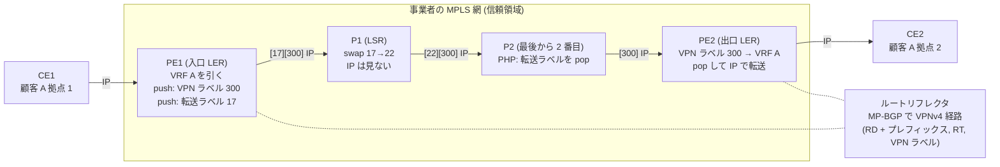
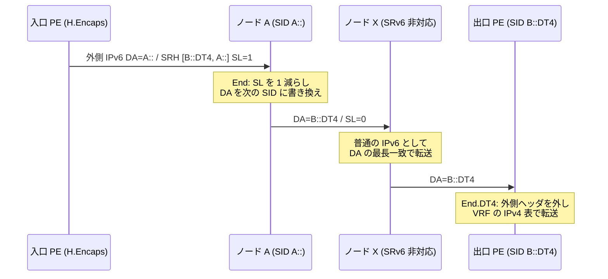

# MPLS と Segment Routing (MPLS & Segment Routing: Carrier WAN)

## 概要 (Overview)

本ドキュメントは、通信事業者の基幹網 (carrier WAN) で使われる **MPLS (Multiprotocol Label Switching)** と、その後継として広がった **Segment Routing (SR)** を扱う。対象は、ラベルスイッチング (label switching) の仕組み (RFC 3031/3032)、ラベル配布プロトコル (LDP と RSVP-TE)、高速迂回 (Fast Reroute)、MPLS の上で提供されるサービス (BGP/MPLS L3VPN、VPLS・EVPN、6PE/6VPE)、SR-MPLS と SRv6、そして運用と故障とセキュリティである。経路制御の基礎 (最長一致・RIB/FIB・IGP と BGP) は [`ip-routing-bgp.md`](ip-routing-bgp.md) を前提とし、データセンター内のオーバーレイ (VXLAN・EVPN) は [`virtual-networks-overlay.md`](virtual-networks-overlay.md)、暗号で守る VPN は [`vpn-tunneling.md`](vpn-tunneling.md) に委ねる。

中心テーゼは、**ラベルスイッチングの価値は表引きの速さではなく、「パケットをどこへ送るか」の判断を IP の宛先アドレスから切り離したことにある**ということである。MPLS が生まれた 1990 年代半ばには、固定長ラベルの完全一致は IP の最長一致より速いという期待があった。この利点は、最長一致を回線速度で処理する ASIC が普及して意味を失った。それでも MPLS が残ったのは、入口のルータが決めた経路・顧客網・迂回路を、中継ルータが IP 宛先を見ずに守れるからである。トラフィックエンジニアリング (TE)、プロバイダが提供する VPN、50 ms 級の迂回は、いずれもこの切り離しの応用である。

SR はこの価値を保ったまま、経路の状態を置く場所を変えた。LDP や RSVP-TE では経路ごとの状態を途中のルータが持ち、プロトコルで維持していた。SR では入口ルータが経路をセグメントの列としてパケットに書き込み、途中のルータは IGP が配る少数の識別子だけを知っていればよい。代わりにヘッダが長くなり、特に SRv6 では 128 ビットの識別子が積み重なるため、圧縮 (RFC 9800) とハードウェア対応が普及の条件になった。信頼の前提は変わらない。MPLS も SR も「事業者が管理する閉じた網の中は信頼できる」という前提で設計されており、SRv6 では IP で外から届いてしまうぶん、その境界を守るフィルタが必須になる。分析深度は Level 3。

## 方法論 (Methodology)

- **一次資料**: アーキテクチャは RFC 3031・3032・3443、ラベル配布は RFC 5036 (LDP)・RFC 3209 (RSVP-TE)・RFC 5443 (LDP と IGP の同期)、迂回は RFC 4090・5286・7490・9855、サービスは RFC 4364・4761・4762・7432・4798・4659、SR は RFC 8402・8660・8661・9256・8754・8986・9800・9602・9252 を使う。RFC の発行年と種別 (標準化トラックか情報提供か) は rfc-editor.org で確認した。
- **セキュリティ**: MPLS VPN の安全性は RFC 4381 と RFC 5920、SRv6 の境界防御は RFC 8754 の第 5 章・第 7 章、経路ヘッダの前例は RFC 5095 に基づく。RFC 4381 は IETF としてのセキュリティ評価を受けていない旨の IESG 注記が付いているため、主張の一部は RFC 8754 など他の文書と照らし合わせて使う。
- **導入状況**: 事業者の導入は事業者自身の発表 (ソフトバンクのプレスリリース、Bell Canada の講演資料) と、IETF に提出された導入状況の Internet-Draft (draft-matsushima-spring-srv6-deployment-status-15、2022 年 4 月、失効済み) で確かめる。ベンダーの記事は事業者発表の傍証としてのみ使い、そう明示する。導入状況はすべて「2026 年 10 月時点で確認できた公開情報」として扱う。
- **担当範囲**: 光伝送と海底ケーブルの物理層は [`../../engineering/telecom/submarine-cables.md`](../../engineering/telecom/submarine-cables.md)、クラウドの基幹網と専用線接続は [`../cloud/cloud-network-topology.md`](../cloud/cloud-network-topology.md)、スイッチ ASIC の表の物理は [`../../hardware/networking/nic-switch-architecture.md`](../../hardware/networking/nic-switch-architecture.md) に委ねる。

## 発見事項 (Findings)

1. **MPLS の当初の動機だった表引きの高速化は、すでに意味を失っている。** Cisco のタグスイッチング (tag switching、RFC 2105、1997 年) や Ipsilon の IP スイッチングは、ATM スイッチの高速な交換機能に IP を載せることを狙っていた。RFC 3031 自身も、ネットワーク層ヘッダを回線速度で解析できない装置でも転送できることを利点に挙げている。現在のルータは IP の最長一致を ASIC で回線速度で処理するため、この利点は残っていない。残ったのは、転送の判断を入口で一度だけ行い、その結果をラベルとして運ぶという構造の利点である。
2. **ラベルは「入口で決めた転送の等価クラス (FEC) を運ぶ番号」であり、その意味は隣接するルータ間でしか通用しない。** ラベルは 20 ビットで、各ルータが自分で割り当てて隣接ルータに配る。中継ルータはラベルを付け替える (swap) だけで、IP ヘッダを見ない。このため、基幹網の中継ルータ (P ルータ) はインターネットの全経路を持つ必要がなくなる (BGP フリーコア)。顧客ごとの経路は縁のルータ (PE) だけが持つ。
3. **LDP は IGP の最短経路にラベルを付けるだけで、経路を選ぶ力を持たない。経路を選ぶには RSVP-TE が必要で、その代償は状態の量だった。** RSVP-TE は帯域や制約付きの経路 (CSPF で計算) を経路上の全ルータに予約させるため、N 台の PE をフルメッシュでつなぐと N(N−1) 本の LSP の状態が途中のルータに積み上がり、定期的な更新 (soft state) が必要になる (RFC 5439)。
4. **50 ms という迂回の目標は、MPLS ではなく SONET/SDH の保護切替から引き継いだ数字である。** SDH のリング保護では、故障検出後 50 ms 以内の切替完了が目標とされた (ITU-T G.841。原文は未確認で、計測器ベンダーの解説と学会論文で確認)。RFC 4090 自身は「数十ミリ秒」とだけ書いている。速さの源は、迂回路を事前に計算して設定しておき、故障時に経路計算もシグナリングもしないことにある。
5. **LFA と rLFA は追加の状態なしに迂回できるが、守れないトポロジがある。TI-LFA は SR を使ってこの穴を埋めた。** LFA (RFC 5286) はループしない隣接ルータがあれば使えるが、リング状の網などでは候補がない (RFC 6571)。TI-LFA (RFC 9855、2025 年 10 月) は、迂回後に IGP が収束したときの経路 (post-convergence path) をセグメント列として事前に設定し、リンクステート IGP を使う 2 重連結の網なら、直接つながるリンク・ノード・SRLG の単一故障を必ず守れる。
6. **BGP/MPLS L3VPN の分離は暗号ではなく設定で保たれている。** 顧客ごとの経路表 (VRF) を分け、Route Distinguisher (RD) で重複アドレスを区別し、Route Target (RT) でどの VRF がどの経路を取り込むかを決める (RFC 4364)。RT の設定を一つ誤れば、別の顧客の経路が取り込まれて網が混ざる。RFC 4381 は、この方式は ATM やフレームリレーと同等の分離を提供できるが、暗号化・完全性・認証は提供しないと明記している。
7. **SR は経路の状態を途中のルータからパケットへ移した。** SR-MPLS (RFC 8660) ではセグメントをラベルとして積み、ノード SID は IGP が配る全網共通の番号 (SRGB の中の index) として扱う。途中のルータは LDP のセッションも RSVP-TE の LSP 状態も持たない。経路の指定は入口の SR ポリシー (RFC 9256) に集約され、複雑な経路計算は PCE (RFC 5440・8664) に任せられる。
8. **SRv6 の弱点はヘッダの長さであり、圧縮がそれを補う。** SRv6 では各セグメントが 128 ビットの IPv6 アドレスで、外側の IPv6 ヘッダ 40 バイトと SRH の固定部 8 バイトに、セグメントごとに 16 バイトが加わる (RFC 8754)。MPLS ラベルは 1 枚 4 バイトである。RFC 9800 (2025 年 6 月) は複数の短い識別子 (C-SID) を 128 ビットに詰める方式を標準化し、そのうち NEXT-C-SID は、以前 uSID と呼ばれていた方式にあたる。
9. **導入事例は事業者の自己発表が中心で、独立した集計は乏しい。** ソフトバンクは 2019 年 4 月にモバイル IP 網で SRv6 の商用運用を始め、2022 年 4 月に全国展開の完了と Flex-Algo によるネットワークスライシングの導入を発表した。IETF の導入状況の Draft (2022 年) は Iliad (イタリア)、中国電信、中国聯通、LINE、楽天 (uSID、展開中)、Bell Canada (uSID) などを挙げる。事業者全体で SR-MPLS と SRv6 と LDP のどれが多いかを示す独立した統計は、今回は見つからなかった。
10. **MPLS も SR も「閉じた信頼領域」を前提としており、SRv6 ではその境界の防御が仕様上の必須事項になった。** MPLS のラベル付きパケットは、PE が顧客側から受け取らない限り外から注入できない。SRv6 の SID は普通の IPv6 アドレスなので外からも届く。RFC 8754 は、SR ドメインの入口で SID 宛てのパケットを捨てることを求め、これを怠れば送信元経路指定 (source routing) の攻撃にさらされると書く。IPv6 の経路ヘッダ Type 0 が 2007 年に廃止された前例 (RFC 5095) が、この設計の背景にある。

## アーキテクチャ (Architecture)

### MPLS L3VPN のパケットの流れ

凡例: 実線はデータの経路、点線は MP-BGP のセッション。`[17][300]` はラベルスタックで、左が一番外側。外側の転送ラベルは「PE2 のループバックまで」を表し、LDP・RSVP-TE・SR のいずれかで配られる。内側の VPN ラベルは「PE2 の中のどの VRF か」を表し、MP-BGP で配られる。P ルータは顧客の経路を一切持たない。

### 経路の状態をどこに置くか

| 方式 | 経路の決め方 | 途中のルータが持つ状態 | 迂回 | 主な制約 |
|---|---|---|---|---|
| LDP (RFC 5036) | IGP の最短経路に従う | FEC ごとのラベル対応、隣接ごとの LDP セッション | LFA / rLFA (rLFA は追加の LDP セッションが必要) | 経路を選べない。IGP との同期が必要 |
| RSVP-TE (RFC 3209) | 入口で CSPF、明示経路を予約 | 通過する LSP ごとの予約状態と定期更新 | RFC 4090 (detour / bypass) | フルメッシュで状態が N² に増える |
| SR-MPLS (RFC 8660) | 入口の SR ポリシー、または IGP 最短経路 | IGP が配るノード SID・隣接 SID のみ | TI-LFA (RFC 9855) | ラベルスタックの深さ (MSD) |
| SRv6 (RFC 8754/8986) | 同上。SID は IPv6 アドレス | ロケータの経路 (IGP) と自分の SID の動作 | TI-LFA | ヘッダ長と MTU、境界フィルタ |

### SRv6 での転送

SRv6 に対応しないルータも、DA (宛先アドレス) を普通の IPv6 アドレスとして転送できる。この点が SR-MPLS との大きな違いで、途中に SRv6 非対応の IPv6 ルータが混ざっていても動く。SRH の Segment List は逆順に並ぶ (最後のセグメントが先頭の要素)。

## 技術詳細 (Technical Details)

### 1. MPLS のデータプレーン (RFC 3031/3032/3443)

- **ラベルスタックの要素**: 1 枚 32 ビットで、ラベル 20 ビット、TC 3 ビット (旧称 EXP、RFC 5462 で改称)、スタックの底を示す S ビット、TTL 8 ビットからなる。ラベルは何枚でも積め、L3VPN では 2 枚、TE や迂回が重なると 3〜4 枚になる。
- **予約ラベル**: 0 (IPv4 explicit null)、2 (IPv6 explicit null)、3 (implicit null)、7 (エントロピーラベル指示子、RFC 6790)、13 (GAL) など 0〜15 が予約されている。implicit null はパケットに現れず、「1 つ手前で pop してほしい」という合図として配られる。
- **LSR と LER、push・swap・pop**: 網の縁でラベルを付ける・外すルータが LER (Label Edge Router)、中で付け替えるルータが LSR (Label Switching Router) である。入口 LER は FEC (同じ扱いを受けるパケットの集合。多くは「出口 PE のループバック宛て」) を決めてラベルを push し、LSR は入ってきたラベルだけを見て swap し、出口で pop する。
- **PHP (Penultimate Hop Popping)**: 出口ルータが implicit null を配ると、1 つ手前のルータが外側のラベルを外す。出口ルータは「ラベルを引いてから IP を引く」という 2 回の表引きを 1 回で済ませられる。代わりに外側ラベルの TC (QoS の印) が失われるため、それを残したい場合は explicit null を配る。
- **TTL の扱い (RFC 3443)**: 入口で IP の TTL をラベルに写し、出口で戻す **uniform** モードでは、traceroute に網内のルータが見える。写さずにラベルの TTL を 255 から始める **pipe**・**short pipe** モードでは、網全体が 1 ホップに見える。内部の構成を隠すために後者を選ぶ事業者もあり、その網は外部の計測からは見えないトンネルになる (Donnet ら 2012 は、測定した経路の少なくとも 30% が MPLS トンネルを通っていたと報告した)。LSP の途中で TTL が尽きた場合、LSR は ICMP Time Exceeded を作り、送信元へ直接返さずに LSP の終端まで運んでから返す (RFC 3032 第 2.3.2 節)。P ルータが送信元への経路を持たなくても traceroute が動くのはこのためで、RFC 4950 は ICMP にラベルスタックを載せる拡張を定めた。
- **ECMP とエントロピーラベル**: 中継ルータは負荷分散のハッシュに使う 5 タプルをラベルの下から推測する。L2 の疑似回線 (pseudowire) では、Ethernet の宛先 MAC の先頭が 4 や 6 だと IPv4/IPv6 と誤認され、同じフローが別経路に散って順序が入れ替わる。対策は制御ワード (control word、RFC 8469 が Ethernet で使用を推奨) と、入口がハッシュ用の値を別のラベルとして載せるエントロピーラベル (RFC 6790) である。

### 2. ラベル配布: LDP と RSVP-TE

- **LDP (RFC 5036)**: 隣接ルータを UDP で発見し、TCP (ポート 646) のセッションで「この FEC にはこのラベル」を交換する。多くの実装は受け取ったラベルを全部保持し (liberal retention)、IGP の次ホップが変わればすぐ使えるようにする。経路は IGP の最短経路そのもので、LDP は経路を選ばない。
- **LDP と IGP の同期 (RFC 5443)**: リンクが復旧した直後、IGP は数百ミリ秒で新しいリンクを使い始めるが、LDP のセッションとラベル交換はそれより遅れることがある。その間、IGP はラベルのない次ホップへ転送させ、BGP フリーコアや L3VPN の通信は捨てられる。RFC 5443 は、LDP が整うまで IGP がそのリンクのメトリックを最大値で広告し、通信を流さないようにする。
- **RSVP-TE (RFC 3209)**: 入口ルータは IGP の TE 拡張 (OSPF-TE は RFC 3630、IS-IS は RFC 5305) で集めたリンクの帯域・属性から、制約付き最短経路 (CSPF) を計算する。PATH メッセージで明示経路 (ERO) を下流へ送り、RESV メッセージで帯域を予約しながらラベルを上流へ返す。状態は soft state で、定期的な更新がなければ消える (RFC 2961 が更新の削減を定める)。
- **状態の代償**: PE が 500 台なら、フルメッシュの LSP は約 25 万本になる。基幹網の中央のルータは、その多くの経路と予約状態を持ち続けなければならない。RFC 5439 はこの規模の問題を分析し、階層化 (LSP を束ねる) などの対処を論じている。この重さが、TE を使わず LDP だけで運用する事業者が多かった理由であり、SR が支持された理由でもある。

### 3. 高速迂回 (Fast Reroute)

- **50 ms の由来**: 電話網の伝送路は SONET/SDH の保護切替 (APS) で守られ、SDH リングでは故障検出後 50 ms 以内に切替を完了することが目標とされた (ITU-T G.841。条件として、余剰トラフィックがなく、1,200 km 未満のリングであることが付く)。IP/MPLS が電話の伝送路を置き換えるとき、この数字が比較の基準になった。RFC 4090 と IP FRR の枠組み (RFC 5714) は「数十ミリ秒」と書くだけで、50 ms を規定していない。
- **速さの内訳**: 故障の影響時間は、検出・局所的な反応・他のルータへの通知・再計算・ハードウェアの表への書き込みの和である (RFC 5714)。FRR は後ろの 3 つを故障の後から外し、検出 (光の信号断や BFD で数十ミリ秒以下) と局所的な切替だけにする。その後で IGP がゆっくり収束し、迂回路から本来の新しい経路へ移る。
- **RSVP-TE FRR (RFC 4090)**: 局所修復点 (PLR) が、保護する LSP ごとに迂回 LSP を作る one-to-one (detour) と、1 本の迂回トンネルに多数の LSP をラベルの重ね付けで載せる facility backup (bypass) がある。迂回路は合流点 (MP) で本来の LSP に戻る。実運用では状態の少ない facility backup が多く使われる。
- **LFA (RFC 5286)・rLFA (RFC 7490)**: LFA は「その隣接ルータへ送っても、自分へ戻ってこない」という不等式を満たす隣接ルータを事前に選んでおく。追加の状態もシグナリングも不要だが、守れる範囲はトポロジで決まり、リングでは 1 つも見つからないことがある (RFC 6571)。rLFA は数ホップ先の PQ ノードまでトンネルで運ぶことで範囲を広げるが、そのノードへの追加の LDP セッション (targeted LDP) が必要になる。
- **TI-LFA (RFC 9855)**: SR では任意の経路をセグメント列で指定できるため、PLR は「故障後に IGP が収束したら使う経路」をそのままセグメント列で表して事前に設定できる。迂回路と収束後の経路が一致するため、収束時の経路の切り替わりが少なく、マイクロループ (収束の途中で一時的にできるループ) も起きにくい。RFC 9855 の付録には、実網で 99% 超のリンク保護を 1 個以下の追加 SID で表せたという結果が載っている。

### 4. MPLS の上のサービス

- **BGP/MPLS L3VPN (RFC 4364)**: PE は顧客ごとに VRF を持ち、CE から学んだ経路に RD (8 バイト) を前置して VPNv4 (12 バイトのアドレス) にし、MP-BGP で他の PE に広告する。RD は「異なる顧客が同じ 10.0.0.0/8 を使っても別の経路として扱う」ための区別にすぎず、どの VRF がその経路を取り込むかは拡張コミュニティの RT で決まる。RD と RT を混同した設計は、事故の典型的な原因である。ハブ&スポーク型や共有サービス型の VPN は、RT の取り込み・広告の組み合わせで作る。事業者をまたぐ接続には Option A (VRF どうしを直結)、B (ASBR が VPN 経路を交換)、C (PE 間で直接交換) がある (RFC 4364 第 10 章)。
- **L2VPN**: VPLS は Ethernet の LAN を MPLS 網の上に作る方式で、シグナリングに BGP を使う RFC 4761 と LDP を使う RFC 4762 の 2 つがある。どちらもデータプレーンで MAC アドレスを学習し、マルチホーミング (1 つの拠点を 2 台の PE につなぐ) が苦手だった。EVPN (RFC 7432) は MAC アドレスも BGP の経路として広告し、アクティブ・アクティブのマルチホーミングを標準で扱う。EVPN は MPLS の上でも VXLAN の上でも使え、データセンターでの使い方は [`virtual-networks-overlay.md`](virtual-networks-overlay.md) が扱う。
- **6PE/6VPE**: 基幹網を IPv4 の MPLS のまま、PE だけを IPv6 対応にして IPv6 を運ぶ方式である。6PE (RFC 4798) は IPv6 のインターネット経路、6VPE (RFC 4659) は VPN の IPv6 経路を、IPv4 の BGP ネクストホップと内側のラベルで運ぶ。P ルータは IPv6 を知らなくてよく、ここでもラベルが IP 宛先を隠す利点が使われている。
- **プロバイダ提供 VPN と暗号 VPN**: L3VPN は顧客から見ると「事業者が分けてくれる閉域網」であり、[`vpn-tunneling.md`](vpn-tunneling.md) の IPsec や WireGuard のように暗号で守るものではない。事業者を信頼しない顧客は、L3VPN の上で IPsec を張る (RFC 4381 もそう勧めている)。クラウドの専用線接続の先が事業者の閉域網であることも多い ([`../cloud/cloud-network-topology.md`](../cloud/cloud-network-topology.md))。

### 5. Segment Routing (RFC 8402) と SR-MPLS

- **送信元経路指定への回帰**: セグメントは「このノードへ最短経路で行け」「このリンクを通れ」「このサービスを適用せよ」といった命令で、入口がその列をパケットに書く。主な種類は、全網で通用するプレフィックス SID (ループバックに付けたものがノード SID)、そのルータの中だけで通用する隣接 SID (adjacency SID)、別の SR ポリシーへの入口を表すバインディング SID である。SID は IGP (IS-IS・OSPF の SR 拡張) が配るため、LDP も RSVP-TE も不要になる。
- **SRGB とラベル (RFC 8660)**: プレフィックス SID は index として配られ、各ルータは自分の SRGB (Segment Routing Global Block、SR 用に確保したラベル範囲) の先頭に index を足した値をラベルとして使う。全ルータが同じ SRGB を使えば、あるノードへのラベルは網のどこで見ても同じ値になり、運用と障害解析が簡単になる。ルータごとに SRGB が違っても動くが、その場合ラベルは隣接ごとに変わる。
- **SR ポリシー (RFC 9256)**: SR ポリシーは (入口、color、出口) の組で識別され、複数の候補経路とそれぞれのセグメント列を持つ。color は「低遅延」「帯域保証」などの意図を表す番号で、BGP の経路に同じ color のコミュニティを付けると、その宛先の通信が自動的に対応するポリシーに載る。経路計算の制約を IGP に持たせる Flex-Algo (RFC 9350) を使えば、ポリシーを個別に作らずに「遅延を最小にする別の最短経路木」などを網全体で計算できる。
- **PCE の役割**: 複数の領域や AS をまたぐ経路、帯域の空きを考慮した経路は、入口ルータ単独では計算しにくい。PCE (Path Computation Element) は網全体の TE 情報を集めて計算し、PCEP (RFC 5440、SR 拡張は RFC 8664) で入口にセグメント列を渡す。RSVP-TE では途中のルータが帯域予約を持っていたが、SR では予約の台帳は PCE (コントローラ) の中にしかない。途中のルータは帯域を守る仕組みを持たないため、帯域保証の正しさはコントローラの計算と計測に依存する。
- **LDP からの移行 (RFC 8661)**: SR と LDP は同じルータで並行して動かせる。SR 非対応のルータが残る区間では、マッピングサーバが SR 非対応ノードのプレフィックスに代わりに SID を広告し、境界のルータが LDP のラベルと SR のラベルをつなぐ。全ルータが SR に対応したら、SR のラベルを優先する設定に切り替え、LDP を止める。Bell Canada は早期に SR-MPLS を導入し、その後 SRv6 uSID へ移ったことを講演 (MPLS World Congress 2022) で説明している。

### 6. SRv6 (RFC 8754/8986/9800)

- **SRH (RFC 8754、2020 年)**: IPv6 の経路ヘッダ (Routing Type 4) で、固定部 8 バイトに Segments Left (残りのセグメント数)、Last Entry、Tag などを持ち、その後に 16 バイトのセグメントが並ぶ。現在のセグメントは常に外側 IPv6 の DA に入っている。
- **ネットワークプログラミング (RFC 8986、2021 年)**: SID を「ロケータ (どのノードか)・機能 (何をするか)・引数」に分け、End (次のセグメントへ)、End.X (指定の隣接へ)、End.DT4/DT6 (外側を外して VRF の表で転送)、End.DX2 (L2 の疑似回線) などの動作を定める。L3VPN の VPN ラベルの役割を End.DT4 の SID が担い、BGP での広告方法は RFC 9252 が定める。MPLS ではラベルの意味が各ルータの表にしかなかったが、SRv6 では SID の値そのものに「どのノードの、どの動作か」が書かれている。
- **ヘッダ長の比較**: 3 セグメントの経路を指定する場合、SR-MPLS ならラベル 3 枚で 12 バイトである。SRv6 で全セグメントを SRH に載せると、外側 IPv6 40 バイト + SRH 8 バイト + 16×3 バイトで 96 バイトになる。最初のセグメントを DA だけに入れる H.Encaps.Red (RFC 8986) なら 80 バイト、1 セグメントだけなら SRH を省いて 40 バイトになる。基幹網のリンクは通常ジャンボフレームを使うが、顧客側の 1500 バイトの MTU を保ったまま運ぶには、網内の MTU に余裕が必要である。RFC 8754 は、網内の MTU を入口より大きくするよう勧めている。
- **SID の圧縮 (RFC 9800、2025 年 6 月)**: 共通の上位ビット (Locator-Block) を一度だけ書き、その後に 16 ビットや 32 ビットの短い C-SID を詰める。NEXT-C-SID では、Locator-Block が 32 ビット、C-SID が 16 ビットなら 1 つの 128 ビットのアドレスに 6 個、Locator-Block が 48 ビットなら 5 個の C-SID が入る。各ノードは DA の中で C-SID をずらし、次の C-SID を先頭に出すだけで転送できる。6 ノード以内の経路なら SRH が不要になり、ヘッダは外側 IPv6 の 40 バイトだけになる。NEXT-C-SID は、以前の Draft で uSID (micro-segment) と呼ばれた方式で、もう一方の REPLACE-C-SID は SRH の中の C-SID を順に DA に入れ替える。一つのルーティング領域では一つの方式に揃えることが推奨されている。
- **アドレスの割り当て (RFC 9602、2024 年)**: IANA は SRv6 の SID 用に `5f00::/16` を割り当てた。SID であることがアドレスで判別できるため、境界のフィルタを書きやすくなる。それ以前の導入例では、SID に事業者のグローバルアドレスや ULA が使われており (楽天は ULA を使用、2022 年の Draft による)、既存網がこのブロックへ移るかは事業者ごとの判断である。
- **ハードウェアとの関係**: 入口で積めるラベルや SID の数には ASIC の上限があり、各ルータは IGP で MSD (Maximum SID Depth、IS-IS は RFC 8491) を広告して、コントローラがそれを超える経路を作らないようにする。SRv6 では中継ルータが 128 ビット単位のセグメント列を深く読む必要があり、古い ASIC は対応できないか、処理が遅い経路に回る。圧縮した SID は DA の最長一致とビットのずらしだけで処理できるため、既存の IPv6 転送機能に近い形で実装できる。SR-MPLS と SRv6 の選択は、この装置の世代と、網の端まで (ホストやコンテナまで) 同じ方式を延ばしたいかどうかで決まることが多い。
- **導入の状況 (2026 年 10 月時点)**: ソフトバンクは 2019 年 4 月にモバイル IP 網で SRv6 の商用運用を始め、2022 年 4 月に全国展開の完了と SRv6 Flex-Algo によるスライシングの導入を発表した (同社プレスリリース。Cisco も人口カバー率 90% 超の網と発表しているが、これはベンダーによる発表で独立した検証ではない)。2022 年 4 月版の導入状況 Draft は、Iliad (イタリア、2020 年末時点で NCS 5500 ルータ 1,350 台)、中国電信 (四川)、中国聯通、CERNET2、MTN Uganda、楽天 (uSID、展開中)、Bell Canada (uSID)、Alibaba、Free (フランス、展開中) などを挙げる。この Draft は個人提出で失効しており、2022 年以降の更新はない。事業者の発表は導入の事実を示すが、規模や比率の独立した集計ではない。

## セキュリティ考察 (Security Considerations)

- **閉じた信頼領域という前提**: MPLS の制御プレーン (LDP・RSVP-TE・MP-BGP) とデータプレーンは、網の内部にいる者を信頼する。RFC 4381 も MPLS の中核網が信頼できることを前提に分析しており、網内の誤設定や盗聴は分析の対象外である。事業者をまたぐ L3VPN (特に Option B・C) では、関係する全事業者が一つの信頼領域になる (RFC 4381)。顧客は、自分のデータの機密性を事業者の運用に預けていることになる。
- **ラベルの偽装**: PE が顧客側の回線からラベル付きのパケットを受け取らなければ、外部から網内へラベルを注入することはできない (RFC 4381)。逆にこの規則が破られると、攻撃者は内側の VPN ラベルを推測して他の顧客の VRF にパケットを送り込める。事業者間の接続点 (Option B・C) でラベル付きのパケットを受け取る場合は、相手から届いてよいラベルの範囲を限ることが必要になる。RFC 5920 は MPLS と GMPLS の脅威と対策を体系化している。
- **L3VPN の分離が壊れる場合**: 分離は RT・VRF・インターフェースの対応という設定で保たれる。RT の取り込み設定の誤り、共有サービス用の RT の付けすぎ、インターネット用 VRF との誤った経路漏れ (route leaking) は、暗号の解読なしに顧客網どうしを直接つなぐ。分離に暗号学的な保証はないため、設定の監査 (どの VRF がどの RT を取り込むかの一覧と差分) が実質的な防御になる。
- **TTL の非伝播と可視性**: pipe モードは事業者の内部構成を隠すが、同時に顧客や第三者が障害の位置を調べる手段も奪う。網内の障害は外からは「1 ホップの中で何かが起きた」としか見えない。LSP ping (RFC 8029) などの網内の診断手段を事業者が持つことが前提になる。
- **SRv6 の境界防御**: SRv6 の SID は IPv6 アドレスなので、境界で止めなければ外部から任意の SID 列を指定したパケットを送り込める。これはファイアウォールの迂回、本来届かない機器への到達、トポロジの探索、ループによる帯域の浪費につながり、IPv6 の経路ヘッダ Type 0 が廃止された理由 (RFC 5095、2007 年) と同じ種類の問題である。RFC 8754 は、(1) SR ドメインの入口で SID 宛てのパケットを捨てる ACL (SID を一つのアドレス範囲から割り当てておくと書きやすい)、(2) 各ノードで、送信元がドメイン内でない自分の SID 宛てのパケットを捨てることを求め、これを怠ればドメインは送信元経路指定の攻撃にさらされると書いている。SRH を守る HMAC TLV は任意であり、内部では使われないことが多い。
- **SRH の情報漏洩と改ざん**: SRH は暗号化されないため、網内で傍受されれば経路上の SID が見える (RFC 8754 第 7.3 節)。HMAC を使わない場合、網内に入り込んだ攻撃者は SRH を書き換えて経路を変えられる。どちらも「網内は信頼できる」という前提の範囲で許容されているリスクである。
- **制御プレーンの集中**: SR ではセグメント列を書く入口ルータと、それを計算する PCE やコントローラが、経路の指定を一手に担う。RSVP-TE では途中のルータが不正な予約を拒否できたが、SR では途中のルータは渡されたセグメント列に従うだけである。コントローラや PCEP セッションの侵害は網全体の経路の侵害になるため、PCEP は TLS で保護し (RFC 8253)、コントローラの変更経路を監査する必要がある。
- **ルータへの攻撃面**: LDP は TCP 646 番、RSVP は IP プロトコル 46 で動く。いずれも網の外から届くべきでない通信であり、境界での遮断と、ルータの制御プレーン保護 (CoPP)、LDP の TCP 認証 (TCP-AO、RFC 5925) を組み合わせる。BGP のセッション保護は [`ip-routing-bgp.md`](ip-routing-bgp.md) と共通である。

## 結論 (Conclusions)

- MPLS が残った理由は表引きの速さではなく、転送の判断を入口で一度だけ行い、中継ルータに IP 宛先を見させないことにある。BGP フリーコア、TE、L3VPN、6PE、FRR は、いずれもこの切り離しの上に成り立っている。
- LDP は状態が軽いが経路を選べず、RSVP-TE は経路を選べるが状態が重い。SR は経路をパケットに書くことでこの二者択一を解き、途中のルータの状態を IGP の情報だけにした。その代わりに、帯域の台帳と経路の正しさはコントローラへ集まった。
- 迂回の 50 ms は SONET/SDH から受け継いだ目標であり、その速さは事前計算と局所的な切替から来る。TI-LFA は SR の自由な経路指定を使って、LFA が守れなかったトポロジを埋めた。
- SRv6 は IPv6 だけで網の端から端まで同じ方式を使えるが、ヘッダの長さとハードウェアの対応が課題で、RFC 9800 の圧縮がその解として標準化された。導入は日本・欧州・中国などの事業者で公表されているが、全体の比率を示す独立した統計はない。
- 安全性は一貫して「閉じた網の中は信頼できる」という前提に依存する。L3VPN の分離は設定で保たれ、暗号の保証はない。SRv6 では網が IP で外とつながるため、RFC 8754 が求める境界フィルタが守られているかどうかが、送信元経路指定の攻撃を防ぐ条件になる。

### 次の接続先 (Related Topics)

- [`ip-routing-bgp.md`](ip-routing-bgp.md) — IGP と BGP の機構。L3VPN の MP-BGP、ルートリフレクタ、セッション保護はここが前提。
- [`virtual-networks-overlay.md`](virtual-networks-overlay.md) — EVPN をデータセンターの VXLAN オーバーレイで使う場合。カプセル化と MTU の議論は SRv6 と共通する。
- [`vpn-tunneling.md`](vpn-tunneling.md) — 暗号で守る VPN。事業者が提供する閉域網 (L3VPN) との対比。
- [`ip-addressing-icmp-dhcp-nat.md`](ip-addressing-icmp-dhcp-nat.md) — 経路 MTU 探索とそのブラックホール。ラベルや SRH の追加で起きる MTU 障害の背景。
- [`../cloud/cloud-network-topology.md`](../cloud/cloud-network-topology.md) — クラウドの基幹網と専用線接続。事業者の閉域網との接点。
- [`../../engineering/telecom/submarine-cables.md`](../../engineering/telecom/submarine-cables.md) — MPLS/SR 網の下にある長距離の物理伝送路。
- [`../../hardware/networking/nic-switch-architecture.md`](../../hardware/networking/nic-switch-architecture.md) — ラベルスタックの深さや SRv6 の処理を決める ASIC の構造。

## 参考文献 (References)

**一次資料 (RFC)**

- Rosen, E., Viswanathan, A., & Callon, R. (2001). Multiprotocol Label Switching Architecture. *RFC 3031*. — [rfc-editor.org](https://www.rfc-editor.org/rfc/rfc3031) — Accessed: 2026-10-26
- Rosen, E., et al. (2001). MPLS Label Stack Encoding. *RFC 3032*. — ラベルスタックの形式、予約ラベル、LSP 内の ICMP の扱い (第 2.3.2 節)。
- Agarwal, P., & Akyol, B. (2003). Time To Live (TTL) Processing in Multi-Protocol Label Switching (MPLS) Networks. *RFC 3443*. — uniform / pipe / short pipe モード。
- Rekhter, Y., Davie, B., Katz, D., Rosen, E., & Swallow, G. (1997). Cisco Systems' Tag Switching Architecture Overview. *RFC 2105*. — [rfc-editor.org](https://www.rfc-editor.org/rfc/rfc2105) — Accessed: 2026-10-26
- Andersson, L., Minei, I., & Thomas, B. (Eds.) (2007). LDP Specification. *RFC 5036*.
- Jork, M., Atlas, A., & Fang, L. (2009). LDP IGP Synchronization. *RFC 5443*.
- Awduche, D., et al. (2001). RSVP-TE: Extensions to RSVP for LSP Tunnels. *RFC 3209*.
- Yasukawa, S., Farrel, A., & Komolafe, O. (2009). An Analysis of Scaling Issues in MPLS-TE Core Networks. *RFC 5439*.
- Pan, P., Swallow, G., & Atlas, A. (Eds.) (2005). Fast Reroute Extensions to RSVP-TE for LSP Tunnels. *RFC 4090*. — [rfc-editor.org](https://www.rfc-editor.org/rfc/rfc4090) — Accessed: 2026-10-26。「数十ミリ秒」での迂回、detour と bypass。
- Shand, M., & Bryant, S. (2010). IP Fast Reroute Framework. *RFC 5714*. — 影響時間の内訳。
- Atlas, A., & Zinin, A. (Eds.) (2008). Basic Specification for IP Fast Reroute: Loop-Free Alternates. *RFC 5286*. / Bryant, S., et al. (2015). Remote Loop-Free Alternate (LFA) Fast Reroute (FRR). *RFC 7490*. / Filsfils, C., et al. (2012). Loop-Free Alternate (LFA) Applicability in Service Provider (SP) Networks. *RFC 6571*.
- Bashandy, A., Litkowski, S., Filsfils, C., Francois, P., Decraene, B., & Voyer, D. (2025). Topology Independent Fast Reroute Using Segment Routing. *RFC 9855*. — [rfc-editor.org](https://www.rfc-editor.org/info/rfc9855) — Accessed: 2026-10-26
- Rosen, E., & Rekhter, Y. (2006). BGP/MPLS IP Virtual Private Networks (VPNs). *RFC 4364*.
- Kompella, K., & Rekhter, Y. (Eds.) (2007). Virtual Private LAN Service (VPLS) Using BGP for Auto-Discovery and Signaling. *RFC 4761*. / Lasserre, M., & Kompella, V. (Eds.) (2007). Virtual Private LAN Service (VPLS) Using Label Distribution Protocol (LDP) Signaling. *RFC 4762*.
- Sajassi, A., et al. (2015). BGP MPLS-Based Ethernet VPN. *RFC 7432*.
- De Clercq, J., Ooms, D., Prevost, S., & Le Faucheur, F. (2007). Connecting IPv6 Islands over IPv4 MPLS Using IPv6 Provider Edge Routers (6PE). *RFC 4798*. / De Clercq, J., et al. (2006). BGP-MPLS IP Virtual Private Network (VPN) Extension for IPv6 VPN. *RFC 4659*.
- Kompella, K., et al. (2012). The Use of Entropy Labels in MPLS Forwarding. *RFC 6790*. / Bryant, S., et al. (2018). Recommendation to Use the Ethernet Control Word. *RFC 8469*.
- Bonica, R., et al. (2007). ICMP Extensions for Multiprotocol Label Switching. *RFC 4950*. / Kompella, K., et al. (2017). Detecting Multiprotocol Label Switched (MPLS) Data-Plane Failures. *RFC 8029*.
- Filsfils, C., et al. (Eds.) (2018). Segment Routing Architecture. *RFC 8402*. — [rfc-editor.org](https://www.rfc-editor.org/rfc/rfc8402) — Accessed: 2026-10-26
- Bashandy, A., et al. (Eds.) (2019). Segment Routing with the MPLS Data Plane. *RFC 8660*. / Bashandy, A., et al. (Eds.) (2019). Segment Routing MPLS Interworking with LDP. *RFC 8661*.
- Filsfils, C., Talaulikar, K., et al. (Eds.) (2022). Segment Routing Policy Architecture. *RFC 9256*.
- Psenak, P., et al. (2023). IGP Flexible Algorithm. *RFC 9350*.
- Vasseur, JP., & Le Roux, JL. (Eds.) (2009). Path Computation Element (PCE) Communication Protocol (PCEP). *RFC 5440*. / Sivabalan, S., et al. (2019). PCEP Extensions for Segment Routing. *RFC 8664*. / Lopez, D., et al. (2017). PCEPS: Usage of TLS to Provide a Secure Transport for PCEP. *RFC 8253*.
- Tantsura, J., et al. (2018). Signaling Maximum SID Depth (MSD) Using IS-IS. *RFC 8491*.
- Filsfils, C., et al. (Eds.) (2020). IPv6 Segment Routing Header (SRH). *RFC 8754*. — [rfc-editor.org](https://www.rfc-editor.org/rfc/rfc8754) — Accessed: 2026-10-26。第 5 章・第 7 章の境界フィルタと HMAC。
- Filsfils, C., et al. (Eds.) (2021). Segment Routing over IPv6 (SRv6) Network Programming. *RFC 8986*.
- Dawra, G., et al. (Eds.) (2022). BGP Overlay Services Based on Segment Routing over IPv6 (SRv6). *RFC 9252*.
- Cheng, W., Filsfils, C., Li, Z., Decraene, B., & Clad, F. (Eds.) (2025). Compressed SRv6 Segment List Encoding. *RFC 9800*. — [rfc-editor.org](https://www.rfc-editor.org/rfc/rfc9800) — Accessed: 2026-10-26
- Krishnan, S. (2024). Segment Routing over IPv6 (SRv6) Segment Identifiers in the IPv6 Addressing Architecture. *RFC 9602*. — [rfc-editor.org](https://www.rfc-editor.org/info/rfc9602) — Accessed: 2026-10-26。`5f00::/16` の割り当て。
- Abley, J., Savola, P., & Neville-Neil, G. (2007). Deprecation of Type 0 Routing Headers in IPv6. *RFC 5095*.
- Behringer, M. (2006). Analysis of the Security of BGP/MPLS IP Virtual Private Networks (VPNs). *RFC 4381*. — [rfc-editor.org](https://www.rfc-editor.org/rfc/rfc4381) — Accessed: 2026-10-26。IETF のセキュリティ評価を受けていない旨の IESG 注記あり。
- Fang, L. (Ed.) (2010). Security Framework for MPLS and GMPLS Networks. *RFC 5920*.

**一次資料 (Internet-Draft・事業者の発表)**

- [SRv6 Implementation and Deployment Status (draft-matsushima-spring-srv6-deployment-status-15)](https://datatracker.ietf.org/doc/html/draft-matsushima-spring-srv6-deployment-status-15) — Accessed: 2026-10-26。2022 年 4 月、個人提出、失効済み。
- [Compressed SRv6 Segment List Encoding (draft-ietf-spring-srv6-srh-compression-18)](https://datatracker.ietf.org/doc/html/draft-ietf-spring-srv6-srh-compression-18) — Accessed: 2026-10-26。NEXT-C-SID が以前 uSID と呼ばれた方式であることの記述。
- [ソフトバンク: モバイルIPネットワークにおいて「SRv6（セグメントルーティングIPv6）」の運用を開始 (2019-04-24)](https://www.softbank.jp/corp/news/press/sbkk/2019/20190424_03) — Accessed: 2026-10-26
- [ソフトバンク: SRv6の全国展開完了と新機能「SRv6 Flex-Algo」によるネットワークスライシングの商用ネットワークへの導入開始について (2022-04-26)](https://www.softbank.jp/corp/news/press/sbkk/2022/20220426_01) — Accessed: 2026-10-26
- [Voyer, D. (Bell Canada). Bell SRv6 uSID Deployment, MPLS World Congress 2022](https://www.segment-routing.net/conferences/MPLS-WC-2022-Daniel-Voyer/) — Accessed: 2026-10-26。事業者による講演資料 (掲載サイトはベンダー運営)。

**二次資料 (Secondary)**

- [Cisco: Cisco marks world's first with the deployment of SRv6 Flex-Algo on SoftBank's 5G commercial network (2022-04-27)](https://news-blogs.cisco.com/apjc/2022/04/27/cisco-marks-worlds-first1-with-the-deployment-of-srv6-flex-algo-on-softbanks-5g-commercial-network/) — Accessed: 2026-10-26。ベンダーの発表であり、ソフトバンクの発表の傍証としてのみ使用。
- Donnet, B., Luckie, M., Mérindol, P., & Pansiot, J.-J. (2012). Revealing MPLS Tunnels Obscured from Traceroute. *ACM SIGCOMM Computer Communication Review*, 42(2), 87–93. — 測定経路の少なくとも 30% が MPLS トンネルを通過。
- [Anritsu: APS (Automatic Protection Switching) Application Note](https://dl.cdn-anritsu.com/en-us/test-measurement/files/Application-Notes/Application-Note/APS-Application%20Note_EF2100.pdf) — Accessed: 2026-10-26。ITU-T G.783/G.841 の 50 ms 切替要件の解説。G.841 の原文は本稿執筆時に参照できなかった。
