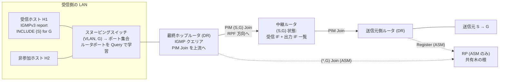
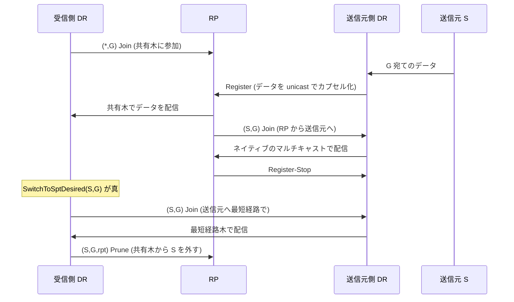

# IP マルチキャストとローカルなサービス探索 (IP Multicast & Local Service Discovery: IGMP/MLD, PIM, mDNS & DNS-SD)

## 概要 (Overview)

本ドキュメントは 1 つの送信を複数の受信者へ届ける **IP マルチキャスト (IP multicast)** と、その上に作られた **ローカルなサービス探索 (local service discovery)** を扱う。対象はグループアドレスと MAC アドレスへの写像、ホストとルータの間の合図 (IGMP・MLD) とスイッチの IGMP/MLD スヌーピング (snooping)、ルータ間の配信木を作る PIM (PIM-SM・SSM・PIM-DM) と状態を持たない BIER、実際に使われている場面 (通信事業者の IPTV、金融の市場データ配信、IPv6 の近隣探索、無線 LAN)、そして mDNS・DNS-SD・SSDP・LLMNR・NBT-NS と、その代わりに広がりつつあるユニキャストの DNS-SD (SRP・Discovery Proxy) である。MAC アドレスの構造とフラッディング、ストーム制御、近隣探索 (NDP) の仕組みは [`ethernet-lan-switching.md`](ethernet-lan-switching.md) に、224.0.0.0/4 の範囲と IPv6 でのブロードキャストの廃止は [`ip-addressing-icmp-dhcp-nat.md`](ip-addressing-icmp-dhcp-nat.md) に、ユニキャストの DNS のレコード型とキャッシュは [`dns-resolution.md`](dns-resolution.md) に委ねる。

中心テーゼは、**マルチキャストは送信者の負担を受信者の数から切り離す代わりに、「誰が聞いているか」という状態を網の中に置く技術であり、その状態を誰が持ち、誰が費用を払い、どこまで信頼するかが決まらない場所では使われない**ということである。送信者は 1 つのパケットを送るだけで済むが、その複製を正しい枝にだけ流すには、ルータがグループごと (送信元ごと) の転送状態を持ち、スイッチが受信者の参加を盗み聞きして表を作る必要がある。単一の事業者や組織が網と受信者をまとめて管理する場所 (IPTV、取引所の配信網、データセンターの EVPN) では、この状態の費用を払う者がはっきりしているので使われている。インターネット全体ではこの条件がそろわず、ドメイン間のマルチキャストは一般向けのサービスにならなかった。

ローカルなサービス探索は、この構図を小さな規模にしたものである。mDNS と DNS-SD は「リンクの上の全員に聞けば、管理者なしで名前とサービスが見つかる」という設計で、家庭や小さな事務所では非常にうまく働く。しかし、全員に聞くことは、無線 LAN では電波の時間を大きく消費し、ルータを越えられず、近くにいる誰の応答でも信じることを意味する。大規模な網や低電力の網では、IETF 自身がマルチキャストからユニキャストの登録 (SRP、RFC 9665) と代理 (Discovery Proxy、RFC 8766) へ移る道を標準化した。また、応答者を誰でも名乗れることは LLMNR・NBT-NS の名前解決の毒入れ (poisoning) による認証情報の窃取の原因になった。本書は (1) グループアドレス、(2) IGMP/MLD、(3) スヌーピング、(4) PIM と SSM、(5) BIER とデータセンター・VPN でのマルチキャスト、(6) 使われている場面と無線 LAN、(7) mDNS と DNS-SD、(8) その他の探索プロトコル、(9) ユニキャストの DNS-SD、(10) 障害モードの順に整理する。分析深度は Level 3。

## 方法論 (Methodology)

- **一次資料 (RFC)**: ホストの拡張は RFC 1112、IGMP は RFC 2236 (v2)・RFC 3376 と、2025 年 3 月に Internet Standard になった RFC 9776 (IGMPv3、STD 100)、MLD は RFC 3810 と RFC 9777 (MLDv2、STD 101)、スヌーピングは RFC 4541、経路制御は RFC 7761 (PIM-SM、STD 83)・RFC 4607 と RFC 4604 (SSM)・RFC 3973 (PIM-DM)・RFC 5059 (BSR)・RFC 4610 (Anycast-RP)・RFC 3618 (MSDP)・RFC 7450 (AMT)、BIER は RFC 8279・8296、EVPN は RFC 9251、無線 LAN は RFC 9119、サービス探索は RFC 6762 (mDNS)・RFC 6763 (DNS-SD)・RFC 4795 (LLMNR)・RFC 8766・RFC 8765・RFC 9665 を使う。RFC の発行年・種別・改訂関係は rfc-editor.org と IETF Datatracker で確認した。
- **業界・事業者の仕様**: SSDP と UPnP は Open Connectivity Foundation (OCF) の UPnP Device Architecture 2.0 (2020 年 4 月 17 日版)、通信事業者のアクセス網での IGMP の扱いは Broadband Forum の TR-101 Issue 2 (2011 年 7 月)、市場データの配信は CME Group の MDP 3.0 の公開文書、Thread のボーダールータは OpenThread の公式文書、Matter の DNS-SD の使い方は Matter Handbook を参照した。Matter の仕様書そのものは会員向けで参照できなかったため、Matter Handbook の記述を二次的な裏付けとして扱う。
- **セキュリティ**: 名前解決の毒入れは MITRE ATT&CK T1557.001、SSDP の反射増幅は CISA の注意喚起 (TA14-017A、2019 年 12 月改訂)、CallStranger は CERT/CC の VU#339275、mDNS のリンク外への応答は CERT/CC の VU#550620、Microsoft の LLMNR・NetBIOS の段階的廃止は同社の Tech Community の記事 (2022 年 4 月) に基づく。攻撃は仕組みと防御の観点からだけ説明し、ツールの使い方は書かない。
- **歴史的評価**: インターネットでマルチキャストが広がらなかった理由は Diot ら (2000、IEEE Network) の事業者の視点からの分析を原典とする。現在のドメイン間マルチキャストの普及度を示す独立した計測は今回見つからなかったため、量的な主張はしない。
- **担当範囲**: QoS の配分は [`qos-traffic-management.md`](qos-traffic-management.md)、MPLS 網とその上の VPN は [`mpls-segment-routing.md`](mpls-segment-routing.md)、VXLAN と EVPN の制御平面は [`virtual-networks-overlay.md`](virtual-networks-overlay.md)、反射増幅攻撃一般への対策は [`ddos-mitigation.md`](ddos-mitigation.md)、NTLM と Windows の認証は [`../security/enterprise-authentication.md`](../security/enterprise-authentication.md) に委ねる。

## 発見事項 (Findings)

1. **マルチキャストは送信者の費用を受信者数から切り離すが、その代わりに網の中に状態を置く。** ルータはグループ (または送信元とグループの組) ごとに、どのインターフェースへ複製するかを覚える。スイッチは IGMP/MLD を盗み聞きして、ポートごとの参加状態を作る。ユニキャストの経路表は宛先プレフィックスの数で決まるが、マルチキャストの状態はアプリケーションが作るグループの数で増え、網の運用者はその数を制御できない。
2. **インターネットでマルチキャストが広がらなかったのは、技術の不足ではなく事業モデルの不在による。** Diot ら (2000) は、もとのサービスモデルが商用の要件 (グループの作成・送信・受信の認可、アドレスの分散割り当て、課金、網の管理) を考えずに作られたこと、ドメイン間の送信元の発見に使われた MSDP が送信元の情報を定期的に全域へ流すため拡張性がないことを指摘した。同論文は送信元を 1 つに限るモデル (後の SSM) なら RP も MSDP も不要になり、課金も単純になると結論した。
3. **IPv4 のマルチキャストアドレスから MAC アドレスへの写像は 32 対 1 であり、L2 では区別できないグループがある。** `01:00:5e` の後に IP アドレスの下位 23 ビットを入れるため、28 ビットのグループ部のうち 5 ビットが失われる (RFC 1112)。このため `224.0.0.1` と `225.0.0.1`・`239.128.0.1` は同じ MAC アドレスになり、MAC アドレスで転送するスイッチは参加していない受信者にも届けてしまう (RFC 4541)。IPv6 は `33:33` の後に下位 32 ビットを入れる (RFC 2464) が、重なりの問題は同じ形で残る。
4. **IGMPv3 と MLDv2 は「どの送信元から受け取るか」を受信者が言えるようにし、2025 年に Internet Standard になった。** v2 までは同じグループの報告を他の端末が出したら自分の報告を取りやめる (報告の抑制) ため、ルータは端末ごとの参加を知らなかった。v3 は抑制をやめ、送信元の一覧 (INCLUDE/EXCLUDE) を報告する。RFC 9776・9777 (2025 年 3 月) はそれぞれ RFC 3376・3810 を置き換え、STD 100・101 になった。
5. **IGMP/MLD スヌーピングは標準ではなく、情報提供の RFC 4541 (2006 年) が推奨をまとめているだけである。** そのため実装ごとに、未登録のグループの扱い (全ポートへ流すか、ルータのポートだけへ送るか)、クエリア (querier) がいない場合の挙動、IGMPv3 の理解の程度が違う。IPv6 では近隣探索がマルチキャストに頼るため、MLD スヌーピングの不具合は IPv6 の通信そのものを止める。
6. **PIM-SM の共有木から最短経路木への切り替えは、仕様では方針として実装に任されている。** 受信側の DR はまず RP を根とする共有木 (\*,G) に参加し、送信元が分かると (S,G) の最短経路木に移れる。いつ移るかは `SwitchToSptDesired(S,G)` という方針の関数で、RFC 7761 は「移らない」「最初のパケットで移る」を例に挙げるだけである。SSM (RFC 4607) は受信者が最初から送信元を指定するため、RP・共有木・切り替え・MSDP がまとめて不要になる。
7. **BIER は中継ルータからグループごとの状態をなくし、受信側の出口ルータの集合をビット列としてパケットに書く。** 中継ルータは IGP から作った表 (BIFT) を引いて、ビット列の AND で複製先を決める (RFC 8279)。RFC 8279 と 8296 は実験的 (Experimental) として発行されたが、2018 年 5 月に IESG が Proposed Standard への変更を承認した。導入の規模を示す独立した資料は今回見つからなかった。
8. **マルチキャストが今も使われているのは、網と受信者を同じ組織が管理する場所である。** 通信事業者の IPTV ではアクセス網の装置が IGMP スヌーピングやプロキシで複製を制御する (Broadband Forum TR-101)。取引所の市場データ配信は UDP マルチキャストで、同じ内容を A・B の 2 系統で送り、受信側が両方を処理して欠落を補う (CME MDP 3.0)。どちらも、送信元・網・受信者が契約で結ばれ、課金と状態の費用を払う者がはっきりしている。
9. **無線 LAN ではマルチキャストは最も遅く、確認応答のない送信になる。** マルチキャストのフレームは接続中の最も遅い端末に合わせた速度で送られ、最適なユニキャストとの速度差は 3 桁を超えることがある。確認応答がないため再送もなく、5% 以上の損失も珍しくない。省電力の端末がいれば DTIM のビーコンまで溜め置かれる (RFC 9119)。IPv6 の近隣探索・ルータ広告と mDNS はこの媒体の上で常に流れる。
10. **mDNS は「リンク上の協力的な端末」を前提とした設計であり、大規模な網ではユニキャストの登録へ移る。** RFC 6762 自身が、名前の衝突検出は端末が協力的であることを前提とし、敵対的な参加者がいる場では手動の設定や DNSSEC が適すると書いている。RFC 8766 (2020 年) はリンクごとの mDNS をユニキャストの DNS へ橋渡しする代理を、RFC 9665 (2025 年) は端末がユニキャストの DNS Update でサービスを登録する SRP を標準化した。Thread のボーダールータは SRP のサーバとして働き、Thread の端末のサービスを Wi-Fi・Ethernet 側に mDNS で広告する。
11. **応答者を誰でも名乗れる名前解決は、そのまま認証情報の窃取の手段になる。** LLMNR・NBT-NS・mDNS の問い合わせはリンク上の全員に届き、最初に答えた者が正しいとされる。偽の応答で誘導された Windows の端末は NTLM 認証を試み、その応答がオフラインの解読や中継 (relay) に使われる (MITRE ATT&CK T1557.001)。Microsoft は 2022 年 4 月に NetBIOS の名前解決と LLMNR を段階的に縮小し、mDNS に寄せる方針を発表した。

## アーキテクチャ (Architecture)

### 合図と転送状態の置き場所



凡例: 実線は SSM または最短経路木での合図と配信、点線は ASM (任意の送信元) の場合にだけ必要な RP との合図。ホストとルータの間は IGMP (IPv4) か MLD (IPv6)、ルータどうしは PIM で話す。スイッチは IGMP/MLD を盗み聞きするだけで、PIM には参加しない。状態はスイッチ (ポートの集合)、各ルータ ((S,G) または (\*,G) ごとの出力インターフェースの一覧)、ASM の場合は RP に置かれる。

### PIM-SM の共有木から最短経路木への移行



凡例: RFC 7761 の手順を簡略化したもの。Register は送信元側 DR から RP へのユニキャストのトンネルで、RP が送信元へ Join してネイティブの配信が届くと Register-Stop で止まる。受信側が最短経路木へ移るかどうかと移る時期は、実装の方針で決まる。SSM ではこの図の RP に関わる手順がすべてなくなり、受信側 DR は最初から (S,G) Join を送る。

### サービス探索の 3 つの形

```mermaid
flowchart TB
  subgraph L1["リンク内 (mDNS)"]
    C1["クライアント"] -- "PTR? _ipp._tcp.local<br/>224.0.0.251 / ff02::fb :5353" --> ALL["リンク上の全端末"]
    P1["プリンタ"] -- "SRV/TXT/A で応答<br/>(既知の応答は省略)" --> C1
  end
  subgraph L2["ルータ越え (Discovery Proxy, RFC 8766)"]
    C2["別サブネットのクライアント"] -- "unicast DNS<br/>_ipp._tcp.b1.example.com" --> DP["Discovery Proxy<br/>(b1 の委任先)"]
    DP -- "mDNS に変換して<br/>リンク b1 で問い合わせ" --> P2["リンク b1 のプリンタ"]
  end
  subgraph L3["登録 (SRP, RFC 9665)"]
    T["Thread 端末"] -- "DNS Update (SIG(0) 署名)<br/>unicast のみ" --> BR["ボーダールータ<br/>SRP サーバ + 広告代理"]
    BR -- "mDNS で広告" --> WIFI["Wi-Fi / Ethernet 側の端末"]
  end
```



凡例: 上から、全員に聞く方式 (mDNS)、問い合わせのときだけリンクに聞く代理、端末が事前に登録しておく方式。下に行くほど無線媒体の上のマルチキャストが減り、ルータを越えて使え、権威を持つ登録先がはっきりする。

### マルチキャストの方式の比較

| 方式 | 受信者の指定 | 中継ルータの状態 | 送信元の発見 | 主な使われ方 |
|---|---|---|---|---|
| PIM-DM (RFC 3973、実験的) | 参加なしでまず全域へ流し、不要な枝を刈る | 刈った枝の (S,G) 状態も全ルータが持つ | 不要 (全域へ流す) | 小規模・高密度の網。現在は少ない |
| PIM-SM の ASM (RFC 7761) | (\*,G) Join | (\*,G) と (S,G) | RP への Register。ドメイン間は MSDP | 企業網、送信元が多いアプリケーション |
| SSM (RFC 4607) | (S,G) を IGMPv3/MLDv2 で指定 | (S,G) のみ | 受信者が事前に知っている (アプリケーションの責任) | IPTV、市場データ、AMT |
| BIER (RFC 8279) | 入口ルータが出口ルータのビット列を決める | なし (BIFT は IGP から作る) | 上位の仕組み (BGP の MVPN など) | 事業者網・データセンター (導入規模は未確認) |
| 入口での複製 (ingress replication) | 制御平面 (EVPN など) が受信側の装置を知らせる | なし (送信側で複製) | 制御平面の経路 | VXLAN/EVPN、MPLS の EVPN |

## 技術詳細 (Technical Details)

### 1. グループアドレスと MAC アドレスへの写像

- **アドレスの範囲**: IPv4 のマルチキャストは 224.0.0.0/4 で、その中に、ルータが転送しないリンクローカルの 224.0.0.0/24、SSM 用の 232.0.0.0/8 (RFC 4607)、組織内で使う管理スコープ (administratively scoped) の 239.0.0.0/8 がある。範囲の全体像は [`ip-addressing-icmp-dhcp-nat.md`](ip-addressing-icmp-dhcp-nat.md) を参照。IPv6 は `ff00::/8` で、4 ビットのスコープ (2 がリンクローカル、5 がサイトローカルなど) をアドレス自身に持ち、SSM 用には `ff3x::/32` が予約されている。
- **IPv4 の写像 (RFC 1112 §6.4)**: `01:00:5e` に 1 ビットの 0 を続け、IP アドレスの下位 23 ビットを入れる。グループ部は 28 ビットなので 5 ビットが失われ、1 つの MAC アドレスに 32 個の IP グループが対応する。例えば `224.1.1.1`・`225.1.1.1`・`239.129.1.1` は、いずれも `01:00:5e:01:01:01` になる。
- **リンクローカルの範囲との重なり**: RFC 4541 は 224.0.0.0/24 宛てのパケットを参加の有無にかかわらず全ポートへ流すよう勧めている。MAC アドレスで転送するスイッチでは、`225.0.0.x` や `239.128.0.x` のように下位 23 ビットが 224.0.0.x と同じグループも `01:00:5e:00:00:xx` になるため、同じように全ポートへ流れる。上の写像の規則から導かれる結果であり、アプリケーションがこのような範囲のグループを選ぶと、スヌーピングを有効にしていても洪水が起きる。
- **IPv6 の写像 (RFC 2464 §7)**: `33:33` の後に IPv6 アドレスの下位 32 ビットを入れる。近隣探索に使う要請ノードマルチキャスト (`ff02::1:ffXX:XXXX`) はアドレスの下位 24 ビットから作られるため、`33:33:ff:XX:XX:XX` になる。RFC 4541 は、1 つの MAC アドレスに対応する IPv6 グループが膨大な数になるため、IPv6 では IP アドレスで転送することを勧めている。
- **送信元での選別**: 共有媒体では、L2 は送信元を見ずに届ける。SSM で特定の送信元だけを受け取るには、ホストの IP 層が送信元アドレスで選別しなければならない (RFC 4607)。

### 2. ホストとルータの合図: IGMP と MLD

- **IGMPv2 (RFC 2236、1997 年)**: ルータは定期的に全端末 (224.0.0.1) へ General Query を送り、端末はランダムな遅延の後に参加中のグループの Membership Report を返す。同じグループの報告を他の端末が先に出せば、自分の報告を取りやめる (報告の抑制)。このためルータが知るのは「この LAN に少なくとも 1 台の参加者がいるか」だけである。離脱は Leave Group を 224.0.0.2 へ送り、ルータはそのグループに限った Query で残りの参加者を確かめる。
- **IGMPv3 (RFC 3376 → RFC 9776)**: 報告は 224.0.0.22 へ送られ、グループごとに INCLUDE (この送信元だけ) か EXCLUDE (この送信元以外) と送信元の一覧を持つ。記録の型は現在の状態 (MODE_IS_INCLUDE・MODE_IS_EXCLUDE)、モードの変化 (CHANGE_TO_INCLUDE_MODE・CHANGE_TO_EXCLUDE_MODE)、送信元一覧の変化 (ALLOW_NEW_SOURCES・BLOCK_OLD_SOURCES) の 3 種類である。v3 は報告の抑制をやめた。RFC 9776 の付録はその理由を実装の単純化と、端末ごとの参加の追跡 (explicit tracking) を可能にするためと説明し、追跡によって即時の離脱や課金に使える記録が得られると書いている。
- **タイマ**: 既定値は Robustness Variable が 2、Query Interval が 125 秒、Query Response Interval が 10 秒である。参加者がいなくなったと判断するまでの Group Membership Interval は、RFC 9776 では (Robustness Variable × Query Interval) + (2 × Query Response Interval) で、既定値では 270 秒になる (RFC 3376 では最後の項が 1 倍で 260 秒だった)。離脱の通知が失われると、最大でこの時間だけ不要な配信が続く。
- **MLD (IPv6)**: MLD は ICMPv6 の一部として動き、Query は型 130、MLDv2 の Report は型 143 である。メッセージはホップ制限 1 で Hop-by-Hop のルータ警告 (Router Alert) オプションを持ち、Query はリンクローカルの送信元アドレスから送られなければならない (RFC 9777)。MLDv2 は IGMPv3 と同じく送信元の選別と報告の抑制の廃止を持つ。
- **クエリアの選出**: 同じ LAN に複数のルータがいる場合、Query を送るのは 1 台だけである。IGMP では、自分より小さい IP アドレスから General Query を受け取ったルータはクエリアをやめ、Other Querier Present Timer を設定する (RFC 9776)。MLD も同じ形でリンクローカルアドレスの小さい方が選ばれる。古いバージョンの Query を受け取ったルータは、その LAN で最も古いバージョンに合わせなければならない。
- **SSM の要件 (RFC 4604・4607)**: SSM を使うホストは IGMPv3 か MLDv2 を実装しなければならない。v1・v2 の報告で v3 の記録が抑制されることを、SSM に対応したホストは許してはならない。

### 3. スイッチの IGMP/MLD スヌーピング (RFC 4541)

- **基本動作**: スイッチは IGMP/MLD のメッセージを制御用の CPU に回し、Report を受けたポートを (VLAN, グループ) の表に加える。ルータのつながるポートは、送信元アドレスが 0 でない Query を受けたポートとして学ぶか、設定で決める。Report はルータのポートにだけ転送する。IGMPv1・v2 の端末は他人の報告を聞くと自分の報告を取りやめるため、Report を他の端末へ流すと、スイッチが端末の参加を学べなくなる。
- **未登録のマルチキャスト**: どの端末も参加していないグループ宛てのパケットを全ポートへ流すか、ルータのポートだけへ送るかは実装と設定による。RFC 4541 はルータのポートには送ることを求め、全ポートへ流す既定も許したうえで、特定のポートへの洪水を強制する設定を用意するよう勧めている。全ポートへ流せば端末に負荷をかけ、流さなければ、スイッチが理解できないバージョンで参加した端末に届かなくなる。
- **リンクローカルの例外**: 224.0.0.0/24 宛ての IGMP 以外のパケット (OSPF・VRRP・mDNS など) は、参加を報告しない端末やルータが使うため、全ポートへ流すよう勧められている。IPv6 では `ff02::1` 宛てを全ポートへ流し、`ff00::/15` には MLD が送られない。
- **クエリアの不在**: スヌーピングの表は、ルータからの定期的な Query に応えて端末が出す Report で更新される。マルチキャストルータのいない VLAN では誰も Query を送らないため、表の項目が時間切れで消え、参加中の端末への配信が途中で止まる。このためスイッチ自身が Query を送る機能 (スヌーピングクエリア) を持つことが多い。RFC 4541 は、代理として Query を送るスイッチは送信元アドレスを 0 にし、その Query をクエリアの選出に参加させないよう求めている。
- **バージョンの食い違い**: IGMPv3 の Query は v2 と同じ型番号を使うため、v3 を知らないスヌーピングスイッチは誤って解釈することがある。RFC 4541 は、v3 の Report を処理できない v2 のスヌーピングスイッチがある場合、ルータを IGMPv2 で動かすか、スヌーピングを無効にすることを勧めている。
- **MLD スヌーピングの危険**: IPv6 の近隣探索は要請ノードマルチキャストを使う。スイッチが MLD の Report を学び損ねる、または ICMPv6 をまとめて CPU に回して近隣探索のメッセージを取り違えると、IPv6 のアドレス解決が失敗する (RFC 4541)。また、端末ごとに複数のアドレスを持つ IPv6 では要請ノードのグループの数が多く、スイッチのマルチキャスト表が溢れて洪水に戻ることがある (RFC 9119)。

次の擬似コードは、スヌーピングスイッチがデータのパケットの出力ポートを決める手順を示す。

```text
# Pseudocode: egress port selection on an IGMP/MLD snooping switch (data packets only).
# Assumptions: per-VLAN tables keyed by IP group (not MAC); router ports learned from
#   non-zero-source Queries or configuration; table lookups are hash-based.
# Complexity: O(1) expected for lookups, O(P) to build the output set for P ports.
function egress_ports(vlan, ingress_port, dst_group, src):
    if is_link_local(dst_group):              # 224.0.0.0/24 or ff02::1
        return all_ports(vlan) - {ingress_port}
    ports = router_ports(vlan)                 # routers always receive the traffic
    entry = group_table[vlan].lookup(dst_group)
    if entry is None:                          # unregistered group
        if flood_unregistered(vlan):           # implementation or config choice
            return all_ports(vlan) - {ingress_port}
        return ports - {ingress_port}
    for p in entry.member_ports:
        if entry.source_filter_allows(p, src): # IGMPv3/MLDv2-aware snoopers only
            ports.add(p)
    return ports - {ingress_port}
```

### 4. ルータ間の配信木: PIM

- **RPF (逆経路転送) の検査**: マルチキャストでは宛先がグループなので、ループを防ぐ基準は送信元の側にある。ルータはマルチキャスト用の経路表 (MRIB) で送信元 (共有木では RP) へ向かうときに使うインターフェースから届いたパケットだけを受け取り、それ以外は捨てる (RFC 7761)。MRIB は普通はユニキャストの経路表と同じだが、MBGP などで別にできる。
- **PIM-SM (RFC 7761、2016 年、STD 83)**: 受信側の DR (Designated Router) は RP へ向けて (\*,G) Join を送り、RP を根とする共有木を作る。送信元側の DR は最初のパケットをユニキャストの Register に包んで RP へ送る。RP は送信元へ (S,G) Join を送り、ネイティブの配信が届くと Register-Stop を返す。受信側は方針に従って (S,G) Join で最短経路木へ移り、共有木からその送信元を刈る。RFC 7761 は RFC 4601 の改訂で、導入の経験が足りなかった (\*,\*,RP) 状態、PIM マルチキャスト境界ルータの機能、IPsec による認証を削った。
- **DR の選出と Assert**: 各インターフェースの DR は Hello で選ばれ、DR Priority の大きい方、同じなら主アドレスの大きい方が勝つ。同じ LAN に複数のルータが同じ配信を流した場合は Assert を交換し、(S,G) 状態を持つ方、次に送信元または RP への経路のメトリックが良い方が転送役になる。
- **RP の決め方**: グループと RP の対応は静的な設定、BSR (RFC 5059) による候補 RP の集約と全域への配布、IPv6 では RP のアドレスをグループアドレスに埋め込む方式 (Embedded-RP) で決める。RP の冗長化には複数の RP に同じアドレスを付けて送信元の情報を RP どうしで交換する Anycast-RP (MSDP を使う RFC 3446、PIM だけで行う RFC 4610) を使う。
- **ドメイン間と MSDP**: ASM をドメイン間で使うには、各ドメインの RP が自分の知る送信元を他のドメインへ知らせる必要があり、MSDP (RFC 3618、実験的) がそれを担った。Diot ら (2000) は、MSDP が送信元の情報を定期的に全域へ流すために拡張性がなく、送信元ごとの枝を作らせて共有木の利点も失わせると指摘した。
- **SSM (RFC 4607、2006 年)**: チャネルは (S,G) の組で識別され、`(192.0.2.1, 232.7.8.9)` と `(192.0.2.2, 232.7.8.9)` は別のチャネルになる。グループアドレスは送信元ごとに独立するので、アドレスの割り当てを全体で調整しなくてよい。RP・共有木・Register・切り替え・MSDP がいらないため、ルータに必要な仕組みは大幅に減る。代わりに、受信者が送信元のアドレスを事前に知る方法 (番組表、設定、上位のプロトコル) をアプリケーションが用意しなければならない。RFC 4607 は SSM 単独では強い安全性を与えず、送信元の認証には IPsec などを使うよう書いている。
- **PIM-DM (RFC 3973、2005 年、実験的)**: 参加の合図を待たずにまず全域へ流し、受信者のいない枝を刈り取る (flood and prune)。刈った状態は時間が経つと消えるため、定期的に流し直される。受信者が網の大部分にいる場合には単純だが、疎な網では帯域と状態を浪費する。
- **網の外へのトンネル (AMT、RFC 7450)**: マルチキャストに対応していない網の受信者のために、受信側のゲートウェイが対応網の中のリレーへユニキャストの UDP でトンネルを張り、リレーが受信者ごとに複製する。リレーはエニーキャストのアドレスで見つける。主な対象は SSM である。ドメイン間のマルチキャストが一般に提供されていないことを前提に、対応網の縁から先をユニキャストで運ぶ仕組みである。

### 5. 状態を持たない複製: BIER とデータセンター・VPN

- **BIER の転送 (RFC 8279)**: 入口ルータ (BFIR) はこのパケットを受け取るべき出口ルータ (BFER) の集合をビット列で表し、BIER ヘッダ (RFC 8296) に書く。各出口ルータにはサブドメインの中で一意な BFR-id が割り当てられ、ビット列の 1 ビットに対応する。ビット列の長さを超える数の出口ルータには、集合の識別子 (SI) ごとにパケットを複製する。中継ルータの BIFT はビットごとに転送ビットマスク (F-BM) と次の隣接ルータを持つ。ルータは立っている最下位ビットを探し、複製したパケットのビット列と F-BM の AND を取って隣接ルータへ送り、元のビット列からそのビットを消す、という操作をビット列が 0 になるまで繰り返す。
- **BIER の性質**: 各複製は重ならない出口ルータの集合を運ぶため、重複配信が起きず、RPF の検査もいらない。木を作るプロトコルも、フローごとの状態もない。経路は IGP の最短経路に従う。代わりに、どの出口ルータが受信者を持つかは入口ルータが知っていなければならず、その情報は MVPN の BGP 経路などの上位の仕組みで配られる。
- **BIER の標準化と導入**: RFC 8279 と 8296 は 2017 年に Experimental として発行され、IESG は 2018 年 5 月 15 日に両者を Proposed Standard へ変更する承認を出した。2026 年 10 月時点で、事業者の導入の規模を示す独立した資料は見つからなかった。
- **MVPN**: 事業者の L3VPN の上でマルチキャストを運ぶ MVPN (RFC 6513・6514) は、顧客の PIM を PE で受け、事業者網の中では PIM・mLDP・RSVP-TE の P2MP、または入口での複製で運ぶ。L3VPN と MPLS の仕組みは [`mpls-segment-routing.md`](mpls-segment-routing.md) が扱う。
- **データセンターの EVPN**: VXLAN の初期の運用では、ブロードキャスト・未知宛先・マルチキャスト (BUM) をアンダーレイの IP マルチキャストで運んでいた ([`virtual-networks-overlay.md`](virtual-networks-overlay.md))。現在は、EVPN の経路で受信側の装置を知らせ、送信側で複製する入口での複製が広く使われている。RFC 9251 (2022 年) は、PE が IGMP/MLD を自分で終端して EVPN の経路 (Type 6 の SMET 経路など) に要約し、受信者のいる PE にだけ複製を送る方式を定めた。これにより、IGMP の報告と Query を全 PE へ流す必要がなくなる。

### 6. マルチキャストが実際に使われている場面

- **通信事業者の IPTV**: Broadband Forum の TR-101 Issue 2 は、Ethernet のアクセス網で放送型の映像を効率よく複製するため、集約スイッチとアクセス装置 (Access Node) が IGMP スヌーピングで MAC アドレスの転送表を作り、要求のあったポートにだけ複製することを求めている。マルチキャスト専用の N:1 VLAN と、ユニキャストと同じ VLAN に混ぜる 2 つの型を定め、IGMPv2・v3 と ASM・SSM の両方への対応を要件としている。アクセス装置が報告をまとめて上流へ送る proxy reporting や、最後の離脱者が出た時点で配信を止める即時離脱 (immediate leave) は、チャンネルの切り替えの速さと上流の帯域を左右する。
- **金融の市場データ**: CME Group の MDP 3.0 は増分の更新を UDP マルチキャストの Feed A と Feed B の 2 系統で同じ内容で送り、受信者に両方を処理して欠けたパケットをもう一方で補う (arbitration) ことを強く勧めている。両方で失われた場合は、板のスナップショットを流す回復用のフィードで同期し直し、少量の欠落に限って TCP で再送を要求できる。受信者の数によらず全員に同時に同じデータが届くこと、つまり送信者の負担と公平性がマルチキャストを選ぶ理由である。確認応答も再送もない UDP の上で、信頼性は 2 系統化と回復用のフィードで作られている。
- **IPv6 の近隣探索**: IPv6 はブロードキャストを持たず、アドレス解決 (NS)、重複アドレス検出 (DAD)、ルータ広告 (RA) をリンクスコープのマルチキャストで行う。仕組みは [`ethernet-lan-switching.md`](ethernet-lan-switching.md) を参照。マルチキャストを使うことで無関係な端末の処理は減ったが、その効果は L2 がグループで選別できる場合に限られる。スヌーピングのないスイッチや無線 LAN では、結局全端末に届く。
- **ルーティングプロトコルと冗長化**: OSPF (224.0.0.5・224.0.0.6)、VRRP (224.0.0.18)、PIM (224.0.0.13) などはリンクローカルのマルチキャストで隣接を探す。データセンターの経路制御で、隣接の発見や状態の配布にマルチキャストを使う例は [`dc-fabric-routing.md`](dc-fabric-routing.md) にある。

### 7. 無線 LAN の上のマルチキャスト (RFC 9119)

- **速度と損失**: マルチキャストは、接続中の端末のうち最も遅いものが受け取れる速度で送られることが多く、最適なユニキャストの速度と比べて 3 桁を超える差になりうる。遅い送信は電波の時間 (airtime) を長く占め、遠くの端末に届かせるための送信出力が干渉を増やす。確認応答がないため、アクセスポイントは再送すべきかどうかを知らず、5% 以上の損失も珍しくない。
- **省電力**: 省電力の端末が 1 台でもあれば、アクセスポイントはマルチキャストを次の DTIM ビーコンまで溜め置く。これは遅延を増やし、溜め置きの上限を超えた分は捨てられる。
- **常に流れる制御トラフィック**: IPv6 の NS・DAD・RA はリンクスコープのマルチキャストで、プライバシーのために一時アドレスを使う端末ではアドレスが多く、変わるたびにトラフィックが増える。IETF の会議網では、走査 (scanning) や後方散乱 (backscatter) により使われていないアドレスへの ARP の要求が、毎秒約 2,000 個のブロードキャストとして観測された。多くの端末が一斉に mDNS で登録すると網の性能が下がる。
- **対策**: アクセスポイントが端末に代わって ARP や近隣探索に答える代理 ARP・代理 ND、IPv6 のアドレス登録 (RFC 8505・8929)、IGMP/MLD スヌーピングで分かったグループを端末ごとのユニキャストに変換する方式 (Linux のブリッジにも実装がある)、802.11v の Directed Multicast Service (製品には実装されていないとされる)、802.11aa の再送付きグループ配信 (GCR) が挙げられている。変換は確認応答と高い速度を取り戻すが、受信者の数だけ送信が増えるため、受信者が多いグループには向かない。RFC 9119 は大きな網では mDNS などのサービス探索のトラフィックも制限すべきだとしている。

### 8. mDNS と DNS-SD (RFC 6762・6763)

- **mDNS の基本**: 問い合わせと応答は UDP 5353 番で、宛先は `224.0.0.251` と `ff02::fb` である。`.local.` はリンクローカルの名前空間で、そのリンクの上でだけ意味を持ち、`.local.` の問い合わせはユニキャストの DNS サーバではなくマルチキャストへ送らなければならない。応答は IP の TTL を 255 にし、問い合わせ側はリンクの外から来た応答を何も返さずに捨てる (silently discard、RFC 6762 §11)。送信元ポートが 5353 でない応答も無視する。
- **名前を名乗る手順 (probing と announcing)**: 新しい名前やサービスを使い始める端末は、0〜250 ms のランダムな遅延の後、250 ms 間隔で 3 回の確認の問い合わせ (probe) を送る。3 回目から 250 ms 以内に競合する応答がなければ、その名前を使えるものとして、1 秒間隔で少なくとも 2 回、最大 8 回まで間隔を倍にしながら告知 (announce) する。10 秒間に 15 回衝突した場合は、以降の probe の前に少なくとも 5 秒待つ。同時に probe した 2 台はレコードのクラス・型・rdata を辞書順に比べて勝敗を決め、負けた方は名前に数字を付けるなどして probe し直す。
- **トラフィックを減らす仕組み**: 問い合わせ側はすでに知っている応答を Answer の欄に並べ (known-answer suppression)、応答側は、そこに正しい TTL の半分以上が残っている形で載っているレコードを送らない。TTL は、ホスト名に関わるレコード (A・AAAA・SRV など) が 120 秒、その他が 75 分を勧めている。応答のクラスの最上位ビット (cache-flush) は、その名前・型の古いキャッシュを捨てさせる。問い合わせのクラスの最上位ビット (QU) はユニキャストでの応答を求めるもので、起動直後の最初の問い合わせに使う。停止する端末は TTL 0 のレコードで別れを告げ (goodbye)、受け取った側は 1 秒後に消す。周期的な告知は送らず、網の変化があったときだけ告知する。
- **DNS-SD の構造 (RFC 6763)**: サービスのインスタンス名は `<Instance>.<Service>.<Domain>` で、例えば `Office Printer._ipp._tcp.local.` となる。Instance は利用者に見せる UTF-8 の名前、Service は `_ipp._tcp` のような種類、Domain は `local.` または普通の DNS のドメインである。クライアントは `<Service>.<Domain>` の PTR を引いてインスタンスの一覧を得て (browse)、各インスタンスの SRV (ホストとポート) と TXT (`key=value` の属性) を引く (resolve)。TXT はおよそ 200 バイト以下が典型で、1300 バイトを超えることは勧められていない。`_services._dns-sd._udp.<Domain>` は存在するサービスの種類の一覧、`_printer._sub._http._tcp` のような名前は種類の下位分類 (subtype) を表す。`b`・`db`・`r`・`dr`・`lb` の `._dns-sd._udp` は、探索や登録に使うドメインを知らせる名前である。DNS-SD は mDNS 専用ではなく、普通のユニキャストの DNS の上でもそのまま動く。
- **`.local` とユニキャストの DNS の衝突**: 一部の組織は `.local` を内部のユニキャストの DNS の最上位ドメインとして使ってきた。RFC 6762 の付録 G はこれが mDNS と衝突し、マルチキャストとユニキャストの両方に問い合わせれば遅延とトラフィックが増え、どちらの答えか利用者に分からなくなると書き、`.local` をこの用途に使わないよう勧めている。また、2 ラベル以上の相対名に `.local.` を付け足して問い合わせてはならない。付け足すと、`www.example.com.local.` への答えで `www.example.com` を偽装できるからである。
- **実装**: Apple の Bonjour (mDNSResponder)、Linux の Avahi、Windows の DNS クライアント、systemd-resolved が mDNS と DNS-SD を実装している。Chromecast や AirPlay、AirPrint、多くのプリンタが DNS-SD でサービスを広告する。

### 9. その他のローカルな探索と名前解決

- **SSDP と UPnP**: UPnP の機器は `239.255.255.250:1900` (IPv6 では `[ff02::c]:1900` や `[ff05::c]:1900`) へ `NOTIFY` (`ssdp:alive`・`ssdp:byebye`) を送って存在を知らせ、制御点 (control point) は同じアドレスへ HTTP 形式の `M-SEARCH` を送って探す。機器は `MX` で指定された秒数 (5 を超える値は 5 以下と見なす) の範囲でランダムに待ち、要求元へユニキャストで応答する。マルチキャストの IP の TTL は既定で 2 とされている (UPnP Device Architecture 2.0)。応答の中の URL から機器の記述 (XML) を取得し、SOAP で操作し、`SUBSCRIBE` でイベントを受け取る。
- **LLMNR (RFC 4795、2007 年)**: Microsoft が提案した、DNS の形式によるリンクローカルの名前解決で、`224.0.0.252` と `ff02::1:3` の UDP/TCP 5355 番を使う。標準化トラックを目指したが IETF の合意が得られず、情報提供の RFC になった。既定では 1 ラベルの名前だけを問い合わせ、DNS がすべてのインターフェースで失敗した後の補助として使うよう定められている。RFC 6762 は LLMNR を「mDNS とほぼ同じだが小さく重要な点で互換性がない」と評し、サービス探索を明示的に対象外としたことを指摘している。
- **NBT-NS (NetBIOS 名前サービス)**: NetBIOS over TCP/IP (RFC 1001・1002、1987 年) の名前解決で、UDP 137 番のブロードキャストか WINS サーバを使う。Windows では、DNS で名前が見つからないときの最後の手段として残ってきた。
- **Microsoft の方針 (2022 年 4 月)**: Microsoft は、NetBIOS の名前解決と LLMNR はほとんど使われておらず、有効なままでは攻撃面と網の負荷を不必要に増やすとして、mDNS を既定で有効な唯一のマルチキャストの名前解決にする方針を示した。Insider 版では NetBIOS を mDNS と LLMNR が失敗した後にだけ使う「学習モード」にし、グループポリシー (DNS Client の「Configure NetBIOS settings」) で元に戻せるとした。この発表の時点で LLMNR の既定は変わっておらず、その後の既定の変更は今回一次資料で確かめられなかった。

### 10. 大きな網へ: ユニキャストの DNS-SD

- **Discovery Proxy (RFC 8766、2020 年)**: 管理者は各リンクに対応する DNS のサブドメイン (例: `b1.example.com`) を、そのリンクの代理へ NS で委任する。代理はユニキャストの DNS で届いた `_ipp._tcp.b1.example.com` の問い合わせを、自分のリンクで `_ipp._tcp.local` の mDNS の問い合わせに変えて答える。問い合わせがないときには何も送らず、マルチキャストを中継しないので、転送のループやストームを作らない。通常の問い合わせへの応答の TTL は 10 秒を上限とし、変化を追い続けるクライアントには DNS Push Notifications (RFC 8765) で更新を送る。外部から大量の問い合わせを送られるとリンクにマルチキャストを流させられるため、問い合わせの速度を制限しなければならず、802.11 の無線 LAN では毎秒約 20 個の mDNS の問い合わせが上限の目安とされている。
- **SRP (RFC 9665、2025 年 6 月)**: 端末はサービスの PTR、SRV・TXT・KEY、ホストの A/AAAA・KEY を 1 つの DNS Update にまとめて登録先 (registrar) に送る。名前は先に KEY を登録した者のもの (first-come, first-served) になり、以後の更新は SIG(0) の署名 (ECDSAP256SHA256 が必須) で同じ鍵の持ち主であることを示す。別の鍵で同じ名前を登録しようとすると拒否される。登録にはリース (RFC 9664 の EDNS(0) Update Lease) があり、レコードは典型的に 2 時間、KEY は 14 日で、一時的に電源を切った端末も名前を保てる。低電力の端末向けには、網から登録先を知らされ `default.service.arpa.` に登録する簡略な形がある。SIG(0) は更新が同じ送り主から来たことを示すだけで、データの正しさまでは保証しないため、受け付けるレコードの種類を限っている。
- **Thread と Matter**: Thread の端末は自分では mDNS を使わず、ボーダールータの SRP サーバにユニキャストでサービスを登録し、ボーダールータが Wi-Fi・Ethernet のリンクへ mDNS で広告する (OpenThread の文書)。理由として、マルチキャストは帯域を使いすぎ、低電力の端末の電池をすぐに消耗させることが挙げられている。Matter は設定前の機器の発見に `_matterc._udp`、設定済みの機器の運用上の発見に `_matter._tcp` の DNS-SD を使い、運用上の発見は IP の DNS-SD だけで行う。Thread 上の Matter 機器は SRP で登録する (Matter Handbook)。Matter の仕様書そのものでは確かめていない。
- **企業の無線 LAN の mDNS ゲートウェイ**: 無線 LAN のコントローラが mDNS の広告を受けてサービスの一覧を保持し、クライアントの問い合わせに VLAN を越えてユニキャストで答え、不要なサービスのマルチキャストを止める機能がある。Cisco の Catalyst 9800 では、この機能は既定で無効で、WLAN ごとに有効にでき、サービスごとの方針で通すサービスを選ぶ。DNS-SD の名前とレコードの形は変えずに、マルチキャストを流す範囲と、誰に何を見せるかを管理者が決める点で、Discovery Proxy と同じ方向の設計である。

### 11. 障害モード

- **マルチキャストのストーム**: L2 のループがあると、マルチキャストはブロードキャストと同じく TTL なしで循環する ([`ethernet-lan-switching.md`](ethernet-lan-switching.md))。ループがなくても、スヌーピングを無効にしたスイッチや、表が溢れたスイッチでは、高い帯域の配信 (映像や市場データ) が全ポートへ流れ、無関係な端末と無線 LAN のアクセスポイントを埋める。IP の TTL が大きすぎる送信や、管理スコープの境界の設定漏れでは、マルチキャストが意図しない範囲へ漏れる。
- **スヌーピングの設定の誤り**: クエリアがいない VLAN では、参加した端末への配信が Group Membership Interval の後に止まる。v2 しか理解しないスイッチと IGMPv3 の端末の組み合わせでは、v3 の参加が学ばれず配信されない。MLD スヌーピングの不具合は近隣探索を壊し、IPv6 の通信の一部だけが不規則に失敗するという、原因を見つけにくい症状になる。ルータのポートの学習を誤ると、上流へ Report が届かず、ルータが配信を止める。
- **RPF の失敗**: マルチキャストの経路表とユニキャストの経路表が食い違う場合 (片方向の静的経路、トンネル、PIM を有効にしていないインターフェースが RPF の経路になる場合など) 、配信は RPF の検査で気づかれないまま捨てられる。ユニキャストの ping は通るのにマルチキャストだけが届かないという症状になり、送信元ごとの RPF インターフェースを確かめる必要がある。ECMP の網では、どの経路が RPF の経路になるかが実装の選び方で決まる点にも注意が要る。
- **RP の障害と状態の増加**: ASM では RP が止まると新しい送信元の発見ができなくなる。Anycast-RP はこれを冗長化するが、RP どうしの送信元情報の交換が止まると、受信者が送信元の一部しか見えなくなる。グループや送信元が多いアプリケーションは、ルータの (S,G) 状態とスイッチの表を消費する。
- **無線 LAN の電波の浪費**: 低い速度で送られるマルチキャストは、同じ量のユニキャストよりはるかに長く電波を占める。mDNS や SSDP の広告、IPv6 の RA・NS が多い網では、データの転送が少なくても電波の時間が埋まり、省電力の端末の電池も消耗する (RFC 9119)。

## セキュリティ考察 (Security Considerations)

- **名前解決の毒入れ (LLMNR・NBT-NS・mDNS)**: これらの問い合わせはリンク上の全員に届き、問い合わせの ID を推測しなくても、同じリンクの攻撃者は偽の応答を返せる (RFC 4795)。典型的な流れは、利用者が誤った名前や存在しないファイル共有の名前を入力し、DNS で見つからないため Windows が LLMNR や NBT-NS に問い合わせ、攻撃者が「自分がその名前だ」と答える、というものである。誘導された端末はファイル共有や HTTP で NTLM 認証を試み、その応答は攻撃者の手元でオフラインの解読にかけられるか、別のサーバへ中継される (MITRE ATT&CK T1557.001。同ページは Responder や Inveigh などの道具が使われると記す)。攻撃者は網の中の 1 台を握るだけでよく、認証情報の窃取から横展開へ進む足がかりになる ([`../security/attack-lifecycle.md`](../security/attack-lifecycle.md))。
- **毒入れへの対策**: (1) 使わない LLMNR と NetBIOS over TCP/IP を無効にする。グループポリシーの「マルチキャスト名前解決をオフにする (Turn off multicast name resolution)」で LLMNR を止め、NetBIOS はアダプタの設定か DHCP のオプションで止める (ATT&CK の M1042)。(2) ホストのファイアウォールで UDP 5355・137 と、不要なら 5353 を止める (M1037)。(3) SMB 署名を必須にして NTLM の中継を防ぎ、NTLM そのものを減らして Kerberos へ移る ([`../security/enterprise-authentication.md`](../security/enterprise-authentication.md))。(4) 名前解決の失敗が起きにくいように内部の DNS を整え、WPAD のような自動探索の名前に答える者がいない状態を作らない。(5) 検知としては、UDP 5355・137 の異常な応答と、無効にしたはずの多重の名前解決を再び有効にするレジストリの変更を監視する。
- **mDNS の偽装**: mDNS も同じリンクの者を信じる。RFC 6762 は、敵対的な参加者がいる場では手動の設定か、IPsec や DNSSEC の署名で信頼できるメッセージを区別すべきだと書いている。障害時にグローバルな名前をマルチキャストで問い合わせると、近くの端末が本物のサイトになりすませるため、DNSSEC が特に重要になる。Discovery Proxy で `.local` の情報をユニキャストの DNS に出す場合も、そのサービスが本物であることの根拠は「リンク上で答えた」ことだけである (RFC 8766)。強い保証が要る場合は、SRP のような認証付きの登録を使う。
- **mDNS による情報の露出**: DNS-SD のインスタンス名やホスト名には「◯◯さんの iPhone」のような所有者の名前が入りやすく、TXT には機種やファームウェアの情報が入る。同じリンクの誰でもこれを集められ、端末の持ち主と在席を推測できる。RFC 8766 は、リンクの情報を全世界から引ける DNS に出すと、端末の出現と消滅から持ち主の所在が分かりうると警告し、ファイアウォール、DNS の表示の分割 (split view)、認証した利用者だけへの提供を挙げている。ホスト名に個人名を入れる慣行の問題は RFC 8117 が扱っている。端末側では、公衆の無線 LAN で共有の広告を止める設定がこの露出を減らす。
- **mDNS のリンク外への応答**: 一部の mDNS の実装は、WAN 側から届いたユニキャストの問い合わせにも答えていた。CERT/CC の VU#550620 (2015 年) は、これが機種や OS の情報を外部へ漏らし、応答が問い合わせより大きいため反射増幅の踏み台にもなると指摘した。RFC 6762 §5.5 は、ポート 5353 へのユニキャストの問い合わせについて、送信元がリンク上かを確かめるよう求めている。境界で UDP 5353 を止めることが基本の対策である。CISA は mDNS の増幅率を 2〜10 倍としている。
- **SSDP の反射増幅**: SSDP の `M-SEARCH` に対して、機器は要求元へユニキャストで応答する。インターネット側から届いた偽装した送信元の `M-SEARCH` に答える機器は、反射増幅の踏み台になる。CISA は SSDP の帯域の増幅率を 30.8 倍としている (DNS は 28〜54 倍、NTP は 556.9 倍)。UPnP は本来リンク内のプロトコルであり、WAN 側で UDP 1900 を受け付けないこと、送信元偽装を防ぐ BCP 38 が対策になる。反射攻撃への網側の対策は [`ddos-mitigation.md`](ddos-mitigation.md) を参照。
- **CallStranger (CVE-2020-12695)**: UPnP の `SUBSCRIBE` は、イベントの送り先を `CALLBACK` ヘッダの URL で指定する。2020 年 4 月 17 日より前の仕様は送り先の URL を制限していなかったため、攻撃者は機器にイベントを任意の宛先へ送らせることができ、DDoS、データの持ち出し (DLP の迂回)、内部網の走査に使えた (CERT/CC VU#339275、2020 年 6 月 8 日公開)。OCF は同日付で仕様を更新し、UPnP Device Architecture 2.0 の §4.1.1 (Subscription) は、イベント購読の URL と同じ網の区間にない送り先を受け付けてはならないと定めている。CERT/CC は、インターネットに面するインターフェースで UPnP を無効にすること、機器の製造者が `SUBSCRIBE` を既定で無効にすることを勧めている。家庭用ルータの UPnP の IGD (ポート開放の自動化) も、LAN 内の侵害された端末が外部へ穴を開ける手段になるため、必要がなければ無効にする。
- **マルチキャストのグループの悪用**: ASM では、誰でも任意のグループへ送信でき、受信者は送信元を選べない。悪意のある送信元が人気のあるグループへ大量に送れば、そのグループの受信者全員に届く。SSM は、受信者が指定していない送信元のトラフィックを網が運ばないため、この攻撃を構造的に防ぐ。また、端末が大量のグループや送信元に参加すると、ルータの (S,G) 状態、スイッチの表、RP への Register が消費され、状態の枯渇による DoS になる。対策は、ポートごとの参加グループ数の上限、許可したグループだけを受け付ける IGMP/MLD のフィルタ、PIM の隣接を許可したルータに限ること、RP が受け付ける Register の送信元の制限である。PIM-SM の脅威と対策は RFC 4609 がまとめている。
- **境界でのフィルタ**: 組織の境界では、管理スコープ (239.0.0.0/8) とリンクローカルのマルチキャストを外へ出さず、外から受けない。UDP 5353 (mDNS)、5355 (LLMNR)、137〜139 (NetBIOS)、1900 (SSDP) は、境界と、異なる信頼度の区画 (ゲスト用の無線 LAN、IoT 用の VLAN、利用者の VLAN) の間で止める。区画をまたいでサービス探索を許す必要がある場合は、マルチキャストを中継するのではなく、通すサービスと見せる相手を方針で決められる mDNS ゲートウェイや Discovery Proxy を使う。境界防御の配置の考え方は [`../security/perimeter-defense-zero-trust.md`](../security/perimeter-defense-zero-trust.md) が扱う。

## 結論 (Conclusions)

- マルチキャストは送信者の負担を受信者の数から切り離すが、その代わりに「誰が聞いているか」の状態を網のスイッチとルータに置く。その状態の費用を払う者がはっきりしている IPTV、取引所の配信網、事業者の VPN、データセンターの EVPN では使われ、インターネット全体のドメイン間のサービスにはならなかった。Diot ら (2000) が指摘した認可・アドレス割り当て・課金・MSDP の拡張性の問題は、SSM と AMT で一部が解かれたが、事業モデルの問題は残っている。
- IGMPv3・MLDv2 による送信元の指定と、それを前提とする SSM は、RP・共有木・MSDP をまとめて不要にし、悪意のある送信元からの洪水も構造的に防ぐ。2025 年に IGMPv3・MLDv2 が Internet Standard になったことは、この単純化した形が標準の中心になったことを示している。
- L2 のスヌーピングは標準ではなく推奨にとどまり、MAC アドレスへの 32 対 1 の写像、クエリアの不在、バージョンの食い違い、MLD と近隣探索の結び付きが、目に見えにくい障害の原因になる。マルチキャストの配信の問題を調べるときは、ホストの参加、スイッチの表、ルータの RPF と (S,G) 状態の 3 か所を順に確かめる。
- 無線 LAN では、マルチキャストは最も遅く、確認応答のない送信である。IPv6 の近隣探索も mDNS もこの上で常に流れるため、大きな網では代理 ARP・代理 ND、ユニキャストへの変換、サービス探索の制限が必要になる。
- mDNS と DNS-SD は「リンク上の協力的な端末に聞く」設計で、小さな網では管理者なしで動く。大きな網、ルータを越える探索、低電力の網では、レコードの形を変えずに、問い合わせを代理する Discovery Proxy (RFC 8766) と、端末が鍵付きで登録する SRP (RFC 9665) へ移る。Thread と Matter はこの移行の実例である。
- 誰が答えてもよい名前解決は、そのまま認証情報の窃取の手段になる。LLMNR と NBT-NS は無効にし、mDNS と SSDP は区画の境界で止め、区画をまたぐ探索は方針を持つゲートウェイで行う。SSDP と mDNS の応答をインターネットへ返さないことは、反射増幅の踏み台を減らすことでもある。

### 次の接続先 (Related Topics)

- [`ethernet-lan-switching.md`](ethernet-lan-switching.md) — MAC アドレスの I/G ビット、学習ブリッジのフラッディング、ストーム制御、近隣探索。スヌーピングの土台になる L2 の仕組み。
- [`ip-addressing-icmp-dhcp-nat.md`](ip-addressing-icmp-dhcp-nat.md) — 224.0.0.0/4 を含む特別用途アドレスと、IPv6 でのブロードキャストの廃止。
- [`dns-resolution.md`](dns-resolution.md) — ユニキャストの DNS のレコード型、キャッシュ、DNSSEC。DNS-SD・Discovery Proxy・SRP はこの上に載る。
- [`mpls-segment-routing.md`](mpls-segment-routing.md) — L3VPN と EVPN。MVPN と BIER が使われる事業者網。
- [`virtual-networks-overlay.md`](virtual-networks-overlay.md) — VXLAN の BUM の運び方 (フラッド学習と EVPN)。
- [`qos-traffic-management.md`](qos-traffic-management.md) — IPTV や市場データの配信と、混雑時の帯域の配分。
- [`ddos-mitigation.md`](ddos-mitigation.md) — SSDP・mDNS を含む反射増幅攻撃への網の側の対策。
- [`../security/enterprise-authentication.md`](../security/enterprise-authentication.md) — NTLM と Kerberos。名前解決の毒入れが狙う認証の仕組み。

## 参考文献 (References)

**一次資料 (RFC)**

- Deering, S. (1989). Host Extensions for IP Multicasting. *RFC 1112*. — [rfc-editor.org](https://www.rfc-editor.org/rfc/rfc1112) — Accessed: 2026-10-26。§6.4 の MAC アドレスへの写像。
- Crawford, M. (1998). Transmission of IPv6 Packets over Ethernet Networks. *RFC 2464*. — §7 の `33:33` への写像。
- Fenner, W. (1997). Internet Group Management Protocol, Version 2. *RFC 2236*.
- Cain, B., Deering, S., Kouvelas, I., Fenner, B., & Thyagarajan, A. (2002). Internet Group Management Protocol, Version 3. *RFC 3376*.
- Haberman, B. (Ed.) (2025). Internet Group Management Protocol, Version 3. *RFC 9776* (STD 100). — [rfc-editor.org](https://www.rfc-editor.org/rfc/rfc9776) — Accessed: 2026-10-26。RFC 3376 を置き換え。§8 のタイマ、付録の報告の抑制の廃止。
- Vida, R., & Costa, L. (Eds.) (2004). Multicast Listener Discovery Version 2 (MLDv2) for IPv6. *RFC 3810*.
- Haberman, B. (Ed.) (2025). Multicast Listener Discovery Version 2 (MLDv2) for IPv6. *RFC 9777* (STD 101). — [rfc-editor.org](https://www.rfc-editor.org/rfc/rfc9777) — Accessed: 2026-10-26。RFC 3810 を置き換え。
- Christensen, M., Kimball, K., & Solensky, F. (2006). Considerations for Internet Group Management Protocol (IGMP) and Multicast Listener Discovery (MLD) Snooping Switches. *RFC 4541*. — [rfc-editor.org](https://www.rfc-editor.org/rfc/rfc4541) — Accessed: 2026-10-26。情報提供の RFC。
- Fenner, B., Handley, M., Holbrook, H., Kouvelas, I., Parekh, R., Zhang, Z., & Zheng, L. (2016). Protocol Independent Multicast - Sparse Mode (PIM-SM): Protocol Specification (Revised). *RFC 7761* (STD 83). — [rfc-editor.org](https://www.rfc-editor.org/rfc/rfc7761) — Accessed: 2026-10-26
- Holbrook, H., & Cain, B. (2006). Source-Specific Multicast for IP. *RFC 4607*. — [rfc-editor.org](https://www.rfc-editor.org/rfc/rfc4607) — Accessed: 2026-10-26
- Holbrook, H., Cain, B., & Haberman, B. (2006). Using Internet Group Management Protocol Version 3 (IGMPv3) and Multicast Listener Discovery Protocol Version 2 (MLDv2) for Source-Specific Multicast. *RFC 4604*.
- Adams, A., Nicholas, J., & Siadak, W. (2005). Protocol Independent Multicast - Dense Mode (PIM-DM): Protocol Specification (Revised). *RFC 3973*. — 実験的。
- Bhaskar, N., Gall, A., Lingard, J., & Venaas, S. (2008). Bootstrap Router (BSR) Mechanism for Protocol Independent Multicast (PIM). *RFC 5059*.
- Farinacci, D., & Cai, Y. (2006). Anycast-RP Using Protocol Independent Multicast (PIM). *RFC 4610*. / Kim, D., Meyer, D., Kilmer, H., & Farinacci, D. (2003). Anycast Rendevous Point (RP) mechanism using Protocol Independent Multicast (PIM) and Multicast Source Discovery Protocol (MSDP). *RFC 3446*.
- Fenner, B., & Meyer, D. (Eds.) (2003). Multicast Source Discovery Protocol (MSDP). *RFC 3618*. — 実験的。
- Savola, P., Lehtonen, R., & Meyer, D. (2006). Protocol Independent Multicast - Sparse Mode (PIM-SM) Multicast Routing Security Issues and Enhancements. *RFC 4609*.
- Bumgardner, G. (2015). Automatic Multicast Tunneling. *RFC 7450*. — [rfc-editor.org](https://www.rfc-editor.org/rfc/rfc7450) — Accessed: 2026-10-26
- Wijnands, IJ. (Ed.), Rosen, E. (Ed.), et al. (2017). Multicast Using Bit Index Explicit Replication (BIER). *RFC 8279*. — [rfc-editor.org](https://www.rfc-editor.org/rfc/rfc8279) — Accessed: 2026-10-26
- Wijnands, IJ. (Ed.), Rosen, E. (Ed.), et al. (2018). Encapsulation for Bit Index Explicit Replication (BIER) in MPLS and Non-MPLS Networks. *RFC 8296*.
- [IETF: Promote BIER Architecture and Encapsulation to Proposed Standard (status-change-bier-core-to-proposed-standard), history](https://datatracker.ietf.org/doc/status-change-bier-core-to-proposed-standard/history/) — Accessed: 2026-10-26。2018-05-15 の承認。
- Rosen, E. (Ed.), & Aggarwal, R. (Ed.) (2012). Multicast in MPLS/BGP IP VPNs. *RFC 6513*. / Aggarwal, R., Rosen, E., Morin, T., & Rekhter, Y. (2012). BGP Encodings and Procedures for Multicast in MPLS/BGP IP VPNs. *RFC 6514*.
- Sajassi, A., Thoria, S., Mishra, M., Patel, K., Drake, J., & Lin, W. (2022). IGMP and MLD Proxies for EVPN. *RFC 9251*. — [rfc-editor.org](https://www.rfc-editor.org/rfc/rfc9251) — Accessed: 2026-10-26
- Perkins, C., McBride, M., Stanley, D., Kumari, W., & Zúñiga, JC. (2021). Multicast Considerations over IEEE 802 Wireless Media. *RFC 9119*. — [rfc-editor.org](https://www.rfc-editor.org/rfc/rfc9119) — Accessed: 2026-10-26。情報提供の RFC。
- Cheshire, S., & Krochmal, M. (2013). Multicast DNS. *RFC 6762*. — [rfc-editor.org](https://www.rfc-editor.org/rfc/rfc6762) — Accessed: 2026-10-26。§5.5・§8・§10・§11・§21、付録 G・H。
- Cheshire, S., & Krochmal, M. (2013). DNS-Based Service Discovery. *RFC 6763*. — [rfc-editor.org](https://www.rfc-editor.org/rfc/rfc6763) — Accessed: 2026-10-26
- Aboba, B., Thaler, D., & Esibov, L. (2007). Link-local Multicast Name Resolution (LLMNR). *RFC 4795*. — [rfc-editor.org](https://www.rfc-editor.org/rfc/rfc4795) — Accessed: 2026-10-26。情報提供の RFC (IESG 注記あり)。
- NetBIOS Working Group (1987). Protocol Standard for a NetBIOS Service on a TCP/UDP Transport: Concepts and Methods. *RFC 1001*. / Detailed Specifications. *RFC 1002*.
- Cheshire, S. (2020). Discovery Proxy for Multicast DNS-Based Service Discovery. *RFC 8766*. — [rfc-editor.org](https://www.rfc-editor.org/rfc/rfc8766) — Accessed: 2026-10-26
- Pusateri, T., & Cheshire, S. (2020). DNS Push Notifications. *RFC 8765*.
- Lemon, T., & Cheshire, S. (2025). Service Registration Protocol for DNS-Based Service Discovery. *RFC 9665*. — [rfc-editor.org](https://www.rfc-editor.org/rfc/rfc9665) — Accessed: 2026-10-26
- Cheshire, S., & Lemon, T. (2025). An EDNS(0) Option to Negotiate Leases on DNS Updates. *RFC 9664*.
- Thubert, P. (Ed.), Nordmark, E., Chakrabarti, S., & Perkins, C. (2018). Registration Extensions for IPv6 over Low-Power Wireless Personal Area Network (6LoWPAN) Neighbor Discovery. *RFC 8505*.
- Huitema, C., Thaler, D., & Winter, R. (2017). Current Hostname Practice Considered Harmful. *RFC 8117*.

**一次資料 (業界・事業者の仕様と公式文書)**

- [Open Connectivity Foundation: UPnP Device Architecture 2.0 (2020-04-17)](https://openconnectivity.org/upnp-specs/UPnP-arch-DeviceArchitecture-v2.0-20200417.pdf) — Accessed: 2026-10-26。SSDP のアドレス・MX・TTL の既定値、§4.1.1 の `CALLBACK` の送り先の制限、Annex A の IPv6。
- [Broadband Forum: TR-101 Issue 2, Migration to Ethernet-Based Broadband Aggregation (2011-07)](https://www.broadband-forum.org/pdfs/tr-101-2-0-0.pdf) — Accessed: 2026-10-26。マルチキャストの参照モデル (p. 72 前後) と IGMP の要件。
- [CME Group: MDP 3.0 - Dissemination](https://cmegroupclientsite.atlassian.net/wiki/spaces/EPICSANDBOX/pages/457222936/MDP+3.0+-+Dissemination) — Accessed: 2026-10-26。Feed A/B と調停、回復用のフィード。
- [OpenThread: Thread Border Router - Bidirectional IPv6 Connectivity and DNS-Based Service Discovery (codelab)](https://openthread.io/codelabs/openthread-border-router) — Accessed: 2026-10-26。SRP サーバと Wi-Fi/Ethernet 側への mDNS の広告。
- [Cisco: Configure and Troubleshoot mDNS on Catalyst 9800 WLC](https://www.cisco.com/c/en/us/support/docs/wireless/catalyst-9800-series-wireless-controllers/215352-configure-and-troubleshoot-mdns-on-catal.html) — Accessed: 2026-10-26。ベンダーの製品文書であり、mDNS ゲートウェイの一例としてのみ使用。
- [Microsoft Tech Community: Aligning on mDNS: ramping down NetBIOS name resolution and LLMNR (2022-04)](https://techcommunity.microsoft.com/blog/networkingblog/aligning-on-mdns-ramping-down-netbios-name-resolution-and-llmnr/3290816) — Accessed: 2026-10-26。本文は再掲記事と報道 (下記) で確認。

**セキュリティの資料**

- [MITRE ATT&CK: Adversary-in-the-Middle: LLMNR/NBT-NS Poisoning and SMB Relay (T1557.001), v2.0](https://attack.mitre.org/techniques/T1557/001/) — Accessed: 2026-10-26
- [CISA: UDP-Based Amplification Attacks (TA14-017A, revised 2019-12-18)](https://www.cisa.gov/news-events/alerts/2014/01/17/udp-based-amplification-attacks) — Accessed: 2026-10-26。SSDP 30.8 倍、mDNS 2〜10 倍。
- [CERT/CC: VU#339275 Universal Plug and Play (UPnP) SUBSCRIBE can be abused to send traffic to arbitrary destinations (2020-06-08)](https://kb.cert.org/vuls/id/339275) — Accessed: 2026-10-26。CVE-2020-12695 (CallStranger)。
- [CERT/CC: VU#550620 Multicast DNS (mDNS) implementations may respond to unicast queries originating outside the local link (2015-03-31)](https://kb.cert.org/vuls/id/550620) — Accessed: 2026-10-26

**論文**

- Diot, C., Levine, B. N., Lyles, B., Kassem, H., & Balensiefen, D. (2000). Deployment Issues for the IP Multicast Service and Architecture. *IEEE Network*, 14(1), 78–88. DOI: 10.1109/65.819174

**二次資料 (Secondary)**

- [Matter Handbook: Discovery](https://handbook.buildwithmatter.com/how-it-works/discovery/) — Accessed: 2026-10-26。`_matterc._udp` と `_matter._tcp`、Thread 機器の SRP 登録。Matter の仕様書 (CSA の会員向け) の代わりの二次的な裏付け。
- [Born's Tech and Windows World: Microsoft plans to phase out NetBIOS name resolution and LLMNR in the future (2022-04-25)](https://borncity.com/win/2022/04/25/microsoft-lsst-netbios-namensauflsung-und-llmnr-zuknftig-auslaufen/) — Accessed: 2026-10-26。Microsoft の発表の内容の傍証。
