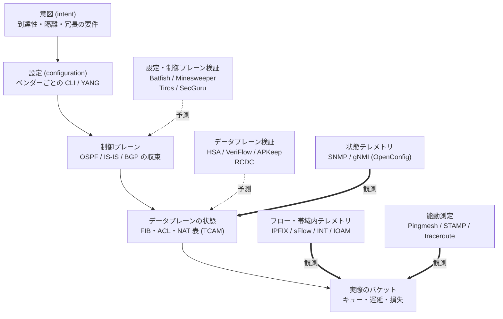

# ネットワーク検証とテレメトリ (Network Verification & Telemetry: What the Network Will Do and What It Is Doing)

## 概要 (Overview)

本ドキュメントは、運用者が「ネットワークがこれから何をするか」と「いま実際に何をしているか」を知るための 2 系統の技術を扱う。前者はネットワーク検証 (network verification) で、設定や転送表からネットワークの振る舞いを計算し、到達性・隔離・ループの有無を証明または反証する。後者はネットワークテレメトリ (network telemetry) で、カウンタ・フロー記録・パケットに書き込まれた計測値・試験パケットから実際の振る舞いを観測する。メトリクス・ログ・トレース・SLO といった一般的な可観測性 (observability) は [`../observability/observability-performance-engineering.md`](../observability/observability-performance-engineering.md)、時系列の保存は [`../observability/time-series-databases.md`](../observability/time-series-databases.md)、ログの収集は [`../observability/logging-systems.md`](../observability/logging-systems.md) に、eBPF の内部は [`../operating-systems/ebpf-kernel-programmability.md`](../operating-systems/ebpf-kernel-programmability.md) に委ね、本書はネットワークに固有の部分を扱う。

中心テーゼは、**ネットワークの振る舞いは「意図 → 設定 → 制御プレーン → データプレーンの状態 → 実際のパケット」という段の連鎖で決まり、どの段も隣の段と食い違いうるため、検証とテレメトリはどちらか一方では閉じない**ということである。検証は上流の段から下流を予測する道具で、その結論は「モデルが装置の実際の意味論と一致している」という前提の上でしか成り立たない。テレメトリは下流の段を観測する道具で、何を・どの粒度で・どの経路から見るかの選択が、見えない故障の種類を決める。運用で最も役に立つ信号は、多くの場合この 2 つの差分、つまり「予測では通るはずなのに観測では通っていない」というずれである。

この見方から 3 つの帰結が出る。(1) 検証の進歩の多くは、表の全体を毎回解く方式から、変更の差分だけを解く方式 (incremental verification) への移行であり、これによって変更を適用する前の門番として使えるようになった。(2) テレメトリの進歩は、装置に問い合わせる方式 (polling) から装置が送り出す方式 (streaming) へ、さらにパケット自身に計測値を運ばせる方式 (in-band) への移行であり、粒度が上がるたびに帯域・MTU・機密性の代償が増えた。(3) 大規模障害の多くは機器の故障ではなく変更作業から起きており、公開された事後報告 (Facebook 2021、Google 2019、Azure 2023) では、変更の監査や検証の仕組みそのものの欠陥や想定漏れが障害を通してしまっている。分析深度は Level 3。

## 方法論 (Methodology)

- **一次資料 (標準)**: フロー記録は RFC 7011 (IPFIX、STD 77)・RFC 3954 (NetFlow v9、情報提供)・RFC 3176 (sFlow v4、情報提供) と sflow.org の sFlow v5 仕様、インターフェースのカウンタは RFC 2863、帯域内計測は RFC 9197・9326・9486・9378 と P4.org の INT 仕様 v2.1 (2020-11-11)、能動測定は RFC 4656 (OWAMP)・5357 (TWAMP)・8762 (STAMP)、測定の分類は RFC 7799 を使う。gNMI は OpenConfig の仕様書 v0.10.0 (2023-05-25) を一次資料とし、ポート番号は IANA の登録で確かめた。
- **一次資料 (論文)**: 検証は HSA (NSDI 2012)、Anteater (SIGCOMM 2011)、VeriFlow・NetPlumber (NSDI 2013)、Delta-net (NSDI 2017)、APKeep (NSDI 2020)、Batfish (NSDI 2015) とその経験報告 (SIGCOMM 2023)、Minesweeper (SIGCOMM 2017) を使う。産業での形式手法は AWS の Tiros (CAV 2019)・Zelkova (FMCAD 2018)、Azure の SecGuru (ICDCIT 2015)・RCDC (SIGCOMM 2019)、Google の Zero Touch Network (CNSM 2016)・Evolve or Die (SIGCOMM 2016)・CAPA (NSDI 2024) による。測定と故障は Pingmesh (SIGCOMM 2015)、Gray Failure (HotOS 2017)、007 (NSDI 2018)、NetBouncer (NSDI 2019)、Paris traceroute (IMC 2006)、マイクロバーストの計測 (IMC 2017) を使う。論文の数値は本文または抄録から取り、本文を確かめたものと抄録だけのものを区別した。
- **事後報告**: Meta (Facebook) の 2021-10-05 の技術ブログ、Google Cloud の 2019-06-04 のブログ、Azure の事後レビュー (追跡 ID VSG1-B90) を一次資料とする。報道は事後報告の所在を探すためにだけ使った。
- **製品の記述**: VPC Reachability Analyzer は AWS の公式文書と発表ブログで確かめる。Tiros がその実装の基盤であるという直接の記述は一次資料では見つからなかったため、本書では両者を別々に扱う。
- **担当範囲**: 経路制御の機構は [`ip-routing-bgp.md`](ip-routing-bgp.md)、パケットフィルタの評価モデルは [`packet-filtering-conntrack.md`](packet-filtering-conntrack.md)、QoS とキューの機構は [`qos-traffic-management.md`](qos-traffic-management.md)、スイッチ ASIC の表とキューの物理は [`../../hardware/networking/nic-switch-architecture.md`](../../hardware/networking/nic-switch-architecture.md) に委ねる。

## 発見事項 (Findings)

1. **検証とテレメトリは同じ連鎖の両端から攻めている。** 設定の検証 (Batfish・Minesweeper) は設定からデータプレーンを導き、データプレーンの検証 (HSA・VeriFlow) は転送表を入力にとる。テレメトリはカウンタ (装置の内部状態)、フロー記録 (通過したパケットの要約)、帯域内計測 (個々のパケットの経路と待ち時間) を観測する。どの方式も、隣の段との食い違い (装置のソフトウェアのバグ、TCAM の破損、設定に書かれていない既定値) を自分だけでは検出できない。
2. **データプレーン検証の本質は、パケットを 1 つずつ調べずに「同じ扱いを受けるヘッダの集合」で計算することにある。** HSA はヘッダを長さ L のビット列とみなし、ワイルドカード式の和集合を転送規則の関数に通す。全ヘッダを試す力ずくの方法は O(2^L) だが、HSA は「規則によって集合がそれほど細かく割れない」という仮定 (Linear Fragmentation) のもとで到達性を O(dR²) で解く (d は網の直径、R は 1 台あたりの最大規則数)。仮定が崩れたときの最悪の場合は保証されない。
3. **検証が「変更の門番」になれたのは、増分化によって 1 回の変更あたりの検証時間がミリ秒未満になったからである。** VeriFlow は規則 1 件の変更を数百 µs で、NetPlumber は平均 50〜500 µs で、Delta-net は平均約 40 µs で検査する。APKeep は ACL・NAT を含む実際の装置の更新でも 1 ms 未満を示し、既存手法がメモリ不足や長時間化に陥る場面を挙げている。いずれも著者の評価環境での値であり、規則の種類 (単一フィールドの IP 転送か、多フィールドの ACL か) で桁が変わる。
4. **設定の検証は「どの状態について証明したか」が手法ごとに違う。** Batfish は設定から収束後のデータプレーンを 1 つ計算して調べる。Minesweeper は設定を SMT の論理式にし、OSPF・BGP・静的経路が収束しうるすべての安定状態について性質を調べる。そのため、外部からの任意の BGP 広告や k 本のリンク故障を含めた主張ができる。Minesweeper は大規模クラウド事業者の実網 152 個で 120 件の違反を見つけたと報告している。
5. **設定検証の限界は、ベンダーのバージョン差よりも、文書化されていない意味論にある。** Batfish の開発者は SIGCOMM 2023 の経験報告で、モデルの誤りの多くは定義されていない route map を参照する BGP 設定のような、ベンダーが文書化していない状況から生じたと書く。対策として、実機のソフトウェアやエミュレータで作った小さな網の状態 (show コマンド・ping・traceroute) とモデルを毎日照合している。同じ報告は、100% の忠実度がなくても重大な誤りは見つけられるとも述べる。
6. **クラウド事業者の形式手法は、全体の証明より「局所の契約」で規模を得ている。** Azure の RCDC は、データセンターの各装置の転送表が満たすべき局所的な契約を並列に検査することで、全網のスナップショットを持たずに全体の性質を確かめる。AWS の Tiros は VPC の構成を論理式にして、パケットを送らずに到達性を判定する。どちらも「網の構造が設計どおりである」ことを前提にした分解であり、その前提自体はテレメトリで確かめる必要がある。
7. **SNMP のポーリングは、カウンタの桁あふれと平均化によって速いリンクの事象を隠す。** 32 ビットのオクテットカウンタは 10 Gb/s の連続送信で約 3.4 秒で一周するため、RFC 2863 は 650 Mb/s 以上のインターフェースに 64 ビットのカウンタを要求する。64 ビットにしても、5 分間隔の平均では数十 µs のバースト (IMC 2017 の計測では、ラックで観測されたバーストの 70% 超が数十 µs 以下) は見えない。ストリーミングテレメトリ (gNMI) は間隔を短くできるが、装置の内部でカウンタを読む頻度が上限になる。
8. **フローテレメトリの精度は、標本の数で決まり、通過したトラフィックの総量には依存しない。** sFlow の 1/N の無作為標本化では、あるクラスに入った標本数を c とすると、95% 信頼の相対誤差はおよそ 196·√(1/c) % になる。標本が 1 万個あれば約 ±2% である。逆に、標本にほとんど入らない短いフロー (走査や短時間の攻撃) は推定の対象にならない。
9. **帯域内テレメトリは「ホップごとの事実」を得る代わりに、パケットを大きくし、網の内部情報をパケットに載せる。** INT-MD ではノード ID・ホップ遅延・キュー占有の 3 項目だけでも 1 ホップ 12 バイト増え、9 項目すべてでは 1 ホップ 48 バイトになる。このため INT 仕様は送信元と受信端の間のリンクの MTU を上げることを勧め、断片化を禁じる。IOAM の DEX (RFC 9326) や INT-XD は、計測値をパケットに書かず各ノードから直接送り出すことでこの問題を避けるが、送り出しの量が増幅攻撃の手段になるためレート制限を必須とする。
10. **変更作業が障害の主因であり、検証の仕組みそのものが単一障害点になりうる。** Google は 2018 年以降のクラスタ網の障害の 58% 以上が管理作業 (management operations) に由来すると報告した (CAPA、NSDI 2024)。Facebook の 2021 年の障害では、バックボーンの容量を調べるコマンドを止めるはずだった監査ツールにバグがあった。Azure の 2023 年の障害では、同じコマンドがベンダーによって局所にとどまるか IGP の全ルータに及ぶかが異なり、後者の挙動が審査で見落とされて遮断リストに入っていなかった。

## アーキテクチャ (Architecture)

### 振る舞いが決まる段と、各段を見る道具



凡例: 実線の矢印は振る舞いが決まる順序。点線は検証による予測 (入力は上流の段)、二重線はテレメトリによる観測。段と段の間の食い違いは次の例で生じる。意図と設定の間は誤設定、設定と制御プレーンの間はベンダー固有の既定値や意味論、制御プレーンとデータプレーンの間は FIB の書き込みの失敗や表の容量不足、データプレーンと実際のパケットの間は TCAM の破損 (Pingmesh が報告したパリティ誤り) やハードウェアの劣化である。

### 道具の比較

| 道具 | 入力 | 答えられる問い | 答えられない問い | 時間の粒度 |
|---|---|---|---|---|
| 設定検証 (Batfish) | 全装置の設定 | 変更後に到達性・隔離が保たれるか (適用前) | モデル化されていない機能、ソフトウェアのバグ | 変更ごと (分) |
| 制御プレーン検証 (Minesweeper) | 設定 + 環境の仮定 | すべての安定状態・k 本故障で性質が成り立つか | 収束途中の一時的な状態 | 変更ごと (分) |
| データプレーン検証 (HSA 系) | 転送表・ACL のスナップショット | 実際の表でループ・黒穴・漏れがあるか | 表の内容と ASIC の実際の動作の差 | 規則ごと (µs〜ms) |
| 状態テレメトリ (SNMP/gNMI) | 装置のカウンタ・状態 | どのインターフェースで何が起きたか | 間隔より短い事象、装置が報告しない落とし | 秒〜分 |
| フロー記録 (IPFIX/sFlow) | 通過パケットの要約・標本 | 誰と誰がどれだけ通信したか | 経路上のどこで遅れたか | 秒〜分 (集約単位) |
| 帯域内 (INT/IOAM) | パケットに書かれたホップごとの値 | どのホップのキューで遅れたか | 計測対象外のパケット、ドメイン外 | パケットごと |
| 能動測定 (Pingmesh/STAMP) | 試験パケットの結果 | 端点から見て遅延・損失があるか | 利用者のパケットと違う扱いを受ける故障 | 秒 |

## 技術詳細 (Technical Details)

### 1. データプレーン検証: ヘッダの集合で計算する

**HSA (Header Space Analysis)。** Kazemian らは、パケットヘッダを意味を持たない長さ L のビット列とみなし、ヘッダ空間 {0,1}^L の部分集合をワイルドカード式 (各ビットが 0・1・x) の和集合で表した。装置は「(ヘッダ, ポート) の集合から (ヘッダ, ポート) の集合への関数」(transfer function) として書かれ、転送・ACL・書き換えはすべてこの関数の規則になる。プロトコルに依存しないため、IP でも MPLS でも独自のヘッダでも同じ枠組みで扱える。著者は実装 Hassel をスタンフォード大学の基幹網に適用し、全ループの検出を 10 分未満、2 つのサブネット間の到達性の確認を 13 秒で行った。

```text
Pseudocode: HSA reachability from port a to port b
Assumptions: each box is a transfer function T over (header-set, port);
  header sets are unions of wildcard expressions; topology function Γ
  maps an output port to the connected input port.
Complexity: O(d * R^2) under Linear Fragmentation (d = network diameter,
  R = max rules per box); worst case output size is O(R1 * R2) wildcard
  expressions per hop, i.e. exponential in d without the assumption.

reach(a, b):
  frontier = { (all-wildcard header set, a) }
  result   = empty
  for hop in 1..d:
    next = empty
    for (H, p) in frontier:
      for (H', q) in T_box(p)(H):        # apply rules: match, rewrite, drop
        if q == b: result = result ∪ H'
        else:      next = next ∪ { (H', Γ(q)) }
    frontier = next
  return result                          # header sets that can reach b
```

ループの検出も同じ構造で、ある入力ポートから出た集合が同じポートに戻るかを調べる (計算量は O(dPR²)、P は調べるポートの数)。返ってきた集合の逆像 (range inverse) をとれば、「a から送ると b に届くヘッダ」の集合が得られる。

**Anteater** (Mai ら、SIGCOMM 2011) は同じ問題をブール充足可能性 (SAT) に帰着させた。到達性・ループ・一貫性の不変条件を SAT の式にして解き、充足する割り当てが反例のパケットになる。大学キャンパス網で、転送ループや古い ACL 規則を含む 23 件のバグを見つけた。HSA も Anteater も、網全体の表を一度に解く方式であり、変更のたびに全体を解き直す。

**増分化。** VeriFlow (Khurshid ら) は SDN コントローラと装置の間に入り、規則の追加・変更・削除のたびに、その規則が影響する同値類 (equivalence class、同じ扱いを受けるパケットの集合) だけを再計算する。NetPlumber (Kazemian ら) は HSA の上に規則間の依存グラフを保持し、1 件の更新で変わる部分だけを辿る。Google の SDN・スタンフォードの基幹網・Internet2 で、1 件の更新と 1 つのポリシーの照合を平均 50〜500 µs で行った。Delta-net (Horn ら) は「パケットの扱いは網の全体だけでなく部分ごとにも共通する」という観察に基づき、規則の境界で作る原子 (atom) の集合を保つ償却準線形のアルゴリズムで、数億件の IP プレフィックス規則に対して挿入・削除 1 件あたり平均約 40 µs を示した。

**実際の装置への拡張。** APKeep (Zhang ら) は、IP 転送だけを対象にした従来の高速な手法が、ACL・NAT・ポリシーベースルーティングを表現できず、多フィールドの ACL 規則でメモリ不足や長時間化に陥ることを示した。APKeep は装置の要素ごとに分けたモデルで、ACL を含む実際の更新列で 1 ms 未満、NAT の更新でもほとんど 1 ms 未満を示した。ここからわかるのは、データプレーン検証の難しさが表の大きさより規則の種類 (どれだけ多くのフィールドを組み合わせるか) にあるということである。

### 2. 設定と制御プレーンの検証: 何を証明し、何を仮定するか

**Batfish。** Fogel らは、設定ファイルから「その設定が生むデータプレーン」を導き、それを解析する方式を示した。設定を直接読む静的解析のように適用前に誤りを見つけられ、データプレーンのスナップショット解析のように具体的な反例のパケットを生成できる。原型は制御プレーン・データプレーンとその相互作用を Datalog の論理関係で表した。SIGCOMM 2023 の経験報告によれば、Datalog は試作には向いたが本番の規模では限界に達し、現在は設定を命令的なコードで解釈して経路計算を決定的に行い、データプレーンの解析には BDD (二分決定図) を使う。新しい手法で 3 桁の高速化を得て、数千ノードの網を数分で解析できると報告している。

Batfish が答えるのは「この設定と、この外部環境 (受け取る BGP 経路など) を与えたとき、収束後の網はどうなるか」である。同じ報告は、利用者が求めたのは転送の解析だけではなかったとも書く。BGP の隣接どうしの設定の整合、参照されている経路ポリシーが定義済みか、IP アドレスの重複、NTP サーバの設定といった設定の検査にも、同じ詳細なモデルが使われている。

**モデルの忠実度。** Batfish の設計上の弱点は、装置が設定をどう解釈するかのモデルを持つことにある。開発者は、問題の多くは装置のソフトウェアの版の差ではなく、文書化されていない意味論から生じたと書く。定義されていない route map を参照する BGP 隣接に届いた経路をどう扱うか、のような状況は文書化されていないが、実際の設定には現れる。データプレーンの処理順にも同じ問題がある。NAT を経路検索の前に行うか後に行うか、ファイアウォールが NAT 前のヘッダで判定するか後のヘッダで判定するかはベンダーによって異なり、Batfish は汎用のパイプラインに段を足して吸収してきた。対策は、実機のソフトウェアやエミュレータ (GNS3) で小さな網を組み、収集した設定から計算したモデルと、実機の show コマンドや ping・traceroute の結果が一致するかを毎日照合することである。これはモデルが現実と一致することを保証しないが、モデルの誤りを大きく減らしたと報告されている。

**Minesweeper。** Beckett らは、設定を SMT の論理式に変換し、その式が網の収束しうる安定状態をすべて表すようにした。調べたい性質の否定を加えて充足可能なら、性質が破れる安定状態が存在する。充足不能なら、どの安定状態でも性質は破れない (安定状態が存在しない場合は別に扱う)。Batfish が 1 つの環境のシミュレーションであるのに対し、Minesweeper は「隣接 AS がどんな経路を広告しても」「任意の k 本のリンクが故障しても」という全称の主張ができる。到達性・経由点・経路長の上限・負荷分散・故障耐性を扱い、大規模クラウド事業者の実網 152 個で 120 件の違反を見つけた。合成ベンチマークでは数百台のルータの網を 5 分未満で検証したが、モデルのスライシングなどの最適化 (大規模網で 460 倍超の短縮) が前提であり、SMT の求解に頼るぶん、扱える規模は数千ノードを数分で解析する Batfish より小さい (両論文の数値の比較による本書の評価)。BGP は安定状態を複数持ちうる (どの状態に落ち着くかは事象の順序による、Griffin ら 2002) ため、「すべての安定状態」を対象にすることには実際の意味がある。一方で、収束の途中の一時的なループや黒穴は対象外である。

**産業での形式手法。**

- **AWS**: Zelkova (Backes ら、FMCAD 2018) は IAM などのアクセスポリシーを SMT の式に変換し、「このリソースは誰からでも読めるか」のような問いを判定する。問題自体は PSPACE 完全だが、1 日に数百万回実行されていると報告されている。Tiros (Backes ら、CAV 2019) は VPC の構成要素 (サブネット・経路表・セキュリティグループ・ネットワーク ACL・ゲートウェイ) を論理として符号化し、Soufflé・MonoSAT・Vampire などの推論エンジンで到達性を判定する。論文は Tiros が Amazon Inspector のネットワーク到達性の分析を支えていると書く。VPC Reachability Analyzer について、AWS の文書は構成のモデルから到達性を判定し、データプレーンは解析しない (パケットを送らない) と説明し、発表ブログは自動推論 (automated reasoning) を使うと書く。Tiros との関係を明言した一次資料は見つからなかった。いずれも、インスタンスの中でポートを待ち受けるプロセスがあるかどうかは判定の範囲外である。
- **Azure**: SecGuru (Bjørner と Jayaraman、ICDCIT 2015) は、ネットワーク ACL と転送表と BGP ポリシーが満たすべき「契約」をビットベクトルの論理式にし、Z3 で検査する。ポリシーが契約を満たすかに加えて、2 つのポリシーの意味の差分も出せる。RCDC (Jayaraman ら、SIGCOMM 2019) は、データセンターの各装置の転送表が満たすべき局所的な契約 (例えば、すべての最短経路が使えること) を装置ごとに並列に検査し、全網のスナップショットを持たずに全体の性質を確かめる。設計どおりの Clos 構造という前提があるから局所の検査に分解できる。
- **Google**: Koley の Zero Touch Network (CNSM 2016) は、すべての運用操作を宣言された意図だけで行うように自動化し、網全体の意図から各装置への変更を導き、意図しない振る舞いを起こした変更を自動で止めて戻し、ポリシーに反する操作を阻止する方針を述べる。CAPA (Liu ら、NSDI 2024) はクラスタ網での管理作業を規制する薄い層で、変更をまず小さな範囲で試す、障害ドメインをまたぐ変更の速さを制限する、などの実践を個々の技術者の注意に頼らずに強制する。5 年間で、網の規模で正規化した管理作業由来の障害の累積時間が 82% 減ったと報告している。

### 3. ポーリングからストリーミングへ

**SNMP の限界。** SNMP は管理装置 (manager) が装置 (agent) に定期的に問い合わせる方式である。RFC 2863 は、20 Mb/s 以下のインターフェースには 32 ビットのカウンタで足りるが、20 Mb/s を超えれば 64 ビットのオクテットカウンタ、650 Mb/s 以上では 64 ビットのパケットカウンタも必要だと定める。同 RFC によると、32 ビットのオクテットカウンタは 10 Mb/s で約 57 分、1 Gb/s で約 34 秒で一周する。本書の計算では、10 Gb/s では 2^32 × 8 / 10^10 ≈ 3.4 秒、100 Gb/s では約 0.34 秒になる。64 ビットなら 1 Tb/s でも一周に 5 年近くかかる (RFC 2863)。

桁あふれのほかに、ポーリングには 3 つの落とし穴がある。(1) 2 回の読み取りの差を間隔で割った値は平均であり、間隔より短い事象を消す。5 分平均で使用率 10% のリンクが、その間に 1 秒間だけ 100% に張り付いていても数字には現れない。IMC 2017 の Zhang らの計測では、ラックで観測されたバーストの 70% 超が数十 µs 以下だった。(2) 装置の再起動やカウンタの初期化で値が 0 に戻る。差分の計算はこれを桁あふれと区別する必要があり、RFC 2863 はそのために `ifCounterDiscontinuityTime` を用意している。(3) 問い合わせは装置の制御プレーンの CPU を使うため、間隔を短くするほど装置に負担がかかる。カウンタの種類と再起動時の扱いは [`../observability/time-series-databases.md`](../observability/time-series-databases.md) の counter の意味論と同じ問題である。

**gNMI と OpenConfig。** gNMI (gRPC Network Management Interface) は gRPC の上の管理プロトコルで、Capabilities・Get・Set・Subscribe の 4 つの RPC を持つ。Subscribe には、1 回だけ値を返す ONCE、クライアントの要求ごとに返す POLL、長く続く STREAM がある。STREAM には一定間隔で送る SAMPLE、値が変わったときだけ送る ON_CHANGE、葉ごとに装置が選ぶ TARGET_DEFINED があり、SAMPLE で変化のない値を省く `suppress_redundant` と、変化がなくても定期的に送り直させる `heartbeat_interval` がある。データの形は OpenConfig などの YANG モデルで決まり、ベンダーをまたいで同じパスで同じ意味の値を取れることが SNMP の MIB に対する利点になる。IANA は TCP 9339 を gnmi-gnoi として登録している。

接続の向きには 2 通りある。収集側が装置に接続して購読を送る方式を dial-in、装置に購読を静的に設定し、装置から収集側へ接続する方式を dial-out と呼ぶ。gNMI 自体は dial-in のプロトコルで、dial-out はベンダーの実装 (Cisco のモデル駆動テレメトリなど) として提供される。dial-out は装置が NAT や防火壁の内側にあっても収集側へ届くが、収集側の到達性と認証を装置側の設定で管理することになる。

**ストリーミングでも残る限界。** SAMPLE の間隔を秒未満にしても、得られるのは装置がカウンタを読んだ時点の値である。ASIC のカウンタを読む頻度、エクスポートのキュー、収集側の取り込み能力がそれぞれ上限を作る。ON_CHANGE は状態 (リンクの上下・BGP セッションの状態) には向くが、常に変わり続けるカウンタには向かない。マイクロバーストを見るには、キューの最大占有を装置の中で保持して報告するか (ハイウォーターマーク)、次節以降の帯域内テレメトリで個々のパケットの待ち時間を見る必要がある。

### 4. フローテレメトリ: 誰と誰がどれだけ

**NetFlow v9 と IPFIX。** NetFlow v9 (RFC 3954、2004 年、情報提供) は Cisco の方式で、エクスポータがテンプレート (どのフィールドをどの順で送るか) を先に送り、続くデータレコードをそのテンプレートで解釈させる。IPFIX (RFC 7011、2013 年、STD 77) はこれを IETF の標準にしたもので、テンプレート・情報要素 (Information Element) の登録・トランスポートの規則を定める。RFC 7011 は輻輳を考慮する SCTP の実装を必須とし、TCP と UDP は任意とする。UDP はメッセージの喪失を許容できる用途でしか使ってはならず、テンプレートは定期的に再送し、収集側は再送間隔の 3 倍以上の寿命でテンプレートを失効させる。テンプレートを受け取る前に届いたデータレコードは解釈できないため、収集側の再起動直後には一時的にデータが読めない期間ができる。

**sFlow。** sFlow (RFC 3176 は v4、2001 年、情報提供。現行の v5 は sflow.org の仕様、2004 年) はフローを装置の中で集約せず、1/N の無作為な標本パケットのヘッダとインターフェースカウンタを UDP 6343 番で送る。各パケットで乱数のスキップ数を数え下げ、0 になったパケットを標本にする。データグラムには、標本になりえたパケットの総数 (`sample_pool`) と、資源不足で捨てた標本の数 (`drops`) が入り、収集側は標本数と sample_pool から元の量を推定する。

**標本化の精度。** sflow.org の解説によれば、精度は標本の数だけで決まり、通過したフレームの総数には依存しない。あるクラス (特定の送信元、特定のプロトコルなど) に入った標本数を c とすると、95% 信頼の相対誤差はおよそ 196·√(1/c) % で、c = 1,000 なら約 6%、c = 10,000 なら約 2% になる。帰結は 2 つある。大きなトラフィックの比率は粗い標本化でも正確に推定できる。一方、標本にほとんど入らない短いフローや少量の通信は推定できない。NetFlow でも 1/N の標本化 (sampled NetFlow) は広く使われており、事情は同じである。全パケットを集約する unsampled のフロー記録は、課金・セキュリティ調査・小さなフローの把握には必要だが、フロー表のメモリとエクスポートの帯域を食い、攻撃で多数の短いフローが生じると表が溢れる。PSAMP (RFC 5475・5476) は、パケットの選択方法 (系統的・無作為・ハッシュによる選択) を標準化しており、ハッシュ選択を使えば経路上の複数の装置で同じパケットを選べる。

フロー記録が答えるのは「どの 5 タプルがどれだけ流れたか」であり、「どのホップで遅れたか」には答えない。後者を知るにはパケットの経路に沿った計測が要る。

### 5. 帯域内テレメトリ: パケットにホップの事実を運ばせる

**INT (P4.org)。** INT 仕様 v2.1 は 3 つの動作モードを定める。INT-MD (eMbed Data) では送信元がパケットに指示 (どの項目を集めるか) を書き、各ホップが自分の値をパケットに積み、受信端 (sink) が指示と値を取り除いて収集系に報告する。INT-MX (eMbed instruct(X)ions) では指示だけをパケットに書き、各ホップは値を収集系に直接送るため、パケットはホップ数に比例して大きくならない。INT-XD (eXport Data) はパケットを変更せず、各ノードが監視対象のフローの一覧 (watchlist) に従って値を送る。INT-XD は以前 postcard モードと呼ばれていた。項目にはノード ID、入出力インターフェース ID、ホップ遅延、キュー ID と占有、入出力の時刻、送信側リンクの使用率、バッファ占有がある。

**INT-MD のヘッダの会計。** 仕様では INT-MD のメタデータヘッダが 12 バイトで、項目はそれぞれ 4 バイト (時刻 2 項目と第 2 層のインターフェース ID は 8 バイト) である。本書の計算では、ノード ID・ホップ遅延・キュー占有の 3 項目を 5 ホップ集めると 12 × 5 + 12 = 72 バイト (カプセル化の shim を除く) が増え、全 9 項目なら 1 ホップ 48 バイトになる。仕様はこのため送信元と受信端の間のリンクの MTU を上げることを勧め、断片化してまで値を足すことを禁じる。MTU を超えるノードは値を足さずに印 (M ビット) を立てるか、そこまでの値を報告して取り除く。送信元は値を足してよい最大ホップ数 (Remaining Hop Count) を設定し、ループでヘッダが膨れ続けるのを防ぐ。Geneve のオプションで運ぶ場合は 1 つのオプションの長さが 124 バイトに制限されるため、INT-MD の全体がそれに収まる必要がある。MTU と経路 MTU 探索の問題は [`ip-addressing-icmp-dhcp-nat.md`](ip-addressing-icmp-dhcp-nat.md)、カプセル化の MTU の税は [`virtual-networks-overlay.md`](virtual-networks-overlay.md) と同じ構図である。

**IOAM (IETF)。** IOAM のデータフィールドは RFC 9197 (2022 年、標準化トラック) で定義される。オプションは 4 種類ある。各ノードの値を書く領域を先に確保する Pre-allocated Trace、各ノードが順に積む Incremental Trace、経路を通ったことを示す Proof of Transit、両端のノードだけが読み書きする Edge-to-Edge である。運ぶ方法は別に定義され、IPv6 の拡張ヘッダのオプションは RFC 9486 (2023 年) が定める。RFC 7799 の分類では、利用者のパケットに計測を載せる IOAM は能動測定と受動測定の中間 (hybrid) にあたる。IOAM は RFC 8799 の「限られたドメイン」での利用を前提とし、IOAM のデータをドメインの縁の外へ漏らしてはならないとする。RFC 9326 (2022 年) の DEX (Direct Export) は、計測値をパケットに書かずに各ノードが収集系へ送り出すことを指示するオプションで、フロー ID と連番で複数ノードの記録を突き合わせる。INT-XD/MX と同じく、パケットの肥大を送り出しの量に置き換える方式である。

**ポストカード方式の系譜。** 各ホップがパケットごとに小さな記録 (postcard) を送る考え方は、NetSight (Handigol ら、NSDI 2014) がパケットの履歴による障害調査として示した。帯域内に値を積む方式はパケットを大きくする代わりに、1 つのパケットの記録が受信端で揃う。ポストカード方式はパケットを変えない代わりに、ホップ数に比例して記録が増え、収集側で記録を照合する作業が要る。どちらも全パケットを対象にすると収集系が持たないため、実際には監視対象のフロー、標本、異常時だけの報告 (キュー遅延が閾値を超えたときなど) に絞る。

### 6. 能動測定: 試験パケットで端点から見る

**Pingmesh。** Guo らは Microsoft のデータセンターで、すべてのサーバが TCP または HTTP の ping を互いに送り合う仕組みを作った。対象はラック内・ToR スイッチ間・データセンター間の多層の完全グラフで、中央の制御器が各サーバの ping 対象の一覧を配る。論文の時点で数十のデータセンターで 4 年間動き、1 日に 24 TB のデータと 2,000 億回を超える試験を生んでいた。任意の 2 サーバ間の試験間隔の下限 (10 秒) と試験のペイロードの上限 (64 KB) をソースコードに書き込み、最悪の場合の試験トラフィックの量を抑えている。損失率は直接測らず、TCP の接続確立にかかる時間から推定する。SYN の初回の再送が 3 秒後なので、約 3 秒の RTT は 1 回の損失、約 9 秒は 2 回の損失とみなす。

Pingmesh が見つけた故障の代表はパケットの黒穴 (black-hole) である。特定の送信元・宛先アドレスの組 (あるいは組とポート番号) のパケットだけを、スイッチが決まって捨てる。サーバ A は B と通信できないが C や D とはでき、すべてのサーバは健全である。著者は前者の原因の多くを ASIC の TCAM の破損 (パリティ誤り) としている。これは制御プレーンもデータプレーンの表も正しく、検証では見つからない故障である。

**OWAMP・TWAMP・STAMP。** OWAMP (RFC 4656) は片方向、TWAMP (RFC 5357) は往復の遅延と損失を、制御用のセッションと試験用のパケットに分けて測る。STAMP (RFC 8762、2020 年) は TWAMP の経験をもとに簡素にしたもので、UDP 862 番を既定とし、片方向・往復の遅延、遅延の揺らぎ、損失を測る。反射側 (reflector) には状態を持たない方式と持つ方式があり、前者では往復の損失しか分からないが、後者ではどちらの向きで失われたかを区別できる。認証モードは HMAC-SHA-256 を使うため、HMAC-SHA-1 を使う TWAMP Light とは認証モードで相互運用できない。片方向遅延の測定には両端の時計の同期が要る ([`../../hardware/timekeeping/clocks-time-synchronization.md`](../../hardware/timekeeping/clocks-time-synchronization.md))。

**traceroute と ECMP。** traceroute は TTL を 1 ずつ増やした試験パケットを送り、TTL 切れの ICMP を返したルータを並べる。等コスト多経路 (ECMP) やフロー単位の負荷分散があると、試験パケットごとにポート番号などが変わって別の経路をたどり、存在しないループ・閉路・菱形の経路が表示される。Paris traceroute (Augustin ら、IMC 2006) は、負荷分散に使われるヘッダのフィールドを固定して 1 つのフローの経路を一貫して辿る。パケット単位の負荷分散では経路を正確に列挙できず、後の MDA は複数の経路を体系的に探す。もう一つの落とし穴は、ICMP の応答をスイッチの制御プレーンの CPU が作ることである。007 の論文では、1 台のスイッチが 1 秒に送れる ICMP の上限が 100 だった。traceroute の結果の遅延はデータプレーンの遅延ではなく、応答を作る CPU の遅延を含む。

### 7. グレー障害と局所化

**Gray Failure。** Huang ら (HotOS 2017) は、クラウドの大きな可用性の低下や性能の異常の多くが、止まる故障 (fail-stop) ではなく微妙な故障から生じると論じた。定義の要は差分可観測性 (differential observability) で、少なくとも 1 つのアプリケーションがシステムを不健全と観測しているのに、故障検出器 (observer) は健全と観測している状態をグレー障害と呼ぶ。性能の大幅な劣化、無作為なパケット損失、不安定な I/O が例に挙げられている。ネットワークの監視に当てはめると、リンクは上がっていて BGP のセッションも保たれ、カウンタにも誤りがないのに、一部のフローだけが落とされている状態がこれにあたる。

**007。** Arzani ら (NSDI 2018) は、端末だけで動く常時稼働の診断を作った。TCP の再送を検知すると、そのフローと同じ 5 タプルの traceroute で経路を調べる (ECMP で同じ経路をたどるため。ロードバランサの背後では、VIP から DIP への対応をロードバランサに問い合わせる)。経路上の各リンクに 1/h (h は経路長) の票を与え、30 秒ごとに集計して票の多いリンクを故障の候補とする。損失が多くのフローに分散するデータセンターでは、票の多いリンクがほぼ確実に損失の多いリンクであることを示している。2 か月の運用で、既存の監視が見つけた問題をすべて見つけ、未検出だった問題の原因も見つけた。traceroute の量はスイッチの ICMP の上限を超えないように制限している。

**NetBouncer。** Tan ら (NSDI 2019) は IP-in-IP のカプセル化で、試験パケットを特定のスイッチまで送って跳ね返させ、経路を指定した能動測定を行う。特別なハードウェアは要らず、Clos 構造ではカプセル化の段数も少なくて済む。装置とリンクの故障を推定するアルゴリズムと組み合わせ、Azure のデータセンターで 3 年間運用して誤検知なし、見逃しも少数だったと報告している。007 が利用者のトラフィックの症状から逆算するのに対し、NetBouncer は試験パケットで能動的に経路を覆う。この 2 つは、グレー障害が「観測者と利用者の見え方の違い」であることに対する 2 つの答えである。

### 8. 変更の前の検証と閉ループ

**事前検査 (pre-change verification)。** 検証を運用に組み込む典型的な形は、変更の候補 (設定の差分) を本番の設定のスナップショットに当てて、到達性・隔離・冗長の不変条件が保たれるかを調べることである。Batfish の経験報告によれば、変更を網に送る前に解析することが Batfish の当初からの用途であり、設定を高水準のデータから自動生成する組織では、ソフトウェアの CI と同様のパイプライン (network CI) の一段として Batfish を呼び出し、端から端までの転送や ACL の振る舞いを検査している。差分の検査は、モデルの誤りに比較的強い。変更前と変更後で同じモデルを使うため、モデルの誤りの多くは両方に同じように現れて打ち消し合う (これは本書の推論であり、Batfish の報告が直接述べているのは「100% の忠実度がなくても役に立つ」ことである)。

**閉ループ。** 意図に基づくネットワーキング (intent-based networking) は、意図から設定を導き (Google の Zero Touch Network)、適用の前に検証で止め、適用後にテレメトリで意図との差を監視し、差があれば止めて戻す。CAPA は、変更を小さな範囲から段階的に広げ、障害ドメインをまたぐ変更の速さを制限し、異常があれば自動で止める層を、個々の作業者の手順から独立させた。

**公開された事後報告に見る失敗の型。**

| 事例 | 何が起きたか | 検証・監査の観点から見た欠落 |
|---|---|---|
| Facebook (2021-10-04) | 世界規模のバックボーンの容量を調べるコマンドが、すべてのバックボーン接続を切った。DNS サーバはバックボーンに届かなくなったことで自分を不健全とみなし、BGP の広告を取り下げた | このようなコマンドを監査して止める仕組みがあったが、監査ツールのバグで止められなかった。監査器自体が単一障害点だった。通常の経路も帯域外の経路も使えなくなり、技術者がデータセンターに出向いた |
| Google Cloud (2019-06-02) | 1 つのリージョンの少数のサーバ向けの設定変更が、近隣の複数リージョンの多数のサーバに適用され、それらのリージョンの網の容量の半分以上が使われなくなった | 変更の適用範囲の誤り。混雑が設定を戻す作業そのものを遅らせ、診断と修正に数分の目標を大きく超える時間がかかった |
| Azure (2023-01-25) | WAN の容量追加の作業でルータの IP アドレスを変更するコマンドが、全 WAN ルータに隣接関係と転送表の再計算を起こさせた | 同じコマンドが、2 社のルータでは局所にとどまり、もう 1 社のルータでは IGP でつながる全ルータに及ぶ。後者の挙動が審査で見落とされ、遮断リストに入っていなかった |

3 つの事例は、本書の 2 つの限界をそのまま示している。Azure の事例は、設定検証の弱点として Batfish の報告が挙げた「ベンダーごとに異なり、文書化が不十分な意味論」が、人による審査でも同じ穴になることを示す。Facebook の事例は、変更を止める仕組みも検証されるべきソフトウェアであることを示す。Google の事例は、テレメトリと制御の経路が障害を起こした網そのものを通っていると、観測と復旧が同時に遅れることを示す。管理用の経路を本番の網から分ける (帯域外管理、out-of-band management) のは、この依存の環を断つためである。ただし Facebook の事例では帯域外の経路も同時に失われており、帯域外の網が本番の網にどこで依存しているか (認証・DNS・経路) まで確かめなければ環は断てない。

## セキュリティ考察 (Security Considerations)

- **テレメトリは偵察の材料になる。** 経路・キューの状態・バッファの占有は、網の弱点 (どこが混みやすいか、どこが単一経路か) を示す。RFC 9197 は IOAM のデータが漏れると網の弱点が露わになると書き、INT 仕様も受信端の機能をドメインの縁に置いて情報の漏洩を防ぐよう求める。ドメインの縁で INT/IOAM のヘッダを確実に取り除くこと、外から届いた INT/IOAM 付きのパケットを受け入れないことが前提になる。SNMP の v1/v2c はコミュニティ文字列を平文で送るため、読み取りだけの権限でも網の全インターフェースと経路表を明かしうる。認証と暗号化を持つ SNMPv3 (USM、RFC 3414) を使い、管理用のアドレスからしか受け付けないようにする。
- **フロー記録とテレメトリの偽装。** IPFIX の UDP には盲目的な挿入への防御がなく、RFC 7011 は DTLS で守らない UDP の送信を専用の網に隔離すること、どこからでも受け付ける収集側を避けることを求める。sFlow v5 の仕様は固有のセキュリティ機構を持たないと明記している。偽のフロー記録は、課金・容量計画・DDoS 検知 (フロー記録から攻撃を検知して経路を落とす仕組みを含む) の判断を誤らせる。収集側は送信元アドレスと受信インターフェースを制限し、可能なら TLS/DTLS の相互認証 (RFC 7011 が要件として定める) を使う。
- **帯域内テレメトリの改ざんと増幅。** RFC 9197 は、経路上の攻撃者による IOAM データの改ざんと偽の IOAM オプションの注入、侵害されたノードによる隠れた通信路 (covert channel)、時刻同期への攻撃によるタイムスタンプの破壊、MTU を超える肥大を脅威に挙げる。RFC 9326 は、DEX の指示を持つパケットを注入すれば経路上の各ノードが送り出しを行うため、負荷が増幅されうると書き、送り出しのレートを制限する機能を必須 (MUST) とする。INT 仕様は、ドメイン内の INT 用の DSCP の値を INT 以外のパケットに使わせないよう求める。
- **gNMI の保護。** gNMI の仕様は、クライアントとサーバの間のセッションを TLS で暗号化しなければならず、暗号化しない接続に戻ってはならないと定め、X.509 証明書による相互認証を前提とする。RPC ごとの認証はメタデータの資格情報で行う。gNMI の Set は装置の設定を変えられるため、テレメトリの購読 (Subscribe) と設定の変更 (Set) の権限を分け、テレメトリの収集系に Set の権限を与えないことが重要である。dial-out では装置側が収集側の証明書を検証する設定が要る。テスト用の dial-out 収集器 (cisco-ie/grpcdialout) が TLS に対応していないように、検証用の道具が平文のまま本番に残る経路にも注意する。
- **検証のモデルは信頼される部品である。** 事前検査の結果を根拠に変更を通す運用では、検証器のモデルの誤りやバグが、そのまま「安全と判定された誤った変更」になる。Facebook の事例は監査器のバグが変更を通した例である。検証器の入力 (設定のスナップショット) が改ざんされれば、検証は誤った網について正しい結論を出す。設定の取得経路の認証、検証器自身の差分テスト (Batfish は 2 つの独立した転送解析エンジンを突き合わせている)、検証器が落ちたときに変更を通さない (fail-closed) か通す (fail-open) かの方針を決めておく必要がある。
- **フロー記録はプライバシーの記録である。** 5 タプルと時刻とバイト数は、内容を含まなくても誰がいつ誰と通信したかを示す。RFC 7011 は、ペイロードを含む情報要素は保護された経路で送り、収集側が蓄積したデータの保護に責任を持つと書く。保持期間・アクセス権・匿名化 (IPFIX の匿名化は RFC 6235) の方針は、組織の監視データ一般の扱い ([`../security/detection-incident-response.md`](../security/detection-incident-response.md)) と同じ枠で決める。
- **能動測定の資源の消費。** 試験パケットの応答 (ICMP、STAMP の反射) は装置の制御プレーンの資源を使う。Pingmesh は試験の間隔と大きさの上限をコードに書き込み、007 はスイッチの ICMP の上限を超えないよう試験の量を制限した。STAMP の反射側を外部に開けば、反射を使った増幅や偵察に使われうるため、認証モードかアクセス制御で範囲を絞る。

## 結論 (Conclusions)

- ネットワークの振る舞いは、意図・設定・制御プレーン・データプレーンの状態・実際のパケットという段の連鎖で決まり、各段は別々に食い違う。検証は上流から下流を予測し、テレメトリは下流を観測する。どちらか一方だけでは、もう一方の側の食い違いを検出できない。
- データプレーン検証は、ヘッダの集合で計算すること (HSA) から始まり、変更の差分だけを解くこと (VeriFlow・NetPlumber・Delta-net・APKeep) で 1 件あたりミリ秒未満になり、変更の門番として使えるようになった。難しさは表の大きさより、ACL や NAT のような多フィールドの規則にある。
- 設定と制御プレーンの検証では、1 つの環境の収束後を計算する方式 (Batfish) と、すべての安定状態と故障を全称的に扱う方式 (Minesweeper) が役割を分ける。どちらの結論もモデルの忠実度に依存し、その最大の敵は文書化されていないベンダーの意味論である。Azure の 2023 年の事例は、同じ穴が人による審査にもあることを示した。
- テレメトリはポーリングからストリーミングへ、さらに帯域内へと粒度を上げてきた。粒度が上がるたびに、帯域・MTU・収集系の負荷、そして網の内部情報が漏れる危険という代償が増える。マイクロバーストのような短い事象は、平均をとる限り見えない。
- 大規模障害の多くは変更作業から起き、変更を止めるための監査や検証の仕組みもソフトウェアとして故障しうる。変更を段階的に広げること、監査器自身を検証すること、管理の経路を本番の網から分けることが、検証とテレメトリを閉ループとして機能させる条件になる。

### 次の接続先 (Related Topics)

- [`ip-routing-bgp.md`](ip-routing-bgp.md) — 制御プレーン検証が対象にする IGP と BGP の機構。BGP が安定状態を複数持ちうることの背景。
- [`packet-filtering-conntrack.md`](packet-filtering-conntrack.md) — データプレーン検証が扱う ACL と NAT の評価モデル。状態を持つフィルタはスナップショットの検証では扱いにくい。
- [`qos-traffic-management.md`](qos-traffic-management.md) — 帯域内テレメトリが測るキューの機構と、マイクロバーストが起きる場所。
- [`virtual-networks-overlay.md`](virtual-networks-overlay.md) — VPC の到達性 (Tiros・Reachability Analyzer の対象) と、カプセル化の MTU の税。
- [`load-balancing-architecture.md`](load-balancing-architecture.md) — ECMP とロードバランサ。traceroute の誤りと、007 が VIP から DIP を問い合わせる理由。
- [`../observability/observability-performance-engineering.md`](../observability/observability-performance-engineering.md)・[`../observability/time-series-databases.md`](../observability/time-series-databases.md) — 収集したテレメトリを保存し、SLO と警報に変える側。
- [`../../hardware/networking/nic-switch-architecture.md`](../../hardware/networking/nic-switch-architecture.md) — TCAM・キュー・カウンタの物理。Pingmesh の黒穴の原因になる TCAM の破損の背景。

## 参考文献 (References)

**一次資料 (標準・仕様)**

- McCloghrie, K., & Kastenholz, F. (2000). The Interfaces Group MIB. *RFC 2863*. — [rfc-editor.org](https://www.rfc-editor.org/rfc/rfc2863) — Accessed: 2026-10-26。第 3.1.6 節の 64 ビットカウンタの要件と桁あふれの時間。
- Blumenthal, U., & Wijnen, B. (2002). User-based Security Model (USM) for version 3 of the Simple Network Management Protocol (SNMPv3). *RFC 3414*.
- Claise, B. (Ed.) (2004). Cisco Systems NetFlow Services Export Version 9. *RFC 3954*. — [rfc-editor.org](https://www.rfc-editor.org/rfc/rfc3954) — Accessed: 2026-10-26
- Claise, B., Trammell, B., & Aitken, P. (Eds.) (2013). Specification of the IP Flow Information Export (IPFIX) Protocol for the Exchange of Flow Information. *RFC 7011* (STD 77). — [rfc-editor.org](https://www.rfc-editor.org/rfc/rfc7011) — Accessed: 2026-10-26。第 8.4・10・11 節のトランスポート・テンプレート・セキュリティ。
- Boschi, E., & Trammell, B. (2011). IP Flow Anonymization Support. *RFC 6235*.
- Zseby, T., et al. (2009). Sampling and Filtering Techniques for IP Packet Selection. *RFC 5475*. / Claise, B., Johnson, A., & Quittek, J. (2009). Packet Sampling (PSAMP) Protocol Specifications. *RFC 5476*.
- Phaal, P., Panchen, S., & McKee, N. (2001). InMon Corporation's sFlow: A Method for Monitoring Traffic in Switched and Routed Networks. *RFC 3176*. — [rfc-editor.org](https://www.rfc-editor.org/info/rfc3176) — Accessed: 2026-10-26
- Phaal, P., & Lavine, M. (2004). [sFlow Version 5](https://sflow.org/sflow_version_5.txt) — Accessed: 2026-10-26。標本化の手順、sample_pool と drops、UDP 6343、セキュリティ機構を持たないことの明記。
- sFlow.org. [Packet Sampling Basics](https://sflow.org/packetSamplingBasics/) — Accessed: 2026-10-26。標本数 c と相対誤差の関係。
- OpenConfig. [gRPC Network Management Interface (gNMI) Specification v0.10.0](https://github.com/openconfig/reference/blob/master/rpc/gnmi/gnmi-specification.md) — Accessed: 2026-10-26。Subscribe のモード、TLS と相互認証の要件。
- IANA. [Service Name and Transport Protocol Port Number Registry (gnmi-gnoi, 9339/tcp)](https://www.iana.org/assignments/service-names-port-numbers/service-names-port-numbers.xhtml?search=gnmi) — Accessed: 2026-10-26
- P4.org Applications Working Group. (2020). [In-band Network Telemetry (INT) Dataplane Specification, Version 2.1](https://github.com/p4lang/p4-applications/blob/master/telemetry/specs/INT.mdk) — Accessed: 2026-10-26。動作モード、項目の長さ、MTU と Remaining Hop Count、ドメインの縁での除去。
- Brockners, F., Bhandari, S., & Mizrahi, T. (Eds.) (2022). Data Fields for In Situ Operations, Administration, and Maintenance (IOAM). *RFC 9197*. — [rfc-editor.org](https://www.rfc-editor.org/rfc/rfc9197) — Accessed: 2026-10-26
- Song, H., Gafni, B., Brockners, F., Bhandari, S., & Mizrahi, T. (2022). In Situ Operations, Administration, and Maintenance (IOAM) Direct Exporting. *RFC 9326*. — [rfc-editor.org](https://www.rfc-editor.org/rfc/rfc9326) — Accessed: 2026-10-26。第 3.1.2 節のレート制限の要件。
- Bhandari, S., & Brockners, F. (Eds.) (2023). IPv6 Options for In Situ Operations, Administration, and Maintenance (IOAM). *RFC 9486*. — [rfc-editor.org](https://www.rfc-editor.org/info/rfc9486) — Accessed: 2026-10-26
- Brockners, F., Bhandari, S., Bernier, D., & Mizrahi, T. (Eds.) (2023). In Situ Operations, Administration, and Maintenance (IOAM) Deployment. *RFC 9378*. — [rfc-editor.org](https://www.rfc-editor.org/info/rfc9378) — Accessed: 2026-10-26
- Carpenter, B., & Liu, B. (2020). Limited Domains and Internet Protocols. *RFC 8799*.
- Morton, A. (2016). Active and Passive Metrics and Methods (with Hybrid Types In-Between). *RFC 7799*.
- Shalunov, S., et al. (2006). A One-way Active Measurement Protocol (OWAMP). *RFC 4656*. / Hedayat, K., et al. (2008). A Two-Way Active Measurement Protocol (TWAMP). *RFC 5357*.
- Mirsky, G., Jun, G., Nydell, H., & Foote, R. (2020). Simple Two-Way Active Measurement Protocol. *RFC 8762*. — [rfc-editor.org](https://www.rfc-editor.org/rfc/rfc8762) — Accessed: 2026-10-26

**一次資料 (論文: 検証)**

- Kazemian, P., Varghese, G., & McKeown, N. (2012). Header Space Analysis: Static Checking for Networks. *USENIX NSDI '12*. — [usenix.org](https://www.usenix.org/conference/nsdi12/technical-sessions/presentation/kazemian) — Accessed: 2026-10-26。第 5 節の計算量と Linear Fragmentation の仮定。
- Mai, H., Khurshid, A., Agarwal, R., Caesar, M., Godfrey, P. B., & King, S. T. (2011). Debugging the Data Plane with Anteater. *ACM SIGCOMM '11*. — [ucdavis.edu](https://bob.cs.ucdavis.edu/assets/dl/mai11.pdf) — Accessed: 2026-10-26
- Khurshid, A., Zou, X., Zhou, W., Caesar, M., & Godfrey, P. B. (2013). VeriFlow: Verifying Network-Wide Invariants in Real Time. *USENIX NSDI '13*. — [usenix.org](https://www.usenix.org/conference/nsdi13/technical-sessions/presentation/khurshid) — Accessed: 2026-10-26
- Kazemian, P., Chang, M., Zeng, H., Varghese, G., McKeown, N., & Whyte, S. (2013). Real Time Network Policy Checking Using Header Space Analysis. *USENIX NSDI '13*. — [usenix.org](https://www.usenix.org/conference/nsdi13/technical-sessions/presentation/kazemian) — Accessed: 2026-10-26
- Horn, A., Kheradmand, A., & Prasad, M. (2017). Delta-net: Real-time Network Verification Using Atoms. *USENIX NSDI '17*, 735–749. — [usenix.org](https://www.usenix.org/conference/nsdi17/technical-sessions/presentation/horn-alex) — Accessed: 2026-10-26
- Zhang, P., Liu, X., Yang, H., Kang, N., Gu, Z., & Li, H. (2020). APKeep: Realtime Verification for Real Networks. *USENIX NSDI '20*, 241–255. — [usenix.org](https://www.usenix.org/conference/nsdi20/presentation/zhang-peng) — Accessed: 2026-10-26
- Fogel, A., Fung, S., Pedrosa, L., Walraed-Sullivan, M., Govindan, R., Mahajan, R., & Millstein, T. (2015). A General Approach to Network Configuration Analysis. *USENIX NSDI '15*. — [usenix.org](https://www.usenix.org/conference/nsdi15/technical-sessions/presentation/fogel) — Accessed: 2026-10-26
- Brown, M., Fogel, A., Halperin, D., Heorhiadi, V., Mahajan, R., & Millstein, T. (2023). Lessons from the Evolution of the Batfish Configuration Analysis Tool. *ACM SIGCOMM '23*. https://doi.org/10.1145/3603269.3604866 — Lesson 3 (忠実度)、第 4.3 節 (実機との照合)、第 7.2 節 (データプレーンの処理順の違い)。
- Beckett, R., Gupta, A., Mahajan, R., & Walker, D. (2017). A General Approach to Network Configuration Verification. *ACM SIGCOMM '17*. https://doi.org/10.1145/3098822.3098834
- Griffin, T. G., Shepherd, F. B., & Wilfong, G. (2002). The Stable Paths Problem and Interdomain Routing. *IEEE/ACM Transactions on Networking*, 10(2), 232–243. https://doi.org/10.1109/90.993304
- Backes, J., et al. (2019). Reachability Analysis for AWS-based Networks. *CAV 2019*, LNCS 11562, 231–241. https://doi.org/10.1007/978-3-030-25543-5_14
- Backes, J., Bolignano, P., Cook, B., et al. (2018). Semantic-based Automated Reasoning for AWS Access Policies using SMT. *FMCAD 2018*, 206–214. https://doi.org/10.23919/FMCAD.2018.8602994
- Bjørner, N., & Jayaraman, K. (2015). Checking Cloud Contracts in Microsoft Azure. *ICDCIT 2015*. — [microsoft.com](https://www.microsoft.com/en-us/research/wp-content/uploads/2016/02/nbjorner-icdcit2015.pdf) — Accessed: 2026-10-26
- Jayaraman, K., et al. (2019). Validating Datacenters at Scale. *ACM SIGCOMM '19*. — [microsoft.com](https://www.microsoft.com/en-us/research/publication/validating-datacenters-at-scale/) — Accessed: 2026-10-26

**一次資料 (論文: 運用・測定・故障)**

- Koley, B. (2016). The Zero Touch Network. *CNSM 2016*. — [research.google](https://research.google/pubs/the-zero-touch-network/) — Accessed: 2026-10-26
- Govindan, R., Minei, I., Kallahalla, M., Koley, B., & Vahdat, A. (2016). Evolve or Die: High-Availability Design Principles Drawn from Google's Network Infrastructure. *ACM SIGCOMM '16*. — [research.google](https://research.google/pubs/evolve-or-die-high-availability-design-principles-drawn-from-googles-network-infrastructure/) — Accessed: 2026-10-26。管理作業の最中に多くの障害が起きるという抄録の記述のみを使用。
- Liu, B., Scott, C., Tariq, M., et al. (2024). CAPA: An Architecture For Operating Cluster Networks With High Availability. *USENIX NSDI '24*. — [usenix.org](https://www.usenix.org/conference/nsdi24/presentation/liu-bingzhe) — Accessed: 2026-10-26。2018 年以降の障害の 58% 以上、累積時間の 82% 減。
- Guo, C., Yuan, L., Xiang, D., et al. (2015). Pingmesh: A Large-Scale System for Data Center Network Latency Measurement and Analysis. *ACM SIGCOMM '15*, 139–152. https://doi.org/10.1145/2785956.2787496
- Huang, P., Guo, C., Zhou, L., Lorch, J. R., Dang, Y., Chintalapati, M., & Yao, R. (2017). Gray Failure: The Achilles' Heel of Cloud-Scale Systems. *HotOS '17*. — [microsoft.com](https://www.microsoft.com/en-us/research/publication/gray-failure-achilles-heel-cloud-scale-systems/) — Accessed: 2026-10-26
- Arzani, B., Ciraci, S., Chamon, L., Zhu, Y., Liu, H., Padhye, J., Loo, B. T., & Outhred, G. (2018). 007: Democratically Finding the Cause of Packet Drops. *USENIX NSDI '18*, 419–435. — [usenix.org](https://www.usenix.org/conference/nsdi18/presentation/arzani) — Accessed: 2026-10-26
- Tan, C., et al. (2019). NetBouncer: Active Device and Link Failure Localization in Data Center Networks. *USENIX NSDI '19*, 599–614. — [usenix.org](https://www.usenix.org/conference/nsdi19/presentation/tan) — Accessed: 2026-10-26
- Augustin, B., Cuvellier, X., Orgogozo, B., Viger, F., Friedman, T., Latapy, M., Magnien, C., & Teixeira, R. (2006). Avoiding Traceroute Anomalies with Paris Traceroute. *ACM IMC '06*, 153–158. — [hal.science](https://hal.archives-ouvertes.fr/hal-01097553) — Accessed: 2026-10-26
- Zhang, Q., Liu, V., Zeng, H., & Krishnamurthy, A. (2017). High-Resolution Measurement of Data Center Microbursts. *ACM IMC '17*. — [washington.edu](https://homes.cs.washington.edu/~arvind/papers/uburst.pdf) — Accessed: 2026-10-26
- Handigol, N., Heller, B., Jeyakumar, V., Mazières, D., & McKeown, N. (2014). I Know What Your Packet Did Last Hop: Using Packet Histories to Troubleshoot Networks. *USENIX NSDI '14*.

**一次資料 (事業者の文書・事後報告)**

- AWS. [How Reachability Analyzer works](https://docs.aws.amazon.com/vpc/latest/reachability/how-reachability-analyzer-works.html) — Accessed: 2026-10-26。構成のモデルからの判定で、データプレーンは解析しない。
- AWS News Blog. [New – VPC Insights Analyzes Reachability and Visibility in VPCs](https://aws.amazon.com/blogs/aws/new-vpc-insights-analyzes-reachability-and-visibility-in-vpcs/) — Accessed: 2026-10-26。自動推論の使用。
- Janardhan, S. (2021-10-05). [More details about the October 4 outage](https://engineering.fb.com/2021/10/05/networking-traffic/outage-details/). Engineering at Meta — Accessed: 2026-10-26
- Treynor Sloss, B. (2019-06-04). [An update on Sunday's service disruption](https://cloud.google.com/blog/topics/inside-google-cloud/an-update-on-sundays-service-disruption). Google Cloud Blog — Accessed: 2026-10-26
- Microsoft Azure. [Post Incident Review (PIR) – Azure Networking – Global WAN issues (Tracking ID VSG1-B90)](https://azure.status.microsoft/en-us/status/history/?trackingId=VSG1-B90) — Accessed: 2026-10-26
- Cisco. [Telemetry Configuration Guide for Cisco ASR 9000 Series Routers, IOS XR Release 6.1.x](https://cisco.com/content/en/us/td/docs/iosxr/asr9000/telemetry/b-telemetry-cg-asr9000-61x.pdf) — Accessed: 2026-10-26。dial-in と dial-out。
- Cisco Innovation Edge. [grpcdialout (Cisco MDT gRPC Dialout Collector)](https://pkg.go.dev/github.com/cisco-ie/grpcdialout) — Accessed: 2026-10-26。テスト用で TLS 非対応。
