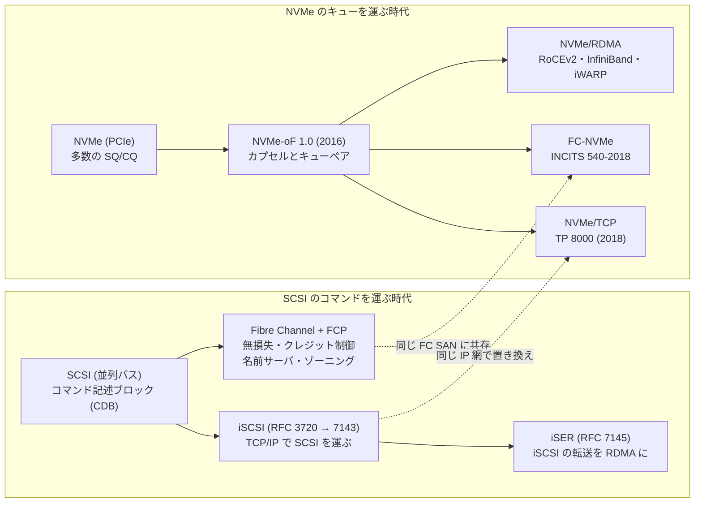
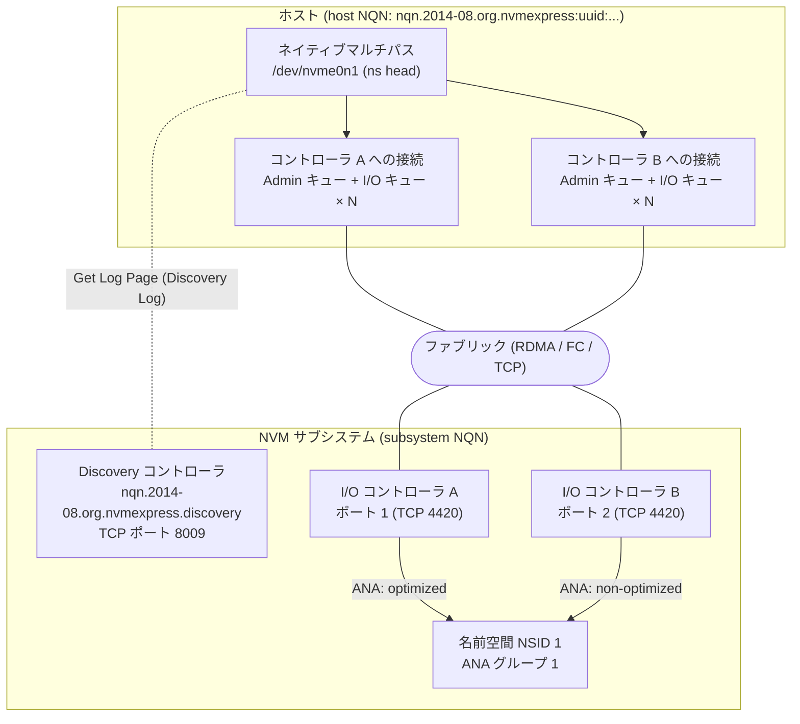
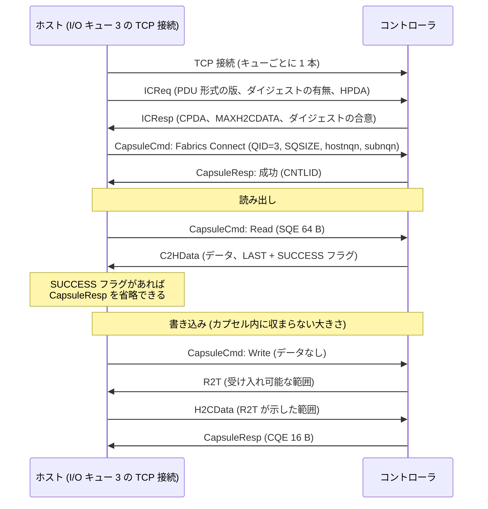

# NVMe over Fabrics とストレージネットワーク (NVMe over Fabrics & Storage Networking)

## 概要 (Overview)

本ドキュメントはブロックストレージを網の向こうへ運ぶ仕組み、つまりストレージネットワーク (storage networking) を扱う。中心は **NVMe over Fabrics (NVMe-oF)** で、その前史として SCSI・Fibre Channel (FC)・iSCSI を置き、NVMe-oF のアーキテクチャ (カプセル・キューペア・Discovery Controller・NQN・ANA マルチパス)、3 つのトランスポート (RDMA・FC-NVMe・NVMe/TCP)、発見と管理、性能とテール遅延、ハイパースケーラの分離型ストレージ (disaggregated storage)、故障と復旧、セキュリティを順に読む。ローカルの NVMe の仕組み (SQ/CQ・ドアベル・PCIe・FTL) は [`../../hardware/hw-sw-interface/storage-nvm-interface.md`](../../hardware/hw-sw-interface/storage-nvm-interface.md) を前提とし、ここでは繰り返さない。

中心テーゼは、**NVMe-oF の設計は「NVMe のキューを網の向こうまでそのまま伸ばす」ことであり、そのとき残る問題は、伸ばした先の網の性質 (ロス・順序・混雑・信頼) をどこで支払うかに帰着する**ということである。SCSI 系のストレージネットワークでは、ホストの NVMe 的な並列性は網に出る前に SCSI のコマンドに翻訳され、ターゲットで再び翻訳されていた。NVMe-oF は NVMe のコマンドと完了をカプセル (capsule) に包んで運び、ホストのキュー 1 本を網のコネクション 1 本に対応付ける。翻訳がなくなったことで、網の上の遅延は「NVMe の遅延 + トランスポートの遅延」に近づいた。

残った支払いの方法は 3 通りに分かれる。RDMA は CPU の負担をほぼゼロにする代わりに、ロスのない網 (PFC・DCQCN) を要求する。FC-NVMe は、網そのものが無損失で名前解決とゾーニング (zoning) を持つ既存の FC SAN にそのまま載る。NVMe/TCP はどんな Ethernet でも動く代わりに、CPU の負担とコピーを TCP スタックで払う。NVMe/TCP が後から伸びたのは、ロスのない網を作る運用費より CPU のほうが安い場面が多かったからである。一方で IP の網には FC のファブリックが持っていた名前サービス・ゾーニング・認証がない。そのため Centralized Discovery Controller、ホスト NQN の許可リスト、DH-HMAC-CHAP と TLS といった仕組みを NVMe の側で作り直すことになった。ハイパースケーラはさらに進み、仮想マシンには NVMe のデバイスを見せながら、網の上では自社のプロトコル (AWS の SRD、Alibaba の Solar) を使う。NVMe はインタフェースとして残り、網の上の形式とは切り離されつつある。分析深度は Level 3。

## 方法論 (Methodology)

- **一次資料**: NVM Express の仕様群 (Base Specification の版の履歴、NVMe over TCP / RDMA Transport、Boot Specification 1.0a)、iSCSI は RFC 7143、IP ストレージの安全性は RFC 3723、FC-NVMe は INCITS 540-2018 と INCITS 556-2020 (FC-NVMe-2) の公開情報、ポート番号は IANA の登録簿を使う。仕様本文は会員外に公開されていない技術提案 (TP) が多いため、TP の内容はそれを実装した Linux カーネルのコードとパッチの説明、NVM Express の関係者による SNIA の講演資料で確かめた。
- **実装**: Linux カーネルのソースコードを v7.3 のタグで読み、行番号を記した (`drivers/nvme/host/tcp.c`、`fabrics.c/h`、`multipath.c`、`core.c`、`drivers/nvme/target/`、`include/linux/nvme-tcp.h`)。機能が入った版は、該当する Kconfig の項目が各版のタグに含まれるかで確認した (NVMe/TCP は v5.0、帯域内認証は v6.0、TLS は v6.7)。
- **性能の主張**: 査読付き論文 (Klimovic et al. EuroSys 2016・ASPLOS 2017、Guz et al. SYSTOR 2017、Hwang et al. NSDI 2020) を根拠とする。仕様団体や業界誌の「目標値」と論文の「実測値」を分けて書く。実測値は 2016〜2020 年頃のハードウェアでのもので、絶対値ではなく桁と比で読む。
- **ハイパースケーラ**: AWS (SRD・EBS の文書)、Alibaba (NSDI 2021・SIGCOMM 2022・FAST 2024)、Microsoft (NSDI 2023) の自社発表を使い、外部から検証できない数値はそう明示する。Meta の分離型ブロックストレージについては、今回は一次資料を見つけられなかった。
- **担当範囲**: RDMA・RoCEv2・PFC・DCQCN の機構は [`../../hardware/networking/nic-switch-architecture.md`](../../hardware/networking/nic-switch-architecture.md)、AI クラスタでのロスレス網は [`../../hardware/accelerators/interconnects-scaleout-training.md`](../../hardware/accelerators/interconnects-scaleout-training.md)、PFC の QoS 上の位置付けは [`qos-traffic-management.md`](qos-traffic-management.md)、ホスト側のブロック層 (blk-mq) は [`../operating-systems/block-io-stack.md`](../operating-systems/block-io-stack.md)、オブジェクトストレージは [`../object-storage/object-storage-architecture.md`](../object-storage/object-storage-architecture.md) に委ね、本書ではストレージに固有の部分だけを扱う。

## 発見事項 (Findings)

1. **NVMe-oF が取り除いたのはネットワークではなく、プロトコルの翻訳である。** iSCSI では、ホストのブロック層の要求が SCSI のコマンドになり、TCP で運ばれ、ターゲットで再び NVMe のコマンドに翻訳される。NVMe-oF は NVMe のコマンド (64 バイトの SQE) と完了 (16 バイトの CQE) をそのままカプセルで運ぶ。Samsung の測定 (Guz et al. 2017、RoCEv2・100GbE) では、4KB のランダム読み出しで NVMe-oF はローカル接続 (DAS) と同じ約 225 万 IOPS に届き、iSCSI は約 40% 低かった。ホストの CPU 使用率も iSCSI は NVMe-oF の 2 倍以上だった。
2. **「ローカルとの差 10 µs 以内」は目標値であり、実測は条件次第で数十 µs から 100 µs 台まで広がる。** NVMe-oF 1.0 (2016 年 6 月) の設計目標として、直結の NVMe に対して追加遅延を 10 µs 以内に抑えることが業界誌や講演で繰り返し引用されている (仕様本文での位置付けは未確認)。ReFlex (ASPLOS 2017) は TCP の上で無負荷時の追加遅延 21 µs を報告し、i10 (NSDI 2020) は軽負荷時でも NVMe/RDMA の 1.7 倍以内とはいえ 100 µs 単位の遅延になると書いている。目標値は網とソフトウェアが理想的な場合の下限として読むのがよい。
3. **キューペア 1 本が網のコネクション 1 本に対応する。** NVMe/TCP ではホストの I/O キューごとに TCP コネクションが張られ、Linux の実装は各キューの送受信処理を、そのキューに対応する CPU に固定する (`tcp.c` の `nvme_tcp_set_queue_io_cpu`)。コア間でロックを取り合わないという NVMe の性質は網の上でも保たれる。その代わり、ホスト数 × キュー数のコネクションがターゲットに集まる。
4. **NVMe/TCP の普及は CPU の効率より網の運用のしやすさで決まった。** RDMA は 1 I/O あたりの CPU 負担が最も小さいが、RoCEv2 は PFC と DCQCN による無損失化を前提とし、その運用の難しさは大規模運用の報告で知られている。NVMe/TCP (TP 8000、2018 年 11 月に承認、Linux v5.0 に収録) は既存の Ethernet と TCP で動く。i10 は、カーネルの NVMe/TCP を作り直すと RDMA に近い 1 コアあたりの性能が出ることを示した。ただし、その差が生まれる場所はストレージスタックとネットワークスタックの境界にあった。
5. **FC が網の機能として持っていた名前サービスとゾーニングを、IP の網では NVMe の側で作り直している。** FC のファブリックにはスイッチが提供する名前サーバとゾーニングがある。IP の網にはそれがないため、各ホストに接続先を個別に設定する必要があった。TP 8009 (mDNS による Discovery Controller の自動発見) と TP 8010 (Centralized Discovery Controller、CDC) は、FC のファブリックサービスに相当するものを Discovery Controller として作り直す試みである。
6. **ANA は「どの経路が速いか」をターゲットがホストに伝える仕組みであり、経路の切り替えの時間はタイマの組み合わせで決まる。** Asymmetric Namespace Access (ANA、TP 4004) は、名前空間をグループに分け、コントローラごとに最適 (optimized)・非最適 (non-optimized)・アクセス不可 (inaccessible)・恒久的喪失 (persistent loss)・遷移中 (change) のいずれかの状態を報告させる。Linux は遷移中のグループがあると ANATT (ANA Transition Time) の 2 倍のタイマを張り、時間切れならコントローラをリセットする。Keep Alive の既定は 5 秒、再接続の間隔は 10 秒、コントローラを諦めるまでの時間は 600 秒であり、どの経路で I/O を待たせるかはこれらの値の組み合わせで決まる。
7. **ハイパースケーラは NVMe を仮想マシンとの境界にだけ使い、網の上では自社のプロトコルを使う。** AWS の Nitro では、EBS ボリュームはゲストに NVMe のブロックデバイスとして見え、io2 Block Express のサーバとは Nitro カード上の SRD (Scalable Reliable Datagram) で通信する。Alibaba は EBS の網をユーザ空間 TCP (Luna) からストレージ向けの UDP スタック (Solar) へ移し、5 年で平均 I/O 遅延を 72% 下げたと報告した。Microsoft は Azure Storage の通信の約 70% が RDMA だと報告している。いずれも標準の NVMe-oF を網の上でそのまま使ってはいない。
8. **SAN の信頼モデルは長く「閉じた網の中は信頼できる」だった。ホスト NQN は本人の申告にすぎない。** Linux のターゲット実装はサブシステムごとに許可するホスト NQN の一覧で接続を判定する。しかし NQN は接続時にホストが名乗る文字列で、認証がなければ偽装できる。Discovery サブシステムは全ホストに開かれており、返す一覧は名乗った NQN で絞り込まれる。DH-HMAC-CHAP (TP 8006、NVMe 2.0 に収録) が帯域内の相互認証を、TLS 1.3 (TP 8011) が NVMe/TCP の暗号化を加えた。RDMA のトランスポートには、仕様上の暗号化の手段が定義されていない。

## アーキテクチャ (Architecture)

### ストレージネットワークの系譜



凡例: 実線は技術の系譜、点線は同じ網の上での置き換えや共存の関係。

### NVMe-oF の構成要素



凡例: 実線はデータの経路、点線は接続先を調べるための Discovery の問い合わせ。ホストはまず Discovery コントローラに接続し、Discovery Log Page (トランスポートの種類・アドレス・ポート・サブシステム NQN の一覧) を受け取る。その後、I/O コントローラごとに Admin キュー 1 本と I/O キュー N 本を張る。同じ名前空間に複数のコントローラから届く場合、ホストはそれらを 1 つのブロックデバイスにまとめ、ANA の状態で経路を選ぶ。

### NVMe/TCP の 1 キューの流れ



PDU はすべて 8 バイトの共通ヘッダ (種別・フラグ・ヘッダ長・データの位置・全長) で始まる。ヘッダダイジェストとデータダイジェスト (どちらも CRC32C、4 バイト) は ICReq/ICResp で接続ごとに有効化する。小さな書き込みは R2T を待たずにコマンドのカプセルにデータを入れて送れる (I/O キューのカプセルの大きさは IOCCSZ で決まる)。

## 技術詳細 (Technical Details)

### 1. 前史: SCSI・Fibre Channel・iSCSI

- **SCSI と FCP**: SCSI はコマンド記述ブロック (CDB) で読み書きを指示するプロトコルで、もとは並列バスの上で使われた。FC は SCSI を運ぶ FCP を載せ、バッファ間のクレジット (buffer-to-buffer credit) で送信を止める無損失の網として設計された。FC のスイッチは名前サーバ (どのポートに何がつながっているか) とゾーニング (誰が誰を見られるか) を網の機能として提供する。ストレージ側では、LUN マスキングで「どのホストにどの論理ユニットを見せるか」を決める。
- **iSCSI (RFC 7143)**: iSCSI は SCSI のコマンドとデータを TCP で運ぶ。RFC 3720 (2004 年) 以降の 4 つの RFC を 2014 年に 1 本にまとめたのが RFC 7143 である。セッションは複数の TCP コネクションを束ねられるが、SCSI のコマンドの意味論と、その上のホスト側・ターゲット側の SCSI スタックは残る。RDMA で転送する拡張が iSER (RFC 7145) である。
- **NVMe-oF の動機**: NVMe SSD は単体で 100 万 IOPS 級を出し、ホストは CPU ごとにキューを持つ。i10 の論文は、iSCSI が 1 コアあたり約 7 万 IOPS しか処理できず、NVMe SSD 1 台を使い切るのに 14 コアが要ると指摘する (Hwang et al. 2020)。Klimovic ら (EuroSys 2016) は、iSCSI 系のリモートフラッシュではアプリケーションのスループットが 20% 落ちるが、資源の使用効率の改善で補えると報告した。NVMe-oF はこの翻訳と単一キューのコストを外すために作られた。

### 2. NVMe-oF の仕様の構造

- **版の経緯**: NVMe-oF 1.0 は 2016 年 6 月に公開され、RDMA と FC のトランスポートを定めた。NVMe/TCP は TP 8000 として 2018 年 11 月 15 日に承認され、NVMe-oF 1.1 に入った。NVMe 2.0 (2021 年 6 月) で仕様群が再編され、ファブリックの共通部分は Base Specification に統合された。トランスポートごとの仕様 (TCP・RDMA) は別の文書に分かれ、独立した NVMe-oF 仕様は廃止扱いになった。2026 年 10 月時点の最新は Base Specification 2.4 (2026 年 7 月 31 日承認) である。
- **カプセル**: コマンドカプセルは SQE (64 バイト) に任意でデータや SGL を付けたもの、応答カプセルは CQE (16 バイト) に任意でデータを付けたものである。PCIe の NVMe ではコントローラがホストメモリの SQ を DMA で読みに行くが、NVMe-oF ではホストがカプセルをメッセージとして送る。ドアベルの MMIO はない。
- **キューペアとコネクション**: NVMe-oF の各キューは送信キュー (SQ) と完了キュー (CQ) を 1 対 1 で組にしたキューペアで、トランスポートのコネクション 1 本 (RDMA の QP、TCP のコネクション、FC の交換の集まり) に対応する。キューは Fabrics の Connect コマンドで作り、QID 0 が Admin キュー、それ以外が I/O キューになる。PCIe の NVMe のように複数の SQ が 1 つの CQ を共有することはできない。
- **NQN と ID**: ホストとサブシステムは NVMe Qualified Name (NQN、最大 223 バイト) で識別する。形式は `nqn.yyyy-mm.<逆順ドメイン>:<任意の文字列>`、または UUID を使う `nqn.2014-08.org.nvmexpress:uuid:<UUID>` である。Discovery サブシステムには既定の NQN `nqn.2014-08.org.nvmexpress.discovery` がある (Linux `include/linux/nvme.h` 24 行)。Linux はホスト NQN を `/etc/nvme/hostnqn` から読み、`nvme gen-hostnqn` で生成する。
- **名前空間と予約**: 名前空間 (namespace) はターゲットが見せる論理ブロックの集まりで、FC の LUN に相当する。複数のホストで共有する場合、Persistent Reservations (SCSI の永続予約に相当) で書き込めるホストを限定する。クラスタファイルシステムのフェンシングはこれに依存する。
- **IANA のポート**: TCP 4420 は `nvme` (NVM Express over Fabrics storage access)、TCP 8009 は `nvme-disc` (Discovery Service) として登録されている。

### 3. トランスポート

| 項目 | NVMe/RDMA | FC-NVMe | NVMe/TCP |
|---|---|---|---|
| 網への要求 | RoCEv2 は PFC/ECN の無損失化が事実上必要。InfiniBand はクレジット制御。iWARP は TCP の上 | FC の無損失ファブリック (既存 SAN) | なし (普通の Ethernet・IP) |
| データの移動 | ターゲットが RDMA READ/WRITE でホストのメモリを直接読み書き | FC の交換 (exchange) でデータを運ぶ | TCP のバイト列。受信側でソケットから I/O バッファへコピー |
| CPU 負担 | 最小 (NIC が転送) | HBA が処理 | 最大 (TCP/IP とコピー・CRC) |
| 経路制御と規模 | L3 で可。ロスレスの範囲は運用で限定 | FC ファブリック内 | IP で経路制御、データセンターをまたいでも動く |
| 暗号化 | トランスポートの仕様には定義なし | FC の暗号化 (FC-SP) は普及していない | TLS 1.3 (TP 8011) |
| 標準 | NVMe over RDMA Transport | INCITS 540-2018 / 556-2020 | NVMe over TCP Transport (TP 8000) |

- **NVMe/RDMA**: コマンドと応答のカプセルは RDMA の SEND で送る。データはホストがメモリを登録し、その鍵 (rkey) を SGL に載せる。ターゲットはその鍵で RDMA WRITE (読み出しの応答) と RDMA READ (書き込みのデータ取得) を発行する。ホストの CPU はデータの移動に関わらない。RoCEv2 の網に何が要るかは [`../../hardware/networking/nic-switch-architecture.md`](../../hardware/networking/nic-switch-architecture.md) に譲る。ストレージに固有の注意点として、1 つの I/O が大きなデータ転送を伴うため、PFC の停止が起きると I/O の完了がまとめて遅れる。
- **FC-NVMe**: INCITS 540-2018 (2018 年 6 月公開) が FC の上での NVMe-oF の写像を定め、FC-NVMe-2 (INCITS 556-2020) がシーケンス単位の誤り回復 (SLER) を加えた。FC SAN を持つ企業にとっては、同じ HBA とスイッチで SCSI (FCP) と NVMe を並べて使える移行経路である。
- **NVMe/TCP の PDU**: 共通ヘッダは次の 8 バイトである。

```c
/* C: NVMe/TCP common PDU header (8 bytes) shared by all PDU types.
 * Source: include/linux/nvme-tcp.h lines 72-78 (Linux v7.3) */
struct nvme_tcp_hdr {
	__u8	type;
	__u8	flags;
	__u8	hlen;
	__u8	pdo;
	__le32	plen;
};
```

  PDU の種別は ICReq/ICResp (接続の初期化)、H2CTermReq/C2HTermReq (致命的なエラーによる終了)、CapsuleCmd/CapsuleResp、H2CData/C2HData、R2T である (同ファイル 44-54 行)。`pdo` はデータ部の開始位置で、ICReq/ICResp で合意した整列 (HPDA/CPDA) に従う。受信側がデータを整列した位置に置きやすくするための欄である。
- **ダイジェスト**: ヘッダダイジェストとデータダイジェストは CRC32C で、TCP のチェックサム (16 ビットの 1 の補数和) より強い誤り検出を端から端まで提供する。TCP のチェックサムは NIC がオフロードで計算すると、NIC とメモリの間で起きた破損を検出できない。データダイジェストの代償は CPU で、Linux の受信経路はコピーと CRC 計算を 1 回のパスで行う。

```c
/* C: copy received payload from the skb into the request's bio,
 *    computing CRC32C on the fly when data digest is enabled.
 * Source: drivers/nvme/host/tcp.c lines 993-998 (Linux v7.3) */
		if (queue->data_digest)
			ret = skb_copy_and_crc32c_datagram_iter(skb, *offset,
				&req->iter, recv_len, &queue->rcv_crc);
		else
			ret = skb_copy_datagram_iter(skb, *offset,
					&req->iter, recv_len);
```

- **キューごとの TCP コネクション**: Linux の `nvme_tcp_alloc_queue` (`tcp.c` 1834 行〜) はキューごとに `sock_create_kern` でソケットを作り (1856-1858 行)、`TCP_NODELAY` を設定する (1876 行)。SYN の再送は 1 回に絞り (1873 行)、閉じるときは送信待ちのデータを捨てる (1883 行、網が戻ったときに古いデータが流れないようにするため)。各キューの送受信を処理するワークは、そのキューに対応する CPU のうち担当キューが最も少ないものに固定される (`nvme_tcp_set_queue_io_cpu`、1706-1747 行)。I/O キューの数は既定でホストの CPU 数に合わせ、書き込み専用キュー (`nr_write_queues`) とポーリング用キュー (`nr_poll_queues`) を別に持てる。
- **SPDK**: SPDK はユーザ空間でポーリングによって動くストレージ開発キットで、NVMe-oF のターゲットとイニシエータを持つ。NVMe/TCP の実装は Linux カーネルとほぼ同時期 (2018 年末) に公開された。ターゲットは TCP と RDMA を標準で、FC はベンダーの下位ドライバを使って扱い、TLS と帯域内認証にも対応する。カーネルを経由しない代わりにコアをポーリングで専有するため、CPU 効率を比べるときは使ったコア数を揃える必要がある。

### 4. 発見と管理

- **Discovery の手順**: ホストは Discovery コントローラに接続し、Get Log Page で Discovery Log Page を読む。各項目にはトランスポートの種類 (Linux の定義では PCI=0・RDMA=1・FC=2・TCP=3)、アドレス、サービス ID (TCP ではポート)、サブシステム NQN、セキュリティの要求が載る。`nvme discover` はこの一覧を表示し、`nvme connect-all` は一覧にあるすべてのサブシステムに接続する。永続的な設定は `/etc/nvme/discovery.conf` に書く。
- **直接 Discovery の限界**: 各ターゲットが Direct Discovery Controller (DDC) を持つ構成では、ホストごとに「どのターゲットの Discovery に問い合わせるか」を設定しなければならない。ホスト 1,000 台、ターゲット 50 台の網では、その組み合わせの管理が運用の負担になる。FC ではファブリックの名前サーバがこれを引き受けていた。
- **TP 8009 と TP 8010**: TP 8009 は DNS-SD/mDNS で `_nvme-disc._tcp` のサービスを告知し、ホストが同じブロードキャストドメインの Discovery Controller を自動で見つける方式である。TP 8010 は Centralized Discovery Controller (CDC) を定める。CDC はホストとサブシステムの登録を受け付け、管理者が設定したゾーニング (どのホストがどのサブシステムを見てよいか) に従って Discovery Log Page を返す。DDC は CDC に自分から登録する (push)、CDC に読ませる (pull)、管理者が設定する、のいずれかで情報を渡す。Linux では `nvme-stas` (stafd/stacd) が mDNS による発見と CDC のクライアントを実装している。両 TP の承認日と、どの版の Base Specification に入ったかは、一次資料で確認できなかった。
- **NVMe-oF Boot**: NVM Express Boot Specification (1.0 は 2022 年末、1.0a は 2024 年 7 月 29 日承認) は、UEFI のファームウェアが NVMe/TCP の名前空間から OS を起動し、その接続情報を ACPI の NBFT (NVMe Boot Firmware Table) で OS に渡す方法を定める。iSCSI の iBFT に相当し、Linux では libnvme と dracut が NBFT を読む。

### 5. 性能とテール遅延

- **1 I/O あたりの CPU**: i10 の測定 (100Gbps、4KB ランダム読み出し) では、長寿命の TCP の流れは 1 コアで約 915 kIOPS 相当、ローカルの NVMe のブロック層は 1 コアで約 350 kIOPS を処理できた。ところが両者を組み合わせた既存のリモートストレージスタックは 1 コアで 96 kIOPS にとどまった (Hwang et al. 2020、図 1)。ボトルネックは網のスタックでもストレージのスタックでもなく、その境界 (I/O ごとに起こすコンテキストスイッチや、パケット単位に細かく送ること) にあった。i10 はコアとターゲットの組ごとの専用経路、まとめ送り (batching)、ドアベルの遅延で、NVMe/TCP より CPU 使用率を 2.5 分の 1 に下げ、1 コアあたりのスループットを NVMe/RDMA と同程度にした。その代わり軽負荷時の遅延は NVMe/RDMA の最大 1.7 倍になる。i10 は研究実装であり、Linux 本体には取り込まれていない。
- **iSCSI との比較**: Guz ら (2017) の測定では、目標スループットを出すのに必要なターゲット側のコアは、NVMe-oF なら全コアの 1/12 で DAS の 90% に届いた。iSCSI はコアを 32 から 8 に減らすとスループットが 2.4 分の 1 に落ちた。遅延は iSCSI が軽負荷でも約 10 倍で、早く飽和した。
- **コピーとオフロード**: NVMe/TCP の受信では、NIC が書いたソケットバッファからブロック層のバッファへのコピーと CRC32C の計算が、I/O ごとに CPU に残る。NIC が NVMe/TCP の PDU を解釈し、データを直接 I/O バッファへ置き (DDP: Direct Data Placement)、CRC も検証するオフロードが NVIDIA ConnectX-7 向けに提案されている (`ulp_ddp`、Linux のパッチは 2020 年から改版を重ねている)。v7.3 の `tcp.c` にはこの経路がなく、本体には取り込まれていない。送信側は `MSG_SPLICE_PAGES` でページを参照渡しにしてコピーを避けている (`tcp.c` 1200 行など)。
- **ターゲットでの incast**: 多数のホストが 1 台のターゲットに同時に書き込むと、ターゲットのスイッチのポートに一斉に到着し、浅いバッファがあふれる。読み出しでは逆に、1 台のホストがストライプした複数のターゲットから同時に応答を受ける。TCP の incast はもともとクラスタストレージで見つかった現象であり (Phanishayee et al. FAST 2008)、ブロック全体がそろうまで完了しない同期的な読み出しが、最小 RTO (当時は 200 ms) の待ちで止まる。NVMe/TCP では 1 回の I/O が大きく、キュー深度も深いため、同じ形の incast が起きやすい。RDMA では PFC が上流を止めて取りこぼしを防ぐ代わりに、停止が無関係な流れへ広がる。
- **HoL ブロッキング**: NVMe/TCP では 1 本の TCP コネクションに同じキューの I/O が順に並ぶ。1 MB の読み出しの C2HData の後ろに 4KB の読み出しの応答が並ぶと、小さな I/O が大きな I/O の転送を待つ。1 セグメントのロスで、そのコネクション上のすべての I/O が再送を待つ (TCP の HoL、[`tcp-transport-congestion.md`](tcp-transport-congestion.md))。キューが多いほど影響は分散するが、ブロック層は CPU ごとにキューを選ぶため、同じ CPU から出た大小の I/O は同じコネクションに乗る。書き込みと読み出しのキューを分ける `nr_write_queues` はこの影響を減らす手段の 1 つである。
- **ロスとテール**: ストレージのテール遅延は網の 1 回のロスでも TCP の再送タイムアウトの分だけ伸びる。AWS が SRD を、Alibaba が Solar を作った理由の 1 つはここにあり、どちらもパケットを複数の経路に散らし、マイクロ秒単位で再送して、1 つの経路の混雑や故障をテールに出さないようにしている (Shalev et al. 2020、Miao et al. 2022)。

### 6. ハイパースケーラの分離型ストレージ

- **研究の系譜**: Klimovic ら (Facebook の研究者との共著、EuroSys 2016) は、リモートのフラッシュでアプリケーションのスループットが 20% 落ちても、計算とフラッシュを別々に増やせる資源効率で補えることを示した。ReFlex (ASPLOS 2017) は、データプレーン型のカーネルでネットワークとストレージの処理を 1 つの経路にまとめ、10GbE の TCP で 1 コア 85 万 IOPS、ローカルとの無負荷時の差 21 µs を報告した。さらに QoS スケジューラで、多数のクライアントのテール遅延とスループットの目標を同時に守る。
- **AWS (Nitro・EBS・SRD)**: Nitro のインスタンスでは EBS ボリュームが NVMe のブロックデバイスとして見え、ゲストは標準の NVMe ドライバで使う。io2 Block Express のサーバとの通信には SRD を使い、その処理は EBS の I/O 専用の Nitro カードに実装されている。AWS は io2 Block Express の設計目標として 16KiB の I/O で平均 500 µs 未満の遅延、最大 256,000 IOPS を挙げている (目標値)。SRD は EFA と同じプロトコルで、順序を保証せずパケットを多数の経路に散らし、輻輳した経路を避ける (Shalev et al. 2020)。ゲストから見ると NVMe だが、網の上は NVMe-oF ではない。
- **Alibaba (Pangu・EBS)**: Pangu は RoCE の RDMA を導入し、運用の安全策として RDMA から TCP へ切り替える経路を残した (Gao et al. NSDI 2021)。EBS の計算ノードとストレージの間の網は、ユーザ空間 TCP の Luna から、1 パケットを 1 つのストレージブロックに対応させてハードウェアで処理する UDP の Solar へ移った。2 世代を合わせて平均 I/O 遅延を 72% 下げたと報告されている (Miao et al. SIGCOMM 2022)。EBS 自体の 3 世代の変遷は Zhang ら (FAST 2024) が書いている。
- **Microsoft (Azure Storage)**: Azure は計算 VM とストレージの間 (フロントエンド) とストレージクラスタ内 (バックエンド) の両方で RDMA を使い、通信の約 70% が RDMA だと報告した (Bai et al. NSDI 2023)。異なる NIC 間の相互運用などの課題は網の構成を変えて解決したとしている。
- **読み方**: これらの数値はすべて自社の報告で、外部の独立した測定はない。共通しているのは、(1) ゲストとの境界を NVMe にして標準ドライバを使わせる、(2) 網の上は自社で制御できるプロトコルにしてテールと故障の扱いを自分で決める、(3) ブロックの耐久性は複製や消失訂正符号の分散ストレージで作る、という点である。

### 7. ブロックストレージとオブジェクトストレージ

ブロックストレージを網で運ぶとき、運ばれるのは LBA に対する読み書きで、その意味論は「1 台のディスク」である。上書き・部分書き込み・FLUSH/FUA による永続化の順序を、網の向こうでも守らなければならない。ファイルシステムは通常 1 台のホストだけが持つ前提で動き、共有するには予約によるフェンシングが要る。[`../object-storage/object-storage-architecture.md`](../object-storage/object-storage-architecture.md) のオブジェクトストレージは、部分書き換えを捨てて全体の PUT/GET にすることで、ホスト間の調整を不要にしている。そのため、遅延の目標がマイクロ秒単位の NVMe-oF に対して、オブジェクトストレージは数十ミリ秒単位でも成り立つ。EBS や Pangu のように、ブロックのインタフェースの裏側を分散ストレージで作る設計は、両者の間にある。

### 8. 故障と復旧

- **Keep Alive**: ファブリックのコントローラは、ホストからの Keep Alive コマンドが KATO (Keep Alive Timeout) の間届かなければ、ホストとの関係 (association) を終える。Linux の既定の KATO は 5 秒で (`drivers/nvme/host/nvme.h` 31 行)、送信の間隔は KATO の半分、ほかのコマンドの完了を生存の印に使う Traffic Based Keep Alive が有効ならさらにその半分である (`core.c` 1334-1347 行)。
- **再接続の既定値**: Linux の既定値は次のとおりである。

```c
/* C: default fabrics reconnect parameters.
 * Source: drivers/nvme/host/fabrics.h lines 14-19 (Linux v7.3) */
#define NVMF_DEF_QUEUE_SIZE	128
#define NVMF_DEF_RECONNECT_DELAY	10
/* default to 600 seconds of reconnect attempts before giving up */
#define NVMF_DEF_CTRL_LOSS_TMO		600
/* default is -1: the fail fast mechanism is disabled  */
#define NVMF_DEF_FAIL_FAST_TMO		-1
```

  再接続の試行回数は `ctrl_loss_tmo / reconnect_delay` の切り上げ (既定で 60 回) で (`fabrics.c` 1087-1089 行)、尽きるとコントローラが削除される。`fast_io_fail_tmo` が既定の -1 のままだと、マルチパスでない構成では I/O は再接続の間ずっと待たされる。
- **ネイティブマルチパスと I/O の待たせ方**: Linux のネイティブマルチパスは、ある経路のコントローラが LIVE・RESETTING・CONNECTING のいずれかであれば、使える経路がなくても I/O を失敗させずに再キューする (`multipath.c` 499-531 行)。経路の選び方は `numa` (既定、近い NUMA ノードの optimized 経路)、`round-robin`、`queue-depth` (未完了の I/O が少ない経路) の 3 つから選べる (69-71 行)。dm-multipath の `queue_if_no_path` に相当する挙動が既定である点に注意が要る。ストレージが戻らなければ、アプリケーションは最大で `ctrl_loss_tmo` の間止まる。
- **ANA の遷移**: ANA の状態が遷移中 (change) のとき、ホストはその経路に I/O を出さずに待つ。Linux は ANATT の 2 倍をタイマに設定し、時間内に遷移が終わらなければコントローラをリセットする。

```c
/* C: arm the ANA transition timer at 2x ANATT while any group is in change state.
 * Source: drivers/nvme/host/multipath.c lines 983-987 (Linux v7.3) */
	if (nr_change_groups)
		mod_timer(&ctrl->anatt_timer, ctrl->anatt * HZ * 2 + jiffies);
	else
		timer_delete_sync(&ctrl->anatt_timer);
```

  ストレージのコントローラが切り替わる (片方の筐体の保守など) ときは、旧経路が inaccessible、新経路が optimized になるまでの時間がアプリケーションから見た停止時間になる。
- **失敗した経路の I/O を別経路で出し直すときの危険**: 経路が切れても、ターゲットではその経路で受け取ったコマンドがまだ実行中かもしれない。ホストがすぐ別の経路で同じ書き込みを出し直し、その後に新しい書き込みを出すと、旧経路の古い書き込みが後から反映されて内容が巻き戻る可能性がある (本稿の推論。仕様が対処している問題として以下に記す)。TP 4129 (KATO Corrections and Clarifications) は、コントローラが未完了のコマンドを止めきるまでの時間 CQT (Command Quiesce Time) を定め、ホストが KATO と CQT の範囲でコントローラ間の回復を試みるようにした。Linux への対応 (フェイルオーバーを CQT の分だけ遅らせる) は 2026 年 7 月時点で v5 のパッチがレビュー中で、v7.3 には含まれていない。
- **再接続の嵐**: ターゲットが再起動すると、全ホストが同時に接続を失う。Linux の再接続は固定の `reconnect_delay` (既定 10 秒) ごとで、揺らぎ (jitter) を加えない (`tcp.c` 2393-2414 行)。数千のホストがそれぞれキュー数分の TCP 接続と Connect コマンド、場合によっては TLS と DH-HMAC-CHAP のハンドシェイクを同じ周期で再試行し、復旧直後のターゲットに集中する。Discovery の AEN (非同期イベント) で全ホストが一斉に Discovery Log を読み直すときにも同じ形の集中が起きる。
- **ホストを諦める条件**: `nvmf_should_reconnect` は、DNR (Do Not Retry) の付いたステータスと、鍵が拒否されたか見つからないとき (`-EKEYREJECTED`・`-ENOKEY`) には再接続しない (`fabrics.c` 590-603 行)。認証の設定を誤ると、再試行せずにすぐ経路を失う。

## セキュリティ考察 (Security Considerations)

- **SAN の平坦な信頼**: FC の SAN は物理的に分かれた網で、ゾーニングと LUN マスキングが事実上の境界だった。iSCSI では RFC 3723 が IPsec の実装を必須としたが、使用は必須ではなかった ("mandatory to implement, … not mandatory to use")。現場では VLAN による分離で済ませることが多かった。NVMe/TCP は同じ IP の網に載るため、ストレージの網とテナントの網が分かれていない構成では、L2/L3 の分離 ([`virtual-networks-overlay.md`](virtual-networks-overlay.md)、[`ethernet-lan-switching.md`](ethernet-lan-switching.md)) だけが最初の防御になる。
- **ホスト NQN の許可リストは認証ではない**: Linux のターゲットはサブシステムごとに `allowed_hosts` を持つか、`allow_any_host` で全ホストを許す (`drivers/nvme/target/core.c` 1548-1566 行)。照合するのは Connect コマンドでホストが名乗った NQN の文字列で、FC の WWPN によるゾーニングと同じく、名乗りを確かめる手段がなければ偽装できる。`nvme gen-hostnqn` の UUID 形式は推測しにくいが、ホストの設定ファイルや Discovery の挙動から漏れうる。
- **Discovery による列挙**: Discovery サブシステムは全ホストに開かれている (同 1557-1558 行)。返す Discovery Log はホストが名乗った NQN で絞り込まれるが (`discovery.c` 152・218 行)、許可された NQN を知る攻撃者には、接続できるサブシステムとアドレスの一覧が返る。TCP 8009 と 4420 への到達を、ストレージの網の外から遮断しておく必要がある ([`packet-filtering-conntrack.md`](packet-filtering-conntrack.md))。
- **DH-HMAC-CHAP (TP 8006)**: NVMe 2.0 に入った帯域内認証で、Connect の後に、ホストとコントローラが共有鍵による HMAC のチャレンジ・レスポンスを交わし、任意で Diffie-Hellman を加える。相互認証にすれば、偽のターゲットに接続させる攻撃も防げる。Linux はホストとターゲットの両方を v6.0 から実装している。鍵はホストごとに配る共有秘密なので、鍵の配布と更新の運用 (CDC と組み合わせた一元管理が議論されている) がそのまま安全性を決める。
- **TLS 1.3 (TP 8011) と secure concatenation (TP 8018)**: NVMe/TCP の TLS は TLS 1.3 で、事前共有鍵 (PSK) を使う。Linux は v6.7 で対応し、カーネルの TLS (kTLS) で暗号化し、ハンドシェイクはユーザ空間の `tlshd` に任せる (`tcp.c` 1781-1832 行の `nvme_tcp_start_tls`、既定のタイムアウトは 10 秒)。TP 8018 は DH-HMAC-CHAP で合意した鍵から TLS の PSK を導出し、接続を張り直して TLS に移る方式で、PSK を事前に配る手間を減らす。TLS はキューごとのコネクションすべてで張る必要があるため、CPU と再接続時のハンドシェイクの負担はキュー数に比例する。
- **RDMA の暗号化の欠如**: TLS は NVMe/TCP の仕様の一部で、NVMe/RDMA には同等の仕組みが定義されていない。RDMA の rkey はホストのメモリへの書き込み権限そのものであり、網の上で読み取られたり推測されたりすると、ホストのメモリが書き換えられうる。マルチテナントの網で RDMA を使うなら、IPsec や PSP のような回線上の暗号化と、テナントごとの網の分離が要る ([`../../hardware/networking/nic-switch-architecture.md`](../../hardware/networking/nic-switch-architecture.md))。
- **データダイジェストは改ざん防止ではない**: CRC32C は偶発的な破損の検出であり、攻撃者は CRC を計算し直せる。完全性の保証は TLS (あるいは IPsec) にしかない。
- **可用性への攻撃**: Connect の嵐や Keep Alive の妨害は、ターゲットを止めずに多数のホストの I/O を数分単位で止めうる。PFC を使う網では、偽の pause フレームが網全体を止める ([`ddos-mitigation.md`](ddos-mitigation.md) の資源枯渇の議論と同じ構造)。
- **データ残留**: 名前空間を削除して別のテナントに割り当て直すとき、ターゲット側でサニタイズや暗号鍵の破棄 (Crypto Erase) をしなければ、前のテナントのデータが読めることがある ([`../../hardware/hw-sw-interface/storage-nvm-interface.md`](../../hardware/hw-sw-interface/storage-nvm-interface.md) の FTL とデータ残留の議論)。

## 結論 (Conclusions)

- NVMe-oF は NVMe のコマンドと完了をカプセルで運び、キューペアを網のコネクションに対応させることで、SCSI 系のストレージネットワークにあった翻訳と単一キューのコストを取り除いた。測定では、スループットと CPU 負担の両方で iSCSI との差は大きい。
- 残った問題は伸ばした網の性質をどこで支払うかである。RDMA は CPU を節約して網の運用 (無損失化) で払い、NVMe/TCP は網を選ばない代わりに CPU とコピーで払う。i10 が示したように、TCP のコストの多くはプロトコルではなくスタックの境界にあり、オフロード (DDP) はその残りを NIC に移す試みである。
- FC のファブリックが網の機能として持っていた名前サービス・ゾーニング・閉じた網による信頼を、IP の網では NVMe の側で作り直している。CDC (TP 8010)、ホスト NQN の許可リスト、DH-HMAC-CHAP、TLS 1.3 がそれにあたる。認証のない許可リストと開かれた Discovery は、SAN の平坦な信頼をそのまま IP の網に持ち込む。
- 故障時の挙動は Keep Alive・再接続・ANA・マルチパスのタイマの組み合わせで決まり、既定値では I/O を失敗させずに最大 10 分待たせる。止まり方を決めるのは運用者の設定である。
- ハイパースケーラは NVMe をゲストとの境界にだけ使い、網の上では自社のプロトコルでテールと故障を制御している。NVMe はインタフェースの標準として広がり、網の上の形式とは切り離されつつある。

### 次の接続先 (Related Topics)

- [`../../hardware/hw-sw-interface/storage-nvm-interface.md`](../../hardware/hw-sw-interface/storage-nvm-interface.md) — ローカルの NVMe (SQ/CQ・ドアベル・PCIe)、FTL、FLUSH/FUA による永続化。本書が網の向こうへ伸ばしたもの。
- [`../operating-systems/block-io-stack.md`](../operating-systems/block-io-stack.md) — blk-mq の CPU ごとのキュー。NVMe/TCP のキューとコネクションの対応の出発点。
- [`../../hardware/networking/nic-switch-architecture.md`](../../hardware/networking/nic-switch-architecture.md) — RDMA (verbs・QP)、RoCEv2 と PFC・DCQCN、NIC のオフロードと DPU。
- [`../../hardware/accelerators/interconnects-scaleout-training.md`](../../hardware/accelerators/interconnects-scaleout-training.md) — AI クラスタのロスレス RDMA 網。チェックポイントの保存先としてのストレージ網と同じ網を共有する場合がある。
- [`qos-traffic-management.md`](qos-traffic-management.md) — PFC を含むトラフィッククラスの設計。ストレージのトラフィックを分けるときの前提。
- [`tcp-transport-congestion.md`](tcp-transport-congestion.md) — TCP の HoL ブロッキングと再送タイムアウト。NVMe/TCP のテールの源。
- [`kernel-network-stack.md`](kernel-network-stack.md) — sk_buff・GRO・RSS。NVMe/TCP の受信経路が通るスタック。
- [`../object-storage/object-storage-architecture.md`](../object-storage/object-storage-architecture.md) — 部分書き換えを捨てたもう一つのストレージ抽象。

## 参考文献 (References)

**一次資料 (仕様・標準)**

- NVM Express, Inc. *NVM Express Base Specification*, Revision 2.4 (2026-07-31 承認) と版の履歴 (1.4: 2019-06-10、2.0: 2021-06-02、2.0c: 2022-10-04)。— [nvmexpress.org](https://nvmexpress.org/specification/nvm-express-base-specification/) — Accessed: 2026-10-26
- NVM Express, Inc. *Specifications* (NVMe over TCP Transport、NVMe over RDMA Transport、Boot、Management Interface。NVMe-oF Specification は廃止扱い)。— [nvmexpress.org/specifications](https://nvmexpress.org/specifications/) — Accessed: 2026-10-26
- NVM Express, Inc. (2024). *NVM Express Boot Specification*, Revision 1.0a (2024-07-29 承認)。— [PDF](https://nvmexpress.org/wp-content/uploads/NVM-Express-Boot-Specification-1.0a-2024.07.29-Ratified.pdf) — Accessed: 2026-10-26
- Chadalapaka, M., Satran, J., Meth, K., & Black, D. (2014). Internet Small Computer System Interface (iSCSI) Protocol (Consolidated). *RFC 7143*. — [rfc-editor.org](https://www.rfc-editor.org/info/rfc7143) — Accessed: 2026-10-26
- Ko, M., & Nezhinsky, A. (2014). Internet Small Computer System Interface (iSCSI) Extensions for the Remote Direct Memory Access (RDMA) Specification. *RFC 7145*.
- Aboba, B., Tseng, J., Walker, J., Rangan, V., & Travostino, F. (2004). Securing Block Storage Protocols over IP. *RFC 3723*. — [rfc-editor.org](https://www.rfc-editor.org/rfc/rfc3723) — Accessed: 2026-10-26。IPsec は実装必須・使用は任意。
- INCITS 540-2018. *Information technology – Fibre Channel – Non-Volatile Memory Express (FC-NVMe)*. / INCITS 556-2020. *FC-NVMe-2*. — [ANSI Webstore](https://webstore.ansi.org/standards/incits/incits5402018) — Accessed: 2026-10-26
- [Fibre Channel Industry Association: INCITS Publishes FC-NVMe (2018)](https://fibrechannel.org/?p=2197) — Accessed: 2026-10-26
- [IANA Service Name and Transport Protocol Port Number Registry (nvme 4420、nvme-disc 8009)](https://www.iana.org/assignments/service-names-port-numbers/service-names-port-numbers.xhtml?search=nvme) — Accessed: 2026-10-26

**一次資料 (実装)**

- Linux kernel v7.3. `include/linux/nvme-tcp.h`、`include/linux/nvme.h`、`drivers/nvme/host/{tcp.c, fabrics.c, fabrics.h, multipath.c, core.c, nvme.h}`、`drivers/nvme/target/{core.c, configfs.c, discovery.c}`。— [github.com/torvalds/linux (v7.3)](https://github.com/torvalds/linux/tree/v7.3/drivers/nvme) — Accessed: 2026-10-26
- [Linux kernel mailing list: TCP transport binding for NVMe over Fabrics (2018-11、TP 8000 への準拠)](https://lore.kernel.org/all/20181121130545.GD1373@lst.de/T/) — Accessed: 2026-10-26
- [linux-nvme: nvme: implement secure concatenation (PATCHv4、2024-05、TP 8018)](https://lists.infradead.org/pipermail/linux-nvme/2024-May/047291.html) — Accessed: 2026-10-26
- [linux-nvme: nvme-tcp receive offloads (PATCH v12、2023-07、ulp_ddp)](https://lists.infradead.org/pipermail/linux-nvme/2023-July/041075.html) — Accessed: 2026-10-26
- [LKML: nvme: Add support for CQT to nvme host (PATCH v5 16/16、2026-07、TP 4129)](https://lkml.iu.edu/2607.1/08704.html) — Accessed: 2026-10-26
- [linux-nvme/nvme-cli](https://github.com/linux-nvme/nvme-cli) — Accessed: 2026-10-26
- [linux-nvme/nvme-stas (TP 8009 の mDNS 発見と TP 8010 の CDC クライアント)](https://github.com/linux-nvme/nvme-stas) — Accessed: 2026-10-26
- [libnvme: NBFT (NVMe Boot Firmware Table)](https://libnvme.readthedocs.io/en/stable/rst/nbft.html) — Accessed: 2026-10-26
- [SPDK: NVMe over Fabrics Target](https://spdk.io/doc/nvmf.html) — Accessed: 2026-10-26
- [Kernel Newbies: Linux 6.7 (nvme-tcp: In-kernel TLS support for TCP)](https://kernelnewbies.org/Linux_6.7) — Accessed: 2026-10-26

**一次資料 (論文)**

- Hwang, J., Cai, Q., Tang, A., & Agarwal, R. (2020). TCP ≈ RDMA: CPU-efficient Remote Storage Access with i10. *Proc. 17th USENIX NSDI*, 127–140. — [usenix.org](https://www.usenix.org/conference/nsdi20/presentation/hwang) — Accessed: 2026-10-26
- Klimovic, A., Litz, H., & Kozyrakis, C. (2017). ReFlex: Remote Flash ≈ Local Flash. *Proc. ASPLOS '17*, 345–359. DOI: 10.1145/3037697.3037732
- Klimovic, A., Kozyrakis, C., Thereska, E., John, B., & Kumar, S. (2016). Flash Storage Disaggregation. *Proc. EuroSys '16*, 29:1–29:15. DOI: 10.1145/2901318.2901337
- Guz, Z., Li, H., Shayesteh, A., & Balakrishnan, V. (2017). NVMe-over-Fabrics Performance Characterization and the Path to Low-Overhead Flash Disaggregation. *Proc. SYSTOR '17*, 16:1–16:9. DOI: 10.1145/3078468.3078483 — [発表資料](https://www.systor.org/2017/slides/NVMe-over-Fabrics_Performance_Characterization.pdf) — Accessed: 2026-10-26
- Phanishayee, A., Krevat, E., Vasudevan, V., Andersen, D. G., Ganger, G. R., Gibson, G. A., & Seshan, S. (2008). Measurement and Analysis of TCP Throughput Collapse in Cluster-based Storage Systems. *Proc. 6th USENIX FAST*, 175–188.
- Shalev, L., Ayoub, H., Bshara, N., & Sabbag, E. (2020). A Cloud-Optimized Transport Protocol for Elastic and Scalable HPC. *IEEE Micro*, 40(6), 67–73. DOI: 10.1109/MM.2020.3016891
- Gao, Y., Li, Q., Tang, L., et al. (2021). When Cloud Storage Meets RDMA. *Proc. 18th USENIX NSDI*, 519–533. — [usenix.org](https://www.usenix.org/conference/nsdi21/presentation/gao) — Accessed: 2026-10-26
- Miao, R., Zhu, L., Ma, S., et al. (2022). From Luna to Solar: The Evolutions of the Compute-to-Storage Networks in Alibaba Cloud. *Proc. ACM SIGCOMM '22*, 753–766. DOI: 10.1145/3544216.3544238
- Zhang, W., Xu, E., et al. (2024). What's the Story in EBS Glory: Evolutions and Lessons in Building Cloud Block Store. *Proc. 22nd USENIX FAST*, 277–291. — [usenix.org](https://www.usenix.org/conference/fast24/presentation/zhang-weidong) — Accessed: 2026-10-26
- Bai, W., Abdeen, S. S., Agrawal, A., Attre, K. K., et al. (2023). Empowering Azure Storage with RDMA. *Proc. 20th USENIX NSDI*, 49–67. — [usenix.org](https://www.usenix.org/conference/nsdi23/presentation/bai) — Accessed: 2026-10-26

**一次資料 (事業者の文書)**

- [AWS: Amazon EBS volumes and NVMe](https://docs.aws.amazon.com/ebs/latest/userguide/nvme-ebs-volumes.html) — Accessed: 2026-10-26
- [AWS: Amazon EBS Provisioned IOPS SSD volumes (io2 Block Express と SRD)](https://docs.aws.amazon.com/ebs/latest/userguide/provisioned-iops.html) — Accessed: 2026-10-26。遅延と IOPS は設計目標値。

**二次資料 (Secondary)**

- [SNIA SDC 2022: DeSanti, C. Scaling NVMe Fabric Security](https://www.snia.org/sites/default/files/2025-05/SNIA-SDC22-DeSanti-Scaling-NVMe-Fabric-Security.pdf) — Accessed: 2026-10-26。TP 8006 が Base 2.0 に、TP 8011 が TCP Transport 1.0 に入ったことの記述 (検索結果の要約で確認、本文は取得できず)。
- [SNIA SDC 2021: Smith, E. Automating the Discovery of NVMe-oF Subsystems over an IP Network](https://www.snia.org/sites/default/files/2025-05/SNIA-SDC21-Smith-Automating-the-discovery-of-NVMe-oF-subsystems-over-an-IP-Network.pdf) — Accessed: 2026-10-26。TP 8009/8010 の構成 (当時は策定段階)。
- [Oracle Linux Blog: NVMe In-band Authentication](https://blogs.oracle.com/linux/nvme-inband-authentication) / [TLS and NVMe/TCP](https://blogs.oracle.com/linux/tls-and-nvmetcp) — Accessed: 2026-10-26
- [Lightbits Labs: NVM Express Ratification of NVMe/TCP Transport Standard (2018-11)](https://www.lightbitslabs.com/press-releases/lightbits-labs-celebrates-nvm-express-ratification-of-nvme-tcp-transport-standard) — Accessed: 2026-10-26。仕様策定に参加したベンダーの発表。承認日の出典。
- [TechTarget: NVMe over Fabrics (NVMe-oF)](https://www.techtarget.com/searchstorage/definition/NVMe-over-Fabrics-Nonvolatile-Memory-Express-over-Fabrics) — Accessed: 2026-10-26。NVMe-oF 1.0 の公開日 (2016-06-05) と「追加遅延 10 µs 以内」の目標の記述。仕様本文での位置付けは未確認。
