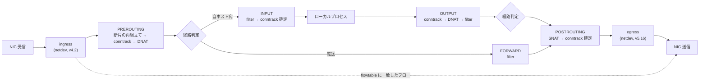
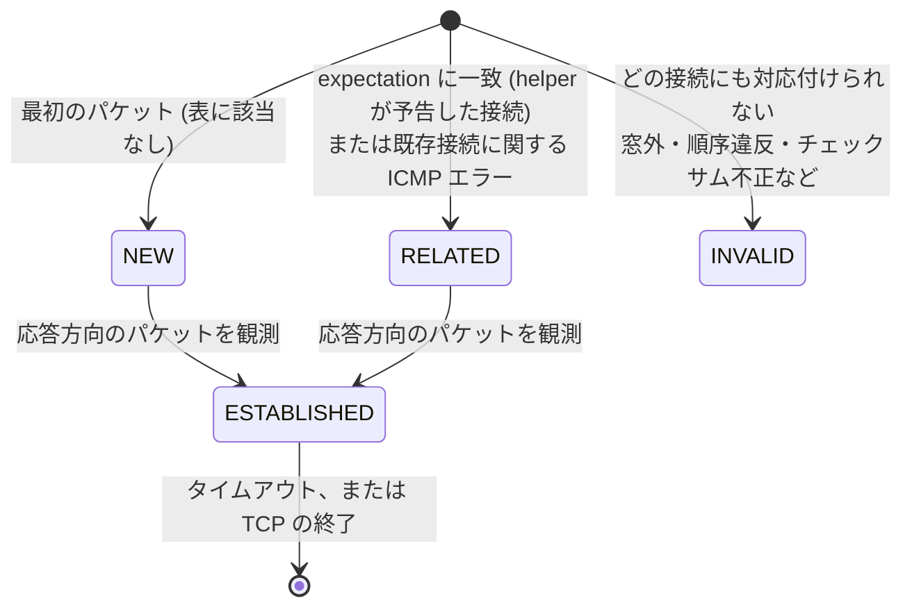

# パケットフィルタと接続追跡 (Packet Filtering & Connection Tracking: netfilter, nftables & conntrack)

## 概要 (Overview)

本ドキュメントは、ホストやルータの中でパケットを通すか捨てるかを決める仕組み、つまりパケットフィルタ (packet filter) と、それを支える接続追跡 (connection tracking, conntrack) を扱う。参照実装は Linux の netfilter・iptables・nftables とし、対比として BSD の pf、eBPF/XDP による実装、フローテーブルによる高速化を取り上げる。ファイアウォールの概念と配置 (境界防御・DMZ・ゼロトラスト) は [`../security/perimeter-defense-zero-trust.md`](../security/perimeter-defense-zero-trust.md) に、NAT の挙動要件 (RFC 4787) と「NAT はファイアウォールではない」という整理は [`ip-addressing-icmp-dhcp-nat.md`](ip-addressing-icmp-dhcp-nat.md) に、パケットがカーネルを通る機械 (NAPI・sk_buff・XDP) は [`kernel-network-stack.md`](kernel-network-stack.md) に委ねる。本書はその間にある「規則と状態の実装」を扱う。

中心テーゼは、**ステートフルファイアウォールと NAT の本体は規則の一覧ではなく接続追跡表という状態であり、この層の性能・障害・攻撃の多くは、その状態をいつ作り、どれだけ持ち、誰と共有するかで決まる**ということである。規則が評価されるのは、主に接続の最初のパケットで「この接続の状態を作ってよいか」を決めるときである。2 つ目以降のパケットは、表を引いて既存の接続に属するかどうかで判定される。NAT の変換もこの表に記録され、最初のパケットで決めた変換が残りのパケットに適用される。

この見方から 3 つの帰結が出る。(1) 規則評価のコストは新しい接続に集中するため、規則数が増える環境では規則の表し方 (上から順に照合する一覧か、集合や表で引くか) がスケールを決める。iptables から nftables への移行の主な理由はここにある。(2) 状態は有限であり、攻撃者が外から消費できる。また、状態は通信の両方向を見て初めて正しく作られるため、片方向しか見えない経路 (非対称経路) や、状態を持たない待機系への切り替えで壊れる。(3) FTP や SIP のように本文の中で別の接続を予告するプロトコルに対応するには、状態を作るためにペイロードを読む必要がある。この補助 (helper/ALG) は攻撃面になり、Linux では段階的に既定で無効にされた。本書は (1) フックと評価モデル、(2) iptables から nftables へ、(3) conntrack の状態機械、(4) 表の大きさと枯渇、(5) helper、(6) NAT、(7) 非対称経路と状態の同期、(8) 他の実装、(9) 性能の順に整理する。分析深度は Level 3。

## 方法論 (Methodology)

- **一次資料**: Linux カーネルのソースコード (v6.12 のタグで行番号を確認)、カーネル付属文書 (`nf_conntrack-sysctl`、`nf_flowtable`)、netfilter プロジェクトの文書と nftables wiki、man ページ (`iptables-extensions(8)`、`ipset(8)`、OpenBSD の `pf.conf(5)`・`pfsync(4)`)、conntrack-tools の利用者マニュアルを使う。conntrack の設計は開発者自身による解説 (Neira Ayuso, 2006) を原典とする。
- **機能が入った版の確認**: 「どのカーネルの版から使えるか」は、wiki や配布物の記述だけでなく、該当するコミットやファイルが各版のタグに含まれるかを確かめて記載した (helper の自動割り当ての既定無効化は v4.7、廃止は v6.0、など)。
- **性能の主張**: 規則数による照合コストの増え方は、Kubernetes の公式ブログ (kube-proxy の nftables モード) と査読付き論文 (Miano et al., 2019) を根拠とする。パケットあたりのナノ秒単位の値は構成に強く依存するため、本書では桁や傾向として扱い、具体的な数値は主張しない。
- **担当範囲**: クラウドのセキュリティグループと OVS の `ct()` は [`virtual-networks-overlay.md`](virtual-networks-overlay.md)、kube-proxy の各モードの詳細は [`../cloud/kubernetes-networking.md`](../cloud/kubernetes-networking.md)、eBPF の検証器・マップ・フックは [`../operating-systems/ebpf-kernel-programmability.md`](../operating-systems/ebpf-kernel-programmability.md) に委ね、本書では接続追跡との関係に必要な範囲だけを述べる。

## 発見事項 (Findings)

1. **conntrack はパケットを捨てない。状態を付けるだけで、判定は規則が行う。** netfilter の conntrack は、パケットを既知の接続に対応付け、NEW・ESTABLISHED・RELATED・INVALID といった状態を付ける。設計者は「接続追跡はパケットを追跡するだけで、フィルタしない」と明言している (Neira Ayuso, 2006)。INVALID と判定されたパケットも、規則で明示的に捨てなければ先へ進む。Kubernetes では、この素通りした INVALID パケットが逆方向の NAT を受けないまま Pod に届き、接続がリセットされる障害が起きた (Kubernetes Blog, 2019)。
2. **規則の評価は最初のパケットに集中し、NAT は最初のパケットで決まる。** 典型的な規則セットは先頭で `ct state established,related accept` を置くため、確立済みの接続のパケットは表を 1 回引くだけで通る。NAT も同様で、nftables の文書は「フローの最初のパケットで一致する規則を探し、その NAT の対応をフローに設定する」と述べる。そのため規則の変更は、すでに確立した接続には効かないことがある。
3. **iptables の問題は機能ではなく、規則の表し方と更新の仕方にあった。** iptables の規則は上から順に照合する一覧で、更新はテーブル全体を作り直して入れ替える。Kubernetes の kube-proxy では、Service 数に比例して最初のパケットの照合時間と同期のたびの更新量が増えた。nftables は集合 (set) と対応表 (map, verdict map) で照合を表引きにし、トランザクションで規則セットを一括して入れ替える。照合はおおむね定数時間、更新量は変更分だけになった (Kubernetes Blog, 2025)。
4. **接続追跡表は有限で、既定の上限はメモリ量から決まる。** v6.12 の実装では、64 ビットで 4 GiB を超えるメモリを持つホストのハッシュ表は 262,144 バケットで、上限 `nf_conntrack_max` も同じ値になる。上限に達すると、まだ両方向の通信が確認されていない (ASSURED でない) エントリを近くのバケットから追い出し、それもできなければ新しい接続のパケットを捨てる。DNS サーバや NAT ゲートウェイのように短い接続が大量にある機器では、この上限が攻撃を受けなくても障害の原因になる。
5. **状態は両方向を見て作られるため、非対称経路と切り替えで壊れる。** TCP の追跡は SYN、SYN-ACK、ACK の順序とシーケンス番号の窓を検査する。往路と復路が別のファイアウォールを通ると、どちらの装置でも期待した順序が見えず、パケットは INVALID になる。冗長構成では、待機系が状態を持っていなければ切り替えの瞬間に既存の接続がすべて切れる。conntrackd や pfsync はこの状態を複製するが、複製は非同期で、両方向が同じ装置を通る前提を外すことは推奨されていない。
6. **ペイロードを読む helper は、既定で無効化され、ついには自動適用が廃止された。** FTP や SIP は制御用の接続の本文で、次に使うアドレスとポートを伝える。conntrack の helper はこれを読んで「来るはずの接続 (expectation)」を登録し、RELATED として通す。外部の者が送ったデータで穴の開き方が決まるため、Linux はポート番号だけで helper を自動適用する挙動を 2012 年 (v3.5) に無効化できるようにし、2016 年 (v4.7) に既定で無効にし、2022 年 (v6.0) に切り替えの手段ごと削除した。ブラウザから家庭用ルータの SIP ALG を操作して内側の端末への穴を開ける NAT Slipstreaming (2020) は、同じ構造の攻撃である。
7. **高速化の方向は「状態を持ったまま規則を通らない経路を作る」ことである。** nftables のフローテーブル (flowtable) は、確立した転送フローを ingress フックで表から直接送り出し、PREROUTING から POSTROUTING までを飛ばす。対応する NIC ではこれをハードウェアに載せる。Cilium は netfilter の conntrack を使わず、eBPF マップに自前の接続追跡表を持つ。どちらも、規則評価を最初のパケットに限り、以後は表引きで処理するという conntrack の考え方を、より手前の層で実装している。
8. **防御の穴は、規則の内容よりも規則の外側にできやすい。** IPv4 だけに規則を書いて IPv6 を素通しにする、別のソフトウェアが NAT テーブルに書いた規則が INPUT の規則を迂回させる、iptables-legacy と nftables の規則が同じフックで並んで動く、などである。どの規則がどのフックのどの順序で評価されるかを全体として把握しない限り、個々の規則が正しくても意図した通りには守れない。

## アーキテクチャ (Architecture)

### netfilter のフックとパケットの経路

netfilter はカーネルのネットワークスタックに 5 つのフック (PREROUTING、INPUT、FORWARD、OUTPUT、POSTROUTING) を置き、各フックに登録された関数を優先度の順に呼ぶ (Neira Ayuso, 2006)。iptables のチェーン名はこのフック名と同じだが、iptables は netfilter の上に作られた道具の 1 つにすぎない。nftables では、これに NIC ごとの ingress (v4.2) と egress (v5.16) のフックが加わった。



凡例: 実線は通常の経路。破線は flowtable の高速経路で、一致したフローは ingress から直接送信され、PREROUTING 以降のフックを通らない (カーネル文書 `nf_flowtable`)。

通る経路は宛先で 3 通りに分かれる。転送されるパケットは PREROUTING → FORWARD → POSTROUTING、自ホスト宛ては PREROUTING → INPUT、自ホストから出るパケットは OUTPUT → POSTROUTING を通る。転送されるパケットは INPUT を通らないため、INPUT に書いた規則はルータとして転送する通信やコンテナ宛ての通信には効かない (技術詳細 §1)。

### 1 つのフックの中の順序

同じフックに複数の処理が登録されるとき、順序は優先度の数値で決まる。nftables wiki の表から主なものを抜き出す。

| 優先度 | 処理 | 置かれるフック |
|---|---|---|
| -400 | 断片の再組立て (defrag) | PREROUTING |
| -300 | raw (追跡の除外 `notrack` を書く場所) | PREROUTING, OUTPUT |
| -200 | conntrack (接続の検索と新規作成) | PREROUTING, OUTPUT |
| -150 | mangle | 全フック |
| -100 | dstnat (DNAT) | PREROUTING, OUTPUT |
| 0 | filter | 全フック |
| 100 | srcnat (SNAT) | POSTROUTING |
| INT_MAX | conntrack の確定 (confirm) | INPUT, POSTROUTING |

この順序から次のことが分かる。断片は conntrack より前に組み立て直されるので、conntrack とその後の規則は組み立て後のパケットを見る。raw で `notrack` を付けると、そのパケットは conntrack の処理を受けない。filter は DNAT の後に評価されるので、FORWARD や INPUT の規則には書き換え後の宛先を書く。新しい接続のエントリは最後の確定の段階で初めて表に入る。途中で捨てられたパケットのためのエントリは表に残らない。

### 接続追跡表の構造

conntrack の 1 つのエントリ (`struct nf_conn`) は、送信元・宛先のアドレスとポート、プロトコルからなる組 (tuple) を 2 つ持つ。接続を始めた側から見た方向 (original) と、その応答の方向 (reply) である。2 つの組はどちらもハッシュ表に登録されるので、どちらの方向のパケットも 1 回の検索で同じエントリにたどり着く (Neira Ayuso, 2006)。NAT をかけると、reply の組は変換後のアドレスで登録される。そのため戻りのパケットはエントリを引いた時点で、どう逆変換すればよいかが分かる。ハッシュ関数には乱数の種が混ぜられ、特定のバケットに連鎖を集中させる攻撃 (hash bomb) を防ぐ。



ここに示したのは規則から見える状態 (`ct state`) で、TCP そのものの状態とは別物である。TCP の内部状態 (SYN_SENT、ESTABLISHED、TIME_WAIT など) は conntrack が別に持ち、タイムアウトの選択に使う (技術詳細 §3)。

## 技術詳細 (Technical Details)

### 1. フィルタの評価モデル

- **ステートレスな ACL とステートフルなフィルタ**: ステートレスなフィルタは 1 つのパケットのヘッダだけで判定する。内側から始めた TCP 接続の戻りを通すには、戻り先の一時ポートを広く許すか、ACK フラグの有無で近似するしかない。ステートフルなフィルタは、許可した接続の続きだけを表で判定できる。一方で状態の上限・非対称経路・切り替えという問題を抱える (§4、§7)。ステートレスな ACL は状態を持たないのでこれらの問題がなく、パケットごとの処理量も規則だけで決まる。
- **iptables の評価**: 各チェーンの規則を上から照合し、ACCEPT や DROP のような終端の動作 (target) に一致した時点でそのチェーンの評価を終える。最後まで一致しなければチェーンの既定動作 (policy) に従う。最初に一致した規則が勝つので、広い許可を狭い拒否より前に書くと、拒否は効かない。
- **nftables の評価**: 同じフックに優先度の異なる複数の base chain を置ける。ある base chain で accept されたパケットは、同じフックの次の base chain に進む。drop はその場で確定し、以後の規則とチェーンは評価されない (nftables wiki)。そのため iptables-legacy と nftables の規則、あるいは複数のソフトウェアが作った nftables のテーブルが同じフックに並ぶと、パケットはすべてに accept されたときだけ通る。どこか 1 か所の drop で止まる。
- **pf の評価**: OpenBSD の pf は逆に、**最後に一致した規則**が判定を決める。`quick` を付けた規則は一致した時点で評価を打ち切る (`pf.conf(5)`)。iptables と同じ順序で規則を書くと意味が逆になる。pf は `pass` 規則に一致した最初のパケットで状態を作るのが既定で、TCP の既定の条件は `flags S/SA` (SYN だけが立ったパケット) である。
- **NAT と filter の位置関係**: DNAT は PREROUTING で filter より前に行われるので、filter には書き換え後の宛先が見える。Docker は公開ポートを nat テーブルの DNAT で実現するため、コンテナ宛ての通信は INPUT ではなく FORWARD を通る。ufw のように INPUT に規則を書く道具は、公開されたコンテナのポートを守れない (Docker 文書)。

### 2. iptables から nftables へ

- **iptables の構造**: iptables (Linux 2.4 から) は、テーブルごとの規則を 1 つの連続した領域 (blob) としてカーネルに渡す。1 本の規則を足すだけでも、利用者空間でテーブル全体を読み出し、変更し、全体を書き戻す。IPv4・IPv6・ARP・ブリッジで別々の道具 (iptables・ip6tables・arptables・ebtables) を使い、規則も別々に書く。どの規則にも既定でカウンタが付き、使わない組み込みチェーンも登録される。
- **規模の壁**: Kubernetes の kube-proxy の iptables モードでは、規則数は Service 数とエンドポイント数の和に比例し、新しい接続の最初のパケットの照合は Service 数に対して O(n) になる。`iptables-restore` の API では更新も常に全体の量に比例する (Kubernetes Blog, 2025)。この経緯と各モードの比較は [`../cloud/kubernetes-networking.md`](../cloud/kubernetes-networking.md) で扱う。
- **nftables の設計** (Linux 3.13 から): カーネル側には小さな仮想機械と汎用の部品 (集合・対応表・カウンタなど) だけを置き、規則はユーザ空間の `nft` がバイトコードに変換して渡す。新しいプロトコルへの対応は多くの場合 `nft` の更新だけで済む。テーブルとチェーンは既定では 1 つも存在せず、必要なものだけを作る。`inet` ファミリ (Linux 3.14 から) では 1 つのチェーンで IPv4 と IPv6 の両方を扱える。
- **集合と対応表**: 「宛先アドレス・プロトコル・ポート」のような複数の項目をつないだキー (concatenation) を集合や対応表に入れ、1 本の規則で引ける。判定そのものを値に持つ verdict map (`vmap`) を使えば、数千の Service の振り分けが 1 本の規則とハッシュ表の検索になる。範囲を含む複数項目のキーには専用の集合の実装 (pipapo、Linux 5.6 から) がある。
- **原子的な入れ替え**: `nft -f` はファイルの中のすべての変更を 1 つのトランザクションとしてカーネルに渡す。新しい規則セットを古いものと並べて組み立ててから一度に入れ替えるので、規則セットが途中まで読み込まれた状態は存在しない (nftables wiki)。シェルスクリプトで iptables コマンドを 1 行ずつ実行すると、その間は規則が半端な状態になる。
- **iptables-nft**: iptables と同じ文法のまま、カーネルの nf_tables に規則を書く互換層である。2018 年の Netfilter Workshop で、従来の setsockopt を使う実装は legacy と位置付けられ、`iptables-legacy` という名前になった。2 つの実装は別々の場所に規則を持つため、同じホストで混在させると、一方の道具では他方の規則が見えない。どちらを使っているかは `iptables --version` の表示 (`nf_tables` か `legacy`) で確かめられる。
- **ipset**: iptables の時代に、大量のアドレスやポートを 1 本の規則で照合するために作られた集合の仕組みである。`bitmap:ip`、`hash:net`、`hash:ip,port` などの型があり、要素ごとにタイムアウトを付けられる (`ipset(8)`)。nftables では集合が言語に組み込まれたため、同じことを ipset なしで書ける。

### 3. conntrack の状態機械

- **TCP の追跡**: conntrack は TCP のフラグの組み合わせ (SYN、SYN-ACK、FIN、ACK、RST) と現在の内部状態から、次の状態を表で決める。次の抜粋は、original 方向 (接続を始めた側) から来た SYN-ACK と ACK の行である。

```c
/* C (Linux v6.12): net/netfilter/nf_conntrack_proto_tcp.c lines 154-158, 185-189
 * Purpose: TCP state transition table (ORIGINAL direction) for SYN/ACK and ACK.
 * Columns are the current conntrack TCP state; sIV marks the packet INVALID. */
/* 	     sNO, sSS, sSR, sES, sFW, sCW, sLA, sTW, sCL, sS2	*/
/*synack*/ { sIV, sIV, sSR, sIV, sIV, sIV, sIV, sIV, sIV, sSR },
/*
 *	sNO -> sIV	Too late and no reason to do anything
 *	sSS -> sIV	Client can't send SYN and then SYN/ACK
...
/* 	     sNO, sSS, sSR, sES, sFW, sCW, sLA, sTW, sCL, sS2	*/
/*ack*/	   { sES, sIV, sES, sES, sCW, sCW, sTW, sTW, sCL, sIV },
/*
 *	sNO -> sES	Assumed.
 *	sSS -> sIV	ACK is invalid: we haven't seen a SYN/ACK yet.
```

  SYN を送った側 (状態 sSS) から、応答の SYN-ACK を見る前に ACK が来ると INVALID になる。これが非対称経路で起きることである (§7)。一方、表にない接続の途中の ACK (sNO) は「確立済みと仮定」して拾われる。この途中参加は `nf_conntrack_tcp_loose` (既定で有効) で制御され、0 にすると途中から始まる接続を拾わない (カーネル文書)。

- **シーケンス番号の窓の検査**: 状態の表に加えて、各パケットのシーケンス番号と ACK 番号が、相手の広告した受信窓と整合するかを検査する。実装は van Rooij (2000) の IP Filter の手法にもとづき、データの上限・下限と ACK の上限・下限の 4 つの条件を持つ (`nf_conntrack_proto_tcp.c` 284–310 行のコメント。第 I〜IV の条件は 301–304 行)。窓の外のパケットは INVALID になる。窓の検査は偽の RST による接続の切断を難しくするが、途中から拾った接続や、ウィンドウスケールのオプションを見逃した接続では正しい窓が分からない。そのため途中から拾った接続には緩い検査 (be liberal) が自動で適用される。`nf_conntrack_tcp_be_liberal` を 1 にすると、窓外の RST 以外は INVALID にしなくなる。
- **UDP と ICMP の擬似状態**: UDP と ICMP には接続がないが、conntrack は 5 つ組と時間で擬似的な接続を作る。UDP は応答を見れば ESTABLISHED になり、ICMP は echo request と echo reply を対応付ける。ICMP のエラー (宛先到達不能など) は、中に含まれる元のパケットのヘッダから既存の接続を探し、RELATED として扱う。
- **タイムアウト**: 状態ごとに、最後のパケットからの残り時間が決まっている (カーネル文書と `nf_conntrack_proto_tcp.c` 61–76 行)。

| 対象 | 既定値 | 備考 |
|---|---|---|
| TCP ESTABLISHED | 432,000 秒 (5 日) | 長時間無通信の接続も切らない |
| TCP SYN_SENT / TIME_WAIT | 120 秒 | |
| TCP CLOSE | 10 秒 | RST を見た後 |
| TCP 応答のない再送 (UNACK, RETRANS) | 300 秒 | ESTABLISHED より短い値に切り替える |
| UDP (片方向のみ) | 30 秒 | |
| UDP (双方向のストリーム) | 120 秒 | |
| ICMP | 30 秒 | |
| その他のプロトコル (generic) | 600 秒 | |

  TCP の確立済みの接続が 5 日間残るため、相手が FIN も RST も送らずに消えた接続 (端末の電源断など) は長く表を占める。逆に、NAT や中間のファイアウォールの UDP のタイムアウトが短いと、アプリケーションの keepalive の間隔より先に対応が消える。RFC 4787 が NAT に UDP の対応を 2 分未満で消さないよう求めているのはこのためである ([`ip-addressing-icmp-dhcp-nat.md`](ip-addressing-icmp-dhcp-nat.md))。

### 4. 表の大きさと枯渇

- **既定の大きさ**: 起動時にハッシュ表のバケット数を決め、上限 `nf_conntrack_max` をその 1 倍にする。各エントリは 2 方向分の 2 回登録されるので、表が満杯のときのバケットあたりの平均の長さは 2 になる。v6.12 では 64 ビットかつ 4 GiB を超えるメモリでバケット数は 262,144、1 GiB を超えるメモリで 65,536、それ以下はメモリ量に比例する (最小 1,024)。起動時にバケット数を明示した場合は、互換性のため上限をその 8 倍にする (`nf_conntrack_core.c` 2632–2657 行)。カーネル文書は「既定値はメモリ量を 16384 で割った値で、1024〜262144 に制限される」と簡略に記述している。
- **満杯のときの挙動**: 新しいエントリを割り当てる関数は、上限を超えると近くのバケットから追い出せるエントリを探す。

```c
/* C (Linux v6.12): net/netfilter/nf_conntrack_core.c lines 1660-1671
 * Purpose: when the table is full, try early_drop(); if nothing can be evicted,
 * refuse to allocate a new conntrack (the packet that triggered it is dropped). */
	/* We don't want any race condition at early drop stage */
	ct_count = atomic_inc_return(&cnet->count);

	if (nf_conntrack_max && unlikely(ct_count > nf_conntrack_max)) {
		if (!early_drop(net, hash)) {
			if (!conntrack_gc_work.early_drop)
				conntrack_gc_work.early_drop = true;
			atomic_dec(&cnet->count);
			net_warn_ratelimited("nf_conntrack: table full, dropping packet\n");
			return ERR_PTR(-ENOMEM);
		}
	}
```

  `early_drop()` は最大 8 個のバケット (`NF_CT_EVICTION_RANGE`) を調べ、ASSURED の印がないエントリ、つまり両方向の通信が確認されていない接続を消す (同ファイル 1403–1478 行)。確立済みの接続は守られ、新しい接続が失われる。ログの `nf_conntrack: table full, dropping packet` は、この追い出しにも失敗したことを示す。

- **運用での対処**: 現在の数は `nf_conntrack_count` で、上限への近さを監視できる。上限とバケット数を引き上げる (メモリと引き換え)、短い接続が大量に来る通信 (権威 DNS など) を raw で `notrack` にして追跡から外す、UDP や TCP の終了後のタイムアウトを短くする、が定石である。`notrack` を付けた通信は状態を持たないので、そのぶん規則はステートレスに書く必要がある。
- **conntrack のゾーン**: conntrack は既定で、同じ 5 つ組の接続を 1 つしか持てない。ゾーン (zone、Linux 2.6.34 から) は接続に番号を付けて別の空間に分け、同じアドレスとポートの接続を別のものとして扱えるようにする。アドレス空間が重なる複数のネットワークを 1 台で扱う場合に使う。OVS の `ct(zone=...)` もこの仕組みを使っている ([`virtual-networks-overlay.md`](virtual-networks-overlay.md))。

### 5. helper と expectation

- **仕組み**: FTP のパッシブモードでは、制御用の接続 (ポート 21) の応答の中で、データ用の接続に使うポートが知らされる。FTP の helper は制御接続のペイロードからこのポートを読み取り、「この相手からこのポートへの接続が来るはず」という expectation を登録する。その接続が実際に来ると、親の接続に関係するもの (RELATED) として扱われる (Neira Ayuso, 2006)。NAT をかける場合、helper はペイロードの中のアドレスとポートも書き換える。SIP、H.323、IRC の DCC、TFTP にも helper がある。
- **攻撃面としての helper**: helper は外部から届いたデータを解析し、その結果で新しい通信を許す。解析の誤りや、想定外の送り手が作ったデータは、そのまま意図しない穴になる。netfilter の開発者たちは 2011〜2012 年の文書 "Secure use of iptables and connection tracking helpers" で、helper をポート番号で自動的に割り当てるのをやめ、規則で明示的に割り当てるよう勧めた。
- **既定の変更の経緯**: 自動割り当ては次の 3 段階で廃止された。いずれもコミットが各版のタグに含まれることを確認した。
  1. v3.5 (2012): sysctl `nf_conntrack_helper` を追加し、自動割り当てを無効にできるようにした。互換性のため既定は有効のままだった。
  2. v4.7 (2016): 既定を無効に変更した (コミット 3bb398d925)。helper に頼っていた通信が通らなくなる回帰として指摘され、2017 年には自動割り当てが行われなかったときに警告を出すパッチが提案された (LKML, 2017)。
  3. v6.0 (2022): sysctl とモジュールの引数そのものを削除した (コミット b118509076)。helper は規則 (iptables の `CT --helper`、nftables の `ct helper`) で明示的に割り当てるしかなくなった。同時期には IRC の helper がメッセージを誤って照合し、ファイアウォールを迂回されうる脆弱性 (CVE-2022-2663) も公表されている。
- **明示的な割り当て**: 推奨される形は、helper を使う通信の始まり (FTP なら特定のサーバの TCP 21 番) を規則で狭く指定して helper を割り当て、それとは別の規則で RELATED を許すことである。送信元の偽装を防いでいない環境では、helper が偽のペイロードで expectation を作らされる恐れがある。

### 6. NAT の実装

- **conntrack への依存**: Linux の NAT は conntrack の上に実装されている。conntrack は読み込みが任意のモジュールだが、NAT を使うなら必須である (Neira Ayuso, 2006)。NAT の規則はフローの最初のパケットでだけ評価され、決まった変換はエントリの reply の組として記録される (nftables wiki)。2 つ目以降のパケットと戻りのパケットは、エントリを引いて同じ変換を受ける。
- **SNAT・DNAT・MASQUERADE**: DNAT は PREROUTING (と OUTPUT) で宛先を、SNAT は POSTROUTING で送信元を書き換える。MASQUERADE は送信元を出口のインターフェースのアドレスにする SNAT の一種で、インターフェースが落ちるとそのインターフェースの変換を使っていた接続を忘れる (`iptables-extensions(8)`)。アドレスが動的に変わる回線のための挙動である。
- **ポートの割り当て**: NAT は変換後の組が既存の接続と重ならないように選ぶ。送信元のポートが範囲内で、かつ重ならなければ元のポートをそのまま使う。重なる場合は乱数で決めた位置から範囲を順に試す。

```c
/* C (Linux v6.12): net/netfilter/nf_nat_core.c lines 676-697
 * Purpose: search for a free port, starting at a random offset; give up the full
 * scan after NF_NAT_MAX_ATTEMPTS (128) and retry with halved windows. */
	attempts = range_size;
	if (attempts > NF_NAT_MAX_ATTEMPTS)
		attempts = NF_NAT_MAX_ATTEMPTS;

	/* We are in softirq; doing a search of the entire range risks
	 * soft lockup when all tuples are already used.
	 *
	 * If we can't find any free port from first offset, pick a new
	 * one and try again, with ever smaller search window.
	 */
another_round:
	for (i = 0; i < attempts; i++, off++) {
		*keyptr = htons(min + off % range_size);
		if (!nf_nat_used_tuple_harder(tuple, ct, attempts - i))
			return;
	}

	if (attempts >= range_size || attempts < 16)
		return;
	attempts /= 2;
	off = get_random_u16();
	goto another_round;
```

  パケットの処理は割り込みに近い文脈 (softirq) で動くので、ポートの全範囲を探すことはせず、最大 128 回の試行と、窓を半分にしながらの再試行で打ち切る。ポートがほぼ使い切られた NAT では、空きがあっても見つけられずに失敗することがある。範囲を指定しない場合、元のポートが 1024 未満なら 1〜511 または 600〜1023、それ以外なら 1024〜65535 から選ぶ (同ファイル 640–658 行)。`random-fully` (Linux 3.14 から) は元のポートを保つ処理を飛ばし、常に乱数で選ぶ。外から見たポートから内側の端末のポートを推測されにくくなる。
- **確定時の競合**: 同じソケットから 2 つのスレッドが同時に UDP を送ると (DNS の A と AAAA の問い合わせなど)、2 つのパケットがどちらも表にない状態で同じ変換を選び、後から確定しようとした方が重複として捨てられることがある。`nf_nat_core.c` 700–705 行のコメントも、最悪の場合は確定の段階で重複となりパケットを捨てると述べている。Linux 4.19 では、2 つのエントリがまったく同じ変換を表している場合に限り、後の方を捨てずに先のエントリに合流させる処理が入った (コミット ed07d9a021df)。

### 7. 非対称経路と状態の同期

- **非対称経路**: 往路と復路が別のファイアウォールを通る構成では、往路の装置は SYN とその後の ACK を見るが、SYN-ACK を見ない。§3 の表のとおり、SYN_SENT の状態で ACK が来ると INVALID になる。復路の装置では、最初に見るのが SYN-ACK なので、これも INVALID になる。ECMP で経路が分かれる場合や、冗長な 2 台がそれぞれ片方向を受け持つ場合に起きる。対処は、同じ接続の両方向が同じ装置を通るように経路を設計すること (送信元と宛先を入れ替えても同じ値になる対称なハッシュなど) か、その区間をステートレスなフィルタにすることである。
- **conntrackd**: conntrack-tools の conntrackd は、表の変化を通知 (netlink のイベント) で受け取り、専用のリンクで他の装置に送る。複製の方式は 3 つある。NOTRACK は確認なしで送るだけで、失われた更新を回復しない。FT-FW は順序番号と再送で失われた更新を回復する。ALARM は定期的に全体を送り直し、帯域を多く使う。待機系は受け取った状態を自分のキャッシュに持ち、切り替えのときにそれをカーネルに書き込む。マニュアルは、どの装置も任意のパケットを受けうる active-active 構成について、同期と転送の競合のため難しく、ステートフルなフィルタの設計に反すると述べている。また、状態の情報を傍受されないよう、同期には専用のリンクを使うよう求めている。
- **pfsync**: pf は状態表の変化を pfsync で共有する。既定ではマルチキャスト (224.0.0.240) で送られ、認証も完全性の保護もないため、偽のパケットで状態を作られると規則を迂回される (`pfsync(4)`)。`defer` を有効にすると、新しい接続の最初のパケットを、状態の挿入が相手に確認されるまで (または時間切れまで) 保留する。複数の装置が同時にパケットを扱う構成で、状態が届く前に戻りのパケットが別の装置に着く問題を減らす。
- **同期の限界**: どの方式も非同期なので、切り替えの直前に作られた接続や、同期の更新が遅れた TCP の窓の情報は失われうる。conntrack-tools のマニュアルは、窓の追跡を有効にしたまま TCP の接続を回復するには Linux 2.6.36 以降が必要だと記している。

### 8. 他の実装との対比

- **BSD の pf**: 規則は最後に一致したものが勝つ (§1)。既定で状態を作り、状態の上限の既定値は 100,000 である。状態は既定でインターフェースに縛られない (`floating`)。フラグメントは既定で組み立て直してから規則を評価する (`pf.conf(5)`)。Linux のように conntrack とフィルタを別々の部品にせず、状態の管理が規則の言語に組み込まれている。
- **eBPF/XDP による実装**: XDP は sk_buff を作る前のドライバの中で eBPF プログラムを動かし、DDoS のパケットを早い段階で捨てられる ([`kernel-network-stack.md`](kernel-network-stack.md))。ただし XDP の段階では断片はまだ組み立てられておらず、netfilter のフックも通らない。状態を持つ判定をするには、プログラムが自分でマップに状態を持つか、netfilter の conntrack の表を参照する kfunc (`bpf_xdp_ct_lookup` など。`nf_conntrack_bpf.c`、v5.18 から) を呼ぶ必要がある。Cilium はこの方式で、TCP 用に 512k、UDP 用に 256k のエントリを持つ eBPF マップを自前の接続追跡表として使い、NAT にも 512k エントリのマップを使う (既定値。メモリ量に対する比率でも決められる。Cilium 文書)。Miano et al. (2019) は iptables の意味を保ったまま eBPF で実装した bpf-iptables を示し、規則が多い場合に iptables より高い処理能力を報告している。
- **bpfilter の経緯**: iptables の規則をカーネルの中で eBPF に変換する bpfilter は、2018 年 (v4.18) にユーザモードヘルパの骨組みだけがカーネルに入った。変換の本体を入れる試みは何度か放棄され、「使われず、使えない」状態のまま v6.8 で削除された (コミット 98e20e5e13d2)。開発は GitHub 上の独立したプロジェクトとして続いている。規則の言語と実行の仕組みを分けて置き換える方向は、カーネルの中では nftables、外では Cilium などが担っている。
- **flowtable**: nftables の flowtable (v4.16 から) は、転送される接続のうち規則で指定したもの (例: 確立した TCP) を表に登録し、以後のパケットを ingress フックで表から直接送り出す。経路判定と PREROUTING・FORWARD・POSTROUTING を飛ばすが、記録された NAT と TTL の減算は適用する。断片、RST や FIN の付いたパケット、MTU を超えるパケットは通常の経路に戻す (カーネル文書)。`flags offload` を付けると、対応する NIC やスイッチのチップに処理を載せる (v5.5 から)。高速経路に乗ったパケットは FORWARD の規則を通らないので、規則を変えても登録済みのフローには効かない。表の中身は経路や宛先の MAC アドレスの変化に追従しない場合があり、カーネル文書もキャッシュとして古くなりうることを注意している。

### 9. 性能

- **コストのかかる場所**: パケットあたりのコストは、(1) conntrack の表の検索 (ハッシュ表 1 回)、(2) 新しい接続の最初のパケットでの規則の照合、(3) NAT の書き換えとチェックサムの更新、(4) 確定時の表への挿入とロック、に分かれる。確立済みの接続の大半のパケットは (1) だけで済む。規則数の影響が大きく出るのは、短い接続が多い場合と、規則が上から順に照合される場合である。
- **規則の表し方**: iptables では、規則を「頻繁に一致するものを前に」並べ、ipset で多数のアドレスを 1 本にまとめるのが定石だった。nftables では集合と verdict map で照合を表引きにでき、更新も差分になる。Kubernetes の測定では、5,000 と 10,000 の Service のクラスタで、nftables の中央値のレイテンシが iptables の最良に近い値 (p01) とほぼ同じになった (Kubernetes Blog, 2025)。kube-proxy が iptables から IPVS、そして nftables へ移った経緯は [`../cloud/kubernetes-networking.md`](../cloud/kubernetes-networking.md) を参照。
- **追跡を外す選択**: 状態を必要としない大量の通信 (権威 DNS、負荷試験のトラフィック、ルータが転送するだけの通信) は、raw で `notrack` にすると表の検索・挿入・枯渇のすべてを避けられる。代わりにその通信の規則はステートレスに書くことになる。追跡を外すことによる性能の向上の大きさは構成に依存し、本書では独立した 2 つの測定による数値は確認できていない。
- **状態を残したまま規則を飛ばす**: flowtable のソフトウェアの高速経路と、そのハードウェアオフロードは、確立した転送フローの規則評価と経路判定を省く。eBPF による実装は、表と判定を XDP や tc の段に置き、netfilter のフックの連鎖を通らない。どちらも、確立した接続を規則評価から外すという conntrack の考え方を延長したものである。

## セキュリティ考察 (Security Considerations)

この層の攻撃の多くは、表が有限であること、判定に使うデータの一部を外部の者が送ること、規則が評価される場所と順序の誤解、のいずれかを突く。

| 攻撃・誤り | 何を悪用するか | 主な防御 |
|---|---|---|
| conntrack 表の枯渇 | 表の上限と、確立前の状態が無償で作れること | 上限の監視と引き上げ、SYNPROXY、送信元ごとの接続数の制限 (`connlimit`)、追跡が不要な通信の `notrack` |
| INVALID の素通し | conntrack は判定するだけで捨てない | 規則で `ct state invalid drop` を明示する |
| helper / ALG の悪用 | 外部のデータで expectation が作られる | helper を使わない、使うなら規則で狭く明示的に割り当てる、ルータの SIP ALG を無効にする |
| 断片化による回避 | 先頭以外の断片にはポート番号がない、重なる断片の組み立て方の違い | 規則の評価の前に組み立て直す (Linux の defrag、pf の既定)、小さすぎる先頭断片の破棄 |
| 規則の順序の誤り | 最初に一致 (iptables) と最後に一致 (pf) の違い、accept が最終でない (nftables) | 既定で拒否、規則セットの機械的な検査、変更の差分の確認 |
| 規則の外側の経路 | DNAT が INPUT を迂回する、別の道具が別のテーブルに規則を書く | どのフックとチェーンを通るかを確かめる (`nft list ruleset`)、FORWARD にも既定の拒否を置く |
| IPv6 の見落とし | IPv4 だけに規則を書き、既定で有効な IPv6 を素通しにする | `inet` ファミリで両方を 1 つの規則セットに書く、トンネル (プロトコル 41、Teredo) も扱う |

- **表の枯渇**: 新しい接続ごとにエントリを作るため、偽装した送信元から SYN や UDP を大量に送るだけで表を埋められる。Linux は ASSURED でないエントリから追い出すので確立済みの接続は守られやすいが、新しい接続は通らなくなる。SYNPROXY は、SYN を追跡から外して SYN cookie で応答し、正しい ACK が返ってきた接続だけを表に入れる (`iptables-extensions(8)`)。ただし同じ man ページは、Linux 4.4 で SYN flood に対するカーネル自身の処理が改善されたため、Linux のサーバ自体を守る目的では必要なくなったと述べている。確立前の状態を最小にするという原則は [`kernel-network-stack.md`](kernel-network-stack.md) の SYN cookie の議論と同じである。
- **INVALID の扱い**: INVALID のパケットを捨てないと、窓外のパケットや状態を失った接続のパケットが、NAT の逆変換を受けずに先へ進む。Kubernetes の事例では、Pod の IP アドレスを送信元とする応答がクライアントに届き、クライアントが RST を返して接続が切れた。修正は INVALID を捨てる規則を加えることで、v1.15 で入った (Kubernetes Blog, 2019)。`nf_conntrack_tcp_be_liberal` を 1 にする回避策もあるが、窓の検査を緩めることになる。
- **NAT Slipstreaming**: Kamkar (2020) は、利用者がウェブページを開くだけで、内側の端末に外から届く穴を NAT に開けさせる攻撃を示した。ブラウザから SIP のポート (5060) に向けて HTTP の POST を送り、TCP のセグメントの境界を調整して、偽の SIP REGISTER がセグメントの先頭に来るようにする。ルータの SIP ALG はこれを本物の SIP として解釈し、穴を開ける。2021 年の第 2 版は H.323 を使い、内側の任意の端末を対象にした。Kamkar によれば第 1 版はブラウザ側で修正された。現在の Fetch 標準の接続禁止ポートには 5060、5061、1720、1723 が含まれている。ルータ側の根本の対策は、不要な ALG を無効にすることである。
- **断片化による回避**: 先頭以外の断片にはポート番号がないので、断片ごとに判定するフィルタはそれらを通すか捨てるかしかない。先頭の断片を小さくして TCP のフラグを 2 つ目の断片に押し出す攻撃 (tiny fragment attack) や、重なる断片で先頭の内容を上書きする攻撃がある (RFC 1858、RFC 3128)。Linux は conntrack の前に断片を組み立て直すので規則は完全なパケットを見るが、組み立てのためのメモリとタイムアウトが別の消耗の対象になる。IDS と端末の組み立て方の違いを使う回避は [`ip-addressing-icmp-dhcp-nat.md`](ip-addressing-icmp-dhcp-nat.md) で扱う。
- **規則の順序と重複**: iptables では、広い ACCEPT の後に置いた DROP は効かない。nftables では、あるチェーンで accept しても別のチェーンの drop で止まる。pf では最後に一致した規則が勝つ。同じ「規則の一覧」でも意味が異なるため、移行のときに順序をそのまま写すと穴か障害になる。規則が増えるほど誰も全体を説明できなくなるので、規則セットをコードとして管理し、変更のたびに差分を確かめるのが運用の基本になる。
- **IPv6 の見落とし**: iptables と ip6tables は別の道具で、IPv4 にだけ既定拒否を書くと IPv6 は既定のまま開く。多くの OS は IPv6 を既定で有効にしているため、IPv4 だけで運用しているつもりのネットワークでも、IPv6 のリンクローカル通信や偽のルータ広告、6to4・Teredo などのトンネルで IPv4 の規則を迂回されうる (RFC 7123)。nftables の `inet` ファミリなら 1 つの規則セットで両方を扱える。
- **状態の同期の経路**: conntrackd や pfsync の同期は認証を持たないか弱いので、同期用のリンクに入れる者は状態を作って規則を迂回できる。専用のリンクに閉じることが前提である。

## 結論 (Conclusions)

- ステートフルファイアウォールと NAT の判定の大半は、規則ではなく接続追跡表の検索で行われる。規則は主に最初のパケットで状態を作るかどうかを決め、NAT の変換もそこで決まる。conntrack 自体は状態を付けるだけで、INVALID のパケットを捨てるのは規則の役目である。
- iptables から nftables への移行は、規則の一覧を上から照合し全体を書き換える構造から、集合と対応表で表を引き、トランザクションで差分を入れ替える構造への移行である。Kubernetes の kube-proxy のように規則が数万に達する環境で、この違いが表れた。
- 状態は有限で、両方向を見て初めて正しく作られ、装置の外には自動では複製されない。そのため、表の枯渇、非対称経路での INVALID、切り替え時の接続の喪失が、ステートフルな設計に固有の故障になる。conntrackd や pfsync による同期はこれを緩和するが、両方向が同じ装置を通るという前提は残る。
- ペイロードを読んで状態を作る helper と ALG は、外部の者に穴の開け方を決めさせる仕組みであり、Linux は 10 年かけて自動適用を廃止した。NAT Slipstreaming はルータの ALG に同じ構造の弱点が残っていることを示した。
- 高速化の方向は、flowtable、ハードウェアオフロード、eBPF のいずれも、確立した接続を規則評価から外し、より手前の層で表を引くことである。防御の穴は個々の規則よりも、どのフックで何がどの順に評価されるか、IPv6 と他の道具の規則を含めて全体を把握していないところに生じやすい。

### 次の接続先 (Related Topics)

- [`kernel-network-stack.md`](kernel-network-stack.md) — netfilter のフックが置かれているカーネルの受信・送信の経路、XDP と SYN cookie。
- [`ip-addressing-icmp-dhcp-nat.md`](ip-addressing-icmp-dhcp-nat.md) — NAT の挙動要件 (RFC 4787)、断片化と ICMP の遮断の問題、NAT とファイアウォールの区別。
- [`virtual-networks-overlay.md`](virtual-networks-overlay.md) — セキュリティグループという分散ステートフルファイアウォールと、OVS の `ct()` による conntrack の利用。
- [`../cloud/kubernetes-networking.md`](../cloud/kubernetes-networking.md) — kube-proxy の iptables・nftables・IPVS モードと eBPF による置き換え。
- [`../operating-systems/ebpf-kernel-programmability.md`](../operating-systems/ebpf-kernel-programmability.md) — XDP と tc のフック、検証器、マップ。eBPF によるフィルタの基盤。
- [`../security/perimeter-defense-zero-trust.md`](../security/perimeter-defense-zero-trust.md) — ファイアウォールの種類と配置、境界防御からゼロトラストへの流れ。

## 参考文献 (References)

**一次資料 (カーネルのソースコードと文書)**

- [Linux v6.12: net/netfilter/nf_conntrack_proto_tcp.c](https://github.com/torvalds/linux/blob/v6.12/net/netfilter/nf_conntrack_proto_tcp.c) — Accessed: 2026-10-26。TCP のタイムアウトの既定値 (61–76 行)、状態遷移表 (134 行以降)、窓の検査の条件 (284–310 行)、途中参加の処理 (869 行以降)。
- [Linux v6.12: net/netfilter/nf_conntrack_core.c](https://github.com/torvalds/linux/blob/v6.12/net/netfilter/nf_conntrack_core.c) — Accessed: 2026-10-26。`early_drop()` (1403–1478 行)、満杯時の割り当て拒否 (1660–1671 行)、ハッシュ表と上限の既定値 (2618–2657 行)。
- [Linux v6.12: net/netfilter/nf_nat_core.c](https://github.com/torvalds/linux/blob/v6.12/net/netfilter/nf_nat_core.c) — Accessed: 2026-10-26。ポートの探索 (581–697 行)、`NF_NAT_MAX_ATTEMPTS` (30 行)、確定時の重複についてのコメント (700–705 行)。
- [Netfilter Conntrack Sysfs variables, The Linux Kernel documentation](https://docs.kernel.org/networking/nf_conntrack-sysctl.html) — Accessed: 2026-10-26。`nf_conntrack_max`・`nf_conntrack_buckets`・各タイムアウト・`tcp_loose`・`tcp_be_liberal` の既定値と意味。
- [Linux v6.12: net/netfilter/nf_conntrack_bpf.c](https://github.com/torvalds/linux/blob/v6.12/net/netfilter/nf_conntrack_bpf.c) — Accessed: 2026-10-26。eBPF から conntrack を検索・作成する kfunc (`bpf_xdp_ct_lookup`・`bpf_skb_ct_lookup`・`bpf_xdp_ct_alloc`)。v5.18 でファイルが追加されたことを各版のタグで確認した。
- [Netfilter's flowtable infrastructure, The Linux Kernel documentation](https://docs.kernel.org/networking/nf_flowtable.html) — Accessed: 2026-10-26。flowtable の高速経路、通常経路に戻すパケット、ハードウェアオフロード、キャッシュとしての注意。
- Linux カーネルのコミット (GitHub のミラーで内容と、各版のタグに含まれるかを確認。Accessed: 2026-10-26): a9006892643a "netfilter: nf_ct_helper: allow to disable automatic helper assignment" (v3.5)、3bb398d925ec "netfilter: nf_ct_helper: disable automatic helper assignment" (v4.7)、b118509076b3 "netfilter: remove nf_conntrack_helper sysctl and modparam toggles" (v6.0)、5d0aa2ccd469 "netfilter: nf_conntrack: add support for conntrack zones" (v2.6.34)、ed07d9a021df "netfilter: nf_conntrack: resolve clash for matching conntracks" (v4.19)、ac2a66665e23 "netfilter: add generic flow table infrastructure" (v4.16)、d2ba09c17a06 "net: add skeleton of bpfilter kernel module" (v4.18)、98e20e5e13d2 "bpfilter: remove bpfilter" (v6.8)。`nf_flow_table_offload.c` (v5.5)、`nft_set_pipapo.c` (v5.6)、`nf_tables_inet.c` (v3.14) は各版のタグでファイルの有無を確認した。

**一次資料 (netfilter プロジェクトと man ページ)**

- Neira Ayuso, P. (2006). Netfilter's Connection Tracking System. *;login:*, 31(3), 34–39. USENIX. https://www.usenix.org/publications/login/june-2006-volume-31-number-3/netfilters-connection-tracking-system — フック、状態、2 方向の組とハッシュ表、確定、helper と expectation、NAT が conntrack を必要とすること。
- [The netfilter.org "nftables" project](https://netfilter.org/projects/nftables/index.html) — Accessed: 2026-10-26。Linux 3.13 からの提供、互換層、仮想機械と集合・対応表。
- [Netfilter hooks, nftables wiki](https://wiki.nftables.org/wiki-nftables/index.php/Netfilter_hooks) — Accessed: 2026-10-26。ファミリごとのフック、ingress (4.2)・inet ingress (5.10)・egress (5.16)、優先度の表。
- [Main differences with iptables, nftables wiki](https://wiki.nftables.org/wiki-nftables/index.php/Main_differences_with_iptables) — Accessed: 2026-10-26。
- [Atomic rule replacement, nftables wiki](https://wiki.nftables.org/wiki-nftables/index.php/Atomic_rule_replacement) — Accessed: 2026-10-26。
- [Configuring chains, nftables wiki](https://wiki.nftables.org/wiki-nftables/index.php/Configuring_chains) — Accessed: 2026-10-26。同じフックの複数の base chain と、accept と drop の扱い。
- [Performing Network Address Translation (NAT), nftables wiki](https://wiki.nftables.org/wiki-nftables/index.php/Performing_Network_Address_Translation_(NAT)) — Accessed: 2026-10-26。最初のパケットでの変換の決定、`random`・`fully-random`・`persistent`。
- [Legacy xtables tools, nftables wiki](https://wiki.nftables.org/wiki-nftables/index.php/Legacy_xtables_tools) — Accessed: 2026-10-26。iptables-legacy と iptables-nft、2018 年の Netfilter Workshop での位置付け。
- [Secure use of iptables and connection tracking helpers (Leblond, E., Neira Ayuso, P., McHardy, P., Engelhardt, J., et al.)](https://home.regit.org/netfilter-en/secure-use-of-helpers/) — Accessed: 2026-10-26。helper の明示的な割り当ての推奨。netfilter の開発者自身による文書。
- [[PATCH v3] netfilter: nf_ct_helper: warn when not applying default helper assignment, LKML (2017-02-01)](https://lkml.iu.edu/1702.0/00717.html) — Accessed: 2026-10-26。既定の無効化 (3bb398d925) が既存のファイアウォールの挙動を変えたこと、無効化はセキュリティ上の理由で維持すべきこと。
- [iptables-extensions(8)](https://ipset.netfilter.org/iptables-extensions.man.html) — Accessed: 2026-10-26。`conntrack` の状態、SNAT の `--random-fully` (3.14)、MASQUERADE、CT ターゲット (`--helper`・`--zone`・`--notrack`)、SYNPROXY。
- [ipset(8)](https://ipset.netfilter.org/ipset.man.html) — Accessed: 2026-10-26。集合の型とタイムアウト。
- [conntrack-tools user manual](https://conntrack-tools.netfilter.org/manual.html) — Accessed: 2026-10-26。conntrackd の複製方式 (NOTRACK・FT-FW・ALARM)、active-backup と active-active、専用リンクの要求。
- [pf.conf(5), OpenBSD manual pages](https://man.openbsd.org/pf.conf.5) — Accessed: 2026-10-26。最後に一致した規則、`quick`、既定の状態作成、`flags S/SA`、状態の上限、フラグメントの組み立て。
- [pfsync(4), OpenBSD manual pages](https://man.openbsd.org/pfsync.4) — Accessed: 2026-10-26。

**一次資料 (RFC・論文)**

- Ziemba, G., Reed, D., & Traina, P. (1995). Security Considerations for IP Fragment Filtering. *RFC 1858*.
- Miller, I. (2001). Protection Against a Variant of the Tiny Fragment Attack. *RFC 3128*.
- Gont, F., & Liu, W. (2014). Security Implications of IPv6 on IPv4 Networks. *RFC 7123*.
- Audet, F., & Jennings, C. (2007). Network Address Translation (NAT) Behavioral Requirements for Unicast UDP. *RFC 4787* (BCP 127).
- van Rooij, G. (2000). Real Stateful TCP Packet Filtering in IP Filter. *Proceedings of the 2nd International SANE Conference*. — Linux の TCP の窓の検査が依拠する手法 (`nf_conntrack_proto_tcp.c` のコメントによる)。本文は未確認。
- Miano, S., Bertrone, M., Risso, F., Vásquez Bernal, M., Lu, Y., & Pi, J. (2019). Securing Linux with a Faster and Scalable Iptables. *ACM SIGCOMM Computer Communication Review*, 49(3), 3–17. https://doi.org/10.1145/3371927.3371928
- Høiland-Jørgensen, T., Brouer, J. D., Borkmann, D., Fastabend, J., Herbert, T., Ahern, D., & Miller, D. (2018). The eXpress Data Path: Fast Programmable Packet Processing in the Operating System Kernel. *CoNEXT '18*. https://doi.org/10.1145/3281411.3281443

**事例・製品の文書**

- [NFTables mode for kube-proxy, Kubernetes Blog (2025-02-28)](https://kubernetes.io/blog/2025/02/28/nftables-kube-proxy/) — Accessed: 2026-10-26。iptables モードの O(n) の照合と更新、verdict map、Service 数ごとのレイテンシの比較。
- [kube-proxy Subtleties: Debugging an Intermittent Connection Reset, Kubernetes Blog (2019-03-29)](https://kubernetes.io/blog/2019/03/29/kube-proxy-subtleties-debugging-an-intermittent-connection-reset/) — Accessed: 2026-10-26。INVALID のパケットが逆変換されずに届く障害と、v1.15 での修正。
- [Packet filtering and firewalls, Docker Docs](https://docs.docker.com/engine/network/packet-filtering-firewalls/) — Accessed: 2026-10-26。公開ポートが ufw の規則を迂回すること、nftables のバックエンド (実験的)。
- [eBPF Maps, Cilium Documentation](https://docs.cilium.io/en/stable/network/ebpf/maps/) — Accessed: 2026-10-26。接続追跡と NAT のマップの既定の大きさ (ベンダーの仕様値)。
- [NAT Slipstreaming v2.0, Samy Kamkar](https://samy.pl/slipstream/) — Accessed: 2026-10-26。第 1 版 (2020-10-31) と第 2 版 (2021-01-26、Armis との共同) の手順。
- [Fetch Standard: Port blocking, WHATWG](https://fetch.spec.whatwg.org/#port-blocking) — Accessed: 2026-10-26。接続禁止ポートの一覧 (1720、1723、5060、5061 など)。
- [CVE-2022-2663, CVE Program](https://www.cve.org/CVERecord?id=CVE-2022-2663) — Accessed: 2026-10-26。nf_conntrack_irc のメッセージ処理の誤りによるファイアウォールの迂回。
