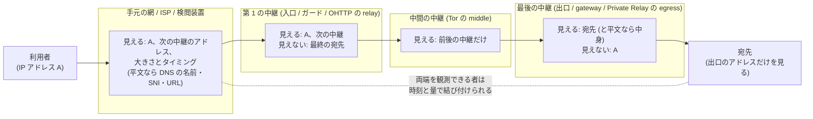
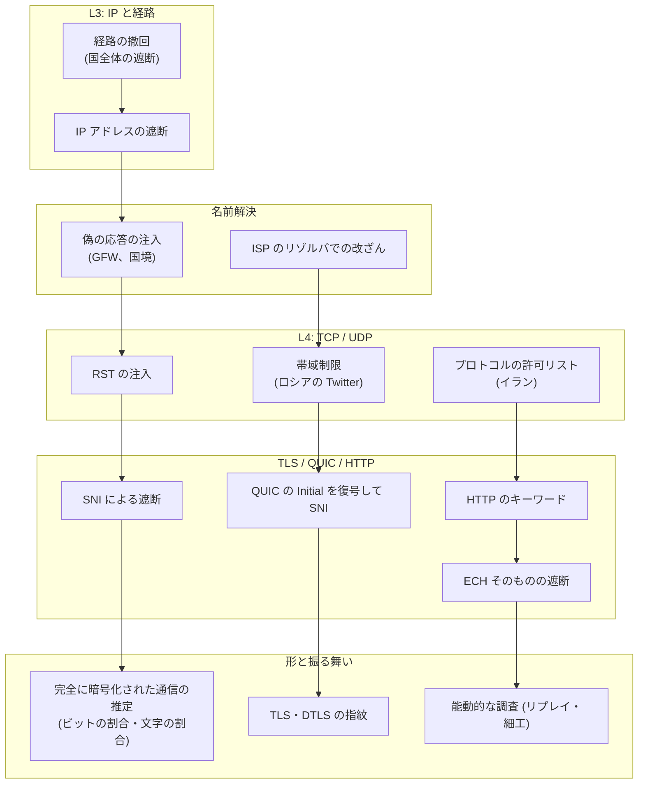
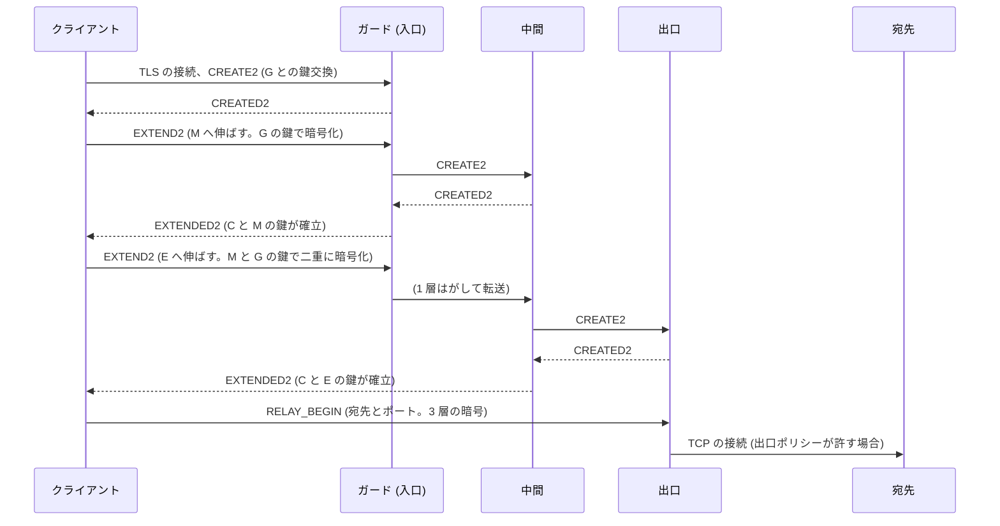

# プロキシ・匿名化・検閲 (Proxies, Anonymity Networks & Internet Censorship)

## 概要 (Overview)

本ドキュメントは通信を代わりに中継するプロキシ (proxy)、送信者と宛先の結び付きを隠す匿名化の仕組み (anonymity system)、国家などによるインターネット検閲 (censorship) とその迂回 (circumvention) を扱う。対象はフォワード・リバース・透過型のプロキシ、HTTP の CONNECT と SOCKS、PAC/WPAD、中継の痕跡を運ぶヘッダ (X-Forwarded-For・Forwarded・PROXY protocol)、2 段の中継で知識を分ける iCloud Private Relay・Oblivious HTTP (OHTTP)・ODoH、Tor (回路・ディレクトリ・ガード・オニオンサービス・非匿名化の型・Arti)、層ごとの検閲の技法 (IP・DNS・SNI・RST 注入・帯域制限・プロトコルの識別と能動的な調査・遮断)、検閲の計測とその倫理、迂回の設計 (ブリッジと pluggable transport・Shadowsocks・模倣と乱数化・リフラクションネットワーキング・ドメインフロンティング) である。

この話題はこれまで複数の文書に分かれていた。VPN の識別と一般向け VPN の信頼モデルは [`vpn-tunneling.md`](vpn-tunneling.md)、SNI・ECH・ロシアの ECH 遮断・TLS を終端する中間装置は [`tls-internals.md`](tls-internals.md)、CONNECT と MASQUE と UDP の遮断は [`http-quic-evolution.md`](http-quic-evolution.md)、DoH と ODoH は [`dns-resolution.md`](dns-resolution.md)、エジプトの遮断と IODA は [`ip-routing-bgp.md`](ip-routing-bgp.md) にある。本書はそれらをつなぐ入口として、各文書の詳細を繰り返さずに参照する。

検証する仮説は次のとおりである。プロキシ、匿名化、検閲は 1 つの設計空間にある。軸は、経路の上の誰がどのフィールド (IP アドレス、SNI、DNS の名前、タイミング、大きさ) を見られるかと、誰を信頼しなければならないかである。検閲は平文で見えるものか、統計的に区別できるものを使う。迂回とプライバシの設計は、そのフィールドを暗号化するか、知識を複数の当事者に分ける (中継の連鎖、oblivious 型の設計) か、許可された通信に似せるかのどれかを選ぶ。似せる方向は「オウムは死んだ (The Parrot is Dead)」の結果が示すとおり、いたちごっこになる。

資料を読んだ結論として、この仮説の骨格は成り立つが、3 点で修正が要る。第 1 に、見えるかどうかだけでは検閲の振る舞いは決まらない。検閲する側は遮断の費用 (巻き添えの被害、計算資源、政治的な費用) と見比べて判断する。GFW は完全に暗号化された通信の約 26% しか遮断せず (Wu et al. 2023)、QUIC の検閲は Initial の復号の負荷で性能が落ちる (Zohaib et al. 2025)。迂回の側も巻き添えの大きい基盤 (CDN、大手のクラウド、多数の一時的なプロキシ) に隠れることで、この費用を突いている。Snowflake の論文は迂回の技術を「検閲する側に過剰な遮断か遮断の不足かを選ばせること」と書く (Bocovich et al. 2024)。第 2 に、「何にも似せない」乱数化も模倣と同じく負けうる。GFW は「どのプロトコルにも見えないこと」そのものを特徴として遮断した (Wu et al. 2023)。第 3 に、知識の分割は運用者が結託しないことを前提にするが、運用者が別でも網の上の同じ AS に集まれば前提は弱まる (Private Relay の測定、RAPTOR)。ドメインフロンティングは検閲する側ではなく CDN の方針によって終わった。迂回の持続性は技術より第三者の事業者の判断に左右される。分析深度は Level 3。

## 方法論 (Methodology)

- **一次資料**: 匿名化と検閲の査読付き論文 (USENIX Security・CCS・IEEE S&P・NDSS・IMC・PoPETs・FOCI) を本文または著者の公開ページで読み、数値を確かめた。Tor の原設計は Dingledine et al. (2004)、AS による相関攻撃は Johnson et al. (2013) と Sun et al. (2015、RAPTOR)、Web サイトの指紋は Sirinam et al. (2018) と Cherubin et al. (2022)、GFW の能動的な調査は Ensafi et al. (2015) と Alice et al. (2020)、完全に暗号化された通信の遮断は Wu et al. (2023)、QUIC の検閲は Zohaib et al. (2025)、ロシアは Xue et al. (2021, 2022)、イランは Bock et al. (2020)、Snowflake は Bocovich et al. (2024) である。
- **標準と仕様**: RFC 1928 (SOCKS5)、RFC 7239 (Forwarded)、RFC 9110 (CONNECT)、RFC 9230 (ODoH)、RFC 9458 (OHTTP) の本文、HAProxy の PROXY protocol の仕様、Tor の仕様 (guard-spec) を読んだ。
- **時間とともに変わる値**: Tor の中継の数と利用者数は Tor Metrics の CSV、ディレクトリ機関の数は Consensus Health、Arti の版は crates.io と Tor Project のブログ、Chrome の IP Protection の状況は Google の Privacy Sandbox の発表で、いずれも 2026 年 11 月 7 日に確かめた。
- **出典の格付け**: Apple・Google・Tor Project の文書は自社の仕組みについては一次資料だが、効果の主張は自社の主張として扱う。悪意ある Tor 中継の規模 (2020 年の出口、KAX17) は独立の研究者 (nusenu) の報告と報道が根拠で、査読を経ていないことを明記する。報道や二次的な要約で読んだだけの数値はそう書く。
- **書かないこと**: 特定の国の規制を回避する手順や、利用者を攻撃する手順は書かない。迂回は仕組みと公開された計測の水準で扱い、論文が示す検閲装置の具体的な弱点は、その存在と影響の範囲にとどめる。
- **担当範囲**: 社内の SWG・TLS インスペクション・SSE は [`../security/perimeter-defense-zero-trust.md`](../security/perimeter-defense-zero-trust.md)、TLS の終端の測定は [`tls-internals.md`](tls-internals.md)、MASQUE のプロトコルは [`http-quic-evolution.md`](http-quic-evolution.md)、WebRTC のアドレスの漏洩は [`webrtc-realtime-media.md`](webrtc-realtime-media.md)、差分プライバシなどデータの側のプライバシ技術は [`../security/privacy-engineering.md`](../security/privacy-engineering.md) に委ねる。

## 発見事項 (Findings)

1. **プロキシは信頼を消さず、移す。** フォワードプロキシ、一般向けの VPN、企業の SWG は、手元の網から見えるものを減らす代わりに、中継する者にすべてを見せる。公開の HTTP プロキシ約 1.9 万台を 2 か月観測した研究では、38% が内容を書き換え、5.15% は有害と言える書き換え (広告やスクリプトの注入など) をしていた (Tsirantonakis et al. 2018)。単一の中継で守れるのは「誰に見られるか」の選択までである。
2. **2 段の中継は「誰か」と「何を」を分けるが、結託しないことが前提である。** Private Relay、OHTTP、ODoH は、入口の中継が利用者の IP アドレスを、出口 (またはゲートウェイ) が宛先や中身を知り、両方を知る者を作らない。RFC 9458 は中継とゲートウェイを同じ者が運用してはならないと書く。Private Relay の測定では、運用者が別でも、入口と出口が同じ AS の同じルータの後ろにある例があった ([`http-quic-evolution.md`](http-quic-evolution.md))。Google は Chrome のシークレットモード向けに同じ形の IP Protection を準備したが、2025 年 10 月 17 日に Privacy Sandbox の技術の 1 つとして廃止を発表した。
3. **Tor は 3 段の中継と多数のボランティアで知識を分けるが、両端を見る者には弱い。** 2026 年 11 月 5 日の時点で中継は 9,552、ブリッジは 2,517 である。Tor の設計は、両端の通信を観測できる者による相関を防がないことを最初から前提にしている (Dingledine et al. 2004)。Johnson ら (2013) のシミュレーションでは、中程度の帯域の中継を運用する攻撃者が 6 か月で利用者の種類の 80% を非匿名化できた。1 つの AS や IXP の攻撃者が一般的な場所の利用者を 3 か月でほぼ 100% 非匿名化できる場合もあった。
4. **Web サイトの指紋は、実験室の数値と実地の数値の差が大きい。** Deep Fingerprinting は防御のない Tor の通信で閉じた世界の正解率 98% 超、WTF-PAD の防御に対しても 90% 超を出した (Sirinam et al. 2018)。一方、Tor の出口で安全に集めた実際の通信で評価すると、監視したいサイトが少数 (25 程度) を超えると実用的でなくなるという結果が出ている (Cherubin et al. 2022)。脅威の大きさは評価の前提に強く依存する。
5. **検閲は平文のフィールドを順に使ってきた。** DNS の応答の偽造、TCP の RST の注入、HTTP のキーワード、TLS の SNI、そして QUIC の Initial である。QUIC の Initial は暗号化されているが、鍵が公開の値から導かれるため、経路の上の誰でも復号できる。GFW は 2024 年 4 月 7 日から QUIC の Initial を復号して SNI で遮断しており、遮断の対象は 2024 年 10 月〜2025 年 1 月の期間に 58,207 の FQDN に及んだ (Zohaib et al. 2025)。ECH はこの最後の平文を閉じるが、ロシアは ECH そのものを遮断した ([`tls-internals.md`](tls-internals.md))。
6. **見えないものは形の統計で区別される。** GFW は 2021 年 11 月から、最初のパケットのビットの割合や表示可能な文字の割合などから「どのプロトコルにも見えない」通信を推定して遮断している。対象は人気のあるデータセンターの一部の IP の範囲への接続に限られ、遮断は確率的で、該当する接続の約 26% が遮断された (Wu et al. 2023)。OpenVPN もバイトの並び、パケットの大きさ、問い合わせへの応答から 85% 超が識別された ([`vpn-tunneling.md`](vpn-tunneling.md))。
7. **疑わしいサーバは能動的に調べられる。** GFW は Tor のブリッジや Shadowsocks のサーバの疑いがある宛先に、自分で接続して応答を確かめる。Ensafi ら (2015) は 16,083 の調査元のアドレスを集め、ほとんどが中国のアドレスで、中央の 1 つのシステムに制御されていると結論した。Shadowsocks では、正規の通信の最初のパケットを再送 (リプレイ) したり細工したりする調査が、12,300 の中国のアドレスから 51,837 回届いた (Alice et al. 2020)。共有の秘密を知らない相手に応答しない設計 (obfs4、AEAD とリプレイ対策を持つ Shadowsocks) が、これへの答えになった。
8. **検閲の配置は国によって違う。** GFW の DNS の注入は主に国境で行われる (Anonymous 2014)。ロシアの TSPU は、各 ISP の網の中、利用者の近くに国が配った装置で、Xue ら (2022) は 650 の AS の 100 万を超える端点が TSPU の後ろにあり、その 70% は端点から 2 ホップ以内にあると測定した。2021 年 3 月の Twitter の帯域制限は SNI を引き金に上り下りを 130〜150 kbps に絞った (Xue et al. 2021)。イランは特定のポートで DNS・HTTP・HTTPS 以外のプロトコルを落とすプロトコルのフィルタを他の検閲と重ねていた (Bock et al. 2020)。国全体を切る遮断は 2025 年に 52 か国で少なくとも 313 件記録された (Access Now 2026)。
9. **似せる方向も、何にも似せない方向も、いたちごっこになる。** Houmansadr ら (2013) は、Skype や HTTP を模倣する SkypeMorph・StegoTorus・CensorSpoofer を、弱い検閲者でも区別できると示し、不完全な模倣は模倣しないより悪いと結論した。本物のプロトコルの中を通す (トンネル) か、遮断の費用が高い基盤に隠れる方向が残った。ただしドメインフロンティングは、2018 年 4 月に Google と Amazon が、後に Microsoft が自社の CDN で止めた。迂回の寿命は検閲する側だけでなく基盤を持つ事業者の方針でも決まる。
10. **Snowflake は「多数の使い捨てのプロキシ」という別の軸を示した。** ブラウザの拡張などで動く約 10 万規模の一時的なプロキシを、WebRTC で利用者とつなぐ。2024 年 3 月時点で平均約 3 万 5,000 の同時利用者を支え、ロシア (2021 年 12 月) とイラン (2022 年 9 月) で利用が急増した。どちらの国でも、遮断の引き金は DTLS や TLS のハンドシェイクの指紋で、プロキシのアドレスではなかった (Bocovich et al. 2024)。アドレスを数で守っても、プロトコルの指紋の問題は残る。

## アーキテクチャ (Architecture)

### 誰が何を見るか

凡例: 箱は経路の上の観測点、実線は通信の向き、点線は相関攻撃が使う結び付き。Private Relay と OHTTP には中間の中継がなく、2 段である。単一の中継 (フォワードプロキシ・一般向け VPN) では第 1 と最後の中継が同じ者になり、A と宛先の両方を知る。

### 方式ごとの見え方と信頼の置き場

| 方式 | 手元の網から見えるもの | 中継が見るもの | 宛先が見るもの | 信頼しなければならない者 |
|---|---|---|---|---|
| フォワードプロキシ (平文 HTTP) | プロキシのアドレス。中身も見える | 利用者のアドレス、URL、中身 | プロキシのアドレス (ヘッダで元のアドレスが付くことがある) | プロキシの運用者 |
| CONNECT・SOCKS のトンネル + TLS | プロキシのアドレス。プロキシまで平文なら CONNECT の宛先 | 利用者のアドレス、宛先のホスト名とポート、量。中身は TLS で守られる | プロキシのアドレス | プロキシの運用者 (宛先と時刻をすべて知る) |
| 企業の SWG (TLS インスペクション) | — (社内) | 利用者、URL、復号した中身 | SWG のアドレス | SWG の運用者と、その TLS 実装の品質 |
| 一般向け VPN | VPN サーバのアドレス、量とタイミング | 利用者のアドレス、すべての宛先 (平文なら中身) | VPN の出口のアドレス | VPN 事業者 |
| iCloud Private Relay | 入口 (Apple) のアドレス | 入口: 利用者のアドレス。出口 (CDN 事業者): 宛先の名前 | 出口のアドレス (大まかな地域だけを反映) | Apple と出口の事業者が結託しないこと |
| OHTTP (RFC 9458) | relay のアドレス | relay: 利用者のアドレス。gateway: 要求の中身 | gateway のアドレス | relay と gateway が結託しないこと。gateway が要求を改ざんしないこと |
| Tor (3 段) | ガード (またはブリッジ) のアドレス | ガード: 利用者のアドレス。出口: 宛先 (平文なら中身) | 出口のアドレス | 多数の中継のうち両端が同じ者でないこと。両端を観測できる AS などがいないこと |
| リフラクションネットワーキング | 当たり障りのない宛先 (おとり) への TLS | 協力する ISP の局: 利用者のアドレスと本当の宛先 | 局の先のプロキシのアドレス | 協力する ISP と局の運用者 |

この表のどの行でも、暗号化と中継で隠せるのは「フィールドの中身」までで、パケットの大きさとタイミングは残る。両端を観測できる者に対しては、どの方式も保証を持たない。

### 検閲が介入する層

凡例: 上から下へ、検閲が見るものが平文のヘッダから統計的な特徴に移っていく順に並べた。矢印は層の関係で、時系列ではない。暗号化が上の層の平文を閉じるたびに、検閲は下の段 (形と振る舞い) か、上の段 (アドレスや経路の単位の粗い遮断) に移る。

### Tor の回路の確立

凡例: 回路は 1 段ずつ伸ばし (telescoping)、各段との鍵交換は前の段を経由する。各中継は自分の層だけをはがすので、前後の中継しか知らない (Dingledine et al. 2004)。

## 技術詳細 (Technical Details)

### 1. プロキシの分類

- **フォワード・リバース・透過型**: フォワードプロキシは利用者の側に置かれ、利用者が明示的に設定して外への通信を代わりに出す。リバースプロキシはサーバの側に置かれ、外からの接続を代わりに受ける (TLS の終端・負荷分散・WAF。[`load-balancing-architecture.md`](load-balancing-architecture.md)、[`cdn-edge-delivery.md`](cdn-edge-delivery.md))。透過型 (インターセプト型) は利用者の設定なしに、網の機器が通信を横取りしてプロキシに回す。HTTPS では透過型の中継は宛先の証明書を出せないので、中身を見るには端末に独自の認証局を入れる TLS インスペクションが要る。社内の SWG と SSE の位置付けは [`../security/perimeter-defense-zero-trust.md`](../security/perimeter-defense-zero-trust.md)、終端による安全性の低下の測定 (Durumeric et al. 2017) は [`tls-internals.md`](tls-internals.md) の技術詳細 10 で扱う。
- **HTTP のプロキシと CONNECT**: 平文の HTTP では、クライアントはプロキシに絶対形式の URI (`GET http://example.com/ HTTP/1.1`) を送り、プロキシが要求を解釈して中継する。プロキシは URL と中身をすべて見て、キャッシュも書き換えもできる。HTTPS では、クライアントは `CONNECT example.com:443` でトンネルを頼み、その中で宛先と TLS を張る (RFC 9110 §9.3.6)。プロキシに見えるのは宛先のホスト名・ポートと量だけになる。HTTP/2 と HTTP/3 の CONNECT、Extended CONNECT による UDP と IP のトンネル (MASQUE) は [`http-quic-evolution.md`](http-quic-evolution.md) の §17 にある。
- **SOCKS**: SOCKS は HTTP に依存しない汎用の中継である。SOCKS4 は TCP の接続だけを IPv4 のアドレスで頼み、拡張の SOCKS4a でホスト名を渡せるようになった。SOCKS5 (RFC 1928、1996 年) は認証の交渉、IPv6、ドメイン名、UDP の中継 (UDP ASSOCIATE) を加えた。ホスト名をプロキシ側で解決させる (`ATYP` = ドメイン名) かどうかで、DNS の問い合わせが手元の網に漏れるかが決まる (技術詳細 11)。SSH の `-D` は手元に SOCKS のプロキシを立てる ([`vpn-tunneling.md`](vpn-tunneling.md))。Tor のクライアントも SOCKS のポートを開けて、アプリケーションの通信を受ける。
- **PAC と WPAD**: PAC (Proxy Auto-Config) は `FindProxyForURL(url, host)` という JavaScript の関数で、URL ごとにどのプロキシを使うかを返す。WPAD (Web Proxy Auto-Discovery) は PAC の場所を DHCP のオプションか、`wpad.<ドメイン>` という DNS の名前で自動的に探す。IETF の草案は 1999 年に失効し、標準にはならなかった。名前で探す方式は、社内の名前が外に漏れると攻撃者が登録した名前から PAC を配れるという弱点を持つ。Chen ら (2016) は、新しい gTLD の開放で社内向けの名前の問い合わせがインターネットに漏れ、1 日に約 2,000 万件の悪用可能な WPAD の問い合わせが観測されることを示し、US-CERT の注意喚起 (TA16-144A) につながった。PAC を握った者はすべての通信の経路を決められるので、WPAD は使わないなら無効にするのが基本の対策である (CIS のベンチマークも無効化を推奨している)。
- **公開プロキシ**: 設定の誤りや意図的な公開で誰でも使えるプロキシは、匿名化の手段として広く出回る一方、運用者が誰か分からない。Tsirantonakis ら (NDSS 2018) は 2 か月の監視で、動作する 19,473 台のうち 7,441 台 (38%) が中身を書き換え、1,004 台 (5.15%) が有害な書き換え (広告・追跡のスクリプト・暗号通貨の採掘の注入など) をしていたと報告した。書き換えの多くはプライバシのための遮断などの無害なものだった。公開プロキシは攻撃の送信元を隠す踏み台としても使われる。サーバの側の SSRF は、サーバを攻撃者の意図しない公開プロキシにする脆弱性と見ることもできる ([`../security/web-application-vulnerabilities.md`](../security/web-application-vulnerabilities.md))。

### 2. X-Forwarded-For・Forwarded・PROXY protocol

- **X-Forwarded-For と Forwarded**: リバースプロキシは後ろのサーバに元のクライアントのアドレスを伝えるために `X-Forwarded-For` (事実上の標準) か、標準化された `Forwarded` (RFC 7239、2014 年 6 月、`for`・`by`・`host`・`proto` の各パラメータ) を付ける。中継のたびに右へ追記されるので、左端ほど利用者に近い。左端の値はクライアントが自由に書けるので、アクセス制御や回数の制限に使ってはならない。MDN は信頼するプロキシの台数か、アドレスの一覧を設定し、右から数えて最初の信頼できない値を使うよう勧めている。サーバがインターネットから直接到達できるなら、リストのどの値も信頼できない。RFC 7239 は内部の構成を隠す難読化した識別子 (`_` で始まる) と、出口のプロキシでの削除も定めている。
- **PROXY protocol**: HAProxy が 2010 年に公開した方式で、TCP の接続の最初に元のアドレスとポートを書いたヘッダを付ける。版 1 は 1 行のテキスト、版 2 は 12 バイトの署名で始まるバイナリで、ALPN・SNI (AUTHORITY)・TLS の情報などを TLV で運べる。HTTP 以外のプロトコルでもアドレスを渡せる点が利点である。仕様は、受け手はヘッダの有無を推測してはならず、設定で有効にした信頼する送信元からだけ受け付けるよう求めている。そうしないと、誰でも任意の送信元のアドレスを名乗れる。
- どの方式も、中継が付けた値を、どの中継が付けたか確かめずに信じたときに失敗する。ロードバランサの前に別の経路が残っていると、攻撃者はその経路から偽のヘッダを付けて、IP アドレスによる許可や回数の制限をすり抜ける。匿名化の側から見ると、これらのヘッダは逆に、プロキシを通しても元のアドレスが宛先に届く経路になる。匿名化をうたうプロキシがヘッダを付けたまま中継する例は、公開プロキシの調査で繰り返し指摘されている。

### 3. 知識を分ける中継

- **iCloud Private Relay**: Apple の説明では、第 1 の中継 (Apple が運用) は利用者の IP アドレスを見るが、DNS の問い合わせは暗号化されていて宛先を知らない。第 2 の中継 (第三者のコンテンツ事業者が運用) は一時的な IP アドレスを割り当て、宛先の名前を復号して接続する。対象は Safari の閲覧、DNS の問い合わせ、アプリの暗号化されていない HTTP の通信である。出口のアドレスは利用者のおおまかな地域 (既定では都市の水準) に対応し、Apple は出口のアドレスの一覧を公開している。網の管理者は `mask.icloud.com` と `mask-h2.icloud.com` に NXDOMAIN か空の応答を返すことで、Private Relay を使えないと端末に伝えられる。Apple は、DNS をタイムアウトさせたり、中継へのパケットを応答なしに捨てたりしないよう求めている。入口と出口の間は QUIC の上の MASQUE で、測定で分かった AS の重なりは [`http-quic-evolution.md`](http-quic-evolution.md) の §17 にある。Apple はサービスの利用者を端末と iCloud+ の契約で確かめ、使い捨ての認証トークンと回数の制限で悪用を抑えると説明している (自社の説明)。
- **Oblivious HTTP (RFC 9458、2024 年 1 月、標準化過程)**: クライアントは要求を HPKE でゲートウェイの公開鍵に向けて包み、relay に送る。relay は利用者のアドレスとゲートウェイの宛先を知るが中身を読めず、ゲートウェイは中身を知るが利用者のアドレスを知らない。RFC は relay とゲートウェイを同じ者が運用してはならないと書く。適用できるのは、要求の間で状態を持たない用途 (DNS、テレメトリの送信、匿名のアンケート、検索、地図のタイル) に限られる。Cookie や認証を使うと要求どうしが結び付き、分割の意味がなくなる。前方秘匿性はなく、relay は要求を再送できるので、サーバの側でリプレイへの対処が要る。どの鍵の設定を使うか、どの relay を使うかの違いも利用者の区別に使われうる。トラフィックの分析 (大きさとタイミング) は仕様の範囲外である。
- **ODoH (RFC 9230、2022 年 6 月、Experimental)**: OHTTP と同じ考え方を DNS に限って先に定義したもので、プロキシと接続先のリゾルバが知識を分ける ([`dns-resolution.md`](dns-resolution.md) の §8)。
- **Chrome の IP Protection**: Google はシークレットモードで、広告や追跡に使われる第三者のドメイン (Masked Domain List) への通信だけを 2 段のプロキシに通す計画を示していた。第 1 段は Google、第 2 段は外部の CDN が運用し、認証には RSA のブラインド署名を使ってアカウントと通信を結び付けない設計だった。2025 年 4 月時点では、安定版への提供は早くても 2025 年 7 月とされた。しかし Google は 2025 年 10 月 17 日の Privacy Sandbox の更新で、IP Protection を廃止する技術の一覧に含めた (理由として採用の少なさと業界の反応を挙げた)。設計を公開したリポジトリは 2025 年 11 月 3 日に保存のみの状態になった。2026 年 11 月時点で、Chrome の一般の機能としての提供は確認できない。
- これら 4 つの方式は Tor と違い、中継の数を 2 に固定し、運用者を少数の大企業に置く。遅延は小さいが、中継の運用者どうしの結託と、網の上での集中 (同じ AS) に弱い。宛先の側から見ると、多数の利用者が同じ出口のアドレスを共有するので、IP アドレスで回数を制限していたサービスは、匿名の認証トークン (Privacy Pass、Apple の Private Access Tokens) に移ることが勧められている。

### 4. Tor のオニオンルーティング

- **回路と暗号の層**: Tor (Dingledine, Mathewson, Syverson 2004) は、クライアントがガード・中間・出口の 3 つの中継を選び、上図のように 1 段ずつ回路を伸ばす。各段との鍵交換で得た鍵で、送るデータを 3 重に暗号化する。中継間は TLS で、データは固定長のセル (リンクプロトコルの版 4 以降で 514 バイト、本体は 509 バイト) で運ぶので、パケットの大きさから中身の長さは分かりにくい。1 本の回路に複数の TCP ストリームを多重化し、回路は一定の時間ごとに作り直す。原論文は、両端を観測できる者による時刻と量の相関を防がないことを明示している。混ぜる (mix) 処理をせず遅延を小さく保つための選択である。
- **ディレクトリ機関と合意文書**: 中継の一覧は、少数のディレクトリ機関 (directory authority) が投票し、1 時間ごとに署名付きの合意文書 (consensus) として配る。機関の鍵はソフトウェアに埋め込まれている。2026 年 11 月 7 日 02:00 UTC の合意文書には 9 つの機関のうち 8 つが投票し、そのうち 4 つが帯域の測定値を出していた (Consensus Health)。少数の機関に信頼を集めることで、中継の一覧の改ざんや分断 (利用者ごとに違う一覧を見せる攻撃) を防いでいる。その代わりに、機関の過半数の侵害や停止が網全体の弱点になる。
- **ガード**: クライアントが毎回新しい入口を選ぶと、いずれ攻撃者の入口を選ぶ確率が 1 に近づく。そこでクライアントは少数の入口 (ガード) を長く使い続ける。現在の仕様では候補を最大 60 まで標本にとり、3 つを主なガードとし、通常はそのうち 1 つを使う。標本に入れたガードは 120 日程度で入れ替える (guard-spec の付録)。攻撃者のガードを引かなければ長く安全だが、引けば長く観測される。ガードはこの賭けを利用者ごとに固定する仕組みである。
- **出口ポリシー**: 出口の中継はどの宛先とポートへの接続を許すかを公開する。出口は宛先への通信の送信元として外から見えるため、苦情や法的な問い合わせを受けやすく、出口の容量は中継全体より限られる。出口から先は普通のインターネットなので、TLS を使わない通信は出口に読まれ、書き換えられる (技術詳細 5)。
- **オニオンサービス**: サーバの側も匿名にする仕組みで、クライアントとサービスがそれぞれ回路を作り、ランデブーポイントで出会う。v3 (Tor 0.3.2.1-alpha、2017 年 9 月) は SHA1・RSA-1024 などを SHA3・ed25519・curve25519 に置き換え、アドレスを 56 文字の公開鍵そのものにした。v2 は 0.4.6 系で廃止され、2021 年 10 月の Tor Browser の安定版の更新で到達できなくなった。サービスへの入口 (導入点) を大量の要求で埋める DoS に対しては、0.4.8 (2023 年) から、負荷が高いときだけクライアントに計算の手間 (proof-of-work) を払わせ、手間の大きい要求を優先する ([`ddos-mitigation.md`](ddos-mitigation.md))。送信元のアドレスで制限できない環境での DoS 対策の例である。
- **規模 (2026 年 11 月 7 日時点の Tor Metrics)**: 中継は 9,552、ブリッジは 2,517 (2026-11-05)。過去 1 年の月初の値は中継 9,076〜10,150、ブリッジ 2,392〜2,770 の範囲だった。利用者数は直接の数ではなく、ディレクトリへの要求の数を、1 クライアント 1 日 10 回と仮定して割った推定である。中継に直接つなぐ利用者の推定は 2026 年 5〜10 月に 1 日あたり 270 万〜390 万の範囲にあったが、10 月 28 日から急増し、10 月 29 日に 6,449 万に達した後、11 月 4 日には 1,141 万まで下がった。推定の方法から、ディレクトリへの要求を大量に出す自動化されたクライアントが加わると値は跳ね上がる。この急増の原因は本書の執筆時点で確認できておらず、人の利用者の増加と読むべきではない。ブリッジの利用者の推定は 2026 年 11 月初めに 38 万〜56 万である。
- **Arti**: Tor Project は C の実装を Rust の Arti で置き換える作業を進めている。crates.io の `arti` の最新版は 2026 年 11 月 4 日の 2.8.0 で、月に 1 回ほど版を出している。2.6.0 (2026 年 9 月) で輻輳制御と新しい中継の暗号 (Counter Galois Onion) が常に有効になった。Tor Project は 2.8.0 の告知 (2026 年 11 月 3 日) でも、中継とディレクトリ機関として使えるようにする開発を「進めている」と書いており、Arti はまだ中継として本番で動かす段階にない。

### 5. Tor の非匿名化の型

| 型 | 攻撃者 | 使うもの | 主な研究と数値 | 対策の方向 |
|---|---|---|---|---|
| 端から端までの相関 | 入口側と出口側を両方見られる者 (中継の運用者、AS、IXP) | パケットの時刻と量 | Johnson et al. (2013): 中程度の中継の攻撃者で 6 か月に 80%、1 つの AS/IXP で 3 か月にほぼ 100% の場合 | ガード、経路の多様性を考えた中継の選択。根本の対策はない |
| 経路制御の悪用 (RAPTOR) | AS、経路のハイジャックができる者 | 非対称な経路 (片方向ずつ見れば足りる)、BGP の操作 | Sun et al. (2015): 90% 超の中継が攻撃を受けうる。実網で無害な実証 | 経路の監視、ROV ([`ip-routing-bgp.md`](ip-routing-bgp.md)) |
| Web サイトの指紋 | ガードかその手前 (ISP・検閲者) の 1 か所 | 暗号化された通信の大きさと向きの列 | Sirinam et al. (2018): 実験で 98% 超。Cherubin et al. (2022): 実地では監視対象が少数を超えると非実用的 | パディング (WTF-PAD)、半二重化 (Walkie-Talkie) |
| 悪意ある中継 | 中継を多数運用する者 | 出口での平文の読み取りと書き換え、ガードと出口の両方を引く確率 | 下記 | 不正な中継の検出と除名、HTTPS の徹底 |

- 相関攻撃は現実に重い。Johnson ら (CCS 2013) は、実際の中継の一覧と経路のデータでシミュレーションし、普通の利用者でも数か月の利用で高い確率で非匿名化されうることを示した。RAPTOR は、インターネットの経路が非対称なので、両方向でなく片方向ずつを見れば相関できること、経路のハイジャックで観測点を作れることを示した。Tor の匿名性は中継の数よりも、網の上で誰がどこを見られるかの分布に依存する。
- Web サイトの指紋は、評価の方法をめぐって論争がある。指紋の研究の多くは、少数のサイトを繰り返し読み込んだ実験室のデータで、1 つのタブで 1 つのページだけを読み込むといった前提を置く。Juarez ら (CCS 2014) がこの前提を批判し、Cherubin ら (USENIX Security 2022、優秀論文賞) は Tor の出口で、ドメイン名を秘密の鍵で HMAC にかけて研究者自身も本当の名前を知らない形で実際の通信を集めた。その結果、オンラインの攻撃は監視対象が少数を超えると実用的でなくなった。脅威を否定する結果ではなく、評価の条件をそろえないと数値を比べられないことを示している。
- **悪意ある中継**: Winter ら (PETS 2014) は、出口の中継を数か月監視し、TLS の中間者攻撃などをする悪意あるか設定の誤った出口を見つけた (論文の版によって 25〜65 という数が示されている)。2020 年には、独立の研究者 nusenu が Bitcoin の混合サービスへの通信で HTTPS を HTTP に格下げしてアドレスを書き換える出口の集団を報告し、最大で出口の容量の約 23% を占めたとした。2021 年に同じ研究者が報告した KAX17 は、出口ではなく入口と中間の中継を最大 900 以上運用し、ピーク時には利用者が KAX17 のガードを引く確率が約 16%、中間を通る確率が約 35% だったとされる。Tor Project は 2021 年 10 月と 11 月に該当する中継を除名した。これらの数値は査読を経ていない報告と報道によるもので、時点も違う。出口の問題には HTTPS の徹底 (Tor Browser は 2022 年 7 月の 11.5 からデスクトップ版で HTTPS-Only モードを既定にした) が、入口と中間の問題には運用者の確認と中継の多様性が対策になる。
- **ミックスネットとの比較**: 相関攻撃への答えは遅延とダミーの通信を加えて時刻と量の結び付きを壊すミックスネット (mixnet) である。Loopix (Piotrowska et al. 2017) は、各メッセージに指数分布の遅延を加え、利用者と中継がダミーの通信を常に流すことで、網全体を観測できる攻撃者にも送受信の関係を隠すことを目指した。その代わりに、遅延が秒の単位になり、Web の閲覧のような対話的な用途には向かない。Tor が低遅延を選んだことと、相関攻撃に弱いことは、同じ設計判断の両面である。

### 6. 層ごとの検閲の技法

- **IP アドレスと経路**: 宛先のアドレスを遮断するのは最も粗く、同じアドレスの後ろにある多数のサイト (CDN) を巻き込む。国全体の遮断は経路の撤回で行われ、2011 年のエジプトでは約 20 分の間に BGP の経路の大半が消えた ([`ip-routing-bgp.md`](ip-routing-bgp.md))。Access Now の #KeepItOn の集計では、2025 年に 52 か国で少なくとも 313 件の遮断があり、2024 年の 304 件を上回った。最多はミャンマー (少なくとも 95 件) で、紛争に関連するものが 125 件 (40%) を占めた。低軌道衛星のインターネットの遮断も 7 か国で 14 件記録された。集計は市民団体によるもので、遮断の定義と数え方は報告書による。IODA は BGP・能動的な探査・ネットワーク望遠鏡を組み合わせて断を検出するが、原因が政府の遮断かどうかの判断には別の分析が要る。
- **DNS の改ざんと注入**: 経路の上の装置が問い合わせを見て本物より先に偽の応答を返す。GFW の DNS の注入は主に国境で行われ、数百のプロセスの集まりが毎秒約 2,800 の偽の応答を出していたと測定された (Anonymous 2014)。GFWatch (Hoang et al. 2021) は 9 か月間、1 日平均 4 億 1,100 万のドメインを試し、31.1 万のドメインが DNS で検閲されていることを見つけた。このうち 7.7 万のドメインでは、偽の応答が Google や Cloudflare の公開リゾルバのキャッシュにまで入っていた。注入は国外から中国を通る問い合わせにも働く。Wallbleed (NDSS 2025) は、GFW の DNS の注入装置が偽の応答に最大 125 バイトの自分のメモリを付けて返していた欠陥を報告した。2023 年 11 月の修正は不完全で、2024 年 3 月に修正された。暗号化した DNS (DoH・DoT) は注入を防ぐが、DoT は専用のポートで目立つ ([`dns-resolution.md`](dns-resolution.md))。
- **SNI・HTTP のキーワード・RST の注入**: GFW は通信の経路の外に置いた (on-path の) 装置で平文の内容を見て、両端に偽の TCP の RST を送って接続を切る。Clayton ら (2006) は、両端が RST を無視すれば通信が続くことを示した。経路の外から送るだけで、パケットそのものは止められないからである。TLS の時代には平文の SNI が主な引き金になった ([`tls-internals.md`](tls-internals.md))。TCP のヘッダが平文であることがこの手段を可能にしており、QUIC がトランスポートまで暗号化した動機の 1 つになった ([`tcp-transport-congestion.md`](tcp-transport-congestion.md))。
- **帯域制限 (throttling)**: 遮断ではなく遅くする手段である。2021 年 3 月 10 日、ロシアは Twitter への通信を遅くした。Xue ら (IMC 2021) は、TLS の SNI に Twitter のドメインがあると、上りと下りの両方が 130〜150 kbps に絞られ、超えた分のパケットが捨てられることを測定した。遮断より気付かれにくく、利用者は「つながりにくい」とだけ感じる。検閲の手段としての大規模な帯域制限の最初の例とされている。
- **QUIC の検閲**: QUIC の Initial は暗号化されているが、鍵は接続 ID から誰でも導けるので、経路の上の装置は復号して SNI を読める。Zohaib ら (USENIX Security 2025) によると、GFW は 2024 年 4 月 7 日から、遮断対象の SNI を持つ Initial を 1 つ見ると、同じ送信元・宛先のアドレスと宛先のポートへのクライアントからの UDP を 180 秒間捨てる。QUIC の遮断リストは DNS や HTTPS の遮断リスト (約 10 万) の約 55% の大きさで、重なりは部分的だった。遮断装置は DNS の注入装置と同じホップにあった。Initial の復号は重い処理で、大量の Initial を送ると遮断の能力が落ちた。逆に、送信元を偽った Initial で、中国の内外の任意のホストの間の UDP を遮断させる可用性の攻撃も成り立った (国外からの攻撃は 2025 年 3 月 13 日以降、成り立たなくなった)。論文の後、Firefox と quic-go は Initial の SNI を複数のデータグラムに分ける実装を入れた。耐量子の鍵共有で ClientHello が大きくなったことも、同じ効果を持つ。
- **完全に暗号化された通信の推定**: Shadowsocks や VMess のような、最初の 1 バイトから乱数に見える通信は、特定のプロトコルの特徴を持たないこと自体で区別できる。Wu ら (USENIX Security 2023) は、GFW が 2021 年 11 月から、TCP の最初のデータのパケットについて、1 バイトあたりの立っているビットの平均が 3.4 以下か 4.6 以上、最初の 6 バイトが表示可能な文字、表示可能な文字が半分を超える、表示可能な文字が 20 以上続く、TLS や HTTP の先頭に見える、のいずれかに当てはまれば見逃し、どれにも当てはまらなければ遮断の候補にすることを推定した。監視は人気のあるデータセンターの一部の IP の範囲への接続に限られ、遮断は確率的 (約 26%) で、遮断すると 180 秒間その組を止めた。推定した規則を大学の網の通信に当てはめると、0.6% の接続が巻き込まれる計算になる。検閲する側も巻き添えを抑えるために対象を絞っている。
- **プロトコルの指紋と能動的な調査**: 受け身の識別で候補を絞り、能動的な調査で確かめる 2 段の構成が典型である (発見事項 7)。Ensafi ら (IMC 2015) は、GFW が Tor のブリッジや SSH の利用者の接続を見た後に、その宛先に自分で接続してプロトコルを確かめることを示した。調査元のアドレスは 1 万 6 千を超え、中央のシステムが制御していると推定された。イランのプロトコルのフィルタ (Bock et al. 2020) は、DNS・HTTP・HTTPS 以外に見える接続を落とす許可リスト型の方式で、他の検閲の仕組みと重ねて使われていた。
- **ECH の遮断**: ECH は SNI を暗号化するが、外側の SNI が共通の名前 (`cloudflare-ech.com`) なので、その名前を見て ECH を使う接続をまとめて落とせる。ロシアは 2024 年 11 月から、Cloudflare の ECH を使う接続を遮断した ([`tls-internals.md`](tls-internals.md) の技術詳細 3)。ECH が守れるのは、ECH そのものの遮断の費用が検閲する側にとって高い場合に限られる。

### 7. 集中型と分散型の検閲

| 国 | 配置 | 計測で分かったこと | 出典 |
|---|---|---|---|
| 中国 (GFW) | 主に国境の経路の上 (on-path) の装置。DNS と QUIC の検閲装置は同じホップにある | DNS の注入、RST の注入、SNI、QUIC の Initial の復号、完全に暗号化された通信の推定、能動的な調査 | Anonymous 2014、Hoang et al. 2021、Wu et al. 2023、Zohaib et al. 2025 |
| ロシア (TSPU) | 各 ISP の網の中、利用者の近くの経路の中 (in-path) の装置。国が配り、Roskomnadzor が方針を決める | SNI・IP・QUIC を引き金にした 6 種類の遮断の振る舞い、帯域制限、ロシアの中から始まる接続だけを遮断。端点の 70% が装置から 2 ホップ以内 | Xue et al. 2021, 2022 |
| イラン | 遮断の仕組みを重ねる (censorship-in-depth) | プロトコルの許可リスト、2022 年 9 月の抗議の後の遮断の強化と TLS の指紋による Snowflake の遮断 | Bock et al. 2020、Bocovich et al. 2024 |

- GFW は数十年かけて国境の要所に装置を置いた。ロシアは数千の民間の ISP を抱え、要所がない。Xue ら (2022) は 2019 年の「主権インターネット法」の後、3 年足らずで、ISP の網の中に国の装置を配る形で全国規模の検閲を作ったことを示し、利用者に近い in-path の配置は特定の利用者の監視や中間者攻撃にも向くと警告した。in-path の装置はパケットそのものを捨てられるので、RST を無視しても通信は続かない。
- 計測からは、検閲の限界も分かる。どちらの体制でも、装置ごと・ISP ごと・時間帯ごとに振る舞いがばらつく。GFW の QUIC の遮断は北京で最も強く、早朝に強まった (Zohaib et al. 2025)。検閲は均一な壁ではなく、資源の制約の下で動く分散したシステムである。

### 8. 検閲の計測とその倫理

- **OONI**: 利用者が自分の端末で OONI Probe を動かし、Web サイト・メッセージングアプリ・迂回ツールへの接続を試して結果を公開する。2012 年以降 241 の国と地域、2 万 5 千の網で測定が行われた (OONI の説明。総件数は 2024 年 3 月に 20 億件に達したとされる)。中の利用者が測るので、住宅の網の実際の状態が分かるが、測る人が危険を負う。
- **Censored Planet**: Raman ら (CCS 2020) は国の中に協力者を置かず、世界中の公開されたサーバ (DNS のリゾルバ、Web サーバなど) を遠隔の観測点として使う方式を作った。20 か月で 221 か国の 9 万 5 千以上の観測点から 218 億件の測定を集め、国あたりの AS の中央値は 8 (OONI は 4、ICLab は 1) だった。
- **ICLab**: Niaki ら (IEEE S&P 2020) は、商用の VPN のサーバを観測点にした。協力者を危険にさらさない一方で、観測点の多くがデータセンターの AS にあり、住宅の網より検閲が緩い可能性がある。
- **GFWatch と IODA**: GFWatch は中国の DNS の検閲を、IODA は国や AS の単位の断を継続的に記録する。継続的な計測は検閲の変化 (例: 2024 年 4 月の QUIC の遮断の開始) を日付で特定できる。
- **倫理**: Burnett と Feamster の Encore (SIGCOMM 2015) は、Web ページを訪れた第三者のブラウザに、検閲されうるサイトへの要求を本人に知らせずに出させて計測した。プログラム委員会は、検閲のある国の利用者に危険が及びうること、同意がないこと、利用者の意図を反映しない要求であることを懸念し、論文に委員会の見解を付けて採録した。対象を Facebook・Twitter・YouTube に絞った緩和も議論になった。Wallbleed の論文でも、委員会は技術的な貢献を認めつつ、重要な対象に影響しうる研究の前に法的な助言を求めるよう勧めた。遠隔の計測 (Censored Planet) や VPN の観測点 (ICLab) は、この問題への応答として設計された面がある。

### 9. 迂回の設計

- **ブリッジと pluggable transport**: Tor のブリッジは公開の一覧に載らない入口で、配布の方法 (Web・メール・Telegram など) を制限してアドレスの列挙を難しくする。ブリッジとクライアントの間の通信の見た目は pluggable transport (PT) として交換できるようにした。
  - **obfs4**: 通信全体を乱数に見せる方式で、ブリッジの公開鍵などの秘密を知らない相手には応答しない。能動的な調査への答えだが、「乱数に見える」こと自体が GFW の完全に暗号化された通信の推定の対象になりうる。
  - **meek**: HTTPS の外側 (SNI と DNS) では大手の CDN のドメインを名乗り、暗号化された内側の Host ヘッダで本当の宛先を指定する (ドメインフロンティング。Fifield et al. 2015)。CDN ごと遮断しない限り止められないが、CDN の帯域の料金が高い。
  - **Snowflake**: 次項。
  - **WebTunnel**: 2024 年 3 月 12 日に公開された PT で、Tor の通信を WebSocket に似た HTTPS の接続に包む。同じドメイン・アドレス・ポートで普通の Web サイトと共存できる。Tor Project は中国とロシアでは機能するが、イランの一部では機能しないと説明した (Tor Project のブログ)。
- **Snowflake の仕組み**: クライアントはまず仲介役 (broker) にランデブーの要求を送り、broker は待機している一時的なプロキシとクライアントを組み合わせる。broker への経路自体が遮断されないように、ランデブーはドメインフロンティング、AMP のキャッシュ、Amazon SQS のどれかの間接的な経路で行う。その後、クライアントとプロキシは WebRTC (ICE・STUN・DTLS) で直接つながり、プロキシは通信を中央のブリッジへ転送する。プロキシが消えれば別のプロキシに切り替え、セッションの状態はクライアントとブリッジが持つので、上位の層からは 1 本の接続に見える。プロキシの大半 (1 日に約 14 万の IP アドレスの 80% 超) はブラウザの拡張で、半数が入れ替わるのに約 20 時間かかる。2024 年 3 月時点の利用は平均約 3 万 5,000 の同時利用者、2.7 Gbit/s、1 日約 29 TB で、Tor の利用者の約 1.2% (ブリッジの利用者の 25%) だった (Bocovich et al. 2024)。
  - **ロシアの例**: 2021 年 12 月 1 日に一部の ISP が Tor の多くの接続方法を遮断した。Snowflake の遮断の引き金は DTLS のハンドシェイクの特徴で、数週間で修正された。その後の 2 か月で利用者は 4 倍になり、2022 年 5 月には Snowflake の利用者の約 70% がロシアからだった。
  - **イランの例**: 2022 年 9 月 16 日からの抗議の後、イランの利用者の割合は 9 月 20 日の 1% から 9 月 24 日の 67% に急増した。10 月 4 日に TLS の指紋による遮断で急減し、修正後に回復した。
  - 2 つの例から分かるとおり、アドレスの数と入れ替わりで列挙と遮断に耐えても、プロトコルの指紋という別の面は残った。迂回の仕組み全体の強さはランデブーと本体の弱い方で決まる。
- **Shadowsocks と GFW**: Shadowsocks は事前に共有した鍵で全体を暗号化する簡素なプロキシである。Alice ら (IMC 2020) は、GFW が最初のデータのパケットの長さとエントロピーで候補を選び、正規の最初のパケットをそのまま、またはバイトを変えて再送する調査をすることを示した。調査は 1 秒以内から 570 時間後まで遅れて届き、同じ内容が最大 47 回再送された。サーバが調査にどう応答するか (切断のタイミングなど) が識別の手がかりになった。対策は完全性のない流れ暗号 (stream cipher) を捨てて AEAD に限ること、リプレイを検出すること、最初のパケットの長さを固定しないことだった。
- **模倣・トンネル・乱数化**: Houmansadr ら (S&P 2013、最優秀実用論文賞) は、Skype や HTTP の見た目を模倣する方式は、模倣しきれない細部 (エラーへの反応、副次的な通信、能動的な問いへの応答) で見分けられると示した。そこから 2 つの方向が残った。本物のプロトコルの実装の中に通信を通す方向 (meek・WebTunnel・MASQUE、uTLS によるブラウザの ClientHello の再現) と、何にも似せない方向 (obfs4・Shadowsocks) である。後者は 2021 年以降の GFW の推定の対象になった。Frolov と Wustrow (NDSS 2019) は、約 110 億の ClientHello を 9 か月集め、多くの迂回ツールの TLS の指紋が本物のブラウザと簡単に見分けられることを示して、ブラウザの ClientHello を再現する uTLS を作った。
- **リフラクションネットワーキング**: 協力する ISP の網の中に局 (station) を置き、クライアントは当たり障りのないサイト (おとり) への TLS の接続に、局だけが読める合図を埋め込む。局は合図を見つけると、その接続を横取りして本当の宛先へつなぐ。検閲する側から見ると、協力する ISP を通る多数のサイトへの接続のどれが迂回か分からない。Telex (Wustrow et al. 2011) が原型で、TapDance (Wustrow et al. 2014) は通信の経路の外からの観測と注入だけで動くようにした。Conjure (Frolov et al. 2019) は、ISP の未使用のアドレス空間に「幻のホスト」を作り、そこを宛先にする。VanderSloot ら (PoPETs 2020) は、TapDance を Merit Network の 140 Gbps の上りの回線に置き、Psiphon の 1 つの接続方式として本番で運用した。2019 年末に 55.9 万のインストールで有効で、月に 3 万 3 千人超の利用者に使われた。この方式は ISP の協力が前提で、技術より協力関係の維持が難しいと論文自身が書いている。
- **ドメインフロンティングの衰退**: Google は 2018 年 4 月中旬、Host ヘッダと TLS の名前が一致しない要求を拒むようになった。Amazon も 2018 年 4 月 27 日に CloudFront での遮断を発表し、同じ週に Signal の CloudFront のアカウントが規約違反として止められた。Microsoft は Azure Front Door と Azure CDN で、2022 年 11 月 8 日以降に作られた資源で既定で遮断し、既存の資源への適用も 2024 年 1 月を目処に進めた (適用の最終の日付は告知が何度か変わり、本書では確かめていない)。どの事業者も技術としては可能なまま、方針として止めた。

### 10. 匿名化と迂回が漏れる場所

| 症状 | 原因 | 見つけ方・対策 |
|---|---|---|
| プロキシや VPN を使っているのに名前解決が手元の網に出る (DNS リーク) | アプリケーションが OS のリゾルバを直接使う。SOCKS でホスト名をクライアント側で解決する | プロキシ側で名前を解決する (SOCKS5 でドメイン名を渡す、SOCKS4a)。DNS をトンネルに入れる。Tor Browser は名前解決も Tor に通す |
| Web サイトに本当の IP アドレスが見える | WebRTC の ICE がトンネルの外のアドレスを集める。分割トンネル | RFC 8828 のモード 2 以上、mDNS の候補。詳細は [`webrtc-realtime-media.md`](webrtc-realtime-media.md) |
| プロキシを経由したはずの通信が直接出る | プロキシの設定がアプリケーションごとに違う。PAC の例外。プロキシの障害時に直接接続に戻る | OS やファイアウォールで直接の外向き通信を止め、プロキシ以外を通さない (キルスイッチ) |
| 中継が元のアドレスを付ける | `X-Forwarded-For`・`Via` を付けるプロキシ | 匿名化に使うプロキシの挙動を確かめる。中継の運用者は付けないか、出口で削除する |
| 同じ利用者だと分かる | TLS の ClientHello の指紋 (JA3・JA4)、Cookie やログイン、ブラウザの指紋 | 使う TLS の実装を主要なブラウザにそろえる。Tor Browser はすべての利用者の見た目をそろえる方針を取る |
| 迂回ツールが指紋で遮断される | 独自の TLS・DTLS の実装の細部 (Snowflake のロシア・イランの例) | 主要な実装を使う (uTLS など)。指紋の変化に追随する保守が要る |
| 匿名だと思っていた接続が事業者に記録される | 単一の中継の VPN は信頼を移すだけ | [`vpn-tunneling.md`](vpn-tunneling.md) の §10。事業者の選定、端から端までの暗号化 |

- **TLS の指紋**: JA3 (Salesforce、2017 年) は ClientHello の版・暗号スイート・拡張・楕円曲線の並びをハッシュにした。Chrome は 2022 年 11 月に出荷の意図を示し、Chrome 110 前後で拡張の順序を接続ごとに乱すようにした。目的は固定の順序を前提にしたサーバの実装による硬直化を防ぐことだった (blink-dev の Intent to Ship)。その結果、1 つのブラウザが多数の JA3 の値を持つようになり、JA3 は使いにくくなった。FoxIO の JA4 (2023 年 9 月) は暗号スイートと拡張を並べ替えてからハッシュにすることでこれに対応した。指紋はボットの検出にも検閲にも使われ、守る側も攻撃する側も同じ道具を使う。同じ道具で、TLS を終端する装置も検出できる ([`tls-internals.md`](tls-internals.md) の Durumeric らの方法)。
- 運用上の安全には限界がある。通信の匿名化は、利用者がアカウントにログインしたり、匿名でない通信と同じ時間帯に同じ行動をしたりすれば意味を失う。Tor の相関攻撃と同じく、応用の層で利用者を結び付ける情報が残る限り、ネットワークの層で隠しても足りない。

## セキュリティ考察 (Security Considerations)

| 脅威 | 何を悪用するか | 主な防御・緩和 |
|---|---|---|
| 中継の運用者による監視 | 単一の中継 (プロキシ・VPN) がすべての宛先を見る | 知識を分ける設計 (2 段以上)、端から端までの TLS |
| TLS インスペクションによる安全性の低下 | 中間装置が独自の TLS で接続し直し、証明書の検証を誤る | 装置の TLS の品質の検証、終端する範囲の限定 ([`tls-internals.md`](tls-internals.md)) |
| 出口での盗聴と書き換え | Tor の出口や公開プロキシから先が平文 | HTTPS の徹底、不正な中継の除名 |
| 中継の結託と集中 | 2 段の運用者が結託する、同じ AS に集まる | 運用者を分けるだけでなく、網の上の位置も分ける。監査 |
| 相関攻撃 | 両端の時刻と量 | ガード、AS を考えた経路の選択。低遅延の方式では根本の対策はない |
| 中継のヘッダの偽装 | X-Forwarded-For・PROXY protocol を確かめずに信じる | 信頼するプロキシの一覧で右から読む、PROXY protocol は設定した送信元からだけ受ける |
| WPAD による経路の横取り | 名前で PAC を探す仕組みと名前の漏れ | WPAD の無効化、PAC の場所を明示する |
| 検閲装置そのものの欠陥 | 経路の上の装置の実装の誤り | Wallbleed のように、装置の欠陥は検閲される側と無関係な通信の情報も漏らしうる |
| 匿名化の悪用 | 送信元を隠した攻撃、不正な取引の場 | 匿名の認証トークン (Privacy Pass)、サービス側の振る舞いによる制限 |

- **誰を信頼するかを先に決める**: 本書のすべての仕組みは見える者を減らすか、分けるか、変えるかのどれかである。VPN やプロキシの導入を「安全になる」と表現すると、誰に見せることになったかが抜け落ちる。比較表の右端の列 (信頼しなければならない者) を書き出すことが評価の出発点になる。
- **検査と匿名化は同じ道具の両面である**: 企業の SWG は社員の通信を検査するために中継し、一般向けの VPN や Tor は検査を避けるために中継する。QUIC や ECH の暗号化は検閲を難しくすると同時に、企業の網の可視性も奪う ([`http-quic-evolution.md`](http-quic-evolution.md) のセキュリティ考察)。どちらの側の要求を優先するかは技術ではなく方針の問題で、網の管理者に Private Relay の無効化を伝える手段 (Apple の DNS の合図) のように、両者の折り合いを仕様に組み込む例もある。
- **匿名性は利用者の数に依存する**: Tor や Private Relay の匿名性は、同じ中継を使う人が多いほど大きい。悪用を理由に匿名化の利用者が減ると、残った利用者の匿名性も下がる。Tor の利用者の大半は合法な目的で使っていることを示す研究もあるが、本書では数値を検証していないので扱わない。
- **法と規制**: 迂回ツールの利用、VPN の提供、暗号化の利用は国によって規制が違い、ロシアは ECH を法律に反すると表明した。計測の研究も Encore や Wallbleed の例のように、測られる国の利用者や基盤への影響を問われる。本書は特定の国の規制を回避する方法を扱わない。

## 結論 (Conclusions)

- プロキシ・匿名化・検閲は、経路の上の誰がどのフィールドを見られるか、という 1 つの設計空間で読める。検閲は平文のフィールド (DNS の名前、SNI、HTTP、TCP のヘッダ、QUIC の Initial) を順に使い、暗号化がそれを閉じるたびに、形の統計 (ビットの割合、パケットの長さ、指紋) と能動的な調査、そしてアドレスや経路の単位の粗い遮断に移った。
- ただし検閲の振る舞いは見えるかどうかだけで決まらず、遮断の費用と見比べて決まる。GFW は完全に暗号化された通信の一部の範囲の約 26% しか遮断せず、QUIC の検閲は復号の負荷で性能が落ちた。迂回の設計が巻き添えの大きい基盤や多数の使い捨てのプロキシに隠れるのは、この費用を高くするためである。
- 知識を分ける設計 (Tor、Private Relay、OHTTP、ODoH) は、単一の中継より強い保証を持つが、結託しないことと、網の上で両端を見る者がいないことに依存する。Tor では AS による相関と悪意ある中継が、2 段の中継では運用者と AS の集中が、その前提を崩しうる。
- 似せる方向 (模倣) も、何にも似せない方向 (乱数化) も、検閲する側の推定に負けうる。残る方向は本物のプロトコルの実装に通すことと、遮断の費用が高い場所に隠れることだが、ドメインフロンティングは CDN の方針で終わった。迂回の持続性は第三者の事業者の判断に依存する。
- Tor の規模は 2026 年 11 月時点で中継 9,500 前後、ブリッジ 2,500 前後で、利用者数の推定は自動化されたクライアントで大きく揺れる。Rust の Arti は月ごとに版を重ねているが、中継としての本番運用はまだ先である。Chrome の IP Protection は 2025 年 10 月に廃止が発表され、大手のブラウザによる 2 段の中継の一般提供は Apple の Private Relay にとどまっている。

### 次の接続先 (Related Topics)

- [`vpn-tunneling.md`](vpn-tunneling.md) — VPN の識別と検閲 (OpenVPN の指紋)、一般向け VPN の信頼モデルと Khan ら (2018) の測定。単一の中継の側。
- [`tls-internals.md`](tls-internals.md) — SNI と ECH、ロシアの ECH の遮断、TLS を終端する中間装置の測定。検閲が最後に見る平文のフィールド。
- [`http-quic-evolution.md`](http-quic-evolution.md) — CONNECT・Extended CONNECT・MASQUE、iCloud Private Relay の構成と AS の重なり、UDP の遮断とフォールバック。
- [`dns-resolution.md`](dns-resolution.md) — DoH・DoT・DDR・ODoH とリゾルバの集中。DNS の改ざんへの暗号の側からの答え。
- [`ip-routing-bgp.md`](ip-routing-bgp.md) — 国全体の遮断 (エジプト 2011) の経路の上での再構成と IODA、RAPTOR が使う経路のハイジャック。
- [`webrtc-realtime-media.md`](webrtc-realtime-media.md) — ICE の候補による IP アドレスの漏洩と RFC 8828。Snowflake が使う WebRTC の部品。
- [`ddos-mitigation.md`](ddos-mitigation.md) — オニオンサービスの proof-of-work と、送信元で制限できない環境の DoS 対策。
- [`../security/perimeter-defense-zero-trust.md`](../security/perimeter-defense-zero-trust.md) — 企業のフォワードプロキシ・SWG・SSE。検査のために中継する側。
- [`../security/privacy-engineering.md`](../security/privacy-engineering.md) — 差分プライバシと LINDDUN。データの側のプライバシの道具立て。

## 参考文献 (References)

### 標準・仕様

- Leech, M., et al. (1996). SOCKS Protocol Version 5. *RFC 1928*. — [rfc-editor.org](https://www.rfc-editor.org/rfc/rfc1928)
- Petersson, A., & Nilsson, M. (2014). Forwarded HTTP Extension. *RFC 7239*. — [rfc-editor.org](https://www.rfc-editor.org/rfc/rfc7239)
- Fielding, R., Nottingham, M., & Reschke, J. (2022). HTTP Semantics. *RFC 9110*. §9.3.6 CONNECT. — [rfc-editor.org](https://www.rfc-editor.org/rfc/rfc9110)
- Kinnear, E., McManus, P., Pauly, T., Verma, T., & Wood, C. A. (2022). Oblivious DNS over HTTPS. *RFC 9230* (Experimental). — [rfc-editor.org](https://www.rfc-editor.org/rfc/rfc9230)
- Thomson, M., & Wood, C. A. (2024). Oblivious HTTP. *RFC 9458*. — [rfc-editor.org](https://www.rfc-editor.org/rfc/rfc9458.html)
- [Tarreau, W.: The PROXY protocol, Versions 1 & 2 (HAProxy Technologies, 2020-03-05 改訂)](https://www.haproxy.org/download/3.0/doc/proxy-protocol.txt) — Accessed: 2026-11-07
- [Tor Project: Guard specification, Appendices (parameters)](https://spec.torproject.org/guard-spec/appendices.html) — Accessed: 2026-11-07
- [Tor Project: Tor directory protocol, outline](https://spec.torproject.org/dir-spec/outline.html) — Accessed: 2026-11-07
- [Tor Project: Tor specification, Preliminaries (CELL_LEN)](https://spec.torproject.org/tor-spec/preliminaries.html) — Accessed: 2026-11-07
- [Althouse, J.: JA4+ Network Fingerprinting (FoxIO, 2023-09-26)](https://medium.com/foxio/ja4-network-fingerprinting-9376fe9ca637) — Accessed: 2026-11-07
- [blink-dev: Intent to Ship: TLS ClientHello extension permutation (2022-11)](https://groups.google.com/a/chromium.org/g/blink-dev/c/bYZK81WxYBo) — Accessed: 2026-11-07

### Tor の設計・計測・実装

- Dingledine, R., Mathewson, N., & Syverson, P. (2004). Tor: The Second-Generation Onion Router. *Proc. 13th USENIX Security Symposium*. — [usenix.org](https://www.usenix.org/conference/13th-usenix-security-symposium/tor-second-generation-onion-router)
- [Tor Metrics: Relays and bridges (networksize.csv)](https://metrics.torproject.org/networksize.html) — Accessed: 2026-11-07。2025-11〜2026-11 の月初の値と 2026-11-05 の値。
- [Tor Metrics: Directly connecting users (userstats-relay-country.csv)](https://metrics.torproject.org/userstats-relay-country.html) — Accessed: 2026-11-07。2026-05〜2026-11-04 の推定値と 10 月末の急増。
- [Tor Metrics: Bridge users (userstats-bridge-country.csv)](https://metrics.torproject.org/userstats-bridge-country.html) — Accessed: 2026-11-07
- [Tor Metrics: Reproducible Metrics (user estimation)](https://metrics.torproject.org/reproducible-metrics.html) — Accessed: 2026-11-07。1 クライアント 1 日 10 回の仮定。
- [Tor Project: Consensus Health](https://consensus-health.torproject.org/) — Accessed: 2026-11-07。2026-11-07 02:00 UTC の合意文書の投票。
- [Tor Project: Tor 0.3.2.1-alpha is released, with support for next-gen onion services and KIST scheduler (2017-09-18)](https://blog.torproject.org/tor-0321-alpha-released-support-next-gen-onion-services-and-kist-scheduler/) — Accessed: 2026-11-07
- [Tor Project status: v2 onion services deprecation (2021)](https://status.torproject.org/issues/2021-05-6-v2-deprecation) — Accessed: 2026-11-07
- [Tor Project: Introducing Proof-of-Work Defense for Onion Services (2023-08-23)](https://blog.torproject.org/introducing-proof-of-work-defense-for-onion-services) — Accessed: 2026-11-07
- [Tor Project: Hiding in plain sight: Introducing WebTunnel (2024-03-12)](https://blog.torproject.org/introducing-webtunnel-evading-censorship-by-hiding-in-plain-sight/) — Accessed: 2026-11-07
- [Tor Project: New Release: Tor Browser 11.5 (2022-07-14)](https://blog.torproject.org/new-release-tor-browser-115/) — Accessed: 2026-11-07。デスクトップ版の HTTPS-Only の既定化。
- [Tor Project: Arti 2.6.0 released (2026-09-01)](https://blog.torproject.org/arti_2_6_0_released/) — Accessed: 2026-11-07
- [Tor Project: Arti 2.8.0 released (2026-11-03)](https://blog.torproject.org/arti_2_8_0_released/) — Accessed: 2026-11-07
- [crates.io: arti (versions)](https://crates.io/crates/arti) — Accessed: 2026-11-07。2.8.0 (2026-11-04)。

### 匿名化への攻撃

- Johnson, A., Wacek, C., Jansen, R., Sherr, M., & Syverson, P. (2013). Users Get Routed: Traffic Correlation on Tor by Realistic Adversaries. *Proc. ACM CCS 2013*. DOI: 10.1145/2508859.2516651
- Sun, Y., Edmundson, A., Vanbever, L., Li, O., Rexford, J., Chiang, M., & Mittal, P. (2015). RAPTOR: Routing Attacks on Privacy in Tor. *Proc. 24th USENIX Security Symposium*, 271–286. — [usenix.org](https://www.usenix.org/conference/usenixsecurity15/technical-sessions/presentation/sun)
- Juarez, M., Afroz, S., Acar, G., Diaz, C., & Greenstadt, R. (2014). A Critical Evaluation of Website Fingerprinting Attacks. *Proc. ACM CCS 2014*. DOI: 10.1145/2660267.2660368
- Sirinam, P., Imani, M., Juarez, M., & Wright, M. (2018). Deep Fingerprinting: Undermining Website Fingerprinting Defenses with Deep Learning. *Proc. ACM CCS 2018*. DOI: 10.1145/3243734.3243768
- Cherubin, G., Jansen, R., & Troncoso, C. (2022). Online Website Fingerprinting: Evaluating Website Fingerprinting Attacks on Tor in the Real World. *Proc. 31st USENIX Security Symposium*. — [usenix.org](https://www.usenix.org/conference/usenixsecurity22/presentation/cherubin)
- Winter, P., Köwer, R., Mulazzani, M., Huber, M., Schrittwieser, S., Lindskog, S., & Weippl, E. (2014). Spoiled Onions: Exposing Malicious Tor Exit Relays. *Proc. PETS 2014*. — [petsymposium.org](https://www.petsymposium.org/2014/papers/Winter.pdf)
- [The Register: Tor exit nodes hijacked to perform SSL stripping attacks (2020-08-12)](https://www.theregister.com/2020/08/12/tor_exit_nodes/) — Accessed: 2026-11-07。nusenu の報告の報道 (査読なし)。
- [The Record: A mysterious threat actor is running hundreds of malicious Tor relays (2021-12)](https://therecord.media/a-mysterious-threat-actor-is-running-hundreds-of-malicious-tor-relays/) — Accessed: 2026-11-07。KAX17 に関する nusenu の報告の報道 (査読なし)。
- Piotrowska, A. M., Hayes, J., Elahi, T., Meiser, S., & Danezis, G. (2017). The Loopix Anonymity System. *Proc. 26th USENIX Security Symposium*. — [usenix.org](https://www.usenix.org/conference/usenixsecurity17/technical-sessions/presentation/piotrowska)

### プロキシとプライバシ中継

- Tsirantonakis, G., Ilia, P., Ioannidis, S., Athanasopoulos, E., & Polychronakis, M. (2018). A Large-scale Analysis of Content Modification by Open HTTP Proxies. *Proc. NDSS 2018*. — [cs.ucy.ac.cy](https://www.cs.ucy.ac.cy/~elathan/papers/ndss18.pdf)
- Chen, Q. A., Osterweil, E., Thomas, M., & Mao, Z. M. (2016). MitM Attack by Name Collision: Cause Analysis and Vulnerability Assessment in the New gTLD Era. *Proc. IEEE S&P 2016*. — [ics.uci.edu](https://www.ics.uci.edu/~alfchen/pubs/alfred_sp16.pdf)
- [MDN: X-Forwarded-For](https://developer.mozilla.org/en-US/docs/Web/HTTP/Reference/Headers/X-Forwarded-For) — Accessed: 2026-11-07
- [Microsoft Learn: How to disable HTTP proxy features (WPAD)](https://learn.microsoft.com/en-us/troubleshoot/windows-server/networking/disable-http-proxy-auth-features) — Accessed: 2026-11-07
- [Apple: About iCloud Private Relay](https://support.apple.com/en-us/102602) — Accessed: 2026-11-07。自社の説明。
- [Apple Developer: Prepare your network or web server for iCloud Private Relay](https://developer.apple.com/support/prepare-your-network-for-icloud-private-relay/) — Accessed: 2026-11-07。自社の説明。
- [GoogleChrome/ip-protection (2025-11-03 に保存のみの状態)](https://github.com/GoogleChrome/ip-protection) — Accessed: 2026-11-07
- [Google Privacy Sandbox: Update on plans for Privacy Sandbox technologies (2025-10-17)](https://privacysandbox.google.com/blog/update-on-plans-for-privacy-sandbox-technologies) — Accessed: 2026-11-07

### 検閲の計測

- Clayton, R., Murdoch, S. J., & Watson, R. N. M. (2006). Ignoring the Great Firewall of China. *Proc. PET 2006*, LNCS 4258, 20–35. DOI: 10.1007/11957454_2
- Anonymous. (2014). Towards a Comprehensive Picture of the Great Firewall's DNS Censorship. *Proc. USENIX FOCI 2014*. — [usenix.org](https://www.usenix.org/conference/foci14/workshop-program/presentation/anonymous)
- Ensafi, R., Fifield, D., Winter, P., Feamster, N., Weaver, N., & Paxson, V. (2015). Examining How the Great Firewall Discovers Hidden Circumvention Servers. *Proc. ACM IMC 2015*. DOI: 10.1145/2815675.2815690
- Alice, Bob, Carol, Beznazwy, J., & Houmansadr, A. (2020). How China Detects and Blocks Shadowsocks. *Proc. ACM IMC 2020*. — [gfw.report](https://gfw.report/publications/imc20/en/)
- Raman, R. S., Shenoy, P., Kohls, K., & Ensafi, R. (2020). Censored Planet: An Internet-wide, Longitudinal Censorship Observatory. *Proc. ACM CCS 2020*. DOI: 10.1145/3372297.3417883
- Niaki, A. A., Cho, S., Weinberg, Z., Hoang, N. P., Razaghpanah, A., Christin, N., & Gill, P. (2020). ICLab: A Global, Longitudinal Internet Censorship Measurement Platform. *Proc. IEEE S&P 2020*. — [arXiv:1907.04245](https://arxiv.org/abs/1907.04245)
- Bock, K., Fax, Y., Reese, K., Singh, J., & Levin, D. (2020). Detecting and Evading Censorship-in-Depth: A Case Study of Iran's Protocol Whitelister. *Proc. USENIX FOCI 2020*. — [usenix.org](https://www.usenix.org/conference/foci20/presentation/bock)
- Hoang, N. P., Niaki, A. A., Dalek, J., Knockel, J., Lin, P., Marczak, B., Crete-Nishihata, M., Gill, P., & Polychronakis, M. (2021). How Great is the Great Firewall? Measuring China's DNS Censorship. *Proc. 30th USENIX Security Symposium*, 3381–3398. — [usenix.org](https://www.usenix.org/conference/usenixsecurity21/presentation/hoang)
- Xue, D., Ramesh, R., ValdikSS, Evdokimov, L., Viktorov, A., Jain, A., Wustrow, E., Basso, S., & Ensafi, R. (2021). Throttling Twitter: An Emerging Censorship Technique in Russia. *Proc. ACM IMC 2021*. DOI: 10.1145/3487552.3487858
- Xue, D., Mixon-Baca, B., ValdikSS, Ablove, A., Kujath, B., Crandall, J. R., & Ensafi, R. (2022). TSPU: Russia's Decentralized Censorship System. *Proc. ACM IMC 2022*, 179–194. DOI: 10.1145/3517745.3561461
- Wu, M., Sippe, J., Sivakumar, D., Burg, J., Anderson, P., Wang, X., Bock, K., Houmansadr, A., Levin, D., & Wustrow, E. (2023). How the Great Firewall of China Detects and Blocks Fully Encrypted Traffic. *Proc. 32nd USENIX Security Symposium*. — [gfw.report](https://gfw.report/publications/usenixsecurity23/en/)
- Fan, S., Sippe, J., San, S., Sheffey, J., Fifield, D., Houmansadr, A., Wedwards, E., & Wustrow, E. (2025). Wallbleed: A Memory Disclosure Vulnerability in the Great Firewall of China. *Proc. NDSS 2025*. — [ndss-symposium.org](https://www.ndss-symposium.org/ndss-paper/wallbleed-a-memory-disclosure-vulnerability-in-the-great-firewall-of-china)
- Zohaib, A., Zao, Q., Sippe, J., Alaraj, A., Houmansadr, A., Durumeric, Z., & Wustrow, E. (2025). Exposing and Circumventing SNI-based QUIC Censorship of the Great Firewall of China. *Proc. 34th USENIX Security Symposium*, 783–802. — [usenix.org](https://www.usenix.org/conference/usenixsecurity25/presentation/zohaib)
- Burnett, S., & Feamster, N. (2015). Encore: Lightweight Measurement of Web Censorship with Cross-Origin Requests. *Proc. ACM SIGCOMM 2015*, 653–667. (委員会の見解を含む版: arXiv:1410.1211)
- [OONI: Interpreting OONI data](https://ooni.org/support/interpreting-ooni-data/) — Accessed: 2026-11-07
- [Access Now: Rising and resisting in the darkness: internet shutdowns in 2025 (2026-03-31)](https://www.accessnow.org/press-release/rising-and-resisting-in-the-darkness-internet-shutdowns-in-2025/) — Accessed: 2026-11-07

### 迂回の設計

- Houmansadr, A., Brubaker, C., & Shmatikov, V. (2013). The Parrot is Dead: Observing Unobservable Network Communications. *Proc. IEEE S&P 2013*, 65–79. DOI: 10.1109/SP.2013.14
- Fifield, D., Lan, C., Hynes, R., Wegmann, P., & Paxson, V. (2015). Blocking-resistant communication through domain fronting. *Proc. PETS 2015*(2), 46–64. DOI: 10.1515/popets-2015-0009
- Wustrow, E., Wolchok, S., Goldberg, I., & Halderman, J. A. (2011). Telex: Anticensorship in the Network Infrastructure. *Proc. 20th USENIX Security Symposium*. — [usenix.org](https://www.usenix.org/conference/usenix-security-11/telex-anticensorship-network-infrastructure)
- Wustrow, E., Swanson, C. M., & Halderman, J. A. (2014). TapDance: End-to-Middle Anticensorship without Flow Blocking. *Proc. 23rd USENIX Security Symposium*. — [usenix.org](https://www.usenix.org/conference/usenixsecurity14/technical-sessions/presentation/wustrow)
- Frolov, S., Wampler, J., Tan, S. C., Halderman, J. A., Borisov, N., & Wustrow, E. (2019). Conjure: Summoning Proxies from Unused Address Space. *Proc. ACM CCS 2019*. DOI: 10.1145/3319535.3363218
- Frolov, S., & Wustrow, E. (2019). The use of TLS in Censorship Circumvention. *Proc. NDSS 2019*. — [ndss-symposium.org](https://www.ndss-symposium.org/ndss-paper/the-use-of-tls-in-censorship-circumvention/)
- VanderSloot, B., Frolov, S., Wampler, J., Tan, S. C., Simpson, I., Kallitsis, M., Halderman, J. A., Borisov, N., & Wustrow, E. (2020). Running Refraction Networking for Real. *Proc. PETS 2020*(4). — [petsymposium.org](https://www.petsymposium.org/popets/2020/popets-2020-0075.php)
- Bocovich, C., Breault, A., Fifield, D., Serene, & Wang, X. (2024). Snowflake, a censorship circumvention system using temporary WebRTC proxies. *Proc. 33rd USENIX Security Symposium*, 2635–2652. — [usenix.org](https://www.usenix.org/conference/usenixsecurity24/presentation/bocovich)
- [SentinelOne Labs: Privacy 2019: Tor, Meek & The Rise And Fall Of Domain Fronting](https://www.sentinelone.com/blog/privacy-2019-tor-meek-rise-fall-domain-fronting/) — Accessed: 2026-11-07。2018 年 4 月の Google と Amazon の変更の経過 (二次資料)。
- [Microsoft Azure Updates: Domain fronting update on Azure Front Door and Azure CDN](https://azure.microsoft.com/updates/general-availability-domain-fronting-update-on-azure-front-door-and-azure-cdn/) — Accessed: 2026-11-07
- [Microsoft Tech Community: Prohibiting Domain Fronting with Azure Front Door and Azure CDN Standard from Microsoft (classic)](https://techcommunity.microsoft.com/t5/azure-networking-blog/prohibiting-domain-fronting-with-azure-front-door-and-azure-cdn/ba-p/4006619) — Accessed: 2026-11-07
