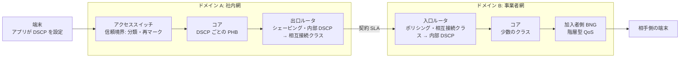
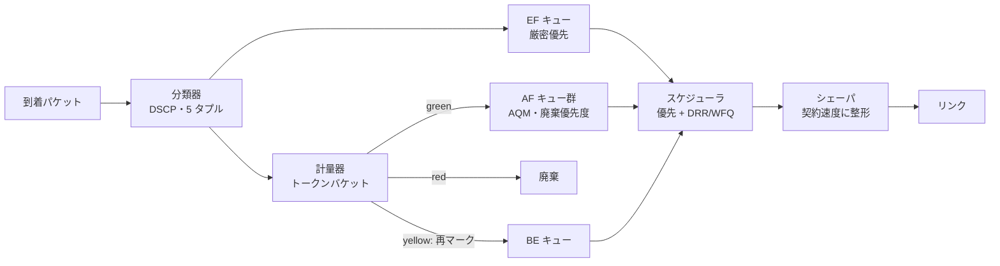

# QoS とトラフィック制御 (QoS & Traffic Management)

## 概要 (Overview)

本ドキュメントは、混雑したリンクでパケットをどの順に送り、どれを捨てるかを決める仕組み、つまりサービス品質 (QoS: Quality of Service) とトラフィック制御を扱う。端点の輻輳制御とバッファブロート、AQM (CoDel・ECN) は [`tcp-transport-congestion.md`](tcp-transport-congestion.md) に、ホストの送信側の qdisc と BQL は [`kernel-network-stack.md`](kernel-network-stack.md) に、IP ヘッダの DSCP/ECN 欄の位置は [`ip-addressing-icmp-dhcp-nat.md`](ip-addressing-icmp-dhcp-nat.md) に、スイッチの共有バッファと PFC は [`../../hardware/networking/nic-switch-architecture.md`](../../hardware/networking/nic-switch-architecture.md) に委ねる。本書はそれらの間にある、網の装置がトラフィックを分類し、測り、並べ替える層を整理する。

中心テーゼは、**QoS は容量を作らず、混雑したときに誰の遅延と損失を増やすかを決めるだけであり、その決定が正しく働くのは、ボトルネックを自分で管理し、マークの付け手を信頼できる範囲に限られる**ということである。リンクが空いていればキューはできず、どの方式でも結果は同じになる。リンクが溢れたとき、ある種類のパケットを先に送れば、ほかの種類のパケットが待つ。この配分を決める情報 (DSCP) は送信元が自由に書けるため、網の入口で信頼するかどうかを決め直さなければならない。

その結果は 3 つの形で現れる。(1) フローごとに帯域を予約する IntServ は経路上の全ルータに状態を求めたため広がらず、パケットに種類の印を付けるだけの DiffServ が残った。(2) DiffServ の印は管理ドメインの境界で書き換えられるのが普通で、公衆インターネットを端から端まで通る優先度は期待できない。(3) 家庭や事業者の出口では、種類を見分けて優先する従来型の QoS より、フローごとにキューを分けて滞留時間で制御するフローキューイング (FQ) と AQM が主流になりつつあり、L4S はさらに優先度ではなく低遅延だけを提供する方向へ進んでいる。本書は (1) キューができる場所、(2) IntServ から DiffServ へ、(3) DSCP と PHB、(4) 分類と信頼境界、(5) スケジューリング、(6) ポリシングとシェーピング、(7) 階層型 QoS と Linux tc、(8) 現代の方向の順に整理し、故障の形と攻撃面を対で示す。分析深度は Level 3。

## 方法論 (Methodology)

- **一次資料**: IETF の RFC を中心にする。DiffServ の枠組みは RFC 2474・RFC 2475、PHB は RFC 3246 (EF)・RFC 2597 (AF)・RFC 8622 (LE)・RFC 9956 (NQB)、サービスクラスの設計指針は RFC 4594、ドメイン間の扱いは RFC 8100、計量器は RFC 2697・RFC 2698、L4S は RFC 9330〜9332 である。スケジューリングは Demers, Keshav & Shenker (1989)、Parekh & Gallager (1993)、Shreedhar & Varghese (1995) の原論文、Linux の実装は `tc-htb(8)` と `tc-cake(8)` の man ページ、移動通信は 3GPP TS 23.501 を参照する。
- **測定研究で運用の実態を確かめる**: DSCP がインターネット上でどう書き換えられるかは仕様から分からないため、Custura, Secchi & Fairhurst (2018) と Barik ら (2018, 2019) の測定、およびその結果をまとめた RFC 9435 に頼る。ポリシングが TCP に与える影響は Flach ら (2016) の大規模測定による。測定の値は対象と期間を添えて示す。
- **担当範囲**: TSN の時間ゲート (802.1Qbv) は [`../../engineering/automotive/automotive-ethernet-tsn.md`](../../engineering/automotive/automotive-ethernet-tsn.md)、RoCE のロスレス網の運用は [`../../hardware/networking/nic-switch-architecture.md`](../../hardware/networking/nic-switch-architecture.md) に委ね、本書では QoS の設計空間の中での位置付けだけを示す。
- 各機構を「混雑したとき、誰に何を譲らせるか」と「その判断を誰の申告に基づいて行うか」の対で説明し、攻撃と防御は対で扱う。

## 発見事項 (Findings)

1. **QoS が効くのはボトルネックのキューだけである。** キューは入ってくる速度が出ていく速度を上回るリンクの手前にできる。そこ以外の装置で優先度を設定しても、待ち行列がないので結果は変わらない。家庭の回線のように、ボトルネックが自分の管理できない事業者側の装置にある場合、利用者側のルータが回線速度よりわずかに低い速度でシェーピングして、キューを自分の手元に移す必要がある (技術詳細 §7)。
2. **IntServ は状態の量で、DiffServ は保証の弱さで代償を払った。** RSVP (RFC 2205) によるフロー単位の予約は、経路上の全ルータに予約ごとの状態と分類を求めた。RFC 2208 (1997 年) は、処理と記憶の量が予約の数に比例して増えるため、現時点では高速なバックボーンには向かないと述べている。DiffServ はパケットに 6 ビットの印 (DSCP) を付け、ルータは印ごとの扱い (PHB: Per-Hop Behavior) だけを持つ。状態はフローの数ではなくクラスの数に比例するので広がったが、個々のフローへの保証はない。
3. **DSCP は送信元が自由に書けるので、信頼境界で決め直さなければならない。** 端末が EF を付ければ優先される網では、誰でも優先度を奪える。そのため網の入口 (アクセススイッチや事業者の境界) を信頼境界とし、そこで分類をやり直すか、印を書き換える。RFC 8100 は、ドメインの間では送り側が自分の内部の DSCP を少数の相互接続用クラスに書き換え、受け側が自分の内部の値に書き換え直すことを前提にしている。
4. **公衆インターネットでは、DSCP は途中で書き換えられることが多い。** 測定研究は、DSCP がしばしば 0 に戻され (bleaching)、別の値に書き換えられることを示している (Barik ら 2019)。旧来の ToS 優先度の意味で上位 3 ビットだけを消す装置も多く (Custura ら 2018)、その結果、別のクラスどうしが同じ値に潰れることがある。RFC 8622 は LE の DSCP を CS1 から 1 (000001) に変えた理由の 1 つとして、この部分的な書き換えで他のクラスが誤って LE に落ちるのを避けることを挙げている。
5. **強い優先度は低遅延を作るが、上限を付けないと他を飢えさせる。** 厳密優先 (strict priority) のキューは、そのクラスにパケットがある限り他のクラスを送らない。EF を厳密優先で実装するなら、入口のポリサーで EF の量を抑えることが前提になる。公平性を保証する WFQ・DRR と、遅延の上限を保証する厳密優先は、目的が違う道具である。
6. **ポリシングは TCP と相性が悪く、シェーピングかペーシングで置き換えられる。** ポリサーは超過分をその場で捨てるため、TCP の送信バーストの末尾がまとめて失われる。Flach ら (2016) は 2,700 億パケット、28,400 のクライアント AS にわたる測定で、地域によっては損失のある転送の最大 7% がポリシングを受けており、ポリシングを受けた転送の損失率は平均 6 倍になることを示した。同じ論文は、ペーシングとシェーピングで同じ管理目的を副作用なく達成できると結論している。
7. **家庭と事業者の出口では、分類よりもフローの分離が効く。** fq_codel や CAKE はフローごとにキューを分け、各キューの滞留時間で AQM をかける。アプリケーションが正しい印を付けなくても、少量の対話的な通信は大量転送の後ろで待たされない。CAKE はこれにシェーピング、回線のオーバーヘッド補正、DSCP による大まかな区分、ホスト単位の公平性を組み合わせた (Høiland-Jørgensen ら 2018)。
8. **新しい方式は「優先」ではなく「低遅延」を売る方向にある。** L4S (RFC 9330〜9332) は ECN 欄の ECT(1) で低遅延用のキューを選ばせるが、そのキューは帯域を多く得るわけではない。結合した AQM によって、両方のキューのフローがほぼ同じスループットになるよう調整される。帯域を奪えない印なら、送信元が自由に付けても害が小さく、ドメイン境界で書き換える理由も弱くなる。NQB (RFC 9956、DSCP 45) も、優先も帯域制限もなしに浅いキューを分けるだけの PHB である。

## アーキテクチャ (Architecture)

### DiffServ ドメインでの扱いの流れ

端末から社内網、事業者網を経て相手のドメインに届くまでに、DSCP がどこで決まり、どこで使われ、どこで書き換えられるかを示す。



凡例: 四角は装置、矢印はパケットの向き、囲みは管理ドメインを表す。分類と書き換えは境界 (アクセススイッチ、ドメインの出入口) に集め、コアは DSCP を見て PHB を選ぶだけにする。これが RFC 2475 の「複雑さは境界へ、コアは単純に」という設計である。

### 出力ポートの中の処理

1 つの出力ポートで、DiffServ の機能ブロック (RFC 2475 の classifier・meter・marker・shaper/dropper) とキューがどう並ぶかを示す。



凡例: 実際の装置では、計量はクラスごとに行い、yellow を同じ AF クラス内の高い廃棄優先度 (AF12・AF13) に書き換えることが多い。図は流れを示すための簡略である。

### 主な PHB と DSCP

| PHB | DSCP (10 進) | 定義 | 意味と典型的な用途 |
|---|---|---|---|
| Default (DF / CS0) | 0 | RFC 2474 | ベストエフォート |
| LE (Lower Effort) | 1 | RFC 8622 | BE より後回しでよい通信 (バックアップ、更新の配布) |
| CS1〜CS7 | 8, 16, …, 56 | RFC 2474 | 旧 IP 優先度との互換。RFC 4594 は CS6 をネットワーク制御に、CS5 を信号に割り当てる |
| AF11〜AF43 | 10〜38 | RFC 2597 | 4 クラス × 3 段の廃棄優先度。クラス内では順序を保ち、混雑時は廃棄優先度の高いものから捨てる |
| EF | 46 | RFC 3246 | 設定した速度以上で送り出すことを保証する。音声など、遅延と揺らぎに敏感で量が予測できる通信 |
| VOICE-ADMIT | 44 | RFC 5865 | 受付制御を経た音声。RFC 8100 は EF とともに相互接続の Telephony クラスに入れる |
| NQB | 45 | RFC 9956 | キューを積まない少量の通信を浅いキューに分ける。優先も帯域制限も求めない |

## 技術詳細 (Technical Details)

### 1. キューができる場所

- 出力リンクの速度を C、到着の速度を λ とすると、λ が一時的に C を上回る間だけキューが伸びる。平均では余裕があっても、マイクロ秒単位の同時到着 (マイクロバースト) でキューは伸びる。スイッチのバッファでこれを吸収する仕組みは [`../../hardware/networking/nic-switch-architecture.md`](../../hardware/networking/nic-switch-architecture.md) で扱う。
- QoS の機構は、キューに何かがたまっているときに「どれを先に送るか」「どれを捨てるか」を決める。キューが空ならすべての方式が FIFO と同じになる。したがって、QoS の設定はボトルネックのリンクに置かないと意味がない。速度の違うリンクの境目 (LAN から WAN、事業者のアクセス回線、データセンターの上位リンク) が典型的なボトルネックである。
- 優先度は遅延の合計を減らさない。先に送られたパケットの遅延が減った分、後回しにされたパケットの遅延が増える。容量が足りないときの本当の対策は、容量を増やすか、送る量を減らすか (受付制御)、端点の輻輳制御に速度を下げさせることである。

### 2. IntServ と RSVP から DiffServ へ

- **IntServ** (RFC 1633、1994 年) は、フローごとに帯域と遅延を予約する枠組みである。保証型サービス (Guaranteed) と負荷制御型サービス (Controlled Load) を定め、予約の信号に RSVP (RFC 2205、1997 年) を使う。送信側が PATH メッセージで経路をたどり、受信側が RESV メッセージで逆向きに予約する。予約は定期的に更新し、更新が止まれば消えるソフトステートである。
- **広がらなかった理由**: 経路上の全ルータが予約ごとに状態を持ち、到着するパケットを予約と照合し、予約ごとにスケジューリングしなければならない。RFC 2208 は、処理と記憶の量がセッションの数に比例して増えることを挙げ、高速なバックボーンでは境界で予約をまとめ、コアでは安い方法を使う設計を見込んだ。予約を受け付ける側にも、他のドメインの予約を受け入れて課金する仕組みが必要だった。
- **DiffServ** (RFC 2474・RFC 2475、1998 年) は、IP ヘッダの旧 ToS 欄を DS 欄に再定義し、上位 6 ビットを DSCP、下位 2 ビットを (後に) ECN とした。境界の装置がパケットを少数のクラス (振る舞い集約、BA: Behavior Aggregate) に分けて印を付け、コアのルータは DSCP から PHB を引くだけにする。状態はクラスの数で決まり、フローの数に依存しない。代わりに、保証はクラスの集合に対するもので、個々のフローには及ばない。
- RSVP が消えたわけではない。拡張した RSVP-TE (RFC 3209) は、MPLS の経路と帯域を予約する信号として事業者網の中で使われている。予約の数をフローではなく事業者が設計する経路の数に抑えたことで、状態の問題を避けた。

### 3. DSCP と PHB

- **CS と互換性**: DSCP の下位 3 ビットが 0 の値 (xxx000) はクラスセレクタ (CS) で、旧 IP 優先度 (precedence) の 8 段階と互換になるよう定めた (RFC 2474)。値が大きいほど優先されることを期待する機器との互換のためである。
- **EF** (RFC 3246): EF の集約に設定した速度以上で、任意の時間区間に送り出すことを求める。実装は多くの場合、厳密優先のキューと入口のポリサーの組み合わせである。EF のキューに滞留が生じないよう、EF に割り当てる量をリンク容量より十分小さく抑えるのが前提になる。
- **AF** (RFC 2597): 4 つのクラス (AF1x〜AF4x) にそれぞれ帯域とバッファを割り当て、クラス内では 3 段の廃棄優先度で捨てる順を決める。同じフローのパケットが廃棄優先度の違いで別のキューに入ると順序が入れ替わるため、AF では同じクラスのパケットを 1 つのキューに入れることが求められる。
- **LE** (RFC 8622): BE より後回しにしてよい通信のための PHB である。以前は CS1 が推奨されていたが、RFC 2474 の互換規則に従う装置では CS1 が BE より優先されうるため、優先度の逆転を避けて DSCP 1 に変えた。
- **サービスクラスの指針** (RFC 4594): 12 のサービスクラスに DSCP を対応させた設計例である。ネットワーク制御 CS6、電話 EF、信号 CS5、テレビ会議 AF4x、対話型リアルタイム CS4、ストリーミング AF3x、放送映像 CS3、低遅延データ AF2x、運用管理 CS2、大量データ AF1x、標準 DF、低優先データ (現在は LE) である。網の中で 12 のキューを持つ装置は少なく、実際には 4〜8 程度のキューにまとめて使う。
- **無線 LAN への写像**: IEEE 802.11 のアクセスカテゴリは 4 つ (音声・映像・ベストエフォート・バックグラウンド) しかない。RFC 8325 は DSCP からこの 4 つへの対応を定め、RFC 9956 が NQB の扱いを追加した。

### 4. 分類・マーキング・信頼境界

- **分類の手がかり**: 入ってきた DSCP、送信元と宛先のアドレスとポート (5 タプル)、VLAN の優先度 (802.1Q の PCP)、入力ポートである。暗号化された通信では中身を見られないので、アドレスとポートか、送信元が付けた DSCP に頼ることになる。
- **信頼境界をどこに置くか**: 企業網では、管理された IP 電話機の DSCP は信頼し、利用者の PC の DSCP は 0 に書き換える、といった判断をアクセススイッチで行う。境界を内側に置きすぎると、境界より外の区間では誰でも優先度を名乗れる。事業者網では加入者の DSCP を信頼しないのが普通で、契約したクラスに従って入口で付け直す。
- **ドメイン間** (RFC 8100): ドメインの境界では、送り側が内部のクラスを相互接続用の 4 つの扱い (Telephony: EF・VOICE-ADMIT、Bulk Real-Time: AF41、Assured Elastic: AF31・AF32、Default: CS0) に書き換え、受け側が内部の値に戻す。想定外の DSCP は CS0 に書き換えてよいが、扱いは相互接続の契約 (SLA) に書くべきとしている。送り側の CS6 は受け側にとっての制御通信ではないので、そのまま通さない。
- **インターネットでの実態**: Custura, Secchi & Fairhurst (2018) は、多くのルータが旧 ToS の意味で DS 欄を扱い続けていること、DS 欄をすべて消す装置は網の種類によって多い少ないの差が大きいことを報告した。Barik ら (2019) は端末が契約なしに付けた DSCP がしばしば変更されるか 0 にされること、ただし害になる扱いはまれであることを示した。同じ研究では、10 万を超えるリンクのうち、混雑時に WebRTC 用の DSCP で遅延が減ったリンクが約 3%、逆に増えたリンクが約 2% だった。RFC 9435 はこれらの測定から書き換えの型を整理している (すべて 0 にする、上位 3 ビットだけ消す、特定の値に付け替える、など)。
- **トンネル**: カプセル化するとき、内側の DSCP を外側のヘッダに写すか (uniform モデル)、外側に別の値を付けるか (pipe モデル) を選ぶ (RFC 2983)。暗号化した VPN では外側の DSCP しか見えないので、内側の値を写さない限り、網は中のクラスを区別できない。

### 5. スケジューリング

- **FIFO**: 到着順に送る。公平性はなく、大量に送るフローがキューを占めると他のフローも同じ遅延を被る。
- **厳密優先 (SP)**: 優先度の高いキューが空のときだけ下のキューを送る。上のクラスの遅延は最小になるが、上のクラスが帯域を使い切ると下のクラスは送られなくなる (飢餓)。上限 (ポリサーかシェーパ) と組み合わせて使う。
- **GPS と WFQ**: 一般化プロセッサ共有 (GPS: Generalized Processor Sharing) は、各フローに重み φᵢ を与え、ビット単位の流体として容量を重みの比で分ける理想モデルである。パケットは分割できないので、各パケットが GPS で送り終わるはずの時刻 (仮想終了時刻) を計算し、それが小さい順に送る。これが重み付き公平キューイング (WFQ: Weighted Fair Queueing、Demers, Keshav & Shenker 1989。重み付きの解析は Parekh & Gallager 1993) である。Parekh & Gallager は、トークンバケット (深さ σ、速度 ρ) に従うフローに ρ 以上の速度 g を保証すると、1 ノードでの遅延が σ/g にパケット 1 個分の項を足した値で抑えられることを示した。公平性と遅延の上限を同時に与えるが、送る順を決めるのに整列が要る。
- **WRR と DRR**: 重み付きラウンドロビン (WRR) はキューを順に回り、重みの数だけパケットを送る。パケットの大きさが揃っていないと、大きなパケットのフローが多く取る。不足ラウンドロビン (DRR: Deficit Round Robin、Shreedhar & Varghese 1995) は、各キューにバイト単位の持ち分 (クォンタム) を加え、送った分を差し引くことで、パケット長の違いを補正する。クォンタムが最大パケット長以上なら、1 パケットあたりの処理は O(1) である。Linux の fq_codel や HTB の内部、多くのスイッチの重み付きスケジューラが DRR かその変形を使う。

DRR の擬似コードを示す。前提は、キューの集合が固定で、各キュー i のクォンタム Qᵢ が最大パケット長以上であること。計算量は 1 パケットあたり O(1)、状態はキューの数 n に対して O(n) である。

```text
// active: 空でないキューを並べた循環リスト
// deficit[i]: キュー i が今回送れる残りバイト数
loop:
    i := active.next()
    deficit[i] := deficit[i] + Q[i]
    while queue[i] が空でない and head(queue[i]).length <= deficit[i]:
        p := dequeue(queue[i])
        deficit[i] := deficit[i] - p.length
        transmit(p)
    if queue[i] が空:
        deficit[i] := 0          // 空になったキューは持ち分を持ち越さない
        active.remove(i)
```

- **公平性と遅延は別の目標である**: DRR は長い時間で見た帯域の配分を公平にするが、あるキューのパケットが次に送られるまでに他のキューが一巡するので、遅延の上限はキューの数とクォンタムに比例して大きくなる。音声のように遅延の上限が要るクラスは、厳密優先のキューを DRR の上に置くのが一般的な組み合わせである。

### 6. ポリシングとシェーピング

- **トークンバケット**: 深さ B のバケットに速度 r でトークンがたまり、パケットを送るときにその長さ分のトークンを使う。長い時間では r を超えず、瞬間的には B までのバーストを許す。超過したパケットを**捨てる (または印を付け直す) のがポリシング**、**キューに入れて待たせるのがシェーピング**である。シェーピングは遅延を加える代わりに損失を減らし、ポリシングは遅延を加えない代わりに損失を出す。
- **単一速度 3 色マーカ** (srTCM、RFC 2697): 速度 CIR と 2 つのバケット (CBS と EBS) を持つ。CBS の範囲内なら green、CBS を超えて EBS の範囲内なら yellow、それも超えれば red とする。CBS が満杯のときにあふれたトークンが EBS にたまるので、長く静かだったフローに大きめのバーストを許す。
- **2 速度 3 色マーカ** (trTCM、RFC 2698): ピーク速度 PIR (バケット PBS) と認定速度 CIR (バケット CBS) の 2 つの速度を持つ。PIR を超えれば red、PIR 内で CIR を超えれば yellow、両方の範囲内なら green である。どちらも、入ってきた色を考慮する color-aware と、考慮しない color-blind の動作がある。

trTCM (color-blind) の擬似コードを示す。前提は、時刻 t は単調増加、トークンの補充は到着時にまとめて計算すること。計算量は 1 パケットあたり O(1)、状態はバケット 2 つ分である。

```text
on arrival(p, t):
    Tp := min(PBS, Tp + PIR * (t - last))
    Tc := min(CBS, Tc + CIR * (t - last))
    last := t
    if p.length > Tp:
        return RED                  // ピーク速度も超えている
    if p.length > Tc:
        Tp := Tp - p.length
        return YELLOW               // ピーク内だが認定速度を超えている
    Tp := Tp - p.length
    Tc := Tc - p.length
    return GREEN
```

- **バーストの大きさと TCP**: TCP は ACK に合わせて、輻輳ウィンドウ分のデータをまとめて送ることがある。ポリサーのバケットがこのバーストより小さいと、バーストの後半がまとめて捨てられ、TCP は大きく速度を下げる。下げた速度ではトークンが余り、再び速度を上げて同じ位置で捨てられる、という鋸歯状の挙動を繰り返し、平均のスループットは契約速度を大きく下回る。逆にバケットが大きすぎると、下流の小さなバッファに長いバーストを流し込む。Flach ら (2016) は、ポリシングを受けた転送の損失率が平均 6 倍で、動画の再生品質を下げていることを示した。対策は、ポリサーの代わりにシェーパを置くこと、送信側でペーシングすること (BBR や Linux の fq が行う。[`kernel-network-stack.md`](kernel-network-stack.md))、ポリサーを使うならバケットを往復時間分の送信量に見合う大きさにすることである。機器ベンダの推奨値は製品によって異なり、本書では特定の値を示さない。
- **シェーパの置き場所**: シェーパはキューを持つので、そのキューにも AQM が要る。AQM のないシェーパは、事業者の装置にあったバッファブロートを手元に移すだけになる。

### 7. 階層型 QoS と Linux tc

- **階層型 QoS (HQoS)**: 事業者の加入者収容装置 (BNG: Broadband Network Gateway) では、物理ポート → VLAN や卸先事業者 → 加入者 → 加入者内のクラス、という階層でシェーピングとスケジューリングを入れ子にする。加入者ごとに契約速度でシェーピングし、その中で音声を優先する、という 2 段の判断を 1 つのポートで数万の加入者に対して行う。下流のアクセス網 (光回線の分岐や DSL の集線装置) の容量を超えないよう、その単位でも上限をかける。
- **Linux の qdisc とクラス**: Linux の `tc` は、出力インターフェースに qdisc の木を作る。分類する qdisc (クラスを持つもの) の葉に、別の qdisc を付けられる。
  - **HTB** (Hierarchy Token Bucket): クラスごとに保証速度 `rate` と上限 `ceil` を持つ。親に余りがあれば `ceil` まで借りられる。`ceil` の既定値は `rate` で、借りないことを意味する。`burst` は子の最大の `burst` 以上にすること、`quantum` の既定値は `rate / r2q` (r2q の既定値は 10) であることが man ページに書かれている。
  - **fq_codel**: フローごとのキューを DRR で回し、各キューに CoDel をかける (RFC 8290)。
  - **fq**: フローごとのペーシングを行う。BBR と組み合わせる (詳細は [`kernel-network-stack.md`](kernel-network-stack.md))。
  - **CAKE**: シェーパ、回線のオーバーヘッド補正 (`docsis`、`pppoe-vcmux`、`overhead N` など)、DSCP による区分 (`diffserv3` が既定、`diffserv4` は Bulk・BE・Video・Voice の 4 つ)、ホストとフローの公平性 (既定は `triple-isolate`)、NAT の内側のアドレスで公平性を取る `nat` を 1 つにまとめた qdisc である。
- **回線のオーバーヘッド補正が要る理由**: DSL の ATM セル化や PPPoE、DOCSIS のフレームは、IP パケットの長さに加えて固定のバイトを使う。シェーパが IP の長さだけで数えると、実際の回線の速度を超えて送り、事業者側の装置にキューができる。CAKE の `overhead` と `atm` はこの差を補正する。

例示用の設定 (筆者作成): 100 Mbit/s の出力を HTB で 3 クラスに分け、EF を優先クラスへ送る。言語は `tc` のコマンド列で、目的は階層と分類の関係を示すことである。

```sh
# Root HTB; unclassified traffic goes to class 1:30.
tc qdisc add dev eth0 root handle 1: htb default 30
tc class add dev eth0 parent 1: classid 1:1 htb rate 100mbit ceil 100mbit
# Voice: guaranteed 10 Mbit/s, may borrow up to 20 Mbit/s, served first (prio 0).
tc class add dev eth0 parent 1:1 classid 1:10 htb rate 10mbit ceil 20mbit prio 0
tc class add dev eth0 parent 1:1 classid 1:20 htb rate 50mbit ceil 100mbit prio 1
tc class add dev eth0 parent 1:1 classid 1:30 htb rate 40mbit ceil 100mbit prio 2
# Each leaf gets flow queuing + AQM so a class does not become a bloated FIFO.
tc qdisc add dev eth0 parent 1:20 fq_codel
tc qdisc add dev eth0 parent 1:30 fq_codel
# DSCP 46 (EF) -> TOS byte 0xb8; mask 0xfc ignores the ECN bits.
tc filter add dev eth0 parent 1: protocol ip u32 match ip dsfield 0xb8 0xfc flowid 1:10
```

同じ目的を CAKE で書くと、`tc qdisc replace dev eth0 root cake bandwidth 95mbit diffserv4 nat` の 1 行になる。ここで `95mbit` は回線速度よりわずかに低い値の例であり、どれだけ下げるかは回線の種類と測定で決める。

### 8. 現代の方向

- **フローキューイングと AQM**: 従来の QoS は「どのアプリケーションか」を分類して優先度を決めた。fq_codel や CAKE は分類をせず、少量しか送らないフローが自然に先に送られる形にした。分類の誤りや DSCP の書き換えに影響されず、設定もほとんど要らない。バッファブロートの背景は [`tcp-transport-congestion.md`](tcp-transport-congestion.md) を参照。
- **L4S** (RFC 9330 が構成、RFC 9331 が識別子、RFC 9332 が DualQ Coupled AQM。いずれも 2023 年 1 月の Experimental): 低遅延キュー (L) と従来キュー (Classic) の 2 つを持ち、ECN 欄が ECT(1) か CE のパケットを L に入れる。RFC 9331 は識別子の要件に、端から端まで残ること、IPv4 と IPv6 で共通なことを挙げ、DSCP ではなく ECN 欄を選んだ。2 つの AQM は結合しており、内部の確率 p′ から Classic の廃棄確率を p′²、L への結合した印付け確率を k·p′ (推奨 k = 2) とすることで、Reno 系と L4S 系のフローがほぼ同じスループットになる。スケジューラは L を優先するが、Classic が飢えないよう、小さな重みの WRR か時間をずらした FIFO で条件付きにする。RFC 9332 の例 (DualPI2) は L キューの印付けを最小しきい値 800 µs から始めている。
- **NQB** (RFC 9956、2026 年): 少量で滑らかな通信 (DNS、ゲームの状態更新など) を DSCP 45 で印付けし、浅いキューに分ける。優先と帯域制限を求めないので、印を偽っても大量転送には不利になるだけである。RFC 8325 の無線 LAN への写像も更新した。
- **5G の QoS フロー** (3GPP TS 23.501 §5.7): 5G は PDU セッションの中を QoS フローに分け、QoS フロー識別子 (QFI) で区別する。各フローには 5QI が付き、資源の種類 (GBR・非 GBR・遅延重視 GBR)、優先度、パケット遅延予算 (PDB)、パケット誤り率 (PER) が決まる。例として、5QI 1 は会話音声 (GBR、PDB 100 ms、PER 10⁻²)、5QI 5 は IMS の信号 (非 GBR、100 ms、10⁻⁶)、5QI 9 はバッファ付き動画やウェブ (非 GBR、300 ms、10⁻⁶)、5QI 82 は離散的な自動化制御 (遅延重視 GBR、10 ms、10⁻⁴) である。無線区間の外 (基地局とコアをつなぐ IP 網) で 5QI をどの DSCP に写すかは事業者が決める。
- **データセンターのロスレスクラス**: RoCE のために、IEEE 802.1Qbb の優先度別フロー制御 (PFC) を 8 つの優先度のうち一部だけにかけ、そのクラスでは捨てずに上流を止める。DSCP や PCP からその優先度への対応を網全体で揃えないと、ロスレスのはずのクラスで捨てられたり、無関係なクラスが止まったりする。運用の難しさは [`../../hardware/networking/nic-switch-architecture.md`](../../hardware/networking/nic-switch-architecture.md) で扱う。決まった時刻に送る保証が要る産業・車載の網は、TSN の時間ゲート ([`../../engineering/automotive/automotive-ethernet-tsn.md`](../../engineering/automotive/automotive-ethernet-tsn.md)) という別の道を取る。

### 9. 故障の形

| 故障 | 起きる仕組み | 症状 | 対策 |
|---|---|---|---|
| 優先キューの乱用 | 「重要だから」と大量の通信を EF・厳密優先に入れる | 下位クラスが飢え、優先クラス自体にも滞留が生じる | 優先クラスに量の上限をかける。優先は少量で遅延に敏感な通信だけにする |
| ポリサーによる鋸歯状の挙動 | バケットが TCP のバーストより小さい | 契約速度を大きく下回るスループット、損失の集中 | シェーピングかペーシングに置き換える。バケットを大きくする |
| マイクロバースト | 平均使用率は低いが、µs 単位で同時に到着する | 平均の統計に現れない廃棄 | キュー深度と廃棄の細かい観測。ペーシング。バッファの割り当ての見直し |
| 信頼の設定の誤り | 境界で DSCP を信頼する、または消してはいけない値を消す | 優先度の窃取、または音声が BE に落ちる | 信頼境界を明示して文書化する。境界ごとの書き換えを試験する |
| 部分的な書き換えによるクラスの潰れ | 旧 ToS の意味で上位 3 ビットだけを消す装置 | AF11・AF21・AF31・AF41 が同じ値になる。xxx001 は LE に落ちる | 経路上の装置の扱いを測る。RFC 9435 の注意に沿って値を選ぶ |
| 順序の入れ替わりと IPsec のリプレイ窓 | 同じ SA の中で DSCP の違うパケットが別のキューを通る | 優先度の低いパケットがリプレイ窓の外とみなされて捨てられる | クラスごとに別の SA を使う (RFC 4301 §4.1) |
| オーバーヘッドの数え漏れ | シェーパが IP の長さだけで数える | 事業者側の装置にキューができ、シェーピングが効かない | オーバーヘッド補正を設定する |

## セキュリティ考察 (Security Considerations)

- **DSCP の偽装による優先度の窃取**: DSCP は認証されないので、端末やマルウェアが EF や CS6 を名乗れば、信頼する網では他の通信より先に送られる。防御は信頼境界での書き換えと、優先クラスへの量の上限である。CS6 をネットワーク制御に使う網では、外から CS6 で届くパケットをそのまま制御通信のキューに入れてはならない (RFC 8100)。
- **QoS は DoS の増幅にも緩和にもなる**: 上限のない優先キューに攻撃の通信が入ると、帯域を奪うだけでなく、経路制御のメッセージ (BGP や OSPF の hello) を飢えさせて経路を落とし、障害を広げる。逆に、ルータ自身に向かう制御用の通信を専用のクラスで守り (制御プレーンのポリシング)、不明な通信を LE や BE に入れておけば、攻撃を受けても経路制御と管理用の接続は保てる。
- **フローの公平性の限界**: FQ はフローごとに公平なので、1 つの攻撃者が多数のフローを開けば多くの帯域を得る。CAKE のホスト単位の公平性 (`triple-isolate` など) はこれを緩和するが、多数のホストからの分散攻撃には効かない。容量を超える攻撃は、上流での遮断かスクラビングで対処する。
- **低遅延の印の乱用**: L4S の低遅延キューに、ECT(1) を付けて印付けに反応しない通信を流し込むと、L キューの遅延を壊せる。RFC 9332 は持続的な過負荷のときに両方のキューで廃棄に切り替えることを求めている。フローごとに違反を検出するキュー保護 (queue protection) の仕組みも DOCSIS 向けに提案されている。NQB も同じく、浅いキューに大量の通信を入れた送信元が損をする設計にしてある。
- **トラフィックの差別とネットワーク中立性**: 同じ機構は、特定の事業者やアプリケーションの通信を遅くするのにも使える。EU 規則 2015/2120 第 3 条 3 項は、通信をすべて平等に扱うことを原則とし、透明で差別がなく比例的で、商業上の理由ではなく客観的な技術的品質要件の違いに基づく「合理的なトラフィック管理」だけを認めている。米国では、FCC の 2024 年の規則を第 6 巡回区控訴裁判所が 2025 年 1 月 2 日に無効とした (CRS の解説による)。技術的には、DSCP や 5QI による区別は契約したクラスへの振り分けとして説明できる形で運用し、その基準を開示することが、規制と利用者の信頼の両方にとって前提になる。
- **観測される情報**: DSCP をトンネルの外側に写すと、暗号化していても通信の種類 (音声か大量転送か) が外から分かる。写すかどうかは、網での扱いと情報の秘匿のどちらを取るかの判断になる。

## 結論 (Conclusions)

- QoS は容量を作らない。混雑したボトルネックのキューで、誰の遅延と損失を増やすかを決めるだけであり、ボトルネックにない設定は効かない。手の届かない装置がボトルネックなら、手前で速度を絞ってキューを自分の側に移す。
- フロー単位で予約する IntServ は状態の量で広がらず、クラス単位の DiffServ が残った。DiffServ の印は送信元が自由に書けるため、信頼境界とドメインの境界で決め直され、公衆インターネットでは端から端まで残ることを期待できない。
- 厳密優先は低遅延を、WFQ・DRR は公平性を与える別の道具であり、優先には量の上限が要る。ポリシングは TCP と相性が悪く、シェーピングとペーシングで置き換えられる。
- 出口のキューの主流は、分類して優先するやり方から、フローを分けて滞留時間で制御するやり方 (fq_codel、CAKE) へ移り、L4S と NQB は帯域を奪わない低遅延の印という形で、信頼の問題そのものを小さくする方向にある。

### 次の接続先 (Related Topics)

- [`tcp-transport-congestion.md`](tcp-transport-congestion.md) — 本書のキューを相手にする端点の制御。バッファブロート、CoDel、ECN。
- [`kernel-network-stack.md`](kernel-network-stack.md) — ホストの送信側の qdisc、BQL、fq によるペーシング。
- [`ip-addressing-icmp-dhcp-nat.md`](ip-addressing-icmp-dhcp-nat.md) — DS 欄と ECN 欄を持つ IP ヘッダ。
- [`vpn-tunneling.md`](vpn-tunneling.md) — トンネルの外側のヘッダと IPsec の SA。DSCP の写し方とリプレイ窓。
- [`../../hardware/networking/nic-switch-architecture.md`](../../hardware/networking/nic-switch-architecture.md) — スイッチの共有バッファ、マイクロバースト、PFC と DCQCN。
- [`../../engineering/automotive/automotive-ethernet-tsn.md`](../../engineering/automotive/automotive-ethernet-tsn.md) — 確率的な QoS と対照的な、時間ゲートによる決定的な遅延保証。

## 参考文献 (References)

**一次資料 (Primary — RFC・規格・原論文)**

- Braden, R., Clark, D., & Shenker, S. (1994). Integrated Services in the Internet Architecture: an Overview. *RFC 1633*.
- Braden, R., Zhang, L., Berson, S., Herzog, S., & Jamin, S. (1997). Resource ReSerVation Protocol (RSVP) — Version 1 Functional Specification. *RFC 2205*.
- Mankin, A. (Ed.), Baker, F., Braden, B., Bradner, S., O'Dell, M., Romanow, A., Weinrib, A., & Zhang, L. (1997). Resource ReSerVation Protocol (RSVP) — Version 1 Applicability Statement: Some Guidelines on Deployment. *RFC 2208*. — 予約の数に比例する処理と記憶、バックボーンでの集約。
- Awduche, D., Berger, L., Gan, D., Li, T., Srinivasan, V., & Swallow, G. (2001). RSVP-TE: Extensions to RSVP for LSP Tunnels. *RFC 3209*.
- Nichols, K., Blake, S., Baker, F., & Black, D. (1998). Definition of the Differentiated Services Field (DS Field) in the IPv4 and IPv6 Headers. *RFC 2474*.
- Blake, S., Black, D., Carlson, M., Davies, E., Wang, Z., & Weiss, W. (1998). An Architecture for Differentiated Services. *RFC 2475*.
- Davie, B., Charny, A., Bennett, J. C. R., Benson, K., Le Boudec, J. Y., Courtney, W., Davari, S., Firoiu, V., & Stiliadis, D. (2002). An Expedited Forwarding PHB (Per-Hop Behavior). *RFC 3246*.
- Heinanen, J., Baker, F., Weiss, W., & Wroclawski, J. (1999). Assured Forwarding PHB Group. *RFC 2597*.
- Bless, R. (2019). A Lower-Effort Per-Hop Behavior (LE PHB) for Differentiated Services. *RFC 8622*. — DSCP 1 への変更理由。
- Baker, F., Polk, J., & Dolly, M. (2010). A Differentiated Services Code Point (DSCP) for Capacity-Admitted Traffic. *RFC 5865*.
- White, G., Fossati, T., & Geib, R. (2026). A Non-Queue-Building Per-Hop Behavior (NQB PHB) for Differentiated Services. *RFC 9956*.
- Babiarz, J., Chan, K., & Baker, F. (2006). Configuration Guidelines for DiffServ Service Classes. *RFC 4594*.
- Geib, R. (Ed.), & Black, D. (2017). Diffserv-Interconnection Classes and Practice. *RFC 8100*.
- Szigeti, T., Henry, J., & Baker, F. (2018). Mapping Diffserv to IEEE 802.11. *RFC 8325*.
- Black, D. (2000). Differentiated Services and Tunnels. *RFC 2983*.
- Kent, S., & Seo, K. (2005). Security Architecture for the Internet Protocol. *RFC 4301*. — §4.1 のクラスごとの SA とリプレイ窓。
- Custura, A., Fairhurst, G., & Secchi, R. (2023). Considerations for Assigning a New Recommended Differentiated Services Code Point (DSCP). *RFC 9435*. — 書き換えの型の整理。
- Heinanen, J., & Guerin, R. (1999). A Single Rate Three Color Marker. *RFC 2697*. / Heinanen, J., & Guerin, R. (1999). A Two Rate Three Color Marker. *RFC 2698*.
- Høiland-Jørgensen, T., McKenney, P., Taht, D., Gettys, J., & Dumazet, E. (2018). The Flow Queue CoDel Packet Scheduler and Active Queue Management Algorithm. *RFC 8290*.
- Briscoe, B. (Ed.), De Schepper, K., Bagnulo, M., & White, G. (2023). Low Latency, Low Loss, and Scalable Throughput (L4S) Internet Service: Architecture. *RFC 9330*.
- De Schepper, K., & Briscoe, B. (Ed.) (2023). The Explicit Congestion Notification (ECN) Protocol for Low Latency, Low Loss, and Scalable Throughput (L4S). *RFC 9331*.
- De Schepper, K., Briscoe, B. (Ed.), & White, G. (2023). Dual-Queue Coupled Active Queue Management (AQM) for Low Latency, Low Loss, and Scalable Throughput (L4S). *RFC 9332*. — 結合の式、条件付き優先、DualPI2 のしきい値、過負荷時の廃棄。
- Demers, A., Keshav, S., & Shenker, S. (1989). Analysis and Simulation of a Fair Queueing Algorithm. *ACM SIGCOMM '89*, 1–12. DOI: 10.1145/75246.75248
- Parekh, A. K., & Gallager, R. G. (1993). A Generalized Processor Sharing Approach to Flow Control in Integrated Services Networks: The Single-Node Case. *IEEE/ACM Transactions on Networking*, 1(3), 344–357. DOI: 10.1109/90.234856
- Shreedhar, M., & Varghese, G. (1995). Efficient Fair Queuing Using Deficit Round Robin. *ACM SIGCOMM '95*, 231–242. DOI: 10.1145/217382.217453 (雑誌版は *IEEE/ACM Transactions on Networking*, 4(3), 375–385, 1996)
- 3GPP TS 23.501. *System architecture for the 5G System (5GS)*. §5.7 (QoS model)、Table 5.7.4-1 (標準化された 5QI)。
- IEEE 802.1Qbb. *Priority-based Flow Control*.
- Regulation (EU) 2015/2120 of the European Parliament and of the Council, Article 3 — [legislation.gov.uk (EU 法の公開写し)](https://www.legislation.gov.uk/eur/2015/2120/article/3) — Accessed: 2026-10-26。

**測定研究 (Measurement)**

- Custura, A., Secchi, R., & Fairhurst, G. (2018). Exploring DSCP modification pathologies in the Internet. *Computer Communications*, 127, 86–94. DOI: 10.1016/j.comcom.2018.05.016
- Barik, R., Welzl, M., Elmokashfi, A., Dreibholz, T., & Gjessing, S. (2018). Can WebRTC QoS Work? A DSCP Measurement Study. *30th International Teletraffic Congress (ITC 30)*, 167–175. DOI: 10.1109/ITC30.2018.00034
- Barik, R., Welzl, M., Elmokashfi, A., Dreibholz, T., Islam, S., & Gjessing, S. (2019). On the Utility of Unregulated IP DiffServ Code Point (DSCP) Usage by End Systems. *Performance Evaluation*, 135. DOI: 10.1016/j.peva.2019.102036 — 変更・0 化の頻度、約 3% と約 2% のリンク。
- Flach, T., Papageorge, P., Terzis, A., Pedrosa, L., Cheng, Y., Karim, T., Katz-Bassett, E., & Govindan, R. (2016). An Internet-Wide Analysis of Traffic Policing. *ACM SIGCOMM '16*, 468–482. DOI: 10.1145/2934872.2934873 — 最大 7%、損失率 6 倍。
- Høiland-Jørgensen, T., Täht, D., & Morton, J. (2018). Piece of CAKE: A Comprehensive Queue Management Solution for Home Gateways. *IEEE LANMAN 2018*. — [arXiv:1804.07617](https://arxiv.org/abs/1804.07617) — Accessed: 2026-10-26。

**実装のドキュメント (Implementation)**

- [tc-htb(8), Linux manual page](https://man7.org/linux/man-pages/man8/tc-htb.8.html) — Accessed: 2026-10-26。rate・ceil・burst・quantum・r2q。
- [tc-cake(8), Linux manual page](https://man7.org/linux/man-pages/man8/tc-cake.8.html) — Accessed: 2026-10-26。オーバーヘッド補正、diffserv3/4、triple-isolate、nat。
- [5.7.4 Standardized 5QI to QoS characteristics mapping (TS 23.501 の公開写し)](https://whatthespec.net/sos/spec/ts-23501/5.7.4) — Accessed: 2026-10-26。5QI 1・5・9・82 の値の確認に使用。

**時期で変わる状況 (Time-sensitive)**

- [No More Deference: Sixth Circuit Relies on Loper Bright to Strike Down Net Neutrality Rules, Congressional Research Service Legal Sidebar LSB11264 (2025-02-03)](https://www.everycrsreport.com/files/2025-02-03_LSB11264_67666b3e7389da143171b5fd3b75ae51f9dbf168.html) — Accessed: 2026-10-26。2025-01-02 の判決と判断の内容。
- [draft-ietf-tsvwg-nqb, IETF Datatracker](https://datatracker.ietf.org/doc/draft-ietf-tsvwg-nqb/) — Accessed: 2026-10-26。RFC 9956 としての公開と DSCP 45。
