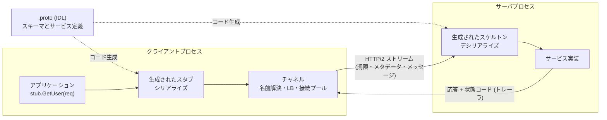

# RPC とシリアライズ (RPC & Serialization)

## 概要 (Overview)

マイクロサービスどうしの通信の多くは、**RPC (remote procedure call)** の形をとる。呼び出し側は手元の関数を呼ぶように書き、引数は**シリアライズ (serialization)** でバイト列に変換されてネットワークを渡り、相手のプロセスで関数が実行される。gRPC と Protocol Buffers (Protobuf) の組み合わせは、その現代の標準的な実装である。

RPC の設計は、Birrell & Nelson (1984) 以来、「リモートの呼び出しをローカルの呼び出しに見せる」ことを目標にしてきた[^birrell]。この目標は半分しか達成できない。ローカルの呼び出しは失敗しても原因が分かるが、リモートの呼び出しはタイムアウトしたとき、相手が実行したのかどうかが分からない。Waldo ら (1994) は、遅延・メモリ空間の分離・部分故障・並行性の4点で、リモートとローカルの違いは隠しきれないと論じた[^waldo]。

もう一つの問題は、時間の経過である。RPC の両端は別々のチームが別々の時期にデプロイする。ローリングデプロイの最中には、新旧のバージョンが同時に動き、互いのメッセージを読み合う。そのため、メッセージの形式 (スキーマ) は**後方互換と前方互換の両方**を保ちながら変える必要がある。

本ドキュメントは、(1) 呼び出しの失敗の意味論、(2) シリアライズ形式の設計空間、(3) Protobuf のワイヤ形式とスキーマ進化の規則、(4) Avro とスキーマレジストリ、(5) gRPC のプロトコルと HTTP/2 の上の設計、(6) ゼロコピー形式を分析する。HTTP/2 のストリーム多重化は [`http-quic-evolution.md`](http-quic-evolution.md)、HTTP/2 とロードバランサの相性の問題は [`load-balancing-architecture.md`](load-balancing-architecture.md) が扱う。分析深度は Level 3。

## 方法論 (Methodology)

- RPC を「関数呼び出しの抽象」と「バイト列の取り決め」の2層に分けて扱う。前者は失敗の意味論、後者はスキーマ進化の問題として整理する。
- 一次資料は、RPC の原典 (Birrell & Nelson 1984)、分散計算の批判 (Waldo et al. 1994)、Protobuf のエンコーディング仕様と言語ガイド、gRPC の HTTP/2 プロトコル仕様、Apache Avro の仕様、Confluent Schema Registry の文書である。形式どうしの比較の枠組みは Kleppmann (2017) の第4章に拠る[^kleppmann]。
- バイト数の例は仕様のエンコーディング規則から手計算で求めたものである。

## 発見事項 (Findings)

1. **タイムアウトした RPC の結果は「不明」であり、成功とも失敗とも扱えない。** 要求が届かなかったのか、実行後に応答が失われたのかを、呼び出し側は区別できない。再送すると二重実行の危険があり、再送しないと未実行の危険がある。安全に再送できるのは、操作が**冪等 (idempotent)** であるか、冪等キーで重複を排除できる場合に限られる。
2. **Protobuf の互換性を支えるのは、フィールド名ではなくフィールド番号である。** ワイヤ上には番号と型の種類 (ワイヤタイプ) しか載らない。名前の変更はバイナリ形式では無害だが、番号の変更や再利用はデータを別のフィールドとして解釈させる。削除したフィールドの番号は `reserved` で予約し、再利用できないようにする[^proto-guide]。
3. **前方互換の鍵は「知らないフィールドを無視して保持する」ことにある。** 古いコードが新しいフィールドを読み飛ばせれば、新しい送信側を先にデプロイできる。proto3 は当初、未知のフィールドを捨てていたが、3.5 以降の多くの言語実装で保持するようになった[^proto-changes]。中継するサービスが未知のフィールドを捨てると、下流に届くはずのデータが途中で消える。
4. **Avro はスキーマをデータに含めず、書き手と読み手のスキーマを突き合わせて解決する。** フィールドは名前で対応づけられ、読み手にしかないフィールドは既定値で埋まる[^avro-spec]。データにタグがない分コンパクトだが、書き手のスキーマが読み手の手元になければ読めないため、スキーマレジストリが運用上の必須部品になる[^confluent]。
5. **gRPC は HTTP/2 の機能を深く使うため、HTTP/2 を完全には扱えない経路で問題が起きる。** 状態コードを HTTP/2 のトレーラで返すので、トレーラを扱えないブラウザやプロキシでは使えない (gRPC-Web が別途必要になる)。1本の長寿命接続に呼び出しを多重化するので、接続単位で振り分ける L4 ロードバランサでは負荷が偏る。
6. **任意の型を復元できるシリアライズは、それ自体が攻撃面になる。** Java の標準シリアライズのように、データの中で復元するクラスを指定できる形式は、既存のクラスを組み合わせた任意コード実行 (ガジェットチェーン) を許す[^frohoff]。スキーマで型が固定される Protobuf や JSON のデータ形式は、この種の攻撃を構造的に避けられる。

## アーキテクチャ (Architecture)

### RPC の構成要素



凡例: 実線は実行時の呼び出し、破線は IDL からのビルド時のコード生成。

RPC フレームワークは3つの部品からなる。**IDL (interface definition language)** はメッセージとサービスの形を言語中立に定義する。**コード生成器**は IDL から各言語のスタブとスケルトン (型付きのクラスとシリアライズのコード) を作る。**ランタイム**は、名前解決、ロードバランシング、接続管理、期限 (deadline) の伝播、再送を受け持つ。IDL が両端の取り決めになり、スキーマ進化の規則はこの IDL の変更規則として表れる。

### シリアライズ形式の設計空間

| 形式 | スキーマ | ワイヤ上の識別子 | 読み取り | 代表的な用途 |
|---|---|---|---|---|
| JSON | 任意 (JSON Schema など) | フィールド名 (文字列) | テキストの解析 | 公開 API、設定、ブラウザ |
| Protobuf / Thrift | 必須 (IDL) | フィールド番号 + ワイヤタイプ | タグ付きバイナリの解析 | サービス間 RPC、ストレージ |
| Avro | 必須 (書き手と読み手の2つ) | なし (スキーマの順序で並ぶ) | スキーマ解決 + 解析 | データパイプライン、Kafka |
| FlatBuffers / Cap'n Proto | 必須 | オフセット表 | 解析不要 (バッファを直接参照) | ゲーム、低遅延、mmap したファイル |
| 言語固有 (Java Serializable, pickle) | 言語の型そのもの | クラス名 | オブジェクトグラフの復元 | 同一言語内の一時的な保存 (外部入力には使わない) |

表の下に行くほど、データにスキーマ情報を載せずに済み、コンパクトで速くなる。その代わり、データを読むには書き手と同じか互換なスキーマが必要になる。言語固有の形式は、型の情報をすべてデータに載せるので柔軟だが、言語をまたげず、セキュリティ上の問題がある (セキュリティ考察)。

## 技術詳細 (Technical Details)

### 1. 呼び出しの失敗の意味論 (failure semantics)

ローカルの関数呼び出しは「実行された」か「例外で失敗した」かのどちらかになる。RPC にはもう1つ、「分からない」がある。

```text
状態              再送の安全性                     例
要求が届かず未実行  再送すべき                       接続の確立に失敗
実行して応答喪失    再送すると二重実行               応答の途中でタイムアウト
実行中             再送すると並行に二重実行           サーバが遅いだけ
```

呼び出し側から見ると、2行目と3行目は1行目と区別できない。RPC の配信保証は、この区別の付かなさにどう対処するかで分類される。

- **at-most-once**: 再送しない。二重実行はないが、未実行のまま終わりうる。
- **at-least-once**: 成功の応答が届くまで再送する。未実行はないが、二重実行しうる。
- **exactly-once (の実効)**: at-least-once の再送に、サーバ側の重複排除を組み合わせる。クライアントが要求ごとに一意な**冪等キー (idempotency key)** を付け、サーバは処理済みのキーに対して前回の結果を返す。決済 API がこの方式をとる ([`../apis/stripe-connect-specification.md`](../apis/stripe-connect-specification.md))。

**期限 (deadline)** の伝播も失敗の意味論の一部である。gRPC はタイムアウトを相対時間 (`grpc-timeout` ヘッダ) として送り、サーバはそれを受け取って下流の呼び出しに残り時間を引き継ぐ[^grpc-protocol]。期限を伝播しないと、呼び出し元がすでに諦めた要求を下流が処理し続け、無駄な負荷になる。再送も同じ理由で上限を設ける。各層が独立に最大3回ずつ試行すると、3層の呼び出しでは最下層に最大 3³ = 27 倍の要求が届く。この増幅は、メタステーブル障害の典型的な持続効果である ([`../distributed-systems/failure-models.md`](../distributed-systems/failure-models.md))。

### 2. Protobuf のワイヤ形式 (Protobuf wire format)

Protobuf のメッセージは、(タグ, 値) の組の並びである。タグはフィールド番号とワイヤタイプを1つの可変長整数 (varint) に詰めたものになる[^proto-encoding]。

```text
タグ = (フィールド番号 << 3) | ワイヤタイプ
ワイヤタイプ: 0 = VARINT (int32, int64, bool, enum …)
              1 = I64 (fixed64, double)
              2 = LEN (string, bytes, 入れ子のメッセージ, packed repeated)
              5 = I32 (fixed32, float)

varint: 7 ビットずつ下位から並べ、続きがあるバイトは最上位ビットを 1 にする

例: message Test1 { int32 a = 1; } で a = 150
  タグ:  (1 << 3) | 0 = 0x08
  値:    150 = 0b1001_0110 → 下位 7 ビット 0010110 + 続き → 0x96
                            → 残り 1 → 0x01
  エンコード結果: 08 96 01  (3 バイト。同じ内容の JSON {"a":150} は 9 バイト)
```

ワイヤタイプがあるので、受け手は知らないフィールドでも長さを知って読み飛ばせる。これが前方互換 (発見事項 3) の仕組みである。一方、ワイヤ上にフィールド名はないので、データだけを見ても意味は分からない。スキーマなしでは、番号と大まかな型しか読み取れない。

proto3 は、値が既定値 (数値の 0、空文字列) のフィールドをワイヤに書かない。そのため、受け手は「0 が送られた」と「送られなかった」を区別できない。この区別が必要な場面が多かったため、3.15 で `optional` キーワードが既定で使えるようになり、明示的な存在判定 (field presence) が戻った[^proto-presence]。

### 3. スキーマ進化の規則 (schema evolution rules)

互換性には向きが2つある。

```text
後方互換 (backward compatibility): 新しいコードが古いデータを読める
前方互換 (forward compatibility):  古いコードが新しいデータを読める

ローリングデプロイ中は両方が必要:
  新しいサーバ ← 古いクライアントの要求 (後方互換)
  古いサーバ   ← 新しいクライアントの要求 (前方互換)
保存されたデータは後方互換が必要:
  何年も前に書いたレコードを今日のコードが読む
```

Protobuf の主な変更とその安全性は次のとおりである[^proto-guide]。

| 変更 | ワイヤ互換 | 注意点 |
|---|---|---|
| フィールドの追加 | 安全 | 古いコードは読み飛ばし、新しいコードは既定値を見る。既定値が「値なし」と区別できるかを確認する |
| フィールドの削除 | 安全 (番号を `reserved` にする場合) | 番号を再利用すると、古いデータの値が新しいフィールドとして解釈される |
| フィールド名の変更 | バイナリでは安全 | JSON 形式やテキスト形式では名前が識別子なので互換性が壊れる |
| フィールド番号の変更 | 非互換 | 削除と追加をしたのと同じになる |
| int32 ↔ int64 ↔ uint32 ↔ uint64 ↔ bool | ワイヤ上は互換 | 値の範囲を超えると切り詰められ、気づかないうちに値が変わる |
| enum への値の追加 | 互換 | 古いコードは未知の値を受け取る。言語によって扱いが異なる |
| 単一フィールドを oneof に移す | 条件付き | 複数のフィールドを1つの oneof にまとめると、両方が設定された古いデータで値が失われうる |

最も壊れやすいのは、ワイヤ上は互換でも意味が変わる変更である。型の拡大縮小による切り詰め、単位の変更 (ミリ秒から秒へ)、enum の値の意味の変更は、パーサが何のエラーも出さないまま誤った値を渡す。スキーマの互換性検査は構文の互換性しか見ないので、意味の互換性はレビューとテストで守るしかない。

### 4. Avro とスキーマレジストリ (Avro and schema registries)

Avro のデータには、フィールドの番号も名前も載らない。値がスキーマの宣言順に並ぶだけである。読み手は、データを書いたときのスキーマ (書き手のスキーマ) と自分が期待するスキーマ (読み手のスキーマ) の両方を使って解決する[^avro-spec]。

```text
フィールドは名前で対応づける
  書き手にあり読み手にない → 読み飛ばす
  読み手にあり書き手にない → 読み手のスキーマの既定値を使う (既定値がなければエラー)
  型の昇格: int → long, float, double などは許される
```

既定値を持つフィールドの追加と削除は、両方向で互換になる[^confluent]。Protobuf の番号に相当する固定の識別子がない代わりに、名前の変更には別名 (aliases) を宣言する。

書き手のスキーマをデータと一緒に運ぶ必要があるので、Kafka のようなメッセージ基盤では、メッセージにスキーマ ID だけを付け、スキーマ本体は**スキーマレジストリ (schema registry)** に置く。Confluent Schema Registry は、新しいスキーマを登録するときに互換性を検査する。互換性の種類は BACKWARD (新しいスキーマの読み手が直前のスキーマのデータを読める)、FORWARD (直前のスキーマの読み手が新しいデータを読める)、FULL (両方) と、それぞれを過去のすべてのスキーマに対して検査する TRANSITIVE 版がある。既定は BACKWARD で、消費者をトピックの先頭から読み直せるようにするためである[^confluent]。互換性の検査をデプロイの前に機械的に行えることが、レジストリを置く主な利点である。

### 5. gRPC のプロトコル (the gRPC protocol)

gRPC は HTTP/2 の上で動く。1回の呼び出しが1本の HTTP/2 ストリームになり、メソッドはパス (`/package.Service/Method`) で指定される[^grpc-protocol]。

```text
要求:   HEADERS (:method POST, :path /pkg.Svc/Method,
                 content-type application/grpc, grpc-timeout 100m, メタデータ)
        DATA    (長さ付きメッセージ) …
応答:   HEADERS (:status 200, content-type)
        DATA    (長さ付きメッセージ) …
        HEADERS (トレーラ: grpc-status 0, grpc-message)

長さ付きメッセージ: 圧縮フラグ 1 バイト + 長さ 4 バイト (ビッグエンディアン) + 本体
```

1本のストリームに複数のメッセージを流せるので、単発の呼び出し (unary) のほか、サーバストリーミング、クライアントストリーミング、双方向ストリーミングの4種類の呼び出しを同じ仕組みで扱える。

この設計から、運用上の制約が2つ生じる。第一に、**状態コードがトレーラに載る**。HTTP の状態コードは呼び出しの成否に関係なく 200 であり、gRPC の成否はストリームの最後の `grpc-status` で決まる。ブラウザの fetch API はトレーラを読めないため、ブラウザからは gRPC-Web という別のプロトコルを使い、プロキシで変換する。第二に、**接続が長寿命で多重化される**。クライアントは少数の接続を張りっぱなしにし、その上に呼び出しを流す。接続単位で振り分ける L4 ロードバランサは、接続を張った時点のバックエンドにすべての呼び出しを送ってしまう。gRPC では、ストリーム単位で振り分ける L7 のプロキシか、クライアント自身が名前解決とロードバランシングを行う方式 (xDS など) が使われる ([`load-balancing-architecture.md`](load-balancing-architecture.md)、[`service-mesh.md`](service-mesh.md))。

### 6. ゼロコピー形式 (zero-copy formats)

Protobuf を読むには、バイト列を走査して各言語のオブジェクトを組み立てる解析が必要である。FlatBuffers や Cap'n Proto は、データをメモリ上の表現そのままの配置で書き、オフセット表を引いて必要なフィールドだけを直接読む。解析とメモリ確保が不要なので、大きなメッセージの一部だけを読む用途や、ファイルを mmap してそのまま使う用途で速い。

代償もある。整列のためのパディングやオフセット表でサイズが大きくなりやすく、読み取りのたびに範囲検査が要る。また、受け取ったバッファを信頼せずに使うには、すべてのオフセットが範囲内にあるかを検証する手順 (FlatBuffers の verifier など) を挟む必要がある。検証を省くと、細工したオフセットで範囲外のメモリを読まれる。

## セキュリティ考察 (Security Considerations)

- **任意型のデシリアライズ**: Java の `ObjectInputStream`、Python の `pickle`、.NET の `BinaryFormatter` のように、データの中で生成するクラスを指定できる形式は、信頼できない入力に使ってはならない。復元の過程で呼ばれるメソッドの連鎖 (ガジェットチェーン) を組み合わせると、任意のコードを実行できる。Frohoff と Lawrence (2015) はこの攻撃を体系化し、ツール (ysoserial) として公開した[^frohoff]。スキーマで型が固定された形式に置き換えるのが根本的な対策である。
- **資源の消費**: 長さフィールドに巨大な値を書いたメッセージや、深く入れ子にしたメッセージは、受け手に大量のメモリ確保や深い再帰を強いる。メッセージの最大サイズと入れ子の深さに上限を設ける。gRPC の各実装と Protobuf のパーサは、それぞれ既定の上限を持つ。
- **パーサ間の解釈の違い**: 同じ JSON でも、重複したキー、巨大な数値、不正な Unicode の扱いはパーサごとに違う。検証するサービスと処理するサービスが別のパーサを使うと、検証を通った値が別の意味で処理される[^bishopfox]。サービス間で同じパーサを使うか、重複キーなどを拒否する厳格な設定にそろえる。
- **リフレクションとメタデータの露出**: gRPC のサーバリフレクションは、サービスとメッセージの定義を外部に公開する。開発には便利だが、本番の外部向けエンドポイントでは攻撃面の把握を助けるので無効にする。
- **認証と通信路**: gRPC の通信路は TLS で保護し、サービス間では相互 TLS (mTLS) でサービスの身元を確かめる ([`service-mesh.md`](service-mesh.md)、[`tls-internals.md`](tls-internals.md))。

## 結論 (Conclusions)

RPC は2つの約束からなる。1つは「リモートの呼び出しをローカルの呼び出しのように書ける」という約束で、これは成功時にしか守れない。タイムアウトしたときの「分からない」状態は隠しきれず、冪等キーと期限の伝播で明示的に扱う必要がある。もう1つは「バイト列の形式についての取り決め」で、こちらは時間とともに変わる。Protobuf ではフィールド番号が、Avro では名前と既定値が取り決めの中心であり、それを守る規則と互換性の機械的な検査によって、新旧のコードが混在する期間を安全に過ごせる。

形式の選択は、データにどれだけの情報を載せるかの選択である。JSON は名前を載せて自己記述的にし、Protobuf は番号だけを載せて小さくし、Avro は何も載せずにスキーマを外に出し、ゼロコピー形式は解析そのものを省く。どれを選んでも、互換性を保つための規則と、信頼できない入力への備えは別に設計しなければならない。

### 次の接続先 (Related Topics)

- [`http-quic-evolution.md`](http-quic-evolution.md) — HTTP/2 のストリーム多重化とトレーラ
- [`load-balancing-architecture.md`](load-balancing-architecture.md) — HTTP/2・gRPC と L4/L7 ロードバランシング
- [`service-mesh.md`](service-mesh.md) — サービス間通信の制御、mTLS、xDS
- [`../messaging/distributed-logs-delivery-semantics.md`](../messaging/distributed-logs-delivery-semantics.md) — 配信セマンティクスと exactly-once
- [`../apis/stripe-connect-specification.md`](../apis/stripe-connect-specification.md) — 冪等キーの実例
- [`../compression/lossless-compression.md`](../compression/lossless-compression.md) — varint と符号化の効率

## 参考文献 (References)

[^birrell]: Birrell, A. D., & Nelson, B. J. (1984). Implementing Remote Procedure Calls. *ACM Transactions on Computer Systems*, 2(1), 39–59. DOI: 10.1145/2080.357392 — RPC の原典。スタブ、バインディング、トランスポート。

[^waldo]: Waldo, J., Wyant, G., Wollrath, A., & Kendall, S. (1994). *A Note on Distributed Computing* (SMLI TR-94-29). Sun Microsystems Laboratories. — リモートとローカルの違い (遅延・メモリ空間・部分故障・並行性) は隠しきれないという論。

[^kleppmann]: Kleppmann, M. (2017). *Designing Data-Intensive Applications*. O'Reilly Media. Chapter 4 (Encoding and Evolution). — 形式の比較と、後方互換・前方互換の枠組み。

[^proto-encoding]: [Protocol Buffers — Encoding](https://protobuf.dev/programming-guides/encoding/) — タグ、ワイヤタイプ、varint。Accessed: 2026-10-11.

[^proto-guide]: [Protocol Buffers — Language Guide (proto3)](https://protobuf.dev/programming-guides/proto3/) — フィールド番号、`reserved`、メッセージ型の更新規則。Accessed: 2026-10-11.

[^proto-presence]: [protocolbuffers/protobuf — Application note: Field presence](https://github.com/protocolbuffers/protobuf/blob/HEAD/docs/field_presence.md) — proto3 の `optional` と明示的な存在判定 (3.15)。Accessed: 2026-10-11.

[^proto-changes]: [protocolbuffers/protobuf — CHANGES.txt (3.5.0)](https://fuchsia.googlesource.com/third_party/protobuf/+/v3.5.2/CHANGES.txt) — proto3 の未知フィールドを多くの言語実装で既定で保持。Accessed: 2026-10-11.

[^grpc-protocol]: [gRPC over HTTP2](https://github.com/grpc/grpc/blob/master/doc/PROTOCOL-HTTP2.md) — 要求・応答の構造、長さ付きメッセージ、`grpc-timeout`、トレーラの状態コード。Accessed: 2026-10-11.

[^avro-spec]: [Apache Avro — Specification](https://avro.apache.org/docs/) — スキーマ解決 (書き手と読み手のスキーマ)、既定値、型の昇格、別名。Accessed: 2026-10-11.

[^confluent]: [Confluent — Schema Evolution and Compatibility](https://docs.confluent.io/platform/7.2/schema-registry/avro.html) — 互換性の種類と既定の BACKWARD、各モードでのアップグレード順序。Accessed: 2026-10-11.

[^frohoff]: Frohoff, C., & Lawrence, G. (2015). *Marshalling Pickles: How Deserializing Objects Will Ruin Your Day*. AppSecCali 2015. — Java デシリアライズのガジェットチェーンと ysoserial。

[^bishopfox]: [Bishop Fox — An Exploration of JSON Interoperability Vulnerabilities](https://bishopfox.com/blog/json-interoperability-vulnerabilities) — 重複キーや数値の扱いのパーサ間の差。Accessed: 2026-10-11.
