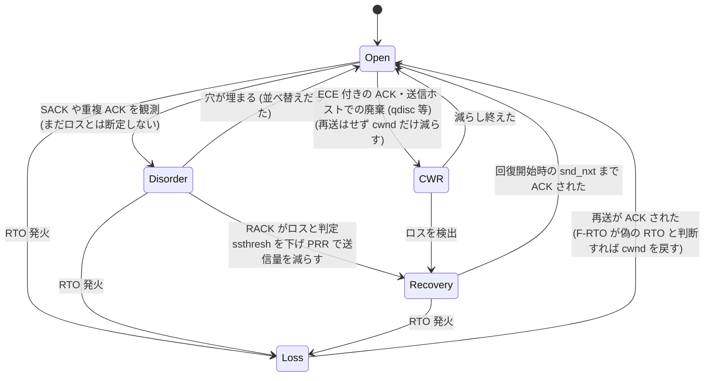

# TCP と輻輳制御 (TCP, Reliability & Congestion Control)

## 概要 (Overview)

IP は「ベストエフォート」しか約束しない。パケットは落ち、重複し、順序も入れ替わる。この IP の上に**信頼できるバイトストリーム**という幻想を築くのが TCP であり、その中核は2つの制御ループである: 受信側の都合に合わせる**フロー制御 (flow control)** と、**ネットワークの都合**に合わせる**輻輳制御 (congestion control)**。

とりわけ輻輳制御は、インターネットという「誰も全体を管理していない系」で、**各端点が自律的に送信レートを調整して全体の崩壊を防ぐ**分散制御であり、1986 年の輻輳崩壊 (congestion collapse) と Jacobson の処方箋以来、ネットワーク工学の中心問題であり続けている。ロスベース (Reno/CUBIC) からモデルベース (BBR) への転換、バッファブロート、そして TCP の構造的限界 (HoL ブロッキング) が QUIC を生んだ経緯までを本ドキュメントで扱う。

そのほか、接続管理の細部 (SYN cookie、TIME_WAIT とポートの再利用、RFC 5961 による RST・SYN の検証、keepalive、TCP Fast Open が広まらなかった理由)、損失回復 (RTO の計算と最小値、RACK-TLP、PRR、F-RTO と偽の再送の取り消し、遅延 ACK と Nagle の干渉)、窓の拡張 (ウィンドウスケール、タイムスタンプと PAWS、バッファの自動調整)、Multipath TCP (MPTCP) と結合輻輳制御、BBR の公平性の実測と BBRv3 の標準化の状況 (2026 年 11 月時点)、データセンター向けの輻輳制御への橋渡し、TCP 固有の脆弱性 (チャレンジ ACK のサイドチャネル、SACK Panic、TCP-AO) を扱う。実装の例は Linux カーネル v7.3 のソースで確かめた。

「端点だけが賢く、網は単純に」という**エンドツーエンド原則**の代表的な実装として TCP を読むことが本書の視点である。分析深度は Level 3。

## 方法論 (Methodology)

- TCP の機能を「接続管理」「信頼性（再送）」「フロー制御」「輻輳制御」の4機構に分解し、それぞれが**どの情報を観測してどの変数を動かすか**（制御工学的な視点）で整理する。
- 輻輳制御は歴史順（Tahoe/Reno → CUBIC → BBR）ではなく、**「何を輻輳のシグナルとみなすか」**（ロス／遅延／モデル推定／明示通知 ECN）の設計軸で分類する。
- 規範は RFC（9293 ほか）に、アルゴリズムは原論文に基づく。数値は代表値であり、OS・設定で変わる。
- 「TCP で困る点」を明示し、[`http-quic-evolution.md`](http-quic-evolution.md)（QUIC がそれをどう解いたか）へ接続する。
- **実装**: Linux カーネルのソースを v7.3 のタグで読み、行番号を記した (`include/net/tcp.h`、`include/uapi/linux/tcp.h`、`net/ipv4/{tcp_input.c, tcp_ipv4.c, tcp_recovery.c, tcp_bbr.c, syncookies.c, tcp_fastopen.c, tcp.c, Kconfig}`、`include/trace/events/tcp.h`、`Documentation/networking/ip-sysctl.rst`)。機能が入った版は、ファイルや文書の項目が各版のタグに含まれるかで確認した (MPTCP は v5.6、TCP-AO は v6.7、AccECN は v6.18、`tcp_tw_recycle` の削除は v4.12)。修正コミットが入った版は GitHub の比較 API で確かめた。観測の道具は iproute2 (v7.3.0) の `misc/ss.c` を読んだ。
- **測定研究**: BBR の公平性は Hock et al. (ICNP 2017)、Ware et al. (IMC 2019)、Zeynali et al. (PAM 2024) の査読付きの実測に基づく。Google の BBRv3 の導入状況は自社の IETF 発表だけが根拠で、外部からは検証できないため、そう明記する。
- **担当範囲**: AQM (fq_codel・CAKE)・L4S・ECN の印付けの詳細は [`qos-traffic-management.md`](qos-traffic-management.md)、GRO/GSO・qdisc・BQL は [`kernel-network-stack.md`](kernel-network-stack.md)、QUIC は [`http-quic-evolution.md`](http-quic-evolution.md)、DCQCN と RoCE は [`../../hardware/networking/nic-switch-architecture.md`](../../hardware/networking/nic-switch-architecture.md)、ECMP は [`dc-fabric-routing.md`](dc-fabric-routing.md)、大規模な SYN flood の防御は [`ddos-mitigation.md`](ddos-mitigation.md) が扱う。本書は TCP の側から必要な範囲だけを書き、詳細はそれらに譲る。

## 発見事項 (Findings)

1. **TCP の信頼性は「累積 ACK ＋タイマ」という最小の道具立てから出発した。** シーケンス番号・累積確認応答・再送タイムアウト (RTO) だけで信頼性は成立するが、性能は悪い。以後の歴史（高速再送、SACK、タイムスタンプ）は **「再送のために何を観測できるか」を増やす**歴史である。
2. **RTT の推定を誤ると全てが壊れる。** RTO は RTT の平均と分散から計算する (Jacobson/Karels)。過小なら偽の再送で網を圧迫し、過大なら回復が遅い。**再送されたセグメントの RTT は測らない**（Karn のアルゴリズム: どちらの送信への ACK か判別できない）など、推定の規律が輻輳制御の前提にある。
3. **輻輳制御の核は AIMD (加算的増加・乗算的減少) である。** 慎重に増やし (cwnd += 1/RTT ごと)、事故ったら半分にする。この非対称性が、複数フローが同じボトルネックを公平に分け合う**収束性**を与える (Chiu–Jain)。「なぜ半分か」には数学的根拠がある。
4. **「ロス＝輻輳」という等式が現代では綻んだ。** ロスベース (Reno/CUBIC) はバッファが溢れるまで押し込む。そのため巨大バッファでは**溢れる前に遅延が秒単位に膨らむ** (バッファブロート)。BBR はロスを見ず、**ボトルネック帯域と最小 RTT を推定してそのモデルに送信レートを合わせる**転換を行った。
5. **公平性は自明ではない。** 輻輳制御は各フローが勝手に走らせるアルゴリズムであり、異種混在 (CUBIC vs BBR) では取り分が偏りうる。BBRv1 のロスベースフローへの圧迫は実測で問題化し、v2/v3 で修正が続く。ただし Linux 本体 (v7.3) の `tcp_bbr.c` は今も v1 で、v3 は IETF の Internet-Draft (draft-ietf-ccwg-bbr-07、2026 年 11 月) と Google の別ブランチにある。PAM 2024 の実測では v3 も CUBIC との共存が不十分だった。**「インターネットの公平性」はアルゴリズム設計の暗黙の合意**で保たれている。
6. **TCP の限界は機能でなく構造にある。** (a) 単一ストリームゆえの**ヘッドオブライン (HoL) ブロッキング** (1パケットのロスが後続全バイトを塞ぐ)、(b) ハンドシェイクの往復 (＋TLS でさらに)、(c) ミドルボックスが TCP ヘッダに介入するため**プロトコルを進化させられない (硬直化, ossification)**。これらが「TCP を直す」のではなく「UDP 上に作り直す」(QUIC) という解を生んだ。
7. **損失回復は「数える」から「時刻で判断する」へ移った。** 重複 ACK を 3 つ数える方式は、並べ替え (reordering) に弱く、末尾のロスでは重複 ACK が来ないため RTO まで待たされる。RACK-TLP (RFC 8985) はセグメントごとの送信時刻と SACK から、「後に送ったものが届いたのに、まだ届かない」セグメントを、RTT と並べ替えの猶予を過ぎた時点でロスとみなす。末尾のロスは 2·SRTT 後のプローブで高速回復に変える。Linux v7.3 ではこれが唯一のロス検出であり、重複 ACK の閾値は補助の経験則として残るだけである (`tcp_recovery` の説明)。
8. **状態を持つ機構はどれも攻撃面かサイドチャネルになった。** SYN キューは SYN flood の標的になり、SYN cookie は状態を ISN に符号化して回避した。RFC 5961 のチャレンジ ACK はブラインド RST への防御として入ったが、ホスト全体で共有した送信回数の上限 (Linux では既定 100 回/秒) が、他人の接続の有無と ISN を推測する手がかりになった (CVE-2016-5696)。Linux は上限をランダム化し (v4.7)、のちにホスト全体の上限を既定で無効にした (v6.0)。SACK の処理では整数オーバーフローがリモートからのカーネルパニックになった (CVE-2019-11477)。
9. **TCP を拡張する余地は、ミドルボックスが通すものの範囲に限られる。** TCP Fast Open (RFC 7413) は SYN にデータを載せて 1 RTT を削るが、RFC 自身が引く測定で約 6% の経路が「データ付き SYN か未知のオプション」を落としていた。その後もブラウザで不具合が続き、Firefox は 57 で既定を無効にし、87 で機能を削除した。クッキーがトラッキングに使えるという懸念も加わった。Multipath TCP (RFC 8684) は、オプションが剥がされたら通常の TCP に戻る設計を最初から組み込んだことで実用になり、Apple の Siri (iOS 7 以降) と Linux 本体 (v5.6 以降) に入った。

## アーキテクチャ (Architecture)

### 2つの制御ループ

```
 送信可能量 = min( rwnd, cwnd )
              ─────  ─────
              フロー制御          輻輳制御
              受信側の空き        ネットワークの容量推定
              (相手が広告する)     (送信側が自分で推定する)

 受信バッファ溢れ → rwnd で防ぐ / 網内バッファ溢れ → cwnd で防ぐ
```

- **rwnd** は受信側が ACK で明示的に広告する（観測不要の事実）。**cwnd** は誰も教えてくれないので、送信側が**プローブ（増やしてみる）とシグナル（ロス・遅延・ECN）** から推定し続ける。輻輳制御が難しいのはこの非対称性ゆえである。

### 信頼性の道具立て

```
 シーケンス番号 (バイト単位) ──▶ 順序・重複・欠落の検出
 累積 ACK「N まで全部受けた」──▶ 最小限だが情報が粗い
 ├─ 重複 ACK ×3 → 高速再送 (RTO を待たずに再送)
 ├─ SACK (RFC 2018) 「N まで＋飛び地で M〜K も受けた」→ 欠けた所だけ再送
 └─ RTO (Jacobson/Karels: SRTT + 4·RTTVAR) → 最後の砦。発火は高くつく
```

### 輻輳制御の状態機械（ロスベースの古典形）

```
        cwnd
         │      ロス検出(重複ACK) → cwnd/2 から線形増加を再開
         │     ／＼      ／＼      ／＼
         │    ／   ＼＿／    ＼＿／    ＼   ← 「のこぎり波 (sawtooth)」
         │   ／
         │  ／  ← スロースタート: RTT ごとに倍増 (指数)
         │ ／     ssthresh 到達 or ロスで輻輳回避 (線形) へ
         └──────────────────────────────▶ 時間
```

### 実装の状態機械 — Linux の輻輳状態 (`tcp_ca_state`)

のこぎり波は理想化した絵である。実装の送信側は ACK を受けるたびに次の 5 つの状態のどれにいるかを判断する (`include/uapi/linux/tcp.h` 193-227 行、v7.3)。状態ごとに、cwnd をどう動かすか、どのセグメントを再送するかが変わる。



凡例: 状態名は Linux の `TCP_CA_*` の定数名から `TCP_CA_` を除いたもの。遷移の条件は代表的なものだけを書いた。

## 技術詳細 (Technical Details)

### 1. 接続管理 — 3WHS と状態機械の隅

- **3ウェイハンドシェイク**: SYN / SYN-ACK / ACK で双方の初期シーケンス番号を交換する。データ送信まで最低 1 RTT かかる。この「儀式のコスト」が後の 0-RTT 競争（TFO、QUIC）の動機になる。
- **TIME_WAIT**: 能動クローズ側は 2MSL 待つ。旧接続の遅延パケットが**同じ4タプルの新接続**に化けるのを防ぐための待機であり、「ポートが枯渇する」という運用問題はこの正しさの代償。短命接続を大量に張るクライアント側の設計課題になる。
- **SYN バックログ**: SYN を受けた半開状態はサーバ資源を消費する。SYN flood はここを突く（セキュリティ考察参照）。
- **同時オープン (simultaneous open)**: 双方が同時に SYN を送ると、どちらも SYN-SENT から SYN-RECEIVED に移り、SYN-ACK を交わして確立する (RFC 9293 3.5 節)。サーバとクライアントの区別は TCP の意味論にはなく、NAT 越えの TCP ホールパンチングはこの遷移を利用する。
- **SYN cookie の中身**: Linux は SYN のキューが溢れたときだけ cookie に切り替える (`tcp_syncookies` の既定は 1。`net/ipv4/tcp_ipv4.c` 3457 行、v7.3)。cookie は SYN-ACK の ISN そのもので、時刻のカウンタ、4 段階に丸めた MSS (536・1300・1440・1460。`net/ipv4/syncookies.c` 144-149 行)、4 タプルの鍵付きハッシュを詰める。状態を持たない代償に、ウィンドウスケール・SACK・ECN といった SYN のオプションは失われる。ただし両端がタイムスタンプを使えば、それらを TSval の下位ビットに符号化して持ち越せる (同 37-39 行と 56-72 行)。cookie の有効期間は `MAX_SYNCOOKIE_AGE` = 2 周期 (`include/net/tcp.h` 624 行)。大規模な攻撃での使い方 (SYNPROXY・XDP) は [`ddos-mitigation.md`](ddos-mitigation.md) が扱う。
- **TIME_WAIT の実際**: RFC 9293 は MSL を 2 分と置くので 2MSL は 4 分になるが、Linux は TIME_WAIT を 60 秒に固定している (`TCP_TIMEWAIT_LEN`、`include/net/tcp.h` 140 行)。同じ宛先への短命な接続を大量に張るクライアントでは、エフェメラルポートが TIME_WAIT で埋まる。対策は 3 つある。(1) タイムスタンプがあれば、新しい接続の SYN が旧接続のどのセグメントより新しいと判定できるので、TIME_WAIT の 4 タプルを再利用できる (RFC 6191。Linux の `tcp_tw_reuse`。v7.3 の既定は 2 で、ループバックだけで有効、`tcp_ipv4.c` 3464 行)。(2) 接続を使い回す (HTTP の keep-alive やコネクションプール)。(3) 宛先の IP やポートを増やして 4 タプルの空間を広げる。かつての `tcp_tw_recycle` は NAT の背後の複数ホストのタイムスタンプを同じホストのものとみなして SYN を捨てる事故を起こした。Linux 4.10 で接続ごとにタイムスタンプのオフセットをランダム化したことで完全に成り立たなくなり、v4.12 で削除された。TIME_WAIT の接続に RST を送って早く消させる「TIME-WAIT assassination」の危険は RFC 1337 が整理している。
- **RST の受け入れ規則**: RFC 793 は受信窓のどこかに当たる RST を受け入れたため、窓の大きい長寿命の接続ではブラインドな RST 注入の当たり確率が高かった。RFC 5961 は規則を厳しくした。RST のシーケンス番号が RCV.NXT にちょうど一致すれば切断し、窓内だが一致しなければチャレンジ ACK (正しい SND.NXT・RCV.NXT を載せた ACK) を返して捨てる。本物の相手はこれを見て正しい番号の RST を送り直す。確立済みの状態で届いた SYN には、番号を問わずチャレンジ ACK を返す。ACK 番号も (SND.UNA − MAX.SND.WND) 以上 SND.NXT 以下に限る。Linux はこれに加え、FIN の後の RCV.NXT − 1 と、最も右の SACK ブロックの端に一致する RST も受け入れる (`net/ipv4/tcp_input.c` 6393-6434 行、SYN は 6438-6466 行)。
- **keepalive**: 無通信の接続が生きているかを確かめるプローブ。Linux の既定は 2 時間無通信で開始し、75 秒間隔で 9 回応答がなければ切断する (`include/net/tcp.h` 178-180 行)。NAT やステートフルファイアウォールのアイドルタイムアウトは普通これより短い ([`packet-filtering-conntrack.md`](packet-filtering-conntrack.md))。そのため長寿命の接続を保つには、ソケットごとに `TCP_KEEPIDLE` などを縮めるか、アプリケーション層の ping を使う。送ったデータに ACK が来ないまま待ち続けるのを打ち切る `TCP_USER_TIMEOUT` (RFC 5482 のユーザタイムアウトに相当) は、keepalive とは別に設定する。

### 2. TCP Fast Open — 0-RTT の試みと硬直化の実例

- **仕組み (RFC 7413、2014 年 12 月、Experimental)**: 初回の接続で、サーバはクライアントの IP アドレスに結び付けた cookie (サーバだけが作れる MAC。オプション種別 34、4〜16 バイト) を渡す。2 回目以降、クライアントは SYN に cookie とデータを載せ、サーバは cookie が正しければ 3WHS の完了を待たずにデータをアプリケーションに渡す。これで HTTP の最初の要求が 1 RTT 早くなる。
- **冪等性の制約**: SYN に載せたデータは重複して届きうる (SYN の再送や複製)。RFC 7413 は重複を扱えないデータでは TFO を使ってはならない (MUST NOT) と定める。TLS の ClientHello は安全とされ、副作用のある POST は不適とされた。のちの TLS 1.3 の 0-RTT も同じ再送の問題を抱える ([`tls-internals.md`](tls-internals.md))。
- **広まらなかった理由**: (1) **ミドルボックス**。RFC 7413 7.1 節は Langley (2006) と Honda et al. (IMC 2011) を引き、約 6% の経路が「データ付きの SYN か未知のオプションを持つ SYN」を落とすと書く。さらに厄介なのは、3WHS が成功した後に、応答を返さずにデータだけを捨てる装置で、クライアントからは検出しにくい。Linux はこれに備え、TFO の接続で確立後にタイムアウトが続くと能動側の TFO を止める仕組み (`tcp_fastopen_active_disable()`、`net/ipv4/tcp_fastopen.c` 582 行) を持つ。ただしその期間を決める `tcp_fastopen_blackhole_timeout_sec` の既定は v7.3 では 0 (検出を無効) である (`tcp_ipv4.c` 3517 行)。(2) **ブラウザでの不具合**。Firefox では TFO と TLS 1.3 を組み合わせると、一定の無通信の後に接続が止まる問題が報告された (Bugzilla 1395494)。Firefox は 57 で既定を無効にし (Bug 1398201)、87 で機能を削除した (Bug 1689604)。(3) **プライバシー**。cookie はクライアントの IP とサーバの組に対して長期間有効な識別子であり、Sy et al. (PoPETs 2020) は TFO の cookie で訪問を結び付けるトラッキングを示した。(4) **API**。クライアントは `connect()` ではなく `sendto(MSG_FASTOPEN)` などを使う必要があり、既存のコードにそのまま入らない。Linux の既定もクライアント側だけ有効 (0x1) で、サーバ側は無効である (`tcp_ipv4.c` 3516 行と `ip-sysctl.rst` の `tcp_fastopen`)。
- **教訓**: 0-RTT はトランスポートの中では実現が難しく、QUIC と TLS 1.3 がトランスポートごと暗号化することで実現した。TFO は本書の発見事項 9 (硬直化) の最もわかりやすい例である。

### 3. 再送と損失回復 — RTO から RACK-TLP へ

- **RTO の計算 (RFC 6298)**: SRTT ← 7/8·SRTT + 1/8·R、RTTVAR ← 3/4·RTTVAR + 1/4·|SRTT − R|、RTO = SRTT + max(G, 4·RTTVAR) (G はクロックの粒度)。初期値は 1 秒で、RFC は「RTO が 1 秒未満なら 1 秒に切り上げるべき (SHOULD)」と定め、発火のたびに 2 倍にする (指数バックオフ)。**Linux は最小値を 200 ms にしている** (`TCP_RTO_MIN` = HZ/5、`include/net/tcp.h` 162 行。初期値 1 秒は 167 行、上限 120 秒は 160-161 行)。実装は RTTVAR の項を `tcp_rto_min` で下から抑えるので、RTO はおおむね SRTT + max(4·RTTVAR, 200 ms) になる (`net/ipv4/tcp_input.c` 1070 行の `tcp_rtt_estimator()` と 1129 行)。RTT が数十 µs のデータセンターでは 200 ms が RTT の数千倍になり、incast で RTO が起きると回復が大きく遅れる。v7.3 には最小値を µs 単位で変える `tcp_rto_min_us` (既定 200000) と、ソケットごとの `TCP_RTO_MIN_US` がある (`ip-sysctl.rst`)。
- **Karn のアルゴリズム**: 再送したセグメントの ACK からは RTT を測らない。タイムスタンプ (RFC 7323) を使えば、どちらの送信への ACK かを TSecr で区別できるので、再送後も RTT を測れる。
- **RACK-TLP (RFC 8985、2021 年 2 月、Standards Track)**: RACK はセグメントごとの送信時刻を記録し、後に送ったセグメントが SACK された時点で、それより前に送ってまだ届かないセグメントが「最新の RTT + 並べ替えの猶予 (reo_wnd)」を過ぎていればロスとみなす。reo_wnd の初期値は min_RTT/4 で、DSACK (偽の再送だったという報告) を受けると広がり、SRTT を上限とする。Linux でも同じく `min(min_rtt/4 × 段数, SRTT)` である (`net/ipv4/tcp_recovery.c` 5-29 行)。TLP (Tail Loss Probe) は、末尾のロスで ACK が途絶えたときに PTO = 2·SRTT (SRTT がなければ 1 秒) 後に 1 セグメントを送る。新しいデータがあればそれを、なければ最後のセグメントを再送して、SACK を引き出して RACK による高速回復につなげる。RFC 8985 はこれでほとんどのロスを 1〜2 往復で回復でき、高くつく RTO を避けられるとしている。Linux v7.3 では RACK が唯一のロス検出で (`tcp_recovery` の既定 0x1、`tcp_ipv4.c` 3475 行)、TLP も既定で有効 (`tcp_early_retrans` = 3、3474 行)。
- **PRR (Proportional Rate Reduction)**: 高速回復の間に cwnd をいきなり半分にすると、送信が 1 RTT 近く止まったあとに急にバーストを出す。PRR は「ACK で届いたと分かった量に比例して送る」ことで、回復の終わりに送信中の量がちょうど ssthresh になるよう減らす。送信中の量が ssthresh を下回ったら、送れる量を届いた量に合わせ、条件が良ければ slow start で ssthresh まで戻す。RFC 6937 (2013 年、Experimental) が 2025 年 12 月に RFC 9937 (Proposed Standard) として改訂された。Linux の実装は `tcp_cwnd_reduction()` (`net/ipv4/tcp_input.c` 2985 行〜) で、`prr_delivered`・`prr_out` の 2 つの数を持つ。
- **F-RTO と偽の再送の取り消し**: 無線などで RTT が急に伸びると、ロスがないのに RTO が発火する (spurious RTO)。F-RTO (RFC 5682) は RTO 後に再送した直後の ACK を見て、再送していない新しいデータが ACK されたなら偽の RTO と判断し、cwnd を戻す。Linux では既定で有効 (`tcp_frto` = 2、`tcp_ipv4.c` 3482 行)。高速再送が偽だった場合は、DSACK (RFC 2883) やタイムスタンプで検出して cwnd と ssthresh を元に戻す ("undo")。
- **遅延 ACK と Nagle の干渉**: 受信側は ACK をまとめるために遅らせる (RFC 1122・RFC 9293。最大 500 ms、2 フルサイズのセグメントごとに少なくとも 1 回は ACK する)。Linux の遅延 ACK のタイマは 40〜200 ms の範囲で動く (`TCP_DELACK_MIN` = HZ/25、`TCP_DELACK_MAX` = HZ/5、`include/net/tcp.h` 150-155 行)。送信側の Nagle アルゴリズム (RFC 896) は、ACK されていない小さなセグメントがある間は次の小さなセグメントを送らない。両方が働くと、「書き込み → 書き込み → 読み込み」型の要求で、2 回目の小さな書き込みが相手の遅延 ACK のタイマ (数十〜200 ms) が切れるまで止まる。対処は要求を 1 回の書き込みにまとめる、`TCP_NODELAY` で Nagle を切る、`TCP_CORK` で明示的にまとめる、のいずれかである。受信側の `TCP_QUICKACK` で遅延 ACK を一時的に止める方法もある。

### 4. 窓の拡張とバッファ — BDP を埋める

- **ウィンドウスケール (RFC 7323)**: TCP ヘッダの窓は 16 ビットで最大 64 KiB である。SYN で交換するシフト量 (最大 14。Linux の `TCP_MAX_WSCALE`、`include/net/tcp.h` 100 行) を掛けて、最大 2^30 バイト (1 GiB) まで広げる。シフト量は SYN でしか交換できないので、SYN からオプションを剥がすミドルボックスや、SYN cookie でタイムスタンプがない場合には、窓が 64 KiB から増えない。100 ms の経路では、これだけでスループットの上限が約 5 Mbit/s になる。
- **タイムスタンプと PAWS (RFC 7323)**: 各セグメントに TSval と TSecr を載せ、RTT を毎回測れるようにする。もう 1 つの役割が PAWS (Protection Against Wrapped Sequences) である。32 ビットのシーケンス空間 (2^32 バイト) は 10 Gbit/s なら約 3.4 秒で一周するので、遅れて届いた旧いセグメントが窓内に入りうる。TSval が直前より古いセグメントを捨てることで、これを防ぐ。Linux は接続ごとにタイムスタンプのオフセットをランダム化しているので (前述の v4.10 の変更。コミット 95a22caee396)、TSval からホストの稼働時間や、NAT の背後のホストの数を推測しにくい。
- **BDP と自動調整**: 帯域 B・RTT が R の経路を埋めるには B × R バイトの送信中データが必要である (1 Gbit/s × 100 ms = 12.5 MB)。送信側の cwnd、受信側の rwnd、送信バッファのどれかがこれに届かないと律速になる。Linux は受信バッファを、アプリケーションが実際に読み出す速さと RTT から毎 RTT 見積もり直して広げる (`tcp_moderate_rcvbuf` = 1、`net/ipv4/tcp_input.c` 960 行の `tcp_rcv_space_adjust()`)。上限は `tcp_rmem` の 3 つ目の値で、v7.3 の既定はメモリ量に応じて 128 KiB〜32 MiB、送信側の `tcp_wmem` は 64 KiB〜4 MiB である (`net/ipv4/tcp.c` 5373-5382 行)。アプリケーションが `SO_RCVBUF`/`SO_SNDBUF` を明示すると自動調整が止まるため、「よかれと思って固定した値が BDP に足りない」のは典型的な失敗である。逆に送信バッファが大きすぎると、送信済みでない大量のデータがソケットに溜まって遅延が伸びる。`TCP_NOTSENT_LOWAT` はその未送信分を抑える。
- **初期 cwnd**: Linux は 10 セグメント (`TCP_INIT_CWND`、`include/net/tcp.h` 269 行。RFC 6928 の IW10)。短いレスポンスの多くは slow start の途中で終わるので、初期値が短いフローの完了時間をほぼ決める。

### 5. AIMD はなぜ「半分」か — 公平性の力学

2フローが1つのボトルネックを共有する状態空間で考える (Chiu–Jain 1989)。

- **加算的増加**は両フローを対角線（合計＝容量）に向けて 45° で押し上げ、**乗算的減少**は原点方向へ縮める。この組み合わせだけが**公平点（両者 equal）へ収束**する。乗算的増加や加算的減少では公平性が改善しない。
- のこぎり波の平均から、古典的な**Mathis の式**が従う: スループット ≈ (MSS/RTT)·(C/√p)（p はロス率）。含意は2つ: (a) **RTT が短いフローほど強い**（RTT 公平性の欠如）、(b) 高帯域×高遅延では p を非現実的に小さくしないと帯域を埋められない。これが、Reno が長距離高速網で破綻する定量的理由である。

### 6. CUBIC — ロスベースの現代形 (Linux 既定)

- 増加関数を「前回ロス時の cwnd (W_max) を変曲点とする**3次関数**」に置き換える: 減少直後は急速に W_max 近くへ戻り、W_max 付近で平坦に振る舞い（TCP フレンドリー領域）、超えたら再び加速して新容量を探る。
- 増加が**RTT ではなく実時間**の関数であるため、RTT 公平性が Reno より改善する。高帯域遅延積 (BDP) 網での回復の遅さという Reno の弱点への直接の答えであり、Linux の既定 (RFC 9438) として事実上のインターネット標準になった。
- ただし**ロスベースの宿命は共有**する: ボトルネックのバッファを**満たしてから**しか輻輳を検知できない。

### 7. バッファブロートと AQM — 網側からの補正

- ルータのバッファが巨大だと、ロスベース輻輳制御はそれを**満杯にしてから**半減する。そのため定常的に「満杯のキュー」がぶら下がり、**遅延が数百 ms〜秒に膨らむ**。これが**バッファブロート (bufferbloat)**。帯域は出ているのに対話的通信が壊滅する、という形で顕在化する。
- 網側の対策が **AQM (Active Queue Management)**: 満杯になる前に確率的に落とす/マークする。**CoDel** (Nichols & Jacobson 2012) は「パケットがキューに**滞在した時間**」を制御量にし、パラメータ調整をほぼ不要にした。**FQ-CoDel** はフロー別キュー化で「1つの象がすべてを壊す」のも防ぐ。網の装置がクラスごとにキューを分けて優先度を決める QoS 側の仕組み (DiffServ・ポリシング・L4S) は [`qos-traffic-management.md`](qos-traffic-management.md) で扱う。
- **ECN (RFC 3168)**: ロスの**代わりに**ヘッダのマークで輻輳を通知する。落とさずに伝えられる。ただし端点・網の双方の対応が要り、普及は部分的。データセンター内では DCTCP がマーク**率**を細かい制御信号に使い、極小バッファで低遅延を実現している。
- **TCP 側の ECN の帰還 (AccECN)**: RFC 3168 の ECN は、受信側が CE を見ると、送信側が CWR を返すまで ECE を立て続ける。そのため 1 RTT に何個の印が付いたかは送信側に伝わらない。古典的な TCP は 1 RTT に 1 回半分にするだけなのでそれで足りたが、DCTCP や L4S の送信側は印の数そのものを制御に使う。AccECN (RFC 9768、2026 年 4 月、Proposed Standard。RFC 3168 を更新) は、ヘッダの 3 ビットとオプションで CE の数とバイト数を数えて返す。Linux は v6.18 で AccECN を入れたが、v7.3 の `tcp_ecn` の既定は 2 (受けた接続でだけ従来の ECN を使い、自分からは要求しない) のままである (`net/ipv4/tcp_ipv4.c` 3440 行と `ip-sysctl.rst` の `tcp_ecn`)。網の側での印の付け方 (L4S の DualQ など) は [`qos-traffic-management.md`](qos-traffic-management.md) に譲る。

### 8. BBR — ロスを見ない輻輳制御

- 発想の転換: 最適動作点は「バッファが溢れる点」ではなく「**パイプがちょうど満ちる点**」= 送信中データ量 (inflight) が **BDP = BtlBw × RTprop** に等しい点である。
- BBR は2つの量を交互に推定する: **BtlBw**（配送レートの最大値をスライディング窓で観測）と **RTprop**（キューが空の時の最小 RTT）。両者は同時に観測できない（帯域を測るには押し込む＝キューができ RTT が汚れる）ため、**周期的にペーシングゲインを上げ下げして交互にプローブする**。
- 送信は cwnd 制限ではなく**ペーシング**（推定帯域に合わせた等間隔送出）が主役になる。ロスは原則シグナルとして使わない。そのため無線などの**非輻輳ロスに強い**一方、v1 はロスベースのフローを圧迫する非公平性やキュー形成が実測で示され、v2/v3 でロス・ECN への反応が再導入された。**「モデルが正しい限り最適」な制御の、モデル外との共存問題**という古典的構図である。
- **Linux の実装 (v1)**: `net/ipv4/tcp_bbr.c` (v7.3) の冒頭のコメントがモデルを要約している。帯域は直近 10 往復の配送レートの最大値、min_rtt は直近 10 秒の最小値で、pacing_rate = pacing_gain × 帯域、cwnd = max(cwnd_gain × 帯域 × min_rtt, 4) とする (1-60 行)。STARTUP のゲインは 2/ln 2 ≈ 2.885 (155 行)、cwnd_gain は 2 (161 行)。PROBE_BW では 8 相のゲイン {1.25, 0.75, 1, 1, 1, 1, 1, 1} を巡回する (163-169 行)。10 秒間 min_rtt が更新されなければ、200 ms 以上 PROBE_RTT に入って送信中の量を 4 パケットまで絞る (136・138 行)。ペーシングには fq qdisc を使うことが推奨され、ない場合はソケットごとの高精度タイマで代用する (コメント末尾)。

### 9. BBR の公平性 — 実測と v2/v3 の状況

- **v1 の非公平性の実測**: Hock, Bless & Zitterbart (ICNP 2017) は Linux 4.9 の BBR を 1 Gbit/s と 10 Gbit/s のボトルネックで評価し、キューの遅延の増加、フロー間の不公平、大量のロスを報告した。著者の発表資料 (IETF 100) によれば、複数の BBR フローが共存するとモデルが合わなくなり、各フローがより攻撃的に振る舞う。浅いバッファ (約 0.8 BDP) では大量のロスを出しながら CUBIC を強く抑え込み、深いバッファでは逆に BBR が負けることもある。Ware et al. (IMC 2019) は、BBR の送信中の量の上限 (cwnd_gain × 推定 BDP) に着目してモデル化した。深いバッファで CUBIC と競合する BBR は、cwnd の上限 (送信中の量の上限) で律速され、その取り分は競合するロスベースのフローの数によらずほぼ一定になる。1 本の BBR が 16 本の CUBIC に対して約 40% を取るという測定は、このモデルで説明できる (CUBIC に対して中央値の誤差 5%)。「フロー数に比例して分け合う」という AIMD の前提が、異種混在では成り立たない。
- **v2 → v3 の変更**: v2 はロス率と ECN を再びシグナルに入れ、送信中の量に上限 (inflight_hi) を設けた。v3 は v2 の帯域の収束の不具合を直したもので、2023 年 7 月の IETF 117 で公開された。IETF の CCWG の draft-ietf-ccwg-bbr-07 (2026 年 11 月 2 日、Experimental を想定、著者は Google の Cardwell・Swett と Meta の Beshay) が v3 を記述している。帯域のプローブ中に 1 往復のロス率が 2% (`BBR.LossThresh`) を超えたら上限を下げ、減少の係数は 0.7 (`BBR.Beta`)、STARTUP のゲインは 4 ln 2 ≈ 2.77、min_rtt の窓は 10 秒、ProbeRTT は 200 ms である。ECN への応答は「CE を輻輳として扱わなければならない (MUST)」と定めるだけで、具体的な応答は今後の課題としている。
- **どこで動いているか (2026 年 11 月時点)**: **Linux 本体の `tcp_bbr.c` は v7.3 でも v1 のまま**である (v2/v3 で導入された `inflight_hi` の制御がない)。v3 は Google の GitHub のブランチ (最新は `bbr-v3-2026-09-16-01`) と、有志が各版に移植したパッチで配布されている。Google は IETF 120 (2024 年 7 月) の CCWG の資料で、社内 WAN のすべての TCP と、google.com と YouTube の公衆インターネットへの TCP で v3 を使っていると発表した。これは自社の発表であり、外部からの検証はない。
- **v3 でも残る問題**: Zeynali et al. (PAM 2024) は v3 を独立に評価し、多くの条件で CUBIC との帯域の公平な分け合いができないこと、RTT の長いフローを優遇する偏りが残ることを報告した。v3 は v1 より穏やかになったが、ロスベースとの共存はまだ解けていない。設定によって結果が大きく変わるため、ここでは「解けた」とも「悪化した」とも言わず、公平性は経路の条件に依存する未解決の問題として扱う。

### 10. データセンターの輻輳制御 — 橋渡し

データセンターでは RTT が数十 µs、バッファは浅く、incast (多対一の同時応答) が日常的に起き、端点も網も 1 つの組織が管理する。インターネット向けの前提がほぼすべて崩れるので、別の設計が使われる。ここでは位置付けだけを示す。

- **DCTCP (RFC 8257、2017 年 10 月、Informational)**: スイッチはキューが閾値 K を超えたパケットに CE を付ける。送信側は 1 窓のうち印の付いた割合 F を指数移動平均で α ← (1 − g)·α + g·F (g は 1/16 を推奨) と追い、cwnd ← cwnd × (1 − α/2) と減らす。軽い混雑では少しだけ、重い混雑では半分まで減らすので、キューを K 付近に保てる。原論文 (Alizadeh et al., SIGCOMM 2010) は、TCP と同等以上のスループットを、バッファを 90% 少なく使って出せたと報告した。RFC 8257 は DCTCP をインターネットで使うと従来の TCP を圧迫するため、管理された網の中だけで使うよう注意している。Linux では `tcp_dctcp` モジュールとして選べる。
- **遅延・テレメトリを使う方式**: Google の Swift (Kumar et al., SIGCOMM 2020) は NIC のハードウェアタイムスタンプで測った遅延を目標値に保つ AIMD で、ファブリックとホストの遅延を分けて扱う。HPCC (Li et al., SIGCOMM 2019) はスイッチが埋め込む INT (In-band Network Telemetry) でリンクの負荷を直接知り、送信量を合わせる。RDMA 向けの DCQCN は [`../../hardware/networking/nic-switch-architecture.md`](../../hardware/networking/nic-switch-architecture.md) が扱う。
- **輻輳を経路の選び直しで避ける**: PLB (Protective Load Balancing、Qureshi et al., SIGCOMM 2022) は、ECN の印が続いた接続の IPv6 フローラベルを変えて、ECMP で別の経路に移す。Linux v7.3 には `tcp_plb_enabled` などの sysctl があり、既定は無効である。ECMP 自体は [`dc-fabric-routing.md`](dc-fabric-routing.md) が扱う。

### 11. Multipath TCP — 1 本の接続で複数の経路を使う

- **構造 (RFC 8684、2020 年 3 月、Standards Track。v0 の RFC 6824 を廃止)**: アプリケーションには普通の TCP ソケットに見せたまま、その下で複数の TCP 接続 (サブフロー) を張る。最初のサブフローの 3WHS で `MP_CAPABLE` オプションを使って 64 ビットの鍵を交換し、鍵のハッシュから接続を識別するトークンを作る。追加のサブフローは `MP_JOIN` でトークンを示し、乱数と鍵の HMAC-SHA256 で同じ接続の相手であることを示す。データには接続全体で通しの 64 ビットのデータシーケンス番号 (DSN) を振り、`DSS` オプションで各サブフローのシーケンス番号との対応を伝える。接続全体の Data ACK と、全サブフローで共有する受信窓を持つ。アドレスの追加と削除は `ADD_ADDR`/`REMOVE_ADDR` で通知する。
- **ミドルボックスへの備え**: 設計の大半は TCP に見えないと通らない網への対策である。各サブフローは単体でも正しい TCP に見えるよう、シーケンス番号が連続している。オプションが剥がされたら通常の TCP に戻り、途中で書き換えが見つかれば「無限の対応 (infinite mapping)」で以後を単一経路の TCP として続ける。省略できるチェックサムで、ペイロードを書き換える装置も検出できる。Honda et al. (IMC 2011) が、新しいオプションを通す経路の割合とセグメントの分割・結合をする装置の実在を測定したことが、この設計の前提になった。
- **結合輻輳制御 (RFC 6356、2011 年 10 月、Experimental)**: サブフローごとに独立に Reno や CUBIC を動かすと、ボトルネックを共有する 2 本のサブフローは、単一の TCP の 2 倍の帯域を取ってしまう。LIA (Linked Increases Algorithm) は 3 つの目標を置く。(1) 最良の 1 経路の TCP と同等以上の性能を出す。(2) 共有資源からは単一の TCP 以上を取らない。(3) 混んでいる経路からできるだけ移す。そのため増加量を min(α·acked·MSS_i/cwnd_total, acked·MSS_i/cwnd_i) とし、減少は通常の TCP と同じにする。Khalili et al. (IEEE/ACM ToN 2013) は LIA がパレート最適でないことを示し、改良の OLIA を提案した。Linux 本体の MPTCP (v7.3 の `net/mptcp/`) には結合輻輳制御の実装がなく、各サブフローは通常の TCP の輻輳制御で動く (ディレクトリにパスマネージャとスケジューラの実装はあるが、LIA/OLIA に当たるものはない)。LIA や OLIA を持っていたのは、本体に入る前のツリー外の実装 (multipath-tcp.org) である。
- **導入**: Apple は 2013 年の iOS 7 から Siri に MPTCP を使い、95 パーセンタイルの「最初の単語が返るまでの時間」が 20% 短くなり、ネットワークの失敗が 5 分の 1 になったと報告した (IETF 99 の Paasch の発表)。iOS 11 からはサードパーティにも `URLSessionConfiguration.multipathServiceType` (handover・interactive・aggregate) として API を開いた。Linux は v5.6 で本体に MPTCP を入れ (複数のサブフローは v5.7 から)、アプリケーションは `socket(AF_INET, SOCK_STREAM, IPPROTO_MPTCP)` で使う。使い道は帯域を足し合わせることより、Wi-Fi とセルラーの切り替え (ハンドオーバー) で接続を切らないことにある。QUIC の接続移行も同じ問題を解く ([`http-quic-evolution.md`](http-quic-evolution.md))。

### 12. 実務での観測と調整

| 疑問 | 道具 |
|---|---|
| 接続ごとの cwnd・RTT・再送 | `ss -ti`（cwnd, rtt/rttvar, retrans, 輻輳アルゴリズム名） |
| 再送・ロスの全体像 | `nstat`/`netstat -s`（TcpRetransSegs 等） |
| RFC 5961 の防御や SYN cookie が働いたか | `nstat` の `TcpExtTCPChallengeACK`・`TcpExtTCPSYNChallenge`・`TcpExtSyncookiesSent` |
| 使用アルゴリズムの確認/変更 | `sysctl net.ipv4.tcp_congestion_control`（cubic/bbr…） |
| パケットレベルの確定診断 | `tcpdump` + シーケンス解析 |
| 何が律速か (アプリ・受信窓・送信バッファ) | `ss -ti` の `busy`・`rwnd_limited`・`sndbuf_limited`・`app_limited` |
| 再送・RST をイベントとして拾う | tracepoint `tcp:tcp_retransmit_skb`・`tcp:tcp_send_reset`・`tcp:tcp_receive_reset` (bpftrace など) |
| ACK ごとの cwnd・SRTT の推移 | tracepoint `tcp:tcp_probe`、輻輳状態の遷移は `tcp:tcp_cong_state_set` |
| 受信バッファの自動調整 | tracepoint `tcp:tcp_rcv_space_adjust`・`tcp:tcp_rcvbuf_grow` |

- **`ss -ti` の読み方**: 値はカーネルが `tcp_info` 構造体 (`include/uapi/linux/tcp.h` 247-348 行、v7.3) で返すものを iproute2 の `ss` (`misc/ss.c` 2683-2756 行、v7.3.0) が整形している。`rtt:SRTT/RTTVAR`・`rto`・`cwnd`・`ssthresh` が窓と推定の現在値、`retrans:現在/累計`・`lost`・`dsack_dups`・`reordering` がロスと並べ替えの履歴である。`delivery_rate` は直近の配送レートの標本、`minrtt` は経路の最小 RTT、BBR なら `bbr:(bw:…,mrtt:…,pacing_gain:…,cwnd_gain:…)` でモデルの中身がそのまま見える。切り分けに最も効くのは `busy`・`rwnd_limited`・`sndbuf_limited` の 3 つ (`tcpi_busy_time` などは 303-305 行) で、送信していた時間のうち受信窓と送信バッファのそれぞれに律速されていた割合がわかる。`rwnd_limited` が大きければ相手の受信バッファ、`sndbuf_limited` が大きければ自分の `tcp_wmem` が原因で、どちらも小さく `app_limited` (配送レートの標本がアプリケーション律速の間に取られた印) が付いていれば、アプリケーションが十分に書いていない。v7.3 では RTO の発生回数 (`tcpi_total_rto`、326 行) や受けた CE の数 (`tcpi_received_ce`、337 行) も取れる。
- **tracepoint**: `include/trace/events/tcp.h` (v7.3) は再送 (16 行)、RST の送受信 (82・186 行)、受信バッファの調整 (200・207 行)、ACK ごとの状態 (`tcp_probe`、367 行)、輻輳状態の変化 (`tcp_cong_state_set`、469 行)、TCP-AO と MD5 の検証の失敗 (517 行以降) を定義している。パケットを全部取る `tcpdump` と違い、本番のホストで「どの接続が、いつ、なぜ再送したか」だけを安く拾える。eBPF で集計する方法は [`../operating-systems/ebpf-kernel-programmability.md`](../operating-systems/ebpf-kernel-programmability.md) を参照。
- ソケットバッファの自動チューニングが BDP に届いていない、というのが「帯域が出ない」の定番原因（`tcp_rmem`/`tcp_wmem` 上限）。**スループット ≈ min(rwnd, cwnd)/RTT** という一行に立ち返って、どの窓が律速かを切り分けるのが基本手順である。
- NIC オフロード (TSO/GRO) は、CPU 側では巨大セグメントで扱い分割/結合を NIC に任せる。これはプロトコル処理と割り込み負荷の削減であり、[`../../hardware/hw-sw-interface/mmio-dma-interrupts.md`](../../hardware/hw-sw-interface/mmio-dma-interrupts.md) の NIC リング・割り込み合体と一続きの層である。

### 13. TCP の構造的限界 — QUIC への橋

- **HoL ブロッキング**: TCP は単一の順序付きバイト列なので、セグメント1つのロスは**論理的に無関係な後続データ**（HTTP/2 の別ストリーム等）まで塞ぐ。多重化はトランスポート層の順序保証と衝突する。
- **ハンドシェイクの直列**: TCP 3WHS → TLS ハンドシェイクで、データ送信まで 2〜3 RTT。
- **硬直化 (ossification)**: 経路上のミドルボックス（NAT・FW・最適化装置）が TCP ヘッダを解釈・書き換えするため、新オプションや挙動変更が**網のどこかで壊される**。TCP Fast Open の普及が難航した実例が示す通り、「変更できる場所は端点の中だけ」になった。
- QUIC の答えは [`http-quic-evolution.md`](http-quic-evolution.md) で扱う。QUIC は UDP 上でトランスポートを再実装し、**ストリームを一次概念に**して（ロスの影響をストリーム内に閉じ込め）、**トランスポートヘッダごと暗号化**し（ミドルボックスに見せない＝硬直化の予防）、ハンドシェイクを TLS 1.3 と統合した。

## セキュリティ考察 (Security Considerations)

- **SYN flood**: 偽装送信元からの SYN で半開接続テーブルを枯渇させる古典的 DoS。**SYN cookies**（状態を持たずシーケンス番号に暗号学的に符号化して返す）が標準的対処で、「状態を持つこと自体が攻撃面」という設計教訓の代表例。
- **オフパス攻撃と乱数**: RST 注入・データ注入には正しい4タプル＋窓内シーケンス番号が要る。初期シーケンス番号 (ISN) が推測可能だった時代は接続乗っ取りが成立した。ISN のランダム化 (RFC 6528) とエフェメラルポートのランダム化が防壁であり、「**推測可能性＝攻撃可能性**」の直接の実装。長寿命 BGP セッション等では TCP-AO による認証を重ねる。
- **シーケンス番号の予測の歴史**: Morris (1985) は 4.2BSD の ISN が時刻に応じて単調に増えるだけであることを使い、応答を見ずに相手になりすまして接続を確立できることを示した。Bellovin (1989) はこれを TCP/IP の設計上の問題として整理した。対策は ISN を推測不能にすることで、RFC 6528 (2012 年) は「時計 + 4 タプルと秘密鍵の擬似乱数関数」で接続ごとに ISN を作る方式を定めた。接続ごとにずらしても時計の項で単調に増えるので、同じ 4 タプルの旧接続との区別には役立つ。
- **チャレンジ ACK のサイドチャネル (CVE-2016-5696)**: RFC 5961 7 節はチャレンジ ACK を送りすぎないよう上限を設けるべき (SHOULD) とした。Linux 3.6 (2012 年) 以降の実装は、この上限を**ホスト全体で共有する 1 秒あたり 100 回**とした。Cao et al. (USENIX Security 2016) はこの共有のカウンタを測定の道具にした。攻撃者は自分の正規の接続でチャレンジ ACK を引き出し、同じ秒に偽装したパケットを標的の接続に送る。自分に返ってくるチャレンジ ACK が 100 回より少なければ、偽装したパケットが標的の接続でチャレンジ ACK を消費した、つまり推測が当たったとわかる。これを繰り返して 4 タプルの存在、シーケンス番号、ACK 番号を順に絞り込み、経路上にいない攻撃者が任意の 2 ホストの接続を切断したりデータを注入したりできた。論文では接続の有無の推測に約 10 秒、攻撃全体に約 40〜60 秒かかり、成功率は 88〜97% だった。Linux は上限を 1000 に上げて 1 秒ごとの回数をランダム化し (コミット 75ff39ccc1bd、v4.7)、その後、ホスト全体の上限そのものを既定で無効にした (コミット 79e3602caa6f、v6.0)。v7.3 の `tcp_challenge_ack_limit` の既定は INT_MAX で、文書は「この上限はサイドチャネルを許すので有効にすべきでない」と書く (`tcp_ipv4.c` 3494 行、`ip-sysctl.rst`)。ソケットごとの上限は別に残る (`net/ipv4/tcp_input.c` 4069 行〜の `tcp_send_challenge_ack()`)。防御のために足した状態が、共有されたとたんに情報を漏らすという教訓である。
- **SACK Panic (CVE-2019-11477) と関連の脆弱性**: Netflix の Looney が 2019 年 6 月に報告した。細工した SACK の列で、再送キューのセグメントを小さく分割・結合させ続けると、1 つの skb が表すセグメント数 (`tcp_gso_segs`) が整数オーバーフローを起こし、カーネルが BUG で停止した。影響は Linux 2.6.29 以降で、攻撃者が SYN で MSS を極端に小さく (48 バイト) 指定すると、1 つの skb に詰まるセグメントの数が増えて起こしやすくなる。同時に、再送キューを細切れにして CPU を浪費させる CVE-2019-11478 と、MSS を 48 にさせて 1 セグメント 8 バイトの応答を大量に送らせる CVE-2019-11479 も公表された。修正は主系統では v5.2 に入り (コミット 3b4929f65b0d)、安定版にも戻された。相手が広告できる MSS の下限を設定できる `tcp_min_snd_mss` (既定は従来と同じ 48 で、`TCP_MIN_SND_MSS`、`include/net/tcp.h` 72 行) はこの時に追加された。回避策は修正を当てるか、SACK を無効にするか、MSS の小さい SYN をフィルタで落とすことだった。SACK は性能のための拡張だが、受信者が送信者のデータ構造を操作できる入力でもある。
- **TCP-AO と TCP MD5**: BGP や LDP のような長寿命のルータ間のセッションは、RST の注入で切られると経路の再計算が広く波及する。TCP MD5 署名オプション (RFC 2385、1998 年) は、共有鍵と MD5 でセグメントを認証するが、鍵の交換や更新の仕組みがなく、MD5 しか使えない。TCP-AO (RFC 5925、2010 年) はこれを置き換え、鍵の識別子 (KeyID) による無停止の鍵の切り替え、接続ごとに派生させる鍵、HMAC-SHA-1 や AES-128-CMAC などの MAC (RFC 5926)、シーケンス番号の周回に備えた拡張番号 (SNE) を持つ。Linux は v6.7 で TCP-AO を入れた (`CONFIG_TCP_AO`、`net/ipv4/Kconfig` 744 行。64 ビットの環境が必要)。MD5 も互換のために残る (759 行)。いずれもペイロードを暗号化しないので、機密性は TLS や IPsec で別に守る。
- **TFO と MPTCP の新しい攻撃面**: TFO は 3WHS の前にサーバの資源を使わせるため、RFC 7413 は保留中の TFO 要求の数を制限し、超えたら通常の SYN として扱うよう求めている (5.1 節)。盗んだ cookie で、偽装した送信元に大きな応答を送らせる反射も論じている (5.2 節)。MPTCP は `MP_CAPABLE` の鍵を平文で交換する。そのため最初の 3WHS を観測できる攻撃者は、`MP_JOIN` の HMAC を計算してサブフローを追加できる。RFC 8684 はこの残余の脅威を RFC 7430 に委ねており、単一経路の TCP と同程度の安全性を目標にしている。
- **輻輳制御は「行儀」の上に立つ**: 端点がアルゴリズムを守る保証はどこにもない。ACK を偽って高速化する、AIMD より攻撃的に振る舞う、といった逸脱があっても、網はアルゴリズムの遵守を強制できない（せいぜい AQM/policing で緩和）。インターネットの安定は技術的強制ではなく**プロトコル実装の社会的合意**で保たれている、という事実は覚えておく価値がある。
- **暗号化との関係**: TCP ヘッダは平文であり、RST 注入・計測・検閲に使われる。ペイロードの TLS では守れない層の話であり、QUIC がトランスポート層まで暗号化した動機の一つ（可視性とのトレードオフは次章）。

## 結論 (Conclusions)

- TCP は「min(rwnd, cwnd) を窓としたバイトストリーム」であり、信頼性（再送）・フロー制御・輻輳制御という3つの制御ループの合成として理解できる。
- 輻輳制御の歴史は「何をシグナルとするか」の変遷である: ロス (AIMD/Reno/CUBIC) → 網内の遅延蓄積の顕在化（バッファブロート）→ 網側の補正 (AQM/ECN) → モデルベース (BBR)。AIMD の公平性収束と Mathis の式は、この分野の判断の物差しとして今も生きている。
- インターネットの安定と公平は、各端点が自主的に守るアルゴリズムの合意で成立している。強制機構なき分散制御という点で、TCP は工学的にも社会的にも特異なシステムである。
- HoL ブロッキング・ハンドシェイク遅延・硬直化という構造的限界は TCP の内側では解けず、トランスポートの作り直し (QUIC) に繋がった。次章で扱う。
- 損失回復は重複 ACK を数える方式から、送信時刻で判断する RACK-TLP と、送信量を滑らかに減らす PRR へ移った。RTO は最後の手段になったが、Linux の最小値 200 ms は µs 級の RTT の網では依然として大きすぎる。
- 拡張が使われ続けるかどうかは、ミドルボックスに剥がされたときの戻り方で決まった。TFO は確立後にデータだけが消える場合の戻り方を持たず、広まらなかった。MPTCP は通常の TCP への退避を最初から組み込んで実用になった。
- 防御のために足した状態 (SYN キュー、チャレンジ ACK の上限、SACK の処理) は、それ自体が攻撃面やサイドチャネルになった。TCP の安全性は暗号よりも「何を共有し、何を推測させるか」の設計で決まってきた。
- BBR の公平性は、Linux 本体がまだ v1 で、v3 は Internet-Draft の段階にあり、独立した実測でも CUBIC との共存が不十分という状況にある (2026 年 11 月時点)。モデルベースの制御とロスベースの制御の共存は未解決である。

### 次の接続先 (Related Topics)

- [`http-quic-evolution.md`](http-quic-evolution.md) — TCP の構造的限界への答え (HTTP/2・QUIC・HTTP/3)。
- [`../distributed-systems/consistency-models.md`](../distributed-systems/consistency-models.md) — パケットロス・遅延・分断という故障モデルの発生源はこの層。
- [`../../hardware/hw-sw-interface/mmio-dma-interrupts.md`](../../hardware/hw-sw-interface/mmio-dma-interrupts.md) — NIC リング・割り込み合体・オフロード。プロトコル処理の物理的な下端。
- [`../../engineering/automotive/automotive-ethernet-tsn.md`](../../engineering/automotive/automotive-ethernet-tsn.md) — 「輻輳を確率で扱う」インターネットと対照的な、帯域予約による決定性の設計。
- [`qos-traffic-management.md`](qos-traffic-management.md) — 端点の輻輳制御が相手にする網側のキュー。fq_codel・CAKE・L4S・ECN の印付け。
- [`kernel-network-stack.md`](kernel-network-stack.md) — TCP の下の GRO/GSO・qdisc・BQL。BBR のペーシングを担う fq。
- [`ddos-mitigation.md`](ddos-mitigation.md) — SYN cookie・SYNPROXY・XDP による大規模な SYN flood の防御。
- [`dc-fabric-routing.md`](dc-fabric-routing.md) — ECMP。PLB による経路の選び直しの下地。
- [`datacenter-congestion-control.md`](datacenter-congestion-control.md) — 第 10 節の橋渡しの先。DCTCP・DCQCN・Swift・HPCC・Homa・UET の詳細。

## 参考文献 (References)

**一次資料 (Primary — RFC・原論文)**

- RFC 9293 (2022). *Transmission Control Protocol (TCP)*. — [rfc-editor.org](https://www.rfc-editor.org/rfc/rfc9293) — Accessed: 2026-07-02。TCP 仕様の現行統合版。
- Jacobson, V. (1988). Congestion Avoidance and Control. *SIGCOMM '88*. DOI: 10.1145/52324.52356 — スロースタート・AIMD・RTO 推定の原典。
- Chiu, D.-M., & Jain, R. (1989). Analysis of the Increase and Decrease Algorithms for Congestion Avoidance in Computer Networks. *Computer Networks and ISDN Systems*, 17(1), 1–14. DOI: 10.1016/0169-7552(89)90019-6 — AIMD の公平性収束の証明。
- Saltzer, J. H., Reed, D. P., & Clark, D. D. (1984). End-to-End Arguments in System Design. *ACM TOCS*, 2(4), 277–288. DOI: 10.1145/357401.357402 — エンドツーエンド原則の原典。
- RFC 9438 (2023). *CUBIC for Fast and Long-Distance Networks*. — [rfc-editor.org](https://www.rfc-editor.org/rfc/rfc9438) — Accessed: 2026-07-02。
- Cardwell, N., Cheng, Y., Gunn, C. S., Yeganeh, S. H., & Jacobson, V. (2017). BBR: Congestion-Based Congestion Control. *Communications of the ACM*, 60(2), 58–66. DOI: 10.1145/3009824
- Nichols, K., & Jacobson, V. (2012). Controlling Queue Delay. *ACM Queue*, 10(5). DOI: 10.1145/2209249.2209264 — CoDel とバッファブロートの分析。
- RFC 2018 (SACK) ／ RFC 3168 (ECN) ／ RFC 6528 (ISN randomization) ／ RFC 4987 (SYN flood 対策の整理)。

**一次資料 (RFC・Internet-Draft — 拡充分)**

以下はすべて rfc-editor.org または datatracker.ietf.org で確認した — Accessed: 2026-11-07。

- Paxson, V., Allman, M., Chu, J., & Sargent, M. (2011). Computing TCP's Retransmission Timer. *RFC 6298*. — [rfc-editor.org](https://www.rfc-editor.org/rfc/rfc6298)
- Cheng, Y., Cardwell, N., Dukkipati, N., & Jha, P. (2021). The RACK-TLP Loss Detection Algorithm for TCP. *RFC 8985*. — [rfc-editor.org](https://www.rfc-editor.org/rfc/rfc8985)
- Mathis, M., Cardwell, N., Cheng, Y., & Dukkipati, N. (2025). Proportional Rate Reduction (PRR). *RFC 9937* (RFC 6937 を廃止)。 — [rfc-editor.org](https://www.rfc-editor.org/rfc/rfc9937)
- Sarolahti, P., Kojo, M., Yamamoto, K., & Hata, M. (2009). Forward RTO-Recovery (F-RTO). *RFC 5682*. ／ Floyd, S., Mahdavi, J., Mathis, M., & Podolsky, M. (2000). An Extension to the SACK Option (DSACK). *RFC 2883*.
- Borman, D., Braden, B., Jacobson, V., & Scheffenegger, R. (Ed.) (2014). TCP Extensions for High Performance. *RFC 7323*. — [rfc-editor.org](https://www.rfc-editor.org/rfc/rfc7323)
- Gont, F. (2011). Reducing the TIME-WAIT State Using TCP Timestamps. *RFC 6191*. ／ Braden, R. (1992). TIME-WAIT Assassination Hazards in TCP. *RFC 1337*. ／ Nagle, J. (1984). Congestion Control in IP/TCP Internetworks. *RFC 896*. ／ Braden, R. (Ed.) (1989). Requirements for Internet Hosts — Communication Layers. *RFC 1122*. ／ Chu, J., Dukkipati, N., Cheng, Y., & Mathis, M. (2013). Increasing TCP's Initial Window. *RFC 6928*. ／ Eggert, L., & Gont, F. (2009). TCP User Timeout Option. *RFC 5482*.
- Ramaiah, A., Stewart, R., & Dalal, M. (2010). Improving TCP's Robustness to Blind In-Window Attacks. *RFC 5961*. — [rfc-editor.org](https://www.rfc-editor.org/rfc/rfc5961)
- Cheng, Y., Chu, J., Radhakrishnan, S., & Jain, A. (2014). TCP Fast Open. *RFC 7413*. — [rfc-editor.org](https://www.rfc-editor.org/rfc/rfc7413)。7.1 節 (経路の約 6% がデータ付き SYN を落とす)、5 節 (資源の枯渇と反射)。
- Ford, A., Raiciu, C., Handley, M., Bonaventure, O., & Paasch, C. (2020). TCP Extensions for Multipath Operation with Multiple Addresses. *RFC 8684*. — [rfc-editor.org](https://www.rfc-editor.org/rfc/rfc8684)
- Raiciu, C., Handley, M., & Wischik, D. (2011). Coupled Congestion Control for Multipath Transport Protocols. *RFC 6356*. — [rfc-editor.org](https://www.rfc-editor.org/rfc/rfc6356) ／ Bagnulo, M., Paasch, C., Gont, F., Bonaventure, O., & Raiciu, C. (2015). Analysis of Residual Threats and Possible Fixes for Multipath TCP (MPTCP). *RFC 7430*.
- Bensley, S., Thaler, D., Balasubramanian, P., Eggert, L., & Judd, G. (2017). Data Center TCP (DCTCP): TCP Congestion Control for Data Centers. *RFC 8257*. — [rfc-editor.org](https://www.rfc-editor.org/rfc/rfc8257)
- Briscoe, B., Kühlewind, M., & Scheffenegger, R. (2026). More Accurate Explicit Congestion Notification (AccECN) Feedback in TCP. *RFC 9768*. — [datatracker](https://datatracker.ietf.org/doc/rfc9768/)。2026 年 4 月、Proposed Standard。
- Touch, J., Mankin, A., & Bonica, R. (2010). The TCP Authentication Option. *RFC 5925*. ／ Lebovitz, G., & Rescorla, E. (2010). Cryptographic Algorithms for the TCP Authentication Option (TCP-AO). *RFC 5926*. ／ Heffernan, A. (1998). Protection of BGP Sessions via the TCP MD5 Signature Option. *RFC 2385*.
- Cardwell, N., Swett, I., & Beshay, J. (Ed.) (2026). BBR Congestion Control. *draft-ietf-ccwg-bbr-07* (2026-11-02、Internet-Draft、作業中の文書)。 — [datatracker](https://datatracker.ietf.org/doc/draft-ietf-ccwg-bbr/)

**一次資料 (実装)**

- Linux kernel v7.3. `include/net/tcp.h`、`include/uapi/linux/tcp.h`、`include/trace/events/tcp.h`、`net/ipv4/{tcp_input.c, tcp_ipv4.c, tcp_recovery.c, tcp_bbr.c, syncookies.c, tcp_fastopen.c, tcp.c, proc.c, Kconfig}`、`net/mptcp/`、`Documentation/networking/ip-sysctl.rst`。— [github.com/torvalds/linux (v7.3)](https://github.com/torvalds/linux/tree/v7.3/net/ipv4) — Accessed: 2026-11-07
- Linux kernel commits: [75ff39ccc1bd "tcp: make challenge acks less predictable" (v4.7)](https://github.com/torvalds/linux/commit/75ff39ccc1bd5d3c455b6822ab09e533c551f758)、[79e3602caa6f "tcp: make global challenge ack rate limitation per net-ns and default disabled" (v6.0)](https://github.com/torvalds/linux/commit/79e3602caa6f9d59c4f66a268407080496dae408)、[3b4929f65b0d "tcp: limit payload size of sacked skbs" (v5.2)](https://github.com/torvalds/linux/commit/3b4929f65b0d8249f19a50245cd88ed1a2f78cff) — Accessed: 2026-11-07
- iproute2 v7.3.0. `misc/ss.c`。— [github.com/iproute2/iproute2](https://github.com/iproute2/iproute2/blob/main/misc/ss.c) — Accessed: 2026-11-07
- [Netflix Security Bulletin 2019-001: Linux and FreeBSD Kernel: Multiple TCP-based remote denial of service vulnerabilities](https://github.com/Netflix/security-bulletins/blob/master/advisories/third-party/2019-001.md) — Accessed: 2026-11-07。CVE-2019-11477/11478/11479 の機構と回避策。
- [google/bbr (v3 ブランチ)](https://github.com/google/bbr) — Accessed: 2026-11-07
- [Mozilla Bugzilla 1395494: Gmail problem with TFO and TLS1.3](https://bugzilla.mozilla.org/show_bug.cgi?id=1395494)、[Bug 1398201: Disable TFO for 57](https://bugzilla.mozilla.org/show_bug.cgi?id=1398201)、[Bug 1689604: Remove TCP FastOpen](https://bugzilla.mozilla.org/show_bug.cgi?id=1689604) — Accessed: 2026-11-07

**一次資料 (論文・発表)**

- Morris, R. T. (1985). A Weakness in the 4.2BSD Unix TCP/IP Software. *AT&T Bell Laboratories Computing Science Technical Report* No. 117.
- Bellovin, S. M. (1989). Security Problems in the TCP/IP Protocol Suite. *ACM SIGCOMM Computer Communication Review*, 19(2), 32–48. DOI: 10.1145/378444.378449
- Cao, Y., Qian, Z., Wang, Z., Dao, T., Krishnamurthy, S. V., & Marvel, L. M. (2016). Off-Path TCP Exploits: Global Rate Limit Considered Dangerous. *Proc. 25th USENIX Security Symposium*, 209–225. — [usenix.org](https://www.usenix.org/conference/usenixsecurity16/technical-sessions/presentation/cao) — Accessed: 2026-11-07
- Honda, M., Nishida, Y., Raiciu, C., Greenhalgh, A., Handley, M., & Tokuda, H. (2011). Is it Still Possible to Extend TCP? *Proc. ACM IMC 2011*, 181–194. DOI: 10.1145/2068816.2068834
- Sy, E., Burkert, C., Federrath, H., & Fischer, M. (2020). Enhanced Performance and Privacy for TLS over TCP Fast Open. *Proceedings on Privacy Enhancing Technologies*, 2020(2). — [PDF](https://crysp.petsymposium.org/popets/2020/popets-2020-0027.pdf) — Accessed: 2026-11-07
- Hock, M., Bless, R., & Zitterbart, M. (2017). Experimental Evaluation of BBR Congestion Control. *Proc. IEEE ICNP 2017*, 1–10. DOI: 10.1109/ICNP.2017.8117540
- Ware, R., Mukerjee, M. K., Seshan, S., & Sherry, J. (2019). Modeling BBR's Interactions with Loss-Based Congestion Control. *Proc. ACM IMC 2019*, 137–143. DOI: 10.1145/3355369.3355604
- Zeynali, D., Weyulu, E. N., Fathalli, S., Chandrasekaran, B., & Feldmann, A. (2024). Promises and Potential of BBRv3. *Proc. PAM 2024*, LNCS. DOI: 10.1007/978-3-031-56252-5_12
- Cardwell, N., et al. (2023). BBRv3: Algorithm Bug Fixes and Public Internet Deployment. *IETF 117 CCWG*. — [slides](https://datatracker.ietf.org/meeting/117/materials/slides-117-ccwg-bbrv3-algorithm-bug-fixes-and-public-internet-deployment-00) — Accessed: 2026-11-07 ／ Cardwell, N., et al. (2024). BBR: IETF 120 (CCWG). — [slides](https://datatracker.ietf.org/meeting/120/materials/slides-120-ccwg-bbrv3-ccwg-internet-draft-update-00) — Accessed: 2026-11-07。「BBR deployment status at Google」の頁。導入状況は自社の発表。
- Alizadeh, M., Greenberg, A., Maltz, D. A., Padhye, J., Patel, P., Prabhakar, B., Sengupta, S., & Sridharan, M. (2010). Data Center TCP (DCTCP). *Proc. ACM SIGCOMM 2010*, 63–74. DOI: 10.1145/1851182.1851192
- Kumar, G., Dukkipati, N., Jang, K., et al. (2020). Swift: Delay is Simple and Effective for Congestion Control in the Datacenter. *Proc. ACM SIGCOMM 2020*, 514–528. DOI: 10.1145/3387514.3406591
- Li, Y., Miao, R., Liu, H. H., et al. (2019). HPCC: High Precision Congestion Control. *Proc. ACM SIGCOMM 2019*, 44–58. DOI: 10.1145/3341302.3342085
- Qureshi, M. A., Cheng, Y., Yin, Q., et al. (2022). PLB: Congestion Signals are Simple and Effective for Network Load Balancing. *Proc. ACM SIGCOMM 2022*, 207–218. DOI: 10.1145/3544216.3544226
- Khalili, R., Gast, N., Popovic, M., & Le Boudec, J.-Y. (2013). MPTCP Is Not Pareto-Optimal: Performance Issues and a Possible Solution. *IEEE/ACM Transactions on Networking*, 21(5), 1651–1665. DOI: 10.1109/TNET.2013.2274462
- Paasch, C. (2017). iOS & Linux Implementation Updates. *IETF 99 MPTCP WG*. — [slides (PDF)](https://www.ietf.org/proceedings/99/slides/slides-99-mptcp-sessa-ios-linux-implementation-updates-00.pdf) — Accessed: 2026-11-07。Siri での効果は自社の発表。
- [mptcp.dev: MPTCP in the Linux kernel — FAQ](https://www.mptcp.dev/faq.html) — Accessed: 2026-11-07。通常の TCP へのフォールバックとアプリケーションでの使い方。
- Martineau, M., & Othman, O. (2020). Using Upstream MPTCP in Linux Systems. *Netdev 0x14*. — [paper (PDF)](https://netdevconf.info/0x14/pub/papers/59/0x14-paper59-talk-paper.pdf) — Accessed: 2026-11-07。v5.6 での基本機能、v5.7 での複数サブフロー。

**二次資料 (Secondary)**

- Bufferbloat project. — [bufferbloat.net](https://www.bufferbloat.net/) — Accessed: 2026-07-02。FQ-CoDel/CAKE の背景と測定手法。
