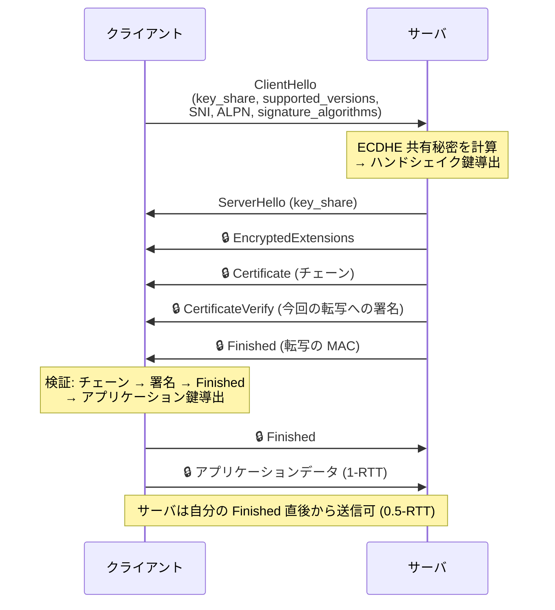

# TLS 1.3 の内部構造 (TLS 1.3 Internals: Handshake, Key Schedule & PKI)

## 概要 (Overview)

今日のインターネットで暗号化されていない接続は例外である。HTTP は HTTPS になり、QUIC ([`http-quic-evolution.md`](http-quic-evolution.md)) は TLS 1.3 をトランスポートに内蔵した。本ドキュメントはその TLS 1.3 (RFC 8446, 2018) の内部、すなわちハンドシェイク、鍵スケジュール、そして信頼の根拠である PKI を扱う。

中心テーゼは、**TLS 1.3 は「足して」ではなく「削って」安全かつ高速になった**、ということ。RSA 鍵交換・静的 DH・CBC モード・圧縮・再ネゴシエーションといった、過去 20 年の攻撃 (BEAST, CRIME, POODLE, FREAK…) の温床は個別修正ではなく**削除**され、鍵交換は前方秘匿性 (forward secrecy) を持つ (EC)DHE だけが残った。削減は速度にも寄与した: 選択肢が減ったからこそクライアントは「先に鍵を送る」賭けができ、ハンドシェイクは 2-RTT から 1-RTT になった。

もう一つの軸は**暗号と信頼の分離**である。ハンドシェイクの数学 (鍵合意・署名) は形式検証まで済んでいるが、「その公開鍵は本当にそのサーバのものか」を保証するのは PKI、つまり数百の認証局 (CA) と証明書チェーンという**運用のシステム**であり、歴史的な事故 (DigiNotar) も対策 (Certificate Transparency) もこちら側で起きている。

本書は (1) ハンドシェイクの設計、(2) HKDF による鍵スケジュール、(3) 証明書検証と PKI の信頼モデル、(4) 再開・0-RTT・ダウングレード防御、(5) 攻撃史と耐量子への移行、を整理する。分析深度は Level 3。

## 方法論 (Methodology)

- プロトコルの各要素を「どの攻撃への応答か」で説明する。TLS 1.3 の設計は攻撃史の否定形として読むのが最も見通しが良い。
- 仕様は RFC 8446 を一次資料とし、形式検証・証明の知見 (設計段階での学術検証という TLS 1.3 の新しい開発様式) を安全性主張の根拠とする。
- 「プロトコルの欠陥」(BEAST 等) と「実装の欠陥」(Heartbleed) を峻別する。両者の対策は全く異なる。
- 暗号プリミティブ (AES-GCM, X25519 等) の内部は扱わず、その組み合わせ方 (プロトコル設計) に集中する。QUIC への統合は [`http-quic-evolution.md`](http-quic-evolution.md) と分担する。

## 発見事項 (Findings)

1. **TLS の仕事は 2 相に分かれる。** 高価な非対称暗号で「認証された鍵合意」を行うハンドシェイク相と、合意した鍵で対称暗号 (AEAD) の高速通信を行うレコード相。性能もリスクも構造が全く違い、ハンドシェイクは RTT とサーバ CPU (署名) が、レコード相は AES-NI によりほぼタダ (数 %) が支配項である。
2. **1-RTT 化の正体は「クライアントの見切り発車」である。** TLS 1.2 は「合意してから鍵交換」の 2-RTT。TLS 1.3 のクライアントは ClientHello に **key_share (DH 公開値) を同梱**し、サーバは即座に自分の share と暗号化応答を返せる。群の選択肢を事実上数個に削ったから外れない賭けになった。つまり、**選択肢の削減が往復の削減を買った**。
3. **ServerHello 以降は全て暗号化された。** 証明書・拡張・署名はハンドシェイク鍵で包まれ、盗聴者に見えるのは ClientHello/ServerHello だけになった。受動的観測者への露出が激減した一方、残る平文の SNI (どのホスト名へ接続するか) が最後の漏れとして ECH (Encrypted ClientHello) の課題になっている。
4. **鍵スケジュールは「1 つの秘密から多数の鍵を派生する」規律である。** (EC)DHE の共有秘密と (あれば) PSK を HKDF の連鎖に投入し、ハンドシェイク鍵・アプリケーション鍵・再開用秘密・exporter を**それぞれ独立に**導出する。用途ごとの鍵分離 (key separation) により、1 つの鍵の侵害や誤用が他に波及しない。
5. **暗号は数学だが、信頼は運用である。** 署名検証が保証するのは「証明書の秘密鍵の持ち主」まで。その証明書が正当かは、ルート CA 集合・チェーン検証・失効・Certificate Transparency (全発行の公開ログ化) という運用機構に懸かっており、TLS の実際の破れの多くは数学ではなくこの層 (誤発行・検証実装のバグ) で起きてきた。
6. **後方互換は「変装」でしか達成できなかった。** 中間装置 (middlebox) が TLS 1.2 以外を落とすため、TLS 1.3 は**ワイヤ上では 1.2 のセッション再開のふり**をする (supported_versions 拡張で本当の版を伝え、ダミーの ChangeCipherSpec まで送る)。プロトコル硬直化 (ossification) への対処としての「見た目の凍結」であり、QUIC が暗号化で将来の硬直化を予防する ([`http-quic-evolution.md`](http-quic-evolution.md)) 判断の直接の前史である。

## アーキテクチャ (Architecture)

### 1-RTT ハンドシェイク



- **CertificateVerify** が要: サーバは「**この**ハンドシェイク転写 (transcript) 全体」への署名を出す。鍵合意と身元の結合がここで起き、過去の署名の再生 (replay) や切り貼りが通用しない。
- **Finished** は転写全体の MAC で、経路上での改竄 (アルゴリズムのすり替え等) を最終確認する。

### 鍵スケジュール (HKDF の連鎖)

```
  PSK (再開時。なければ 0) ──▶ HKDF-Extract ──▶ Early Secret ──▶ 0-RTT 用鍵
                                     │ Derive-Secret
  (EC)DHE 共有秘密 ─────────▶ HKDF-Extract ──▶ Handshake Secret
                                     │            ├─▶ client/server handshake traffic secret
                                     │ Derive-Secret
                              HKDF-Extract ──▶ Master Secret
                                                  ├─▶ client/server application traffic secret
                                                  ├─▶ exporter secret (他プロトコルへの鍵供出)
                                                  └─▶ resumption secret (次回の PSK)
  各 traffic secret ─ HKDF-Expand-Label ─▶ AEAD 鍵 + IV (ラベルで用途を分離)
```

## 技術詳細 (Technical Details)

### 1. 削除の目録 — 1.2 → 1.3 で消えたもの

| 削除されたもの | 葬った攻撃・問題 |
|---|---|
| RSA 鍵交換 (鍵輸送) | 前方秘匿性の欠如。サーバ秘密鍵が漏れると**過去の全通信**が復号される。「今盗って後で解く」への根本対策 |
| CBC モード + MAC-then-Encrypt | BEAST, Lucky13, POODLE (パディングオラクル系)。AEAD (GCM/ChaCha20-Poly1305) のみに |
| RC4 | 統計的偏りによるバイト回復 |
| 圧縮 | CRIME (圧縮率が秘密を漏らすサイドチャネル) |
| 再ネゴシエーション | 接続への平文注入 (2009) |
| カスタム DH パラメータ・輸出級暗号 | FREAK, Logjam (弱パラメータへのダウングレード) |

- 暗号スイートは 1.2 の数十から**実質 5 つ** (AES-GCM ×2, ChaCha20-Poly1305, CCM ×2) になり、「鍵交換 × 署名 × 暗号 × ハッシュ」の組合せ爆発も解体された (鍵交換と署名はスイートから分離)。**攻撃面の縮小と相互運用性の向上が同じ操作で達成された**のが要点である。

### 2. 証明書検証 — 信頼チェーンの実務

- 検証の実体: (1) チェーン構築 (サーバ証明書 → 中間 CA → ルート CA。ルートは OS/ブラウザの**トラストストア**に事前配置)、(2) 各段の署名検証と有効期間、(3) **名前検証** (SAN と接続先ホスト名の一致。これを省く実装バグが史上最も繰り返された TLS の穴)、(4) 失効確認。
- 失効は未解決問題の見本市である: CRL (肥大化)、OCSP (可用性とプライバシの問題)、**OCSP stapling** (サーバが証明済み回答を同梱)、ブラウザ独自の集約配信 (CRLite/OneCRL)。「失効が確認できないとき繋ぐか切るか (soft-fail vs hard-fail)」は今も妥協の産物で、多くの実装が soft-fail を選んでいる。
- **Certificate Transparency (CT)**: 全ての証明書発行を追記専用の公開ログ (Merkle 木) に記録させ、SCT (ログ収録証明) のない証明書を主要ブラウザは拒否する (Chrome は 2018 年から必須化)。誤発行を**防ぐ**のではなく**隠せなくする**。検出可能性による抑止という設計で、DigiNotar 型の事故 (CA 侵害による偽証明書、2011) への構造的応答である。
- 証明書の有効期間は短縮の一途 (最大 398 日 → さらに短縮の合意が進行中) にあり、自動化 (ACME/Let's Encrypt) が前提の運用になった。**失効が信頼できないなら、寿命を縮めるのが次善**という論理である。

### 3. 再開と 0-RTT — 速度とリプレイの取引

- 初回接続の resumption secret から **PSK (セッションチケット)** を発行し、次回はフルの証明書検証を省略できる (PSK + ECDHE で前方秘匿性は維持するのが推奨形)。
- **0-RTT (early data)**: 再開時、クライアントは ClientHello と同時に PSK 由来の鍵でアプリケーションデータを送れる。ただしこのデータは**リプレイ可能**である。攻撃者が暗号文を複製再送しても TLS 層は検出できない。冪等なリクエストに限る・回数制限を課すなどの規律はアプリケーション層の責務であり、QUIC/HTTP サーバの実装が「0-RTT で POST を受けない」のはこのため ([`http-quic-evolution.md`](http-quic-evolution.md) のリプレイの議論と同根)。
- **ダウングレード防御**: 1.3 対応サーバが 1.2 で応答させられた場合、ServerHello.random の末尾に固定センチネル値 (`DOWNGRD` 印) を埋め込む。1.3 対応クライアントはこれを見て中間者によるバージョン強制を検出する。これは、**古い版との共存自体を署名対象に組み込む**設計である。

### 4. レコード層と実装の現在地

- レコード相は AEAD による認証付き暗号化のみ。ヘッダの content type すら暗号化され (見かけは全部 application_data)、長さ以外のメタデータを漏らさない方向に寄せた。パディングも仕様に入ったが、**長さとタイミングというサイドチャネルは依然残る** (トラフィック解析への完全な防御は TLS の守備範囲外)。
- 性能: AES-NI 環境で AES-GCM は数 GB/s/コア級であり、レコード相の暗号コストは実務上ほぼ問題にならない。ボトルネックはハンドシェイクの署名 (RSA-2048 で数百 µs〜、ECDSA はより軽い) と RTT に移った。CDN がエッジで TLS を終端する理由の半分はこの RTT である。
- **kTLS**: 確立後の対称暗号をカーネル/NIC にオフロードし、`sendfile` と暗号化を両立する ([`kernel-network-stack.md`](kernel-network-stack.md) のオフロードの系譜)。ハンドシェイクはユーザ空間、レコード相はカーネルという分業。

### 5. 耐量子への移行 — 「今盗って後で解く」対策

- 脅威モデル: 大規模量子計算機は (EC)DH と署名を破る (Shor)。署名は「その時が来てから」でも間に合うが、**鍵交換は今の盗聴が将来復号される** (harvest now, decrypt later) ため先行対応が要る。
- 現在地 (2026 時点): ハイブリッド鍵交換 **X25519MLKEM768** (古典 ECDH + 格子ベース ML-KEM/FIPS 203 の併用。どちらかが破れても他方が守る) が主要ブラウザ・CDN で既定化へ進み、接続の相当割合が既に耐量子鍵交換で張られている。key_share が数百バイトから約 1.2KB に増え、ClientHello が複数パケットに割れる。**暗号の移行がまた硬直化 (これを落とす middlebox) をあぶり出す**という反復も観測されている。

### 6. 観測の入口 (Observability)

| 疑問 | 道具 |
|---|---|
| 何が合意されたか | `openssl s_client -connect host:443 -tls1_3` (スイート・チェーン・ALPN)、ブラウザの開発者ツール |
| ハンドシェイクのどこで失敗したか | TLS alert コード、`SSLKEYLOGFILE` + Wireshark (復号して転写を読む) |
| 証明書の素性 | CT ログ検索 ([crt.sh](https://crt.sh))。自ドメインの意図しない発行の監視にも使う |
| サーバ設定の健全性 | SSL Labs Server Test、`testssl.sh` |
| ハンドシェイクのコスト | `openssl speed rsa ecdsa`、サーバの TLS 終端 CPU プロファイル |

## セキュリティ考察 (Security Considerations)

- **実装の欠陥はプロトコルを素通りする。** Heartbleed (2014, OpenSSL の heartbeat 境界検査漏れでメモリ内容 (秘密鍵を含む) が読める) は TLS の設計とは無関係の実装バグだが、被害はプロトコルの欠陥より大きかった。証明書検証の省略・ホスト名検証漏れも同類で、**「TLS を使っている」ことと「TLS が守っている」ことの距離**は実装と設定で決まる。
- **PKI は最弱の CA に律速される。** どの CA も (制約がなければ) どのドメインの証明書でも発行できるため、体系全体の強度は数百の CA の最弱点で決まる。CT による検出、CAA レコード (発行可能 CA の宣言)、名前制約が緩和策であり、「信頼の集中と分散」の設計問題として PKI は今も動いている。
- **メタデータは暗号化されても残る。** 誰がいつ・どこへ・どれだけの量を送ったかは TLS では隠れない。SNI の暗号化 (ECH) は接続先の隠蔽を進めるが、IP アドレスとトラフィックパターンによる推定は残る。つまり「暗号化 = 匿名化ではない」。
- **0-RTT のリプレイ・チケットの追跡性**: セッションチケットは再開を速くする一方、発行者にクライアントの再訪を対応付ける能力を与える (トラッキングの道具になりうる)。ブラウザはチケットの寿命・使い回しを制限している。
- **ダウングレードと「互換モード」は常に攻撃面である**: 古いバージョン・弱い設定を残す限り、そこへ誘導する攻撃 (FREAK/Logjam 型) が成立しうる。TLS 1.0/1.1 の廃止 (RFC 8996) が示す通り、**最終的な防御は削除**である。

## 結論 (Conclusions)

- TLS 1.3 は「攻撃史の否定形」として設計された。RSA 鍵交換・CBC・圧縮・再ネゴシエーションの削除は個別のパッチではなく攻撃クラスの根絶であり、削減が 1-RTT 化という速度まで買った。**安全性と性能が同じ設計操作から出た**稀有な例である。
- 鍵スケジュール (HKDF 連鎖と鍵分離) とハンドシェイク転写への署名・MAC が、鍵合意と認証を密結合する。この中核は形式検証まで済んでおり、残るリスクは実装・設定・そして PKI という運用系に集中している。
- 信頼の層 (CA・失効・CT) は数学ではなく制度設計であり、「防げないなら隠せなくする」(CT)、「失効できないなら短命にする」(自動化と短寿命証明書) という現実的な妥協の積み重ねで動いている。
- ミドルボックス対策の「変装」から耐量子ハイブリッドの鍵サイズ問題まで、TLS の歴史はプロトコル進化と硬直化の戦いの記録でもある。QUIC が TLS 1.3 を内蔵し暗号化を既定にした判断は、この戦いの直接の続編として読める。

### 次の接続先 (Related Topics)

- [`http-quic-evolution.md`](http-quic-evolution.md) — TLS 1.3 を内蔵した QUIC。0-RTT・アンプ制限・硬直化対策の実装先。
- [`kernel-network-stack.md`](kernel-network-stack.md) — kTLS オフロード。レコード相の暗号がカーネル/NIC に降りる経路。
- [`dns-resolution.md`](dns-resolution.md) — 接続の前段。DoT/DoH は DNS を TLS の中に入れる動きであり、SNI と並ぶ「最後の平文」問題を共有する。
- [`../../hardware/security/side-channels-tee-secure-boot.md`](../../hardware/security/side-channels-tee-secure-boot.md) — 鍵を守る側の基盤 (TEE, secure boot)。タイミングサイドチャネルの一般論。
- [`../apis/authentication-tokens-specification.md`](../apis/authentication-tokens-specification.md) — TLS の上に載る認証トークンの層。

## 参考文献 (References)

**一次資料 (Primary — RFC・論文)**

- Rescorla, E. (2018). The Transport Layer Security (TLS) Protocol Version 1.3. *RFC 8446*. — [rfc-editor.org](https://www.rfc-editor.org/rfc/rfc8446) — Accessed: 2026-07-05。
- Dowling, B., Fischlin, M., Günther, F., & Stebila, D. (2021). A Cryptographic Analysis of the TLS 1.3 Handshake Protocol. *Journal of Cryptology*, 34(4). DOI: 10.1007/s00145-021-09384-1 — ハンドシェイクの安全性証明。
- Laurie, B., Langley, A., & Kasper, E. (2013). Certificate Transparency. *RFC 6962*. — [rfc-editor.org](https://www.rfc-editor.org/rfc/rfc6962) — Accessed: 2026-07-05。
- Moriarty, K., & Farrell, S. (2021). Deprecating TLS 1.0 and TLS 1.1. *RFC 8996*. — [rfc-editor.org](https://www.rfc-editor.org/rfc/rfc8996) — Accessed: 2026-07-05。
- Thomson, M., & Turner, S. (2021). Using TLS to Secure QUIC. *RFC 9001*. — [rfc-editor.org](https://www.rfc-editor.org/rfc/rfc9001) — Accessed: 2026-07-05。

**二次資料 (Secondary — 解説)**

- [The Illustrated TLS 1.3 Connection](https://tls13.xargs.org/) — Accessed: 2026-07-05。全バイトの逐語解説。手を動かす学習に最適。
- Ristić, I. *Bulletproof TLS and PKI* (2nd ed.), Feisty Duck — TLS/PKI 運用の網羅的教科書。
- Cloudflare Blog — [A Detailed Look at RFC 8446 (a.k.a. TLS 1.3)](https://blog.cloudflare.com/rfc-8446-aka-tls-1-3/)、[Post-quantum cryptography](https://blog.cloudflare.com/pq-2024/) — Accessed: 2026-07-05。設計解説と耐量子移行の実測。
