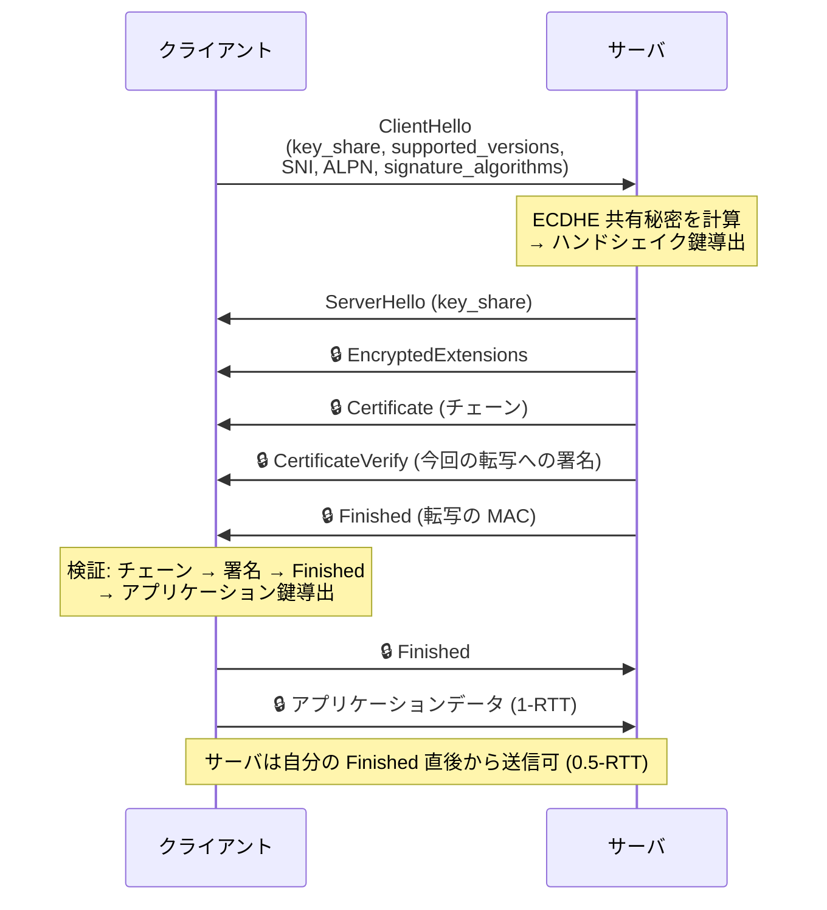
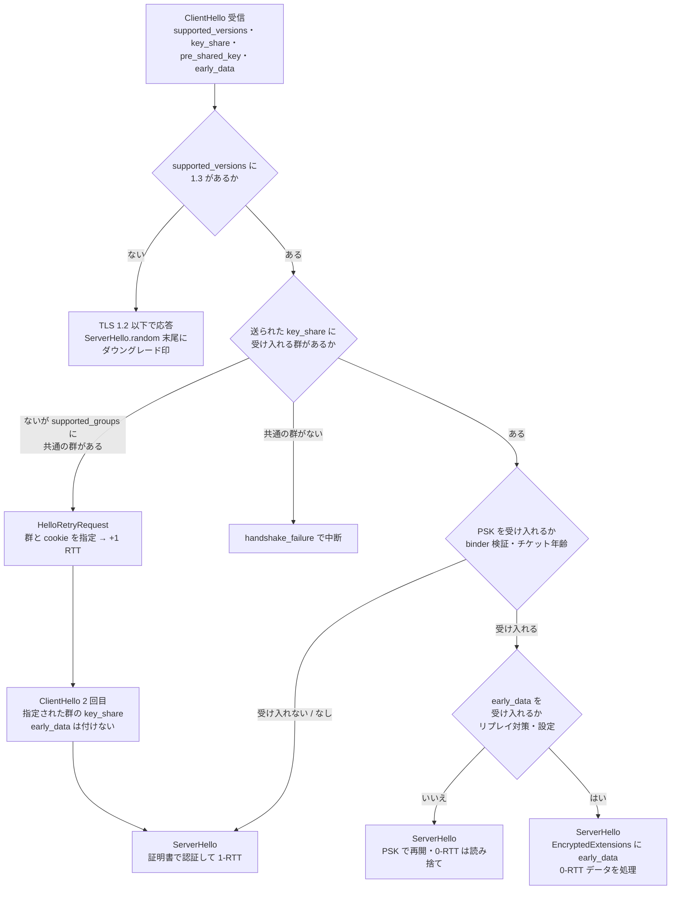
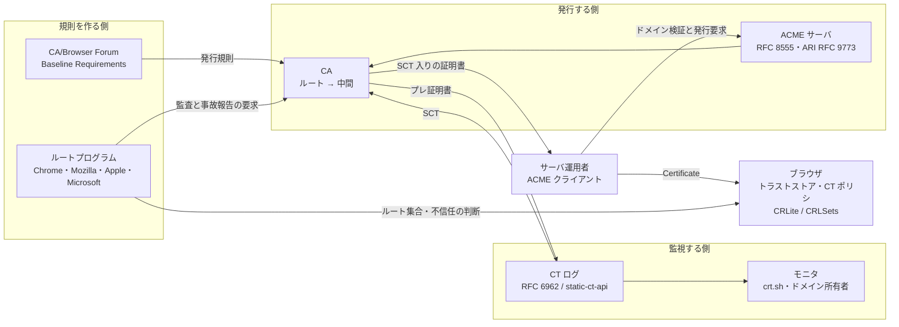

# TLS 1.3 の内部構造 (TLS 1.3 Internals: Handshake, Key Schedule & PKI)

## 概要 (Overview)

今日のインターネットで暗号化されていない接続は例外である。HTTP は HTTPS になり、QUIC ([`http-quic-evolution.md`](http-quic-evolution.md)) は TLS 1.3 をトランスポートに内蔵した。本ドキュメントはその TLS 1.3 (RFC 8446, 2018) の内部、すなわちハンドシェイク、鍵スケジュール、そして信頼の根拠である PKI を扱う。2026 年 7 月には改訂版の RFC 9846 が発行され、RFC 8446 と TLS 1.2 の RFC 5246 を廃止 (obsolete) した。同じ月に RFC 9851 が TLS 1.2 の機能凍結 (feature freeze) を定めたので、新しい機能は 1.3 にしか入らない。

中心テーゼは、**TLS 1.3 は「足して」ではなく「削って」安全かつ高速になった**、ということ。RSA 鍵交換・静的 DH・CBC モード・圧縮・再ネゴシエーションといった、過去 20 年の攻撃 (BEAST, CRIME, POODLE, FREAK…) の温床は個別修正ではなく**削除**され、鍵交換は前方秘匿性 (forward secrecy) を持つ (EC)DHE だけが残った。削減は速度にも寄与した: 選択肢が減ったからこそクライアントは「先に鍵を送る」賭けができ、ハンドシェイクは 2-RTT から 1-RTT になった。

もう一つの軸は**暗号と信頼の分離**である。ハンドシェイクの数学 (鍵合意・署名) は形式検証まで済んでいるが、「その公開鍵は本当にそのサーバのものか」を保証するのは PKI、つまり数百の認証局 (CA) と証明書チェーンという**運用のシステム**であり、歴史的な事故 (DigiNotar) も対策 (Certificate Transparency) もこちら側で起きている。

本書は (1) ハンドシェイクの設計、(2) HKDF による鍵スケジュール、(3) 証明書検証と PKI の信頼モデル、(4) 再開・0-RTT・ダウングレード防御、(5) 攻撃史と耐量子への移行、を整理する。そのうえで、ハンドシェイクの分岐 (HelloRetryRequest・版交渉・互換モード・GREASE)、拡張 (SNI・ALPN・ECH・証明書圧縮)、PKI の運用 (証明書の短寿命化・ACME・失効・CT ログ・ルートプログラム)、再開の鍵管理と 0-RTT のリプレイ対策、レコード層の利用上限、実装と形式検証、mTLS と DTLS 1.3、TLS を終端する中間装置、故障の形を順に掘り下げる。分析深度は Level 3。

## 方法論 (Methodology)

- プロトコルの各要素を「どの攻撃への応答か」で説明する。TLS 1.3 の設計は攻撃史の否定形として読むのが最も見通しが良い。
- 仕様は RFC 8446 を一次資料とし、形式検証・証明の知見 (設計段階での学術検証という TLS 1.3 の新しい開発様式) を安全性主張の根拠とする。
- 「プロトコルの欠陥」(BEAST 等) と「実装の欠陥」(Heartbleed) を峻別する。両者の対策は全く異なる。
- 暗号プリミティブ (AES-GCM, X25519 等) の内部は扱わず、その組み合わせ方 (プロトコル設計) に集中する。QUIC への統合は [`http-quic-evolution.md`](http-quic-evolution.md) と分担する。
- **節番号の扱い**: 2026 年 7 月以降の一次資料は RFC 9846 である。RFC 9846 では節番号が RFC 8446 からずれている (例: HelloRetryRequest は 8446 の §4.1.4 に対して 9846 の §4.2.4、互換モードは付録 D.4 に対して付録 E.4)。本書では確認できた RFC 9846 の節番号を示し、必要に応じて 8446 の番号を併記する。
- **PKI の運用**: CA/Browser Forum の投票 (ballot) の原文、Chrome Root Program Policy (v1.8)、ブラウザ各社の不信任 (distrust) の告知、Let's Encrypt (ISRG) の告知を一次資料とする。日付は告知の版によって改訂されることがあるため、最終版の日付を書き、改訂があった場合はその旨を記す。
- **実装**: OpenSSL は `openssl-3.5.0` タグのソースと man ページを読み、行番号を記した。脆弱性は各プロジェクトのセキュリティ勧告を、運用の実態は査読付きの測定研究 (Durumeric ら IMC 2014・NDSS 2017、Springall ら IMC 2016) を根拠とする。
- **事業者の数値**: Cloudflare などの展開率は単一事業者の網で観測した値であり、インターネット全体の比率ではない。自社発表であることを明記する。
- **担当範囲**: STARTTLS・MTA-STS・DANE は [`email-delivery-authentication.md`](email-delivery-authentication.md)、QUIC での TLS の使い方は [`http-quic-evolution.md`](http-quic-evolution.md)、メッシュでの mTLS の自動化と SPIFFE は [`service-mesh.md`](service-mesh.md)、耐量子暗号のアルゴリズムは [`../security/applied-cryptography.md`](../security/applied-cryptography.md)、TLS を使う VPN は [`vpn-tunneling.md`](vpn-tunneling.md)、組織の検査装置の位置付けは [`../security/perimeter-defense-zero-trust.md`](../security/perimeter-defense-zero-trust.md) に委ねる。

## 発見事項 (Findings)

1. **TLS の仕事は 2 相に分かれる。** 高価な非対称暗号で「認証された鍵合意」を行うハンドシェイク相と、合意した鍵で対称暗号 (AEAD) の高速通信を行うレコード相。性能もリスクも構造が全く違い、ハンドシェイクは RTT とサーバ CPU (署名) が、レコード相は AES-NI によりほぼタダ (数 %) が支配項である。
2. **1-RTT 化の正体は「クライアントの見切り発車」である。** TLS 1.2 は「合意してから鍵交換」の 2-RTT。TLS 1.3 のクライアントは ClientHello に **key_share (DH 公開値) を同梱**し、サーバは即座に自分の share と暗号化応答を返せる。群の選択肢を事実上数個に削ったから外れない賭けになった。つまり、**選択肢の削減が往復の削減を買った**。
3. **ServerHello 以降は全て暗号化された。** 証明書・拡張・署名はハンドシェイク鍵で包まれ、盗聴者に見えるのは ClientHello/ServerHello だけになった。受動的観測者への露出が激減した一方、残る平文の SNI (どのホスト名へ接続するか) が最後の漏れとして残った。これを塞ぐ ECH (Encrypted Client Hello) は 2026 年 3 月に RFC 9849 になった (技術詳細 3)。
4. **鍵スケジュールは「1 つの秘密から多数の鍵を派生する」規律である。** (EC)DHE の共有秘密と (あれば) PSK を HKDF の連鎖に投入し、ハンドシェイク鍵・アプリケーション鍵・再開用秘密・exporter を**それぞれ独立に**導出する。用途ごとの鍵分離 (key separation) により、1 つの鍵の侵害や誤用が他に波及しない。
5. **暗号は数学だが、信頼は運用である。** 署名検証が保証するのは「証明書の秘密鍵の持ち主」まで。その証明書が正当かは、ルート CA 集合・チェーン検証・失効・Certificate Transparency (全発行の公開ログ化) という運用機構に懸かっており、TLS の実際の破れの多くは数学ではなくこの層 (誤発行・検証実装のバグ) で起きてきた。
6. **後方互換は「変装」でしか達成できなかった。** 中間装置 (middlebox) が TLS 1.2 以外を落とすため、TLS 1.3 は**ワイヤ上では 1.2 のセッション再開のふり**をする (supported_versions 拡張で本当の版を伝え、ダミーの ChangeCipherSpec まで送る)。プロトコル硬直化 (ossification) への対処としての「見た目の凍結」であり、QUIC が暗号化で将来の硬直化を予防する ([`http-quic-evolution.md`](http-quic-evolution.md)) 判断の直接の前史である。
7. **鍵の「賭け」が外れたときの代償は 1 往復である。** クライアントが送った key_share の群をサーバが受け入れないと、サーバは HelloRetryRequest (HRR) で群を指定し直させ、ハンドシェイクは 2-RTT に戻る。耐量子ハイブリッドの X25519MLKEM768 は鍵共有だけで 1,216 バイトあるため、複数の群の鍵共有を同時に送って外れを防ぐ方法は、パケットの大きさという費用を伴う。OpenSSL 3.5 の既定は X25519MLKEM768 と X25519 の 2 つを送る (技術詳細 2)。
8. **失効の確認は「オンラインで問い合わせる」方式から「ブラウザに配る一覧」と「短い寿命」へ移った。** Let's Encrypt は 2025 年 8 月 6 日に OCSP レスポンダを止めた。Firefox は CT ログに載った失効済み証明書の全集合を圧縮して配る CRLite に移った。CA/Browser Forum は証明書の最大有効期間を 2029 年 3 月までに 47 日へ縮める投票 (SC-081v3) を可決した。失効の情報を届けることが難しいので、失効しなくても短期間で切れる証明書を使う方向に寄せたことになる (技術詳細 4・5)。
9. **再開を速くする鍵が前方秘匿性の弱点になる。** セッションチケットを暗号化する鍵 (STEK: Session Ticket Encryption Key) を長く使い回すと、その鍵の漏洩で過去の通信が読める。Springall ら (IMC 2016) は TLS 1.2 の時代の上位 100 万サイトについて、サーバの秘密が 24 時間後に漏れた場合でも 38% のサイトの接続が復号可能になると推定した。TLS 1.3 の psk_dhe_ke はこの穴を小さくしたが、0-RTT のデータはチケットの鍵だけで守られる (技術詳細 6)。
10. **TLS 1.3 の中核は設計の段階で形式検証された。** Tamarin (Cremers ら, S&P 2016・CCS 2017) と ProVerif/CryptoVerif (Bhargavan ら, S&P 2017) が草案を検証し、標準化の途中で予期しない挙動を指摘した。それでも、破れは実装 (Heartbleed、OpenSSL の CVE-2024-12797) と運用 (CA の不祥事による不信任) の側で起き続けている (技術詳細 8)。
11. **TLS を終端する検査装置は、測定上ほとんどが安全性を下げている。** Durumeric ら (NDSS 2017) は Firefox の更新サーバへの接続の 4.0%、e コマースサイトの 6.2%、米国の Cloudflare への接続の 10.9% が途中で終端されていたと測定した。網の中間装置を通った接続の 62% は安全性が下がり、58% はさらに後から盗聴できる深刻な脆弱性を持っていた (技術詳細 10)。

## アーキテクチャ (Architecture)

### 1-RTT ハンドシェイク



- **CertificateVerify** が要: サーバは「**この**ハンドシェイク転写 (transcript) 全体」への署名を出す。鍵合意と身元の結合がここで起き、過去の署名の再生 (replay) や切り貼りが通用しない。
- **Finished** は転写全体の MAC で、経路上での改竄 (アルゴリズムのすり替え等) を最終確認する。

### 鍵スケジュール (HKDF の連鎖)

```
  PSK (再開時。なければ 0) ──▶ HKDF-Extract ──▶ Early Secret ──▶ 0-RTT 用鍵
                                     │ Derive-Secret
  (EC)DHE 共有秘密 ─────────▶ HKDF-Extract ──▶ Handshake Secret
                                     │            ├─▶ client/server handshake traffic secret
                                     │ Derive-Secret
                              HKDF-Extract ──▶ Master Secret
                                                  ├─▶ client/server application traffic secret
                                                  ├─▶ exporter secret (他プロトコルへの鍵供出)
                                                  └─▶ resumption secret (次回の PSK)
  各 traffic secret ─ HKDF-Expand-Label ─▶ AEAD 鍵 + IV (ラベルで用途を分離)
```

### ハンドシェイクの分岐

1-RTT の図は「賭けが当たった」場合である。サーバが ClientHello を受け取ってから最初の応答を決めるまでの分岐を示す。



凡例: 菱形はサーバの判断、四角は送る内容。psk_ke (PSK のみ) のモードでは key_share の判断を通らないが、ブラウザは前方秘匿性のある psk_dhe_ke を使う。HRR を受けたクライアントは 2 回目の ClientHello に early_data を付けられないので、HRR が起きた接続では 0-RTT は使えない。

### PKI の構成要素



凡例: 矢印は情報または判断の流れ。ルートプログラムは CA/Browser Forum の規則に加えて独自の規則を持ち、ブラウザの更新で CA を不信任にできる。この強制力が PKI の規律を支えている。

## 技術詳細 (Technical Details)

### 1. 削除の目録 — 1.2 → 1.3 で消えたもの

| 削除されたもの | 葬った攻撃・問題 |
|---|---|
| RSA 鍵交換 (鍵輸送) | 前方秘匿性の欠如。サーバ秘密鍵が漏れると**過去の全通信**が復号される。「今盗って後で解く」への根本対策 |
| CBC モード + MAC-then-Encrypt | BEAST, Lucky13, POODLE (パディングオラクル系)。AEAD (GCM/ChaCha20-Poly1305) のみに |
| RC4 | 統計的偏りによるバイト回復 |
| 圧縮 | CRIME (圧縮率が秘密を漏らすサイドチャネル) |
| 再ネゴシエーション | 接続への平文注入 (2009) |
| カスタム DH パラメータ・輸出級暗号 | FREAK, Logjam (弱パラメータへのダウングレード) |

- 暗号スイートは 1.2 の数十から**実質 5 つ** (AES-GCM ×2, ChaCha20-Poly1305, CCM ×2) になり、「鍵交換 × 署名 × 暗号 × ハッシュ」の組合せ爆発も解体された (鍵交換と署名はスイートから分離)。**攻撃面の縮小と相互運用性の向上が同じ操作で達成された**のが要点である。

### 2. HRR・版交渉・互換モード・GREASE

**HelloRetryRequest (HRR)**

- クライアントは、サーバがどの群を選ぶかを知らないまま key_share を送る。サーバが受け入れる群の鍵共有がなく、supported_groups (クライアントが扱える群の一覧) に共通の群がある場合、サーバは HRR で群を指定し、クライアントはその群の鍵共有を付けて ClientHello を送り直す (RFC 9846 §4.2.4)。HRR は形式上は ServerHello で、random 欄に「HelloRetryRequest」の SHA-256 という固定値を入れて区別する。
- HRR は cookie 拡張を運べる。サーバは自分の状態を cookie に詰めてクライアントに預ければ、HRR の時点で状態を持たずに済む (stateless HRR)。これは DTLS で送信元アドレスを確かめる手段にもなる。転写ハッシュでは 1 回目の ClientHello をそのハッシュ値を入れた合成メッセージ (message_hash) に置き換える。これにより、サーバは 1 回目の ClientHello 全体を保存しなくても転写を検証できる。
- サーバが群をどう選ぶかは実装で決まる。OpenSSL 3.5 の man ページは、サーバの群を「同程度の強さの組 (tuple)」の優先順に並べ、組ごとに「クライアントが鍵共有を送った群があれば ServerHello、supported_groups にしかなければ HRR」と判断する疑似コードを載せている (`doc/man3/SSL_CTX_set1_curves.pod` 150-171 行、`openssl-3.5.0`)。つまり、強い群を優先するサーバは、クライアントが弱い群の鍵共有だけを送ってきたときに、1 往復を払ってでも強い群に切り替えさせる。

**鍵共有の予測と耐量子化の費用**

- 外れを減らすには、複数の群の鍵共有を同時に送ればよい。ただし鍵共有の大きさは X25519 が 32 バイトなのに対し、X25519MLKEM768 は 1,216 バイトある ([`../security/applied-cryptography.md`](../security/applied-cryptography.md))。OpenSSL 3.5.0 の既定の群の一覧は次のとおりで、`*` を付けた X25519MLKEM768 と X25519 の 2 つの鍵共有を送る。

```c
/* C: OpenSSL の既定の群の一覧 (ssl/t1_lib.c 203-205 行、openssl-3.5.0) */
/* "*" = クライアントが鍵共有を送る、"/" = 同程度の強さの組の区切り、"?" = 未実装なら無視 */
#define DEFAULT_GROUP_NAME "DEFAULT"
#define TLS_DEFAULT_GROUP_LIST \
    "?*X25519MLKEM768 / ?*X25519:?secp256r1 / ?X448:?secp384r1:?secp521r1 / ?ffdhe2048:?ffdhe3072"
```

- Chrome は Kyber の草案版 (0x6399) から標準版の X25519MLKEM768 (0x11EC) へ移るとき、2 つの耐量子の鍵共有を同時に送る案を採らず、Chrome 131 で切り替えた。理由として、鍵共有の予測にかかる大きさの費用と、非標準の方式に固まる (ossify) 危険を挙げている (Google Security Blog, 2024-09-13)。同じ告知は、サーバが対応する群を DNS で広告し、クライアントが予測できるようにする IETF の提案にも触れている。
- RFC 9846 は鍵共有の値を複数の接続で使い回すことを禁じた (§4.3.8)。RFC 8446 は使い回しを許していたので、受信側は相手の使い回しを受け入れなければならない、という互換の規定も同時に置かれている。

**版交渉と互換モード**

- ClientHello の legacy_version は 1.2 (0x0303) に固定され、本当の版は supported_versions 拡張で伝える。古い版の番号欄を見て 1.2 より新しい値を拒む実装が多かったため、版の番号欄そのものを使わなくなった。
- **互換モード (middlebox compatibility mode)** では、クライアントは空でない legacy_session_id を送り、サーバはそれを返す。両者はダミーの change_cipher_spec も送る (RFC 9846 付録 E.4、RFC 8446 では付録 D.4)。ワイヤ上の見た目が TLS 1.2 のセッション再開と同じになり、1.2 の状態遷移しか知らない中間装置を通り抜けられる。
- **ダウングレード防御** の固定値は、1.2 に落とされた場合に ServerHello.random の末尾 8 バイトを `44 4F 57 4E 47 52 44 01` (「DOWNGRD」と 01)、1.1 以下なら末尾を 00 にする (RFC 9846 §4.2.3)。RFC 9846 は TLS 1.0 と 1.1 の交渉を禁じた。

**GREASE**

- GREASE (Generate Random Extensions And Sustain Extensibility, RFC 8701) では、クライアントは予約された無意味な値 (`0x0A0A`, `0x1A1A`, … の形) を暗号スイート・拡張・群・署名方式・版の一覧に混ぜて送る。正しく実装されたサーバは知らない値を無視するが、知らない値で接続を切るサーバはすぐに見つかる。将来の拡張が通らなくなる前に、拡張点を使い続けて硬直化を防ぐ方法である。
- ECH にも GREASE がある。ECH の設定を持たないクライアントも偽の ECH 拡張を送り、本物の ECH を使う接続が目立たないようにする (RFC 9849 §6.2)。

### 3. SNI・ALPN・ECH・証明書圧縮

| 拡張 | RFC | 役割 | 実務上の論点 |
|---|---|---|---|
| server_name (SNI) | RFC 6066 | 接続先のホスト名。1 つの IP で複数の証明書を出し分ける | 平文なので、CDN の振り分けにも、検閲や社内の通信制御にも使われる |
| ALPN | RFC 7301 | 上位プロトコル (`h2`, `http/1.1` など) の交渉 | 追加の往復なしに HTTP/2 を選べる。ACME の tls-alpn-01 検証 (RFC 8737) にも使われる |
| encrypted_client_hello (ECH) | RFC 9849 | 内側の ClientHello (SNI・ALPN を含む) を暗号化する | 鍵の配布を DNS に頼る。大きな匿名集合が要る。網での遮断 |
| compress_certificate | RFC 8879 | Certificate メッセージを zlib・Brotli・zstd で圧縮する | 証明書チェーンは大きく、QUIC では応答量の上限 (受信量の 3 倍) に当たりやすい |
| record_size_limit | RFC 8449 | 受け取れるレコードの最大長を伝える | メモリの少ない機器向け。旧来の max_fragment_length の置き換え |
| status_request (OCSP stapling) | RFC 6066 | サーバが OCSP の応答を同梱する | 失効を OCSP で配る CA が減り、意味が薄れつつある (技術詳細 5) |

**ECH の仕組み (RFC 9849, 2026-03)**

- クライアントは本当の ClientHello (ClientHelloInner) を HPKE で暗号化し、当たり障りのない値を持つ外側の ClientHello (ClientHelloOuter) の encrypted_client_hello 拡張に入れる。外側の SNI は ECH の設定にある public_name (多数のサイトで共有する名前) になる (§4, §5)。外側の ClientHello は HPKE の関連データとして認証される。
- ECH の設定 (HPKE の公開鍵など) は DNS の HTTPS レコードで配るのが基本で (RFC 9848)、DNS が平文なら改ざんされうる (§10.2)。DNS の問い合わせ自体も接続先を漏らすので、ECH の効果は暗号化 DNS ([`dns-resolution.md`](dns-resolution.md)) と組み合わせたときに出る。
- 受け付けたサーバは ServerHello.random の末尾 8 バイトに確認値を埋め込み、クライアントは ECH が受け入れられたかを知る (§7.2)。拒否されたときは、サーバは外側の ClientHello で public_name の証明書を使ってハンドシェイクを完了し、新しい設定 (retry_configs) を返す。クライアントはその接続を本来の接続先への接続として扱わず、新しい設定で接続し直す (§6.1.6)。DNS に古い設定が残っていても、1 回の再試行で回復できる。
- ECH が隠すのは ClientHello の中身だけである。サーバの IP アドレス、平文の DNS、OCSP などの証明書の検証通信は接続先を漏らす (§1, §10.7)。プライバシーの効果は同じ public_name の後ろにいるサイトの数 (匿名集合) で決まる。このため、効果が出るのは大きな CDN の後ろにいるサイトであり、ECH は CDN への集中と組になっている。
- Cloudflare は 2024 年 10 月に顧客のサイトで ECH を既定で有効にし、外側の SNI を全サイト共通の `cloudflare-ech.com` にした。ロシアの通信監督庁 (Roskomnadzor) は 2024 年 11 月初めから、Cloudflare の ECH を使う接続を遮断し、ECH はロシアの法律に反すると表明した (Meduza, The Record の報道)。外側の public_name が 1 つだと、その名前を見るだけで ECH を使う接続を一括で落とせる。ECH はサイトごとの検閲を難しくするが、ECH そのものの遮断は防げない。

### 4. 証明書検証 — 信頼チェーンの実務

- 検証の実体: (1) チェーン構築 (サーバ証明書 → 中間 CA → ルート CA。ルートは OS/ブラウザの**トラストストア**に事前配置)、(2) 各段の署名検証と有効期間、(3) **名前検証** (SAN と接続先ホスト名の一致。これを省く実装バグが史上最も繰り返された TLS の穴)、(4) 失効確認。
- 失効は未解決問題の見本市である: CRL (肥大化)、OCSP (可用性とプライバシの問題)、**OCSP stapling** (サーバが証明済み回答を同梱)、ブラウザ独自の集約配信 (CRLite/OneCRL)。「失効が確認できないとき繋ぐか切るか (soft-fail vs hard-fail)」は今も妥協の産物で、多くの実装が soft-fail を選んでいる。2025 年以降は OCSP そのものが退場しつつある (技術詳細 5)。
- **Certificate Transparency (CT)**: 全ての証明書発行を追記専用の公開ログ (Merkle 木) に記録させ、SCT (ログ収録証明) のない証明書を主要ブラウザは拒否する (Chrome は 2018 年から必須化)。誤発行を**防ぐ**のではなく**隠せなくする**。検出可能性による抑止という設計で、DigiNotar 型の事故 (CA 侵害による偽証明書、2011) への構造的応答である。
- 証明書の有効期間は短縮の一途 (最大 398 日 → 2029 年 3 月に 47 日、技術詳細 5) にあり、自動化 (ACME/Let's Encrypt) が前提の運用になった。**失効が信頼できないなら、寿命を縮めるのが次善**という論理である。

### 5. PKI の運用

**規則の作り手**

- 公開の CA が守る規則は CA/Browser Forum の Baseline Requirements (BR) にまとまっている。規則は投票 (ballot) で変わり、発行者 (CA) と利用者 (ブラウザなどの証明書の利用者) の両方の賛成が要る。ただし実際の強制力はブラウザのルートプログラムにあり、ルートプログラムは BR より厳しい独自の規則を持てる。

**有効期間の短縮 (SC-081v3)**

2025 年 4 月 11 日に可決された SC-081v3 (提案は Apple、発行者側は賛成 25・反対 0・棄権 5、利用者側は Apple・Google・Microsoft・Mozilla の 4 者が賛成) は、次の段階で上限を縮める。

| 適用開始 (発行日) | 証明書の最大有効期間 | ドメイン検証の結果を再利用できる期間 |
|---|---|---|
| 2026-03-15 より前 | 398 日 | 398 日 |
| 2026-03-15 | 200 日 | 200 日 |
| 2027-03-15 | 100 日 | 100 日 |
| 2029-03-15 | 47 日 | 10 日 |

- 投票の告知が明示しているのは開始 (2026 年 3 月)・終了 (2029 年 3 月)・最終値 (47 日と 10 日) である。中間の日付と値は CA 各社の解説 (GlobalSign ほか) と [`../security/applied-cryptography.md`](../security/applied-cryptography.md) の整理による。
- 有効期間が 47 日になると、手作業の更新は成り立たない。証明書の更新が止まって起きる障害 (期限切れ) を避けるには、自動化が前提になる。
- Let's Encrypt は 2026 年 1 月 15 日に、有効期間 160 時間 (約 6 日) の短命な証明書 (`shortlived` プロファイル) と IP アドレスの証明書を一般提供にした。既定の 90 日は 2028 年 2 月までに 45 日へ縮める計画である。6 日の証明書は、失効を確認しなくても漏れた鍵の悪用期間が 6 日以下になる。

**ACME と更新時期の指示**

- ACME (RFC 8555) はドメインの管理を確かめる検証 (http-01・dns-01・tls-alpn-01) と発行を自動化する。tls-alpn-01 (RFC 8737) は ALPN の値 `acme-tls/1` を使い、443 番ポートだけで検証を完結させる。
- ARI (ACME Renewal Information, RFC 9773, 2025-06) は、CA がクライアントに「この期間に更新せよ」と伝える拡張である。CA が大量の証明書を失効させる必要が出たとき、ARI に対応したクライアントは期限前でも自動で更新を始める。更新の時期を CA 側で分散させることもできる。

**失効 — OCSP の退場**

- Let's Encrypt は 2024 年 12 月に OCSP の終了を告知した。2025 年 5 月 7 日に証明書から OCSP の URL を外し、2025 年 8 月 6 日に OCSP レスポンダを止めた。理由として、OCSP では CA が「どの IP アドレスからどのサイトが見られたか」を知ってしまうというプライバシーの問題と、運用の費用を挙げている。失効の情報は CRL で配る。
- Firefox の CRLite は CT ログに載った証明書のうち失効したものの集合を小さく符号化して定期的に配る。Mozilla は平均の通信量を 1 日あたり約 300 kB としている。ブラウザが手元で失効を確かめるので、問い合わせによるプライバシーの漏れも、応答がないときの soft-fail もない。デスクトップ版で有効になった版は、Mozilla の解説記事 (Firefox 137) と四半期報告 (Firefox 142) で記載が異なる。Chrome は Google が選んだ失効情報を CRLSets として配っている。
- OCSP の応答を必須にする OCSP Must-Staple は、Let's Encrypt では 2025 年 1 月 30 日以降、原則として発行できなくなった。

**CT ログの作り替え**

- RFC 6962 型のログは問い合わせに応じてエントリや証明を動的に返す API を持ち、運用の費用が大きい。static-ct-api (C2SP の仕様) はログを「タイル」と呼ぶ静的なファイルの階層として公開し、CDN でキャッシュできるようにした。実装には Filippo Valsorda が設計した Sunlight などがあり、Let's Encrypt も static-ct-api のログを運用している。
- Chrome は 2025 年 3 月 (Chrome 134) から static-ct-api のログの SCT を受け入れた。検証期間のあいだは、少なくとも 1 つの SCT が RFC 6962 型のログのものであることを条件にしている。static-ct-api のログには最大マージ遅延 (MMD) を 1 分以下にすることを求めている。

**ルートプログラムの執行**

| 対象 | 告知 | 不信任の基準 | 理由 (告知の要旨) |
|---|---|---|---|
| Entrust・AffirmTrust | Chrome 2024-06-27 (2024-09-10 に改訂) | SCT が 2024-11-11 より後の TLS 証明書 (Chrome 131 から)。Mozilla は 2024-11-30、Apple は 2024-11-15 より後 | 長期にわたる規則違反と、改善の約束が果たされなかったこと |
| 中華電信 (Chunghwa Telecom)・Netlock | Chrome 2025-05-30 | SCT が 2025-07-31 より後の TLS 証明書 (Chrome 139 から) | 規則違反、改善の約束の不履行、事故報告への対応の遅れ |

- 不信任は「発行日」ではなく「最も早い SCT の日付」で線を引く。CA が自己申告する発行日は過去にさかのぼって書けるが、SCT はログが記録した時刻なので偽れない。CT は不正発行の検出だけでなく、執行のための時刻の証拠にもなっている。期限前の証明書を有効のまま残すので、サイト側は証明書の期限まで移行の猶予を得る。
- Chrome Root Program Policy v1.8 は、ルートプログラムに含める PKI の階層を用途で分け、サーバ認証専用にすることを求める。2027 年 3 月 15 日以降に発行される証明書は、拡張鍵用途 (EKU) にサーバ認証 (id-kp-serverAuth) だけを持たなければならない。ポリシ本文の中で、階層に関する期限に 2025-06-15 と 2026-06-15 の 2 つの日付が混在している。公開 CA のサーバ証明書をクライアント証明書としても使っていた mTLS は、私設 CA に移る必要がある (技術詳細 9)。

### 6. 再開と 0-RTT — 速度とリプレイの取引

- 初回接続の resumption secret から **PSK (セッションチケット)** を発行し、次回はフルの証明書検証を省略できる (PSK + ECDHE で前方秘匿性は維持するのが推奨形)。
- **0-RTT (early data)**: 再開時、クライアントは ClientHello と同時に PSK 由来の鍵でアプリケーションデータを送れる。ただしこのデータは**リプレイ可能**である。攻撃者が暗号文を複製再送しても TLS 層は検出できない。冪等なリクエストに限る・回数制限を課すなどの規律はアプリケーション層の責務であり、QUIC/HTTP サーバの実装が「0-RTT で POST を受けない」のはこのため ([`http-quic-evolution.md`](http-quic-evolution.md) のリプレイの議論と同根)。
- **ダウングレード防御**: 1.3 対応サーバが 1.2 で応答させられた場合、ServerHello.random の末尾に固定センチネル値 (`DOWNGRD` 印) を埋め込む。1.3 対応クライアントはこれを見て中間者によるバージョン強制を検出する。これは、**古い版との共存自体を署名対象に組み込む**設計である。

**PSK のモードとチケットの寿命**

- PSK のモードは 2 つある (RFC 9846 §4.3.9)。psk_ke は PSK だけで鍵を作るので前方秘匿性がない。psk_dhe_ke は PSK に (EC)DHE を加えるので、チケットの鍵が漏れても再開後の 1-RTT の通信は守られる。ブラウザは psk_dhe_ke を使う。
- サーバはチケットの寿命 (ticket_lifetime) を 604,800 秒 (7 日) より長くしてはならず、クライアントも発行から 7 日を超えたチケットを使ってはならない (§4.7.1)。

**ステートレスなチケットとチケット鍵**

- チケットには 2 つの作り方がある。ステートフルな方式では、チケットはサーバのデータベースを引く ID にすぎない。ステートレスな方式では、サーバは再開に必要な秘密 (PSK) をチケット鍵 (STEK) で暗号化してクライアントに預け、自分は何も保存しない。大規模なサーバ群では、全サーバで同じ STEK を共有すれば、どのサーバでも再開できる。
- 代償は前方秘匿性である。STEK を持つ者は預けたチケットから PSK を取り出せる。TLS 1.2 のチケットにはマスター秘密そのものが入っていたので、STEK の漏洩はその STEK で再開した全通信の復号を意味した。Springall ら (IMC 2016) は上位 100 万の HTTPS サイトについて、こうした近道 (STEK の使い回し、DH の値の再利用など) のために、サーバの秘密が 24 時間後に漏れた場合でも 38%、30 日後でも約 10% のサイトの接続が復号できると推定した。複数のドメインで秘密を共有しているため、1 つの秘密の窃取で数万のサイトが影響を受ける例もあった。
- TLS 1.3 の psk_dhe_ke では、STEK が漏れても読めるのは 0-RTT のデータと psk_ke の接続に限られる。STEK は短い周期で入れ替え、配布の経路も鍵として守る必要がある。ステートフルな方式でチケットを使い捨てにすれば、使用後に PSK を消せるので前方秘匿性も得られる (§8.1)。

**0-RTT のリプレイ対策 (RFC 9846 §8)**

| 方式 | 仕組み | 長所 | 短所 |
|---|---|---|---|
| 使い捨てのチケット (§8.1) | 未使用のチケットを記録し、使ったら消す | 1 つのチケットにつき 0-RTT は最大 1 回。PSK を消すので前方秘匿性も得る | 全サーバで共有する記憶が要り、分散すると 0-RTT の成功率が下がる |
| ClientHello の記録 (§8.2) | ClientHello の random か PSK binder を記録し、重複を拒む | 時間の窓に限れば記憶を有限にできる。Bloom フィルタも使える | 記憶が不整合だと漏れる。起動直後は窓が重なるので 0-RTT を拒む必要がある |
| 鮮度の確認 (§8.3) | チケットの発行時刻とクライアントが申告するチケットの経過時間から到着時刻を予測し、ずれが大きければ拒む | 状態が要らない。インターネットのクライアントでは 10 秒程度の窓が目安 | 窓の中の再送は検出できない。単独では不十分 |

- 仕様が求めるのは、各サーバのインスタンスが同じハンドシェイクの 0-RTT を高々 1 回しか受け入れないことである。複数の地域 (ゾーン) に分かれたサーバ群で、ゾーンごとに記憶を持つと、リプレイは「ゾーンごとに 1 回」まで許してしまう。1 つのゾーンだけを権威として扱い、ほかのゾーンでは 0-RTT を拒む構成が最も強い。
- 仕様は、ネットワーク上の攻撃者による再送とは別に、クライアント自身の再試行で同じ要求が 2 回処理される脅威を挙げ、TLS では防げないとしている。HTTP では RFC 8470 が `Early-Data: 1` ヘッダと `425 Too Early` 応答を定め、0-RTT で届いた要求の処理を 1-RTT が完了するまで遅らせられるようにした。

### 7. レコード層と実装の現在地

- レコード相は AEAD による認証付き暗号化のみ。ヘッダの content type すら暗号化され (見かけは全部 application_data)、長さ以外のメタデータを漏らさない方向に寄せた。パディングも仕様に入ったが、**長さとタイミングというサイドチャネルは依然残る** (トラフィック解析への完全な防御は TLS の守備範囲外)。
- 性能: AES-NI 環境で AES-GCM は数 GB/s/コア級であり、レコード相の暗号コストは実務上ほぼ問題にならない。ボトルネックはハンドシェイクの署名 (RSA-2048 で数百 µs〜、ECDSA はより軽い) と RTT に移った。CDN がエッジで TLS を終端する理由の半分はこの RTT である。
- **kTLS**: 確立後の対称暗号をカーネル/NIC にオフロードし、`sendfile` と暗号化を両立する ([`kernel-network-stack.md`](kernel-network-stack.md) のオフロードの系譜)。ハンドシェイクはユーザ空間、レコード相はカーネルという分業。
- **レコードの大きさと詰め物**: 平文のレコードは 2^14 バイト (16 KB) 以下、暗号文は 2^14 + 256 バイト以下である (RFC 9846 §5.1, §5.2)。詰め物 (padding) は内側の content type の後ろに 0 のバイトを足す方式で、受信側は末尾から最初の 0 でないバイトを探して content type を得る (§5.4)。どれだけ詰めるかの方針は仕様の外にあり、アプリケーションが決める。
- **鍵の利用上限**: 同じ鍵で暗号化してよい量には上限がある。AES-GCM では全長のレコード約 2^24.5 個 (約 2,400 万個) までで、このとき認証付き暗号の安全性の余裕は約 2^-57 になる。ChaCha20-Poly1305 では、上限に達する前にレコードの通し番号が一周する (§5.5)。RFC 9846 は上限に達する前に鍵を更新するか接続を閉じることを必須 (MUST) にした。
- **KeyUpdate**: どちらの側も KeyUpdate メッセージを送って、自分の送信鍵を次の世代の秘密から作り直せる。update_requested を付けると相手にも更新を求められる (§4.7.3)。RFC 9846 は鍵の世代 (epoch) が 2^48 − 1 を超えないことを送信側に課したが、受信側はこの規則を強制してはならないとして、将来の変更の余地を残した。
- **DTLS の偽造の上限**: TLS は認証に失敗したレコードを 1 つ受けた時点で接続を切るので、偽造を何度も試すことはできない。UDP の上の DTLS は不正なパケットを捨てて続けるため、攻撃者は偽造を何度も試せる。そのため DTLS 1.3 (RFC 9147 §4.5.3) は、認証に失敗したパケットの数を鍵ごとに数え、AES-GCM と ChaCha20-Poly1305 では 2^36、AES-CCM では 2^23.5 を上限にした。AES-CCM_8 は偽造への別の対策なしに DTLS で使ってはならない。AEAD の利用上限を一般的に整理する CFRG の文書 (draft-irtf-cfrg-aead-limits) は、2026 年 8 月の版 (-12) の時点でまだ RFC になっていない。

### 8. 実装と形式検証

**設計段階の検証**

- TLS 1.3 は、標準化の途中で学術的な検証を受けながら作られた。Cremers ら (S&P 2016) は草案 10 を、同 (CCS 2017) は草案 21 の全ハンドシェイクのモードを、記号的な検証器 Tamarin で検証した。CCS 2017 の論文は、一部の実装で強い認証の保証が成り立たなくなる予期しない挙動を報告し、RFC の本文とモデルを対応付けた注釈付きの仕様も公開した。
- Bhargavan ら (S&P 2017) は、TLS 1.0〜1.3 を実装した RefTLS の型付きコードから ProVerif のモデルを取り出し、TLS 1.2 と同時に運用したときに Logjam や Triple Handshake 型の攻撃が成り立たないかを調べた。また CryptoVerif で草案 18 の計算論的な安全性を証明した。Dowling ら (Journal of Cryptology 2021) は、ハンドシェイクの計算論的な安全性証明をまとめた。
- 検証が保証するのはモデルの範囲である。ハンドシェイクの論理は検証されたが、メモリの扱い、証明書の解析、API の使い方は検証の外にあり、近年の破れはその外側で起きている。

**実装の多様化**

- 主要な実装には、OpenSSL (3.x 系。3.5 は長期サポート版で、2025-04-08 公開)、BoringSSL (Google による OpenSSL の派生で、Chrome と Android が使う)、rustls (Rust で書かれ、メモリ安全性を言語で担保する)、s2n-tls (AWS) などがある。同じプロトコルの実装が複数あると、1 つの実装のバグがインターネット全体の障害にはなりにくい。

**実装の欠陥の例**

| 事例 | 種類 | 内容 | 影響と修正 |
|---|---|---|---|
| Heartbleed (CVE-2014-0160, 2014) | メモリ安全性 | heartbeat 拡張の長さの検査漏れで、サーバのメモリを読み出せる | Durumeric ら (IMC 2014) は、上位 100 万サイトの HTTPS サーバの 24〜55% が公表時に脆弱だったと推定した。公表の 2 日後でも 11%、約 2 か月後も 3% が残った。48 時間後に脆弱だったサイトのうち 1 か月以内に証明書を替えたのは 10% で、そのうち 14% は秘密鍵を替えなかった |
| CVE-2024-12797 (2025-02-11 公表) | 検証の論理 | OpenSSL 3.2〜3.4 で、RFC 7250 の生の公開鍵 (raw public key) でサーバを認証するクライアントが、鍵が一致しなくてもハンドシェイクを中断しない | `SSL_VERIFY_PEER` によるハンドシェイクの失敗に頼るクライアントだけが中間者攻撃を受ける。Apple が報告し、3.4.1・3.3.2・3.2.4 で修正された |

- 2 つの例はどちらも TLS の設計とは関係がない。Heartbleed はめったに使われない拡張のバグであり、CVE-2024-12797 は新しい機能 (生の公開鍵) を足したときに既存の検証経路が前提にしていた条件が成り立たなくなった例である。1.3 の設計が使われない機能を削ったのと同じく、実装でも機能を増やすほど検証すべき経路が増える。

### 9. mTLS と DTLS 1.3

**相互認証 (mTLS)**

- サーバは CertificateRequest を送ってクライアントの証明書を求め、クライアントは Certificate と CertificateVerify で応える。TLS 1.3 では、これらのメッセージはハンドシェイク鍵で暗号化される。TLS 1.2 ではクライアント証明書が平文で流れ、受動的な盗聴者に利用者の身元を知られたが、1.3 ではそれがなくなった。
- ハンドシェイクの後でクライアント認証を求める post-handshake authentication もある。ただし HTTP/2 は 1 本の接続で複数の要求を多重化するため、どの要求のための認証かが曖昧になる。RFC 8740 は HTTP/2 で post-handshake authentication を使うことを禁じた。
- 公開 CA のサーバ証明書をクライアント証明書としても使う運用は、Chrome のルートプログラムがサーバ認証専用の階層を求めたことで成り立たなくなる (技術詳細 5)。mTLS の証明書は私設 CA から発行するのが前提になる。サービス間の mTLS で証明書の発行と更新を自動化する仕組み (SPIFFE など) は [`service-mesh.md`](service-mesh.md) で扱う。

**DTLS 1.3 (RFC 9147, 2022)**

- DTLS は UDP の上で TLS を使うための変種で、順序の入れ替えと損失を前提にする。1.3 版は TLS 1.3 のハンドシェイクを使い、鍵の世代 (epoch) をレコードに明示する。epoch 0 は平文、1 は 0-RTT、2 はハンドシェイク、3 以降はアプリケーションの鍵である。
- ハンドシェイクの再送は新しい content type の ACK (26) で、受け取ったレコードの番号を知らせて制御する。レコードの通し番号は暗号化され (record number encryption)、観測者は番号から接続を追いにくい。
- Connection ID (RFC 9146) を使えば、端末の IP アドレスやポートが変わっても同じ接続を続けられる。アドレスが変わったときは新しい ID に切り替え、経路をまたいだ追跡を防ぐ。
- QUIC は DTLS を使わず、TLS 1.3 のハンドシェイクのメッセージを自分のフレームで運ぶ ([`http-quic-evolution.md`](http-quic-evolution.md))。WebRTC のメディアの鍵の取り決めは DTLS が担う ([`webrtc-realtime-media.md`](webrtc-realtime-media.md))。

### 10. TLS を終端する中間装置 (インターセプション)

- 企業の検査装置やウイルス対策ソフトは、端末のトラストストアに自分のルート証明書を入れ、通信の途中で TLS を終端して中を検査し、別の TLS 接続で送り直す。クライアントから見ると、相手は検査装置の作った証明書を持つサーバになる。
- Durumeric ら (NDSS 2017) は、HTTP の User-Agent が名乗るブラウザと、ClientHello の特徴 (暗号スイート・拡張・楕円曲線などの並び) が一致しない接続を、終端された接続として検出した。約 80 億のハンドシェイクを分析し、Firefox の更新サーバへの接続の 4.0%、e コマースサイトの 6.2%、米国の Cloudflare への接続の 10.9% が終端されていたと推定した。終端された接続のうち、Firefox の 97%、e コマースの 32%、Cloudflare の 54% で安全性が下がった。網の中間装置の接続では 62% で安全性が下がり、58% は後から盗聴できる深刻な脆弱性を持っていた。調べた企業向けの中間装置 12 製品のうち 11 製品は既定の設定で既知の攻撃を許し、5 製品は証明書の検証を誤るなどの深刻な脆弱性を持っていた。端末のソフトでは 20 製品のうち 18 製品が安全性を下げた。
- 原因は、検査装置が自分の TLS 実装で外側の接続を張り直すことにある。ブラウザが古い暗号スイートを捨てても、検査装置が古い実装なら外側の接続は弱いままで、検証の失敗も利用者には見えない。TLS 1.3 で通信を守っても、終端点が増えるほど、どこか 1 か所の弱い実装が全体の強さを決める。
- TLS 1.3 は受動的な復号を終わらせ、「可視性」をめぐる論争を生んだ。TLS 1.2 までは、サーバの RSA 秘密鍵を監視装置に渡せば、網を流れる通信を受動的に復号できた (前方秘匿性のない RSA 鍵交換を使う接続に限る)。TLS 1.3 が RSA 鍵交換を削ったため、この方法は使えなくなった。サーバが静的な DH 鍵を使い回して監視装置に復号させる方式が IETF に提案された (draft-green-tls-static-dh-in-tls13 など) が、作業部会の文書にはならなかった。ETSI は同じ発想の方式を規格にした (TS 103 523-3。2018 年に eTLS として公開し、2019 年に Enterprise Transport Security へ改称)。これは TLS 1.3 の前方秘匿性を意図して外す方式である。組織の検査の位置付けは [`../security/perimeter-defense-zero-trust.md`](../security/perimeter-defense-zero-trust.md) で扱う。

### 11. 耐量子への移行 — 「今盗って後で解く」対策

- 脅威モデル: 大規模量子計算機は (EC)DH と署名を破る (Shor)。署名は「その時が来てから」でも間に合うが、**鍵交換は今の盗聴が将来復号される** (harvest now, decrypt later) ため先行対応が要る。
- 現在地 (2026 時点): ハイブリッド鍵交換 **X25519MLKEM768** (古典 ECDH + 格子ベース ML-KEM/FIPS 203 の併用。どちらかが破れても他方が守る) が主要ブラウザ・CDN で既定になり、接続の相当割合が既に耐量子鍵交換で張られている。key_share が 32 バイト (X25519) から 1,216 バイトに増え、ClientHello が複数パケットに割れる。**暗号の移行がまた硬直化 (これを落とす middlebox) をあぶり出す**という反復も観測されている。
- Chrome は 2024 年 4 月の Chrome 124 で草案版の X25519Kyber768 を既定にし、Chrome 131 (2024 年 11 月) で標準版の X25519MLKEM768 に切り替えた。OpenSSL 3.5 (2025 年 4 月) は既定で X25519MLKEM768 の鍵共有を送る (技術詳細 2)。Apple は iOS 26 などで、TLS 1.3 の接続で X25519MLKEM768 を既定で提示すると告知している。TLS 1.3 のハイブリッド群は RFC 10024 (2026 年 8 月) で標準になった ([`../security/applied-cryptography.md`](../security/applied-cryptography.md))。
- 比率は単一事業者 (Cloudflare) の自社発表による。Cloudflare は自社網に届く人間由来のトラフィックのうち耐量子の鍵交換を使う割合を、2025 年 10 月末に過半、2026 年 4 月に 65% 超と報告している。自社の Radar の 2025 年の年次報告では、年初の 29% から年末の 52% へ増え、iOS の更新が大きく寄与したとしている。一方、Cloudflare からオリジンサーバへの接続では、X25519MLKEM768 に対応したオリジンは 2025 年に 3.7% にとどまった。ブラウザ側が先に進み、サーバ側が遅れている。
- 署名と証明書はまだ移行していない。2025 年 10 月の時点で、公開の信頼を受けた耐量子の証明書は使われていない。ML-DSA の署名と公開鍵はそれぞれ KB 単位の大きさがあり、証明書チェーン全体が大きく膨らむ。Cloudflare は、10 KB を超えるチェーンを嫌うクライアントや中間装置があると報告している。Chrome は耐量子の X.509 証明書をそのままルートストアに入れる方針を採らず、Merkle Tree Certificates (MTC) を検討している。MTC では CA が多数の証明書をまとめた木の頂点 (tree head) にだけ署名し、各サーバは短い包含証明を送る。Chrome と Cloudflare は 2026 年に MTC の実地試験を始め、Chrome は 2027 年に MTC だけを受け入れる耐量子のルートストアを作る計画を示している (計画段階の目標であり、報道による)。

### 12. 故障の形

| 症状 | 原因 | 見分け方・対処 |
|---|---|---|
| 新しいクライアントだけ接続できない | ClientHello が大きくなり (耐量子の鍵共有、ECH)、複数の TCP セグメントに分かれた。最初の読み取りで ClientHello 全体が来ると仮定するサーバや中間装置が接続を切る | tldr.fail が製品ごとの状況をまとめている。Chrome の `PostQuantumKeyAgreementEnabled` ポリシで一時的に回避できるが、根本の対処は機器の修正である |
| ハンドシェイクが 1 往復遅い | クライアントの鍵共有とサーバの優先する群が合わず、毎回 HRR が起きる | パケットキャプチャで ServerHello の random が HRR の固定値かを見る。サーバとクライアントの群の優先順を揃える |
| 証明書の期限切れで全面停止 | 更新の自動化の失敗。有効期間が短くなるほど更新の回数が増える | 期限の監視、ARI への対応、更新失敗の警報。期限までの残り日数ではなく更新の失敗そのものを監視する |
| 一部のクライアントだけ検証に失敗 | 中間 CA の証明書を送り忘れた不完全なチェーン。ブラウザは中間証明書を補えることがあるが、ほかのクライアントは補えない | `openssl s_client -showcerts` で送られたチェーンを確かめる |
| CA の不信任でブラウザが警告を出す | ルートプログラムの不信任。SCT の日付で線を引くので、更新した証明書から失敗し始める | 告知を追い、期限前に別の CA へ移る。古い証明書は期限まで動くので、更新した時点で初めて気づくことがある |
| ECH を使う接続だけ失敗 | 網での ECH の遮断、または DNS に残った古い ECH 設定 | 古い設定なら retry_configs で 1 回で回復する。遮断なら ECH を無効にするしかない |
| 0-RTT の要求が 2 回処理される | ゾーンをまたいだリプレイ、またはクライアントの再試行 | 0-RTT を冪等な要求に限る。`425 Too Early` で遅らせる |
| mTLS のクライアント証明書が更新できない | 公開 CA がクライアント認証の用途を外した証明書しか出さなくなった | 私設 CA に移る (技術詳細 5・9) |

### 13. 観測の入口 (Observability)

| 疑問 | 道具 |
|---|---|
| 何が合意されたか | `openssl s_client -connect host:443 -tls1_3` (スイート・チェーン・ALPN)、ブラウザの開発者ツール |
| ハンドシェイクのどこで失敗したか | TLS alert コード、`SSLKEYLOGFILE` + Wireshark (復号して転写を読む) |
| 証明書の素性 | CT ログ検索 ([crt.sh](https://crt.sh))。自ドメインの意図しない発行の監視にも使う |
| サーバ設定の健全性 | SSL Labs Server Test、`testssl.sh` |
| ハンドシェイクのコスト | `openssl speed rsa ecdsa`、サーバの TLS 終端 CPU プロファイル |
| HRR が起きているか・どの群で合意したか | Wireshark で ServerHello の random と key_share を見る。`openssl s_client -groups X25519MLKEM768` で群を指定して試す |
| ECH が効いているか | DNS の HTTPS レコードの `ech` パラメータ、外側の SNI が public_name になっているか (パケットキャプチャ) |
| 証明書の更新と失効 | ACME クライアントのログと ARI の応答、CT モニタによる自ドメインの発行の通知 |

## セキュリティ考察 (Security Considerations)

- **実装の欠陥はプロトコルを素通りする。** Heartbleed (2014, OpenSSL の heartbeat 境界検査漏れでメモリ内容 (秘密鍵を含む) が読める) は TLS の設計とは無関係の実装バグだが、被害はプロトコルの欠陥より大きかった。証明書検証の省略・ホスト名検証漏れも同類で、**「TLS を使っている」ことと「TLS が守っている」ことの距離**は実装と設定で決まる。
- **PKI は最弱の CA に律速される。** どの CA も (制約がなければ) どのドメインの証明書でも発行できるため、体系全体の強度は数百の CA の最弱点で決まる。CT による検出、CAA レコード (発行可能 CA の宣言)、名前制約が緩和策であり、「信頼の集中と分散」の設計問題として PKI は今も動いている。
- **メタデータは暗号化されても残る。** 誰がいつ・どこへ・どれだけの量を送ったかは TLS では隠れない。SNI の暗号化 (ECH) は接続先の隠蔽を進めるが、IP アドレスとトラフィックパターンによる推定は残る。つまり「暗号化 = 匿名化ではない」。
- **0-RTT のリプレイ・チケットの追跡性**: セッションチケットは再開を速くする一方、発行者にクライアントの再訪を対応付ける能力を与える (トラッキングの道具になりうる)。ブラウザはチケットの寿命・使い回しを制限している。
- **ダウングレードと「互換モード」は常に攻撃面である**: 古いバージョン・弱い設定を残す限り、そこへ誘導する攻撃 (FREAK/Logjam 型) が成立しうる。TLS 1.0/1.1 の廃止 (RFC 8996) が示す通り、**最終的な防御は削除**である。
- **チケット鍵は長期の秘密鍵と同じ重さで扱う。** STEK の漏洩はそれで守られたチケットの PSK を明かし、0-RTT のデータと psk_ke の接続を復号可能にする (技術詳細 6)。STEK を短い周期で入れ替え、複数のドメインやサービスで共有しない。
- **0-RTT は再送されてよい要求だけに使う。** TLS 層のリプレイ対策は、分散したサーバ群では「ゾーンごとに 1 回」までしか防げない構成がある。状態を変える要求は 0-RTT で受けず、`425 Too Early` で 1-RTT の完了を待たせる。
- **ECH は検閲に対して「全部か無しか」の選択を迫る。** 外側の public_name が共通なので、サイトごとの遮断は難しくなるが、ECH そのものを遮断されるとすべてのサイトに影響する (2024 年 11 月のロシアの例)。ECH の価値は、遮断の費用が政治的に高くつくほど大きな匿名集合に依存する。
- **検査のための終端は、守る側が攻撃面を増やす行為である。** TLS を終端する装置は、その装置の TLS 実装と証明書の検証が、配下のすべての端末の安全性の上限になる (技術詳細 10)。導入するなら、装置自体の TLS の品質を検証し、終端する範囲を絞る。
- **CA の不信任は PKI の正常な機能である。** Entrust や中華電信の例が示すように、ルートプログラムは規則違反を続ける CA を排除できる。この強制力が「最弱の CA に律速される」問題への現実的な緩和策になっている。利用者の側では、単一の CA に依存しない (ACME で別の CA に切り替えられる) ことが備えになる。

## 結論 (Conclusions)

- TLS 1.3 は「攻撃史の否定形」として設計された。RSA 鍵交換・CBC・圧縮・再ネゴシエーションの削除は個別のパッチではなく攻撃クラスの根絶であり、削減が 1-RTT 化という速度まで買った。**安全性と性能が同じ設計操作から出た**稀有な例である。
- 鍵スケジュール (HKDF 連鎖と鍵分離) とハンドシェイク転写への署名・MAC が、鍵合意と認証を密結合する。この中核は形式検証まで済んでおり、残るリスクは実装・設定・そして PKI という運用系に集中している。
- 信頼の層 (CA・失効・CT) は数学ではなく制度設計であり、「防げないなら隠せなくする」(CT)、「失効できないなら短命にする」(自動化と短寿命証明書) という現実的な妥協の積み重ねで動いている。
- ミドルボックス対策の「変装」から耐量子ハイブリッドの鍵サイズ問題まで、TLS の歴史はプロトコル進化と硬直化の戦いの記録でもある。QUIC が TLS 1.3 を内蔵し暗号化を既定にした判断は、この戦いの直接の続編として読める。
- 2025〜2026 年の変化は、ほとんどがプロトコルの外側で起きた。OCSP の退場と CRLite、47 日への短縮、static-ct-api、ルートプログラムによる不信任と用途の分離は、いずれも「信頼の運用」を自動化し、ブラウザ側の判断に寄せる動きである。プロトコルの側では RFC 9846 による改訂と ECH の標準化があり、次の大きな課題は署名と証明書の耐量子化 (MTC を含む) である。

### 次の接続先 (Related Topics)

- [`http-quic-evolution.md`](http-quic-evolution.md) — TLS 1.3 を内蔵した QUIC。0-RTT・アンプ制限・硬直化対策の実装先。
- [`kernel-network-stack.md`](kernel-network-stack.md) — kTLS オフロード。レコード相の暗号がカーネル/NIC に降りる経路。
- [`dns-resolution.md`](dns-resolution.md) — 接続の前段。DoT/DoH は DNS を TLS の中に入れる動きであり、SNI と並ぶ「最後の平文」問題を共有する。
- [`../../hardware/security/side-channels-tee-secure-boot.md`](../../hardware/security/side-channels-tee-secure-boot.md) — 鍵を守る側の基盤 (TEE, secure boot)。タイミングサイドチャネルの一般論。
- [`../apis/authentication-tokens-specification.md`](../apis/authentication-tokens-specification.md) — TLS の上に載る認証トークンの層。
- [`../security/applied-cryptography.md`](../security/applied-cryptography.md) — AEAD・HKDF・署名の一般論と、ML-KEM・ML-DSA など耐量子暗号のアルゴリズム。
- [`service-mesh.md`](service-mesh.md) — サービス間の mTLS の自動化と SPIFFE。
- [`email-delivery-authentication.md`](email-delivery-authentication.md) — メールの STARTTLS・MTA-STS・DANE。TLS を「使うかどうか」を交渉する層。
- [`vpn-tunneling.md`](vpn-tunneling.md) — TLS を使う VPN。
- [`webrtc-realtime-media.md`](webrtc-realtime-media.md) — DTLS によるメディアの鍵の取り決め。
- [`../security/perimeter-defense-zero-trust.md`](../security/perimeter-defense-zero-trust.md) — TLS インスペクションを行う境界防御の装置とゼロトラスト。
- [`proxies-anonymity-censorship.md`](proxies-anonymity-censorship.md) — SNI・QUIC の Initial・ECH を使う検閲と、ClientHello の指紋 (JA3・JA4・uTLS) による識別と迂回。

## 参考文献 (References)

**一次資料 (Primary — RFC・論文)**

- Rescorla, E. (2018). The Transport Layer Security (TLS) Protocol Version 1.3. *RFC 8446*. — [rfc-editor.org](https://www.rfc-editor.org/rfc/rfc8446) — Accessed: 2026-07-05。2026 年 7 月に RFC 9846 により廃止。
- Dowling, B., Fischlin, M., Günther, F., & Stebila, D. (2021). A Cryptographic Analysis of the TLS 1.3 Handshake Protocol. *Journal of Cryptology*, 34(4). DOI: 10.1007/s00145-021-09384-1 — ハンドシェイクの安全性証明。
- Laurie, B., Langley, A., & Kasper, E. (2013). Certificate Transparency. *RFC 6962*. — [rfc-editor.org](https://www.rfc-editor.org/rfc/rfc6962) — Accessed: 2026-07-05。
- Moriarty, K., & Farrell, S. (2021). Deprecating TLS 1.0 and TLS 1.1. *RFC 8996*. — [rfc-editor.org](https://www.rfc-editor.org/rfc/rfc8996) — Accessed: 2026-07-05。
- Thomson, M., & Turner, S. (2021). Using TLS to Secure QUIC. *RFC 9001*. — [rfc-editor.org](https://www.rfc-editor.org/rfc/rfc9001) — Accessed: 2026-07-05。
- Rescorla, E. (2026). The Transport Layer Security (TLS) Protocol Version 1.3. *RFC 9846*. — [rfc-editor.org](https://www.rfc-editor.org/rfc/rfc9846.html) — Accessed: 2026-11-07。RFC 8446 と RFC 5246 を廃止。節番号は本書の本文でこの RFC に従う。
- Salz, R., & Aviram, N. (2026). TLS 1.2 is in Feature Freeze. *RFC 9851*. — [datatracker.ietf.org](https://datatracker.ietf.org/doc/draft-ietf-tls-tls12-frozen/) — Accessed: 2026-11-07。
- Rescorla, E., Oku, K., Sullivan, N., & Wood, C. A. (2026). TLS Encrypted Client Hello. *RFC 9849*. — [rfc-editor.org](https://www.rfc-editor.org/rfc/rfc9849) — Accessed: 2026-11-07。
- Benjamin, D. (2020). Applying Generate Random Extensions And Sustain Extensibility (GREASE) to TLS Extensibility. *RFC 8701*. — [rfc-editor.org](https://www.rfc-editor.org/rfc/rfc8701) — Accessed: 2026-11-07。
- Ghedini, A., & Vasiliev, V. (2020). TLS Certificate Compression. *RFC 8879*. — [rfc-editor.org](https://www.rfc-editor.org/rfc/rfc8879) — Accessed: 2026-11-07。
- Thomson, M. (2018). Record Size Limit Extension for TLS. *RFC 8449*. — [rfc-editor.org](https://www.rfc-editor.org/rfc/rfc8449) — Accessed: 2026-11-07。
- Thomson, M., Nottingham, M., & Tarreau, W. (2018). Using Early Data in HTTP. *RFC 8470*. — [rfc-editor.org](https://www.rfc-editor.org/rfc/rfc8470) — Accessed: 2026-11-07。
- Benjamin, D. (2020). Using TLS 1.3 with HTTP/2. *RFC 8740*. — [rfc-editor.org](https://www.rfc-editor.org/rfc/rfc8740) — Accessed: 2026-11-07。
- Rescorla, E., Tschofenig, H., & Modadugu, N. (2022). The Datagram Transport Layer Security (DTLS) Protocol Version 1.3. *RFC 9147*. — [rfc-editor.org](https://www.rfc-editor.org/rfc/rfc9147.html) — Accessed: 2026-11-07。
- Barnes, R., Hoffman-Andrews, J., McCarney, D., & Kasten, J. (2019). Automatic Certificate Management Environment (ACME). *RFC 8555*. — [rfc-editor.org](https://www.rfc-editor.org/rfc/rfc8555) — Accessed: 2026-11-07。
- Shoemaker, R. B. (2020). Automated Certificate Management Environment (ACME) TLS Application-Layer Protocol Negotiation (ALPN) Challenge Extension. *RFC 8737*. — [rfc-editor.org](https://www.rfc-editor.org/rfc/rfc8737) — Accessed: 2026-11-07。
- Gable, A. (2025). ACME Renewal Information (ARI) Extension. *RFC 9773*. — [datatracker.ietf.org](https://datatracker.ietf.org/doc/draft-ietf-acme-ari/) — Accessed: 2026-11-07。
- Kwiatkowski, K., Kampanakis, P., Westerbaan, B. E., & Stebila, D. (2026). Post-Quantum Traditional (PQ/T) Hybrid Key Agreement Mechanisms for TLS 1.3. *RFC 10024*. — [rfc-editor.org](https://www.rfc-editor.org/info/rfc10024) — Accessed: 2026-10-04 ([`../security/applied-cryptography.md`](../security/applied-cryptography.md) の確認による)。
- Günther, F., Thomson, M., & Wood, C. A. *Usage Limits on AEAD Algorithms*. draft-irtf-cfrg-aead-limits-12 (2026-08)。— [datatracker.ietf.org](https://datatracker.ietf.org/doc/draft-irtf-cfrg-aead-limits/) — Accessed: 2026-11-07。RFC 未発行。
- Green, M., Droms, R., Housley, R., Turner, P., & Fenter, S. (2017). Data Center use of Static Diffie-Hellman in TLS 1.3. draft-green-tls-static-dh-in-tls13-01。— [ietf.org](https://www.ietf.org/archive/id/draft-green-tls-static-dh-in-tls13-01.txt) — Accessed: 2026-11-07。
- ETSI. (2018/2019). *CYBER; Middlebox Security Protocol; Part 3: Profile for enterprise network and data centre access control*. ETSI TS 103 523-3 (V1.1.1, V1.3.1)。— [ETSI press release (2018-11)](https://www.etsi.org/newsroom/press-releases/1388-2018-11-press-etsi-releases-standards-for-enterprise-security-and-data-centre-management) — Accessed: 2026-11-07。

**一次資料 (PKI の規則・ルートプログラム・CA の告知)**

- CA/Browser Forum. (2025-04-11). [Ballot SC081v3: Introduce Schedule of Reducing Validity and Data Reuse Periods](https://cabforum.org/2025/04/11/ballot-sc081v3-introduce-schedule-of-reducing-validity-and-data-reuse-periods/) — Accessed: 2026-11-07。投票結果と最終値。
- Google Chrome. [Chrome Root Program Policy, Version 1.8](https://googlechrome.github.io/chromerootprogram/crp/policy/) — Accessed: 2026-11-07。サーバ認証専用の階層と EKU の期限。
- Google Security Blog. (2024-06-27, 2024-09-10 改訂). [Sustaining Digital Certificate Security - Entrust Certificate Distrust](https://security.googleblog.com/2024/06/sustaining-digital-certificate-security.html) — Accessed: 2026-11-07。
- Google Security Blog. (2025-05-30). Sustaining Digital Certificate Security - Upcoming Changes to the Chrome Root Store (Chunghwa Telecom・Netlock)。— [security.googleblog.com (2025-05)](https://security.googleblog.com/2025/05/) — Accessed: 2026-11-07。本文は報道 (BleepingComputer, SecurityWeek) で確認。
- Google Security Blog. (2024-09-13). [A new path for Kyber on the web](https://security.googleblog.com/2024/09/a-new-path-for-kyber-on-web.html) — Accessed: 2026-11-07。
- Chromium CT Policy. (2025-03-01). [Chrome CT Policy changes to accept static-ct-api logs](https://groups.google.com/a/chromium.org/g/ct-policy/c/HBFZHG0TCsY/m/HAaVRK6MAAAJ) — Accessed: 2026-11-07。
- Valsorda, F. (2024). [The Sunlight CT log implementation and monitoring API](https://groups.google.com/a/chromium.org/g/ct-policy/c/v9JzlbphYBs) — Accessed: 2026-11-07。
- ISRG / Let's Encrypt. (2024-12-05). [Ending OCSP Support in 2025](https://www.abetterinternet.org/post/ending-ocsp/) — Accessed: 2026-11-07。/ [Community: OCSP 停止の告知](https://community.letsencrypt.org/t/ending-ocsp-support-in-2025/229786) — Accessed: 2026-11-07。
- Let's Encrypt. (2026-01-15). [6-day and IP Address Certificates are Generally Available](https://letsencrypt.org/2026/01/15/6day-and-ip-general-availability) — Accessed: 2026-11-07。/ [Certificate Lifetime Rationale and Plans](https://letsencrypt.org/docs/cert-lifetimes/) — Accessed: 2026-11-07。
- Mozilla Hacks. (2025-08). [CRLite: Fast, private, and comprehensive certificate revocation checking in Firefox](https://hacks.mozilla.org/2025/08/crlite-fast-private-and-comprehensive-certificate-revocation-checking-in-firefox/) — Accessed: 2026-11-07。/ [Firefox Security & Privacy Newsletter 2025 Q3](https://attackanddefense.dev/2025/10/28/firefox-security-privacy-newsletter-2025-q3.html) — Accessed: 2026-11-07。有効になった版の記載が両者で異なる。
- Apple. [Prepare your network for quantum-secure encryption in TLS](https://support.apple.com/en-gb/122756) — Accessed: 2026-11-07。

**一次資料 (実装・脆弱性)**

- OpenSSL `openssl-3.5.0`: `ssl/t1_lib.c` 203-205 行 (既定の群の一覧)、`doc/man3/SSL_CTX_set1_curves.pod` 104-171 行 (群の組と HRR の選択)。— [github.com/openssl/openssl (openssl-3.5.0)](https://github.com/openssl/openssl/tree/openssl-3.5.0) — Accessed: 2026-11-07
- OpenSSL Project. (2025-02-11). [OpenSSL Security Advisory: RFC7250 handshakes with unauthenticated servers don't abort as expected (CVE-2024-12797)](https://seclists.org/oss-sec/2025/q1/122) — Accessed: 2026-11-07。
- [BoringSSL](https://boringssl.googlesource.com/boringssl/)、[rustls](https://github.com/rustls/rustls)、[s2n-tls](https://github.com/aws/s2n-tls) — Accessed: 2026-11-07。

**一次資料 (論文・測定)**

- Cremers, C., Horvat, M., Scott, S., & van der Merwe, T. (2016). Automated Analysis and Verification of TLS 1.3: 0-RTT, Resumption and Delayed Authentication. *Proc. IEEE S&P 2016*.
- Cremers, C., Horvat, M., Hoyland, J., Scott, S., & van der Merwe, T. (2017). A Comprehensive Symbolic Analysis of TLS 1.3. *Proc. ACM CCS '17*, 1773–1788. DOI: 10.1145/3133956.3134063
- Bhargavan, K., Blanchet, B., & Kobeissi, N. (2017). Verified Models and Reference Implementations for the TLS 1.3 Standard Candidate. *Proc. IEEE S&P 2017*. DOI: 10.1109/SP.2017.26 — [PDF](https://www.ieee-security.org/TC/SP2017/papers/234.pdf) — Accessed: 2026-11-07
- Durumeric, Z., Kasten, J., Adrian, D., Halderman, J. A., Bailey, M., Li, F., Weaver, N., Amann, J., Beekman, J., Payer, M., & Paxson, V. (2014). The Matter of Heartbleed. *Proc. ACM IMC '14*. DOI: 10.1145/2663716.2663755
- Springall, D., Durumeric, Z., & Halderman, J. A. (2016). Measuring the Security Harm of TLS Crypto Shortcuts. *Proc. ACM IMC '16*, 33–47.
- Durumeric, Z., Ma, Z., Springall, D., Barnes, R., Sullivan, N., Bursztein, E., Bailey, M., Halderman, J. A., & Paxson, V. (2017). The Security Impact of HTTPS Interception. *Proc. NDSS '17*. DOI: 10.14722/ndss.2017.23456

**二次資料 (Secondary — 解説)**

- [The Illustrated TLS 1.3 Connection](https://tls13.xargs.org/) — Accessed: 2026-07-05。全バイトの逐語解説。手を動かす学習に最適。
- Ristić, I. *Bulletproof TLS and PKI* (2nd ed.), Feisty Duck — TLS/PKI 運用の網羅的教科書。
- Cloudflare Blog — [A Detailed Look at RFC 8446 (a.k.a. TLS 1.3)](https://blog.cloudflare.com/rfc-8446-aka-tls-1-3/)、[Post-quantum cryptography](https://blog.cloudflare.com/pq-2024/) — Accessed: 2026-07-05。設計解説と耐量子移行の実測。
- Cloudflare Blog. (2025-10-28). [State of the post-quantum Internet in 2025](https://blog.cloudflare.com/pq-2025/) — Accessed: 2026-11-07。人間由来のトラフィックの過半、オリジンの 3.7%、PQ 証明書と MTC の状況 (自社発表)。
- Cloudflare Blog. (2026-04-07). [Cloudflare targets 2029 for full post-quantum security](https://blog.cloudflare.com/post-quantum-roadmap/) — Accessed: 2026-10-04 ([`../security/applied-cryptography.md`](../security/applied-cryptography.md) の確認による)。65% 超 (自社発表)。
- [heise: Cloudflare Report (2025 Radar Year in Review)](https://heise.de/-11116190) — Accessed: 2026-11-07。29% → 52% (Cloudflare の発表の報道)。
- [SecurityBrief: Google tests Merkle Tree Certificates for quantum web](https://securitybrief.co.uk/story/google-tests-merkle-tree-certificates-for-quantum-web) — Accessed: 2026-11-07。Chrome の MTC の試験と 2027 年の計画 (報道)。
- [Meduza (2024-11-08): Russia's internet censor demands a break from Cloudflare](https://meduza.io/en/news/2024/11/08/russia-s-internet-censor-demands-a-break-from-cloudflare-after-the-american-company-enabled-new-privacy-tools-last-month)、[The Record: Russia blocks thousands of websites that use Cloudflare service](https://therecord.media/russia-blocks-thousands-of-websites-that-use-cloudflare-service) — Accessed: 2026-11-07。ECH の遮断の報道。
- [tldr.fail](https://tldr.fail/) — Accessed: 2026-11-07。大きな ClientHello を正しく読めない実装の一覧。
- [GlobalSign: 47-day TLS certificate lifespan](https://www.globalsign.com/en/blog/47-day-tls-certificate-lifespan-what-it-means-for-security-teams) — Accessed: 2026-11-07。SC-081v3 の中間の日付 (CA による解説)。
