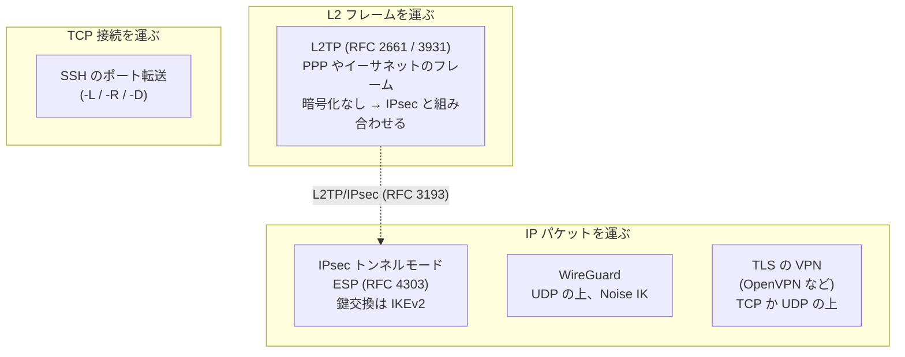

# VPN とトンネリング (VPN & Tunneling: IPsec, SSH, WireGuard, L2TP & TLS VPN)

## 概要 (Overview)

本ドキュメントはパケットを別のパケットで包んで運ぶトンネリング (tunneling) と、それに暗号と認証を組み合わせた VPN (Virtual Private Network) を扱う。対象は IPsec (ESP・AH・IKEv2)、SSH とそのポート転送、WireGuard、L2TP、TLS を使う VPN (いわゆる SSL-VPN) である。[`ip-addressing-icmp-dhcp-nat.md`](ip-addressing-icmp-dhcp-nat.md) の IP と NAT、[`tls-internals.md`](tls-internals.md) の TLS が前提になる。データセンター内でテナントを分けるためのカプセル化 (VXLAN・Geneve) は [`virtual-networks-overlay.md`](virtual-networks-overlay.md) が扱い、本書は暗号で守るトンネルに集中する。

中心テーゼは、**VPN の安全性を決めるのは暗号の強さよりも、「どの通信がトンネルに入るか」と「トンネルの入口の機器が守られているか」の 2 点である**ということである。暗号の部分は成熟しており、IPsec も WireGuard も TLS も、正しく設定すれば現代の攻撃者に解読されることはまずない。実際の事故は別のところで起きている。端末の経路表を操作されて通信がトンネルの外に出る (TunnelVision、TunnelCrack)、VPN 装置そのものの脆弱性を突かれて社内網への入口を奪われる (Ivanti Connect Secure など)、接続を確立する手順の細部を突かれて保護を外される (SSH の Terrapin)、といった事故である。

設計の系譜も同じ方向を示している。IPsec は多くの暗号方式と設定の選択肢を持ち、交渉の仕組み (IKE) が複雑になった。WireGuard は選択肢をなくし、暗号方式を 1 組に固定して、約 4,000 行のコードで同じ役割を果たした。複雑さを減らすこと自体を安全性の手段にしたのである。分析深度は Level 3。

## 方法論 (Methodology)

- **一次資料**: IPsec は RFC 4301 (アーキテクチャ)・RFC 4303 (ESP)・RFC 4302 (AH)・RFC 7296 (IKEv2)、SSH は RFC 4251〜4254、L2TP は RFC 2661 と RFC 3931 を使う。WireGuard は設計者の論文 (Donenfeld, NDSS 2017) を、攻撃は査読付き論文 (Terrapin は USENIX Security 2024、TunnelCrack は USENIX Security 2023) と、発見者や CERT/CC・CISA の公開情報を使う。
- **装置の脆弱性は公的機関の文書で確かめる**: VPN 装置の事件は報道が多く数字が揺れるため、CISA の緊急指令やベンダーの告知など、日付と CVE 番号が確かめられる文書を使う。
- **担当範囲**: TLS のハンドシェイクと証明書の検証は [`tls-internals.md`](tls-internals.md)、AEAD や鍵交換の一般論は [`../security/applied-cryptography.md`](../security/applied-cryptography.md)、クラウドとオンプレミスを VPN や専用線でつなぐ構成は [`../cloud/cloud-network-topology.md`](../cloud/cloud-network-topology.md)、QUIC の上の VPN (MASQUE) は [`http-quic-evolution.md`](http-quic-evolution.md) に委ねる。VPN を置き換えるゼロトラスト型のアクセスは、セキュリティの文書群 (境界とネットワーク防御) で扱う予定である。
- 各方式を「どの層で包むか」「鍵をどう決めるか」「NAT や MTU とどう付き合うか」の 3 つの観点で比べ、攻撃と防御は対で扱う。

## 発見事項 (Findings)

1. **トンネルとはパケットをもう 1 枚のヘッダで包み、途中の網からは外側のヘッダしか見えないようにすることである。** 包む層によって、L2 のフレームを運ぶもの (L2TP、VXLAN)、IP パケットを運ぶもの (IPsec のトンネルモード、WireGuard)、TCP の接続を運ぶもの (SSH のポート転送) に分かれる。暗号はトンネルの必須の要素ではなく、L2TP や VXLAN は単独では暗号化しない。
2. **IPsec の複雑さは選択肢の多さと交渉の仕組みから来る。** IPsec はどの通信を保護するかの方針 (SPD) と、保護に使う鍵と方式の組 (SA) を分けて管理し、SA を IKE で交渉する。暗号方式、認証方式、モード、ライフタイムの組み合わせが多く、両端の設定が一致しないと接続できない。旧版の IKEv1 のアグレッシブモードを事前共有鍵で使うと、傍受した応答から鍵をオフラインで総当たりできる弱点もあった。
3. **WireGuard は選択肢をなくすことで単純さを得た。** 暗号方式は Curve25519・ChaCha20-Poly1305・BLAKE2s の 1 組に固定され、交渉はない。鍵交換は Noise フレームワークの IK パターンにもとづく 1 往復である。設定は「この公開鍵の相手には、この IP アドレス範囲を送る」という表 (cryptokey routing) だけで、Linux の実装は 4,000 行未満と論文に書かれている。認証できないパケットには一切応答しないため、外から存在を探られにくい。方式が古くなったときは、交渉ではなくプロトコルのバージョンを上げて置き換える設計である。
4. **NAT との相性が方式の普及を左右した。** IPsec の AH は IP ヘッダの送信元アドレスまで改ざん検知の対象にするため、NAT がアドレスを書き換えると必ず検証に失敗する。ESP も TCP・UDP のポート番号を暗号化するため、NAPT が対応表を作れない。そこで ESP を UDP 4500 番で包む NAT トラバーサル (RFC 3948) が加わった。WireGuard と TLS の VPN は最初から UDP や TCP の上に載るため、この問題を持たない。
5. **「全通信をトンネルに通す」は、端末の経路表がそう設定されているという前提に立っている。** VPN クライアントはOS の経路表を書き換えて通信をトンネルの仮想インターフェースへ向ける。TunnelVision (2024 年、CVE-2024-3661) は、同じ LAN の攻撃者が DHCP のオプション 121 (静的経路) でより具体的な経路を配り、VPN が接続中に見えたまま通信をトンネルの外に出させる攻撃である。TunnelCrack (USENIX Security 2023) は、ローカル網へのアクセスを許す設定や VPN サーバ宛ての例外経路を悪用して、同じ結果を得た。どちらも暗号は破っていない。
6. **SSH の Terrapin は暗号ではなく手順の隙間を突いた。** Terrapin (CVE-2023-48795) は、接続確立の途中で攻撃者がメッセージを足し引きして通番をずらし、暗号化が始まった直後のメッセージを気づかれずに削除する攻撃である。これで拡張機能の交渉 (RFC 8308) を消し、保護を弱められる。発見者は、インターネット上の SSH サーバの少なくとも 77% が実際に悪用できる方式に対応していたと報告した。対策は接続確立の間に予期しないメッセージを許さない strict kex で、両端の対応が必要である。
7. **VPN 装置は社内網の入口であると同時に、最も狙われる機器になった。** VPN 装置はインターネットに公開され、認証の前の処理に脆弱性があれば誰でも攻撃でき、突破されれば社内網に直接入れる。2024 年 1 月、Ivanti Connect Secure の認証回避 (CVE-2023-46805) とコマンドインジェクション (CVE-2024-21887) が広く悪用され、CISA は米国連邦機関に緊急指令 ED 24-01 を出した。追加の指示では、該当製品に関連付いたドメインのアカウントが侵害されたものとみなすよう求めた。

## アーキテクチャ (Architecture)

### 包む層による分類



凡例: 実線の囲みは包む対象の層、点線は組み合わせて使う関係を示す。

### パケットの包み方の比較

| 方式 | 外側のヘッダ | 追加される大きさ (概算) | NAT の通過 | 鍵の決め方 |
|---|---|---|---|---|
| IPsec ESP トンネルモード | 新しい IP ヘッダ + ESP | 50〜70B 程度 (暗号方式とパディングによる) | NAT トラバーサル (UDP 4500) で通す | IKEv2 で交渉 |
| IPsec AH | 元の IP ヘッダを保護 | 24B 程度 | 通らない (アドレスの書き換えで検証に失敗) | IKEv2 で交渉 |
| WireGuard | 新しい IP ヘッダ + UDP + WireGuard | IPv4 で 60B、IPv6 で 80B | 通る (UDP) | Noise IK の 1 往復、方式は固定 |
| TLS の VPN | 新しい IP ヘッダ + TCP/UDP + TLS | 方式と実装による | 通る | TLS のハンドシェイク |
| L2TP/IPsec | IP + ESP + UDP + L2TP + PPP | 大きい (二重に包む) | NAT トラバーサルで通す | IKE で交渉、PPP で利用者認証 |

追加される大きさの分だけ、トンネルの中で運べるパケットは小さくなる。MTU を超えた分の扱いは技術詳細 §6 で述べる。

### IPsec の 2 つのモード

```text
元のパケット:            [IP ヘッダ][TCP][データ]

トランスポートモード:    [IP ヘッダ][ESP][TCP][データ][ESP トレーラ][ICV]
                                       └──── 暗号化 ────┘
                                  └──────── 改ざん検知 ────────┘

トンネルモード:          [新 IP ヘッダ][ESP][IP ヘッダ][TCP][データ][ESP トレーラ][ICV]
                                           └──────── 暗号化 ─────────┘
                                      └──────────── 改ざん検知 ────────────┘
```

(RFC 4303 の構造にもとづく模式図。ICV は改ざん検知の値)。トランスポートモードは端末どうしで元の IP ヘッダを残し、トンネルモードは元のパケット全体を包んで新しい IP ヘッダを付ける。拠点間 VPN やリモートアクセスで使うのはトンネルモードである。

## 技術詳細 (Technical Details)

### 1. IPsec

- **構成要素** (RFC 4301): どの通信を保護するか、通すか、捨てるかを決める方針のデータベース (SPD: Security Policy Database) と、保護に使う鍵・方式・通番の組 (SA: Security Association) を保持するデータベース (SAD) を分けて持つ。SA は片方向ごとに 1 つずつ作り、受信側はパケットの SPI (Security Parameter Index) の値で SA を見つける。方針と鍵を分けたことで、同じ方針のまま鍵を定期的に交換できる。
- **ESP と AH**: ESP (RFC 4303) は暗号化と改ざん検知を行う。現在は AES-GCM のような AEAD 方式を使うのが標準的で、ESP に求められる方式は RFC 8221 が定める。AH (RFC 4302) は改ざん検知だけを行い、外側の IP ヘッダの一部まで保護する。NAT と相性が悪く、ESP で足りるため、現在はほとんど使われない。
- **リプレイ防止**: ESP のヘッダには通番があり、受信側は一定の幅の窓で受け取り済みの通番を記録して、同じ通番のパケットを捨てる。窓があるのは、IP がパケットの順序を入れ替えるからである。
- **IKEv2** (RFC 7296): 最初の 1 往復 (IKE_SA_INIT) で Diffie-Hellman の鍵交換と方式の合意を行い、次の 1 往復 (IKE_AUTH) で互いを認証し、最初の SA を作る。認証には証明書、事前共有鍵、EAP (利用者の認証を RADIUS などに任せる方式) を使える。IKEv1 は 2 段階の交渉とモードの種類が多く、事前共有鍵とアグレッシブモードの組み合わせでは、傍受した応答から鍵をオフラインで総当たりできた。IKEv2 はやり取りを整理し、Cookie による DoS 対策も持つ。
- **NAT トラバーサル** (RFC 3947・RFC 3948): IKE の交渉中に経路上の NAT の有無を検出し、NAT があれば ESP を UDP 4500 番で包んで送る。NAT の対応表が消えないよう、定期的に小さなパケット (キープアライブ) を送る。
- **使われる場所**: 拠点間 VPN、クラウドのサイト間 VPN ([`../cloud/cloud-network-topology.md`](../cloud/cloud-network-topology.md))、携帯電話網の一部、OS に組み込まれたリモートアクセス VPN である。IKEv2 は端末の IP アドレスが変わっても SA を維持する拡張 (MOBIKE) を持ち、モバイル端末に向く。

### 2. SSH

- **3 つの層** (RFC 4251〜4254): トランスポート層 (RFC 4253) が鍵交換、サーバの認証、暗号化を行い、認証層 (RFC 4252) が利用者を公開鍵やパスワードで認証し、接続層 (RFC 4254) が 1 本の暗号化された接続の上に複数のチャネル (シェル、ファイル転送、ポート転送) を多重化する。
- **サーバの認証は初回の信頼に頼る**: クライアントは初めて接続したサーバのホスト鍵を `known_hosts` に保存し、次回からはそれと照合する。初回の接続で攻撃者に割り込まれると気づけない (TOFU: Trust On First Use)。ホスト鍵の指紋を DNS に書く SSHFP (RFC 4255、DNSSEC が前提) や、認証局がホスト鍵に署名する SSH 証明書 (OpenSSH の独自拡張) は、この弱点への対策である。
- **ポート転送**: `-L` (ローカル転送) は手元のポートへの接続をサーバ経由で別の宛先に送り、`-R` (リモート転送) はサーバ側のポートへの接続を手元に送り返し、`-D` は手元に SOCKS プロキシを立てる。手軽な VPN として使える一方、ファイアウォールが許した SSH の通信の中に任意の通信を通せるため、組織の境界の制御を迂回する経路にもなる。
- **Terrapin** (Bäumer, Brinkmann & Schwenk, USENIX Security 2024、CVE-2023-48795): SSH はメッセージに暗黙の通番を付け、改ざん検知の計算に含めている。ところが鍵交換の前の平文の段階では通番が検証されないため、攻撃者がこの段階でメッセージを 1 つ足しておけば、暗号化が始まった直後のメッセージを 1 つ消しても、両端の通番は一致したままになる。消されるのは拡張機能の交渉 (RFC 8308) のメッセージで、OpenSSH 9.5 ではキー入力のタイミングを隠す対策が無効になるなどの影響があった。悪用できるのは ChaCha20-Poly1305 と、CBC モードの暗号と Encrypt-then-MAC の組み合わせで、AES-GCM は影響を受けない。対策の strict kex は、鍵交換の途中に予期しないメッセージが来たら接続を切り、鍵交換のたびに通番を 0 に戻す。OpenSSH は 9.6 で対応した。
- **実装の脆弱性**: regreSSHion (CVE-2024-6387、2024 年 7 月に Qualys が公表) は、OpenSSH のサーバで認証の待ち時間が切れたときのシグナル処理に競合状態があり、認証前に root 権限でコードを実行される可能性があった。2024 年 3 月の xz バックドア (CVE-2024-3094) は、圧縮ライブラリに仕込まれたコードが、一部のディストリビューションで sshd に読み込まれる経路を使って公開鍵認証を乗っ取ろうとした ([`../security/software-supply-chain-security.md`](../security/software-supply-chain-security.md))。SSH はインターネットに公開されることが多く、認証前の処理の欠陥がそのまま遠隔からの侵入になる。

### 3. WireGuard

- **cryptokey routing** (Donenfeld 2017): 設定の中心は相手の公開鍵と「その相手から受け取ってよい、その相手へ送るべき IP アドレス範囲」(AllowedIPs) を対応させた表である。送信時は宛先アドレスで表を引いて相手を決め、その相手の鍵で暗号化する。受信時は復号できた鍵から相手を特定し、内側のパケットの送信元アドレスが AllowedIPs に入っているかを確かめる。経路表とアクセス制御が 1 つの表にまとまっている。
- **ハンドシェイク**: Noise フレームワークの IK パターンにもとづき、1 往復で鍵を決める。両端は互いの静的な公開鍵を事前に知っている前提で、一時鍵との Diffie-Hellman を組み合わせて、前方秘匿性 (あとで静的鍵が漏れても過去の通信は読めない性質) を得る。セッション鍵は 2 分ごとに作り直す。
- **応答しない設計**: 正しい公開鍵で認証できないパケットには何も返さない。外からポートを走査しても、WireGuard が動いていることすら分からない。負荷が高いときは、相手に Cookie を返して送信元アドレスを確かめてから重い計算をする、という DoS 対策を持つ。
- **ローミング**: 相手の外側の IP アドレスは、正しく認証できた最新のパケットの送信元に自動で更新される。端末が Wi-Fi から携帯回線に移っても、トンネルを張り直さずに通信を続けられる。
- **持たないもの**: 動的な IP アドレスの割り当て、利用者の認証 (ID とパスワードや多要素認証)、鍵の配布の仕組みを持たない。暗号方式の交渉もない。これらは上位の管理システムが担う。WireGuard を使い、鍵の配布とアクセス方針の管理を中央で行う製品が多いのはこのためである。
- **普及**: Linux カーネルには 2020 年 3 月の 5.6 で取り込まれた。論文は、Linux の実装が 4,000 行未満で、監査と検証がしやすいことを設計の利点として挙げている。

### 4. L2TP と PPTP

- **L2TP** (L2TPv2 は RFC 2661、L2TPv3 は RFC 3931): PPP のフレーム (v3 ではイーサネットなどのフレームも) を UDP 1701 番で運ぶトンネルである。暗号化の機能はないため、リモートアクセスでは IPsec で包む L2TP/IPsec (RFC 3193) として使われてきた。IPsec で端末を認証し、PPP で利用者を認証するという 2 段構えだが、二重に包むため追加の大きさが大きく、NAT の通過にも NAT トラバーサルが要る。通信事業者が加入者の回線を事業者の設備まで運ぶ用途では、暗号化なしの L2TP が今も使われている。
- **PPTP**: Microsoft などが広めた古い VPN 方式で、認証に MS-CHAPv2 を使う。2012 年に MS-CHAPv2 の交換を傍受すれば DES の鍵 1 つ分の総当たりで認証情報を割り出せることが示され、Microsoft も同年のセキュリティアドバイザリ (2743314) で、MS-CHAPv2 を単独で使う PPTP を保護として頼らないよう勧めた。現在は使うべきでない方式である。

### 5. TLS の VPN (SSL-VPN)

- **仕組み**: TLS の接続の中に IP パケットやアプリケーションの通信を通す。OpenVPN のような独自プロトコルのほか、多くの企業向け VPN 装置が、Web ブラウザでログインしてから専用のクライアントや TLS のトンネルを張る方式を採っている。TCP 443 番を使えばほとんどのファイアウォールを通れるため、出張先やホテルの回線からでも接続しやすい。
- **TCP の上に TCP を載せる問題**: トンネルが TCP で、中を通る通信も TCP だと、外側と内側の両方が再送とタイムアウトを行う。外側でパケットが失われると、外側の再送を待つ間に内側の TCP もタイムアウトして再送し、遅延が膨らむ。多くの実装が UDP (DTLS) のトンネルを優先し、TCP は UDP が通らないときの代替にしている。
- **装置の攻撃面**: TLS の VPN 装置はログイン画面やファイルの配信など、Web サーバとしての機能をインターネットに公開している。認証前に処理される Web の機能に脆弱性があると、攻撃者は認証なしで装置を乗っ取れる (セキュリティ考察)。
- **QUIC の上の VPN**: HTTP/3 の上で UDP や IP パケットを運ぶ MASQUE (RFC 9298 の CONNECT-UDP、RFC 9484 の CONNECT-IP) は、TLS の VPN を QUIC で置き換える試みである ([`http-quic-evolution.md`](http-quic-evolution.md))。

### 6. トンネルと MTU、経路表

- **MTU の削減**: トンネルのヘッダの分だけ、中を通るパケットの上限は小さくなる。WireGuard の既定の MTU は 1420B (IPv6 で外側を運ぶ場合の 80B を引いた値) である。トンネルの中のパケットが外側のリンクの MTU を超えると、断片化されるか捨てられる。経路 MTU 探索が ICMP の遮断で動かないと、接続はできるのに大きなデータだけ届かない障害になる ([`ip-addressing-icmp-dhcp-nat.md`](ip-addressing-icmp-dhcp-nat.md))。トンネルの入口で TCP の MSS を書き換える MSS クランプが、実務上の定番の対策である。
- **全トンネルと分割トンネル**: 全通信をトンネルに通す全トンネル (full tunnel) は、VPN の出口で一括して監視・制御できる代わりに、出口の帯域と遅延が問題になる。社内宛てだけをトンネルに通す分割トンネル (split tunnel) は軽いが、端末がインターネットと社内網に同時につながり、端末の侵害が社内網への経路になる。どちらを選ぶかは、出口で何を検査したいかと、端末をどこまで信頼するかで決まる。
- **経路表の優先順位**: OS は最長一致で経路を選ぶため、VPN が設定した「すべての宛先 (0.0.0.0/0)」より具体的な経路があれば、そちらが優先される。VPN クライアントは 0.0.0.0/1 と 128.0.0.0/1 の 2 つに分けて設定するなどの工夫をしているが、DHCP で配られた経路や、ローカル網への例外の経路がさらに具体的なら、通信はトンネルを通らない。これが TunnelVision と TunnelCrack の前提である。DNS の問い合わせだけがトンネルの外に出る DNS リークも、同じ経路表と設定の問題として起きる。

## セキュリティ考察 (Security Considerations)

| 攻撃 | 何を悪用するか | 主な防御 |
|---|---|---|
| TunnelVision (CVE-2024-3661) | DHCP のオプション 121 に認証がなく、VPN より具体的な経路を配れる | オプション 121 を無視する設定、ネットワーク名前空間による分離、DHCP スヌーピング |
| TunnelCrack (LocalNet・ServerIP) | ローカル網へのアクセスを許す例外経路、VPN サーバ宛ての例外経路と DNS の偽装 | ローカル網アクセスの無効化、VPN サーバのアドレスの固定と認証、クライアントの更新 |
| Terrapin (CVE-2023-48795) | 鍵交換前の通番が検証されない | strict kex (両端の対応が必要)、影響を受けない方式 (AES-GCM) への切り替え |
| VPN 装置の認証前の脆弱性 | インターネットに公開された装置の Web 機能 | 迅速な更新、管理画面の非公開化、装置のログの外部保存、侵害を前提にした調査 |
| 事前共有鍵の総当たり | IKEv1 のアグレッシブモード、弱い事前共有鍵 | IKEv2 と証明書認証、長い乱数の鍵 |
| 認証情報の窃取 | パスワードだけの VPN ログイン | 多要素認証、端末証明書との組み合わせ |
| PPTP の解読 | MS-CHAPv2 の弱さ | 使用をやめる |
| SSH のポート転送による迂回 | 許可された SSH の中に任意の通信を通せる | 転送の禁止設定 (`AllowTcpForwarding no` など)、踏み台サーバでの記録 |

- **VPN 装置は侵害を前提に扱う**: Ivanti Connect Secure の 2024 年 1 月の事件では、認証回避とコマンドインジェクションを組み合わせることで、攻撃者が認証なしで装置上でコマンドを実行できた。CISA は 2024 年 1 月 19 日に緊急指令 ED 24-01 を出し、のちの追加の指示で、該当製品を一時的に切り離すことと、製品に関連付いたドメインのアカウントを侵害されたものとみなすことを求めた。VPN 装置は社内の認証基盤とつながっていることが多く、装置の侵害は認証情報の流出とラテラルムーブメントの起点になる。装置のログを装置の外に保存しておかないと、侵害後に調べる手段が残らない。
- **経路の攻撃は暗号を破らない**: TunnelVision と TunnelCrack は、どちらも VPN の暗号を破らず、端末の経路表と OS の設定を操作するだけで通信を平文のままトンネルの外に出させた。公衆 Wi-Fi のように、DHCP サーバやアクセスポイントを攻撃者が用意できる場所では、VPN を使っていても経路が守られている保証はない。L2 の防御 (DHCP スヌーピング、[`ethernet-lan-switching.md`](ethernet-lan-switching.md)) は、攻撃者が管理するネットワークでは期待できないため、VPN クライアントの側で経路を固定する対策が要る。
- **SSH は「インターネットに出す最小の入口」の代表である**: SSH は管理用の入口として公開されることが多く、パスワード認証を許すと総当たりの対象になり、認証前の処理の脆弱性 (regreSSHion) は遠隔からの侵入につながる。公開鍵認証だけを許す、公開する範囲を絞る、踏み台サーバを置いて操作を記録する、といった対策を重ねる。
- **VPN は「入れたら信頼する」モデルである**: VPN に接続できた端末は、社内網の広い範囲に到達できることが多い。認証情報を盗まれた場合も、端末が侵害された場合も、そこから社内網全体が攻撃の対象になる。接続のたびに利用者と端末の状態を確かめ、アプリケーションごとに到達を許すゼロトラスト型のアクセスは、この問題への応答として広まった。

## 結論 (Conclusions)

- トンネリングはパケットを別のヘッダで包む技術で、暗号化は別の要素である。IPsec・WireGuard・TLS の VPN は IP パケットを、SSH は TCP の接続を、L2TP は L2 のフレームを包む。
- IPsec は方針と鍵を分けた柔軟な設計で、拠点間 VPN の標準になったが、選択肢の多さが設定と交渉を複雑にした。WireGuard は暗号方式を固定し、経路表とアクセス制御を 1 つの表にまとめることで、少ないコードで同じ役割を果たした。
- 実際の事故は暗号ではなく周辺で起きている。端末の経路表の操作 (TunnelVision、TunnelCrack)、接続確立の手順の隙間 (Terrapin)、VPN 装置そのものの脆弱性 (Ivanti など) である。VPN の安全性を評価するときは、どの通信がトンネルに入るかと、入口の装置が守られているかを確かめる必要がある。
- VPN は接続できた端末を広く信頼するモデルであり、認証情報や端末の侵害がそのまま社内網全体の問題になる。この限界が接続ごとに確かめるゼロトラスト型のアクセスへの移行の理由になっている。

### 次の接続先 (Related Topics)

- [`ip-addressing-icmp-dhcp-nat.md`](ip-addressing-icmp-dhcp-nat.md) — NAT とトンネルの相性、MTU と経路 MTU 探索、TunnelVision が悪用する DHCP。
- [`tls-internals.md`](tls-internals.md) — TLS の VPN が使うハンドシェイクと証明書の検証。
- [`../security/applied-cryptography.md`](../security/applied-cryptography.md) — ESP や WireGuard が使う AEAD と鍵交換、前方秘匿性。
- [`virtual-networks-overlay.md`](virtual-networks-overlay.md) — 暗号を使わないカプセル化 (VXLAN・Geneve) によるテナントの分離。
- [`../cloud/cloud-network-topology.md`](../cloud/cloud-network-topology.md) — クラウドのサイト間 VPN と専用線接続の使い分け。
- [`http-quic-evolution.md`](http-quic-evolution.md) — QUIC の上で VPN を実現する MASQUE。
- [`../security/software-supply-chain-security.md`](../security/software-supply-chain-security.md) — sshd を狙った xz バックドア。

## 参考文献 (References)

**一次資料 (RFC・論文)**

- Kent, S., & Seo, K. (2005). Security Architecture for the Internet Protocol. *RFC 4301*.
- Kent, S. (2005). IP Encapsulating Security Payload (ESP). *RFC 4303*. / Kent, S. (2005). IP Authentication Header. *RFC 4302*.
- Kaufman, C., Hoffman, P., Nir, Y., Eronen, P., & Kivinen, T. (2014). Internet Key Exchange Protocol Version 2 (IKEv2). *RFC 7296*.
- Huttunen, A., Swander, B., Volpe, V., DiBurro, L., & Stenberg, M. (2005). UDP Encapsulation of IPsec ESP Packets. *RFC 3948*. / Kivinen, T., Swander, B., Huttunen, A., & Volpe, V. (2005). Negotiation of NAT-Traversal in the IKE. *RFC 3947*.
- Wouters, P., Migault, D., Mattsson, J., Nir, Y., & Kivinen, T. (2017). Cryptographic Algorithm Implementation Requirements and Usage Guidance for Encapsulating Security Payload (ESP) and Authentication Header (AH). *RFC 8221*.
- Ylonen, T., & Lonvick, C. (Ed.). (2006). The Secure Shell (SSH) Protocol Architecture / Authentication Protocol / Transport Layer Protocol / Connection Protocol. *RFC 4251*, *RFC 4252*, *RFC 4253*, *RFC 4254*.
- Schlyter, J., & Griffin, W. (2006). Using DNS to Securely Publish Secure Shell (SSH) Key Fingerprints. *RFC 4255*.
- Bider, D. (2018). Extension Negotiation in the Secure Shell (SSH) Protocol. *RFC 8308*.
- Townsley, W., Valencia, A., Rubens, A., Pall, G., Zorn, G., & Palter, B. (1999). Layer Two Tunneling Protocol "L2TP". *RFC 2661*. / Lau, J., Townsley, M., & Goyret, I. (Eds.). (2005). Layer Two Tunneling Protocol - Version 3 (L2TPv3). *RFC 3931*.
- Patel, B., Aboba, B., Dixon, W., Zorn, G., & Booth, S. (2001). Securing L2TP using IPsec. *RFC 3193*.
- Schinazi, D. (2022). Proxying UDP in HTTP. *RFC 9298*. / Pauly, T., Schinazi, D., Chernyakhovsky, A., Kühlewind, M., & Westerlund, M. (2023). Proxying IP in HTTP. *RFC 9484*.
- Donenfeld, J. A. (2017). WireGuard: Next Generation Kernel Network Tunnel. *Network and Distributed System Security Symposium (NDSS 2017)*. — cryptokey routing、Noise IK、応答しない設計と Cookie による DoS 対策、4,000 行未満の実装。
- Bäumer, F., Brinkmann, M., & Schwenk, J. (2024). Terrapin Attack: Breaking SSH Channel Integrity By Sequence Number Manipulation. *33rd USENIX Security Symposium*.
- Xue, N., Malla, Y., Xia, Z., Pöpper, C., & Vanhoef, M. (2023). Bypassing Tunnels: Leaking VPN Client Traffic by Abusing Routing Tables. *32nd USENIX Security Symposium*.

**公的機関・ベンダーの告知と事例**

- [Terrapin Attack](https://terrapin-attack.com/) — Accessed: 2026-10-18。影響を受ける方式、SSH サーバの少なくとも 77% が悪用可能な方式に対応していたという測定。
- [CISA Issues Emergency Directive Requiring Federal Agencies to Mitigate Ivanti Connect Secure and Ivanti Policy Secure Vulnerabilities, CISA (2024-01-19)](https://www.cisa.gov/news-events/news/cisa-issues-emergency-directive-requiring-federal-agencies-mitigate-ivanti-connect-secure-and-policy) — Accessed: 2026-10-18。ED 24-01、CVE-2023-46805 と CVE-2024-21887。
- [CVE-2024-3661 K (TunnelVision) exposes VPN bypass vulnerability, Zscaler](https://www.zscaler.com/blogs/security-research/cve-2024-3661-k-tunnelvision-exposes-vpn-bypass-vulnerability) — Accessed: 2026-10-18。DHCP オプション 121 による経路の操作と対策 (発見は Leviathan Security Group、2024 年 5 月)。
- [TunnelCrack: Details, Mathy Vanhoef](https://tunnelcrack.mathyvanhoef.com/details.html) — Accessed: 2026-10-18。LocalNet と ServerIP の攻撃、CVE と対策。
- [regreSSHion: Remote Unauthenticated Code Execution Vulnerability in OpenSSH server, Qualys (2024-07-01)](https://blog.qualys.com/vulnerabilities-threat-research/2024/07/01/regresshion-remote-unauthenticated-code-execution-vulnerability-in-openssh-server) — Accessed: 2026-10-18。CVE-2024-6387。
- [Microsoft Security Advisory 2743314: Unencapsulated MS-CHAP v2 Authentication Could Allow Information Disclosure (2012)](https://learn.microsoft.com/en-us/security-updates/securityadvisories/2012/2743314) — Accessed: 2026-10-18。PPTP で使う MS-CHAPv2 の弱さ。
