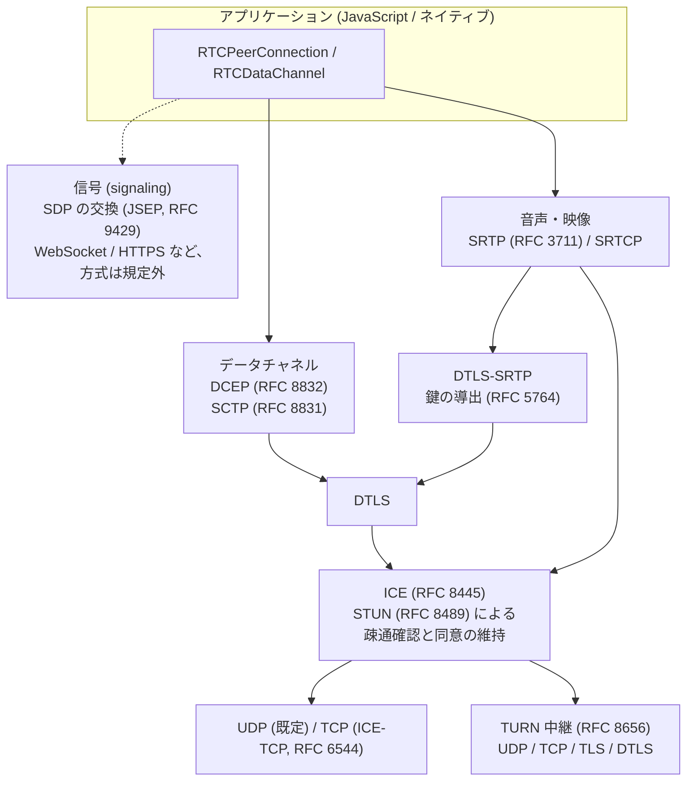
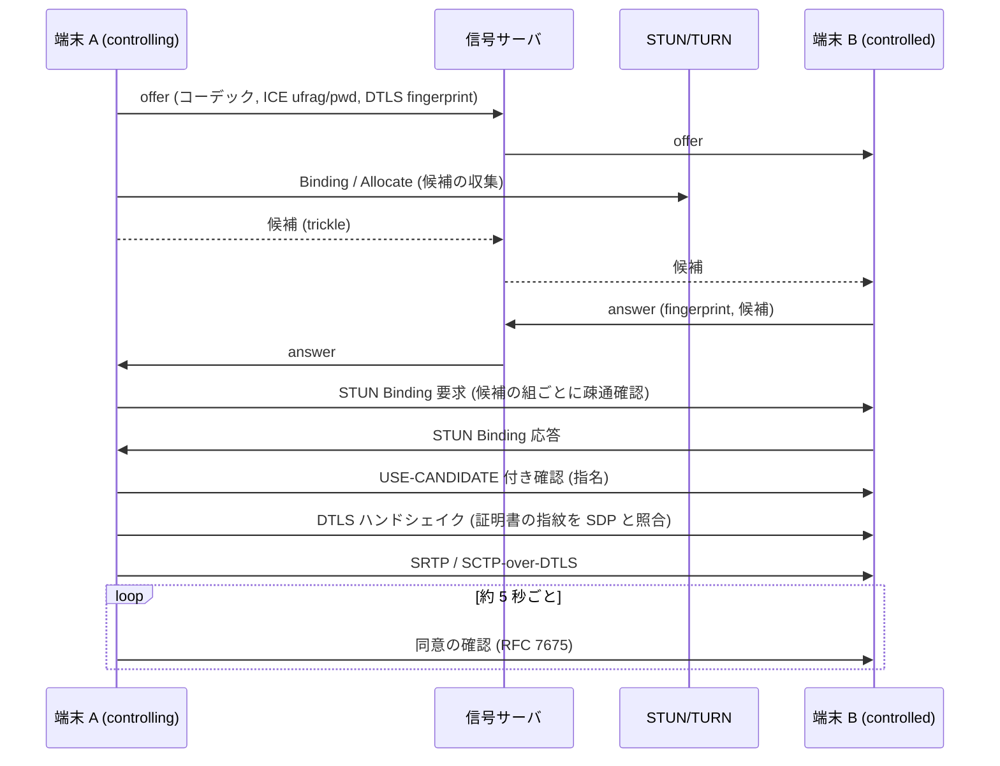
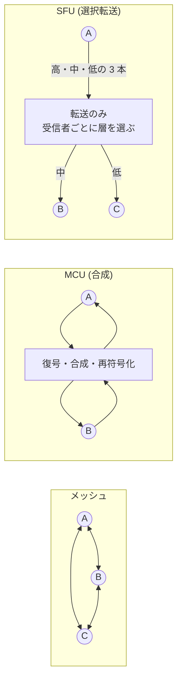

# WebRTC とリアルタイムメディア伝送 (WebRTC & Real-Time Media Transport)

## 概要 (Overview)

本ドキュメントはブラウザやアプリの間で音声・映像・データを対話的な遅延で運ぶ WebRTC (Web Real-Time Communication) と、その下にあるリアルタイムメディア伝送 (real-time media transport) の仕組みを扱う。対象は接続の確立 (ICE・STUN・TURN と JSEP/SDP)、暗号化 (DTLS-SRTP)、メディアの運搬と修復 (RTP/RTCP、ジッタバッファ、NACK・FEC・キーフレーム要求)、メディアの輻輳制御 (GCC・SCReAM・NADA)、多人数通話の構成 (メッシュ・MCU・SFU とサイマルキャスト・SVC)、SFU を越える端から端までの暗号化 (SFrame)、WebTransport・Media over QUIC (MoQ)・WHIP/WHEP という新しい方向、そして障害とセキュリティである。NAT の挙動要件 (RFC 4787) と NAT 越えの基本は [`ip-addressing-icmp-dhcp-nat.md`](ip-addressing-icmp-dhcp-nat.md) に、TCP の輻輳制御とバッファブロートは [`tcp-transport-congestion.md`](tcp-transport-congestion.md) に、AQM・DSCP・L4S は [`qos-traffic-management.md`](qos-traffic-management.md) に、QUIC は [`http-quic-evolution.md`](http-quic-evolution.md) に、TLS 1.3 は [`tls-internals.md`](tls-internals.md) に委ねる。ブラウザのプロセス構成と同一オリジンポリシーは [`../browsers/browser-architecture.md`](../browsers/browser-architecture.md) と [`../browsers/web-security-model.md`](../browsers/web-security-model.md) で扱う。

中心テーゼは、**リアルタイムメディアでは遅れて届いたデータは失われたデータと同じ価値しかないため、伝送のすべての層が「確実に届けること」より「期限までに届けること」を優先して作り直されている**ということである。TCP は失われたパケットを再送し、順序を守るために後続のデータを待たせる。ファイル転送ではこれが正しいが、再生時刻を過ぎた音声の 20 ms 分は届いても使えない。WebRTC は UDP の上で RTP を運び、再送は間に合う見込みのあるときだけ選んで行い (NACK と RTX)、間に合わないなら冗長化 (FEC) や次のキーフレームで回復する。輻輳制御も損失ではなく遅延の増加を見て送信レートを下げ、キューを作らないことを目指す。

この見方から 3 つの帰結が出る。(1) 経路の確立は「最初に見つかった経路」ではなく「遅延の小さい経路」を探す作業になり、ICE は候補を並べて全組み合わせを試す。直接つながらないときだけ中継 (TURN) を使い、中継は遅延と費用の両方を増やす。(2) 多人数通話では、サーバが映像を作り直すと遅延と計算量が増え、端から端までの暗号化もできなくなる。そのためサーバは転送だけを行い (SFU)、受信者ごとの帯域の違いは送信側が複数の品質を同時に送ることで吸収する設計が主流になった。(3) 遅延を優先する設計は、キューを満たすまで送る損失型の TCP と同じボトルネックを共有すると不利になる。この競合はプロトコルだけでは解けず、網側のキュー管理 (AQM・L4S) に解決を委ねる部分が残る。本書は (1) スタックと接続確立、(2) 暗号化と認証、(3) RTP とメディアの修復、(4) 輻輳制御、(5) 構成と SFU、(6) 端から端までの暗号化、(7) QUIC への移行、(8) 障害の順に整理する。分析深度は Level 3。

## 方法論 (Methodology)

- **一次資料**: IETF RTCWEB WG の文書群 (概要の RFC 8825、セキュリティの RFC 8826/8827、JSEP の RFC 9429、IP アドレスの扱いの RFC 8828 など)、ICE/STUN/TURN の RFC 8445/8489/8656、RTP/RTCP の RFC 3550 と拡張 (RFC 4585・4588・5104・8627 など)、輻輳制御の RFC 8298・8698・8836・8888 と draft-ietf-rmcat-gcc-02、SFrame (RFC 9605)、WHIP (RFC 9725) を使う。ブラウザの API は W3C の仕様 (WebRTC Encoded Transform、WebRTC-SVC、WebTransport) を参照した。
- **時点に依存する状態の確認**: MoQ・WHEP・WebTransport・SCReAMv2 の標準化の状態は、2026-10-26 時点の IETF Datatracker と W3C の仕様の表示で確かめた。Chrome の Unified Plan への移行時期は webrtc.org の移行ガイドと Chrome のリリース告知で確かめた。
- **実装の確認**: GCC の実装上の構成は libwebrtc のソースツリー (`modules/congestion_controller/goog_cc/`) のファイル構成で確かめた。行単位の引用はせず、アルゴリズムは draft-ietf-rmcat-gcc-02 に基づく疑似コードで示す。
- **数値の扱い**: 遅延の目安は ITU-T G.114 (2003) を原典とする。TURN による中継が全通話に占める割合は、事業者 (TURN サービス業者) の 10〜25% 程度という見積もりしか見つからず、ブラウザ開発元や大規模事業者の一次の測定値は確認できなかった。そのため本書では割合を主張しない。
- **担当範囲**: NAT の種類の定義、TCP と QUIC の内部、TLS の鍵スケジュールは姉妹文書に委ね、本書では WebRTC がそれらをどう使うかだけを述べる。

## 発見事項 (Findings)

1. **対話の遅延予算は片道 150 ms 程度で、その中で再送できる回数は限られる。** ITU-T G.114 は、一般の網計画では片道遅延が 400 ms を超えないよう勧告し、150 ms 未満ならほとんどの用途で対話への影響が感じられないとする。このうち符号化・パケット化・ジッタバッファ・復号で数十 ms を使うため、往復時間 (RTT) が 100 ms を超える経路では、1 回の再送でも予算を超えやすい。WebRTC が UDP を使い、再送を「間に合うときだけ」に限るのはこのためである。
2. **ICE は経路を見つける仕組みであり、NAT を越える仕組みは STUN と TURN である。** ICE (RFC 8445) は手元のアドレス (host)、STUN で知った外側のアドレス (server reflexive)、TURN の中継アドレス (relayed) を候補として集め、相手の候補と組にして優先度の順に疎通確認を行う。優先度の推奨値は host 126、peer reflexive 110、server reflexive 100、relayed 0 で、中継は最後の手段として扱われる。両側がポートを宛先ごとに変える NAT (RFC 4787 のエンドポイント非依存マッピングを満たさないもの) の内側にいると直接の組は成立せず、TURN が必須になる。
3. **WebRTC の暗号化は必須で、鍵は DTLS で交換し、その正しさは信号の経路に依存する。** RFC 8827 は DTLS-SRTP を必須とし、SDP に鍵を平文で書く SDES を禁止する。DTLS の証明書は自己署名でよく、その指紋 (fingerprint) を SDP に載せて相手に渡す。したがって信号サーバ (signaling server) は指紋をすり替えれば中間者になれる。RFC 8827 はこれを認め、身元の主張 (IdP) か鍵の別経路での確認で防ぐとするが、IdP の仕組みは広く使われていないと自ら記している。
4. **メディアの修復は「再送・冗長化・作り直し」の 3 段で、それぞれ遅延と帯域の交換条件が違う。** NACK (RFC 4585) と RTX (RFC 4588) は 1 RTT の遅延と引き換えに失われたパケットだけを送り直す。FEC (FlexFEC は RFC 8627、RED は RFC 2198) は常に帯域を余分に使う代わりに待ち時間なしで回復する。どちらでも直せないときは PLI (RFC 4585) や FIR (RFC 5104) で送信側にキーフレームを要求し、参照の連鎖を切って作り直す。キーフレームは差分のフレームより大きいため、多人数で要求が重なると、それ自体が輻輳の原因になる。
5. **メディアの輻輳制御は遅延の増加を見て下げ、TCP と同じキューを共有すると不利になる。** GCC (draft-ietf-rmcat-gcc-02) はパケット群の到着間隔の変化から遅延の傾向を推定し、増加を検知すると受信レートの 0.85 倍に下げる。損失型の部分は損失が 10% を超えたときにだけ下げる。損失型の TCP はキューが溢れるまで送るため、深いバッファを共有すると遅延型の流れは帯域を譲り続ける。GCC は検知の閾値を適応的に動かしてこの飢餓を避けようとし、RMCAT の要件 (RFC 8836) も TCP に公平であることと、TCP を飢えさせないことを求めている。
6. **多人数通話は SFU が主流になり、品質の適応は送信側の多重化に移った。** メッシュは参加者数に比例して上りの帯域を使い、MCU は復号・合成・再符号化で遅延と計算量が増え、端から端までの暗号化もできない。SFU (Selective Forwarding Unit) は復号せずに転送し、受信者ごとにどの品質を送るかを選ぶ。そのため送信側は複数の解像度を同時に送るサイマルキャスト (RFC 8853) や、1 本の符号化列を層に分けるスケーラブル符号化 (SVC、W3C WebRTC-SVC の `L3T3` など) を使う。
7. **SFU は転送できるが中身を読めない、という分離は SFrame で初めて標準になった。** DTLS-SRTP の暗号化は区間ごと (hop-by-hop) で、SFU では復号される。SFrame (RFC 9605、2024 年 8 月) は符号化したフレームそのものを AEAD で暗号化し、SFU には鍵 ID とカウンタだけを見せる。鍵の管理は SFrame の範囲外で、RFC 9605 は送信者ごとの鍵と MLS (RFC 9420) による導出の 2 つの方法を示す。ブラウザの API は W3C WebRTC Encoded Transform (2026-06 時点で作業草案) が定める。
8. **次の方向は QUIC の上で配信と対話の中間を狙うことで、2026-10 時点ではまだ標準になっていない。** IETF の MoQ WG の中心文書 draft-ietf-moq-transport は 2026-10-01 の第 22 版で、WG はまだ RFC を出していない。WebTransport の IETF 文書は WG ラストコール中、W3C の API は勧告候補 (CR) である。放送の取り込みには WebRTC をそのまま使う WHIP が RFC 9725 (2025 年) として標準化され、受信側の WHEP は IESG に提出され AD 評価中 (改訂版待ち) である。
9. **攻撃面は暗号化の外側にある。** ICE の候補は手元と外側の IP アドレスを Web ページに渡すため、VPN の内側の本当のアドレスが漏れることがあった。ブラウザは RFC 8828 の扱い方の区分と mDNS の名前による隠蔽で対処している。TURN は認証付きの中継で、宛先を制限しないと利用者が内部網に到達できてしまう (SSRF と同等)。Enable Security は 2020 年に Slack の TURN サーバから AWS のメタデータと内部網に到達できることを示した。SRTP は RTP ヘッダを暗号化しないため、音量のヘッダ拡張から発話の有無が分かる。これを暗号化する cryptex (RFC 9335) が 2023 年に標準化された。

## アーキテクチャ (Architecture)

### プロトコルスタック

WebRTC のスタックは RTCWEB の概要 (RFC 8825) と伝送の要件 (RFC 8835) で決まる。すべての流れ (メディア・データ・疎通確認) は原則として 1 つの UDP の 5 タプルにまとめられる (BUNDLE、RFC 9143、と RTCP の多重化、RFC 5761)。受信側は先頭 1 バイトの値で流れを振り分ける (RFC 7983 を更新した RFC 9443: 0〜3 は STUN、20〜63 は DTLS、64〜79 は TURN のチャネル、128〜191 は RTP/RTCP)。



凡例: 実線はパケットが通る層の積み重ね。破線は信号で、WebRTC は信号の方式を規定しない (JSEP が定めるのは SDP の生成と適用の手順だけ)。SRTP は DTLS で鍵を作ったあとは DTLS の記録層を通らず、直接 ICE が選んだ経路に乗る。

### 接続確立の流れ

JSEP (RFC 9429、RFC 8829 を置き換え) では、提案側が `createOffer()` で SDP を作り、信号で相手に送り、相手が `createAnswer()` で応答を返す。候補は集まった順に信号で送る (trickle ICE、RFC 8838) ため、全候補が揃う前に疎通確認を始められる。



疎通確認は STUN の Binding 要求を、信号で交換した ufrag/pwd による短期の資格情報で認証して送る。疎通確認が成功した組を有効な組 (valid pair) とし、controlling 側の端末が使う組を指名 (nomination) する。RFC 8445 は旧版の積極的な指名 (aggressive nomination) を廃止し、通常の指名だけを残した。ICE lite の端末 (サーバ側で多い) は host 候補だけを持ち、自分からは確認を送らず、常に controlled になる。

### 多人数通話の構成

RTP の構成の分類は RFC 7667 にある。WebRTC の文脈では次の 3 つが比較される。



凡例: 丸は参加者、四角はサーバ。SFU の矢印のラベルは送受信する品質の層。

| 構成 | 送信側の上り | サーバの処理 | 遅延 | 端から端までの暗号化 |
|---|---|---|---|---|
| メッシュ | 参加者数 − 1 本 | なし | 最小 | そのまま可能 |
| MCU | 1 本 | 全員分の復号と再符号化 | 再符号化の分だけ増える | 不可 (サーバが中身を作る) |
| SFU | 1 本 (サイマルキャストなら層の数) | パケットの転送と層の選択 | 小さい | SFrame で可能 |

## 技術詳細 (Technical Details)

### 1. ICE・STUN・TURN

- **候補の優先度**: RFC 8445 の候補の優先度は `2^24 × 種別の優先度 + 2^8 × 手元の優先度 + (256 − コンポーネント ID)` で、種別の推奨値は上記の通り。組の優先度は controlling 側の候補の優先度を G、controlled 側を D として `2^32 × MIN(G,D) + 2 × MAX(G,D) + (G>D ? 1 : 0)` で、両側が同じ順序で確認を進められる。確認は基盤 (foundation) が同じ組をまとめて凍結 (Frozen) し、代表の 1 組だけを Waiting にすることで、組み合わせの爆発を抑える。確認の送信間隔 Ta は RFC 8445 §14.2 が既定 50 ms とし、STUN の送信が網に負荷をかけないよう歩調を取る。
- **STUN (RFC 8489)**: 外から見えるアドレスを `XOR-MAPPED-ADDRESS` で返す。アドレスを XOR するのは、本文の IP アドレスを書き換える ALG による破壊を避けるためである。疎通確認では `MESSAGE-INTEGRITY` (と SHA-256 版) で認証し、`PRIORITY`・`USE-CANDIDATE`・`ICE-CONTROLLING`/`ICE-CONTROLLED` を載せる。
- **TURN (RFC 8656)**: クライアントは長期の資格情報で認証して中継アドレスを割り当てる (Allocate、既定の寿命 600 秒)。相手ごとに許可 (permission、5 分) を作らないと中継は相手からのパケットを捨てる。チャネル (ChannelBind、10 分) を作ると 36 バイトの STUN ヘッダの代わりに 4 バイトのヘッダで送れる。クライアントと TURN の間は UDP・TCP・TLS・DTLS を選べ、TLS/DTLS の既定ポートは 5349 である。中継と相手の間は UDP が基本である。WebRTC では信号サーバが通話ごとに TURN の資格情報を渡すため、資格情報は通話を始められる者なら誰でも得られる (セキュリティ考察)。
- **trickle ICE (RFC 8838)**: 候補の収集 (特に TURN の割り当て) には数百 ms かかることがあり、すべて揃ってから offer を送ると接続開始が遅れる。trickle では候補を見つけた順に送り、最後に「これで終わり」を示す。
- **mDNS 候補**: Chrome は 2019 年 1 月に M73 の Canary で、host 候補の IP アドレスを乱数の `.local` 名に置き換える実験を始めた。名前は端末内の mDNS で解決され、ページの JavaScript には本当のアドレスが見えない。根拠の IETF 草案 (draft-ietf-mmusic-mdns-ice-candidates) は 2021 年の第 3 版のまま失効している。同じ LAN でも mDNS が届かない構成では直接の組が成立しなくなり、server reflexive か中継の経路になる。
- **同意の維持 (RFC 7675)**: 接続後も 4〜6 秒間隔 (既定 5 秒を 0.8〜1.2 倍で揺らす) で STUN の確認を送り、30 秒応答がなければ送信を止める。ページの JavaScript がブラウザを使って、望まない相手に大量のパケットを送る攻撃を防ぐためである。

### 2. DTLS-SRTP と SDP

- **DTLS-SRTP (RFC 5763/5764)**: DTLS のハンドシェイクで `use_srtp` 拡張により SRTP の保護方式を交渉し、鍵材料を TLS の exporter から取り出して SRTP の鍵にする。DTLS の役 (client/server) は SDP の `a=setup` (`actpass`・`active`・`passive`、RFC 8842) で決める。証明書は自己署名で、`a=fingerprint` (RFC 8122) のハッシュと照合する。RFC 8827 は既定では通話ごとに新しい鍵の組を作り、JavaScript から DTLS の鍵や鍵材料に触れられないことを求める。
- **SRTP (RFC 3711)**: RTP のペイロードを暗号化し、ヘッダとペイロードを認証する。既定の組は AES-128 のカウンタモードと 80 ビットに切り詰めた HMAC-SHA1 で、AES-GCM も定義されている (RFC 7714)。ヘッダの順序番号と SSRC は鍵の計算に使うため平文で残る (セキュリティ考察)。
- **データチャネル (RFC 8831/8832)**: SCTP を DTLS の上に載せ (RFC 8261)、1 つの関連 (association) に多数のストリームを持つ。チャネルごとに順序保証の有無と、再送回数 (`maxRetransmits`) か寿命 (`maxPacketLifeTime`) による部分信頼性を選べる。チャネルを開く手順は DCEP (RFC 8832) で、信号を使わずに帯域内で行う。SCTP は TCP と同様の損失型の輻輳制御を持ち、同じ 5 タプルのメディアとは別に制御される。
- **Unified Plan と SDP の書き換え**: 旧来の Chrome は 1 つの m= 行に複数のトラックを載せる独自形式 (Plan B) を使い、アプリは SDP の文字列を直接書き換える (SDP munging) ことで機能を実現していた。標準の Unified Plan では 1 トラックに 1 つの m= 行と `RTCRtpTransceiver` が対応し、`setCodecPreferences()`・`setParameters()`・`sendEncodings` のような API で SDP を書き換えずに設定する。Chrome は M69 で Unified Plan を一般提供し、M72 (2019 年 1 月) で既定にし、Plan B を M96 で全チャネルで例外にし、2022 年に Chromium から取り除いた。

### 3. RTP/RTCP とメディアの修復

- **RTP (RFC 3550)**: 12 バイトの固定ヘッダに、ペイロード種別、16 ビットの順序番号、メディアの時刻 (timestamp)、送信源の識別子 SSRC を持つ。順序番号は損失と並べ替えの検出に、時刻は再生のタイミングと同期に使う。RTCP は送信者報告 (SR) で RTP 時刻と壁時計の対応を、受信者報告 (RR) で損失率・累積損失・ジッタを伝え、その帯域はセッション帯域の 5% を目安とする。WebRTC は即時のフィードバックを許す AVPF (RFC 4585) を前提とし、RTP の使い方の要件は RFC 8834 にまとまっている。
- **ジッタの推定**: RFC 3550 §6.4.1 は 2 つのパケットの到着間隔と送信時刻の間隔の差を D として、ジッタ J を `J ← J + (|D| − J) / 16` で更新する。受信側のジッタバッファはこの揺らぎを吸収するだけの遅延を入れて再生する。バッファを深くすると途切れは減るが遅延が増える。適応型のバッファは観測した遅延の分布に合わせて目標の深さを動かす。音声では再生速度の伸縮や欠落の補間で、聞こえ方を崩さずに深さを変える。
- **NACK と RTX**: 受信側は順序番号の欠けを見つけると汎用 NACK (RFC 4585) を送る。送信側は保持していたパケットを、元とは別の SSRC とペイロード種別の再送ストリーム (RTX、RFC 4588) で送り直す。別ストリームにするのは、再送が元の流れの損失統計と順序番号の解釈を乱さないためである。再送は 1 RTT 以上かかるため、RTT がジッタバッファの深さを超える経路では間に合わない。
- **FEC**: RED (RFC 2198) は前のパケットの符号化データを冗長に載せる単純な方式で、音声で使われる。FlexFEC (RFC 8627) は複数のパケットの XOR から修復パケットを作り、行と列の 2 次元の保護を選べる。Opus は符号器の中に低ビットレートの冗長 (in-band FEC) を持つ (RFC 6716)。FEC は損失率に合わせて量を変えないと、帯域を使って輻輳を悪化させる。
- **キーフレーム要求**: 差分の符号化は前のフレームを参照するため、1 枚欠けると次のキーフレームまで乱れが続く。受信側は PLI (Picture Loss Indication、RFC 4585) で「絵が壊れた」と伝え、FIR (Full Intra Request、RFC 5104) でキーフレームを明示的に要求する。SFU は新しい参加者が加わったときや層を切り替えるときにも、送信者にキーフレームを要求する。
- **帯域の推定のためのヘッダ拡張**: transport-wide CC (draft-holmer-rmcat-transport-wide-cc-extensions) はすべての RTP パケットに 5 タプル全体で通しの順序番号を付け、受信側は各パケットの到着時刻をまとめて返す。IETF は同様のフィードバックを RFC 8888 (2021 年) として標準化した。

### 4. メディアの輻輳制御

GCC の構成を draft-ietf-rmcat-gcc-02 に沿って疑似コードで示す。libwebrtc の実装 (`goog_cc/`) には到着時刻の傾向を線形回帰で推定する `trendline_estimator` と、損失型の推定の第 2 版 `loss_based_bwe_v2` があり、草案のカルマンフィルタと 2〜10% の閾値をそのまま実装しているわけではない。

```text
# Pseudocode: Google Congestion Control (send-side variant), after draft-ietf-rmcat-gcc-02.
# Assumptions: per-packet send/arrival times are fed back (transport-wide CC) at least every 30 ms;
#              packets are grouped into ~5 ms bursts; beta = 0.85.
# Complexity: O(1) per packet group; O(1) state.
on_feedback(groups, loss_ratio):
    for g in groups:
        d = (g.arrival - prev.arrival) - (g.send - prev.send)    # inter-group delay variation
        m = filter.update(d)                                     # Kalman (draft) / trendline (libwebrtc)
        if m > threshold for longer than overuse_time: signal = OVERUSE
        elif m < -threshold:                           signal = UNDERUSE
        else:                                          signal = NORMAL
        threshold += dt * k(m) * (|m| - threshold)               # adaptive: k is larger when |m| < threshold
    state = transition(state, signal)                            # Increase / Hold / Decrease
    if state == DECREASE: A_delay = beta * received_rate
    if state == INCREASE: A_delay = multiplicative or additive increase (near last capacity)
    if loss_ratio > 0.10: A_loss = A_loss * (1 - 0.5 * loss_ratio)
    elif loss_ratio < 0.02: A_loss = A_loss * 1.05
    target = min(A_delay, A_loss)                                # pacer and encoder use target
```

- **遅延型と損失型**: 遅延型はキューができ始めた時点で下げるため遅延が小さいが、損失を待つ流れと共有すると、相手がキューを満たすたびに自分だけ下がる。GCC は閾値を動かして、TCP がキューを作っている間は検知を鈍くし、飢えを避ける。損失型の部分が 2〜10% の損失を無視するのは、無線のように輻輳と無関係な損失がある経路で下げすぎないためである。
- **SCReAM (RFC 8298、Experimental)**: Ericsson が LTE を想定して設計した、窓を使う自己クロック型の方式で、キューの遅延の目標を持ち、ECN にも反応する。後継の SCReAMv2 (draft-ietf-ccwg-rfc8298bis-screamv2-01、2026-07) は L4S への対応を加え、Experimental として出す計画が CCWG のマイルストーンにある。
- **NADA (RFC 8698、Experimental)**: Cisco の提案で、遅延・損失・ECN の印を 1 つの「集約した混雑の信号」にまとめ、その値からレートを決める。
- **RMCAT の要件 (RFC 8836、Informational)**: できるだけ低い遅延で有用な帯域を得ること、遅延の目標と帯域の確保が衝突したら帯域を優先すること、TCP を含む他の流れに公平で TCP を飢えさせないこと、帯域の減少に数 RTT、理想的には 1 秒以内に反応すること、メディアが止まったり再開したりしても安定すること、AQM の下でも低遅延を保つことを求める。
- **符号器との結合**: 網の目標レートは符号器のビットレート、解像度、フレームレート、サイマルキャストの層の数に反映される。符号器は 1 フレームごとにしかレートを変えられず、キーフレームで一時的に大きくはみ出すため、送信側にはペーサ (pacer) があり、目標レートに沿って 5 ms ごとにパケットを送り出す。

### 5. SFU・サイマルキャスト・SVC

- **サイマルキャスト (RFC 8853)**: 送信側は同じ映像を複数の解像度で別々に符号化し、`rid` (RFC 8851) で区別した複数の RTP ストリームとして送る。SFU は受信者ごとの推定帯域と表示サイズに合わせてストリームを選ぶ。切り替えは新しいストリームのキーフレームを待つ必要がある。
- **SVC**: 1 本の符号化列を時間方向 (T) と空間方向 (L) の層に分け、上の層は下の層を参照する。W3C WebRTC-SVC (2026-09 の作業草案) は `RTCRtpEncodingParameters.scalabilityMode` に `L1T3` (時間方向 3 層)、`L3T3` (空間 3 層・時間 3 層)、`L3T3_KEY` (空間の層の参照をキーフレームに限る)、`S2T3` (1 つの SSRC の中のサイマルキャスト) などを指定させる。VP9 と AV1 が空間方向の層に対応する。SFU は層を捨てるだけで受信者に合わせられ、キーフレームを待たずに下の層へ切り替えられる。AV1 の RTP では依存関係記述子 (Dependency Descriptor) のヘッダ拡張が層の依存を示すため、SFU はペイロードを読まずに捨ててよい層を判断できる。
- **SFU の帯域推定**: SFU は送信者との間と、受信者ごとの間で別々に輻輳制御を行う。受信者の推定帯域が下がれば低い層に切り替え、送信者には層ごとの必要性を伝えて不要な層の送信を止めさせる。
- **SFU が主流になった理由**: 上りの帯域は下りより細いことが多く、メッシュでは参加者が増えるとまず上りが足りなくなる。MCU は全員分の再符号化のために計算資源を使い、遅延も増やし、受信者ごとに違うレイアウトを作るほど費用が増える。SFU は転送だけで済み、品質の選択を受信者ごとに変えられ、SFrame と組み合わせればサーバに中身を見せない構成にもできる。

### 6. 端から端までの暗号化 (SFrame と MLS)

- **SFrame (RFC 9605)**: 符号化したフレームを、RTP にパケット化する前に AEAD で暗号化する。ヘッダには鍵 ID (KID) とカウンタ (CTR) があり、暗号化はされないが認証される。暗号方式は AES-GCM (128/256) と、短いタグを選べる AES-CTR + HMAC-SHA256 である。SFU は KID と CTR から送信者と送信の速さが分かるが、中身は読めない。SVC の層ごとに別の暗号文になるため、SFU は層を捨てられる。
- **ブラウザでの実装**: W3C WebRTC Encoded Transform は、Web Worker の中で符号化したフレームを読み書きする `RTCRtpScriptTransform` と、SFrame の暗号化を行う `RTCRtpSFrameEncryptor`/`RTCRtpSFrameDecryptor` を定める (2026-06 の作業草案)。符号化したフレームを書き換えるには、RTP のパケット化がペイロードの中身 (コーデックのヘッダ) に依存しないことが前提になる。
- **鍵の配布**: SFrame は鍵の配布を範囲外とする。参加者の出入りのたびに鍵を変えないと、退出した参加者が以後の通話を読める。MLS (RFC 9420、2023 年 7 月) は木構造の鍵共有で、参加者数 n に対して O(log n) の更新で群の鍵を変えられ、各期間 (epoch) の鍵から SFrame の鍵を導出できる。MoQ の側でも MLS で鍵を配る個人提出の草案 (draft-jennings-moq-mocha-mls-keying) が出ている。

### 7. WebTransport・MoQ・WHIP/WHEP

- **WebTransport**: ブラウザから HTTP/3 の上で、信頼できる双方向・片方向のストリームと、信頼性のないデータグラムを使える API である (W3C の CR、2026-07-30)。HTTP/2 の上でも動くが、そのときデータグラムは信頼できる経路になる。IETF の draft-ietf-webtrans-http3-16 と http2-15 は 2026-10 時点で WG ラストコール中である。WebTransport は輻輳制御とメディアの処理をアプリに任せ、符号化には WebCodecs を組み合わせる。
- **MoQ**: Media over QUIC Transport (draft-ietf-moq-transport-22、2026-10-01) は、トラック (track) をグループ (group) とオブジェクト (object) に分け、出版・購読 (publish/subscribe) の形で中継 (relay) を通して配る。グループは購読者が途中から参加できる単位で、映像では通常キーフレームから始まる。サブグループは QUIC のストリームに、データグラムの配送モードのオブジェクトはデータグラムに対応し、ストリームのリセットで古いデータを捨てる部分信頼性を得る。中継はキャッシュを持ち、CDN のように多数の受信者に広げられる。生の QUIC と WebTransport の両方の上で動く。WG は 2026-10 時点で RFC を出しておらず、文書は改訂が続いている。
- **WHIP (RFC 9725) と WHEP**: WHIP は OBS などの配信ソフトから配信サービスへの取り込み (ingest) を、HTTP の POST で SDP の offer を送り、201 応答で answer を受け取る 1 往復に決める。配信業界の RTMP の置き換えを狙う。逆方向の視聴を定める WHEP (draft-ietf-wish-whep-05、2026-10-12) は IESG に提出されたが、AD 評価で改訂版待ちである。WHIP/WHEP は WebRTC の伝送をそのまま使い、信号だけを標準化した点で MoQ とは方向が違う。

### 8. 障害の型

| 障害 | 起こる仕組み | 症状 | 対処 |
|---|---|---|---|
| 両側が宛先依存の NAT | 外側のポートが相手ごとに変わり、ホールパンチングが当たらない | host・srflx の組がすべて失敗 | TURN を用意する。中継の費用と遅延を見込む |
| UDP の遮断 | 企業網のファイアウォールが UDP を通さない | ICE がすべて失敗 | TURN over TCP/TLS を 443 番で用意する。TCP の再送と HoL で遅延が増える |
| TCP の上のメディア | TCP の再送と順序保証が後続を待たせる | 損失のたびに遅延が跳ね、ジッタバッファが伸びる | UDP の経路を優先し、TCP は最後の手段にする |
| バッファブロート | 深い FIFO を損失型の TCP が満たす | 遅延型の制御がレートを下げ続け、画質が落ちる | AQM (fq_codel・CAKE) と L4S。[`qos-traffic-management.md`](qos-traffic-management.md) |
| キーフレームの集中 | 多数の受信者の PLI や新規参加が同時にキーフレームを求める | 大きなフレームの連続で損失が増え、さらに PLI が増える | SFU で要求をまとめて間隔を制限する、SVC で下の層に逃がす |
| mDNS の失敗 | 同じ LAN でも mDNS の通らない区間がある | 中継に回り、LAN 内の通話が遠回りする | 網の mDNS を通す、または srflx の経路で許容する |
| TURN の資格情報の失効 | 短寿命の資格情報が通話中に切れる | 再割り当ての失敗で中継の経路が切れる | 資格情報の更新と ICE の再開 (ICE restart) |

- **ICE restart**: 経路が切れたとき (Wi-Fi からモバイルへの切り替えなど) は、新しい ufrag/pwd で offer をやり直し、候補を集め直す。QUIC のコネクション ID による移行 ([`http-quic-evolution.md`](http-quic-evolution.md)) と違い、WebRTC の移行は信号の往復を必要とする。
- **キーフレームの集中**: SFU が受信者の PLI をそのまま送信者に流すと、損失が多い受信者 1 人のためにキーフレームが連続し、全員の帯域を使う。SFU は要求をまとめ、送信者へ伝える頻度に上限を設ける必要がある。

## セキュリティ考察 (Security Considerations)

- **IP アドレスの漏洩**: ICE の候補はページの JavaScript から見えるため、STUN で知った外側のアドレスや手元の私用アドレスが、利用者の同意なしに Web サイトに渡っていた。VPN を使っていても、分割トンネルでは ISP のアドレスが見えることがある ([`vpn-tunneling.md`](vpn-tunneling.md))。RFC 8828 はアドレスの扱いを 4 つに分け、同意がなければ既定経路とその私用アドレスだけを使うモード 2 を既定とし、すべてのインタフェースを列挙するモード 1 には同意を要求する (同意の手段はカメラ・マイクの許可に結び付けてもよいとする)。モード 3 は私用アドレスも出さず、モード 4 は HTTP のプロキシを通す。mDNS の名前は私用アドレスを隠すが、2025 年の測定 (Koysha ら) では、Chrome と Firefox の Android 版で内部アドレスが見え、Brave では通話中に変わらない mDNS の名前が識別子になりうることが報告された。
- **権限のモデル**: RFC 8827 はカメラとマイクの使用に明示の同意を求め、HTTP のオリジンには許可を与えないこと、HTTPS のオリジンには 1 回だけの許可と永続する許可の両方を用意すること、使用中の表示をページが隠せないことを求める。画面共有の永続的な許可はページの要求だけでは与えない。メディアを送ってよいという相手の同意は ICE の確認と同意の維持 (RFC 7675) で確かめる。
- **信号サーバの信頼**: DTLS の指紋は信号で運ばれるため、信号サーバを運営する者 (または侵害した者) は双方に自分の指紋を渡して中間者になれる。RFC 8827 は Web サイトの HTTPS による認証は信頼とは別だと明言する。防ぐには IdP の身元の主張か、指紋や安全確認の番号を別経路で照合する必要がある。SFrame と MLS を使う構成でも、鍵の配布を信号サーバが仲介するなら同じ問題が残る。
- **TURN の悪用**: TURN の中継は、認証された利用者が指定した相手 (`XOR-PEER-ADDRESS`) へパケットを送る。TURN サーバが内部網にもつながっていれば、利用者は内部のサービスに届く。RFC 8656 §21.1.4 はこの危険を認め、中継先のアドレスとポートの範囲を管理者が制限できるとする。Enable Security は 2020 年に、Slack の TURN サーバから AWS のメタデータ (169.254.169.254) や内部の 10.41.0.0/16 に到達できたことを報告し、私用・予約済みのアドレスを中継先から外す設定を勧めた。その後、coturn が既定で拒否するループバックを `0.0.0.0` や `[::]` で回避できる問題 (CVE-2020-26262) も見つかり、4.5.2 で修正された。資格情報は通話を装えば誰でも得られるため、認証は防御にならない。TURN サーバは内部網から切り離し、中継先を公開アドレスだけに制限する必要がある。
- **SRTP のヘッダ**: SRTP は RTP ヘッダを暗号化しないため、SSRC・時刻・順序番号に加えて、ヘッダ拡張の中身も見える。音声の音量のヘッダ拡張 (RFC 6464) からは発話の有無やその長さが推測できる。cryptex (RFC 9335、2023 年 1 月) は CSRC の一覧とヘッダ拡張の中身を暗号化し、`a=cryptex` で交渉する。順序番号と SSRC は鍵の計算に必要なため平文のまま残る。パケットの大きさと間隔からも、可変ビットレートの音声の内容が推測されうる。
- **データチャネル**: SCTP over DTLS は DTLS で保護されるが、受け取ったデータの扱い (サイズの上限、型の検査) はアプリの責任である。ブラウザの WebRTC 実装 (コーデックの復号器など) は、相手が送った任意のデータを解釈する攻撃面である。ここの脆弱性は、ブラウザのサンドボックスの外に出る攻撃の最初の段階に使われうる ([`../browsers/browser-architecture.md`](../browsers/browser-architecture.md))。
- **中継と SFU の信頼**: DTLS-SRTP だけの SFU 構成では、SFU の運営者はすべての音声と映像を読める。端から端までの暗号化をうたう製品を評価するときは、SFrame のような仕組みを使っているか、鍵がどこで生成されどう配られるかを確かめる必要がある。

## 結論 (Conclusions)

WebRTC は、遅れたデータは役に立たないという前提から伝送の各層を作り直した体系である。経路は ICE で遅延の小さい順に探し、暗号化は DTLS-SRTP で必須にし、修復は再送・冗長化・作り直しを期限に合わせて使い分け、輻輳制御は遅延の増加で下げる。多人数では、サーバが中身に触れない SFU とサイマルキャスト・SVC の組み合わせが主流になり、SFrame によってサーバに中身を見せない構成も標準の部品で組めるようになった。

残る弱点は 3 つの境界にある。1 つ目は網との境界で、遅延型の制御は損失型の TCP と深いバッファを共有すると負け、その解決は AQM と L4S に委ねられている。2 つ目は信頼の境界で、DTLS の指紋は信号サーバを信頼しなければ意味を持たず、TURN は中継先を制限しなければ利用者を内部網に到達させる。3 つ目は標準化の境界で、MoQ・WebTransport・WHEP は 2026-10 時点で RFC になっておらず、配信と対話の中間を QUIC の上で担う設計はまだ固まっていない。導入する側は TURN の配置と中継先の制限、SFU の構成と鍵の扱い、網側のキュー管理を、メディアの品質と同じ重さで設計する必要がある。

## 参考文献 (References)

### 標準 (Standards)

- ITU-T. (2003). One-way transmission time. *Recommendation G.114 (05/03)*. https://www.itu.int/rec/T-REC-G.114-200305-I/en
- Alvestrand, H. (2021). Overview: Real-Time Protocols for Browser-Based Applications. *RFC 8825*.
- Rescorla, E. (2021). Security Considerations for WebRTC. *RFC 8826*.
- Rescorla, E. (2021). WebRTC Security Architecture. *RFC 8827*.
- Uberti, J., & Shieh, G. (2021). WebRTC IP Address Handling Requirements. *RFC 8828*.
- Uberti, J., Jennings, C., & Rescorla, E. (Ed.). (2024). JavaScript Session Establishment Protocol (JSEP). *RFC 9429*.
- Perkins, C., Westerlund, M., & Ott, J. (2021). Media Transport and Use of RTP in WebRTC. *RFC 8834*.
- Alvestrand, H. (2021). Transports for WebRTC. *RFC 8835*.
- Keranen, A., Holmberg, C., & Rosenberg, J. (2018). Interactive Connectivity Establishment (ICE). *RFC 8445*.
- Petit-Huguenin, M., Salgueiro, G., Rosenberg, J., Wing, D., Mahy, R., & Matthews, P. (2020). Session Traversal Utilities for NAT (STUN). *RFC 8489*.
- Reddy, T., Johnston, A., Matthews, P., & Rosenberg, J. (2020). Traversal Using Relays around NAT (TURN). *RFC 8656*.
- Ivov, E., Uberti, J., & Saint-Andre, P. (2021). Trickle ICE. *RFC 8838*.
- Perumal, M., Wing, D., Ravindranath, R., Reddy, T., & Thomson, M. (2015). Session Traversal Utilities for NAT (STUN) Usage for Consent Freshness. *RFC 7675*.
- Rosenberg, J., Keranen, A., Lowekamp, B. B., & Roach, A. B. (2012). TCP Candidates with Interactive Connectivity Establishment (ICE). *RFC 6544*.
- Fischl, J., Tschofenig, H., & Rescorla, E. (2010). Framework for Establishing a Secure Real-time Transport Protocol (SRTP) Security Context Using Datagram Transport Layer Security (DTLS). *RFC 5763*.
- McGrew, D., & Rescorla, E. (2010). Datagram Transport Layer Security (DTLS) Extension to Establish Keys for the Secure Real-time Transport Protocol (SRTP). *RFC 5764*.
- Baugher, M., McGrew, D., Naslund, M., Carrara, E., & Norrman, K. (2004). The Secure Real-time Transport Protocol (SRTP). *RFC 3711*.
- Uberti, J., Jennings, C., & Murillo, S. G. (2023). Completely Encrypting RTP Header Extensions and Contributing Sources. *RFC 9335*.
- Jesup, R., Loreto, S., & Tüxen, M. (2021). WebRTC Data Channels. *RFC 8831*. / Jesup, R., Loreto, S., & Tüxen, M. (2021). WebRTC Data Channel Establishment Protocol. *RFC 8832*.
- Holmberg, C., & Shpount, R. (2021). Session Description Protocol (SDP) Offer/Answer Considerations for Datagram Transport Layer Security (DTLS) and Transport Layer Security (TLS). *RFC 8842*.
- Holmberg, C., Alvestrand, H., & Jennings, C. (2022). Negotiating Media Multiplexing Using the Session Description Protocol (SDP). *RFC 9143*.
- Aboba, B., Salgueiro, G., & Perkins, C. (2023). Multiplexing Scheme Updates for QUIC. *RFC 9443*. / Petit-Huguenin, M., & Salgueiro, G. (2016). Multiplexing Scheme Updates for Secure Real-time Transport Protocol (SRTP) Extension for Datagram Transport Layer Security (DTLS). *RFC 7983*.
- Perkins, C., & Westerlund, M. (2010). Multiplexing RTP Data and Control Packets on a Single Port. *RFC 5761*.
- Lennox, J., & Holmberg, C. (2017). Connection-Oriented Media Transport over the Transport Layer Security (TLS) Protocol in the Session Description Protocol (SDP). *RFC 8122*.
- Tuexen, M., Stewart, R., Jesup, R., & Loreto, S. (2017). Datagram Transport Layer Security (DTLS) Encapsulation of SCTP Packets. *RFC 8261*.
- McGrew, D., & Igoe, K. (2015). AES-GCM Authenticated Encryption in the Secure Real-time Transport Protocol (SRTP). *RFC 7714*.
- Valin, JM., Vos, K., & Terriberry, T. (2012). Definition of the Opus Audio Codec. *RFC 6716*.
- Schulzrinne, H., Casner, S., Frederick, R., & Jacobson, V. (2003). RTP: A Transport Protocol for Real-Time Applications. *RFC 3550*.
- Ott, J., Wenger, S., Sato, N., Burmeister, C., & Rey, J. (2006). Extended RTP Profile for Real-time Transport Control Protocol (RTCP)-Based Feedback (RTP/AVPF). *RFC 4585*.
- Rey, J., Leon, D., Miyazaki, A., Varsa, V., & Hakenberg, R. (2006). RTP Retransmission Payload Format. *RFC 4588*.
- Wenger, S., Chandra, U., Westerlund, M., & Burman, B. (2008). Codec Control Messages in the RTP Audio-Visual Profile with Feedback (AVPF). *RFC 5104*.
- Zanaty, M., Singh, V., Begen, A., & Mandyam, G. (2019). RTP Payload Format for Flexible Forward Error Correction (FEC). *RFC 8627*.
- Perkins, C., et al. (1997). RTP Payload for Redundant Audio Data. *RFC 2198*.
- Westerlund, M., & Wenger, S. (2015). RTP Topologies. *RFC 7667*.
- Burman, B., Westerlund, M., Nandakumar, S., & Zanaty, M. (2020). Using Simulcast in Session Description Protocol (SDP) and RTP Sessions. *RFC 8853*.
- Roach, A. B. (Ed.). (2021). RTP Payload Format Restrictions. *RFC 8851*.
- Johansson, I., & Sarker, Z. (2017). Self-Clocked Rate Adaptation for Multimedia. *RFC 8298*.
- Zhu, X., Pan, R., Ramalho, M., & Mena, S. (2020). Network-Assisted Dynamic Adaptation (NADA): A Unified Congestion Control Scheme for Real-Time Media. *RFC 8698*.
- Jesup, R., & Sarker, Z. (Ed.). (2021). Congestion Control Requirements for Interactive Real-Time Media. *RFC 8836*.
- Sarker, Z., Perkins, C., Singh, V., & Ramalho, M. (2021). RTP Control Protocol (RTCP) Feedback for Congestion Control. *RFC 8888*.
- Omara, E., Uberti, J., Murillo, S. G., Barnes, R. (Ed.), & Fablet, Y. (2024). Secure Frame (SFrame): Lightweight Authenticated Encryption for Real-Time Media. *RFC 9605*.
- Barnes, R., Beurdouche, B., Robert, R., Millican, J., Omara, E., & Cohn-Gordon, K. (2023). The Messaging Layer Security (MLS) Protocol. *RFC 9420*.
- Murillo, S. G., & Gouaillard, A. (2025). WebRTC-HTTP Ingestion Protocol (WHIP). *RFC 9725*.
- Lennox, J., Ivov, E., & Marocco, E. (2011). A Real-time Transport Protocol (RTP) Header Extension for Client-to-Mixer Audio Level Indication. *RFC 6464*.

### IETF 草案 (Internet-Drafts、2026-10-26 時点の状態)

- [draft-ietf-rmcat-gcc-02: A Google Congestion Control Algorithm for Real-Time Communication](https://datatracker.ietf.org/doc/draft-ietf-rmcat-gcc/) — Accessed: 2026-10-26。2016-07 の第 2 版で失効。
- [draft-holmer-rmcat-transport-wide-cc-extensions: RTP Extensions for Transport-wide Congestion Control](https://datatracker.ietf.org/doc/draft-holmer-rmcat-transport-wide-cc-extensions/) — Accessed: 2026-10-26。
- [draft-ietf-ccwg-rfc8298bis-screamv2: SCReAMv2](https://datatracker.ietf.org/doc/draft-ietf-ccwg-rfc8298bis-screamv2/) — Accessed: 2026-10-26。第 1 版 (2026-07-06)、WG 文書。
- [draft-ietf-mmusic-mdns-ice-candidates: Using Multicast DNS to protect privacy when exposing ICE candidates](https://datatracker.ietf.org/doc/draft-ietf-mmusic-mdns-ice-candidates/) — Accessed: 2026-10-26。第 3 版 (2021-12) で失効。
- [Media Over QUIC (moq) WG documents](https://datatracker.ietf.org/wg/moq/documents/) — Accessed: 2026-10-26。draft-ietf-moq-transport-22 (2026-10-01)、WG の RFC はなし。
- [draft-ietf-moq-transport-22: Media over QUIC Transport](https://datatracker.ietf.org/doc/html/draft-ietf-moq-transport-22) — Accessed: 2026-10-26。
- [draft-ietf-wish-whep: WebRTC-HTTP Egress Protocol (WHEP)](https://datatracker.ietf.org/doc/draft-ietf-wish-whep/) — Accessed: 2026-10-26。第 5 版 (2026-10-12)、IESG で AD 評価中 (改訂版待ち)。
- [WebTransport (webtrans) WG documents](https://datatracker.ietf.org/wg/webtrans/documents/) — Accessed: 2026-10-26。http3-16・http2-15・overview-13 が WG ラストコール中。

### W3C 仕様 (W3C Specifications)

- [WebRTC Encoded Transform (W3C Working Draft, 25 June 2026)](https://www.w3.org/TR/webrtc-encoded-transform/) — Accessed: 2026-10-26。
- [Scalable Video Coding (SVC) Extension for WebRTC (W3C Working Draft, 14 September 2026)](https://www.w3.org/TR/webrtc-svc/) — Accessed: 2026-10-26。
- [WebTransport (W3C Candidate Recommendation Snapshot, 30 July 2026)](https://www.w3.org/TR/webtransport/) — Accessed: 2026-10-26。

### 論文 (Papers)

- Carlucci, G., De Cicco, L., Holmer, S., & Mascolo, S. (2017). Congestion Control for Web Real-Time Communication. *IEEE/ACM Transactions on Networking*, 25(5), 2629–2642. DOI: 10.1109/TNET.2017.2703615
- Koysha, A. F. K., Boyaci, A., & Akdeniz, R. (2025). WebRTC Metadata and IP Leakage in Modern Browsers: A Cross-Platform Measurement Study. *arXiv:2510.16168*. 査読前の論文。

### 実装・事業者の資料 (Implementations & Vendor Material)

- [Unified Plan SDP format - transition plan (webrtc.org)](https://webrtc.org/getting-started/unified-plan-transition-guide) — Accessed: 2026-10-26。
- [Deprecations and removals in Chrome 102](https://developer.chrome.com/blog/deps-rems-102) — Accessed: 2026-10-26。Plan B の削除。
- [PSA: WebRTC host candidate obfuscation experiment in M73 (discuss-webrtc)](https://groups.google.com/g/discuss-webrtc/c/4Yggl6ZzqZk/m/nV24XkXXAQAJ) — Accessed: 2026-10-26。
- [libwebrtc: modules/congestion_controller/goog_cc](https://webrtc.googlesource.com/src/+/refs/heads/main/modules/congestion_controller/goog_cc/) — Accessed: 2026-10-26。`trendline_estimator.cc`・`loss_based_bwe_v2.cc` などのファイル構成を確認。

### セキュリティ勧告 (Security Advisories)

- [How we abused Slack's TURN servers to gain access to internal services (Enable Security, 2020-04-06)](https://www.enablesecurity.com/blog/slack-webrtc-turn-compromise-and-bug-bounty/) — Accessed: 2026-10-26。
- [CVE-2020-26262: bypass of coturn's access control protection (Enable Security, 2021-01-11)](https://www.enablesecurity.com/blog/cve-2020-26262-bypass-of-coturns-access-control-protection/) — Accessed: 2026-10-26。
