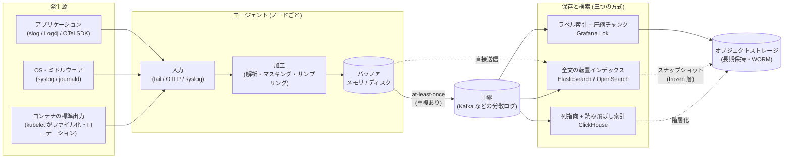

# ログシステム (Logging Systems)

## 概要 (Overview)

ログ (log) は、システムが「いつ、どこで、何が起きたか」を 1 件ずつ書き残す記録である。[`observability-performance-engineering.md`](observability-performance-engineering.md) は観測手段を単価の階層 (カウンタ、サンプリング、イベント記録) に並べ、ログを「負荷に比例して非有界に増えるイベント記録」に分類した。[`../cloud/cloud-observability.md`](../cloud/cloud-observability.md) はそれがマネージドサービスとして取り込みバイト単位で課金される姿を扱った。本書は三つの信号 (メトリクス、トレース、ログ) のうち残る一角であるログを、書き出し、収集、保存と検索、保持、安全の順に掘り下げる。

なお本書の「ログ」は、アプリケーションやシステムが出す事象の記録 (application/system log) を指す。Kafka のような分散ログ (distributed log) は、順序付きの追記列を複製してデータの受け渡しに使う基盤であり、別物である。名前と追記専用という性質は共有するが、そちらは [`../messaging/distributed-logs-delivery-semantics.md`](../messaging/distributed-logs-delivery-semantics.md) で扱う。ただし Kafka はログの収集パイプラインの途中の緩衝材としてもよく使われるため、両者は配送の保証の議論で接する。

中心テーゼは次の通りである。**ログ基盤の設計は、書くときに索引を作る費用を払うか、読むときに走査する費用を払うかの選択である。そして、書かれたログの大半は詳しく読まれないという利用の偏りが、近年の選択を走査側へ寄せている。** 全文の転置インデックス (inverted index) を持つ Elasticsearch/OpenSearch は前者の代表で、ラベルだけを索引にして本体は圧縮チャンクを走査する Grafana Loki と、列指向 (columnar) で保存して必要な列だけを走査する ClickHouse は後者の代表である。Uber は Elasticsearch で索引していたフィールドのうち実際に検索されたのは 5% だったと報告しており ([Uber 2021](https://www.uber.com/blog/logging/))、索引の費用の大部分が読まれないデータに払われていたことになる。ただし「書かれたログ全体のうち何割が一度も読まれないか」を直接測った公開の調査は見つけられなかった (2026-11-28 に再調査したが見つからず、未確認)。本書はこのテーゼを、費用の構造と事例から検討する。分析深度は Level 3。

## 方法論 (Methodology)

- データモデルは OpenTelemetry Logs Data Model の仕様と、RFC 5424 (syslog)、Go 標準ライブラリ `log/slog` の公式文書を一次資料とする。
- 収集パイプラインの挙動 (バッファ、背圧、配送の保証、ファイルのローテーション) は Fluent Bit、Vector、OpenTelemetry Collector の公式文書で確かめ、製品ごとの既定値の違いをそのまま書く。
- 保存と検索は、Grafana Loki と Elasticsearch と ClickHouse の公式文書を基準にする。費用の比較は、条件が公開されている査読論文 (CLP, OSDI 2021) と、移行の当事者が公開した事例 (Uber, Cloudflare) を使う。ベンダーが自社製品について出す削減率は「公称」と明記する。
- セキュリティの考察には、Apache Logging Services と CISA の Log4Shell の告知、MITRE CWE、NIST SP 800-92、改ざん検知の暗号学の論文 (Schneier & Kelsey 1999、Crosby & Wallach 2009) を使う。
- 索引の内部構造は [`../search/inverted-index-fulltext-search.md`](../search/inverted-index-fulltext-search.md)、圧縮の機構は [`../compression/lossless-compression.md`](../compression/lossless-compression.md)、セキュリティ運用としてのログ収集は [`../security/detection-incident-response.md`](../security/detection-incident-response.md) に譲り、本書はログ基盤固有の設計判断に集中する。

## 発見事項 (Findings)

1. **構造化ログの価値は、検索のしやすさより「書く側と読む側の契約」を明示することにある。** 自由文のログは、読む側が正規表現で意味を推測するしかなく、文面の変更が黙って検索や警報を壊す。JSON や logfmt (key=value の並び) で項目を分けて書けば、項目名がそのまま契約になる。OpenTelemetry Logs Data Model は、さらに時刻 (Timestamp と ObservedTimestamp)、重大度 (SeverityNumber の 1〜24)、発生元 (Resource)、TraceId/SpanId を共通の項目として定めた ([OTel Logs Data Model](https://opentelemetry.io/docs/specs/otel/logs/data-model/))。TraceId を持つログは、トレースと結合できる。
2. **収集パイプラインの配送の保証は「少なくとも 1 回 (at-least-once)」が上限であり、重複は仕様である。** Vector は exactly-once を提供しないと明言し、at-least-once でも同じ事象が複数回届きうると書いている ([Vector Guarantees](https://vector.dev/docs/architecture/guarantees/))。Fluent Bit も異常終了の後は少量の再取り込みが起きうるとしている ([Fluent Bit tail](https://docs.fluentbit.io/manual/pipeline/inputs/tail))。したがって重複の除去は保存側か読む側の仕事になる。
3. **取りこぼしの主な原因は、ネットワークより手前のバッファとファイルのローテーションにある。** メモリのバッファが満杯になると、エージェントは入力を止めるか、新しい事象を捨てるか、古いチャンクを捨てる。どれを選ぶかは製品と設定で違う ([Fluent Bit Backpressure](https://docs.fluentbit.io/manual/administration/backpressure)、[Vector Buffering](https://vector.dev/docs/architecture/buffering-model/)、[OTel exporterhelper](https://github.com/open-telemetry/opentelemetry-collector/blob/main/exporter/exporterhelper/README.md))。ファイルのローテーションでは、`copytruncate` の複写と切り詰めの間に書かれた行や、背圧で読み遅れた行が失われうる ([Fluent Bit tail](https://docs.fluentbit.io/manual/pipeline/inputs/tail))。
4. **全文の転置インデックスは、書き込み時に生ログと同じ桁の索引を作る。** CLP の論文の測定では、索引と圧縮済みログを合わせたディスク上の大きさが、Elasticsearch で生ログの 57%、Splunk Enterprise で 35% だった。gzip 系の汎用圧縮では 1 桁以上小さくなる (Rodrigues et al. 2021)。Cloudflare は Elasticsearch で 1 件 600 バイトだったエラーログが ClickHouse では 1 行 60 バイトになったと報告している ([Cloudflare 2022](https://blog.cloudflare.com/log-analytics-using-clickhouse/))。条件の違う 2 つの測定だが、索引付きの保存が素の圧縮より 1 桁ほど大きい点は一致する。
5. **Loki 型の設計は索引をラベルの組 (ストリーム) に限り、本文の検索を走査に回す。** Loki はログの本文を索引にせず、ラベルの組ごとに圧縮したチャンクをオブジェクトストレージに置く ([Loki Overview](https://grafana.com/docs/loki/latest/get-started/overview/))。索引が小さい代わりに、本文の条件はチャンクを展開して行ごとに照合する。この設計は、ラベルの濃度 (cardinality) が高いと崩れる。ユーザー ID やトレース ID をラベルにするとストリームが増え、索引が膨らみ、小さなチャンクが大量にできる ([Loki Cardinality](https://grafana.com/docs/loki/latest/get-started/labels/cardinality/))。
6. **列指向の保存は索引と走査の中間に新しい均衡点を作った。** ClickHouse は行を列ごとに圧縮して保存し、主キーの並び順と、グラニュール (既定 8192 行) 単位の読み飛ばし索引 (data skipping index) で、読む量を減らす ([ClickHouse Skipping Indexes](https://clickhouse.com/docs/optimize/skipping-indexes))。Uber は Elasticsearch からの移行でハードウェアの費用を半分以下にし ([Uber 2021](https://www.uber.com/blog/logging/))、Cloudflare は保存効率の改善でサンプリングをやめて全件を保持できるようになった ([Cloudflare 2022](https://blog.cloudflare.com/log-analytics-using-clickhouse/))。一方、全文索引の側も列指向の工夫を取り込んでいる (Elasticsearch の logsdb モード)。
7. **ログは秘密と個人情報の漏洩経路であり、マスキングは書き出し側で始める必要がある。** Meta は 2019 年、利用者のパスワードが読める形で社内の記憶装置に記録されていたと公表した ([Meta 2019](https://about.fb.com/news/2019/03/keeping-passwords-secure/))。収集パイプラインでの正規表現による伏せ字は、形の分からない秘密を見落とす。項目単位で「何を書かないか」を決めるのが第一の防御になる ([OWASP Logging Cheat Sheet](https://cheatsheetseries.owasp.org/cheatsheets/Logging_Cheat_Sheet.html))。
8. **ログを書く処理そのものが攻撃面になる。** Log4Shell (CVE-2021-44228, CVSS 10.0) は、ログに書く文字列の中の `${jndi:ldap://...}` という参照を Log4j 2 が展開し、攻撃者の LDAP サーバから読み込んだコードを実行してしまう脆弱性だった ([Apache Log4j Security](https://logging.apache.org/security.html))。攻撃者が制御できる文字列をログに書くことは日常の操作なので、ログ処理の中で解釈を行う機能があれば入力の境界がなくなる。
9. **監査ログの改ざん耐性は、追記専用の保存、ハッシュ連鎖、WORM の三つを組み合わせて作る。** ハッシュ連鎖と鍵の更新で、侵害より前の記録を改ざんすると検出できるようにする設計は Schneier & Kelsey (1999) に遡る。現在のクラウドでは、CloudTrail が 1 時間ごとのダイジェストファイルに前のダイジェストの署名を含めて連鎖させ ([CloudTrail Log File Validation](https://docs.aws.amazon.com/awscloudtrail/latest/userguide/cloudtrail-log-file-validation-intro.html))、S3 Object Lock のコンプライアンスモードは保持期間中の削除をルートユーザーにも許さない ([S3 Object Lock](https://docs.aws.amazon.com/AmazonS3/latest/userguide/object-lock.html))。

## アーキテクチャ (Architecture)

### 書き出しから検索までの経路



凡例: 実線は常用の経路、破線は構成によって使う経路を表す。円柱はデータが滞留する場所 (バッファや記憶装置) を表し、取りこぼしと重複はこの円柱の前後で起きる。

### 保存方式の比較: 費用をどこで払うか

| 方式 | 書き込み時の仕事 | 読み出し時の仕事 | 速い問い | 遅い・苦手な問い | 費用の支配項 |
|---|---|---|---|---|---|
| 全文の転置インデックス (Elasticsearch/OpenSearch) | 本文を語に分割し、語→文書の対応を作る | 該当する語のポスティングを引いて交差する | 稀な語の検索 (「この ID を含む行」) | 大量の行の集計、項目の型の衝突 | 索引の大きさと、それを置く高速ストレージ |
| ラベル索引 + 圧縮チャンク (Loki) | ラベルの組でストリームに振り分けて圧縮 | ラベルで絞ったチャンクを展開して行を照合 | 「このサービスのこの時間帯」 | 長い期間にわたる稀な文字列の検索 | 走査する量と、ラベルの濃度 |
| 列指向 (ClickHouse) | 列ごとに並べ替えて圧縮 | 必要な列だけを読み、グラニュール単位で読み飛ばす | 集計、特定の項目での絞り込み | 並び順と無関係な列での稀な値の検索 | 走査する列の量と、並び順の選び方 |

3 方式の違いは問いの種類に対する費用の配り方の違いである。全文索引は「どの問いが来ても速く答える」ために全件に前払いし、Loki と列指向は「よく来る問い」に合わせて並び順とラベルを決め、それ以外の問いは走査で払う。Uber の報告では、Elasticsearch に来るクエリの 80% 超が集計だった ([Uber 2021](https://www.uber.com/blog/logging/))。集計は転置インデックスより列指向が得意な問いであり、利用の実態が方式の選択を動かした例である。

## 技術詳細 (Technical Details)

### 1. 構造化ログとデータモデル

**形式。** JSON は入れ子と型を表せる代わりに冗長である。logfmt は `level=info msg="..." user=42` のような key=value の並びで、人が読みやすく、行指向の道具と相性がよい。logfmt には標準化された仕様がないが、Go 1.21 で標準ライブラリに入った `log/slog` は、同じ形の出力 (TextHandler: 空白区切りの key=value) と行区切りの JSON (JSONHandler) を両方持つ ([Go 1.21 Release Notes](https://go.dev/doc/go1.21)、[log/slog](https://pkg.go.dev/log/slog))。古くからある syslog も RFC 5424 で PRI・TIMESTAMP・HOSTNAME・APP-NAME・PROCID・MSGID のヘッダと、`[SD-ID name="value"]` の形の STRUCTURED-DATA を定めている ([RFC 5424](https://www.rfc-editor.org/rfc/rfc5424))。

**OpenTelemetry Logs Data Model (Stable)。** OTel のログのデータモデルは新しい形式を発明するより、既存の形式 (syslog、Apache のログファイル、改修できる自社アプリ) を曖昧さなく写像できることを設計目標に掲げる ([OTel Logs Data Model](https://opentelemetry.io/docs/specs/otel/logs/data-model/))。主な項目は次の通り。

- **Timestamp と ObservedTimestamp**: 前者は事象が発生した時刻、後者は収集系が観測した時刻である。2 つを分けることで、発生源の時計が狂っている場合や、ファイルから遅れて読んだ場合を区別できる。
- **SeverityNumber と SeverityText**: 数値は 1〜4 が TRACE、5〜8 が DEBUG、9〜12 が INFO、13〜16 が WARN、17〜20 が ERROR、21〜24 が FATAL で、各帯の中に 4 段階の細分がある。元の文字列 (例: syslog の `Notice`) は SeverityText に残す。syslog の 8 段階 (0 Emergency〜7 Debug) のように粒度の違う体系を、順序を保って写像するための設計である。
- **Body、Attributes、Resource、InstrumentationScope**: 本文、事象ごとの属性、発生元 (サービス名やホスト) の属性、ログを出したライブラリの識別である。Resource は同じ発生元の全レコードで共有されるので、送信時にまとめられる。
- **TraceId、SpanId、TraceFlags**: W3C Trace Context の識別子である。ログをトレースのスパンに結び付ける鍵になる。
- **EventName**: 空でなければそのレコードは「イベント」として扱われ、事象の種類を識別する。

**trace_id による相関。** ログに TraceId と SpanId があれば、トレースの UI から「このスパンの間に出たログ」へ移れ、逆にエラーログから全体のトレースへ移れる。この結合が成り立つには、ログを書く時点で現在のスパンの文脈 (context) を取り出して埋め込む必要がある。OTel の SDK やログ用のブリッジは、言語のロギングライブラリにこの埋め込みを行わせる。トレースが標本化 (sampling) されていると、ログの TraceId の指す先のトレースが保存されていないことがある。後述のように、サンプリングの判断を TraceId の値から決めれば、ログとトレースの残り方をそろえられる。

**ラベルと属性の区別。** 構造化すると「何を索引にするか」の判断が項目単位でできるようになる。ただし項目を増やすほど索引の費用は増える。Elasticsearch では項目の数が増え続ける「マッピングの爆発 (mapping explosion)」と、同じ項目名に違う型が入る衝突が運用上の問題として報告されている。Uber では型の衝突でログが捨てられていた ([Uber 2021](https://www.uber.com/blog/logging/)、[Cloudflare 2022](https://blog.cloudflare.com/log-analytics-using-clickhouse/))。

### 2. 収集パイプライン: バッファ、背圧、配送の保証

**エージェント。** ノードごとに置くエージェントには、Fluent Bit (C 製で軽量)、Vector (Rust 製)、OpenTelemetry Collector (Go 製で OTLP を中心にする) がある。いずれも「入力 → 加工 → バッファ → 出力」の構造を持ち、違いはバッファが満杯になったときの既定の振る舞いに現れる。

| 製品 | バッファの種類 | 満杯のときの既定 | 失われる経路 |
|---|---|---|---|
| Fluent Bit | メモリ (`mem_buf_limit`) またはファイルシステム (`storage.type filesystem`) | 入力を一時停止する | メモリだけの構成では一部の入力が停止中に取りこぼす。出力側の `storage.total_limit_size` に達すると最古のチャンクを捨てる |
| Vector | メモリ (既定 500 事象) またはディスク (書き込み前ログの形式) | `block`: 空くまで待ち、背圧を上流へ伝える | `drop_newest` を選ぶと新しい事象を捨てる。メモリのバッファはプロセスの異常終了で失われる |
| OTel Collector | 送信キュー (既定 1000 リクエスト)、任意で永続化 | 投入できないデータは通常捨てる (`block_on_overflow` 既定 false) | キューが満杯、または永続化先のディスクが一杯のとき |

出典: [Fluent Bit Backpressure](https://docs.fluentbit.io/manual/administration/backpressure)、[Vector Buffering](https://vector.dev/docs/architecture/buffering-model/)、[OTel exporterhelper](https://github.com/open-telemetry/opentelemetry-collector/blob/main/exporter/exporterhelper/README.md) (いずれも 2026-10-24 時点の文書)。

**背圧の行き先。** 背圧 (backpressure) を上流へ伝えると、最後は発生源にたどり着く。ファイルを読む入力なら、読むのを止めればよく、ファイル自体がバッファになる。ただしそのファイルがローテーションで消えれば、背圧は取りこぼしに変わる。HTTP や OTLP で押し込まれる入力では、止めることは送信側を待たせることを意味し、アプリのスレッドがログの書き出しで詰まる危険がある。Vector の文書も、クライアントが直接送ってくる構成では、待たせるより捨てる方がよい場合があると書いている ([Vector Buffering](https://vector.dev/docs/architecture/buffering-model/))。ログを書くことが本業の処理を止めてよいかは、ログの種類ごとに決める必要がある。監査ログは止めてでも残すべきで、デバッグログは捨ててよい。

**配送の保証と重複。** Vector の end-to-end acknowledgements は、出力先が受け取りを確認するまで入力側の確認 (チェックポイントの前進や送信元への応答) を遅らせる。複数の出力先があれば最も悪い結果が入力に返り、1 か所でも失敗すれば全出力先へ再送する ([Vector End-to-end Acknowledgements](https://vector.dev/docs/architecture/end-to-end-acknowledgements/))。この方式は再送で損失を防ぐので、重複は避けられない。Vector は exactly-once を提供しないと明記している ([Vector Guarantees](https://vector.dev/docs/architecture/guarantees/))。重複を除くには、発生源で一意な ID を付けて保存側で重複を除くか、読む側が重複を許す集計 (件数ではなく存在の確認) をするかになる。Kafka を中継に挟むと、Kafka 内の区間は冪等な producer とトランザクションで exactly-once に近づけられる ([`../messaging/distributed-logs-delivery-semantics.md`](../messaging/distributed-logs-delivery-semantics.md))。しかしエージェントから Kafka までと、Kafka から保存先までの区間には同じ問題が残る。

### 3. ファイルのローテーションと取りこぼし

**ファイルの同一性。** エージェントは「どのファイルのどこまで読んだか」を記録する。Fluent Bit の tail 入力はこれを `inode=offset` の形で保存する ([Fluent Bit tail](https://docs.fluentbit.io/manual/pipeline/inputs/tail))。inode は別のファイルに再利用されうるため、Vector は既定でファイル先頭の数行のチェックサムでファイルを識別する ([Vector file source](https://vector.dev/docs/reference/configuration/sources/file/))。OTel Collector の filelog receiver は inode と先頭 1000 バイトの指紋 (fingerprint) を組み合わせる ([OTel filelogreceiver](https://github.com/open-telemetry/opentelemetry-collector-contrib/blob/main/receiver/filelogreceiver/README.md))。先頭が同じヘッダで始まるファイルは指紋で区別できない。指紋の大きさを後から縮めると、既存のファイルを新しいファイルと誤認して再取り込みし、重複が出る。

**ローテーションの二方式。**

- **移動して新規作成 (move/create)**: 古いファイルの名前を変え、新しいファイルを作る。エージェントは開いたままの古いファイルを読み終えてから新しいファイルへ移る。Fluent Bit の `rotate_wait` (既定 5 秒) は、名前を変えられたファイルを読み続ける猶予である。猶予の間に読み切れなければ、末尾が失われる。
- **複写して切り詰め (copytruncate)**: 内容を別ファイルへ複写し、元のファイルを長さ 0 に切り詰める。書き手がファイルを開き直さなくてよい代わりに、複写と切り詰めの間に書かれた行が失われる競合がある。背圧で読み遅れていると、読む前に切り詰められる ([Fluent Bit tail](https://docs.fluentbit.io/manual/pipeline/inputs/tail))。Vector は logrotate 側で `delaycompress` を使い、最初のローテーション後のファイルも読む対象に含めるよう勧めている ([Vector file source](https://vector.dev/docs/reference/configuration/sources/file/))。

**Kubernetes の場合。** kubelet はコンテナのログを 1 ファイル 10Mi、最大 5 ファイル (既定) でローテーションし、Pod が退去 (eviction) するとログもコンテナとともに消える ([Kubernetes Logging Architecture](https://kubernetes.io/docs/concepts/cluster-administration/logging/))。1 秒に数 MB を書くコンテナでは、エージェントが数十秒止まるだけで、まだ読んでいないファイルが消える。ノード上のファイルは、収集が追いつく前提の短いバッファでしかない。

**起動時の読み始め位置。** OTel Collector の filelog receiver は既定で `start_at: end`、つまりファイルの末尾から読み始める。永続化した読み取り位置がなければ、エージェントの再起動中に書かれた行は読まれない ([OTel filelogreceiver](https://github.com/open-telemetry/opentelemetry-collector-contrib/blob/main/receiver/filelogreceiver/README.md))。読み取り位置は永続化の拡張 (storage extension) でディスクに保存する。

### 4. 保存と検索 (1): 全文の転置インデックス

Elasticsearch/OpenSearch は Lucene の転置インデックスで、本文の語ごとにそれを含む文書の列 (ポスティングリスト) を作る。構造と圧縮の詳細は [`../search/inverted-index-fulltext-search.md`](../search/inverted-index-fulltext-search.md) にある。ログの用途での特徴は次の 3 点である。

- **索引が大きい。** CLP の論文は、Elasticsearch と Splunk の索引が生ログと同じ桁の大きさになり、しかも十分な性能にはメモリか高速なランダムアクセスのストレージに置く必要があると指摘した。そのため大量のログを持つ利用者は、索引付きのログを数週間しか保持できないことが多いとしている (Rodrigues et al. 2021)。
- **索引は書き込み時の CPU を使う。** 取り込み性能では、CLP は Elasticsearch と Splunk を 13 倍以上上回ったと報告している (同)。Uber は単一ノードの取り込みが ClickHouse で毎秒 30 万件、Elasticsearch の約 10 倍だったと報告している ([Uber 2021](https://www.uber.com/blog/logging/))。測定条件の違う数字であり、倍率そのものより向きの一致を読むべきである。
- **ログ向けの改良。** Elastic は logsdb インデックスモードで、`host.name` と `@timestamp` による並べ替え、`_source` を保存せず列 (doc values) から再構成する synthetic source、Zstandard や差分符号化を組み合わせた。削減率は公称で「最大 65%」(2024-12 の発表、logsdb なしの最近の版との比較) または「最大 60%」(2026-10-24 時点の製品文書) とされる。取り込みの性能は 10〜20% 下がる ([Elastic Search Labs 2024](https://www.elastic.co/search-labs/blog/elasticsearch-logsdb-index-mode)、[Elastic Logs Data Stream](https://www.elastic.co/docs/manage-data/data-store/data-streams/logs-data-stream))。いずれもベンダー自身の測定で、独立した検証は見つけられなかった。logsdb は Elastic Stack 9.0 以降で GA であり、9.5 以降には列指向の `logsdb_columnar` モードがプレビューとしてある。全文索引の陣営が並べ替えと列指向を取り込んでいることは、方式の境界が溶けつつあることを示す。

### 5. 保存と検索 (2): ラベル索引と圧縮チャンク (Loki)

**構造。** Loki はラベルの組 (例: `{app="api", env="prod"}`) を 1 本のストリームとし、ストリームごとに一定の時間範囲のログを圧縮したチャンクにまとめる。索引は「どのラベルの組のどの時間帯のログがどのチャンクにあるか」の目次で、Prometheus の TSDB 形式に由来する。索引もチャンクもオブジェクトストレージに置く ([Loki Architecture](https://grafana.com/docs/loki/latest/get-started/architecture/))。

**クエリ。** LogQL のクエリは必ずストリームセレクタ (ラベルの条件) を持つ。ラベルでチャンクを絞った後、行フィルタ (`|= "timeout"` など) でチャンクの中身を行ごとに照合する。行フィルタはパイプラインの先頭に置くのが速い ([LogQL Log Queries](https://grafana.com/docs/loki/latest/query/log_queries/))。読む側の費用は「ラベルで絞った後のチャンクの量」に比例するので、時間範囲とラベルを狭く指定できる問いは安く、長い期間にわたって稀な文字列を探す問いは高い。

**ラベルの濃度の問題。** ストリームの数はラベルの値の組み合わせの数で決まる。Loki の文書は、索引のラベルは 15 個が既定の上限で、少ないほどよいとし、タイムスタンプ、IP アドレス、Pod 名、ユーザー ID、トレース ID のような値の種類が多い属性をラベルにしないよう求めている。濃度が高いと索引が巨大になり、小さなチャンクが大量にオブジェクトストレージへ書き出される ([Loki Cardinality](https://grafana.com/docs/loki/latest/get-started/labels/cardinality/))。これはメトリクスの時系列の本数の問題 ([`observability-performance-engineering.md`](observability-performance-engineering.md) の発見事項 7) と同じ形である。ストリームがメトリクスの時系列と同じ役割を担うためである。

**高濃度の値の扱い。** 頻繁に検索するがラベルにできない値 (トレース ID など) のために、Loki は structured metadata という、索引の外で行に添える項目を持つ。2026-10-24 時点で実験段階 (experimental) の bloom filter による高速化は、structured metadata のキーと値をハッシュしてチャンク単位のブルームフィルタを作り、該当しないチャンクを読み飛ばす。対象は「大量の行から少数を探す (needle in a haystack)」問いである ([Loki Bloom Filters](https://grafana.com/docs/loki/latest/operations/bloom-filters/))。走査側に寄せた設計が、苦手な問いのために確率的な索引を後から足している点は、テーゼの限界を示している。走査だけでは足りない問いが現実にある。

### 6. 保存と検索 (3): 列指向の台頭 (ClickHouse)

**なぜ列指向がログに合うか。** ログの項目は、時刻、サービス名、重大度、ホストのように値の種類が少なく、並べると同じ値が続く列が多い。列ごとに並べて圧縮すると、行ごとの JSON よりはるかに縮む。Cloudflare は時刻の列に Double-Delta、浮動小数の列に Gorilla、種類の少ない文字列に LowCardinality を使った ([Cloudflare 2022](https://blog.cloudflare.com/log-analytics-using-clickhouse/))。これらの符号化の原理は [`../compression/lossless-compression.md`](../compression/lossless-compression.md) の「構造を知る者が桁を稼ぐ」専用変換の例である。

**読み飛ばし。** ClickHouse は主キーの並び順で疎な索引を持ち、さらに列ごとに読み飛ばし索引 (minmax、set、bloom_filter など) を付けられる。読み飛ばし索引は該当する行を指すのではなく、グラニュールの塊を「確実に該当しない」と判定して読まずに済ませるだけである。該当する値が表全体に散っていれば、ほとんど読み飛ばせず、索引の費用だけが増える ([ClickHouse Skipping Indexes](https://clickhouse.com/docs/optimize/skipping-indexes))。つまり並び順の選択がどの問いを安くするかを決める。2026-10-24 時点では、ClickHouse は 26.2 以降で語→行番号の転置インデックスである text index を GA としている ([ClickHouse Text Index](https://clickhouse.com/docs/engines/table-engines/mergetree-family/invertedindexes))。列指向の陣営も全文索引を取り込みつつある。

**可変の項目の扱い。** ログの項目はサービスごとに違い、事前にすべての列を定義できない。Uber は項目を値の型ごとに「名前の配列」と「値の配列」の組に格納し、型の衝突を書き込み時ではなくクエリ時に解決した。よく使う項目だけを専用の列に昇格させる ([Uber 2021](https://www.uber.com/blog/logging/))。Cloudflare も同じ配列方式を選び、項目を自動で列にする方式は、項目の総数が 1000 未満のときに限るべきだとしている。1 つのアプリが項目を出しすぎると、クラスタ全体が倒れうるためである ([Cloudflare 2022](https://blog.cloudflare.com/log-analytics-using-clickhouse/))。

**規模。** ClickHouse 社は自社の観測基盤 (LogHouse) について、2025-06 時点で非圧縮換算 100 PB 超、約 500 兆行を保持していると報告している ([ClickHouse 2025](https://clickhouse.com/blog/scaling-observability-beyond-100pb-wide-events-replacing-otel))。これはベンダー自身の事例である。

**専用の圧縮という別解。** CLP (Rodrigues et al. 2021) は、ログの行を「定型部分 (log type)」と「変数」に分解して辞書化し、圧縮したまま検索する。評価では手作業の解析規則なしで平均 32 倍の圧縮率を示した。Uber はこれを Spark の非構造ログに適用し、第 1 段階 (書き出し時の中間表現) で 30 日分の約 5.38 PB を 31.4 TB にした (169 倍) と報告している。この導入で、保持期間を 3 日から 1 か月に延ばし、SSD の摩耗のために WARN に下げていた記録のレベルを INFO に戻せたという ([Uber CLP 2022](https://www.uber.com/blog/reducing-logging-cost-by-two-orders-of-magnitude-using-clp))。対象のログが違うので 2 つの倍率は比べられないが、ログの反復性を使えば汎用圧縮より大きく縮むという点では一致する。

### 7. 費用の構造: 索引の前払いと走査の後払い

費用の構造を簡単なモデルで書く (擬似的な式であり、実装を表すものではない)。

```text
total_cost ≈ V × (c_ingest + c_index)            # 書き込み時: 量 V に比例
           + V × r × c_store(tier)                # 保存: 保持期間 r と置き場所の単価
           + Σ_queries  bytes_scanned(q) × c_scan # 読み出し時: 問いごとの走査量
仮定: c_index は全件に払う。bytes_scanned は方式で変わる (全文索引では小さく、
      Loki では時間範囲とラベルで絞った後のチャンク量、列指向では読む列と読み飛ばせない塊の量)。
```

全文索引は第 1 項と第 2 項 (索引も保存する) を大きくして第 3 項を小さくする。Loki と列指向は第 1 項と第 2 項を小さくして第 3 項を大きくする。どちらが安いかは問いの回数と種類で決まる。Uber で索引した項目のうち 5% しか検索されなかったこと ([Uber 2021](https://www.uber.com/blog/logging/)) は、第 3 項の問いが少なく偏っていれば、第 1 項の前払いはほとんど回収されないことを示す。

**保持期間と階層。** 読まれる頻度は時間とともに下がる。Elasticsearch のデータ階層は、新しいログを SSD の hot 層に、数週間前のログを warm 層に置く。cold 層はスナップショットから全体をマウントしてレプリカを不要にし、frozen 層はスナップショットを部分的にマウントして、必要なときだけオブジェクトストレージから取り出す ([Elastic Data Tiers](https://www.elastic.co/docs/manage-data/lifecycle/data-tiers))。後ろの層ほど、索引の前払いを捨てて走査の後払いへ移る構成であり、1 つの製品の中でテーゼの選択が時間軸に沿って切り替わっている。保持期間そのものは業種の規制 (CLP の論文は医療で最長 6 年の保存義務を例に挙げる) と、侵入の発見までの日数 ([`../security/detection-incident-response.md`](../security/detection-incident-response.md)) から下限が決まる。

### 8. サンプリングとレベル制御

**レベルによる制御。** 最も安い削減は書かないことである。SeverityNumber で INFO 未満を既定で出さず、障害の調査中だけ動的に DEBUG を有効にする。OTel の仕様も TRACE を「既定の設定では通常無効」と定義している ([OTel Logs Data Model](https://opentelemetry.io/docs/specs/otel/logs/data-model/))。ただし障害は事前に予告されないので、事後に必要になった DEBUG ログはもう存在しない。

**サンプリング。** ログの標本化は全件を保持できないときの妥協である。Cloudflare は移行前、保存費用を抑えるために強くサンプリングしていた ([Cloudflare 2022](https://blog.cloudflare.com/log-analytics-using-clickhouse/))。OTel Collector の probabilistic sampler processor はログに対応しており (2026-10-24 時点で alpha)、既定では TraceId のハッシュで残すかどうかを決める。TraceId がなければ指定した属性のハッシュを使う ([OTel probabilisticsamplerprocessor](https://github.com/open-telemetry/opentelemetry-collector-contrib/blob/main/processor/probabilisticsamplerprocessor/README.md))。同じ TraceId に同じ判定を下せば、残ったトレースに対応するログがそろって残る。これは文書の「スパンと同じ論理」という記述からの推論であり、一貫させるには全コレクタで `hash_seed` をそろえる必要がある。

**捨ててはいけないもの。** エラーと監査のログは、サンプリングの対象から外すのが原則である。サンプリングは件数の統計を歪めるので、件数を数えたいならログを捨てる前にメトリクスへ変換しておく ([`../cloud/cloud-observability.md`](../cloud/cloud-observability.md) の、構造化ログからメトリクスを導出する議論)。

## セキュリティ考察 (Security Considerations)

### 秘密と個人情報の混入

ログには、認証ヘッダ、アクセストークン、パスワード、接続文字列、個人情報が紛れ込みやすい。典型的な経路は例外のメッセージやリクエスト全体をそのまま書くことである。Meta は 2019 年、数億件規模の利用者のパスワードが読める形で社内の記憶装置に記録されていたと公表した。外部からは見えていなかったとしている ([Meta 2019](https://about.fb.com/news/2019/03/keeping-passwords-secure/))。OWASP はセッション ID、アクセストークン、パスワード、接続文字列、暗号鍵、決済情報、機微な個人情報を直接記録せず、除去、伏せ字、ハッシュ化、暗号化のいずれかをするよう求めている ([OWASP Logging Cheat Sheet](https://cheatsheetseries.owasp.org/cheatsheets/Logging_Cheat_Sheet.html))。

防御は三段になる。(1) 書き出し側: 構造化ログで項目を明示し、秘密を含む型 (トークンやパスワードの型) は文字列化の時点で伏せ字にする。(2) パイプライン: 正規表現による伏せ字 (クレジットカード番号、メールアドレスなど)。形の決まった値には効くが、形の分からない秘密は見落とす。(3) 保存側: ログを読める権限そのものを最小にする。観測基盤は全システムを読める特権点だからである ([`../cloud/cloud-observability.md`](../cloud/cloud-observability.md))。個人情報については、保持期間を過ぎたログの削除が法令上の義務になりうるが、WORM で保存したログは期間中に消せない。何を WORM に置くかは監査の要件と削除の要件の両方から決める必要がある。

### ログの注入 (log injection)

攻撃者が制御する文字列に改行が含まれていると、偽のログ行を作れる。MITRE は「ログへの出力の不適切な無害化」(CWE-117) として、改行を含む入力で `INFO: User logged out=badguy` のような偽の行を差し込む例を挙げる ([CWE-117](https://cwe.mitre.org/data/definitions/117.html))。対策は JSON のような構造化形式で値をエスケープして書くことと、改行や区切り文字を無害化することである。OWASP はプレースホルダによる引数化だけでは CR/LF の注入を防げないので、値をエスケープする構造化エンコーダを使うよう注意している ([OWASP Logging Cheat Sheet](https://cheatsheetseries.owasp.org/cheatsheets/Logging_Cheat_Sheet.html))。読む側の画面 (ログビューアや SIEM の Web 画面) が値を HTML として描画すれば、XSS の経路にもなる。

### Log4Shell: ログ処理が攻撃経路になった事例

Log4j 2 はログのメッセージや引数に含まれる `${...}` の参照 (lookup) を展開する機能を持っていた。JNDI の参照は LDAP などの外部のサーバへの問い合わせを含み、攻撃者が用意した LDAP サーバから読み込んだコードが実行された。Apache の告知は、ログのメッセージかその引数を制御できる攻撃者は、LDAP サーバから読み込んだ任意のコードを実行できると説明している。影響は log4j-core の 2.0-beta9 から 2.15.0 未満 (Java 7 向けの 2.12.2 などの修正版を除く) で、CVSS 3.1 の基本値は 10.0 である ([Apache Log4j Security](https://logging.apache.org/security.html))。

修正は一度で終わらなかった。2.15.0 の修正は特定の非既定の設定で不完全で (CVE-2021-45046)、2.16.0 で JNDI を既定で無効にした。続いて参照の評価の無限再帰によるサービス拒否 (CVE-2021-45105、2.17.0 で修正) と、ログの設定を書き換えられる攻撃者が JDBC Appender の JNDI データソースを使う問題 (CVE-2021-44832) が見つかった (同)。CISA は 2021-12-17 に緊急指令 22-02 を出し、Java 8 なら 2.17.1、Java 7 なら 2.12.4、Java 6 なら 2.3.2 への更新を求めた。影響を受けたサービスのログには利用者が制御した文字列が含まれるので、侵害の確認にはそのログを調べるよう勧めている ([CISA Log4j Guidance](https://www.cisa.gov/news-events/news/apache-log4j-vulnerability-guidance))。

この事例から引き出せる設計原則は 2 つある。第一に、**ログを書く処理は入力を解釈してはならない**。ログに書く文字列は定義上、外部から来た値を含む。その値をテンプレートとして展開する機能は、境界の内側に攻撃者の入力を持ち込む。第二に、**ログの経路は全システムを横断する**ので、ログ処理の部品の脆弱性は影響範囲が極端に広い。依存関係として埋め込まれた Log4j を探す作業は、ソフトウェア部品表 (SBOM) の必要性を示す事例として扱われた ([`../security/software-supply-chain-security.md`](../security/software-supply-chain-security.md))。収集エージェントや保存先の検索エンジンも同じ位置にあり、更新の遅れは許されない。

### 監査ログの改ざん耐性

攻撃者は侵入の後、自分の痕跡を消そうとする。NIST SP 800-92 (2006) は、ログ管理を生成、送信、保存、分析、廃棄の全体として計画し、ログを保護するよう求めた ([NIST SP 800-92](https://csrc.nist.gov/pubs/sp/800/92/final))。改訂版 SP 800-92 Rev. 1 (*Cybersecurity Log Management Planning Guide*) は 2023-10 に初期公開草案 (Initial Public Draft) が出たが、2026-10-24 時点で CSRC 上は草案のままである ([NIST SP 800-92r1 ipd](https://csrc.nist.gov/pubs/sp/800/92/r1/ipd))。

改ざん耐性は 3 つの層で作る。

- **追記専用と送り出し**: 発生源のホストに残したログは、ホストを奪った攻撃者が書き換えられる。発生した直後に別の管理領域へ送り、書き込み専用の権限で受ける。Windows の監査ログの消去はそれ自体が記録されるので、消去の記録の監視も手がかりになる ([`../security/detection-incident-response.md`](../security/detection-incident-response.md))。
- **ハッシュ連鎖と署名**: Schneier & Kelsey (1999) は、各記録の鍵を一方向関数で更新し、記録をハッシュで連鎖させた。こうすると、侵害の時点より前の記録は、攻撃者が読めず、検出されずに書き換えることもできない。Crosby & Wallach (2009) は、木構造 (history tree) で「ある時点のログが、それより前の時点のログに追記しただけのものである」ことを対数の大きさの証明で示せるようにした。syslog には RFC 5848 の署名付きメッセージがあり、署名ブロックに先行するメッセージのハッシュと署名を載せて、発生源、完全性、順序を検証できる ([RFC 5848](https://www.rfc-editor.org/rfc/rfc5848))。CloudTrail は配信した各ログファイルの SHA-256 を 1 時間ごとのダイジェストファイルに入れ、RSA で署名し、各ダイジェストに前のダイジェストの署名を含める ([CloudTrail Log File Validation](https://docs.aws.amazon.com/awscloudtrail/latest/userguide/cloudtrail-log-file-validation-intro.html))。連鎖があるので、ダイジェストを 1 つ消すと検出できる。
- **WORM (write once, read many)**: ハッシュ連鎖は改ざんを「検出」するだけで、削除は防がない。S3 Object Lock のコンプライアンスモードでは、保持期間中はルートユーザーを含めて誰もオブジェクトの版を上書きも削除もできない。期間前に消す唯一の方法はアカウントの削除である ([S3 Object Lock](https://docs.aws.amazon.com/AmazonS3/latest/userguide/object-lock.html))。ガバナンスモードは特別な権限を持つ利用者に解除を許すので、試験や運用の柔軟性と引き換えに保護が弱い。

検出と防止は役割が違う。ハッシュ連鎖は「消されたこと」を証明し、WORM は「消せないこと」を保証する。どちらも、ログが保存先に届く前の区間 (エージェントのバッファ) は守らない。攻撃者はログの送信を止めることもできるので、「ログが届かなくなったこと」自体を警報にする必要がある。

### ログ基盤への負荷攻撃

ログの量は入力に比例するので、攻撃者は大量のエラーを起こさせてログ基盤を溢れさせ、本命の痕跡を埋もれさせたり、背圧でアプリを詰まらせたりできる。前述のバッファの選択 (止めるか捨てるか) がここで効く。Loki ではラベルの値を攻撃者が制御できると (例: リクエストのパスをラベルにする)、ストリームの爆発で基盤そのものが劣化する ([Loki Cardinality](https://grafana.com/docs/loki/latest/get-started/labels/cardinality/))。ラベルに使う値は有限の集合に限る。

## 結論 (Conclusions)

- ログ基盤の設計は、索引を前払いするか、走査で後払いするかの選択である。全文の転置インデックスはどの問いにも速く答える代わりに生ログと同じ桁の索引を全件に作り、Loki と列指向は索引を小さくしてよく来る問いに合わせた並び順とラベルで走査を絞る。索引した項目の 5% しか検索されなかった Uber の事例と、保存費用のためにサンプリングしていた Cloudflare の事例は、読まれないデータへの前払いが費用の大部分を占めうることを示す。ただしログ全体の未読の割合を直接測った公開データは見つけられず、テーゼの「大半」はこの 2 社の事例と、索引付きのログが数週間しか保持されないという CLP の論文の指摘からの推論である。
- 走査側への移行は完全ではない。Loki は bloom filter を、ClickHouse は text index を後から足し、Elasticsearch は並べ替えと列指向を取り込んだ。各方式は相手の得意な問いを部分的に取り込み、境界は溶けつつある。実務の判断は製品の選択より、「どの問いを安くするか」を並び順、ラベル、保持の階層で決める作業である。
- 収集パイプラインの保証は at-least-once が上限であり、取りこぼしはバッファの満杯とファイルのローテーションで起きる。重複を前提にした保存と、ログが届かないこと自体の監視が要る。
- ログは秘密の漏洩経路であり、攻撃の経路でもある。項目単位で書かないものを決めること、ログの処理で入力を解釈しないこと、監査ログをハッシュ連鎖と WORM で守ることが、Log4Shell とパスワードの記録の事例から引き出される規律である。

### 次の接続先 (Related Topics)

- [`observability-performance-engineering.md`](observability-performance-engineering.md) — 観測の単価階層と、メトリクスのカーディナリティ。本書のラベルの濃度の議論の出発点。
- [`time-series-databases.md`](time-series-databases.md) — 時系列データベース。Loki の索引が由来する TSDB と、系列数の問題の本体。
- [`../cloud/cloud-observability.md`](../cloud/cloud-observability.md) — マネージドなログ (CloudWatch Logs、CloudTrail) と、バイト単位の課金。
- [`../search/inverted-index-fulltext-search.md`](../search/inverted-index-fulltext-search.md) — 転置インデックス、セグメントのマージ、ポスティングの圧縮の内部構造。
- [`../messaging/distributed-logs-delivery-semantics.md`](../messaging/distributed-logs-delivery-semantics.md) — Kafka 型の分散ログと配送の保証。収集の中継で接する別の「ログ」。
- [`../security/detection-incident-response.md`](../security/detection-incident-response.md) — セキュリティの観点でのログ収集、SIEM、保存期間。
- [`../compression/lossless-compression.md`](../compression/lossless-compression.md) — 列ごとの専用変換と、汎用圧縮の機構。
- [`../databases/storage-engines.md`](../databases/storage-engines.md) — 追記と LSM-tree、列指向の保存の基礎。
- [`../cloud/data-lakehouse-analytics.md`](../cloud/data-lakehouse-analytics.md) — 古いログをオブジェクトストレージに置いて読む経路。
- [`../security/software-supply-chain-security.md`](../security/software-supply-chain-security.md) — Log4Shell が示した、埋め込まれた依存関係の把握。

## 参考文献 (References)

**一次資料 (仕様・標準・公的機関)**

- [OpenTelemetry Logs Data Model](https://opentelemetry.io/docs/specs/otel/logs/data-model/) — Accessed: 2026-10-24。Stable。LogRecord の項目、SeverityNumber の帯、設計目標。
- Gerhards, R. (2009). The Syslog Protocol. *RFC 5424*. [rfc-editor.org](https://www.rfc-editor.org/rfc/rfc5424) — Accessed: 2026-10-24。
- Kelsey, J., Callas, J., & Clemm, A. (2010). Signed Syslog Messages. *RFC 5848*. [rfc-editor.org](https://www.rfc-editor.org/rfc/rfc5848) — Accessed: 2026-10-24。
- Kent, K., & Souppaya, M. (2006). *Guide to Computer Security Log Management*. NIST Special Publication 800-92. DOI: 10.6028/NIST.SP.800-92 — [csrc.nist.gov](https://csrc.nist.gov/pubs/sp/800/92/final) — Accessed: 2026-10-24。
- Scarfone, K., & Souppaya, M. (2023). *Cybersecurity Log Management Planning Guide*. NIST SP 800-92 Rev. 1 (Initial Public Draft). [csrc.nist.gov](https://csrc.nist.gov/pubs/sp/800/92/r1/ipd) — Accessed: 2026-10-24。
- [Apache Log4j Security Vulnerabilities, Apache Logging Services](https://logging.apache.org/security.html) — Accessed: 2026-10-24。CVE-2021-44228、CVE-2021-45046、CVE-2021-45105、CVE-2021-44832 の影響版と修正版。
- [Apache Log4j Vulnerability Guidance, CISA](https://www.cisa.gov/news-events/news/apache-log4j-vulnerability-guidance) — Accessed: 2026-10-24。緊急指令 22-02、推奨版、ログの確認。
- [CWE-117: Improper Output Neutralization for Logs, MITRE](https://cwe.mitre.org/data/definitions/117.html) — Accessed: 2026-10-24。
- [Logging Architecture, Kubernetes Documentation](https://kubernetes.io/docs/concepts/cluster-administration/logging/) — Accessed: 2026-10-24。kubelet のローテーションの既定値。
- [Go 1.21 Release Notes](https://go.dev/doc/go1.21)・[log/slog package](https://pkg.go.dev/log/slog) — Accessed: 2026-10-24。

**査読論文**

- Schneier, B., & Kelsey, J. (1999). Secure audit logs to support computer forensics. *ACM Transactions on Information and System Security*, 2(2), 159-176. DOI: 10.1145/317087.317089
- Crosby, S. A., & Wallach, D. S. (2009). Efficient Data Structures for Tamper-Evident Logging. *Proceedings of the 18th USENIX Security Symposium*, 317-334. [usenix.org](https://www.usenix.org/conference/usenixsecurity09/technical-sessions/presentation/efficient-data-structures-tamper-evident) — Accessed: 2026-10-24。
- Rodrigues, K., Luo, Y., & Yuan, D. (2021). CLP: Efficient and Scalable Search on Compressed Text Logs. *15th USENIX Symposium on Operating Systems Design and Implementation (OSDI '21)*, 183-198. [usenix.org](https://www.usenix.org/conference/osdi21/presentation/rodrigues) — Accessed: 2026-10-24。索引の大きさ (Elasticsearch 57%、Splunk 35%)、平均圧縮率 32、取り込み性能。

**製品の公式文書 (2026-10-24 時点の挙動と既定値)**

- Grafana Loki: [Overview](https://grafana.com/docs/loki/latest/get-started/overview/)・[Architecture](https://grafana.com/docs/loki/latest/get-started/architecture/)・[Cardinality](https://grafana.com/docs/loki/latest/get-started/labels/cardinality/)・[Log queries](https://grafana.com/docs/loki/latest/query/log_queries/)・[Bloom filters](https://grafana.com/docs/loki/latest/operations/bloom-filters/) — Accessed: 2026-10-24。
- Elastic: [Logs data stream (logsdb)](https://www.elastic.co/docs/manage-data/data-store/data-streams/logs-data-stream)・[Data tiers](https://www.elastic.co/docs/manage-data/lifecycle/data-tiers) — Accessed: 2026-10-24。
- Settle, M., Kobar, G., & Siddiqi, A. (2024-12-12). [Live log and prosper: Elasticsearch newly specialized logsdb index mode, Elastic Search Labs](https://www.elastic.co/search-labs/blog/elasticsearch-logsdb-index-mode) — Accessed: 2026-10-24。削減率「最大 65%」は公称。
- ClickHouse: [Data skipping indexes](https://clickhouse.com/docs/optimize/skipping-indexes)・[Text index](https://clickhouse.com/docs/engines/table-engines/mergetree-family/invertedindexes) — Accessed: 2026-10-24。
- Fluent Bit: [Backpressure](https://docs.fluentbit.io/manual/administration/backpressure)・[Tail input](https://docs.fluentbit.io/manual/pipeline/inputs/tail) — Accessed: 2026-10-24。
- Vector: [Buffering model](https://vector.dev/docs/architecture/buffering-model/)・[Delivery guarantees](https://vector.dev/docs/architecture/guarantees/)・[End-to-end acknowledgements](https://vector.dev/docs/architecture/end-to-end-acknowledgements/)・[File source](https://vector.dev/docs/reference/configuration/sources/file/) — Accessed: 2026-10-24。
- OpenTelemetry Collector: [exporterhelper (sending queue)](https://github.com/open-telemetry/opentelemetry-collector/blob/main/exporter/exporterhelper/README.md)・[filelog receiver](https://github.com/open-telemetry/opentelemetry-collector-contrib/blob/main/receiver/filelogreceiver/README.md)・[probabilistic sampler processor](https://github.com/open-telemetry/opentelemetry-collector-contrib/blob/main/processor/probabilisticsamplerprocessor/README.md) — Accessed: 2026-10-24。
- AWS: [Validating CloudTrail log file integrity](https://docs.aws.amazon.com/awscloudtrail/latest/userguide/cloudtrail-log-file-validation-intro.html)・[Locking objects with S3 Object Lock](https://docs.aws.amazon.com/AmazonS3/latest/userguide/object-lock.html) — Accessed: 2026-10-24。

**事例 (当事者による公開)**

- Wang, C., & Li, X. (2021-02-19). [Fast and Reliable Schema-Agnostic Log Analytics Platform, Uber Engineering](https://www.uber.com/blog/logging/) — Accessed: 2026-10-24。索引した項目の 5% だけが検索された、クエリの 80% 超が集計、ハードウェア費用の半減。
- Agrawal, D., & Luo, J. (2022-09-29). [Reducing Logging Cost by Two Orders of Magnitude using CLP, Uber Engineering](https://www.uber.com/blog/reducing-logging-cost-by-two-orders-of-magnitude-using-clp) — Accessed: 2026-10-24。
- Singh, M., & Chhetri, P. (2022-09-02). [Log analytics using ClickHouse, Cloudflare Blog](https://blog.cloudflare.com/log-analytics-using-clickhouse/) — Accessed: 2026-10-24。
- Crispin, R., & McDiarmid, D. (2025-06-19). [Scaling our Observability platform beyond 100 Petabytes by embracing wide events and replacing OTel, ClickHouse Blog](https://clickhouse.com/blog/scaling-observability-beyond-100pb-wide-events-replacing-otel) — Accessed: 2026-10-24。ベンダー自身の事例。
- [Keeping Passwords Secure, Meta Newsroom (2019-03-21, 2019-04-18 更新)](https://about.fb.com/news/2019/03/keeping-passwords-secure/) — Accessed: 2026-10-24。

**二次資料 (解説)**

- [Logging Cheat Sheet, OWASP Cheat Sheet Series](https://cheatsheetseries.owasp.org/cheatsheets/Logging_Cheat_Sheet.html) — Accessed: 2026-10-24。記録してはならない情報、ログの注入、ログの保護。
