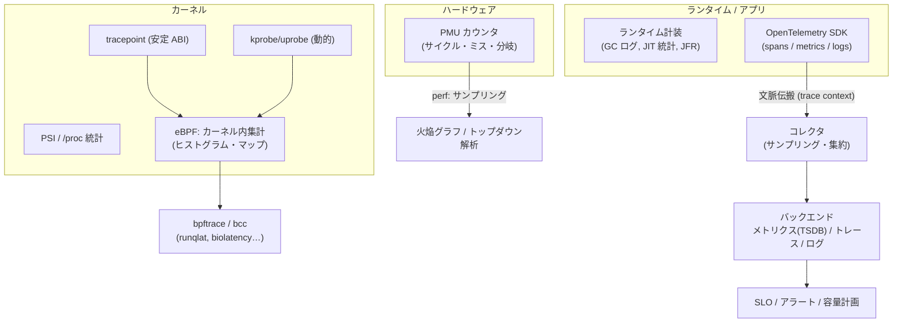

# 可観測性と性能工学 (Observability & Performance Engineering)

## 概要 (Overview)

本リポジトリの各分析ドキュメントは末尾に「観測の入口」表を持つ——ブロック I/O なら biolatency、SSD なら SMART、ブラウザなら Perfetto。本ドキュメントはそれらを束ねる**横串**であり、「システムが今なにをしているかを、どうやって・いくらのコストで知るか」という問題そのものを分析する。[`security/`](../security/README.md) が各領域のセキュリティ考察を軍拡競争の系譜として一般化したのと同じ役割を、観測について担う。

中心テーゼは二つ。第一に、**観測には単価があり、可観測性の設計とは観測の予算配分である**、ということ。カウンタ (常時・ほぼ無料) → サンプリング (常時・有界コスト) → イベント記録 (トレース: 事象比例・非有界) という単価の階段があり、「常時安く測り、異常時だけ深く掘る」二段構えが本番環境の均衡点になる。観測自体が対象を変える (observer effect) 以上、これは精度と侵襲の取引でもある。

第二に、**現代の観測基盤は「再コンパイルなしの全層計装」に到達した**、ということ。ハードウェアは PMU (performance monitoring unit) が μアーキテクチャ事象を数え、カーネルは tracepoint/kprobe に [`../ebpf/`](../ebpf/README.md) の検証済みコードを差し込め、分散システムはリクエストに文脈 (trace context) を運ばせて因果を復元する。printf を仕込んで再デプロイする時代は終わり、**観測は「あとから聞ける」能力としてシステムに常設される**ようになった。分散トレーシングの文脈伝搬が [`../distributed-systems/consistency-models.md`](../distributed-systems/consistency-models.md) の論理時計 (因果の追跡) の実務形であることも見逃せない——可観測性は分散システム理論の応用先である。

本書は (1) 観測の単価階層、(2) PMU とトップダウン解析、(3) カーネルトレーシング (ftrace/perf/eBPF)、(4) 分散トレーシングとメトリクス工学、(5) 測定方法論の落とし穴 (coordinated omission・パーセンタイル)、を整理する。分析深度は Level 3。

## 方法論 (Methodology)

- あらゆる観測手段を「単価 (事象あたりコスト) × 頻度 = 総コスト」と「何の問いに答えるか」の 2 軸で分類する。道具のカタログではなく、予算配分の理論として記述する。
- トップダウン解析は原著 (Yasin 2014)、分散トレーシングは原型システムの論文 (Sigelman et al. 2010, Dapper)、火焔グラフとオフ CPU 解析は Gregg の一次的解説を典拠とする。
- 測定方法論の誤り (coordinated omission、パーセンタイルの合成) は、誤った測定がなぜ系統的に楽観側へ倒れるかの機構まで示す。
- 個別レイヤの観測手段の詳細は各分析ドキュメントの「観測の入口」に委ね、本書は層をまたぐ原理と接続に集中する。

## 発見事項 (Findings)

1. **観測の単価階層が設計を決める。** (a) カウンタ: インクリメントのみ、常時有効でオーバーヘッド実質ゼロ (PMU・`/proc` 統計・NIC カウンタ)。(b) サンプリング: 一定周期で状態を標本化、コストは周波数で完全に制御できる (プロファイラ)。(c) イベント記録: 事象ごとに記録、負荷に比例して非有界 (トレース・ログ)。**高負荷時ほど知りたいのに、高負荷時ほどイベント記録は高くつく**という構造的皮肉が、「常時カウンタ+常時低頻度サンプリング+選択的トレース」という本番の定石を導く。
2. **カウンタは方法論なしには嘘をつく。** PMU は数百種の事象を数えられるが同時に使えるカウンタは数個で、多重化 (時分割) は外挿誤差を、割り込みベースのサンプリングはスキッド (報告 IP のずれ、PEBS/IBS が緩和) を持ち込む。そして「キャッシュミス率が高い」単独では行動を導けない。トップダウン解析 (Yasin 2014) は、パイプラインの発行スロットを Retiring / Bad Speculation / Frontend Bound / Backend Bound の 4 つに完全分割し、**数百のカウンタを一本の決定木に変換した**——[`../../hardware/cpu-architecture/pipeline-superscalar-ooo.md`](../../hardware/cpu-architecture/pipeline-superscalar-ooo.md) の機構理解が、そのまま診断アルゴリズムになった例である。
3. **カーネルは「聞かれたときだけ喋る」黒板になった。** 静的 tracepoint (ABI として安定) と動的 kprobe/uprobe (任意関数に差し込めるが不安定) が計装点を提供し、ftrace・perf・eBPF は同じ計装点に載る別のフロントエンドである。決定的な転換は eBPF による**カーネル内集計**——事象ごとにユーザ空間へ運ぶ (perf 型) のではなく、カーネル内のヒストグラムに畳み込んで結果だけ渡す。毎秒百万事象をユーザ空間へコピーする転送コストこそがトレーシングの本当の壁であり、eBPF はそれを「データを持ってくる」から「計算を持っていく」への反転で解いた。
4. **オン CPU プロファイルは「走っている理由」しか説明しない。** サンプリングプロファイラ (perf → 火焔グラフ) は CPU を使う関数を暴くが、レイテンシの大半が待ち (ロック・I/O・スケジューラ待ち) のとき、そこには映らない。オフ CPU 解析 (ブロックした地点と時間をスタック付きで集計) と PSI (pressure stall information: CPU/メモリ/I/O の飢餓時間の一級市民化) が対を成す。**「速くする」の前に「何を待っているか」**——[`../operating-systems/`](../operating-systems/README.md) のスケジューラ・ブロック I/O 分析はこの問いの解像度を与える。
5. **分散トレーシングは因果の復元であり、本質的にサンプリングである。** trace ID + span (親子関係・開始終了時刻) をリクエストに随伴させ (W3C Trace Context)、サービス横断の 1 リクエストの解剖図を再構成する (Dapper が原型)。全リクエスト記録は帯域・保存の予算を超えるため、head (入口で決める: 安価・异常を逃す) と tail (全 span を一旦バッファし、遅い/失敗したトレースだけ残す: 高価・欲しいものが残る) のサンプリング戦略が核心の設計判断になる。
6. **パーセンタイルは合成できない。**「各ホストの p99 の平均」は何の分位数でもなく、ほぼ常に楽観側に倒れる。分位数を跨いで集計するには分布そのもの (ヒストグラム・スケッチ) を運ぶ必要がある——メトリクス設計でヒストグラムが一級市民なのはこのため。さらに負荷生成側の coordinated omission (応答が遅い間、次のリクエストを送らずに待つことで、遅い期間の標本が系統的に欠落する) は、**測定器自身がバックプレッシャに従うことで最悪値を隠す**——計画到着時刻からの補正か open-loop 負荷が対策である (Tene)。
7. **可観測性の主敵はカーディナリティである。** メトリクスの保存コストは「時系列の本数 = ラベル値の組合せ数」で決まり、user_id のような高カーディナリティラベル 1 つで爆発する。「集計済みで安いが次元が粗いメトリクス」「1 件ずつで高いが何でも聞けるトレース/ログ」という対は、この保存経済の両端であり、exemplar (メトリクスのバケツから代表トレースへのポインタ) が両者を橋渡しする。

## アーキテクチャ (Architecture)

### 観測スタック — 計装点と単価の地図



- 下層ほど「事実に近く・文脈が薄い」(サイクルは嘘をつかないがリクエストを知らない)。上層ほど「文脈が濃く・自己申告」(span は意味を持つが計装した所しか映らない)。**診断とは、上層の症状を下層の事実に接地させる往復**である。

### 三つの信号 + プロファイル — 役割分担

```
 メトリクス   「何かがおかしい」を検知する   集計済み・安価・常時 → アラートの土台
 トレース     「どこがおかしい」を特定する   リクエスト単位の解剖図・サンプリング前提
 ログ         「なぜおかしい」の証言を残す   非構造の詳細・高価 → トレース ID で接続
 プロファイル 「コードのどこが」を突き止める 常時サンプリング (continuous profiling) が第四の信号化
```

## 技術詳細 (Technical Details)

### 1. PMU とトップダウン解析

- **counting と sampling**: `perf stat` は事象を数える (総量・比率)、`perf record` は「N 事象ごとに IP+スタックを標本化」する (どこで)。サンプリング周波数がコストの制御弁で、99 Hz 常時なら本番でも実用になる——continuous profiling の成立条件はこの単価の低さである。
- **トップダウンの決定木**: まず 4 分類 (Retiring / Bad Speculation / Frontend / Backend) で「どこにスロットが消えたか」を確定し、支配項だけを下位分解する (Backend → メモリ律速 or 演算律速 → どのキャッシュ階層か)。**「ミス率」ではなく「発行スロットの消え先」を数える**ことで、無関係な最適化 (メモリ律速なのに分岐を減らす等) を枝刈りする。`perf stat --topdown`・`toplev` が実装。
- **落とし穴**: カウンタ多重化の外挿 (稀な事象×短い区間で不安定)、スキッド (精密モード PEBS/IBS で緩和)、ハイパースレッドの共有資源 (兄弟スレッドの影響が混入)、仮想化環境での PMU 露出の有無。数字を読む前に「どう数えたか」を読むのが規律である。

### 2. カーネルトレーシング — ftrace・perf・eBPF

- **計装点の契約**: tracepoint は開発者が置いた安定した観測点 (`sched:sched_switch`, `block:block_rq_issue`)、kprobe は任意カーネル関数への動的フックでカーネル更新に対して脆い。uprobes/USDT がユーザ空間側の対応物。**安定性の階層 = 観測資産の寿命**であり、ダッシュボードは tracepoint に、その場の調査は kprobe に載せるのが原則。
- **eBPF の役割**: 検証器・JIT・マップの機構は [`../ebpf/ebpf-kernel-programmability.md`](../ebpf/ebpf-kernel-programmability.md) に譲る。観測にとっての本質は「集計をカーネル内で終わらせる」ことと「本番でその場で書ける」こと——`bpftrace -e 'kprobe:vfs_read { @bytes = hist(arg2); }'` のような一行が、再起動もパッチもなく毎秒百万事象を安全に畳み込む。runqlat (スケジューラ待ち)・biolatency (ブロック I/O 分布)・tcpretrans など、本リポジトリ各所の「観測の入口」の多くがこの仕組みの応用である。
- **オフ CPU とレイテンシの分解**: オフ CPU 解析はブロック開始/終了 (sched tracepoint) で待ち時間をスタック別に集計し、「ロック待ち 40%・ディスク待ち 35%」のような**待ちの内訳**を出す。PSI は「実行可能なのに CPU が来ない/メモリで stall した時間」を資源別に常時集計し、飽和の早期警報 (アラート可能なカウンタ) に変えた——単発事象の羅列から「飢餓の総量」への抽象化である。

### 3. 分散トレーシングの工学

- **文脈伝搬がすべての前提**: トレースの成立条件は「全ホップが trace context を運ぶ」こと。HTTP ヘッダ (W3C `traceparent`)・RPC メタデータ・メッセージキューの属性を跨いで文脈を落とさないことは、フレームワーク横断の規律問題であり、OpenTelemetry の中核価値は API 標準化によってこの規律を可搬にした点にある (計装の書き直しなしにバックエンドを替えられる)。
- **サンプリングの経済**: head は O(1) で決まり転送も節約できるが、「遅かったから残す」ができない。tail は全 span を一時保持する集約層のメモリ・帯域を要求する。実務は「head で 1–10% + エラー/高レイテンシは強制保持」の混成が多い。**「全部録れば分かる」は分散システムでは予算超過で死ぬ**——サンプリングはトレーシングの本体である。
- **クロックとの関係**: span の親子は文脈伝搬で確定する (論理的因果) が、ホスト間の時刻ずれは兄弟 span の見かけの順序・隙間を歪める。[`../../hardware/timekeeping/clocks-time-synchronization.md`](../../hardware/timekeeping/clocks-time-synchronization.md) の同期精度が、トレース図の「読める分解能」を規定する。

### 4. メトリクス工学と SLO

- **語彙**: counter (単調増加・rate() で毎秒化)、gauge (瞬時値)、histogram (バケツ別カウント: 分位数を後段で合成可能)。USE (資源: utilization/saturation/errors) が下層の、RED (サービス: rate/errors/duration) が上層のチェックリストで、両者で「症状 (RED) を資源 (USE) に接地する」往復ができる。
- **カーディナリティの会計**: 時系列の本数 = メトリクス数 × ラベル値の直積。エンドポイント別×ステータス別は良い投資、user_id 別は破産。**「誰について集計するか」はスキーマ設計**であり、DB のインデックス設計 ([`../databases/`](../databases/README.md)) と同じ性格の決定である。個体を追いたければメトリクスでなく exemplar 経由でトレースへ渡る。
- **SLO とエラーバジェット**: 可観測性の出口は「直すべきか、放置してよいか」の判断である。SLI (測定可能な良否の割合) → SLO (目標値) → エラーバジェット (1−SLO を「使ってよい失敗」として運用する) という SRE の枠組み (Beyer et al. 2016) は、アラートを「閾値の羅列」から「予算の消費速度 (burn rate)」に置き換え、**観測データを意思決定の通貨に変換する**。
- **アラートの規律**: 原因 (CPU 90%) でなく症状 (ユーザ影響) に張る。原因アラートは誤報と麻痺 (alert fatigue) の温床であり、原因系は診断時のダッシュボードに置く。

### 5. 測定方法論 — 楽観バイアスとの戦い

- **coordinated omission**: closed-loop 負荷生成器 (応答を待って次を送る) は、システムが遅い間の到着を「なかったこと」にする。計画到着時刻基準の補正 (HdrHistogram) か open-loop (到着はポアソン等で独立に発生) で測る。実世界のユーザは協調してくれない。
- **ウォームアップと状態**: JIT ([`../compilers-runtimes/managed-runtimes-gc-jit.md`](../compilers-runtimes/managed-runtimes-gc-jit.md)) のティア昇格前、キャッシュのコールド、SSD の fresh state ([`../../hardware/storage-devices/nand-flash-ftl.md`](../../hardware/storage-devices/nand-flash-ftl.md)) を測った数字は定常状態を代表しない。「どの相を測ったか」の明示は層を問わない共通規律である。
- **平均の罪**: レイテンシは重い裾を持つ非対称分布であり、平均は「誰も体験していない値」になりがち。テール (p99/p999) がユーザ体験を決める——1 リクエストが 100 サービスに扇形展開するなら、各サービスの p99 は約 63% のリクエストが踏む (1−0.99¹⁰⁰)。**分散システムではテールが平均になる** (tail at scale)。

### 6. 観測の入口の入口 (Meta-Observability)

| 疑問 | 道具 |
|---|---|
| CPU はどこで燃えているか | `perf record -g` → 火焔グラフ、continuous profiler |
| CPU が律速か、何律速か | `perf stat --topdown` (トップダウン 4 分類)、`toplev` |
| 何を待っているか | オフ CPU 解析 (bcc offcputime)、PSI (`/proc/pressure/*`)、runqlat |
| このリクエストはどこで遅いか | 分散トレース (trace ID で全ホップ)、exemplar から遷移 |
| いま異常か (常時) | RED メトリクス + burn rate アラート |
| カーネルの特定関数の挙動 | bpftrace ワンライナー (kprobe + hist) |
| 観測自体のコスト | プロファイラの CPU 消費、コレクタの転送量、TSDB の系列数 |

## セキュリティ考察 (Security Considerations)

- **観測機構は特権の塊である。** perf/eBPF はカーネルメモリと全プロセスの実行を見る能力に等しく、`perf_event_paranoid`・`CAP_PERFMON`/`CAP_BPF` による段階的な権限分割が守り。プロファイリングエージェントや APM は「全ホストで root 相当で動く常駐ソフト」であり、その供給網 ([`../security/`](../security/README.md) のサプライチェーン候補) は監視対象より高価値の標的になりうる。
- **PMU はサイドチャネルの測定器でもある。** キャッシュ攻撃・一時的実行攻撃 ([`../../hardware/hardware-security/side-channels-tee-secure-boot.md`](../../hardware/hardware-security/side-channels-tee-secure-boot.md)) の多くは高分解能タイマと事象カウンタを利用する。仮想環境で PMU を露出するか、共有環境で誰に許すかは、可観測性とテナント分離の直接の綱引きである。
- **テレメトリは秘密の漏洩経路になる。** span の属性・ログ本文には URL・トークン・個人情報が混入しやすく、収集パイプラインは組織の全システムを横断して外部 SaaS に届くことも多い。計装時の redaction (秘匿化) 規約と、パイプライン自体のアクセス制御・保持期限が、[`security/`](../security/README.md) 的な意味での「第二のデータベース」として設計されるべきである。
- **観測の欠落は攻撃者の友である。** 監査ログ・トレースの無効化や飽和 (ログ洪水で本命を埋める) は古典的な攻撃前処理であり、「観測パイプラインの可用性」自体が防御要件になる。逆に eBPF ベースの観測基盤はランタイムセキュリティ監視 (LSM フック) と同じ機構に載っており、観測と防御は道具を共有している。

## 結論 (Conclusions)

- 可観測性の設計は道具選びではなく予算配分である。単価の階層 (カウンタ→サンプリング→イベント) に沿って「常時安く・異常時深く」を組むこと、そして観測コスト自体を観測することが、規模に耐える構成の条件になる。
- 診断の縦糸は「上層の症状を下層の事実に接地させる」ことであり、トップダウン解析・オフ CPU 解析・分散トレースはそれぞれ CPU・待ち・サービス境界という次元での接地アルゴリズムである。本リポジトリ各所の「観測の入口」表は、この縦糸の各層の入口として一つに繋がる。
- 測定方法論の誤り (coordinated omission・パーセンタイル合成・ウォームアップ無視) は系統的に楽観側へ倒れるという共通の病理を持つ。数字より先に測り方を疑うことは、層を問わず通用する性能工学の第一原理である。
- 観測基盤は特権・秘密・可用性の三点でセキュリティ設計の対象であり、eBPF を接点に防御機構と融合しつつある。「見える化」は無害な後付けではなく、プラットフォームの一部として設計される時代にある。

### 次の接続先 (Related Topics)

- [`../ebpf/ebpf-kernel-programmability.md`](../ebpf/ebpf-kernel-programmability.md) — カーネル内集計を可能にした実行基盤。本書の道具の半分の土台。
- [`../../hardware/cpu-architecture/pipeline-superscalar-ooo.md`](../../hardware/cpu-architecture/pipeline-superscalar-ooo.md) — トップダウン解析が数えている「発行スロット」の機構側。
- [`../operating-systems/block-io-stack.md`](../operating-systems/block-io-stack.md)・[`../operating-systems/process-thread-scheduling.md`](../operating-systems/process-thread-scheduling.md) — biolatency・runqlat・PSI の対象領域。
- [`../distributed-systems/consistency-models.md`](../distributed-systems/consistency-models.md) — 文脈伝搬の理論側 (因果・論理時計)。
- [`../../hardware/timekeeping/clocks-time-synchronization.md`](../../hardware/timekeeping/clocks-time-synchronization.md) — トレースの時間分解能を規定する物理時計。
- [`../compilers-runtimes/managed-runtimes-gc-jit.md`](../compilers-runtimes/managed-runtimes-gc-jit.md) — ランタイム層の計装 (GC ログ・JIT 統計) とウォームアップ問題。

## 参考文献 (References)

**一次資料 (Primary — 論文・原典)**

- Yasin, A. (2014). A Top-Down Method for Performance Analysis and Counters Architecture. *IEEE ISPASS 2014*. DOI: 10.1109/ISPASS.2014.6844459 — トップダウン解析の原典。
- Sigelman, B. H., et al. (2010). Dapper, a Large-Scale Distributed Systems Tracing Infrastructure. *Google Technical Report dapper-2010-1*. — 分散トレーシング (span モデル・サンプリング) の原型。
- Gregg, B. (2016). The Flame Graph. *Communications of the ACM*, 59(6). DOI: 10.1145/2909476 — 火焔グラフの原典。
- Dean, J., & Barroso, L. A. (2013). The Tail at Scale. *Communications of the ACM*, 56(2). DOI: 10.1145/2408776.2408794 — テールレイテンシが規模で増幅される機構。
- Beyer, B., Jones, C., Petoff, J., & Murphy, N. R. (2016). *Site Reliability Engineering*. O'Reilly. — SLO/エラーバジェット/症状ベースアラートの体系化。[sre.google/books](https://sre.google/books/) — Accessed: 2026-07-10。

**二次資料 (Secondary — 仕様・公式文書・解説)**

- W3C — [Trace Context](https://www.w3.org/TR/trace-context/) — Accessed: 2026-07-10。文脈伝搬の標準。
- OpenTelemetry — [Specification](https://opentelemetry.io/docs/specs/) — Accessed: 2026-07-10。signals/サンプリング/SDK の標準。
- Linux Kernel Documentation — [PSI - Pressure Stall Information](https://docs.kernel.org/accounting/psi.html)・[ftrace](https://docs.kernel.org/trace/ftrace.html) — Accessed: 2026-07-10。
- Gregg, B. (2020). *Systems Performance: Enterprise and the Cloud* (2nd ed.). Addison-Wesley. — USE 法・オフ CPU 解析ほか本書全域の体系的参考書。
- Tene, G. — [How NOT to Measure Latency](https://www.infoq.com/presentations/latency-response-time/) — Accessed: 2026-07-10。coordinated omission の解説 (HdrHistogram 作者)。
