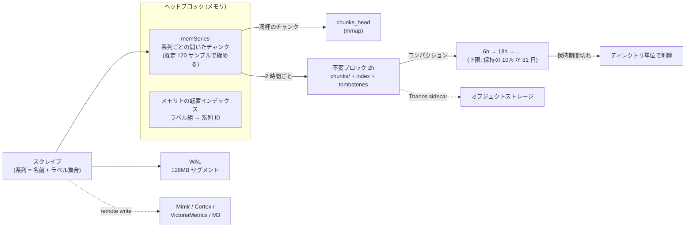

# 時系列データベース (Time-Series Databases)

## 概要 (Overview)

メトリクス用の時系列データベース (time-series database, TSDB) は、「CPU 使用率」や「HTTP リクエスト数」のような数値を、数秒から数十秒おきに記録し続けるための保存系である。汎用のデータベースでも保存はできるが、Facebook の Gorilla (VLDB 2015) が示したとおり、専用の設計を取ると 1 サンプル 16 バイトの生データを平均 1.37 バイトまで縮め、直近のデータを丸ごとメモリに置ける。Prometheus の公式文書も、自身のローカルストレージを「1 サンプルあたり平均 1〜2 バイト」と見積もっている。

本書の中心テーゼは次のとおりである。**時系列データベースは「時刻は等間隔に単調に増え、値は前の値から大きく変わらない」というデータの性質に賭けて、圧縮と書き込みを極端に安くしている。その賭けを崩すのはサンプルの数ではなく、系列 (series) の数、つまり濃度 (cardinality) である。** サンプルは系列の内側で前のサンプルとの差分として符号化されるので、増えても数ビットずつしか増えない。系列が 1 本増えると、メモリ上の状態、逆引きインデックスのエントリ、チャンクの先頭に圧縮せずに置くサンプルがまとめて増える。Prometheus の公式文書が容量削減の手段として「サンプル間隔を延ばすより系列を減らすほうが効きやすい」と書くのは、この非対称を指している。

この非対称は既存文書の二つの指摘に構造上の根拠を与える。[`observability-performance-engineering.md`](observability-performance-engineering.md) は「可観測性の主敵はカーディナリティ」と書き、[`../cloud/cloud-observability.md`](../cloud/cloud-observability.md) は「課金は系列単位であり物理の転嫁」と書いた。本書はその物理の中身として、Gorilla 圧縮のビット割り当て、Prometheus TSDB のヘッドブロック・WAL・2 時間ブロック・ポスティングリスト、系列の増殖 (churn)、ダウンサンプリング、長期保存の分散構成、列指向エンジンとの違い、PromQL の rate とカウンタのリセット、ヒストグラムと分位点の誤差を読む。分析深度は Level 3。

## 方法論 (Methodology)

- 圧縮方式は原論文 (Pelkonen et al. 2015) の符号化規則と測定値を一次資料とし、Prometheus での実装差はソースコード (v3.15.1 タグ、2026-10-21 リリース) の行番号で確かめた。
- Prometheus TSDB の構造は公式文書 (storage・TSDB フォーマット仕様・設定リファレンス) とソースコードで読む。設計者 Fabian Reinartz の解説記事 "Writing a Time Series Database from Scratch" (2017) は執筆時点で配信元のホストに到達できず本文を確かめられなかったため、引用しない。同時期の公式発表 "Announcing Prometheus 2.0" で確かめられる範囲だけを使う。
- 長期保存系 (Thanos・Grafana Mimir・VictoriaMetrics・M3) と InfluxDB 3 は各プロジェクトの公式文書を一次資料とし、ベンダーの性能主張 (「無制限の濃度」など) は主張として区別して書く。
- ヒストグラムの誤差は Prometheus の native histograms 仕様と OpenTelemetry Metrics Data Model の境界の式から本書で計算した値であり、計算の前提を併記する。
- 2026-10 時点で動きのある事項 (native histograms の安定化、XOR2 符号化、Mimir の ingest storage) は、その時点の公式文書の記述として書く。

## 発見事項 (Findings)

1. **Gorilla 圧縮は「等間隔」と「値がほぼ変わらない」に賭けた符号である。** タイムスタンプは二階差分 (delta-of-delta) を取り、0 なら 1 ビットで済ます。Facebook の運用データでは約 96% のタイムスタンプが 1 ビットに収まった。値は前の値との XOR を取り、同じ値なら 1 ビット、違えば先頭と末尾のゼロを省いた「意味のあるビット」だけを送る。約 51% の値が 1 ビットに収まった。2 時間のブロック全体で平均 1.37 バイト/点 (16 バイトからの 12 倍縮小) である (Pelkonen et al. 2015, §4.1)。
2. **賭けが外れたときの罰は有界だが重い。** 二階差分が大きい点は Gorilla で最大 4+32 ビット、Prometheus の実装では最大 4+64 ビットを使う。Prometheus はタイムスタンプをミリ秒で持つため、バケットの幅を Gorilla の 7/9/12 ビットから 14/17/20 ビットへ広げている (xor.go のコメント)。スクレイプ時刻の数ミリ秒の揺らぎは、0 なら 1 ビットで済む箇所を 16 ビットに変える。
3. **Prometheus TSDB は時間で区切った不変ブロックの列であり、LSM 木の時間特化形である。** 書き込みはメモリ上のヘッドブロックと WAL が受け、2 時間ごとに不変ブロックとして書き出し、背景のコンパクションが 2h→6h→18h… と 3 倍ずつ大きなブロックへまとめる (上限は保持期間の 10% か 31 日の小さいほう)。キーが時刻で単調に増えるので、汎用の LSM 木と違って範囲が重ならないブロックを並べるだけで済み、保持期間切れは「古いブロックのディレクトリを消す」操作になる。
4. **系列の検索は全文検索と同じ転置インデックスである。** 各ブロックの索引は「ラベルの組 → 系列 ID の昇順リスト (postings)」を持ち、`{job="api", status="500"}` のようなセレクタはポスティングリストの交差で解く。系列 ID はラベル集合の辞書順に振られるので、交差は昇順リストのマージで済む。
5. **濃度が真の支配項であり、churn が濃度を時間方向に積み上げる。** ラベル値の組合せがそのまま系列になる (Prometheus の命名指針)。Kubernetes のように Pod 名がデプロイのたびに変わる環境では、1 時点の生存系列数が一定でも、ヘッドブロックの窓 (約 2〜3 時間) とブロックごとの索引には入れ替わった系列が全部残る。Prometheus 2.0 の新ストレージは「系列の高い churn に強くなった」ことを主眼に掲げ、v3.15 では古い系列を早めにメモリから追い出す実験的な設定が加わっている。
6. **ダウンサンプリングは容量対策ではなく長期間クエリの速度対策である。** Thanos は 40 時間を過ぎた生データを 5 分解像度に、10 日を過ぎたものを 1 時間解像度にまとめるが、公式文書は「目的は容量削減ではない」と明言し、全解像度を保持すると容量は最大で約 3 倍になると書く。ダウンサンプリングはサンプル数を減らしても系列数を減らさないので、濃度の問題は解かない。
7. **長期保存系の分岐は「Prometheus のブロックをそのまま運ぶか、書き込み経路を作り直すか」である。** Thanos はローカルの 2 時間ブロックをオブジェクトストレージへ上げて読み手側で統合する。Cortex 系の Grafana Mimir は remote write を受けてテナントごとの TSDB を ingester に持つ (従来構成の既定は RF=3 で、書き込みは 2 台の応答で成立)。VictoriaMetrics はノード間通信のない shared-nothing、M3 は Gorilla 由来の M3TSZ 符号と同期複製を持つ。Thanos・Mimir・M3 の保存形式の核は Gorilla 系の系列単位チャンクである。
8. **列指向エンジンは賭けの単位を「系列」から「列」へ移す。** InfluxDB 3 (2025-04-15 GA) は Rust・Apache Arrow・DataFusion・Parquet の上に作り直され、タグも列として持つことで「タグ濃度に上限がない」と主張する。系列ごとのメモリ状態を持たないので書き込み側の濃度の壁は消えるが、その費用は系列の切り出しを読み出し時の走査と並べ替えで払う形に移る、と本書は読む。ClickHouse は Gorilla の二つの変換を列の前処理コーデック (DoubleDelta・Gorilla) として取り込んだ。
9. **rate は外挿と補正を含む推定量であり、カウンタの値そのものではない。** PromQL の `rate()` は範囲内でのカウンタの減少をリセットとみなして前の値を足し戻し、範囲の端までは平均サンプル間隔の 1.1 倍以内なら外挿する。リセット後に前の値を超えるまで増えた場合は減少が観測されず、増分を過小に見積もる。
10. **分位点の誤差はバケットの幾何で決まり、指数ヒストグラムはそれを相対誤差に揃える。** 古典的ヒストグラムでは 200〜300 ms のバケットに入った真値 220 ms が 295 ms と推定されうる (Prometheus 公式の例)。native histograms と OpenTelemetry の指数ヒストグラムは境界を 2^(2^-scale) の冪に置くので、scale 3 なら隣り合う境界の比が約 1.09、推定の相対誤差は最悪でも約 4.4% 程度に収まる (本書の計算)。Prometheus では native histogram が 1 系列で済み、バケットごとに系列を作る古典形より濃度の点でも安い。

## アーキテクチャ (Architecture)

### Prometheus TSDB の書き込み経路と保存の階層



凡例: 実線は Prometheus 単体の経路、点線は長期保存系への分岐を表す。

- ヘッドブロックはクラッシュに対して WAL で守られ、再起動時に WAL を再生して復元する。WAL は少なくとも 3 セグメント、負荷の高いサーバでは生データ 2 時間分以上を保つ (Prometheus storage 文書)。
- ブロックは「時間範囲が重ならない不変のディレクトリ」なので、クエリは時間範囲に重なるブロックだけを開けばよい。ブロックの索引はそのブロックの時間範囲に存在した系列だけを持つ。

### 一つの系列セレクタが解かれるまで

```
クエリ: rate(http_requests_total{job="api", code=~"5.."}[5m])

1. 時間範囲 → 重なるブロック (+ ヘッド) を選ぶ
2. 各ブロックの postings offset table を引く
     __name__="http_requests_total" → [3, 7, 9, 12, 40, …]
     job="api"                     → [7, 9, 12, 55, …]
     code=~"5.."                    → code の値を走査し "500","503" を選び、
                                      それぞれのポスティングを合併
3. 昇順リストの交差 → 系列 ID [9, 12]
4. 系列 ID → series セクション (ラベル + チャンクの mint/maxt/参照)
5. 範囲に重なるチャンクだけを展開 (XOR 復号) → サンプル列
6. rate: リセット補正 + 端への外挿 → 毎秒の値
```

手順 2〜3 の費用は系列数に、手順 5 の費用はサンプル数に比例する。正規表現のマッチャはラベル値の一覧を走査するので、値の種類が多いラベルほど手順 2 が重くなる。

## 技術詳細 (Technical Details)

### 1. 系列とサンプルのデータモデル

- 系列 (series): メトリクス名とラベル (キーと値の組) の集合で一意に決まる。Prometheus は名前も `__name__` というラベルとして扱い、索引上は区別しない。命名指針は「キーと値の組の一意な組合せごとに新しい時系列になる」と書き、ユーザ ID やメールアドレスのような上限のない値をラベルにしないよう警告している。
- サンプル (sample): (タイムスタンプ, 値) の組。Gorilla は秒精度の時刻と 64 ビット浮動小数点の値の 16 バイトを前提にした。Prometheus はミリ秒精度の時刻を使い、値には float64 のほか native histogram を持てる。
- 型と意味論: counter は単調増加で再起動時に 0 へ戻る。gauge は任意に上下する。OpenTelemetry はこれに加えて集計の時間性 (aggregation temporality) を区別する。cumulative は固定の開始時刻からの累積、delta は前回報告からの差分である。Prometheus のモデルは cumulative を前提とする。Google の Monarch は取り込み時に多数の送信元を一つに集約する collection aggregation のために、送信側に delta の書き込みを求めている。開始時刻の異なる累積値を足しても意味がないからである (Adams et al. 2020, §4.3)。

### 2. Gorilla 圧縮のビット割り当て

Gorilla は直近 26 時間のデータをメモリに置く書き込み経由のキャッシュとして設計され、要件は 20 億系列・毎分 7 億点だった (Pelkonen et al. 2015, §2.2)。

タイムスタンプ (delta-of-delta): ブロックの先頭時刻を 2 時間境界に揃えて置き、最初の点は先頭からの差を 14 ビットで持つ。以降は D = (tₙ − tₙ₋₁) − (tₙ₋₁ − tₙ₋₂) を次の可変長で書く。

| D の範囲 (Gorilla, 秒) | 符号 | Prometheus XOR チャンク (ミリ秒) |
|---|---|---|
| 0 | `0` (1 ビット) | `0` (1 ビット) |
| [−63, 64] | `10` + 7 ビット | `10` + 14 ビット |
| [−255, 256] | `110` + 9 ビット | `110` + 17 ビット |
| [−2047, 2048] | `1110` + 12 ビット | `1110` + 20 ビット |
| それ以外 | `1111` + 32 ビット | `1111` + 64 ビット |

範囲の境界は本番の系列を標本にして決められた。たとえば 60 秒間隔で 1 点欠けると差分は 60, 60, 121, 59 になり、二階差分 61 と −62 は最小の範囲に収まる (同 §4.1.1)。Prometheus 側の対応は Go、`tsdb/chunkenc/xor.go` 186–209 行 (v3.15.1) で、コメントは「Gorilla は秒精度、Prometheus はミリ秒なので、より大きなビット幅の段を使う」と説明している。同じ箇所の保守者のコメントは、0 からのわずかなずれでも大きなビット幅へ飛ぶ点を改善の余地として挙げている。

値 (XOR): 隣り合う浮動小数点値が近ければ、符号・指数・仮数の上位ビットが一致する。XOR を取り、0 なら `0` の 1 ビット。0 でなければ `1` に続けて、(a) 意味のあるビットの位置が前回の窓に収まるなら `0` とそのビットだけ、(b) 収まらなければ `1`、先頭ゼロ数 5 ビット、意味のあるビット長 6 ビット、そのビット列を書く (同 §4.1.2)。整数値の系列は XOR 後の 1 のビットの位置が揃いやすく、とくによく縮む。

数字の読み方: 論文の分布は標本ごとに取られている。タイムスタンプは 44 万点の標本、値は 160 万点の標本で、値は 51% が 1 ビット、30% が平均 26.6 ビット、19% が平均 36.9 ビットだった。この値の分布から期待値を計算すると約 15.5 ビットになり、タイムスタンプを足すと 1 点 2 バイト強になる。全データセット (約 20 億系列) での 1.37 バイト/点とは合わない。値の分布が系列の性質に強く依存し、標本の取り方で平均が大きく動くことを示している。Prometheus 公式の「1〜2 バイト/サンプル」はこの幅と整合する。

ブロック長の取引: 長いブロックほど圧縮率は上がるが、短い範囲のクエリでも先頭から復号する費用が増える。Gorilla の測定では 2 時間を超えると縮小幅はほとんど伸びなかった (同 Figure 6)。Prometheus はチャンクを既定 120 サンプルで締める (`tsdb/head.go` 245 行、v3.15.1)。15 秒間隔なら 30 分ぶんにあたる。

2026-10 時点の変化: Prometheus v3.15 は新しい浮動小数点チャンク符号 XOR2 を選べるようにしている。タイムスタンプの二階差分と「値が変わったか」を一つの制御接頭辞にまとめ、よく出る場合をバイト境界に揃える。設定文書は典型的な負荷で XOR より縮むとし、既定は機能フラグを有効にしない限り従来の XOR のままである。XOR2 のチャンクは古い Prometheus や未対応の長期保存系 (例: Thanos sidecar が上げたブロックを読む側) では読めないため、一度書くとダウングレードには該当ブロックの手動削除が要る。

### 3. Prometheus TSDB のヘッド・WAL・ブロック・コンパクション

- ヘッドブロック: 書き込み中のブロックはメモリにあり、完全には永続化されていない。系列ごとに開いたチャンクを持ち、満杯になったチャンクは `chunks_head` ディレクトリへ書いて mmap する。保持サイズの計算には WAL と mmap されたチャンクも含まれる。
- WAL: 128MB のセグメントで `wal` ディレクトリに書かれ、v2.20.0 から既定で圧縮される。WAL はプロセスのクラッシュには効くがディスク障害には効かない。Prometheus 単体は「クラスタ化も複製もされない」と公式文書が明記している。
- ブロック: 2 時間ぶんのサンプルを `chunks/` (最大 512MB のセグメント)、`index`、削除記録の `tombstones` にまとめる。削除はブロックを書き換えず墓石を足すだけで、実際の除去はコンパクション時に行う。
- コンパクション: 範囲は `ExponentialBlockRanges(MinBlockDuration, 10, 3)` で 2h から 3 倍ずつ増える (`tsdb/db.go` 984 行、v3.15.1)。上限は保持期間の 10% か 31 日の小さいほうである。既定の保持期間は 15 日。
- 順序外の書き込み: 既定 (`out_of_order_time_window: 0s`) では、ヘッドの最大時刻より古いサンプルは拒否される。窓を正にすると、その窓の中の順序外サンプルを受け入れる。これはタイムスタンプが単調に増えるという賭けを、運用上の必要 (遅れて届くデータ) のために部分的に解く設定である。
- バックアップ: スナップショットを推奨し、スナップショットなしのバックアップは直近のブロック作成以降のデータを失いうる。ヘッド (直近 3 時間) へのバックフィルは安全でないとされる。NFS (AWS EFS を含む) は非対応である。

LSM 木 ([`../databases/storage-engines.md`](../databases/storage-engines.md) §3) との対応で見ると、ヘッドがメモテーブル、2 時間ブロックが SSTable、時間範囲の段階的併合がレベル併合にあたる。違いはキーの分布にある。汎用の LSM 木ではキー範囲が層をまたいで重なるので読み出し増幅とブルームフィルタが要る。TSDB では時刻が単調なのでブロックの時間範囲が重ならず、時間で刈れる。

### 4. 逆引きインデックスとポスティングリスト

TSDB の索引形式 (`tsdb/docs/format/index.md`) は次の部分からなる。

- シンボル表: ラベルの名前と値に出てくる文字列を重複なく辞書順に並べ、他の部分は位置で参照する。同じ `job="api"` が数万系列に出ても文字列は 1 回しか持たない。
- series セクション: 系列ごとにラベル (シンボル参照) とチャンクのメタ情報 (`mint`・`maxt`・チャンクへの参照) を持つ。系列はラベル集合の辞書順に並び、16 バイト境界に揃えた位置 ÷ 16 が系列 ID になる。
- postings: ラベルの組ごとに「単調増加の系列参照のリスト」を持つ。postings offset table はラベル名と値で整列され、索引を開くときに一部がメモリに読み込まれる。
- 各部の CRC32: 長さを持つ部分は末尾に CRC32 を持ち、破損を検出できる。

これは [`../search/inverted-index-fulltext-search.md`](../search/inverted-index-fulltext-search.md) の転置インデックスと同じ構造で、「語」が「ラベルの組」に、「文書」が「系列」に置き換わっている。違いは二つある。全文検索の関心は関連度による上位 k 件だが、TSDB のセレクタは完全一致の集合演算だけでよい。また、全文検索では語彙がコーパスとともにゆっくり増えるのに対し、TSDB ではラベル値 (Pod 名、コンテナ ID) がデプロイのたびに新しく生まれる。

### 5. 高濃度と系列の増殖 (churn)

- 組合せ爆発: 系列数はラベル値の直積で増える。エンドポイント 50 種 × ステータス 10 種 × インスタンス 100 台なら 5 万系列で済むが、ここに上限のない値 (ユーザ ID、リクエストのパス文字列) を足すと系列数に上限がなくなる。古典的ヒストグラムはさらにバケットの数だけ `_bucket` 系列 (`le` ラベル) を作り、`_sum` と `_count` を加える。
- churn: 系列が生まれては消えることを指す。Prometheus 2.0 の発表は、Kubernetes などで監視対象が動的になったことを背景に、新ストレージが「高い series churn に対してよりよく伸びる」と述べた。ブロック単位の索引は churn を「各ブロックの索引にはそのブロックの時間範囲に生きた系列だけが載る」形で局所化する。それでもヘッドの中では消えた系列も次のヘッドコンパクションまでメモリに残る。v3.15 の実験的設定 `stale_series_compaction_threshold` は、メモリ上の系列のうち古くなった系列の割合が閾値を超えたときに、それらをブロックへ書き出してメモリから外す。
- 濃度の上限: Prometheus のスクレイプ設定は `sample_limit`・`label_limit`・`target_limit` などを持ち、超えたスクレイプ全体を失敗として扱う。既定はどれも 0 (無制限) で、守りは明示しない限り効かない。Mimir はテナントごとの系列数を `max_global_series_per_user` (既定 150000、複製前の数) で抑える。
- Monarch の解き方: 数百万台のディスクサーバが数万のユーザ別に I/O を数えると数百億系列になる。Monarch は取り込み時に集約 (collection aggregation) してユーザ別の合計だけを保存し、この濃度を保存前に潰す (Adams et al. 2020, §4.3)。濃度は保存系の工夫で吸収しきれず、集約の位置を前に動かして減らすしかない場面がある。

### 6. ダウンサンプリングと保持

Thanos の compactor は、40 時間を過ぎた生データを 5 分、10 日を過ぎた 5 分データを 1 時間の解像度にまとめる。各区間には count・sum・min・max・counter の集約を残す。native histogram では counter・count・sum だけである。counter の集約を別に持つのは、区間の平均や最大からはリセットをまたぐ増分を復元できず、rate を計算できないからである。保持期間は解像度ごとに設定でき、10 日より短くするとダウンサンプリングの前に消えてしまう。公式文書は「ダウンサンプリングの当初の目的はディスクやオブジェクトストレージの節約ではない」と書き、全解像度を持つと容量は最大で約 3 倍になるとする。長期間のクエリで読むサンプル数を減らす仕組みであり、系列数は減らない。

### 7. 長期保存とスケールアウト

| 系 | 書き込み経路 | 保存 | 濃度・可用性の扱い (2026-10 時点の公式文書) |
|---|---|---|---|
| Thanos | Prometheus 自身が書く (sidecar がブロックを上げる) か、Receiver が remote write を受ける | オブジェクトストレージ上の Prometheus ブロック | 読み手 (Querier) が HA ペアを replica ラベルで重複除去。compactor はバケットごとに 1 台 (ロックがないため) |
| Grafana Mimir | remote write → distributor → ingester (ingest storage では Kafka 互換のログを経由) | テナントごとの Prometheus TSDB、2 時間ブロックをオブジェクトストレージへ | 従来構成は RF=3 で 2 台の応答で書き込み成立。ingest storage ではパーティションごとに 2 台を推奨し、ingester は書き込み経路から外れる。ゾーンをまたぐ複製 |
| VictoriaMetrics (クラスタ版) | vminsert がメトリクス名と全ラベルの一貫性ハッシュで振り分け | vmstorage のローカルディスク | ノード同士は通信しない shared-nothing。`-replicationFactor=N` で N 台に複製 |
| M3 | M3 Coordinator など (Prometheus remote storage と統合) | M3DB (Go 製、Uber が公開、Gorilla と Cassandra に着想) | 同期複製、one/majority/all の整合性レベル。M3TSZ は可逆にも非可逆にも設定可 |

Mimir は Cortex のフォークとして 2022 年 3 月に AGPLv3 で公開された。Cortex は Apache 2.0 のまま CNCF に残っている。Thanos・Mimir・M3 は保存の核に Gorilla 系の系列単位チャンクを使い (VictoriaMetrics の保存形式は本書では確かめていない)、濃度の問題そのものは残したまま、ノードを足して系列をシャードに分けることで上限を押し広げている。系列ごとの費用は残るので、テナント単位の上限が運用の要になる。

### 8. 列指向エンジンとの比較

- InfluxDB 3: InfluxData は 2025-04-15 に InfluxDB 3 Core (MIT/Apache 2) と Enterprise の一般提供を発表した。エンジンは Rust で書かれ、メモリ上は Apache Arrow、クエリは DataFusion (SQL と InfluxQL)、永続化は Parquet で、オブジェクトストレージだけを永続層とする構成も取れる。Clustered 版の文書では既定でテーブルを日ごとに区切り、compactor がオブジェクトストレージ上のパーティションを併合する。Core は直近のデータ (72 時間) 向けと位置づけられている。「タグ濃度に上限がない」は公式の主張であり、本書では独立の測定を確かめていない。
- ClickHouse: 汎用の列指向 DBMS だが、列ごとに前処理コーデックを付けられる。`DoubleDelta` は Gorilla の二階差分を 64 ビット型へ広げたもの、`Gorilla` は前の値との XOR である。どちらも単独では圧縮せず、`LZ4` や `ZSTD` と組み合わせる前提である。圧縮の手前に変換を置く設計は [`../compression/lossless-compression.md`](../compression/lossless-compression.md) の「桁を稼ぐのは専用変換」の実例になっている。
- 賭けの違い (本書の分析): 系列指向の TSDB は系列を単位にメモリ状態・チャンク・ポスティングを持ち、「1 系列の時間範囲を読む」ことを最安にする。列指向エンジンは系列という単位を保存に持ち込まず、タグを普通の列として整列・圧縮する。書き込み時に系列ごとの状態がないので濃度の壁は書き込み側から消えるが、「ある系列の時間範囲」を読むには、ソートキーとパーティションの刈り込みでタグ列を絞り込む走査が要る。濃度の費用は消えずに、読み出し側の走査と並べ替えへ移る。行単位で属性を持つログやトレースのような高濃度データは列指向に向き、少数の系列を長く追うメトリクスは系列指向に向く。この境界は [`../cloud/data-lakehouse-analytics.md`](../cloud/data-lakehouse-analytics.md) の Parquet と刈り込みの議論につながる。

### 9. クエリ: 範囲ベクトル、rate、カウンタのリセット

- 範囲ベクトル: `x[5m]` は各評価時刻から 5 分さかのぼった区間のサンプル列であり、`rate()` はこれを毎秒の増加率に変える。`irate()` は最後の 2 点だけを使う。
- リセット補正: Go、`promql/functions.go` 531–533 行 (v3.15.1)。隣り合う 2 点で値が減っていれば、カウンタがリセットされたとみなして前の値を結果に足す。開始時刻 (start timestamp) を持つ系列では、開始時刻の変化もリセットとして扱う。
- 外挿: 同ファイル 452 行からの `extrapolatedRate`。最初と最後の点が範囲の端から平均サンプル間隔の 1.1 倍以内にあれば端まで外挿し、それより遠ければ系列がそこで始まった (終わった) とみなして平均間隔の半分だけ外挿する (588・615 行)。カウンタは負にならないので、外挿が 0 を下回る時刻まで伸びる場合は 0 の時刻で止める (602 行)。このため `increase()` の結果は整数カウンタでも小数になる。
- 境界事例として次がある。
  - 範囲内に点が 1 つしかなければ結果は空になる (開始時刻で補える場合を除く)。範囲はスクレイプ間隔の数倍を取らないと、欠けたスクレイプ 1 回で値が消える。
  - リセット後、次のサンプルまでに前の値を超えて増えると減少が観測されず、リセットを見逃して増分を過小に見積もる。これは補正規則から導かれる帰結である。
  - 減少をリセットとみなす規則は gauge には当てはまらない。`rate()` は counter にだけ使うよう公式文書は求めている。

### 10. ヒストグラムと分位点の誤差

- Summary と Histogram: Prometheus の指針によると、Summary は分位 φ の次元で誤差を制御する (0.95±0.01 なら 94〜96 パーセンタイルのどこか) が、インスタンスをまたいで集約できない。Histogram は観測値の次元で誤差を制御し、集約できる。200〜300 ms のバケットに 95 パーセンタイルが落ちた例では、真値約 220 ms に対して線形補間が 295 ms を返しうる。
- Prometheus native histograms: 2022 年 11 月に v2.40.0 で実験的に導入され、v3.8.0 から安定機能になった。スクレイプには `scrape_native_histograms` の設定が要り、v4 で既定を true にする予定とされる (2026-10 時点の仕様)。標準 schema は −4〜8 で、正のバケット i の上端は (2^(2^-schema))^i。schema n+1 の隣接バケットを併合すると schema n になる。−53 はユーザ定義の境界 (NHCB) 用である。1 つの native histogram は 1 系列として保存される。
- OpenTelemetry の指数ヒストグラム: 底は 2^(2^-scale) で、Prometheus の schema と同じ値を取る。バケットの添字は 1 ずれる。OTel は scale に −4〜8 の制限を置かない。Data Model の ExponentialHistogram 節は Stable である。SDK の Base2 Exponential Bucket Histogram 集約は既定で正負それぞれ最大 160 バケット、最大 scale 20 で、データの範囲が収まるよう scale を自動で下げる。
- 誤差の計算 (本書): 境界の比を b = 2^(2^-s) とすると、バケット [l, l·b] の中で推定値を幾何中点 l·√b に置けば、真値との相対誤差は最大 √b − 1 になる。

| scale (schema) | b | 最大相対誤差 √b − 1 | 160 バケットで覆える範囲 b¹⁶⁰ |
|---|---|---|---|
| 0 | 2 | 約 41% | 2¹⁶⁰ |
| 3 | 約 1.0905 | 約 4.4% | 2²⁰ ≈ 1.05×10⁶ |
| 5 | 約 1.0219 | 約 1.1% | 2⁵ = 32 |
| 8 | 約 1.0027 | 約 0.14% | 2^0.625 ≈ 1.54 |

  バケット数を固定すると、分解能を上げるほど覆える値の範囲が狭くなる。scale 3 でも 1 µs から 1 s までの 6 桁を 160 バケットで覆える。Prometheus の `histogram_quantile()` は標準 schema の native histogram では一様分布を仮定した線形補間ではなく、指数補間でバケット内を推定する。
- 集約の可否: 同じ schema のヒストグラムはバケットごとの足し算で合成でき、異なる schema は粗いほうへ併合してから足せる。分位点そのもの (Summary や各ホストの p99) は合成できない。これは [`observability-performance-engineering.md`](observability-performance-engineering.md) の「パーセンタイルは合成できない」を、保存形式の側から裏づける。

## セキュリティ考察 (Security Considerations)

- **濃度はサービス妨害の手段になる。** URL のパスやユーザ入力をそのままラベル値にすると、外部の利用者が任意の数の系列を作れる。系列ごとのメモリ費用は TSDB の最も高い資源なので、少数のリクエストで監視基盤を落とせる。対策は計装の段階で上限のない値をラベルにしないこと、正規化 (パスをルートのテンプレートに置き換える)、`sample_limit`・`label_limit` の明示的な設定 (既定は無制限)、マルチテナント系のテナント単位の系列上限である。監視基盤が落ちると、障害の検知も一緒に失われる。
- **Prometheus の HTTP 端点は信頼境界の内側に置く前提である。** 公式のセキュリティモデルは端点をインターネットに出さないことを求め、高価なクエリやメトリクスで落ちる純粋なサービス妨害は脆弱性として扱わないと明言する。remote read は HTTP で届く者なら誰でもクエリを送れる。管理 API (`--web.enable-admin-api`、系列の削除など) とライフサイクル API は既定で無効であり、有効にするなら認証付きの経路に限る。TLS と basic 認証には対応するが、TLS なしの basic 認証は資格情報を平文で流す。
- **マルチテナントの境界は外側の認証に依存する。** Mimir はテナントを `X-Scope-OrgID` ヘッダで識別し、自身では認証しない。前段のリバースプロキシで認証してヘッダを付け直さないと、ヘッダを書き換えるだけで他テナントのデータを読めてしまう。
- **ラベルは秘密を運びやすい。** ラベル値と exemplar に URL のクエリ文字列やトークン、個人情報が混入すると、長期保存のオブジェクトストレージに何年も残る。不変ブロックからの削除は墓石とコンパクションを経るので、即時には消えない。保存前の再ラベル付け (relabeling) で落とすのが確実である。
- **エクスポータの踏み台化。** blackbox や SNMP のエクスポータは対象を URL パラメータで受け取るので、到達できる者は任意の宛先へ要求を送らせられる (SSRF)。その際、エクスポータに設定された basic 認証のパスワードや SNMP のコミュニティ文字列が漏れうる (Prometheus セキュリティ文書)。
- **完全性**: ブロックと索引の CRC32 は偶発的な破損を検出するが、改竄は検出しない。監査用の記録が要るなら、[`../cloud/cloud-observability.md`](../cloud/cloud-observability.md) の CloudTrail のような別系統に置く。

## 結論 (Conclusions)

- 時系列データベースの速さはデータの性質への賭けから来ている。等間隔の時刻は二階差分で 1 ビットに、ほぼ変わらない値は XOR で 1 ビットに縮み、時刻の単調性はブロックを重ならせずに並べるだけの LSM 木を可能にした。
- 賭けは二方向から崩れる。一つはサンプルの性質で、時刻の揺らぎや値の激しい変動、順序外の到着が起きると数十ビットの罰で済む。もう一つは系列の数で、こちらは系列ごとのメモリ・索引・チャンク見出しとして効き、上限がない。前者は有界な劣化、後者は基盤の停止につながる。
- ダウンサンプリングはサンプル数を減らし、長期保存の分散構成は系列をノードに分けるが、どちらも系列数そのものは減らさない。濃度に効く手段は計装時の設計、取り込み時の集約 (Monarch)、テナント単位の上限、そして系列という単位を持たない列指向エンジンへの移行である。列指向は濃度の費用を書き込みから読み出しの走査へ移すので、ログやトレースのような高濃度データには向くが、メトリクスの最安経路を置き換えるものではない。
- 分位点はバケットの幾何で誤差が決まる推定値であり、rate はリセット補正と外挿を含む推定量である。どちらも「何をどう数えたか」を知らずに数字を読めないという、測定方法論の規律の具体例である。

### 次の接続先 (Related Topics)

- [`observability-performance-engineering.md`](observability-performance-engineering.md) — カーディナリティ・ヒストグラム・パーセンタイル合成の総論。本書はその保存系の物理。
- [`logging-systems.md`](logging-systems.md) — 行単位で属性を持つ高濃度の信号。索引を持つか全文走査かの取引。
- [`../cloud/cloud-observability.md`](../cloud/cloud-observability.md) — 系列単位の課金と Monarch・Gorilla の利用者側の帰結。
- [`../databases/storage-engines.md`](../databases/storage-engines.md) — LSM 木・WAL・コンパクション。TSDB はその時間特化形。
- [`../compression/lossless-compression.md`](../compression/lossless-compression.md) — delta・XOR・列指向化という専用変換の一般論。
- [`../search/inverted-index-fulltext-search.md`](../search/inverted-index-fulltext-search.md) — ポスティングリストと交差の工学。
- [`../cloud/data-lakehouse-analytics.md`](../cloud/data-lakehouse-analytics.md) — Parquet・列指向・刈り込み。InfluxDB 3 の保存形式の基盤。

## 参考文献 (References)

**一次資料 (Primary — 論文・仕様・ソースコード)**

- Pelkonen, T., Franklin, S., Teller, J., Cavallaro, P., Huang, Q., Meza, J., & Veeraraghavan, K. (2015). Gorilla: A Fast, Scalable, In-Memory Time Series Database. *Proceedings of the VLDB Endowment*, 8(12), 1816–1827. DOI: 10.14778/2824032.2824078 — delta-of-delta と XOR 符号化、1.37 バイト/点、96%・51% の分布、2 時間ブロック。
- Adams, C., et al. (2020). Monarch: Google's Planet-Scale In-Memory Time Series Database. *Proceedings of the VLDB Endowment*, 13(12), 3181–3194. [PDF](https://www.vldb.org/pvldb/vol13/p3181-adams.pdf) — Accessed: 2026-10-24。collection aggregation と delta 系列 (§4.3)。
- Prometheus — [Storage](https://prometheus.io/docs/prometheus/latest/storage/) — Accessed: 2026-10-24。2 時間ブロック、WAL、コンパクション、保持、1〜2 バイト/サンプル、耐久性の限界。
- Prometheus — [TSDB index format](https://github.com/prometheus/prometheus/blob/main/tsdb/docs/format/index.md)・[Chunks format](https://github.com/prometheus/prometheus/blob/main/tsdb/docs/format/chunks.md) — Accessed: 2026-10-24。シンボル表・series・postings・XOR/XOR2 チャンク。
- Prometheus ソースコード v3.15.1 (2026-10-21) — [`tsdb/chunkenc/xor.go`](https://github.com/prometheus/prometheus/blob/v3.15.1/tsdb/chunkenc/xor.go) 186–209 行 (二階差分のビット幅)、[`tsdb/head.go`](https://github.com/prometheus/prometheus/blob/v3.15.1/tsdb/head.go) 245 行 (120 サンプル/チャンク)、[`tsdb/db.go`](https://github.com/prometheus/prometheus/blob/v3.15.1/tsdb/db.go) 984 行 (ブロック範囲)、[`promql/functions.go`](https://github.com/prometheus/prometheus/blob/v3.15.1/promql/functions.go) 452–620 行 (rate の外挿とリセット補正) — Accessed: 2026-10-24。
- Prometheus — [Configuration](https://prometheus.io/docs/prometheus/latest/configuration/configuration/) — Accessed: 2026-10-24。`out_of_order_time_window`、`stale_series_compaction_threshold`、XOR2、`sample_limit`・`label_limit`・`target_limit`。
- Prometheus — [Native Histograms specification](https://prometheus.io/docs/specs/native_histograms/) — Accessed: 2026-10-24。schema、v3.8.0 での安定化、OTel との対応、1 系列での保存。
- Prometheus — [Query functions](https://prometheus.io/docs/prometheus/latest/querying/functions/) — Accessed: 2026-10-24。rate・increase・irate、histogram_quantile の補間。
- OpenTelemetry — [Metrics Data Model](https://opentelemetry.io/docs/specs/otel/metrics/data-model/)・[Metrics SDK](https://opentelemetry.io/docs/specs/otel/metrics/sdk/) — Accessed: 2026-10-24。ExponentialHistogram、aggregation temporality、既定 160 バケット・最大 scale 20。

**二次資料 (Secondary — プロジェクト公式文書・発表)**

- Reinartz, F. (2017). [Announcing Prometheus 2.0](https://prometheus.io/blog/2017/11/08/announcing-prometheus-2-0/) — Accessed: 2026-10-24。新ストレージと series churn、CPU・ディスク使用量の削減。
- Prometheus — [Metric and label naming](https://prometheus.io/docs/practices/naming/)・[Histograms and summaries](https://prometheus.io/docs/practices/histograms/)・[Security model](https://prometheus.io/docs/operating/security/) — Accessed: 2026-10-24。
- Thanos — [Compactor](https://thanos.io/tip/components/compact.md/)・[Quick Tutorial](https://thanos.io/tip/thanos/quick-tutorial.md/) — Accessed: 2026-10-24。ダウンサンプリング、解像度別保持、構成要素。
- Grafana Mimir — [Architecture](https://grafana.com/docs/mimir/latest/get-started/about-grafana-mimir-architecture/)・[Ingester](https://grafana.com/docs/mimir/latest/references/architecture/components/ingester/)・[Authentication and authorization](https://grafana.com/docs/mimir/latest/manage/secure/authentication-and-authorization/)・[Configuration parameters](https://grafana.com/docs/mimir/latest/configure/configuration-parameters/) — Accessed: 2026-10-24。
- Grafana Labs — [Announcing Grafana Mimir](https://grafana.com/blog/announcing-grafana-mimir/) — Accessed: 2026-10-24。Cortex からのフォークと AGPLv3。
- VictoriaMetrics — [Cluster version](https://docs.victoriametrics.com/victoriametrics/cluster-victoriametrics/) — Accessed: 2026-10-24。
- M3 — [M3DB architecture overview](https://m3db.io/docs/architecture/m3db/overview/) — Accessed: 2026-10-24。
- InfluxData — [InfluxDB 3 Core & Enterprise GA](https://www.influxdata.com/blog/influxdb-3-oss-ga/)・[InfluxDB 3 storage engine architecture](https://docs.influxdata.com/influxdb3/clustered/reference/internals/storage-engine/) — Accessed: 2026-10-24。GA 日付は報道 ([Blocks & Files, 2025-04-15](https://www.blocksandfiles.com/data-management/2025/04/15/influxdata-rolls-out-influxdb-3-to-power-real-time-apps-at-scale/1615178)) と照合。
- ClickHouse — [Column compression codecs](https://clickhouse.com/docs/reference/statements/create/table/codec) — Accessed: 2026-10-24。DoubleDelta・Gorilla・T64。
