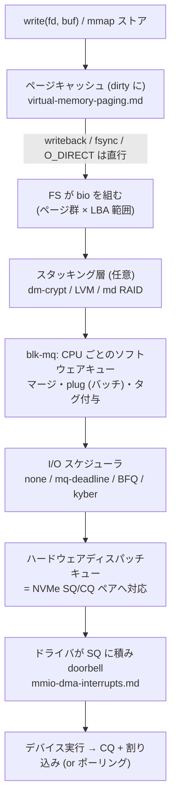

# ブロック I/O スタック (Block I/O Stack: bio, blk-mq & io_uring)

## 概要 (Overview)

ファイルシステム ([`filesystems.md`](filesystems.md)) やページキャッシュの writeback ([`virtual-memory-paging.md`](virtual-memory-paging.md)) が発行する「このページをあの LBA へ」という要求を、実デバイスのコマンドに変えて運ぶのが**ブロック層 (block layer)** である。

本ドキュメントの中心テーゼは、**この層の使命は媒体の世代交代で反転した**、ということ。HDD 時代の仕事は「並べ替えてシークを節約する」ことだった。ミリ秒級の機械的動作を隠すため、要求を溜め、ソートし、賢く待つことに価値があった。NVMe SSD 時代の仕事は「**邪魔をしない**」ことである。デバイスが数百万 IOPS・数万並列を受け付けるとき、ボトルネックはカーネル側のロックとキュー構造に移り、blk-mq (multi-queue block layer) と io_uring はいずれも「ソフトウェアがデバイスに追いつくための再設計」である。

本書は (1) 要求の運搬構造 (bio・request・スタッキング)、(2) blk-mq への転換とその根拠、(3) I/O スケジューラの現在地、(4) io_uring による syscall 境界の再設計、(5) buffered vs `O_DIRECT` の選択、を Linux を参照実装として整理する。分析深度は Level 3。

## 方法論 (Methodology)

- 「1 回の read がデバイスに届くまで」の経路を貫通的に追い、各段の存在理由を媒体の物理特性 (シーク時間 / NAND 並列性) から説明する。
- HDD → NVMe の転換は、単一キュー設計の実測限界 (SYSTOR '13) と NVMe の仕様値を根拠に定量で示す。
- io_uring は「何が新しいか」ではなく「従来 API (同期 syscall, epoll, libaio) のどの制約を外したか」の差分で説明する。
- 数値は桁感を示すものであり、カーネルバージョン・デバイス・設定で変わる点は明示する。デバイス内部 (FTL・NAND) は [`../../hardware/hw-sw-interface/storage-nvm-interface.md`](../../hardware/hw-sw-interface/storage-nvm-interface.md) に委ねる。

## 発見事項 (Findings)

1. **block 層は「翻訳と交通整理」の層である。** 上からの要求は **bio** (ページ群 × デバイス上の位置) に正規化され、マージ・分割・並べ替え・帯域制御を経て、ドライバのハードウェアキューに載る。device mapper (dm-crypt, LVM) や md (RAID) はこの bio を受けて別の bio を発行する**スタック可能な層**であり、暗号化も論理ボリュームも RAID も「bio の書き換え」として同じ枠に載っている。
2. **単一キューは多コア × 高速 SSD で構造的に破綻した。** 旧 block 層はデバイスごとに 1 本のキューと 1 つのロックを持ち、全コアがそこで衝突する。実測で約 100 万 IOPS 付近で頭打ちになり、コアを増やすほど (特にソケットを跨ぐと) むしろ悪化した (Bjørling et al., SYSTOR '13)。ハードウェアはとうにその先にいた。
3. **blk-mq の答えは「コアごとの入口 + デバイスごとの出口」。** ソフトウェアキューを CPU ごとに置いて競合を消し、ハードウェアディスパッチキューをデバイスの実キュー (NVMe は最大 64K キュー × 64K 深さ) に対応付ける。要求の追跡はロックでなくタグ (整数 ID) で行う。Linux 5.0 で旧経路は削除され、現在はこれが唯一の block 層である。
4. **I/O スケジューラは「必須の最適化」から「選べるポリシ」に降格した。** NVMe の既定は `none` (並べ替えず、デバイスの並列性に任せるのが最速)。回転媒体や混載ワークロードには mq-deadline、デスクトップの応答性には BFQ、と「媒体と目的に応じて選ぶもの」になった。
5. **io_uring の本質は「syscall を I/O の単位から外した」こと。** 提出リング (SQ) と完了リング (CQ) を共有メモリに置き、アプリは記述子を書き込むだけ。1 回の `io_uring_enter` で多数の I/O を提出・回収でき、SQPOLL を使えば**syscall ゼロ**の提出すら可能になる。Spectre/Meltdown 緩和策で syscall 単価が上がった時代 ([`../../hardware/cpu/branch-prediction-speculation.md`](../../hardware/cpu/branch-prediction-speculation.md)) に、境界横断の回数そのものを削る設計である。
6. **「非同期 I/O」は io_uring 以前は嘘を含んでいた。** POSIX AIO はユーザ空間スレッドでの偽装、Linux ネイティブ AIO (libaio) は `O_DIRECT` 限定で、しかも経路の随所で密かにブロックした。io_uring はカーネル内で真に非同期に実行し、対象もストレージからネットワーク・ファイル操作へと拡大し続けている。つまり、**「非同期 syscall 実行基盤」への進化**である。

## アーキテクチャ (Architecture)

### 要求の一生 — write() がデバイスに届くまで



- **bio**: `(デバイス, 開始セクタ, [ページ, オフセット, 長さ] のベクタ, 方向, フラグ)`。フラグには `REQ_PREFLUSH`/`REQ_FUA` (永続性バリア、[`filesystems.md`](filesystems.md) のジャーナル commit が使う) が含まれる。
- **plugging**: タスクが連続して bio を発行する間、いったん手元に溜めてから一括で流す。マージ機会を増やしキュー操作を償却するもので、この層の随所にある「バッチ化」の一例である。

### 単一キュー → blk-mq

```
 旧 (single queue):                blk-mq (Linux 3.13〜, 5.0 で唯一に):
   CPU0 ─┐                           CPU0 → SWキュー0 ─┐
   CPU1 ─┼─ 1 本のキュー + ロック      CPU1 → SWキュー1 ─┼─ HWキュー群 ─ NVMe SQ/CQ
   CPU2 ─┤   (全コアが衝突)           CPU2 → SWキュー2 ─┤  (デバイスの数だけ)
   CPU3 ─┘                           CPU3 → SWキュー3 ─┘
                                      入口は競合なし・出口はデバイス並列性に一致
```

## 技術詳細 (Technical Details)

### 1. I/O スケジューラの現在地

| スケジューラ | 方針 | 適所 |
|---|---|---|
| `none` | FIFO、並べ替えなし | NVMe SSD の既定。デバイス内並列性に任せる |
| `mq-deadline` | 読み優先 + 期限保証、軽量 | SATA SSD/HDD の無難な既定。飢餓防止 |
| `bfq` | プロセスごとの公平なタイムスライス | デスクトップ・対話性重視。管理コスト高 |
| `kyber` | 目標レイテンシに合わせキュー深さを自動調整 | 高速デバイスで読み書きの応答性を分けたい場合 |

- HDD で並べ替えが有効だった理由はシーク (数 ms) の節約。SSD では並べ替えの利得が消え、スケジューラの意義は**帯域の公平配分と優先度** (cgroup v2 の `io.max`/`io.latency`/`io.cost` はこの層に実装される) に移った。コンテナの「隣人のバックアップにレイテンシを壊されない」はここで守られる。

### 2. io_uring — リング二本の設計

```
 ユーザ空間                     共有メモリ (mmap)                  カーネル
 ┌──────────┐   SQE を書く   ┌─────────────────┐   取り出して実行
 │ アプリ     │ ───────────▶ │ SQ (提出リング)  │ ─────────────▶  FS / block / net
 │           │ ◀─────────── │ CQ (完了リング)  │ ◀─────────────  完了を書く
 └──────────┘   CQE を読む   └─────────────────┘
   io_uring_enter(2) 1 回で N 件提出＋M 件回収 / SQPOLL なら提出に syscall 不要
```

- **SQE** (submission queue entry) は「opcode (read/write/fsync/accept/send/…), fd, バッファ, オフセット, フラグ」の記述子。**リンク** (前の完了を待って次を実行) で「write → fsync」のような依存列も 1 往復で出せる。
- コスト削減の道具立て: **登録済みバッファ/fd** (`io_uring_register`) で毎回のページピン止め・fd 参照取得を前払いし、**IOPOLL** で完了割り込みを省いてポーリングし ([`../../hardware/hw-sw-interface/mmio-dma-interrupts.md`](../../hardware/hw-sw-interface/mmio-dma-interrupts.md) の「割り込み vs ポーリング」の実例)、**SQPOLL** でカーネルスレッドが SQ を監視する。
- 実測研究 (Didona et al., SYSTOR '22) では、同期 syscall・libaio・io_uring・SPDK (ユーザ空間ドライバ) の順に天井が上がる一方、**低負荷では同期 syscall が最もレイテンシが良い**ことも示されている。つまり、リングとポーリングはスループットの道具であり、万能の置き換えではない。
- epoll との関係: epoll は「読める**ようになった**ら教える」(readiness)、io_uring は「読んで**おいた**から結果を取れ」(completion)。ネットワークサーバの設計様式を readiness 型から completion 型 (Windows の IOCP に近い) へ移す変化であり、ストレージには readiness モデルがそもそも合わなかった (通常ファイルは常に「readable」) という積年の欠落を埋める。

### 3. buffered vs O_DIRECT — キャッシュを通すか迂回するか

- **buffered** (既定): ページキャッシュ経由。read-ahead・write-behind・共有という OS の知恵がすべて活きる。代償はコピー 1 回と、writeback タイミングの非決定性 ([`virtual-memory-paging.md`](virtual-memory-paging.md) の dirty 制御)。
- **`O_DIRECT`**: ユーザバッファとデバイスが DMA で直結 (ページはピン止めされる)。二重キャッシュを避けたい・自前でキャッシュを持つ (DB のバッファプール)・キャッシュ汚染を避けたい (バックアップ) 場合の道具。整列制約 (セクタ境界) があり、**永続性は別問題** (`O_DIRECT` はキャッシュ迂回であって FLUSH ではないため、fsync ないし `O_DSYNC` は依然必要)。
- 選択の指針はワークロードの再利用性: 再利用があるならキャッシュは味方、自分の方が賢いなら迂回する。[`../databases/storage-engines.md`](../databases/storage-engines.md) の「二重キャッシュ回避」はこの選択の実例である。

### 4. レイテンシの解剖と観測 (Observability)

I/O レイテンシは「キュー待ち + デバイス実行」に分解して観測する。飽和の兆候はほぼ常に前者に現れる。

| 疑問 | 道具 |
|---|---|
| デバイスは飽和しているか | `iostat -x` (`aqu-sz` キュー長, `r_await`/`w_await`)。**`%util` は並列デバイスでは飽和指標にならない** (1 本でも in-flight なら 100% に見える) |
| レイテンシの分布 (テール) | eBPF: `biolatency` (ヒストグラム)、`biosnoop` (個別 I/O)、[`ebpf-kernel-programmability.md`](ebpf-kernel-programmability.md) |
| 要求は block 層のどこで時間を使ったか | `blktrace`/`blkparse`、`/sys/block/<dev>/queue/` (スケジューラ, nr_requests, read_ahead_kb) |
| writeback / dirty の圧力 | `/proc/meminfo` (Dirty/Writeback)、PSI (`/proc/pressure/io`) |
| cgroup ごとの I/O | `io.stat` (cgroup v2)、`iotop` |

- 典型の読み違い: 「`%util` 100% だから限界」(NVMe では誤り)、「平均 await が小さいから健全」(テールは平均に出ないので、`biolatency` で分布を見る)。

## セキュリティ考察 (Security Considerations)

- **io_uring はカーネル攻撃面の主役級になった。** 非同期実行のためにカーネル内へ持ち込んだ複雑な状態機械 (オブジェクト寿命・特権継承・ワーカスレッド) は use-after-free 型の脆弱性を繰り返し生み、Google は kCTF (カーネル脆弱性報奨金) への提出の約 6 割が io_uring 起因だった時期を公表し、ChromeOS・Android・自社サーバで io_uring を無効化ないし制限した (2023)。**性能のための境界再設計は、境界の検査点も再設計を要する**という教訓であり、多くのディストリビューションが `io_uring_disabled` sysctl や seccomp での制限を提供する。
- **`O_DIRECT`/登録バッファはユーザページを DMA 先にピン止めする。** fork の COW ([`virtual-memory-paging.md`](virtual-memory-paging.md)) との相互作用で「DMA がどの物理ページに書くべきか」がずれる歴史的問題群があり、また悪意あるサイズ・整列の操作はドライバの検査を突く古典的な入口である。IOMMU ([`../../hardware/hw-sw-interface/mmio-dma-interrupts.md`](../../hardware/hw-sw-interface/mmio-dma-interrupts.md)) が DMA の越境をハード側で抑える。
- **共有キューは資源枯渇の面になる。** キュー深さ・タグは有限であり、cgroup io 制御なしの多テナント環境では 1 プロセスの深いキューが他全員のレイテンシを壊す (noisy neighbor)。帯域だけでなく**レイテンシの隔離** (`io.latency`) まで含めて設計する。
- **バリアを外す高速化は嘘の永続性を売る。** 仮想化層やベンチマーク設定で FLUSH を無視する設定 (`cache=unsafe` 等) にすると、上の FS・DB の全ての保証が気づかないうちに無効になる。性能数値を比較するときは必ず永続性設定を併記する。

## 結論 (Conclusions)

- ブロック層の歴史は媒体への適応の歴史である。ミリ秒のシークを隠すための「溜めて並べ替える」層は、マイクロ秒・超並列の NVMe の前で自身がボトルネックになり、blk-mq (競合しない入口・デバイスに一致する出口) へ再設計された。
- io_uring は同じ適応を syscall 境界に適用したもので、「I/O 1 回 = syscall 1 回」という 50 年来の等式を外した。共有メモリのリングとバッチ化・ポーリング・事前登録という道具立ては、境界横断の単価が上がる時代の一般解であり、適用範囲はストレージを超えて広がっている。
- スケジューラ・キャッシュ迂回・cgroup 制御はいずれも「誰の I/O をいつ通すか」というポリシの座であり、スループットではなく**テールレイテンシと隔離**が現代の主戦場である。観測もそれに合わせ、平均や %util ではなく分布 (biolatency) と圧力 (PSI) で見る。
- 性能のための再設計は攻撃面の再設計でもある。io_uring の脆弱性史は、この層を学ぶ者への最も新しい教材である。

### 次の接続先 (Related Topics)

- [`filesystems.md`](filesystems.md) — 本書の真上。bio の発行元、FLUSH/FUA の意味論の使用者。
- [`virtual-memory-paging.md`](virtual-memory-paging.md) — ページキャッシュと writeback。buffered I/O の実体はこの層にある。
- [`../../hardware/hw-sw-interface/storage-nvm-interface.md`](../../hardware/hw-sw-interface/storage-nvm-interface.md) — 本書の真下。NVMe キュー・FTL・永続性の最終防衛線。
- [`../../hardware/hw-sw-interface/mmio-dma-interrupts.md`](../../hardware/hw-sw-interface/mmio-dma-interrupts.md) — doorbell・DMA・割り込み vs ポーリングの機構。
- [`../databases/storage-engines.md`](../databases/storage-engines.md) — この層の保証 (O_DIRECT, fsync) の最重要顧客。

## 参考文献 (References)

**一次資料 (Primary — 論文・公式ドキュメント)**

- Bjørling, M., Axboe, J., Nellans, D., & Bonnet, P. (2013). Linux Block IO: Introducing Multi-queue SSD Access on Multi-core Systems. *SYSTOR '13*. DOI: 10.1145/2485732.2485740 — 単一キューの限界の実測と blk-mq の設計原典。
- Axboe, J. (2019). Efficient IO with io_uring. — [kernel.dk/io_uring.pdf](https://kernel.dk/io_uring.pdf) — Accessed: 2026-07-05。io_uring 設計者による一次解説。
- Didona, D., et al. (2022). Understanding Modern Storage APIs: A systematic study of libaio, SPDK, and io_uring. *SYSTOR '22*. DOI: 10.1145/3534056.3534945 — API 世代間の定量比較。
- Linux Kernel Documentation — [Multi-Queue Block IO Queueing Mechanism](https://www.kernel.org/doc/html/latest/block/blk-mq.html)、[Control Group v2 (io コントローラ)](https://www.kernel.org/doc/html/latest/admin-guide/cgroup-v2.html) — Accessed: 2026-07-05。
- Google Security Blog (2023). Learnings from kCTF VRP's 42 Linux kernel exploits submissions. — [security.googleblog.com](https://security.googleblog.com/2023/06/learnings-from-kctf-vrps-42-linux.html) — Accessed: 2026-07-05。io_uring 起因の脆弱性比率と無効化判断の一次情報。

**二次資料 (Secondary — 教科書・解説)**

- Arpaci-Dusseau, R. H., & Arpaci-Dusseau, A. C. *Operating Systems: Three Easy Pieces* — I/O Devices / Hard Disk Drives / SSD の章。 — [OSTEP](https://pages.cs.wisc.edu/~remzi/OSTEP/) — Accessed: 2026-07-05。
- Corbet, J. (2019). Ringing in a new asynchronous I/O API. *LWN.net*. — [lwn.net](https://lwn.net/Articles/776703/) — Accessed: 2026-07-05。io_uring 登場時の設計解説。
- Gregg, B. *Systems Performance* (2nd ed.), Addison-Wesley — ディスク I/O の観測手法 (iostat の読み方, biolatency)。
