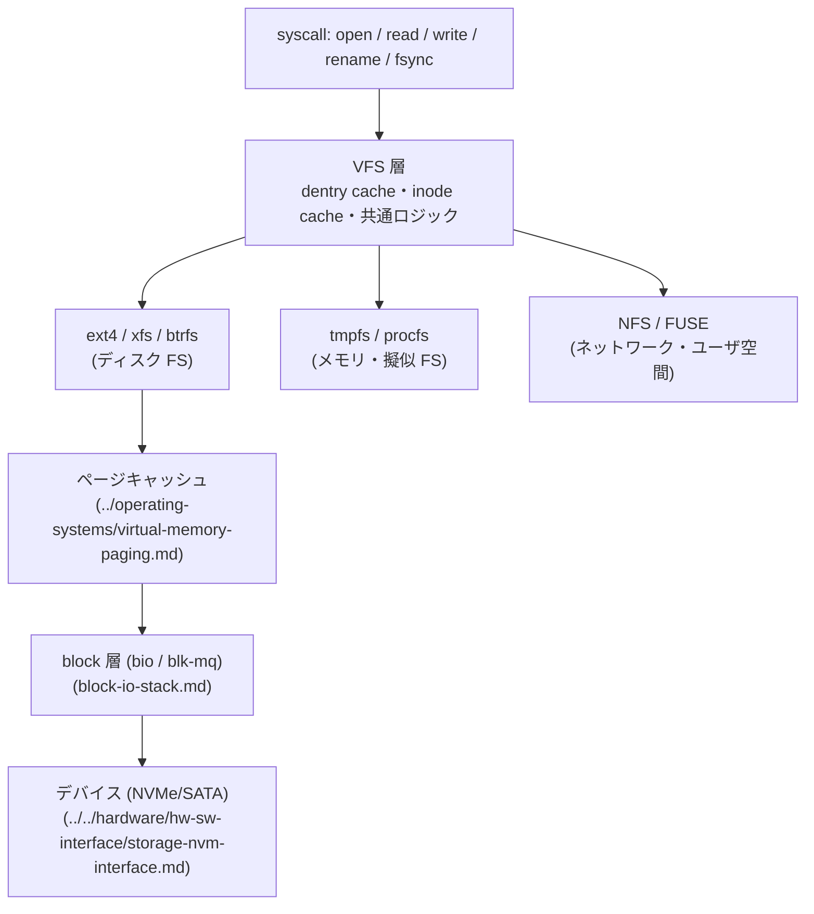

# ファイルシステム (Filesystems: VFS, Journaling & Crash Consistency)

## 概要 (Overview)

ブロックデバイス ([`block-io-stack.md`](block-io-stack.md)) が提供するのは「番地付きセクタの配列」だけである。ファイルシステム (filesystem) はその上に**名前・階層・所有権・永続性の意味論**を構築する翻訳層であり、OS の中で「ユーザに見える抽象」と「デバイスの物理」の距離が最も大きい場所のひとつである。

本ドキュメントの中心テーゼは、**ファイルシステム設計の核心はクラッシュ一貫性 (crash consistency) にある**、ということ。ディスクが保証するのは高々「1 セクタの原子的な書き込み」だけなのに、ファイル作成ひとつでも inode・ディレクトリ・ビットマップと**複数ブロックの更新**を要する。電源断はその途中で必ず起こりうる。fsck・ジャーナリング (journaling)・copy-on-write (CoW)・ログ構造化 (log-structured) という主要な設計流儀は、すべて「**非原子的な媒体の上に原子性をどう偽装するか**」への異なる回答である。

本書は (1) VFS (カーネル内の共通インタフェースと名前解決)、(2) オンディスク構造 (inode・ディレクトリ・割り当て)、(3) クラッシュ一貫性の系譜、(4) `fsync` という契約の実像、を Linux (ext4 を主参照、btrfs/ZFS を対照) で整理する。分析深度は Level 3。

## 方法論 (Methodology)

- 「メモリ内の抽象 (VFS)」と「ディスク上の構造 (on-disk format)」を明確に分離して扱う。両者の混同がファイルシステム理解の典型的な躓きであるため。
- クラッシュ一貫性は「電源断は任意の 2 書き込みの間で起こる」という敵対的モデルで統一的に評価し、各流儀 (fsck / journaling / CoW) を同じ攻撃に対する防御として比較する。
- アプリケーションから見た保証は POSIX の文面ではなく、実測研究 (OSDI '14, ATC '20) が示す実挙動を根拠とする。
- 下の block 層・デバイスの永続性 (FLUSH/FUA) は [`block-io-stack.md`](block-io-stack.md) と [`../../hardware/hw-sw-interface/storage-nvm-interface.md`](../../hardware/hw-sw-interface/storage-nvm-interface.md) に委ねる。

## 発見事項 (Findings)

1. **VFS は「ファイルシステムの ISA」である。** superblock・inode・dentry・file という 4 つのオブジェクト型と操作テーブル (`inode_operations` 等) が共通語彙を定義し、ext4 も NFS も procfs も FUSE も同じ形に翻訳される。`ls` が tmpfs にもネットワーク越しにも同じように動くのはこの多態のおかげである。
2. **ファイル名はファイルの属性ではない。** inode は所有者・サイズ・データ位置を持つが名前を持たず、ディレクトリは「名前 → inode 番号」の対応表にすぎない。ハードリンク (同じ inode への複数の名前)、「削除しても開いていれば消えない」(リンク数と参照数の分離)、匿名の一時ファイル (`O_TMPFILE`) は、すべてこの分離の系である。
3. **名前解決はファイルシステムで最も頻繁なホットパスであり、キャッシュ (dcache) の設計が性能を規定する。** パス 1 要素ごとに 1 ディスク読みでは何もできないため、Linux は dentry キャッシュと **RCU-walk** (ロックも参照カウントも取らずにパスを歩く楽観的走査) で「メモリ内で完結する `open`」を実現している。
4. **クラッシュ一貫性の系譜は「修復 → 予告 → 上書きしない」と進化した。** fsck は事後修復 (ディスク全走査、容量に比例して破綻)、ジャーナリングは WAL による予告 (今日の主流)、CoW は場所を上書きしないことで問題自体を消す (スナップショットが副産物として手に入る)。データベースの WAL ([`../databases/storage-engines.md`](../databases/storage-engines.md)) と ext4 のジャーナルは**同じ発明の再発見**である。
5. **既定のジャーナリングが守るのはファイルシステムの整合性であって、あなたのデータではない。** ext4 の既定 (`data=ordered`) はメタデータのみをジャーナルする。クラッシュ後も FS は必ずマウントできるが、直前に書いたファイル内容は普通に消える。内容の永続化は `fsync` を呼んだ者にだけ与えられる。
6. **`fsync` の正しい使用は専門家でも間違える。** 「新しい内容を書いてから rename で置き換える」だけでは不十分で、ファイルの fsync・rename・**親ディレクトリの fsync** の全てが要る。主要 OSS (SQLite, Git, HDFS 等) にすら順序違反が見つかり (OSDI '14)、さらに fsync が**エラーを返した後**の意味論は長年曖昧で、PostgreSQL の「fsyncgate」(2018) を引き起こした。

## アーキテクチャ (Architecture)

### 層の全体像 — syscall からディスクまで



- VFS の 4 オブジェクト: **superblock** (マウントされた FS 全体)、**inode** (ファイル実体のメタデータ)、**dentry** (名前 → inode の 1 対応。ディレクトリ木のメモリ内表現)、**file** (open ごとのカーソル: オフセットとフラグ)。
- `mount` は「あるディレクトリ (dentry) の下に別の superblock の根を接ぎ木する」操作。bind mount とマウント名前空間 (コンテナのルート FS 切替、[`../virtualization/hardware-virtualization-containers.md`](../virtualization/hardware-virtualization-containers.md)) はこの接ぎ木の一般化である。

### オンディスクの古典形 (ext4 系)

```
 ┌────────────┬─────────────┬──────────────┬─────────────┬────────────────┐
 │ superblock │ ジャーナル   │ inode/block   │ inode table │ データブロック   │
 │ (FS 全体)  │ (jbd2)      │ ビットマップ   │             │ (extent で参照)  │
 └────────────┴─────────────┴──────────────┴─────────────┴────────────────┘
   ファイル = inode ＋ extent 木 (連続範囲 [開始, 長さ] のリスト)
   ディレクトリ = 「名前 → inode 番号」を持つだけのデータブロック (大きければ HTree 索引)
```

- 古典 UNIX の間接ブロック (block map) は 4KB ごとにポインタを要し巨大ファイルで破綻するため、ext4/xfs は **extent** (連続範囲の記述) に移行した。連続割り当てを促す **delayed allocation** (書き込みをメモリに溜め、writeback 時にまとめて位置を決める) とセットの設計である。

### クラッシュ一貫性 — 三つの流儀

```
 問題: create() は「inode 確保 + ディレクトリ追記 + ビットマップ更新」= 複数ブロックの原子的更新を要する
        電源断は任意の書き込みの間で起こる

 流儀 1: fsck (事後修復)          クラッシュ後にディスク全体を走査して矛盾を繕う
                                   → O(ディスク容量)。TB 時代に破綻。最後の砦としては現存
 流儀 2: journaling (予告)        変更をまずジャーナルに追記 (WAL) → commit 記録 → 本体へ反映
                                   → 復旧は O(ジャーナル)。commit 前なら丸ごと捨て、後なら再生 (redo)
 流儀 3: copy-on-write (無上書き)  変更ブロックを新しい場所に書き、根 (uberblock) の差し替えで原子的に切替
                                   → 「途中状態」が構造上存在しない。旧版が残る = スナップショット
```

## 技術詳細 (Technical Details)

### 1. 名前解決と dcache — open のコスト構造

- `open("/a/b/c")` は要素ごとに「dentry を引く → 権限を確認する → 次へ」を繰り返す。全要素が dcache に載っていれば**ディスクにもロック競合にも触れない** (RCU-walk / lockup-free path walk)。途中でシンボリックリンク・マウント境界・キャッシュミスに当たると遅い経路 (ref-walk) へ落ちる。
- 負のエントリ (negative dentry)、つまり「この名前は**存在しない**」というキャッシュも保持する。`PATH` 探索や `import` の試行錯誤のように、存在しないファイルを繰り返し引く操作が高速なのはこのため。
- 含意: パス解決コストは深さに比例する。数百万ファイルを 1 ディレクトリに置く設計が悪いのは走査 (`readdir`) と索引の問題であり、ext4 は HTree、xfs は B+tree でディレクトリ内検索自体は O(log n) に保っている。

### 2. ジャーナリング詳説 — ext4/jbd2 の三つのモード

ジャーナルへの書き込み単位はトランザクション (複数 syscall 分をバッチ、既定で約 5 秒ごと、または `fsync` で強制 commit)。commit レコードの書き込みには媒体キャッシュを貫通させるバリア (FLUSH/FUA、[`../../hardware/hw-sw-interface/storage-nvm-interface.md`](../../hardware/hw-sw-interface/storage-nvm-interface.md)) が要る。これを怠る「速い」設定は電源断で嘘になる。

| モード | ジャーナル対象 | データの扱い | 特性 |
|---|---|---|---|
| `data=journal` | メタデータ＋データ | 全データを二度書き | 最も安全・最も遅い |
| `data=ordered` (既定) | メタデータのみ | **データを先に**本体へ書いてから commit | 「メタデータが指す先にゴミがない」ことを順序で保証 |
| `data=writeback` | メタデータのみ | 順序保証なし | クラッシュ後、ファイルに**他人の古いデータ**が見えうる |

- `data=writeback` の「古いデータの露出」は整合性だけでなく機密性の問題である (削除済みファイルの断片が別ファイルに出現しうる)。既定が ordered なのは性能と安全の妥協点として。
- **delayed allocation と O_PONIES 論争**: ext4 初期、「新内容を書いて rename」した設定ファイルがクラッシュ後に**長さ 0** になる事例が多発した。ext3 (実質 ordered ですぐ書く) の挙動に依存していたアプリの暗黙の期待を、遅延割り当てが破ったためである。ext4 は「rename で置換されるファイルは先にフラッシュする」ヒューリスティック (`auto_da_alloc`) を入れて妥協した。**仕様上正しくても、既存アプリの期待は事実上の仕様になる**という教訓である (LWN "ext4 and data loss")。

### 3. CoW ファイルシステム — btrfs/ZFS の構造

- 原理: データもメタデータも**上書きしない**。変更はブロックの新コピーに書き、それを指すポインタも新コピーに……と根まで伝播し、最後に根 (ZFS: uberblock, btrfs: superblock が指す木の根) を原子的に差し替える。差し替え前に落ちれば旧版、後なら新版であり、**中間状態が定義上ない**。
- 副産物が本体になった: 旧い根を捨てなければそれが**スナップショット**であり、追加コストはほぼゼロ。ブロックポインタにチェックサムを埋め込めば**ビット腐敗 (bitrot) の検出**と (冗長構成なら) 自己修復ができる。ext4 のジャーナルはこれらを提供できない。
- 代償: (a) 上書きしないので**断片化が構造的に進む** (特に DB やVM イメージのようなランダム上書きワークロード。btrfs では `nodatacow` 指定が定石)、(b) 空き領域管理と参照カウントが複雑化する、(c) 「空き容量」の見積りが難しくなる (スナップショットが共有するため)。
- ログ構造化 FS (LFS, Rosenblum 1992) は「全書き込みを追記ログにする」という更に急進的な形で、HDD ではガベージコレクションのコストで主流になれなかったが、その設計は SSD の FTL・F2FS・LSM-tree ([`../databases/storage-engines.md`](../databases/storage-engines.md)) の中に生き延びている。これは、**媒体が「上書きが嫌い」(NAND) になったとき、時代がアイデアに追いついた**例である。

### 4. `fsync` — 契約の実像

アプリケーションが「クラッシュしても新旧どちらかの完全な版が残る」更新をしたければ、正しい呪文は次のとおりである。

```
write(tmp); fsync(tmp); rename(tmp → target); fsync(親ディレクトリ)
```

- `fsync(fd)` はそのファイルのデータとメタデータの永続化までで、**ディレクトリエントリ (名前) の永続化は親ディレクトリの fsync が要る**。rename の原子性 (POSIX) は「実行中の原子性」であり「永続化の原子性」ではない。後者は FS の実装依存で、OSDI '14 の系統的検査は主要アプリ 11 本すべてに何らかの順序仮定違反を見つけた。
- **fsync 失敗後の世界 (fsyncgate)**: writeback エラー (媒体不良など) が起きた後、Linux の多くの FS はダーティページを**クリーン扱いに戻す**。次の fsync は成功を返すが、そのデータは実は書けていない。PostgreSQL はこれを「fsync をリトライすれば良い」と誤解しており、2018 年に修正 (エラー時は即クラッシュ・WAL から回復) を要した。ATC '20 の実測は FS ごとに挙動が異なることを示している。つまり、**エラーパスの意味論は正常系より一段曖昧**であり、堅牢なソフトウェアはそこで最悪を仮定する。
- `O_SYNC`/`O_DSYNC` (書き込みごとに同期)、`sync_file_range` (範囲指定・保証弱)、`O_DIRECT` (キャッシュ迂回、[`block-io-stack.md`](block-io-stack.md)) が周辺の道具。データベースが自前バッファプール＋`O_DIRECT`＋WAL を選ぶのは、この層の保証を自分で握るためである。

### 5. 観測の入口 (Observability)

| 疑問 | 道具 |
|---|---|
| どの FS がどこにマウントされているか | `findmnt`、`/proc/self/mountinfo` |
| dcache/inode キャッシュの状態 | `/proc/sys/fs/dentry-state`、`slabtop` (dentry, inode_cache) |
| 誰がどのファイルに I/O しているか | `fatrace`、eBPF (`opensnoop`, `filetop`, [`ebpf-kernel-programmability.md`](ebpf-kernel-programmability.md)) |
| ジャーナルの実挙動 | `/proc/fs/jbd2/*/info` (トランザクションの頻度・待ち) |
| オンディスク構造の直接確認 | `debugfs` (ext4)、`xfs_db` (xfs)、`btrfs inspect-internal` |
| クラッシュ一貫性の検査 | `dm-log-writes`＋再生検証、fio の `--fsync` 系オプション |

## セキュリティ考察 (Security Considerations)

- **パス解決は TOCTOU 競合の温床である。** 「検査してから開く」の 2 手の間にシンボリックリンクを差し替える古典攻撃 (`/tmp` 競合) は、名前という間接参照が本質的に持つ弱点。防御は名前の再解決を避ける側に寄せる: `openat` 系＋`O_NOFOLLOW`、`RESOLVE_NO_SYMLINKS` を持つ `openat2(2)`、fd 相対の操作。カーネル側も sticky bit ディレクトリでのリンク保護 (`fs.protected_symlinks`) を既定化した。
- **削除はデータを消さない。** unlink はディレクトリエントリと inode を解放するだけで、データブロックは上書きまで残存する (`data=writeback` の露出、SSD では FTL の裏コピーも)。機密データの確実な消去はファイル単位では保証できず、**FS 暗号化 (fscrypt/dm-crypt) ＋鍵破棄**が正解である。
- **ファイルシステムパーサはカーネル内の攻撃面である。** 細工したイメージのマウントはカーネルのパーサバグ (ヒープ破壊等) を直撃する。USB 自動マウントはこれを外部入力に晒す行為であり、信頼できないイメージは FUSE (ユーザ空間・権限分離) やVM 内でマウントするのが防御的な設計。syzkaller によるファジングで各 FS のパーサ脆弱性は継続的に発見されている。
- **クォータ・リンク・名前空間の悪用**: ハードリンクによる権限保持 (`fs.protected_hardlinks` で緩和)、ディレクトリ深さ・シンボリックリンク連鎖による資源枯渇 (`ELOOP` 上限 40)、コンテナ脱出に使われるマウント伝播の設定ミス。名前空間の接ぎ木は分離の道具であると同時に、設定を誤れば脱出経路になる。

## 結論 (Conclusions)

- ファイルシステムは「名前と永続性の翻訳層」であり、その設計の中心問題は**非原子的な媒体の上での原子性の偽装**、すなわちクラッシュ一貫性である。fsck・ジャーナリング・CoW は同じ敵への三世代の防御であり、DB の WAL と同じ発明が層を変えて再発見されている。
- VFS の多態と dcache/RCU-walk が「メモリ内で完結する名前解決」を実現し、オンディスク側は extent・遅延割り当て・ディレクトリ索引で局所性と規模に対応した。メモリ内抽象とディスク構造を分けて見ることが、この層を理解する視座である。
- 既定設定が守るのは FS の整合性であってユーザデータではない。データを守る責務は `fsync` の正しい使用としてアプリケーションに残されており、その契約は想像より狭く (親ディレクトリ、エラー後の意味論)、実証研究が繰り返し違反を発見している。
- 名前という間接参照は TOCTOU を、削除の遅延はデータ残存を、パーサの複雑さはカーネル攻撃面を生む。つまり、利便の各機構がそのままセキュリティの考察対象になる層である。

### 次の接続先 (Related Topics)

- [`block-io-stack.md`](block-io-stack.md) — 本書の真下。bio・スケジューラ・io_uring、FLUSH/FUA の運搬役。
- [`virtual-memory-paging.md`](virtual-memory-paging.md) — ページキャッシュと writeback。FS はこのキャッシュの「背後 (backing store)」である。
- [`../databases/storage-engines.md`](../databases/storage-engines.md) — 同じクラッシュ一貫性問題への DB 側の解 (WAL, ARIES)。FS を信用せず自前で握る設計。
- [`../../hardware/hw-sw-interface/storage-nvm-interface.md`](../../hardware/hw-sw-interface/storage-nvm-interface.md) — 永続性の最終防衛線 (FLUSH/FUA, FTL)。
- [`../compilers-runtimes/linkers-loaders-elf.md`](../compilers-runtimes/linkers-loaders-elf.md) — mmap されたファイルとしての実行イメージ。

## 参考文献 (References)

**一次資料 (Primary — 論文・公式ドキュメント)**

- Rosenblum, M., & Ousterhout, J. K. (1992). The Design and Implementation of a Log-Structured File System. *ACM Transactions on Computer Systems*, 10(1), 26–52. DOI: 10.1145/146941.146943 — LFS の原典。
- Prabhakaran, V., Arpaci-Dusseau, A. C., & Arpaci-Dusseau, R. H. (2005). Analysis and Evolution of Journaling File Systems. *USENIX ATC '05*. — ジャーナリング各モードの系統的分析。
- Pillai, T. S., et al. (2014). All File Systems Are Not Created Equal: On the Complexity of Crafting Crash-Consistent Applications. *OSDI '14*. — アプリの順序仮定違反の実測。
- Rebello, A., et al. (2020). Can Applications Recover from fsync Failures? *USENIX ATC '20*. — fsync エラー後の FS 別挙動の実測。
- Rodeh, O., Bacik, J., & Mason, C. (2013). BTRFS: The Linux B-tree Filesystem. *ACM Transactions on Storage*, 9(3). DOI: 10.1145/2501620.2501623 — CoW B-tree の設計原典。
- Linux Kernel Documentation — [Overview of the Linux Virtual File System](https://www.kernel.org/doc/html/latest/filesystems/vfs.html)、[ext4 Data Structures and Algorithms](https://www.kernel.org/doc/html/latest/filesystems/ext4/index.html)、[Pathname lookup](https://www.kernel.org/doc/html/latest/filesystems/path-lookup.html) — Accessed: 2026-07-05。

**二次資料 (Secondary — 教科書・解説)**

- Arpaci-Dusseau, R. H., & Arpaci-Dusseau, A. C. *Operating Systems: Three Easy Pieces* — File System Implementation / Crash Consistency / Journaling / LFS の章。 — [OSTEP](https://pages.cs.wisc.edu/~remzi/OSTEP/) — Accessed: 2026-07-05。
- Corbet, J. (2009). ext4 and data loss. *LWN.net*. — [lwn.net](https://lwn.net/Articles/322823/) — Accessed: 2026-07-05。delayed allocation と rename 問題 (O_PONIES 論争) の記録。
- Corbet, J. (2018). PostgreSQL's fsync() surprise. *LWN.net*. — [lwn.net](https://lwn.net/Articles/752063/) — Accessed: 2026-07-05。fsyncgate の経緯。
