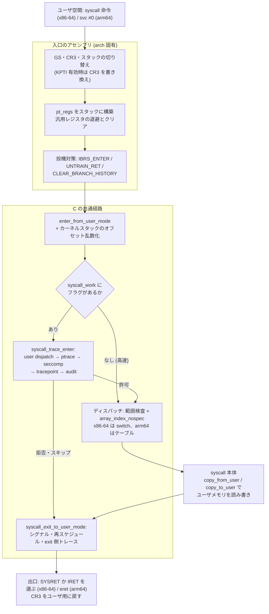

# システムコール境界のカーネル側 (The Kernel Side of the System Call Boundary)

## 概要 (Overview)

ユーザ空間のプログラムがカーネルに仕事を頼む正規の入口は、システムコール (system call) である。割り込みや例外も特権コードへ制御を移すが、ユーザが**引数を選んで**カーネルのコードを動かせる経路は syscall だけである。syscall 境界は、信頼できない入力が特権コードに入る唯一の正規の扉と言える。

本ドキュメントの中心テーゼは次のとおり。**syscall 境界の設計は境界を越えるコストを減らそうとする力と、境界での検査を厚くしようとする力の綱引きで決まる。** vDSO、io_uring、バッチ化は「越える回数」を減らす。KPTI、IBRS、BHB のクリア、SMAP、seccomp は「越えるたびの検査」を足す。片方が進むともう片方が追いかける。Spectre 以後に 1 回の syscall が数倍重くなったことが io_uring の動機を強め、io_uring が検査点を迂回したことが今度は io_uring の無効化を招いた。

呼び出し規約、`syscall`/`svc` 命令、特権レベル遷移といったハードウェア側の話は [`abi-syscalls.md`](../../hardware/hw-sw-interface/abi-syscalls.md) が扱う。本書はその続きとして、命令がカーネルに着いてから戻るまでにカーネルが何をするかを、Linux 7.3 (2026-10-18 リリース) のソースを参照実装として追う。対象は x86-64 と arm64 で、分析深度は Level 3。

## 方法論 (Methodology)

- 1 回の syscall の経路を、入口のアセンブリ → 汎用エントリコード → ディスパッチ → 本体 → 出口の順に、ソースのファイルと行番号で追う。引用はすべて `torvalds/linux` のタグ `v7.3` に基づく。
- 経路上の各段を「コストを減らす仕掛け」と「検査を足す仕掛け」に分類し、どの段がどちらの力で形を変えたかをコミットの日付と説明文で確かめる。
- コストの数値は測定の出典ごとに、CPU 世代、カーネル版、測定方法が違う。一つの値に丸めず、出典ごとの値と範囲を並べる。論文の値とカーネル開発者の値が食い違う箇所は、食い違いとして書く。
- 運用上の状況 (コンテナの既定プロファイル、io_uring の無効化) は 2026-10 時点の公式文書で確かめる。

## 発見事項 (Findings)

1. **入口のアセンブリは縮み、検査は C の共通経路に集まった。** x86-64 の `entry_SYSCALL_64` は GS の切り替え、CR3 の切り替え、スタックの切り替え、`pt_regs` の構築、投機対策のマクロを済ませると、すぐに C の `do_syscall_64()` を呼ぶ。ptrace、seccomp、トレースポイント、監査 (audit) は、アーキテクチャ共通の `syscall_trace_enter()` が決まった順で処理する[^src-entry64][^src-entrycommon]。かつて x86 にあった「仕事がなければ検査を飛ばす」アセンブリの高速経路は、KPTI と retpoline の導入で利点を失い、2018 年に削除された[^commit-fastpath]。

2. **ディスパッチの形まで投機実行が決めている。** x86-64 は syscall テーブルを経由する間接呼び出しをやめ、2024 年から `switch` 文による直接分岐で本体を呼ぶ[^commit-switch]。番号の範囲検査の後には `array_index_nospec()` が入り、arm64 も同じ形を取る[^src-syscall64][^src-arm64-syscall]。引数を `pt_regs` 経由で渡す形 (2018) も、ユーザが選んだレジスタ値を呼び出しの奥まで持ち込ませないためである[^commit-ptregs]。

3. **境界のコストは Spectre/Meltdown 以後に数倍になった。測定値は出典で幅がある。** 2010 年の測定では、空の syscall の往復が約 150 サイクルだった[^flexsc]。KPTI 下ではエントリと出口の固定コストだけで 400〜500 サイクルになり、緩和前の 100 サイクル未満と比べて数倍に増えた[^ren]。KAISER の論文が示した 0.28% という実行時オーバーヘッドには、カーネルにパッチを出した開発者自身が同意しておらず、`lseek` のループでは毎秒 5.2M 回から 3.0M 回 (PCID あり) に落ちている[^kaiser][^hansen]。

4. **ユーザポインタの検査は「範囲の検査」「アクセス窓の開閉」「型の検査」の三層でできている。** `access_ok()` (あるいはアドレスのマスク) で範囲を確かめ、SMAP/PAN でユーザ空間へのアクセス窓を `copy_*_user()` の間だけ開け、sparse が `__user` 注釈でユーザポインタの直接参照をコンパイル時に見つける[^src-uaccess][^src-uaccess64][^src-compiler-types]。ただしどの層も、同じユーザメモリを二度読む**ダブルフェッチ (double fetch)** は防げない[^doublefetch]。

5. **seccomp は「ポインタの先を見ない」ことで TOCTOU を避けている。** フィルタはレジスタ上の syscall 番号と引数だけを評価し、ポインタを参照できない。このため、システムコール監視の枠組みで繰り返された検査と使用の競合 (TOCTOU) を構造的に避けられる[^seccomp-doc][^watson]。その代わり、パス名のようにポインタの先にある内容に基づく判定はできない。user notification で判定をユーザ空間に渡す場合は、TOCTOU の責任がそのまま監視側に戻る[^seccomp-doc]。

6. **io_uring は越境の回数を減らした結果、検査点の外側に出た。** io_uring の操作は syscall の入口を通らずにカーネル内で実行されるので、syscall 単位の seccomp フィルタも、syscall をフックする監視ツールも、個々の操作を見ない[^armo]。Google は kCTF への提出の 60% が io_uring を突いたことを公表し、ChromeOS と自社サーバで無効化、Android ではアプリから到達不能にした (2023)[^google-kctf]。2026-10 時点の Docker の既定 seccomp プロファイルは io_uring 系 syscall を許可していない[^docker-seccomp][^moby-profile]。

7. **ABI の安定性は境界の形を固定し、検査の追加は互換性を壊さない形でしか入らない。** Linux の「リグレッションを起こさない」原則は、ユーザ空間から観測できる振る舞いを守る[^regressions]。拡張可能な構造体を受け取る syscall は `copy_struct_from_user()` で新旧の構造体サイズの差を吸収し[^src-uaccess]、固定アドレスで攻撃の踏み台になった vsyscall ページは、削除されずにトラップによるエミュレーションと読み取り禁止 (既定の `xonly`) へ置き換えられた[^kparams]。

## アーキテクチャ (Architecture)

### 1 回の syscall がたどる経路



凡例: 実線の矢印は制御の流れ、サブグラフは実装の置き場所 (arch 固有のアセンブリか、`kernel/entry/` と `include/linux/entry-common.h` の共通 C コードか) を表す。arm64 の syscall 経路は 2026-10 時点で x86 と同じ共通関数を使っておらず、同じ順序の検査を `arch/arm64/kernel/ptrace.c` に自前で持つ (技術詳細 §2)。

### 境界上の検査点とコスト要因

| 段 | 検査を足す仕掛け | コストを減らす仕掛け |
|---|---|---|
| 入口 | KPTI (CR3 切り替え)、IBRS、リターンスタックの訓練解除、BHB のクリア、レジスタのクリア | PCID による TLB フラッシュの回避、攻撃ベクトル単位での緩和の無効化 |
| 共通経路 | ptrace、seccomp、audit、カーネルスタックの乱数化 | `syscall_work` が 0 なら一度の比較で全検査を飛ばす、seccomp の許可ビットマップ |
| ディスパッチ | 範囲検査、`array_index_nospec()` | 間接呼び出しを `switch` に替えて retpoline/BHI の対象から外す |
| 本体 | `access_ok()`、SMAP/PAN、sparse の `__user` | アドレスのマスクで投機バリアを省く (x86-64) |
| 境界の外 | (検査を受けない) | vDSO (越えない)、io_uring (まとめて越える、または越えない) |

## 技術詳細 (Technical Details)

### 1. 入口: `entry_SYSCALL_64` (x86-64)

`syscall` 命令は RIP を RCX に、RFLAGS を R11 に保存してカーネルの入口へ飛ぶが、スタックは切り替えない[^abi]。カーネルの最初の仕事は、ユーザが自由に決められる RSP を使わずに自分のスタックへ移ることである。

```asm
; アセンブリ (AT&T 記法)。syscall 命令の着地点から C への呼び出しまで。
; arch/x86/entry/entry_64.S lines 87-121 (Linux v7.3)
SYM_CODE_START(entry_SYSCALL_64)
	swapgs                                   ; GS をカーネルの per-CPU 領域へ
	movq	%rsp, PER_CPU_VAR(cpu_tss_rw + TSS_sp2) ; ユーザ RSP を退避
	SWITCH_TO_KERNEL_CR3 scratch_reg=%rsp    ; KPTI: カーネル用ページテーブルへ
	movq	PER_CPU_VAR(cpu_current_top_of_stack), %rsp
	pushq	$__USER_DS                       ; pt_regs->ss
	pushq	PER_CPU_VAR(cpu_tss_rw + TSS_sp2) ; pt_regs->sp
	pushq	%r11                             ; pt_regs->flags
	pushq	$__USER_CS                       ; pt_regs->cs
	pushq	%rcx                             ; pt_regs->ip
	pushq	%rax                             ; pt_regs->orig_ax (syscall 番号)
	PUSH_AND_CLEAR_REGS rax=$-ENOSYS         ; 残りを退避し、レジスタを 0 クリア
	movq	%rsp, %rdi                       ; 第1引数 = pt_regs
	movslq	%eax, %rsi                       ; 第2引数 = 番号 (int として符号拡張)
	IBRS_ENTER
	UNTRAIN_RET
	CLEAR_BRANCH_HISTORY
	call	do_syscall_64
```

(抜粋。`UNWIND_HINT` などの注釈は省いた。)

- **以後、ユーザのレジスタ値は `pt_regs` からしか読まない。** カーネルは入口で退避した値だけを使う。2018 年に x86-64 の syscall 本体は `pt_regs` へのポインタだけを受け取る形に変わった。目的は「ユーザが与えたレジスタ内容が呼び出しの連鎖の奥へ漏れていくのを避ける」ことで、投機実行のガジェットに材料を与えないための変更である[^commit-ptregs]。`PUSH_AND_CLEAR_REGS` が退避直後にレジスタを 0 にするのも同じ理由による。
- **投機対策のマクロは C を呼ぶ前に置かれる。** `IBRS_ENTER` は eIBRS を持たない CPU で間接分岐予測を制限し、`UNTRAIN_RET` はリターン予測の汚染 (Retbleed 系) に対処し、`CLEAR_BRANCH_HISTORY` はユーザが仕込んだ分岐履歴 (BHB) を消す。いずれも CPU と起動パラメータに応じて実行時に有効・無効が決まる。eIBRS を持つ CPU でも BHB はモード間で分離されないため、`BHI_DIS_S` か BHB のクリア手順が必要である[^spectre-doc]。
- **出口では SYSRET を使えるかを毎回判定する。** `do_syscall_64()` は戻る前に、RCX と RIP、R11 と RFLAGS の一致、CS/SS の値、RIP が正規アドレスであることを確かめ、一つでも満たさなければ遅いが安全な IRET を使う[^src-syscall64]。Intel の CPU では非正規の RCX で SYSRET を実行すると、ユーザが選んだ RSP のままカーネルモードで #GP が起きるからである。コードのコメントはこれを「ユーザがカーネルを乗っ取れる」と書いている[^src-syscall64]。
- **FRED は入口の形を変えるが、C の経路は同じである。** x86 の新しい例外配送機構 FRED (Flexible Return and Event Delivery) を使うシステムでは、ハードウェアが保存したフレームから `fred_entry_from_user()` に入り、syscall であれば同じ `do_syscall_64()` を呼ぶ[^src-fred]。FRED 用の入口コードは 2024 年に入った[^commit-fred]。

### 2. 汎用エントリコードと検査の順序

`do_syscall_64()` は最初に `syscall_enter_from_user_mode_randomize_stack()` を呼ぶ[^src-syscall64]。この関数はコンテキスト追跡と lockdep の状態を整え、カーネルスタックの開始位置を乱数でずらしてから、割り込みを許可して `syscall_enter_from_user_mode_work()` に進む[^src-entrycommon]。

```c
/* C。syscall の入口で、スレッドごとの作業フラグに応じて検査を走らせる。
 * include/linux/entry-common.h lines 140-154 (Linux v7.3) */
static __always_inline bool syscall_enter_from_user_mode_work(struct pt_regs *regs, long *syscall)
{
	unsigned long work = READ_ONCE(current_thread_info()->syscall_work);

	if (!(work & SYSCALL_WORK_ENTER))
		return true;              /* 検査対象がなければここで終わり */

	if (unlikely(!syscall_trace_enter(regs, work, *syscall)))
		return false;             /* ptrace や seccomp が実行を止めた */

	/* Reread the syscall number as it might have been modified */
	*syscall = syscall_get_nr(current, regs);
	return true;
}
```

- **検査は「フラグが立っているスレッドだけ」が払う。** `SYSCALL_WORK_ENTER` には seccomp、トレースポイント、ptrace、syscall エミュレーション、audit、Syscall User Dispatch、rseq のスライス延長が含まれる[^src-entrycommon]。どれも使っていないスレッドは比較 1 回で本体へ進む。seccomp を入れたプロセスだけがフィルタ評価のコストを払う、という線引きがここで実現されている。
- **seccomp は ptrace の後に走る。** `syscall_trace_enter()` の順序は Syscall User Dispatch → rseq → ptrace → seccomp → トレースポイント → audit である。ソースのコメントは seccomp を ptrace の後に置く理由を「トレーサが加えた変更を捕まえるため」と書く[^src-entrycommon]。トレーサは syscall 番号や引数を書き換えられるので、seccomp を先に評価すると、書き換え後の syscall が検査を素通りする。ただし `SECCOMP_RET_TRACE` でトレーサに通知した後は seccomp は再評価されない。このため seccomp で隔離したプロセスに ptrace を許すと、隔離を抜けられる[^seccomp-doc]。
- **番号は検査の後に読み直す。** ptrace や seccomp は syscall 番号を書き換えたりスキップを指示したりできるので、ディスパッチに使う番号は検査の後で `pt_regs` から読み直す。
- **arm64 は同じ順序を自前で持つ。** arm64 の `el0_svc()` は `arm64_syscall_enter_from_user_mode()` で MTE や SME の状態を整え、`do_el0_svc()` から `el0_svc_common()` へ進む[^src-arm64-entry]。作業フラグがあれば arm64 版の `syscall_trace_enter()` が ptrace → seccomp → トレースポイント → audit の順に処理する[^src-arm64-ptrace]。arm64 は割り込みの入口では共通コード (`irq-entry-common.h`) を使うが、syscall の検査は 2026-10 時点 (v7.3) でも arch 固有のままである。

### 3. ディスパッチ: テーブルから `switch` へ

```c
/* C。x86-64 の syscall 番号から本体を呼ぶ。
 * arch/x86/entry/syscall_64.c lines 37-43, 57-65 (Linux v7.3) */
static noinline long x64_sys_call(const struct pt_regs *regs, unsigned int nr)
{
	switch (nr) {
	#include <asm/syscalls_64.h>   /* case nr: return __x64_sys_xxx(regs); の列 */
	default: return __x64_sys_ni_syscall(regs);
	}
}

static __always_inline bool do_syscall_x64(struct pt_regs *regs, unsigned long nr)
{
	if (likely(nr < NR_syscalls)) {
		nr = array_index_nospec(nr, NR_syscalls);  /* Spectre v1 対策 */
		regs->ax = x64_sys_call(regs, (unsigned int)nr);
		return true;
	}
	return false;
}
```

- **Spectre v1 (境界検査の迂回) の典型的な標的は syscall 番号である。** `nr < NR_syscalls` の分岐を投機的に誤って通過されると、範囲外の番号で表を引かれる。`array_index_nospec()` は分岐ではなく算術で添字を 0 に丸め、投機中でも範囲外を引かせない。arm64 の `invoke_syscall()` も `syscall_table[array_index_nospec(scno, sc_nr)]` と同じ形を取る[^src-arm64-syscall]。カーネルの Spectre 文書は「ユーザが syscall の引数として渡した値が、後で配列の添字やポインタの計算に使われる」ことを v1 の攻撃シナリオの筆頭に挙げている[^spectre-doc]。
- **`sys_call_table[]` は 2024 年から呼び出しに使われていない。** Torvalds のコミットは表を引く間接呼び出しを `switch` 文に置き換えた理由をこう説明する。条件分岐にも予測はあるが、誤予測しても「間違った syscall を投機的に走らせる」だけで、制御しにくい任意のガジェットへは飛ばない。syscall の間接呼び出しは「最初の、最も簡単に誘発できる例」だった[^commit-switch]。表そのものはトレース機能がアドレスを知るために残っている[^src-syscall64]。このコミットは分岐履歴を注入してカーネルの間接分岐を誘導する BHI (Branch History Injection) への対応として 2024 年 4 月に入った。
- **2026-10 時点で x86-64 の syscall は 386 項目ある。** `syscall_64.tbl` の `common` と `64` の項目は 386 個、最大番号は 472 (`fchroot`) で、x32 専用の項目が別に 36 個ある[^src-tbl]。

### 4. Spectre/Meltdown 以後の境界のコスト

境界を越えるコストはモードの遷移そのものという直接コストと、カーネル実行がキャッシュ、TLB、分岐予測器を汚す間接コストからなる[^flexsc]。2018 年以後、直接コストの側に緩和策の固定費が積み上がった。

| 出典 | 環境・時期 | 測定の対象 | 値 | 種別 |
|---|---|---|---|---|
| Soares & Stumm (OSDI '10)[^flexsc] | Core i7 (Nehalem)、緩和前 | 独自の空 syscall `gettsc` の往復 | 約 150 サイクル (入り 79、出 71) | 実測 |
| 同上[^flexsc] | 同上 | `pwrite` 後のユーザ IPC の低下 | 回復まで最大 14,000 サイクル。高頻度の呼び出しで IPC が最大 65% 低下 | 実測 |
| Ren et al. (SOSP '19)[^ren] | Linux 3.0〜4.20、Intel | 空 syscall のエントリと出口の固定コスト | KPTI なし 100 サイクル未満、KPTI あり 400〜500 サイクル | 実測 |
| 同上[^ren] | 同上 | CR3 への書き込み 1 回 | 約 200 サイクル | 実測 |
| カーネル文書 `pti.rst`[^pti-doc] | x86 一般 | CR3 への書き込み 1 回 | 「100 サイクルのオーダー」 | 開発者の見積り |
| Hansen (LKML, 2017-11)[^hansen] | CPU 未記載、KAISER v2 | 1 スレッドの `lseek` ループ | 毎秒 5.2M 回 → 3.0M 回 (PCID あり)、2.2M 回 (PCID なし) | 実測 |
| Gruss et al. (ESSoS 2017)[^kaiser] | KAISER 原論文 | ベンチマーク全体の実行時オーバーヘッド | 0.28% | 論文の主張。Hansen は同意しないと明言[^hansen] |

- **数値の読み方。** CR3 への書き込みのコストは、カーネル文書の「100 サイクルのオーダー」と Ren らの約 200 サイクルで幅がある。Hansen の `lseek` の値を 1 回あたりの時間に直すと、約 190 ns から約 330 ns (PCID あり) または約 450 ns (PCID なし) になる。この換算は筆者による。KAISER 論文の 0.28% は syscall が少ないベンチマークでの全体平均と読むべきで、syscall を頻繁に呼ぶ負荷の値ではない。パッチを出した開発者が同意していない以上、この値を代表値として使うべきではない。
- **PCID が KPTI のコストを半分以上取り戻した。** KPTI は入るたびに CR3 を書き換えるので、PCID がない CPU では毎回 TLB 全体がフラッシュされる[^pti-doc]。Ren らの測定では、最も短い `read` テストの低下が PCID によって 113% から 47% に縮んだ。それでも CR3 への書き込みが残るため、固定コストは 400〜500 サイクルから下がらなかった[^ren]。
- **retpoline のコストは間接分岐の数に比例する。** `select` は 1 回あたり平均 31 回の間接呼び出しを行い、retpoline 下ではそのすべてが 30〜35 サイクルの誤予測を払って 68% 遅くなった。Ren らは間接呼び出しを `switch` に置き換えて低下を 5.7% に抑えた[^ren]。§3 で見た 2024 年の syscall ディスパッチの変更は、同じ処方を syscall の入口に適用したものである。
- **緩和は「誰を信用しないか」で選べるようになった。** KPTI は `pti=auto` が既定で、Meltdown に脆弱でない CPU では自動的に無効になる[^kparams]。2025 年に入った攻撃ベクトル制御 (attack vector controls) では、緩和を user-to-kernel、user-to-user、guest-to-host などの単位で無効にできる。文書は「信頼できないユーザ空間アプリケーションを動かさないなら user-to-kernel の緩和の無効化を検討せよ」と書き、既定では有効である[^avc-doc][^commit-avc]。境界の検査の厚さが脅威モデルの関数として明示的に設定項目になった。
- **アセンブリの高速経路は緩和に負けて消えた。** 2018 年、Lutomirski は x86-64 の syscall 高速経路を削除した。説明は「PTI ですべてが遅くなり、間接分岐は禁じられ、高速経路の retpoline が特に厄介だった。遅い経路もほとんど遅くない」である[^commit-fastpath]。緩和の固定費が大きくなると、以前の小さな最適化は保守コストに見合わなくなる。

### 5. ユーザポインタの扱い

syscall の引数のうちポインタは、ユーザ空間のアドレスを指していると「主張されている」だけの整数である。カーネルはそれを直接参照せず、専用の関数でコピーする。

```c
/* C。ユーザメモリからカーネルのバッファへ n バイトをコピーする。
 * include/linux/uaccess.h lines 165-192 (Linux v7.3) */
static inline __must_check unsigned long
_inline_copy_from_user(void *to, const void __user *from, unsigned long n)
{
	unsigned long res = n;
	might_fault();
	if (should_fail_usercopy())
		goto fail;
	if (can_do_masked_user_access())
		from = mask_user_address(from);  /* 範囲外を分岐なしで無害なアドレスへ */
	else {
		if (!access_ok(from, n))         /* 範囲はユーザ空間か */
			goto fail;
		barrier_nospec();                /* access_ok の投機的な通過を止める */
	}
	instrument_copy_from_user_before(to, from, n);
	res = raw_copy_from_user(to, from, n); /* フォールトは例外表で回収 */
	instrument_copy_from_user_after(to, from, n, res);
	if (likely(!res))
		return 0;
fail:
	memset(to + (n - res), 0, res);      /* コピーできなかった残りを 0 で埋める */
	return res;
}
```

- **`access_ok()` は範囲しか見ない。** x86-64 の `__access_ok()` は、先頭が `USER_PTR_MAX` 以下で、`ptr + size` がカーネル側へ桁あふれしないことだけを確かめる[^src-uaccess64]。ページがマップされているか、権限があるかは見ない。それは実際のアクセスで起きたページフォールトを例外表 (`_ASM_EXTABLE_UA`) で回収し、コピーできなかったバイト数として返すことで処理する[^src-uaccess64]。
- **x86-64 は投機バリアの代わりにアドレスをマスクする。** `mask_user_address()` は `cmp` と `cmova` で、範囲外のポインタを `USER_PTR_MAX` に置き換える[^src-uaccess64]。分岐がないので投機による迂回が起きず、`barrier_nospec()` (LFENCE) の待ちを省ける。ソースのコメントは、この方式が「アドレスから始まる密なアクセスにだけ使える」と条件を書いている[^src-uaccess64]。検査を省かずに投機対策のコストだけを削る例である。
- **SMAP と PAN はユーザメモリへの「窓」を開け閉めする。** x86 の SMAP (Supervisor Mode Access Prevention) が有効だと、カーネルモードからユーザページへのアクセスはフォールトになる。例外は EFLAGS.AC が 1 の間だけで、`copy_user_generic()` はコピーの前に `stac` で AC を立て、後に `clac` で戻す[^src-uaccess64][^intel-sdm]。SMEP はカーネルモードでのユーザページの実行を禁じる。arm64 の PAN (Privileged Access Never、Armv8.1 の FEAT_PAN) も PSTATE.PAN が 1 の間、EL1 から EL0 のメモリへのアクセスを禁じる[^arm-arm]。arm64 の `copy_from_user` は PAN を外すのではなく、EL0 の権限でアクセスする `ldtr` 系の命令を使う[^src-arm64-copy][^arm-arm]。PAN を持たない Armv8.0 の CPU のために、TTBR0 を切り替えてユーザのページテーブルを外す、ソフトウェアによる PAN のエミュレーションもある[^src-arm64-entry-s][^src-arm64-uaccess]。こうした窓の目的はカーネルのバグで任意のポインタを参照させられたときに、攻撃者がユーザ空間に置いた偽の構造体やコードへ誘導できないようにすることである。
- **`__user` 注釈は型の層の検査である。** sparse で検査するビルド (`make C=1`) では、`__user` は `noderef, address_space(__user)` 属性に展開され、ユーザポインタを直接参照したり、カーネルポインタと混ぜたりするとコンパイル時に警告される[^src-compiler-types][^sparse-doc]。通常の gcc/clang ビルドでは、この注釈は BTF の型タグか空に展開され、実行時のコストはない。
- **ダブルフェッチは三層のどれにも引っかからない。** カーネルが同じユーザメモリを二度読む場合 (たとえば先頭のヘッダで長さを読み、検査した後で全体をもう一度読む)、別スレッドが二度の読み取りの間に値を書き換えられる。Wang らは Coccinelle によるパターン検出で Linux に 90 件のダブルフェッチを見つけ、うち 57 件がドライバにあった。Linux、FreeBSD、Android から未知のバグ 6 件を見つけ、うち 3 件は悪用可能だった[^doublefetch]。防ぐ方法はコードの書き方にしかない。ユーザデータは一度だけカーネルにコピーし、検査も使用もそのコピーに対して行う。
- **拡張可能な構造体では新旧の差も検査する。** `clone3()` や `openat2()` のように構造体とそのサイズを受け取る syscall は `copy_struct_from_user()` を使う。ユーザの構造体が小さければ足りない部分を 0 で埋め、大きければ、カーネルが知らない末尾が 0 であることを確かめ、0 でなければ `-E2BIG` を返す[^src-uaccess]。古いカーネルが新しいプログラムの指定を知らないまま無視する事態を防ぐための検査で、ABI の安定と入力検査が一つの関数に同居している。

### 6. vDSO: 境界を越えない syscall

vDSO (virtual dynamic shared object) は、カーネルがすべてのプロセスに自動でマップする小さな共有ライブラリである。`clock_gettime()` や `gettimeofday()` を、カーネルに入らずユーザ空間の関数呼び出しとして実行する[^vdso-man]。

- **仕組みは「カーネルが書き、ユーザが読む」共有ページである。** カーネルは時刻の基準値とクロックソースの換算係数を vDSO のデータページに書く。ユーザ側の `do_hres()` はシーケンスカウンタを読み、ハードウェアカウンタ (x86 の TSC、arm64 の汎用タイマ) を読み、換算し、カウンタが変わっていれば読み直す[^src-vdso-gtod]。書き手は 1 人、読み手は多数でロックを取らない。
- **安全に読めない場合は syscall に戻る。** クロックソースが vDSO から読めない設定 (`VDSO_CLOCKMODE_NONE`) やカウンタ値が異常な場合、`vdso_get_timestamp()` は false を返し、呼び出し側は通常の syscall にフォールバックする[^src-vdso-gtod]。仮想マシンで TSC が信頼できない場合などに、vDSO があっても実際は毎回カーネルに入る、という性能上の落とし穴がここにある。
- **境界を越えないので、検査も受けない。** vDSO 経由の `clock_gettime()` は syscall の入口を通らないので、seccomp でも ptrace でも捕まらない。時刻のようにカーネルの状態を読むだけで副作用のない操作に対象を限ることで、検査を省いても失うものがない設計になっている。
- **対象は少しずつ広がっている。** Linux 6.11 で `getrandom()` の vDSO 実装が x86-64 に入った[^vgetrandom]。乱数生成器の状態をユーザ空間に置くため、`MAP_DROPPABLE` という新しい種類のマッピングと、使った状態を 0 で消すコピーを組み合わせている[^src-vdso-getrandom]。
- **vDSO の前身 vsyscall は、固定アドレスが災いした。** vsyscall ページは全プロセスで同じアドレス (`0xffffffffff600000`) に置かれ、RIP を制御できる攻撃者の格好の踏み台になった。現在の既定 `vsyscall=xonly` では、vsyscall への呼び出しはトラップしてエミュレートされ、ページは読めない[^kparams]。

### 7. seccomp-bpf: 入口でのフィルタ

seccomp-bpf では、プロセスが自分に cBPF のフィルタを取り付け、以後の syscall をすべてそのフィルタに通す。フィルタの入力は `struct seccomp_data` (syscall 番号、アーキテクチャ、命令ポインタ、6 個の引数のレジスタ値) である[^seccomp-doc]。サンドボックス設計での使い方は [`sandbox-architectures.md`](../security/sandbox-architectures.md) が扱うので、ここではカーネル側の評価を見る。

- **評価はすべてのフィルタを回して、最も厳しい結果を取る。** `seccomp_run_filters()` は、最後に取り付けたフィルタから順にすべてを評価し、アクション部の値が最も小さい (最も厳しい) 結果を採用する[^src-seccomp]。後から足したフィルタで制限を緩めることはできない。フィルタを取り付けるには `no_new_privs` を立てるか `CAP_SYS_ADMIN` を持つ必要がある。これは、setuid プログラムを seccomp で騙して特権のまま誤動作させる攻撃を防ぐための条件である[^seccomp-doc]。
- **アクションの優先順位は固定されている。** 厳しい順に `KILL_PROCESS`、`KILL_THREAD`、`TRAP` (SIGSYS を送る)、`ERRNO` (実行せずにエラーを返す)、`USER_NOTIF` (ユーザ空間の監視者に判定を委ねる)、`TRACE` (ptrace のトレーサに通知)、`LOG` (記録して実行)、`ALLOW` である[^seccomp-doc]。
- **毎回の評価コストは許可ビットマップで削られる。** フィルタが「引数を見ずにこの番号は常に許可する」と判定できる syscall については、取り付け時にビットマップを作っておき、評価の最初に `seccomp_cache_check_allow()` で引く。ビットが立っていれば BPF を一度も実行せずに許可する[^src-seccomp]。この引き当てにも `array_index_nospec()` が入っている。
- **アーキテクチャを確かめないフィルタは迂回される。** syscall 番号は呼び出し規約ごとに違う (x86-64 のネイティブ、x32、i386 の互換)。番号だけで判定するフィルタは、別の規約で同じ番号を持つ別の syscall を通してしまう。文書はこれを「最大の落とし穴」と呼び、必ず `arch` を確かめるよう求めている[^seccomp-doc]。
- **ポインタの先を見ないことが TOCTOU を避ける。** フィルタはポインタを参照できないので、検査した値と使う値が食い違うことがない[^seccomp-doc]。システムコールのラッパで監視する方式 (Systrace、GSWTK など) は、ラッパが引数を検査した後、カーネルが使う前に別スレッドがメモリを書き換える競合で、権限昇格と監査の迂回を許した[^watson]。seccomp はこの失敗を、検査できる対象を狭めることで避けた。
- **user notification は判定を外に出す。** `SECCOMP_RET_USER_NOTIF` は、syscall を止めたまま監視プロセスに `seccomp_notif` を送り、応答を待つ。コンテナ管理ツールが `mount()` などを代行するために使う。文書は、監視者がトレース対象のメモリから引数を読むなら、判定の前に自分のメモリへ読み込んでから判定せよと注意している[^seccomp-doc]。ポインタの先を見るなら TOCTOU は監視者の責任になる、ということである。
- **seccomp と投機対策の結びつき。** フィルタを取り付けると、`SECCOMP_FILTER_FLAG_SPEC_ALLOW` を付けない限り `arch_seccomp_spec_mitigate()` が呼ばれる[^src-seccomp]。x86 ではこれは `spec_store_bypass_disable=seccomp` のときに Speculative Store Bypass の緩和を seccomp 下のスレッドに適用する仕組みで、x86 の既定値は `prctl` (スレッドが自分で選ぶ) である[^kparams]。
- **コンテナの既定 (2026-10 時点)。** Docker の既定プロファイルは許可リスト方式で、既定のアクションは `SCMP_ACT_ERRNO`、300 以上の syscall のうち約 44 個を無効にする。`mount`、`unshare`、`bpf`、`ptrace`、`kexec_load`、`io_uring_*` などが無効の側に入る[^docker-seccomp][^moby-profile]。Kubernetes は kubelet の `seccompDefault` を有効にしない限り Pod の既定を `Unconfined` (seccomp なし) とする。`seccompDefault` で `RuntimeDefault` を既定にする機能は v1.27 から安定版である[^k8s-seccomp]。つまり、Kubernetes では明示しなければ syscall 面は絞られない。

### 8. 境界を減らす方向: io_uring とバッチ化

io_uring は提出キュー (SQ) と完了キュー (CQ) をユーザとカーネルの共有メモリに置き、1 回の `io_uring_enter()` で多数の操作を投入し、SQPOLL を使えば syscall なしで投入できるようにした[^iouring-man]。ストレージ側の設計は [`block-io-stack.md`](block-io-stack.md) が扱う。本書では境界の視点から見る。

- **コストの綱引きで見れば、io_uring は入口の固定費を償却する仕組みである。** §4 の表のとおり、緩和策で 1 回の越境が数百サイクル重くなった時代に、越境 1 回で N 件を処理すれば固定費は N 分の 1 になる。`readv`/`writev`、`sendmmsg`、`epoll_wait` で複数のイベントを受け取ることも、同じ償却の初期の形である。
- **検査の綱引きで見れば、io_uring は検査点の外側に出た。** SQ に積まれた操作は syscall の入口 (§2) を通らずにカーネル内で実行される。syscall 単位で働く seccomp は `io_uring_setup`/`io_uring_enter`/`io_uring_register` の 3 つを見るだけで、中の `openat` や `connect` を区別できない。ARMO は 2025 年、io_uring だけで動く概念実証のルートキット「Curing」で、syscall のフックに頼る監視ツール (Falco など) が io_uring 経由の操作を見落とすことを示した[^armo]。これはベンダーによる検証で、一次的な査読はない。
- **実害は脆弱性の側に出た。** Google は 2023 年 6 月、kCTF の脆弱性報奨金への提出の 60% が io_uring を突いており、io_uring だけで約 100 万ドルを払ったと公表した。ChromeOS で無効化し、Android では seccomp-bpf でアプリから到達不能にし、自社の本番サーバでも無効にした[^google-kctf]。非同期実行のために持ち込んだオブジェクトの寿命管理と状態機械が、use-after-free 型のバグを繰り返し生んだ ([`block-io-stack.md`](block-io-stack.md) のセキュリティ考察を参照)。
- **io_uring 自身も検査を持つようになった。** Linux 5.10 から、無効状態で作ったリングに `IORING_REGISTER_RESTRICTIONS` で許可するオペコードとフラグを登録できる。未登録の操作は許可されない[^iouring-reg]。システム全体では sysctl `kernel.io_uring_disabled` があり、1 で `io_uring_group` に属さない非特権プロセスの新規作成を、2 で全プロセスの新規作成を禁止する[^sysctl-doc]。検査を syscall の入口からリングの中へ移した形で、どちらも「越境を減らした分だけ、新しい場所に検査を置く」動きである。

### 9. syscall の ABI 安定性

- **「リグレッションを起こさない」は利用者を基準にする。** カーネルの文書はこの規則を「Linux カーネル開発の第一の規則」と呼ぶ[^regressions]。Torvalds の引用として、この規則が守るのは作り話の振る舞いではなく「実際の利用者」であることが繰り返し記されている。例外は「根本的で大きな穴を持つセキュリティ問題で、変更せざるをえず、その用途を動かし続ける方法もなかった」場合などに限られる[^regressions]。
- **syscall は安定 ABI の代表である。** `Documentation/ABI/README` は安定度を stable、testing、obsolete、removed の 4 段階に分け、stable について「syscall のようなほとんどのインタフェースは変更されず、常に利用できると期待される」と書く[^abi-readme]。番号は再利用されず、置き換えは新しい番号の追加で行う (`clone` に対する `clone3`、`openat` に対する `openat2`)。
- **検査の追加は互換性の枠の中で行われる。** vsyscall はその好例である。削除すれば古い静的リンクのバイナリが動かなくなるので、ページを残したまま実行をトラップとエミュレーションに置き換え、読み取りを禁じた[^kparams]。`vsyscall=emulate` を選ぶと Linear Address Space Separation (LASS) という保護が無効になる、とパラメータの説明にある[^kparams]。互換性のために残した経路が、後から入る保護の妨げになる例である。
- **seccomp のフィルタも ABI に依存する。** 許可リスト方式のフィルタは作られた後に追加された syscall を既定のアクションで拒否する。Docker の既定プロファイルは `CAP_SYS_ADMIN` を持たないコンテナの `clone3` に対して `EPERM` ではなく errno 38 (`ENOSYS`) を返す[^moby-profile]。`ENOSYS` は「このカーネルにはその syscall がない」という意味なので、C ライブラリは古い `clone` に戻って処理を続けられる。拒否の返し方まで ABI の慣習に合わせないと、フィルタが新しいライブラリを壊す。

## セキュリティ考察 (Security Considerations)

- **境界の検査は「すべての入口」で同じでなければならない。** syscall には x86-64 のネイティブ、x32、i386 互換 (`int 0x80` と `sysenter`)、FRED の経路など複数の入口がある。検査が一つの入口にだけ入っていれば、攻撃者は別の入口を使う。Linux が入口のアセンブリを薄くして共通の C 関数に検査を集めたこと (§1, §2) は、性能よりもこの一貫性のためだと読める。seccomp のフィルタに `arch` の検査が必須なのも同じ問題の裏返しである[^seccomp-doc]。
- **検査の順序そのものが攻撃面になる。** seccomp を ptrace の前に評価すると、トレーサが検査後に syscall を書き換えられる。現在の順序 (ptrace → seccomp) はこれを防ぐが、`SECCOMP_RET_TRACE` 後の再評価はしない。seccomp の隔離下で ptrace を許すと脱出経路になる[^seccomp-doc][^src-entrycommon]。
- **ユーザメモリは検査中も変わりうる。** ダブルフェッチ[^doublefetch]、システムコールラッパの競合[^watson]、user notification での TOCTOU[^seccomp-doc] は同じ根を持つ。ユーザメモリはカーネルの検査中にも別スレッドから書き換えられる、という事実である。対策は「一度だけコピーし、コピーに対して検査し、コピーを使う」の一本しかない。ファジング (syzkaller) やダブルフェッチの静的検出は [`fuzzing-program-analysis.md`](../security/fuzzing-program-analysis.md) の文脈で読める。
- **投機実行は「検査を通らなかった値」も使う。** `access_ok()` や syscall 番号の範囲検査は、アーキテクチャ上は正しくても、投機中に迂回される。`array_index_nospec()`、アドレスのマスク、`barrier_nospec()`、間接呼び出しの `switch` 化は、どれも「検査の結果が出る前に値を使わせない」ための工夫である[^spectre-doc][^commit-switch]。CPU 側の機構は [`branch-prediction-speculation.md`](../../hardware/cpu/branch-prediction-speculation.md) と [`side-channels-tee-secure-boot.md`](../../hardware/security/side-channels-tee-secure-boot.md) を参照。
- **越境を減らす機構は監視の対象からも外れる。** vDSO は副作用のない操作に限ったので問題が小さい。io_uring は副作用のある操作 (ファイル、ネットワーク) を検査点の外で実行するので、syscall 単位の seccomp も syscall をフックする EDR も、その操作を個別に見られない[^armo]。io_uring を許すなら、`IORING_REGISTER_RESTRICTIONS`、`kernel.io_uring_disabled`、LSM のフックによる検査を組み合わせる必要がある[^iouring-reg][^sysctl-doc]。
- **緩和の無効化は脅威モデルの宣言である。** `mitigations=auto,no_user_kernel` や `pti=off` は性能を取り戻すが、それは「このホストでは信頼できないユーザ空間コードを動かさない」と宣言することに等しい[^avc-doc]。マルチテナントの基盤、CI ランナー、ブラウザを動かす端末にはこの前提が成り立たない。

## 結論 (Conclusions)

- syscall 境界は、ユーザが引数を選んでカーネルのコードを動かせる唯一の正規の扉であり、その設計はコストを減らす力と検査を厚くする力の綱引きで決まる。
- 検査の側では入口のアセンブリを薄くして共通の C 経路に ptrace → seccomp → audit の順で検査を集め、ディスパッチを `switch` と `array_index_nospec()` で投機に強くし、ユーザポインタを範囲・アクセス窓・型の三層で守る形に収束した。
- コストの側では、KPTI と分岐予測の緩和で 1 回の越境の固定費が 100 サイクル未満から数百サイクルへ上がった。PCID、アドレスのマスク、seccomp の許可ビットマップ、攻撃ベクトル単位の制御が、検査を残したまま固定費を削っている。
- 越境の回数を減らす vDSO と io_uring は対照的な結果になった。副作用のない読み取りに限った vDSO は検査を省いても問題が小さく、副作用のある操作を運ぶ io_uring は検査点の外に出たことで無効化と制限を招いた。
- ABI の安定性は境界の形を固定する。新しい検査は互換性を壊さない形でしか入れられず、その制約が vsyscall のエミュレーションや拡張可能な構造体の検査のような設計を生んだ。

### 次の接続先 (Related Topics)

- [`../../hardware/hw-sw-interface/abi-syscalls.md`](../../hardware/hw-sw-interface/abi-syscalls.md) — 本書の真下。呼び出し規約、`syscall`/`ecall`/`svc` 命令、特権遷移のハードウェア側。
- [`../../hardware/cpu/interrupts-exceptions-traps.md`](../../hardware/cpu/interrupts-exceptions-traps.md) — syscall を含むトラップ機構の全体。
- [`../../hardware/cpu/branch-prediction-speculation.md`](../../hardware/cpu/branch-prediction-speculation.md) — retpoline、IBRS、BHI が対処する分岐予測器の機構。
- [`../../hardware/cpu/virtual-memory-mmu.md`](../../hardware/cpu/virtual-memory-mmu.md) — KPTI、PCID、ページ権限。
- [`ebpf-kernel-programmability.md`](ebpf-kernel-programmability.md) — seccomp のフィルタ言語 cBPF の系譜と、syscall 境界に置ける eBPF のフック。
- [`block-io-stack.md`](block-io-stack.md) — io_uring のリング設計とストレージ側の性能。
- [`../security/sandbox-architectures.md`](../security/sandbox-architectures.md) — seccomp をサンドボックスの層として使う設計。
- [`../security/memory-safety-exploit-mitigations.md`](../security/memory-safety-exploit-mitigations.md) — カーネルのメモリ破壊と緩和策の全体像。
- [`../virtualization/hardware-virtualization-containers.md`](../virtualization/hardware-virtualization-containers.md) — コンテナの隔離境界としての syscall 面と、VM の境界との対比。

## 参考文献 (References)

**一次資料 (Primary: カーネルのソースとコミット)**

[^src-entry64]: Linux kernel source, `arch/x86/entry/entry_64.S` (tag v7.3), `entry_SYSCALL_64` lines 87-162. — [github.com/torvalds/linux](https://github.com/torvalds/linux/blob/v7.3/arch/x86/entry/entry_64.S) — Accessed: 2026-10-24.

[^src-syscall64]: Linux kernel source, `arch/x86/entry/syscall_64.c` (tag v7.3), `x64_sys_call` lines 37-43, `do_syscall_x64` lines 57-65, `do_syscall_64` lines 79-130. — [github.com/torvalds/linux](https://github.com/torvalds/linux/blob/v7.3/arch/x86/entry/syscall_64.c) — Accessed: 2026-10-24.

[^src-entrycommon]: Linux kernel source, `include/linux/entry-common.h` (tag v7.3), `SYSCALL_WORK_ENTER` lines 25-31, `syscall_trace_enter` lines 65-116, `syscall_enter_from_user_mode_work` lines 140-154, `syscall_enter_from_user_mode_randomize_stack` lines 199-209. — [github.com/torvalds/linux](https://github.com/torvalds/linux/blob/v7.3/include/linux/entry-common.h) — Accessed: 2026-10-24.

[^src-fred]: Linux kernel source, `arch/x86/entry/entry_fred.c` (tag v7.3), `fred_other` lines 87-100. — [github.com/torvalds/linux](https://github.com/torvalds/linux/blob/v7.3/arch/x86/entry/entry_fred.c) — Accessed: 2026-10-24.

[^src-arm64-syscall]: Linux kernel source, `arch/arm64/kernel/syscall.c` (tag v7.3), `invoke_syscall` lines 38-55, `el0_svc_common` lines 62-136. — [github.com/torvalds/linux](https://github.com/torvalds/linux/blob/v7.3/arch/arm64/kernel/syscall.c) — Accessed: 2026-10-24.

[^src-arm64-entry]: Linux kernel source, `arch/arm64/kernel/entry-common.c` (tag v7.3), `arm64_syscall_enter_from_user_mode` lines 85-90, `el0_svc` lines 752-761. — [github.com/torvalds/linux](https://github.com/torvalds/linux/blob/v7.3/arch/arm64/kernel/entry-common.c) — Accessed: 2026-10-24.

[^src-arm64-ptrace]: Linux kernel source, `arch/arm64/kernel/ptrace.c` (tag v7.3), `syscall_trace_enter` lines 2461-2483. — [github.com/torvalds/linux](https://github.com/torvalds/linux/blob/v7.3/arch/arm64/kernel/ptrace.c) — Accessed: 2026-10-24.

[^src-arm64-entry-s]: Linux kernel source, `arch/arm64/kernel/entry.S` (tag v7.3), `__swpan_entry_el1`/`__swpan_exit_el0` lines 459-499 (ソフトウェア PAN)、`tramp_ventry` と BHB 緩和 lines 673-693。 — [github.com/torvalds/linux](https://github.com/torvalds/linux/blob/v7.3/arch/arm64/kernel/entry.S) — Accessed: 2026-10-24.

[^src-arm64-uaccess]: Linux kernel source, `arch/arm64/include/asm/uaccess.h` (tag v7.3), TTBR0 PAN と ハードウェア PAN の切り替え lines 58-152. — [github.com/torvalds/linux](https://github.com/torvalds/linux/blob/v7.3/arch/arm64/include/asm/uaccess.h) — Accessed: 2026-10-24.

[^src-arm64-copy]: Linux kernel source, `arch/arm64/lib/copy_from_user.S` (tag v7.3), `ldtrb`/`ldtrh`/`ldtr` を使う load マクロ lines 23-47. — [github.com/torvalds/linux](https://github.com/torvalds/linux/blob/v7.3/arch/arm64/lib/copy_from_user.S) — Accessed: 2026-10-24.

[^src-uaccess]: Linux kernel source, `include/linux/uaccess.h` (tag v7.3), `_inline_copy_from_user` lines 165-192, `copy_from_user` lines 217-223, `copy_struct_from_user` lines 345-415. — [github.com/torvalds/linux](https://github.com/torvalds/linux/blob/v7.3/include/linux/uaccess.h) — Accessed: 2026-10-24.

[^src-uaccess64]: Linux kernel source, `arch/x86/include/asm/uaccess_64.h` (tag v7.3), `valid_user_address` lines 56-57, `mask_user_address` lines 64-74, `__access_ok` lines 98-107, `copy_user_generic` lines 118-136. — [github.com/torvalds/linux](https://github.com/torvalds/linux/blob/v7.3/arch/x86/include/asm/uaccess_64.h) — Accessed: 2026-10-24.

[^src-compiler-types]: Linux kernel source, `include/linux/compiler_types.h` (tag v7.3), `__user` の定義 lines 46-68. — [github.com/torvalds/linux](https://github.com/torvalds/linux/blob/v7.3/include/linux/compiler_types.h) — Accessed: 2026-10-24.

[^src-seccomp]: Linux kernel source, `kernel/seccomp.c` (tag v7.3), `seccomp_cache_check_allow_bitmap` lines 349-358, `seccomp_run_filters` lines 404-432, `seccomp_assign_mode` lines 447-463. — [github.com/torvalds/linux](https://github.com/torvalds/linux/blob/v7.3/kernel/seccomp.c) — Accessed: 2026-10-24.

[^src-vdso-gtod]: Linux kernel source, `lib/vdso/gettimeofday.c` (tag v7.3), `vdso_clocksource_ok` lines 83-86, `vdso_get_timestamp` lines 112-130, `do_hres` lines 170-192. — [github.com/torvalds/linux](https://github.com/torvalds/linux/blob/v7.3/lib/vdso/gettimeofday.c) — Accessed: 2026-10-24.

[^src-vdso-getrandom]: Linux kernel source, `lib/vdso/getrandom.c` (tag v7.3), `MEMCPY_AND_ZERO_SRC` lines 22-30. — [github.com/torvalds/linux](https://github.com/torvalds/linux/blob/v7.3/lib/vdso/getrandom.c) — Accessed: 2026-10-24.

[^src-tbl]: Linux kernel source, `arch/x86/entry/syscalls/syscall_64.tbl` (tag v7.3)。項目数は筆者が `common`/`64`/`x32` の行を数えた値。 — [github.com/torvalds/linux](https://github.com/torvalds/linux/blob/v7.3/arch/x86/entry/syscalls/syscall_64.tbl) — Accessed: 2026-10-24.

[^commit-fastpath]: Lutomirski, A. (2018). x86/entry/64: Remove the SYSCALL64 fast path. Linux commit `21d375b6b34f`. — [github.com/torvalds/linux](https://github.com/torvalds/linux/commit/21d375b6b34f) — Accessed: 2026-10-24.

[^commit-ptregs]: Brodowski, D. (2018). syscalls/x86: Use 'struct pt_regs' based syscall calling convention for 64-bit syscalls. Linux commit `fa697140f9a2`. — [github.com/torvalds/linux](https://github.com/torvalds/linux/commit/fa697140f9a2) — Accessed: 2026-10-24.

[^commit-switch]: Torvalds, L. (2024). x86/syscall: Don't force use of indirect calls for system calls. Linux commit `1e3ad78334a6`. — [github.com/torvalds/linux](https://github.com/torvalds/linux/commit/1e3ad78334a6) — Accessed: 2026-10-24.

[^commit-fred]: Anvin, H. P. (2024). x86/fred: FRED entry/exit and dispatch code. Linux commit `14619d912b65`. — [github.com/torvalds/linux](https://github.com/torvalds/linux/commit/14619d912b65) — Accessed: 2026-10-24.

[^commit-avc]: Kaplan, D. (2025). Documentation/x86: Document new attack vector controls. Linux commit `1caa1b0509ea`. — [github.com/torvalds/linux](https://github.com/torvalds/linux/commit/1caa1b0509ea) — Accessed: 2026-10-24.

**一次資料 (Primary: カーネル文書・man ページ・仕様)**

[^seccomp-doc]: The Linux Kernel documentation. *Seccomp BPF (SECure COMPuting with filters)*. `Documentation/userspace-api/seccomp_filter.rst`. — [docs.kernel.org](https://docs.kernel.org/userspace-api/seccomp_filter.html) — Accessed: 2026-10-24.

[^pti-doc]: The Linux Kernel documentation. *Page Table Isolation (PTI)*. `Documentation/arch/x86/pti.rst`. — [docs.kernel.org](https://docs.kernel.org/arch/x86/pti.html) — Accessed: 2026-10-24.

[^spectre-doc]: The Linux Kernel documentation. *Spectre Side Channels*. `Documentation/admin-guide/hw-vuln/spectre.rst`. — [docs.kernel.org](https://docs.kernel.org/admin-guide/hw-vuln/spectre.html) — Accessed: 2026-10-24.

[^avc-doc]: The Linux Kernel documentation. *Attack Vector Controls*. `Documentation/admin-guide/hw-vuln/attack_vector_controls.rst`. — [docs.kernel.org](https://docs.kernel.org/admin-guide/hw-vuln/attack_vector_controls.html) — Accessed: 2026-10-24.

[^kparams]: The Linux Kernel documentation. *The kernel's command-line parameters* (`pti=`, `spec_store_bypass_disable=`, `vsyscall=`). `Documentation/admin-guide/kernel-parameters.txt`. — [docs.kernel.org](https://docs.kernel.org/admin-guide/kernel-parameters.html) — Accessed: 2026-10-24.

[^sysctl-doc]: The Linux Kernel documentation. *Documentation for /proc/sys/kernel/* (`io_uring_disabled`, `io_uring_group`). — [docs.kernel.org](https://docs.kernel.org/admin-guide/sysctl/kernel.html) — Accessed: 2026-10-24.

[^regressions]: The Linux Kernel documentation. *Handling regressions* ("We don't cause regressions"). `Documentation/process/handling-regressions.rst`. — [docs.kernel.org](https://docs.kernel.org/process/handling-regressions.html) — Accessed: 2026-10-24.

[^abi-readme]: The Linux Kernel documentation. `Documentation/ABI/README` (ABI の安定度の 4 段階). — [github.com/torvalds/linux](https://github.com/torvalds/linux/blob/v7.3/Documentation/ABI/README) — Accessed: 2026-10-24.

[^sparse-doc]: The Linux Kernel documentation. *Sparse*. `Documentation/dev-tools/sparse.rst`. — [docs.kernel.org](https://docs.kernel.org/dev-tools/sparse.html) — Accessed: 2026-10-24.

[^vdso-man]: Linux man-pages. *vdso(7)*. — [man7.org](https://man7.org/linux/man-pages/man7/vdso.7.html) — Accessed: 2026-10-24.

[^iouring-man]: Linux man-pages. *io_uring(7)*. — [man7.org](https://man7.org/linux/man-pages/man7/io_uring.7.html) — Accessed: 2026-10-24.

[^iouring-reg]: Linux man-pages. *io_uring_register(2)* (`IORING_REGISTER_RESTRICTIONS`, `IORING_REGISTER_ENABLE_RINGS`, since 5.10). — [man7.org](https://man7.org/linux/man-pages/man2/io_uring_register.2.html) — Accessed: 2026-10-24.

[^vgetrandom]: Donenfeld, J. A. (2024). [PATCH v23 0/4] implement getrandom() in vDSO. *linux-kernel mailing list*. — [lkml.iu.edu](https://lkml.iu.edu/hypermail/linux/kernel/2407.1/06234.html) — Accessed: 2026-10-24。6.11 での取り込みは Phoronix の報道 ([Linux 6.11 Lands Support For getrandom() In The vDSO](https://www.phoronix.com/news/Linux-6.11-Lands-getrandom-vDSO) — Accessed: 2026-10-24) で照合した。

[^abi]: Intel Corporation. *Intel 64 and IA-32 Architectures Software Developer's Manual*, Vol. 2B (SYSCALL/SYSRET). — [intel.com/sdm](https://www.intel.com/content/www/us/en/developer/articles/technical/intel-sdm.html) — Accessed: 2026-10-24.

[^intel-sdm]: Intel Corporation. *Intel 64 and IA-32 Architectures Software Developer's Manual*, Vol. 3A (Access Rights: SMEP と SMAP、EFLAGS.AC) と Vol. 2 (STAC/CLAC). — [intel.com/sdm](https://www.intel.com/content/www/us/en/developer/articles/technical/intel-sdm.html) — Accessed: 2026-10-24.

[^arm-arm]: Arm Limited. *Arm Architecture Reference Manual for A-profile architecture* (DDI 0487), PSTATE.PAN / FEAT_PAN (Armv8.1). — [developer.arm.com](https://developer.arm.com/documentation/ddi0487/latest) — Accessed: 2026-10-24.

**一次資料 (Primary: 論文・開発者の測定・事業者の公表)**

[^flexsc]: Soares, L., & Stumm, M. (2010). FlexSC: Flexible System Call Scheduling with Exception-Less System Calls. *Proc. 9th USENIX OSDI*, 33–46. — [usenix.org](https://www.usenix.org/conference/osdi10/flexsc-flexible-system-call-scheduling-exception-less-system-calls) — Accessed: 2026-10-24。§2.1 のモード切り替えの測定と Figure 1 の IPC の回復。

[^ren]: Ren, X. J., Rodrigues, K., Chen, L., Vega, C., Stumm, M., & Yuan, D. (2019). An Analysis of Performance Evolution of Linux's Core Operations. *Proc. 27th ACM SOSP*, 554–569. DOI: 10.1145/3341301.3359640 — §4.1.1 (KPTI) と §4.1.2 (Retpoline)。

[^kaiser]: Gruss, D., Lipp, M., Schwarz, M., Fellner, R., Maurice, C., & Mangard, S. (2017). KASLR is Dead: Long Live KASLR. *Engineering Secure Software and Systems (ESSoS 2017)*, LNCS 10379, 161–176. DOI: 10.1007/978-3-319-62105-0_11

[^hansen]: Hansen, D. (2017-11-08). [PATCH 00/30] [v2] KAISER: unmap most of the kernel from userspace page tables. *linux-kernel mailing list*. — [lkml.iu.edu](https://lkml.iu.edu/hypermail/linux/kernel/1711.1/00768.html) — Accessed: 2026-10-24。will-it-scale `lseek1` の結果と、0.28% に同意しない旨の記述。

[^doublefetch]: Wang, P., Krinke, J., Lu, K., Li, G., & Dodier-Lazaro, S. (2017). How Double-Fetch Situations turn into Double-Fetch Vulnerabilities: A Study of Double Fetches in the Linux Kernel. *Proc. 26th USENIX Security Symposium*, 1–16. — [usenix.org](https://www.usenix.org/conference/usenixsecurity17/technical-sessions/presentation/wang-pengfei) — Accessed: 2026-10-24.

[^watson]: Watson, R. N. M. (2007). Exploiting Concurrency Vulnerabilities in System Call Wrappers. *Proc. 1st USENIX Workshop on Offensive Technologies (WOOT '07)*. — 著者による紹介と論文へのリンク: [USENIX WOOT07, Exploiting Concurrency Vulnerabilities in System Call Wrappers, and the Evil Genius](https://www.lightbluetouchpaper.org/2007/08/06/usenix-woot07-exploiting-concurrency-vulnerabilities-in-system-call-wrappers-and-the-evil-genius/) — Accessed: 2026-10-24.

[^google-kctf]: Google Security Blog (2023-06-14). Learnings from kCTF VRP's 42 Linux kernel exploits submissions. — [security.googleblog.com](https://security.googleblog.com/2023/06/learnings-from-kctf-vrps-42-linux.html) — Accessed: 2026-10-24.

[^docker-seccomp]: Docker Docs. *Seccomp security profiles for Docker*. — [docs.docker.com](https://docs.docker.com/engine/security/seccomp/) — Accessed: 2026-10-24.

[^moby-profile]: moby/profiles. `seccomp/default.json` (Docker の既定 seccomp プロファイルの定義)。io_uring 系が許可リストにないことを筆者が確認。 — [github.com/moby/profiles](https://github.com/moby/profiles/blob/main/seccomp/default.json) — Accessed: 2026-10-24.

[^k8s-seccomp]: Kubernetes Documentation. *Restrict a Container's Syscalls with seccomp*. — [kubernetes.io](https://kubernetes.io/docs/tutorials/security/seccomp/) — Accessed: 2026-10-24.

**二次資料 (Secondary)**

[^armo]: Schendel, A. (ARMO) (2025-04-24). io_uring Is Back, This Time as a Rootkit. — [armosec.io](https://www.armosec.io/blog/io_uring-rootkit-bypasses-linux-security/) — Accessed: 2026-10-24。ベンダーによる概念実証。syscall フックに頼る監視ツールが io_uring 経由の操作を見落とすことの検証。
